# Geometric Consciousness Theory
**Author:** Pablo González Acosta
**Date:** October 26, 2026
**Version:** 1.3.0

---

# Global Frontmatter

# Geometric Consciousness Theory: A 6D-to-3D Projective Framework

## **GLOBAL FRONT MATTER**

### **Global Abstract**

We present **Geometric Consciousness Theory (GCT)**—a framework in which phenomenal presence (the bare fact of experience) is taken as the foundational ontological primitive, from which both geometry and matter are developed as structural consequences. GCT models the vacuum as a discrete, 6D quasicrystalline lattice and proposes a topological defect, the **Identity Polaron**, as a candidate observer carrier. No examined substrate currently realizes that carrier, a physical Selection Operator, an owner, or the phenomenal bridge. Within that tiered framework, GCT develops selected gauge/lepton structures and candidate Standard-Model geometric mechanisms from a small, fully-enumerated set of structural postulates plus a single dimensional anchor for the bare gauge/lepton sector. The native-RGE endpoint reconstruction uses the disclosed A2 gauge-flow anchor $\alpha_2^{-1}(M_{\rm GUT})\approx24$-$25$ (an MSSM unification value, Langacker & Polonsky 1993; not a Standard-Model value) and A4-A6, the App GRF $Z_1$, $Z_2$, $Z_3$ $\beta$-coefficient magnitude normalisations; corrected precision-comparison rows use A3, the measured low-energy fine-structure constant $\alpha(0)$. This is the **5-postulate-plus-6-continuous-anchor current accounting** of Parameter Ledger §0.1. The named precision/gauge comparison subset's six calibrated Tier-3 discrete coefficient handles ($1440$, $12$, $360$, $2$, $10\phi^2$, $1/5$) are counted separately; this is not an exhaustive manuscript-wide handle total. The O.38 $N=144$ cage posit and other sector-specific handles remain separately catalogued. The parameter count is explicit rather than closed away: the postulates are integers and structural choices that the present framework awaits independent derivation for (Open Problems O.5 / O.14 / O.15), A2 and A4-A6 await the App GRF §GRF.5.1 ab-initio derivations, A3 awaits the O.19/O.5 bare-to-physical alpha bridge, and the biophysical and cosmological sectors carry an additional set of calibrated parameters (Parameter Ledger §0.2–0.4).

> **Matter-defect scope:** GCT models matter as **candidate defects** of the lattice field. No hard order-parameter target, topological index, stable or metastable sector, preserving dynamics, or particle identity has yet been derived from the lattice action; defect language throughout the manuscript is conditional on those open bridges.
>
> **Finite-cage/Higgs scope:** $N=144$ is a Tier 3 candidate cage/Fibonacci bookkeeping anchor (O.38), not a unique topological saturation. The $144\times10$ VEV relation is a Tier 3 scale handle; only its product arithmetic is Tier 2 once that handle is supplied. The Mexican-hat potential is an added broken-vacuum completion: no current action in the manuscript selects its coefficient sign or vacuum radius.
>
> **Response-sign scope:** "Phason anti-screening" names the Tier 3 candidate direction required to bridge the bare-alpha residual; no current action derives that response or its sign. If the bare value is read as the ultraviolet boundary, the remaining 41.5 ppm correction must raise $\alpha^{-1}$ toward low energy, which is the direction of conventional (QED-like) screening, so the label is a convention rather than a derived sign (App ORQ O.19). Likewise, the tau minus sign is inserted at Tier 3: Galois conjugation $\phi\mapsto-1/\phi$ is an algebraic automorphism and does not determine a physical polarity.

**Key results include:**
* **Parametric Structure:** GCT's bare lepton mass ratios follow from the icosahedral cut-and-project framework with a small set of structural postulates plus one dimensional anchor (the bare electroweak angle H-EW, the $\phi^{-18}$ stiffness map P3b and the SU(3) gauge factor are open Tier 3 inputs outside this count); the bare fine-structure relation $360\phi^{-2}$ is a separate Tier 3 numerical relation that uses the Tier 3 handle 360 (mechanism open; V1 §13.2.1–§13.2.2); the native-RGE endpoint reconstruction adds A2, $\alpha_2^{-1}(M_{\rm GUT})\approx24$-$25$, as a disclosed Tier 3 gauge-flow endpoint anchor; corrected lepton, Higgs VEV, and QED comparison rows add A3, measured $\alpha(0)$, as a disclosed Tier 1 empirical input — full enumeration in Parameter Ledger §0 (Free Parameter Accounting). Beyond P1 (the icosahedral cut-and-project ansatz), the core sector uses the following integer anchors and the dimensional anchor:

  - **K-theoretic gap-label exponent $n = -107$.** The arithmetic identity $|n| = 107 = 1^2 + 5^2 + 9^2 = \sum m_i^2(H_3)$ — unique to $H_3$ among finite irreducible Coxeter groups — is an exact group-arithmetic fact about $H_3$. The specific exponent $n=-107$ is a Tier 3 empirical anchor until O.14 selects it uniquely from the trace-image candidate family. Its identification as the load-bearing physical content of the electron-mass exponent, via the K-theoretic gap-label chain from the $V$-side Coxeter invariant to the 6D trace-image projection $\tau_*(K_0(\mathcal{A}))$, is a Tier 4 physical-link conjecture (Open Problem O.14). The headline chain $m_e/M_P = \phi^{-107}(1-5\alpha)$ therefore carries a Tier 2 framework + Tier 3 exponent anchor + Tier 4 physical-link disposition.
  - **Phason stiffness exponent $D = 18$.** A Tier 2 integer identification conditional on the irreducible icosahedral premise via the $H_3$ Shephard-Todd invariant-degree sum $2+6+10 = 18$ (Anchor A, the load-bearing $H_3$ anchor). Within the finite irreducible rank-three Coxeter classification, only $H_3$ has degree sum 18; the reducible finite system $A_1\times I_2(14)$ also has degrees $\{2,2,14\}$ and sum 18, so the bare integer is not unique across all finite rank-three Coxeter systems. The 2D-RT-face-in-6D tangent-bundle decomposition $6+6+6 = 18$ is a 6D-ambient consistency cross-check (Anchor B) that any 6D-ambient theory with this triple-decomposition would reproduce regardless of icosahedral structure. The sharper RG-running step $K_\perp/K_\parallel = \phi^{-D}$ is separately open as O.15(b): it is the registered Tier 3 stiffness-map hypothesis P3b, listed outside the postulate count exactly like H-EW. Neither integer count entails it, because icosahedral symmetry alone leaves the relative phason/phonon stiffness free.
  - **Lepton harmonic exponents $N = 11$ and $N = 17$.** A Tier 2 harmonic-ladder mechanism + Tier 3 specific integer anchors pending O.5/O.14/O.15; the linear Hessian does not produce them spontaneously.
  - **Dimensional anchor $m_e$** in SI units.

The fine-structure constant has a Tier 3 numerical relation $360\phi^{-2}$ (Tier 3 600-cell multiplier $360$; mechanism open — the RT solid-angle construction is withdrawn, V1 §13.2.1–§13.2.2), a Tier 3 bilayer factor $2$ in the $1/(2N)$ correction, and Tier 3 numerical residuals pending O.19/O.5 closure; the measured low-energy $\alpha(0)$ used in corrected precision rows is A3 and is not the bare-alpha derivation. The bare Weinberg angle $\phi^{-3}$ is the open Tier 3 hypothesis H-EW, outside the postulate count; the native-RGE runs from it use A2 and the App GRF normalisations A4-A6 and do not reproduce the Z pole; the pre-registered gauge-running check is FAILED (V3 Ch04 §4.3.3; App GRF §GRF.4.3). Together this is a **5-postulate-plus-6-continuous-anchor current system** for the gauge + lepton + dimensional + native-RGE endpoint + precision-comparison sector; it is not yet a closed one-parameter theory. Beyond those six continuous anchors, the named **precision/gauge comparison subset** contains six calibrated Tier-3 discrete coefficient choices: $1440$ in the Higgs VEV (an OPEN-CONDITIONAL $144\times10$ scale branch whose exact $C_3$-axis count inherits the Tier 3 $N_{\rm cage}=144$ posit pending O.38; O.20 closes only the factorisation catalogue), $12$ as the neutrino mass-sum weight, $360$ from the 600-cell's 720 edges grouped into 360 antipodal pairs, $2$ in the $1/(2N)$ bilayer correction, $10\phi^2$ in the bare strong-coupling inverse comparison pending O.42/QLQCD-2, and the $1/5$ muon-$g-2$ equal-weight coefficient pending O.26/O.5. This subset is not a manuscript-wide total: the O.38 $N=144$ cage posit, strange-quark $12\alpha$, proton sheet/exponent, and other sector-specific or deployment handles remain separately catalogued. A full count of integer-valued structural inputs across the entire derivation pipeline is $\geq 9$, not 5; the 5-postulate accounting applies only to the most-constrained bare sub-sector. The biophysical and cosmological extensions carry additional calibrated or imported inputs, nine of which are listed here (the per-spin CISS coupling $g_{single}^{eff}$, the historical Zeno-scenario frequency $\omega_d$ (an external material-frequency scenario, not an action-derived GCT operating rate; V1 Ch17 §17.1.3), the conditional beta-Trp sensitivity-branch population, the biogenic-DE coupling $\lambda_{bio}$, the biogenic-kernel timescales $\tau_{lag}$, $\tau_{evolve}$, $t_{origin}$, plus observational imports $H_0$ and $\Omega_\Lambda$); Parameter Ledger rows B1-B4 and C1-C5 give the full itemisation, including the B4 apparatus bias and the C5 known failure.

  **Named Tier-3 discrete coefficient handles in the precision/gauge comparison subset:** 1440 (candidate Higgs VEV scale handle $144\times10$; App ORQ O.20), 12 (12-fold neutrino mass-sum geometric weight), 360 (fine-structure multiplier; 720 600-cell edges / 2 antipodal pairing), 2 (bilayer factor in the $1/(2N)$ $\alpha$ correction), $10\phi^2$ (bare strong inverse handle; O.42/QLQCD-2), and $1/5$ (muon-$g-2$ equal-weight coefficient; O.26/O.5). Subset total: 6; other sector-specific handles are separately inventoried in the Parameter Ledger.

 The dimensionless ratio $m_e/M_P = \phi^{-107}(1-5\alpha)$ is structured by the K-theoretic gap-labeling framework on the AKN C\*-algebra (Bellissard gap-labeling; Connes-Moscovici local index formula; Pimsner-Voiculescu six-term sequence). The integer $|n| = 107$ is canonically identified as the sum of squared Coxeter exponents of $H_3$ ($1^2 + 5^2 + 9^2 = 107$; unique to $H_3$ among finite irreducible Coxeter groups) — an exact arithmetic fact about $H_3$. The specific exponent $n=-107$ remains a Tier 3 empirical anchor until O.14 selects it uniquely from the trace-image candidate family. The structural-link chain mapping this Coxeter invariant to the $K_0(\mathcal{A})$ gap-label $\tau_*(K_0(\mathcal{A}))$ in the 6D AKN setting is a Tier 4 physical-link conjecture, recorded as Open Problem O.14; the headline derivation chain therefore stands at Tier 2 framework + Tier 3 exponent anchor + Tier 4 physical-link, with the exact arithmetic identity providing necessary-but-not-sufficient anchoring of the integer rather than promoting the physical-link disposition. The framework's structural skeleton survives at the level of the 1D Fibonacci Cuntz-Krieger toy model; the lift to the 6D AKN setting is open.

 The down-quark mass Fuglede–Kadison-determinant route is a **Tier 2 mechanism + Tier 3 $\phi^{\phi}$ identification of the shell median (infinite-volume limit open, O.5)**: the primary output is $m_d = m_u \phi^{\phi} = 4.716$ MeV, $+0.33\%$ against the PDG 2024 central value and inside the registered 11% shell-resonance band (Tier 4 as evidence; App PSC §PSC.9.6). The FK-determinant sequence centers on $\phi^{\phi}$ (closed-cage deep-tail mean $\det_{FK}/\phi^{\phi}=0.9976$, sequence-mean signed error $+0.09\%$ vs PDG); single-cage values oscillate within the 11% band with an empirical decaying envelope, while rigorous infinite-volume convergence remains bundled with O.5. The charm-quark mass and higher CKM mixing angles ($s_{23}, s_{13}$) remain **Tier 3 Ansätze**: the standalone K-theoretic gap-label route is ruled out (App TPR §TP-F), and the residual bundles with Open Problem O.5.

The muon-mass chain has three distinct stages: bare $m_e\phi^{11}$ is off by about $3.75\%$, the first-order $(1+5\alpha_{\rm A3})$ drag correction leaves about $2429$ ppm residual, and the single-1-loop GCT $\phi^{8}\alpha_{\rm A3}^2$ geometric heat-kernel correction yields a nominal ~−21.09 ppm residual conditional on A3 measured $\alpha(0)$ (Tier 4 as evidence; App PSC §PSC.9.6). The muon mass is measured to 22 ppb (CODATA 2022), so this residual is about $10^3$ times the measurement uncertainty; the earlier argument that it lies inside a Standard-Model "theory floor" already incorporated in the measured mass is withdrawn, and the ~21 ppm figure is a Tier 3 formula residual. The exponent arithmetic $8=11-3$ is exact, but the selected $-3$ factor inherits the Tier 3 H-EW boundary, so the specific $\phi^{8}\alpha^2$ term and its residual are also conditional on H-EW. The $5$ is read as the five $A_5$ irreps (trivial included), and counting them as phason channels is a Tier 3 convention; the equal-weight $+5\alpha$ pole-mass normalization that feeds the 21 ppm headline is Tier 3 pending O.5/O.19.
* **Muon Tier 3 formula residual; tau at-gate tension (Tier 2 mechanism + ppm-scale residuals conditional on O.5 / O.14 / O.15 / O.19 / O.26 closure):** **[Tier 2 mechanism + Tier 3 specific exponent + A3 + Tier 3 numerical residual]** Electron mass Planck-link closure check anchored to CODATA $m_e$ under A1 — not an exact-value derivation from geometry alone — ($m_e = M_P \phi^{-107}(1-5\alpha)$; **Tier 2 framework + Tier 3 exponent anchor + Tier 4 physical-link conjecture** under App ORQ O.14, see Parametric Structure bullet above; as a Tier 3 anchor-normalised Planck-link check its 1006 ppm residual misses the pre-registered 1000 ppm pre-commitment by 6 ppm, and App FSM P.1c reports a **FAIL** of that rule), Muon (nominally ~21.09 ppm against the CODATA 2022 mass, **conditional on A3 measured $\alpha(0)$ and on H-EW**; because $m_\mu$ is measured to 22 ppb, the residual is about $10^3\sigma$ in measurement terms, and the earlier "SM corrections already incorporated, theory floor" argument is withdrawn, so the residual is a Tier 3 formula residual; first-principles GCT-native loop computation and the bare-to-physical alpha bridge are Open Problems O.5/O.19; the first-order geometric stage before the $\phi^{8}\alpha^2$ heat-kernel correction leaves about 2429 ppm residual), and Tau (~51 ppm against PDG 2024 $m_\tau = 1776.93 \pm 0.09$ MeV; same §PSC.2.1/A3 caveat applies and the row sits near the precision gate rather than serving as an unconditional success; Tier 2 mechanism + Tier 3 headline coefficient pending O.26b, with $D = 18$ from the load-bearing $H_3$ Shephard-Todd invariant-degree sum (Anchor A), the 2D-RT-face-in-6D tangent-bundle count serving as a 6D-ambient consistency cross-check (Anchor B), and $N = 5$ the count of the five $A_5$ irreps (trivial included), read as phason channels by a Tier 3 convention — App ORQ O.26) masses with no additional continuous fitted parameters beyond the disclosed A1-A6 continuous-anchor set and the five structural postulates listed in §0.1. The named precision/gauge comparison subset's six calibrated Tier-3 coefficient handles ($1440$, $12$, $360$, $2$, $10\phi^2$, $1/5$) are counted separately from that set; other sector-specific handles remain separately catalogued. *(Significance: earlier global-significance figures for the lepton-pair (N=11, N=17) and other numerical matches are withdrawn: the cross-base comparison could not, by construction, credit any base other than φ, and the trial counts behind the quoted σ values were asserted rather than enumerated. As evidence that φ or icosahedral structure is special, these matches are **Tier 4**: the preregistered constant control test (v3, NEGATIVE-FRAGILE; App PSC §PSC.9.6) found φ's pattern of matches on 21 constants not distinguishable from that of random constants (58 of 300 random bases did at least as well). The test "excludes, at power ≥ 0.8, an effect in which φ hits at least 6 of the 8 informative rows through a real effect; weaker effects are not excluded." The numbers are kept as descriptive arithmetic, and no global significance is claimed.)*
* **Higgs VEV and Dark Energy:** The Higgs scale evaluation $v\approx246.18$ GeV is **OPEN-CONDITIONAL**. Its Tier 2 product arithmetic applies only after supplying the Tier 3 O.38 posit $N_{\rm cage}=144$, together with CODATA-2022 A3 measured $\alpha(0)$ and the other disclosed handles. O.20 enumerates the factorisations of 1440 but does not select the $144\times10$ branch. The approximately 179 ppm comparison against the sole declared PDG-2024 anchor $v=246.21965$ GeV is therefore conditional, inherited from the muon/A3 pipeline and the adopted branch, and is not an absolute or geometric closure of $v$ (Parameter Ledger §2 + App PSC §PSC.2; Tier 4 as evidence, App PSC §PSC.9.6). The Biogenic Dark Energy identification $\lambda_{bio}\equiv\alpha$ remains a separate Tier 3 phenomenological correlation (Tier 3 channel-shape fit); its physical-source interpretation is Tier 4.
* **Axiomatic Bridge:** An icosahedral RT-window construction supplies an open Tier 3 candidate for the $\mathrm{SU}(3) \times \mathrm{SU}(2) \times \mathrm{U}(1)$ gauge group and chirality (its eight-dimensional $\mathrm{SU}(3)$ closure is not specific to the RT geometry), with theorem-grade uniqueness over the full Cartan-Killing classification of compact Lie groups remaining App ORQ O.39. The $\mathrm{SU}(3)$ factor is specifically proposed from the ten three-fold axes of the rhombic triacontahedron; For $\mathrm{SU}(2)$, the spatial cover $\operatorname{Spin}(3)\cong\mathrm{SU}(2)$ is only a Tier 1 control; a physical weak-isospin identification would require a distinct internal icosahedral bundle, a chiral matter representation and a gauge connection [Tier 3, open]. Weak isospin is not an identity-address degree of freedom. For $\mathrm{U}(1)$, the condensate phase gradient $\partial_\mu\theta$ is not automatically a Berry connection; that requires a separately derived smooth gapped eigenbundle.
* **Candidate NCG match:** The theory is identified as a candidate Connes-Chamseddine spectral-action structure via the discrete 6D lattice, providing a candidate geometric origin for the ad-hoc finite algebra $\mathcal{A}_F$ [Tier 3 conditional on App ORQ O.32 KO-dim verification; the algebra-dimension match $\dim_\mathbb{R}\mathcal{A}_F = 24$ is necessary but not sufficient]. To complete the Spectral Triple, one candidate $D_F$ (the **Phason Hopping Matrix** on the canonical 152-node $I_h$-closed defect cage) is proposed; KO-dim-6 sign verification against Chamseddine-Connes-Marcolli is Tier 3 conditional pending O.32. The down-quark mass route through $D_F$ is a Tier 2 FK-determinant mechanism with primary output $m_d = m_u \phi^{\phi} = 4.716$ MeV, postdiction-consistent at $+0.33\%$ inside the registered 11% shell-resonance band, with the $\phi^{\phi}$ shell-median identification at Tier 3, and its infinite-volume limit and rigorous convergence open (O.5); the charm-quark gap label at the $N=17$ second-harmonic mode and the higher CKM mixing matrix elements remain an open theoretical problem (Tier 3 structural ansatz; Open Problem O.5).
* **Suspended/adverse QED tension channel (muon g-2; WP2025 TENSION; GCT correction overshoots SM-experiment gap by ~3.3σ — see App PSC):** The 1/5 icosahedral phason vertex factor yields an anomalous magnetic moment correction $\Delta a_\mu \approx 250.65 \times 10^{-11}$ [**Tier 3 fitted/equal-weight coefficient + A3 on top of a geometric mechanism class**]. **Current status:** under the consolidated lattice-HVP synthesis and CMD-3 R-ratio context, the SM–experiment gap is $\sim 0.6\sigma$, leaving the GCT geometric correction in $\sim 3.3\sigma$ tension with the combined SM+experiment closure. The equal-weight numerical $1/5$ factor and the low-energy $\alpha(0)$ input remain Tier 3/A3 provenance inputs pending the O.26/O.5 vertex calculation. The channel is mathematically present in the GCT framework but does not function as load-bearing empirical evidence under the consolidated synthesis. The HVP arbitration condition (App PRG Table PRG.1 row P.5) defines the data-driven boundary under which a >3σ experiment–theory gap would restore the channel to decisive-test status; until that condition holds, the disposition is **Tension under WP2025; no robust confirmation**.
* **Polaron Unity (§11.12, Proposition 11.12.A):** App PUP adopts complement-compatible full-fibre supports $\mathscr D_n=X_n\times K_n$. The former operator-factor bridge, Proposition PUP.1(ii) (Hilbert-space non-factorizability), is withdrawn by an exact $A_5$ counterexample (App PUP §PUP.4.2). O.35/O.36 fail as posed for the represented trefoil group $B_3$ (its centre $\langle\Delta^2\rangle$ makes the amenable radical nontrivial and $L(B_3)$ non-factorial) and hold for the further central quotient $B_3/Z(B_3)\cong C_2*C_3$ [Tier 1 — standard]; whether any physical sector is that quotient's regular representation is open [Tier 3]. Physical adoption and inverse-limit pro-group promotion remain Tier 3 conditional under O.18; the general-prime extension adds Anderson-Putnam, canonicity, and O.32. The uniqueness statement concerns $R_{\rm inv}$ in a factorial sector, not the canonical non-unitary Selection Operator. The ceiling is at most an algebraic unity candidate, not Level II apperception, an owner, or a subject count.
* **Jacobian of Screening (App ULA §ULA.9 [Tier 1 algebraic identity; Tier 3 identification with Tier 3/Tier 4 inputs; the $F_{bio}$ application is a quarantined scenario]):** The factor $(\ell_P/\xi)^3 \approx 10^{-80}$ is proposed as the wavefunction overlap of the Identity Polaron at the defect core; it rests on the Tier 3 healing-length identification and supplies no derived force suppression. The healing length itself is $\xi = a_0/\alpha \approx 7.25$ nm [Tier 1 arithmetic; its identification as the vacuum/polaron healing length is Tier 3] (Parameter Ledger §2; the Route 2 chain under App ORQ O.25 closed negatively: the GCT-internal phason-elastic substitution chain, which underproduced the target by $\sim 10^{26}$). The GCT-specific empirical content of this bridge is the **Tier 3 microtubule-lumen identification** ($2\xi = 14.5$ nm versus lumen inner diameter $\sim 15$–$17$ nm, a 3–17% fit; V3 Ch07 §7.3.3), not a fresh derivation of $\xi$. The bare gauge topology and lepton mass exponent sectors use the disclosed dimensional input $m_e$ and the structural commitments enumerated in the Parameter Ledger; the native-RGE endpoint check separately uses A2 as a disclosed Tier 3 boundary.

> [!IMPORTANT]
> **Epistemic Disclosure:** GCT distinguishes between **Tier 2 mechanisms** (for example, the harmonic-ladder structure), **open Tier 3 candidates** (for example, the icosahedral gauge-group construction), **Tier 3 specific integer/numerical anchors** (including the lepton harmonic exponents and A2 endpoint anchor), and **Tier 4 physical-link conjectures** where explicitly named (notably the O.14 electron-exponent link). Biophysical Zeno-scenario parameters are external material scenarios rather than action-derived GCT rates (V1 Ch17 §17.1.3), and biological lag times remain Tier 3 phenomenological/calibrated. Quantitative comparisons with Standard Model data are reported row by row with their tiers (App PSC), including adverse results such as the electroweak boundary check (V3 Ch04 §4.3.3); the biophysical extensions remain hypothetical.
>
> *Parametric scope note: The bare Lepton Mass Ratios are determined by a 5-postulate-plus-1-dimensional-anchor system (gap-label exponent $n=-107$, stiffness exponent $D=18$, harmonic exponents $N=11$ and $N=17$, the icosahedral projection ansatz itself, and the dimensional anchor $m_e$); the bare fine-structure relation $360\phi^{-2}$ is a separate Tier 3 numerical relation that uses the Tier 3 handle 360 (mechanism open; V1 §13.2.1–§13.2.2); the bare electroweak angle (H-EW), the $\phi^{-18}$ stiffness map (Parameter Ledger P3b; only the integer $D=18$ is Tier 2) and the SU(3) gauge factor are open Tier 3 inputs outside this count. The current native-RGE endpoint check uses A2, $\alpha_2^{-1}(M_{\rm GUT})\approx24$-$25$, as a Tier 3 calibrated gauge-flow boundary and A4-A6 as the App GRF $Z_1$, $Z_2$, $Z_3$ $\beta$-coefficient magnitude normalisations; corrected lepton/Higgs/QED precision-comparison rows use A3, measured $\alpha(0)$, as a Tier 1 empirical input. The current gauge + lepton + native-RGE + precision-comparison accounting is therefore 5-postulate-plus-6-continuous-anchor. That figure applies to this sector only. The named precision/gauge comparison subset's six calibrated Tier-3 coefficient handles ($1440$, $12$, $360$, $2$, $10\phi^2$, $1/5$) are counted separately and do not constitute a manuscript-wide handle total; the O.38 $N=144$ cage posit and other sector-specific handles remain separately catalogued. Across the full theoretical scope the Parameter Ledger records 24 numbered free or calibrated inputs (P1, P2, P3a, P4, P5, A1-A6, H1-H4, B1-B4, C1-C5, with the P3b stiffness-map hypothesis outside the count; 23 if the Tier 4 known failure C5 is treated as an open problem), with the named discrete handles and the O.38 $N=144$ posit catalogued separately, and the count of integer-valued structural inputs across the entire derivation pipeline is nine or more. The K-theoretic Dixmier trace provides the geometric blueprint for $m_e$ but its full non-perturbative computation remains an Open Theoretical Problem (O.5, O.14). The healing length ($\xi$), the 41.5 ppm post-bilayer electromagnetic residual (whose required direction is labelled "phason anti-screening" only as a Tier 3 candidate convention), the A2/A4-A6 native-RGE inputs, and the A3 bare-to-physical alpha bridge are open items pending App GRF §GRF.5.1 and full QLQCD-1L/O.19 closure. The Quark sector beyond the down quark is Tier 3 Ansatz. The biophysical and cosmological extensions carry an additional set of calibrated parameters (Parameter Ledger §0).*
>
> *The ambition.* The structural postulates P2–P5 are not intended as permanent additions to the theory; they are integers awaiting first-principles derivation from the icosahedral cut-and-project framework itself. Closure of Open Problems O.14 (uniqueness of $n = -107$ from the Fibonacci AF-core dimension-group trace plus its 6D AKN trace-image lift), O.15 (RG derivation of $D = 18$ from quasicrystal elasticity), and the harmonic-exponent derivations selecting $N = 11$ and $N = 17$ from the $A_5$ representation theory would reduce the core gauge + lepton sector to the icosahedral postulate (P1) plus a single dimensional anchor ($m_e$) — the **1-parameter limit**. Subsequent closure of O.5 (QLQCD-1L) would extend this reduction to the hadronic sector. The theory's final target is full closure of the dimensionless content of the Standard Model to icosahedral geometry alone, with $m_e$ as the unique SI-unit anchor. The accounting above is the current state of the path toward that target, not the target itself.
>
> **Consciousness Scope:** GCT derives the Quality Space of consciousness (the topological structure of qualitative similarity) from icosahedral geometry (the irrep structure is Tier 2; the modality-to-irrep map is Tier 3). The bare fact that experience is occurring is the sole Tier 0 first-person datum. Axiom 1 generalises it by stipulation [Tier 1] to universal Level I presence in all Field configurations; the objective-idealist ontology remains a Tier 3 parsimony choice.

**The Central Claim:**

Physical reality is not a pre-existing container but an **informational restriction**: the 3D observable manifold is the projection of the adopted primitive-$P$ rank-six parent lattice $\mathbb{Z}^6$ onto the window $E_\parallel$ (see Volume 1 Ch04 §4.2.2 for the cut-and-project construction). [Tier 1/2 — Structural Postulate; rank 6 is fixed by full icosahedral indexing, while the primitive Bravais choice is adopted alongside the classified $F\cong D_6$ and $I\cong D_6^*$ alternatives.] It is a **Supersolid Quasicrystal** ($E_\parallel$) projected via an icosahedral cut-and-project method.

The 3D manifold is the holographic restriction of the 6D lattice — it is not assembled from parts of it but is the entirety of the 6D structure as seen through the $E_\parallel$ window. Consciousness ($\Psi$) — the Field, in its Level I, non-subjective sense — is the fundamental field; GCT **models** matter as candidate topological defects (knots) in this field. The lattice action has not yet supplied the hard target, topological index, stable sector, or particle-identity bridge needed to promote that ontology to a physical derivation.

From two philosophical axioms (Presence and Intelligibility), the icosahedral cut-and-project ansatz, and the explicitly enumerated structural postulates and integer anchors of Parameter Ledger §0, selected gauge/lepton quantities reach sub-percent residuals under disclosed anchors and tier conditions (Tier 2 mechanism + Tier 3 specific anchors per Parameter Ledger §0.1, with the electron exponent additionally inheriting the O.14 Tier 4 physical-link conjecture); these residuals are descriptive arithmetic (Tier 4 as evidence: not distinguishable from numerology for strong effects; App PSC §PSC.9.6). The closure target is a 1-parameter system — P1 plus $m_e$ as the unique SI-unit anchor — recovering the dimensionless Standard Model from geometry alone. The current accounting is not yet that target: it is 5-postulate-plus-6-anchor for the gauge + lepton + native-RGE endpoint + precision-comparison sector, with additional integer choices required for full SM-sector precision itemized in the Ledger.

The icosahedral ansatz is not selected by isotropy alone. Octahedral $O_h$ and tetrahedral $T_d$ point groups also satisfy macroscopic finite-point isotropy. GCT therefore restricts its declared irreducible polyhedral rotational candidates to $A_4$, $S_4$, $A_5$ and adopts $A_5$ (order 60), the largest of those three, together with fivefold symmetry and the rhombic-triacontahedron window. That candidate restriction and the fivefold/RT requirements are architectural premises; "largest finite rotational order" is not a classification over all finite subgroups of $SO(3)$, since the cyclic and dihedral families have unbounded order. This keeps the icosahedral substrate in its proper ledger status as an architectural axiom, not a deduction from isotropy alone.

The theory's claims partition into two epistemic strata that must not be conflated. The **theoretical-framework stratum** — the cut-and-project construction, the Polaron Unity Proposition (§11.12), the Quality Space irrep decomposition (Vol 1 Ch 16), the K-theoretic gap-labeling skeleton, and the open Tier 3 gauge-group candidate plus the lepton mass spectrum mechanism — stands on internal mathematical coherence and is independent of any specific biological substrate; its falsifiable numerical content sits in the tiered gauge/lepton comparison rows, while the Polaron Unity Proposition is at most a Tier 3 algebraic unity candidate (its Hilbert-space non-factorizability part, Proposition PUP.1(ii), is withdrawn). The **biophysical-specific stratum** contains Tier 3 candidate implementations: tubulin Tryptophan radical-pair chemistry as a candidate substrate, the historical branch-frequency scenarios (including the historical 100 MHz material-scan scenario, an external material scenario rather than an action-derived GCT rate; V1 Ch17 §17.1.3), the bound-water candidate geometry, and ordinary CISS/spin/coherence observables. Protocol A-Prime (NV-centre diamond) and Protocol D (isotope substitution) can test those **material-response proxy branches**, but neither presently measures a normalized GCT phason coupling or supplies the independent Level-II bridge. Neither outcome is a verdict on GCT as a whole: each measurement tests an ordinary material proxy, and no phason, Selection-Operator or Level-II inference follows from it (V1 Ch17 §17.1.3). A preregistered null rejects the registered biophysical branch as registered, and only under that branch's own decision rule (the Protocol D NMR polarity gate (P.13c) is held pending redesign: as written it rejected by construction, since $^{17}$O shortens water-$^1$H $T_2$ by scalar relaxation; the former sign-aware rule, which rejects the registered sign-positive branch on a powered, significant negative isotope × activity interaction in water-$^1$H $\Delta T_2$, applies only after the redesign, and until then no outcome supports or rejects the branch); a positive result cannot by itself establish an Identity Polaron, Selection Operator, owner, or Level II.

**Volume 1 (The topological ground state of the phenomenal field)** establishes the ontological and logical foundation. We begin with radical skepticism to locate the only indubitable datum: Experience itself. From this zero-point, GCT adopts **Idealism** (Mind $\to$ Matter; a Tier 3 parsimony choice) and **Discrete Geometry** (Finite Information; a structural postulate, whose lattice realization is P1) as framework choices. We use the **Wheeler-DeWitt equation** ($\hat{H}\Psi = 0$) as the formal expression of a self-balancing cosmos. App USS records $A_5$ as the Tier 1/2 architectural premise H1 and derives conditional Schur-cover and McKay consequences; it does not prove point-group uniqueness or eliminate other spinorial point groups. The Golden Ratio ($\phi$) slope remains the primary candidate for the global maximum of the entropy-packing functional $J(\Omega)$ rather than a settled theorem. We also obtain **Newton's Gravitational Constant ($G$)** as the Information Saturation limit of the Planck-scale lattice ($\ell_P^2$), with tier disposition **Tier 2 thermodynamic mechanism + Tier 4 Planck-link conjecture inheriting O.14 + Tier 3 dimensional anchor** and a 2273.725 ppm residual (display 2274 ppm) on the GCT-$\alpha$ branch $\alpha_{\rm GCT}=\phi^2/360$. The numerical $G$ row is the electron Planck-link row inverted ($G\propto m_e^{-2}$; on the all-CODATA-$\alpha$ branch its 2013 ppm residual is about twice the electron's 1006 ppm), so it is not independent evidence and is not counted as a pass while the electron row fails its pre-registered rule (Tier 4 as evidence: not distinguishable from numerology for strong effects; App PSC §PSC.9.6).

**Volume 2 (The Cosmic Architecture)** instantiates the "geometric substrate." We identify the vacuum condensate as a 3D projection of the 6D parent lattice, generating a **Supersolid Quasicrystal** in the physical manifold. The map $K_\perp/K_\parallel=\phi^{-18}$ used in the finite-propagation model for light is a Tier 3 physical hypothesis, while the SI normalization of $c$ remains an empirical unit anchor; Gravity's kinematics are modelled [Tier 3] as an emergent **acoustic metric** of the condensate (phonon vs phason carrier open); Einstein dynamics enter via the Jacobson horizon-entropy route (V2 Ch09). Dark Matter is framed as **Topological Glass** (frozen phason strain), while the currently supplied dark-energy channel menu remains constrained rather than closed: the multi-channel shape-proxy partition closure-failure is the registered structural verdict for the GCT-derivable channel menu against the DES-Dovekie recalibrated DESI CPL fit $(w_0,w_a)=(-0.803\pm0.054,-0.72\pm0.21)$, with joint dynamical-DE significance 3.2σ. Discovery of a thawing-quintessence channel with $w_c > -0.803$ is registered as App ORQ O.13 closure path C1. The biogenic dark-energy channel remains a Tier 3 channel-shape fingerprint (its physical-source interpretation is Tier 4): a continuous phantom-phase deviation ($w(z) < -1$ asymptoting to $-1$ from below; phantom direction Tier 4: no ghost-free action, V2 Ch14 §14.3.1) with the registered (stipulated) Class-2 template envelope $|\Delta w(z=0.28)| \in [2,5]\times 10^{-5}$; see Ch14 §14.6.3 and App PSC §PSC.8.

**Volume 3 (The Matter Spectrum)** provides the quantitative comparison against precision data. We identify the gauge group $\mathrm{SU}(3) \times \mathrm{SU}(2) \times \mathrm{U}(1)$ as the registered icosahedral-fiber-bundle candidate; the RT window supplies an open Tier 3 $\mathrm{SU}(3)$ candidate whose eight-dimensional closure is not specific to that geometry, and theorem-grade uniqueness over the Cartan-Killing classification remains App ORQ O.39. We calculate the masses of the charged leptons as fractal resonances of a dodecahedral defect, with the muon chain moving from the bare $m_e\phi^{11}$ scale (about $3.75\%$ low), to the first-order $(1+5\alpha_{\rm A3})$ stage (about $2429$ ppm residual), to a nominal **~21.09 ppm** Tier 3 formula residual (about $10^3$ times the 22 ppb measurement uncertainty) after the tree-level + single 1-loop GCT correction factor (Tier 2 phason-channel mechanism + A3 + Tier 3 $+5\alpha$ normalization, conditional on the H-EW-inherited $-3$ exponent selection), and **~51 ppm ($0.005\%$)** for the Tau ($\phi^{17}$ with screening $-3.6\alpha_{\rm A3}$). (No global significance is claimed for the lepton pair; see the Key Results bullet above.) We register the **Proton Mass** route at **~0.015% current tree-level residual** (inside a 500 ppm postdiction band; not a live lattice-QCD falsifier) using the **Baryonic Triad Geometric Resonance** (formula output $\phi^{15+\phi^{-1}} \approx 1836.437\, m_e$ against the observed $1836.153\, m_e$), with disposition **Tier 2 mechanism + Tier 3 sheet/exponent handle pending AKN-action closure** rather than hadron-mass closure from the current postulate set, and we register the bare **Electroweak Mixing Angle** $\phi^{-3}$ as a Tier 3 gauge-kinetic hypothesis: it lies 2.1% from the Z-pole value, but convention-correct one-loop running from that boundary misses the Z pole by about 41%, so the electroweak boundary remains an open problem rather than a derived result. The pre-registered gauge-running check from the H-EW boundary is **FAILED**: no declared-input configuration reproduces $\sin^2\theta_W(M_Z)$, $\alpha_s(M_Z)$ or $\alpha_{\rm em}(M_Z)$ (one borderline two-loop $\alpha_{\rm em}$ value, which imports the measured $\alpha_s$, is excluded by a post hoc judgement; App GRF §GRF.4.3) (App GRF §GRF.4.3). The muon, tau, proton and bare-Weinberg-angle residuals above are descriptive arithmetic; as evidence that φ is special they are Tier 4 (not distinguishable from numerology for strong effects; App PSC §PSC.9.6).

The work concludes with tiered empirical programmes. **XRISM** carries a conditional dark-matter line-shape gate; the former Zeno **Thermodynamic Feasibility Constraint** is now a protected-subspace / material-proxy programme with no action-derived GCT or Level-II decision rule.

**Known Limitations:** Tier 0 contains exactly one item: the first-person datum that experience is occurring. Axiom 1 is its stipulated universal Level I generalisation [Tier 1], not the datum itself; the objective-idealist ontology remains a Tier 3 parsimony choice. Tier 0 supplies no Level II substrate verdict, which remains open (Tier 3). This specification distinguishes between geometric mechanisms (Tier 2), calibrated or state-level closures (Tier 3), and open physical-link conjectures (Tier 4). The **Consciousness Biophysics** sections represent the biophysical-specific stratum and remain hypothetical. Protocol A-Prime and Protocol D can constrain registered ordinary material-response branches, but no outcome presently validates a GCT phason gate, Identity Polaron, Selection Operator, owner, or Level II; a preregistered null rejects the registered biophysical branch as registered and is not a verdict on GCT as a whole. The **Gauge Topology** construction is an open Tier 3 candidate under the icosahedral postulate (its eight-dimensional SU(3) closure is not specific to the RT window), with theorem-grade uniqueness over the full compact-Lie-group classification remaining App ORQ O.39; the spatial $\mathrm{SU}(2)$ cover is not itself weak isospin. The **Lepton Mass Spectrum** currently has a Tier 2 harmonic-ladder mechanism plus Tier 3 specific integer anchors and pole-mass residuals, with the electron exponent additionally inheriting the Tier 4 O.14 K-theoretic physical-link conjecture. Closure of O.5 (GCT-native loop-order / QLQCD-1L), O.14 (first-principles uniqueness of the electron gap-label action), and O.15 (RG derivation of the phason stiffness exponent link) is the path that would elevate the lepton-spectrum disposition toward the Tier 2/1 target. O.16 (Polaron persistence under decoherence) remains open for biological substrate persistence. Trefoil-case Polaron Unity is at most a Tier 3 algebraic unity candidate: Proposition PUP.1(ii) (Hilbert-space non-factorizability) is withdrawn by an exact $A_5$ counterexample; O.35/O.36 fail as posed for the represented trefoil group $B_3$ (its centre $\langle\Delta^2\rangle$ makes the amenable radical nontrivial and $L(B_3)$ non-factorial) and hold for the further central quotient $B_3/Z(B_3)\cong C_2*C_3$ [Tier 1 — standard]; whether any physical sector is that quotient's regular representation is open [Tier 3]; and the physical full-fibre-support/complement-map closure and inverse-limit promotion remain sub-closures of O.18. The general-prime extension remains Tier 3 conditional on Anderson-Putnam-to-knot-complement extension, canonicity of $K \to A_K$, a controlled meridian representation with convergence and trace descent, and KO-dim-6 sign verification (O.32). Even full closure would reach only an algebraic unity candidate, not Level II subjecthood, an owner, or a subject count. The hadronic sector beyond the down quark and the higher CKM mixing angles are Tier 3 ansätze.

**Authoritative Assumptions:** For a complete enumeration of the theory's foundational assumptions, see the **Axiom & Postulate Ledger** in the Global Front Matter. This ledger explicitly distinguishes between non-negotiable ontological axioms and the structural architecture (postulates) adopted for this specific physical realization.

---

### **The Epistemic Tier System**

In the interest of scientific rigor and epistemic discipline, we categorize the claims in this text according to a strict epistemic hierarchy. We distinguish the first-person datum from stipulated axioms, what is logically forced by the axioms, what follows robustly from the specific geometric projection ansatz, and what remains calibrated phenomenology.

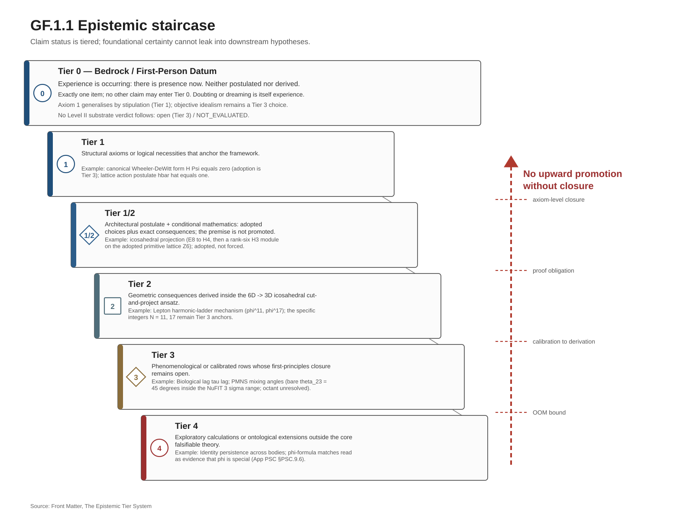

* **Tier 0 (Bedrock / First-Person Datum):** Experience is occurring: there is presence now. This datum is neither a postulate nor a derived result and cannot be coherently doubted: doubting is itself an occurrence of experience, and even in a dream the experience occurs. **One-item rule: exactly this one datum belongs to Tier 0; no other claim may ever be assigned to it.** Axiom 1 generalises this datum by stipulation [Tier 1] to universal Level I intrinsic non-subjective presence in all Field configurations; it is not identical to the datum and does not inherit its certainty. The objective-idealist ontology remains a Tier 3 parsimony choice (V1 Ch06). Tier 0 supplies no Level II verdict for any substrate; those verdicts remain open (Tier 3) / `NOT_EVALUATED`.

* **Tier 1 (Structural / Axiomatic):** Foundational axioms and logical necessities that define the GCT framework. These are either **postulated** as irreducible starting assumptions, or **proven by contradiction** to be the unique consistent solution. If these axioms are true, the subsequent Tier 2 results must follow.
 * *Examples:* the canonical form of the Wheeler–DeWitt constraint $\hat{H}\Psi=0$, whose adoption as a closed-system postulate is separately Tier 3; the **Lattice Action Postulate** ($\hat{\hbar}=1$); the masslessness of the photon ($m_\gamma=0$) as an external Tier 1 Standard-Model fact, which rests on unbroken local $\mathrm{U}(1)$ gauge invariance and the Ward identity (standard field theory, not a GCT-specific derivation; GCT has not yet reproduced it, since its photon sector is a declared open programme, V2 Ch06; compactness of a phase variable alone does not force a flat potential).
 * *Note:* **Tier 1 denotes either a structural axiom or a proof of logical necessity.** These are the irreducible assumptions and forced conclusions that anchor the entire theoretical edifice.

* **Tier 1/2 (Architectural Postulate + Conditional Mathematics):** Architectural choices adopted for parsimony and empirical adequacy, together with exact mathematical consequences that follow once those choices are assumed. The architectural premise is not deductively forced by the Ontological Axioms, and it is not converted into a theorem by its downstream conditional consequences. *Rule:* conditional mathematics never promotes the premise it assumes.
 * *Examples:* The **Icosahedral Projection** ($E_8\to H_4$, followed by a rank-six $H_3$ module with adopted primitive Bravais lattice $P\cong\mathbb{Z}^6$): conditionally preferred by the registered comparison under parsimony, empirical adequacy, maximal polyhedral point symmetry, aperiodicity, the five-fold rhombic-triacontahedral window, and golden arithmetic. Rank 6 is fixed by full icosahedral indexing, but the closed Bravais classification also contains $F\cong D_6$ and $I\cong D_6^*$; the choice of $P$ is itself a Structural Postulate. Isotropy alone does not select $H_3$, since $O_h$ and $T_d$ also satisfy macroscopic finite-point isotropy; nor does spin lifting select it, because every finite rotation subgroup of $SO(3)$ has a canonical Spin$(3)$ preimage. App USS records $A_5$ as the architectural premise H1 and derives exact conditional Schur-cover and McKay consequences [Tier 1 mathematics under that premise]; it does not prove point-group uniqueness, and identifying these consequences as one physical $E_8\to H_4\to\mathbb{Z}^6$ route is architectural compatibility, not a forcing theorem.

* **Tier 2 (Geometric / Derived):** Rigorous mathematical consequences derived from the Tier 1 axioms combined with the specific 6D$\to$3D icosahedral cut-and-project ansatz. These results are structurally robust within the quasicrystalline vacuum identification.
 * *Examples:* The **Electron Mass** chain is Tier 2 mechanism plus a Tier 3 exponent anchor ($n=-107$, pending O.14 selection) plus the Tier 4 O.14 physical-link conjecture; because $m_e$ is the A1 anchor, its numerical row is a Tier 3 anchor-normalised Planck-link check, whose 1006 ppm residual misses the pre-registered 1000 ppm pre-commitment (App FSM P.1c: FAIL of that rule). The **Lepton Mass Ratios** have a Tier 2 harmonic-ladder mechanism plus Tier 3 specific $N=11,17$ integer anchors, an H-EW-dependent second-order $\phi^{8}\alpha^2$ selection, and Tier 3 formula residuals pending O.5/O.14/O.15. The **Proton Mass** is Tier 2 mechanism plus a Tier 3 sheet/exponent handle pending AKN-action closure. **Newton's G** has a Tier 2 thermodynamic/acoustic mechanism, but its numerical Planck-link inherits the Tier 4 O.14 physical-link conjecture and the Tier 3 $m_e$ dimensional anchor; the numerical $G$ row is the electron Planck-link row inverted ($G\propto m_e^{-2}$), so it is not independent evidence. The **Higgs VEV** is OPEN-CONDITIONAL: Tier 2 product arithmetic applies only after supplying the Tier 3 O.38 $N_{\rm cage}=144$ posit; O.20 enumerates but does not select the $144\times10$ branch, and the approximately 179 ppm comparison against the sole declared PDG-2024 anchor $v=246.21965$ GeV is conditional rather than an absolute or geometric closure. The **Light Quark Mass Hierarchy** is a mixed Tier 2/3 sector claim: the adopted down-quark output is the conditional Tier 3 shell-median identification $m_d=m_u\phi^{\phi}=4.716$ MeV ($+0.33\%$), while the exact finite-cage $R=2$ branch is the secondary algebraic diagnostic $m_d=4.848734$ MeV ($+3.1645\%$, displayed as $+3.16\%$); both lie inside the registered 110000-ppm gate, and rigorous convergence plus the algebraic-field identification remain open under O.5. The **CKM Mixing Angles** are Tier 3: the Cabibbo bare value is a Tier 3 identification with a Tier 3 transfer correction, and the higher angles are Tier 3 ansätze. For **spin statistics**, only the standard $\mathrm{SU}(2)\to\mathrm{SO}(3)$ double-cover control and the normalization of the WZW generator of $H^3(\mathrm{SU}(2);\mathbb{Z})$ are Tier 1. The GCT identification of tethered defects with that construction, and exchange statistics for GCT defects, are Tier 3/open rather than a Tier 2 example ($\pi_1(\Sigma_\infty)=0$, so the Solenoid supplies no rotation obstruction), while the separate O.14 APS programme remains conditional because no qualifying boundary operator/domain/index has been specified or evaluated. The **Dark Energy Coupling** ($\lambda_{bio} \equiv \alpha$) is **Tier 3 (Phenomenological)** per the Prediction-Postdiction Firewall — it is a declared matching choice ($\lambda_{bio}\equiv\alpha$), not fitted and not a first-principles derivation, and its physical-source interpretation (selection events as a dark-energy source) is Tier 4. Three items are deliberately *not* Tier 2 examples: the **Fine-Structure Constant bare relation** $\alpha^{-1}_{bare} = 360\phi^{-2} \approx 137.508$ is a Tier 3 numerical relation (Tier 3 600-cell multiplier; mechanism open — the RT solid-angle construction is withdrawn, V1 §13.2.1–§13.2.2), with the residual closure tracked under O.19/O.5; the **Gauge Group Structure** is an open Tier 3 candidate (its eight-dimensional $\mathrm{SU}(3)$ closure is not specific to the RT window; V3 Ch03, App ORQ O.39/O.32); and the bare **Weinberg angle** $\phi^{-3}$ is the Tier 3 hypothesis H-EW (V3 Ch04 §4.3). The invariant-degree sum $D_{H3}=2+6+10=18$ is Tier 2, but this integer does not entail a physical stiffness ratio: the map $K_\perp/K_\parallel=\phi^{-18}$ is the Tier 3 hypothesis P3b (Parameter Ledger §0.1). These tiers describe the mechanisms and anchors; the numerical matches of the φ formulas in these examples (electron, lepton ratios, proton, $G$, Higgs VEV, quarks, couplings and mixing angles) are **Tier 4 as evidence** that φ or icosahedral structure is special, because the preregistered constant control test (v3, NEGATIVE-FRAGILE) did not distinguish them from numerology for strong effects (App PSC §PSC.9.6).

* **Tier 3 (Phenomenological / Calibrated):** Models calibrated to observation where a first-principles derivation is currently incomplete (e.g., requiring full non-perturbative simulation of defect ensembles or horizon-scale boundary conditions). Applies to any sector — biophysical, cosmological, or phenomenological — where free parameters are adjusted to match empirical anchors and a geometric derivation is pending. This tier also covers explicit conditional physical maps from a geometric invariant or coordinate diagnostic to a physical coupling or response coefficient: such a hypothesis need not be a continuous fitted parameter, but it remains an independent commitment until a normalization-invariant dynamical derivation closes it.
 * *Examples:* the stiffness-map hypothesis P3b, $K_\perp/K_\parallel=\phi^{-18}$, and its $\phi^{-9}$ and $\phi^{-36}$ descendants pending O.15(b); the electroweak boundary hypothesis H-EW; biological lag calculations ($\tau_{lag}$); Chiral Enhancement Factors in tubulin; the Consensus Decay Constant ($\lambda_c$, pending derivation from phason stiffness ratio $K_\perp/K_\parallel$, V1 Ch11 §11.2.4); the PMNS mixing angles (Tier 3; the bare $\theta_{23}=45^\circ$ lies inside the NuFIT 6.0 $3\sigma$ range with and without Super-Kamiokande data, and the octant is unresolved); the **Born Rule**, a Tier 3 conditional compatibility theorem pending O.40a/O.40b additivity and noncontextuality closure; the equation of state $w(z)_{bio}$ (sustained phantom phase asymptoting to $-1$ from below; the phantom direction itself is Tier 4, with no ghost-free action, V2 Ch14 §14.3.1; observational distinguishability threshold at $z \approx 0.28$ per V2 Ch14 §14.6.3).

* **Tier 3/4 (Straddle Label):** Tier 3 form / Tier 4 realization. The label marks a claim whose form is Tier 3 and whose realization is Tier 4; the text must say which part is which.

* **Tier 4 (Speculative / Exploratory):** Claims that are either (a) **exploratory calculations** where the dimensional structure is correct but the numerical coefficient is uncertain by >1 order of magnitude (with explicit OOM bounds), or (b) **ontological extensions** that lie outside the core falsifiable theory (identity persistence after biological termination, trans-temporal identity correlations), or (c) **evidential readings of numerical matches** whose evidential weight a preregistered control has not distinguished from numerology. Under (c) the arithmetic itself is not demoted: the computed value and its residual stay as descriptive arithmetic, and only their use as evidence that φ or icosahedral structure is special is Tier 4. No Tier 4 claim is used as support for a core result; where a core chain inherits a Tier 4 link (the O.14 physical-link conjecture, the phantom direction of the registered $w(z)$ channel), the chain carries that Tier 4 label.
 * *Examples (Exploratory):* Biogenic dark energy driving force magnitudes; neutrino mass scale absolute normalization.
 * *Examples (Ontological):* Identity persistence across bodies; consciousness continuity in reversible computational states.
 * *Examples (Evidential, (c)):* evidential readings of φ-formula numerical matches (App PSC §PSC.9.6): the lepton, proton, quark, Higgs-VEV, coupling, mixing-angle and Newton-$G$ matches, read as evidence that φ is special. The preregistered constant control test (v3, NEGATIVE-FRAGILE) found φ's pattern of matches on 21 constants not distinguishable from that of random constants; it "excludes, at power ≥ 0.8, an effect in which φ hits at least 6 of the 8 informative rows through a real effect; weaker effects are not excluded."

---

**Note on Computational Closure:** The Tier 2 analytic mechanisms of the lepton and quark mass hierarchies remain subject to computational verification via the full non-perturbative spectrum of the defect-cage Hessian. The presently used $N=144$ cage is itself a Tier 3 structural posit pending O.38; exact Gauss--Bonnet closure on the icosahedral/dodecahedral boundary does not derive its node count. The pathway for the downstream spectral calculation is defined in Chapter 13 (Open Problem O.5).

---

This classification ensures that the framework is transparent regarding its levels of certainty, separating axiomatic assumptions from geometric derivations, phenomenological fitting, and exploratory/ontological extensions.

---

# Axiom & Postulate Ledger

This document serves as the authoritative enumeration of the foundational assumptions used in Geometric Consciousness Theory (GCT). We distinguish between the **Ontological Root**, which defines the field of inquiry, and the **Structural Architecture**, which specifies a concrete physical implementation.


**Relation to the Parameter Ledger count.** The numerical count of 5 structural postulates + 6 continuous anchors (11 declared core inputs) is governed by Parameter Ledger §0.1, not by the number of bullets in §2 below. The §2 items map onto it as follows: the Discreteness Postulate, Maximal Polyhedral Point Symmetry, the 6D Euclidean Parent Lattice and the 6D φ-slope are the components of **P1**, the icosahedral cut-and-project ansatz. **P2–P5** are the integer exponents $n=-107$, $D_{H3}=18$, $N=11$ and $N=17$, listed in Parameter Ledger §0.1 rather than here, and **A1–A6** are the continuous anchors listed there. The Wheeler–DeWitt Constraint Postulate (a Tier 3 adoption), the Born-rule compatibility statement (a Tier 3 conditional theorem) and Postulate G (a rule restricting admissible exponent arithmetic) carry no numerical input and are outside the 11-input count.

## 1. Ontological Axioms (The Root)
These axioms define the ontological starting point of the framework. The first-person datum must be distinguished from its stipulated universal generalisation.

**First-person datum [Tier 0]:** Experience is occurring: there is presence now. This is the sole Tier 0 item, neither postulated nor derived; all other claims are excluded from Tier 0.

1. **Axiom 1 — Axiom of Presence [Tier 1]:** All Field configurations carry universal Level I intrinsic non-subjective presence. This stipulated generalisation is motivated by the Tier 0 datum, not identical to it or deduced from it. The objective-idealist ontology is a Tier 3 parsimony choice (V1 Ch06); Level II substrate verdicts remain open (Tier 3).
2. **Axiom 2 — Axiom of Intelligibility [Tier 1 — stipulated axiom; it does not carry the Tier 0 certainty]:** Experience is structured. Awareness contains distinctions and sequences that obey consistent rules.

## 2. Structural Postulates (The Architecture)
These postulates are explicitly adopted as an architecture for a concrete physical model. They are justified by **minimum additional complexity** (algorithmic parsimony), **empirical adequacy**, and **falsifiability**. They do not follow deductively from the Axioms alone.

- **Discreteness Postulate [Tier 1/2 — Structural Postulate]:** The information content of any finite volume of the physical universe is finite. Reality is sampled/quantized at the Planck scale.
- **Maximal Polyhedral Point Symmetry [Tier 1/2 — Structural Postulate]:** Isotropy alone is insufficient to select the substrate symmetry: $O_h$ and $T_d$ also satisfy macroscopic finite-point isotropy. The architecture therefore restricts the declared irreducible polyhedral rotational candidates to $A_4$, $S_4$, $A_5$ and adopts the icosahedral group $I\cong A_5$ of order 60, the largest of those three, together with fivefold symmetry and the rhombic-triacontahedron window. Cyclic and dihedral rotation groups have unbounded order, so "maximal finite rotational order" is meaningful only inside the declared polyhedral candidate class. The candidate restriction and the fivefold/RT requirements are architectural premises, not deductions from Presence and Intelligibility alone.
- **6D Euclidean Parent Lattice [Tier 1/2 — Architectural Postulate + Conditional Mathematics]:** The 6-dimensional
parent lattice is obtained, under this postulate, from the Binary Icosahedral Group
 $2I$ via the McKay Correspondence ($2I \to E_8$), the Elser–Sloane
 $E_8\to H_4$ projection, and the rank-six icosahedral module. The primitive
 Bravais choice $P\cong\mathbb{Z}^6$ is adopted explicitly; the alternative
 icosahedral choices are $F\cong D_6$ and $I\cong D_6^*$, and the closed mathematics
 does not uniquely select among them. See the **Conditional T-McKay Architecture Chain**
 (Appendix USS §USS.7). The Schur cover, McKay correspondence, stated Elser–Sloane
 projection, rank-six requirement, Bravais classification, and $H_4$ Cartan/root-metric value of $\phi$ are closed mathematical
 correspondences within their hypotheses. Their composition as the physical 6D
 architecture remains a Tier 1/2 structural postulate, not an unconditional theorem.
 Program T-McK.1b is a separate Tier 3 downstream consistency program: no qualifying
 APS bulk/boundary operator pair, domains, kernel term, regularised eta, or complete
 index has been constructed. The finite cage computations are scalar-adjacency and
 discrete-matrix diagnostics only. Because the RT boundary is defined after adopting
 this 6D architecture, future APS closure could test internal consistency but could not
 derive or elevate its upstream premise to Tier 1.
- **6D φ-slope [Tier 1 conditional mathematics under H1]:** The golden ratio $\phi=2\cos(\pi/5)=(1+\sqrt{5})/2$
 enters the $H_3/H_4$ geometry through the off-diagonal Cartan entry $-\phi$
 between the pentagonal simple roots, the golden-ratio metric of the
 icosahedral root system, and the irrational cut-and-project slope in the
 Elser–Sloane map. The Coxeter-element eigenvalues themselves are roots of
 unity on the unit circle; $\phi$ is therefore not the magnitude of any Coxeter
 eigenvalue. See the Conditional T-McKay Architecture Chain. This fixes $\phi$
 inside the adopted $H_3/H_4$ architecture; it does not prove H1 or global slope optimality.
- **Wheeler–DeWitt Constraint Postulate [Tier 3 adoption; the canonical constraint form is Tier 1]:** The total energy/Hamiltonian of the configuration space of the universe — comprising all matter and gravitational degrees of freedom — is Zero ($\hat{H}|\Psi\rangle = 0$). This is a timeless constraint on the space of all geometries, not a conservation law for a dynamically evolving system. See Chapter 5 for the philosophical motivation.
- **Born Rule [Tier 3 conditional compatibility theorem]:** The Born Rule ($P = |\psi|^2$) follows from Gleason's Theorem only if the GCT Selection Operator is independently shown to define a countably additive, noncontextual probability measure on the phason projection lattice. Those two proof obligations are App ORQ O.40a and O.40b; Appendix BRC §BRC.1–BRC.6 gives the conditional structure without defining the measure by the Born quadratic in advance.
- **Postulate G (Galois Observable Constraint) [Tier 1/2 — Structural Postulate]:** On the lepton/electron ladder ($m_e/M_P=\phi^{-107}$ and $m_\ell=m_e\phi^N$), admissible GCT mass-exponent arithmetic is restricted to Galois-compatible integer powers $\phi^N$ with $N \in \mathbb{Z}$ (App USS §USS.5.3). Postulate G is scoped to that ladder: the non-integer exponents of the proton ($15+\phi^{-1}$), the quark sector (V3 Ch10) and the CKM angles (O.5) lie outside it and keep their own tier labels (Parameter Ledger, integer-handle tier taxonomy; App FTH §FTH.5). It is not the requirement that an observable be invariant under the Galois automorphism $\phi \to -1/\phi$: the elements of $\mathbb{Q}(\sqrt{5})$ fixed by that automorphism are exactly the rationals. Postulate G is a structural postulate of the framework rather than an independently established constraint, and it supplies no narrower Lucas-only trial factor. The Prediction/Postdiction Firewall gives the canonical admissibility rule for mass exponents.

## 3. Methodological Commitments
Non-ontological rules that govern the derivation and validation process.

- **Parsimony as Heuristic Prior:** Simpler models (lower Kolmogorov complexity) are preferred over complex ones, but parsimony is a heuristic for discovery, not a replacement for proof.
- **Tier System Rule:** All claims must be classified by the Epistemic Tier System (Tier 0: Bedrock / First-Person Datum, exactly one item; Tier 1: Structural Axiom / Logical Necessity; Tier 1/2: Architectural Postulate + Conditional Mathematics; Tier 2: Geometric / Derived from the icosahedral ansatz; Tier 3: Phenomenological / Calibrated, including conditional physical-map hypotheses; Tier 4: Speculative / Order-of-Magnitude, with explicit OOM bounds, or ontological extension). Conditional mathematics never promotes the premise it assumes. See the Global Front Matter Epistemic Tier System for complete definitions.
- **Calibration Rule:** All fundamental constants must be derived from dimensionless geometric ratios. SI units are only used via a declared experimental anchor (e.g., the electron mass).

## 4. Physical Modeling Postulates (EFT-Level)
Specific assumptions used for mapping geometric structures to Standard Model entities.

- **Defect/Soliton Matter Model:** Particles are modeled as topological defects or solitons within the lattice strain field.
- **Phonon/Phason Split:** The separation of degrees of freedom into "Standard Physics" (Phonons) and "Dark/Information Physics" (Phasons).

---

# Parameter Ledger

This ledger provides the authoritative categorized inventory of numerical values used as inputs, anchors, or calibrated fits within Geometric Consciousness Theory (GCT). In accordance with the **Prediction/Postdiction Firewall**, values are classified by their technical provenance and quantitative scope. The Gauge, Lepton, and native-RGE endpoint sectors are determined by a small, fully-enumerated set of structural postulates and six continuous anchors: one dimensional anchor, one gauge-flow endpoint anchor, one low-energy fine-structure anchor used only by measurement-anchored precision-comparison rows, and three native-RGE $\beta$-coefficient magnitude normalisations (Section 0 below). A named precision/gauge comparison subset contains six calibrated Tier-3 discrete coefficient handles ($1440$, $12$, $360$, $2$, $10\phi^2$, and $1/5$); the O.38 $N=144$ cage posit and the additional hadronic, biophysical, cosmological, and deployment handles catalogued below are counted outside that subset. The remaining Open Parameters are explicitly quarantined in Section 4 (Tier 3) pending exact geometric derivation.

## 0. Free Parameter Accounting (Summary)

This section aggregates every structural postulate, integer exponent, and calibrated parameter that enters the manuscript's quantitative claims. It is the authoritative accounting for this purpose: the gauge-and-lepton sector's commitments are explicit, finite, and partitioned by epistemic tier.

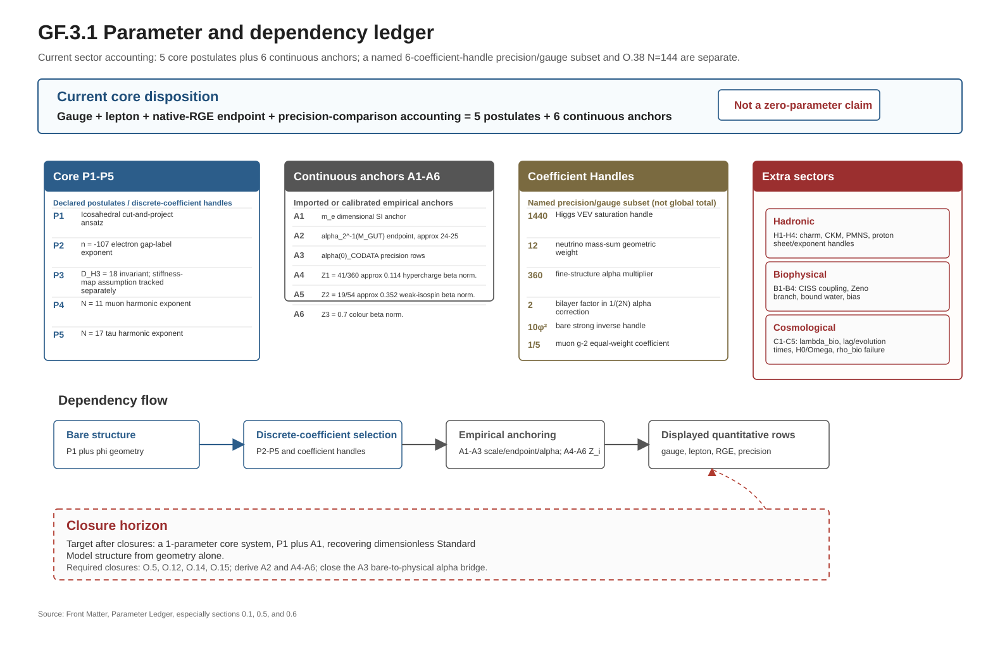

### 0.1 Core Gauge + Lepton + Dimensional + Native-RGE Endpoint Sector — 5 postulates + 6 anchors

| # | Symbol / Postulate | Type | Tier | Status | Cross-Reference |
| :---: | :--- | :--- | :--- | :--- | :--- |
| P1 | **Icosahedral cut-and-project ansatz** ($H_3$ projection of the adopted primitive-$P$ Bravais lattice $\mathbb{Z}^6$ onto $E_\parallel$) | Structural postulate | Tier 1/2 axiomatic | Foundational; not a fitted parameter. Full icosahedral indexing fixes rank 6, while the Bravais classification also permits $F\cong D_6$ and $I\cong D_6^*$; the primitive-$P$ choice is adopted, not uniquely derived from $E_8$ or from the $D_6$ roots. P1 bundles the Discreteness, Maximal Polyhedral Point Symmetry, 6D Parent Lattice and 6D φ-slope items of the Axiom & Postulate Ledger §2; that ledger's Wheeler–DeWitt, Born-rule and Postulate G items carry no numerical input and are outside this count. | V1 Ch04 §4.2.2; App USS §USS.7.3; Axiom & Postulate Ledger §2 |
| P2 | $n = -107$ — K-theoretic gap-label exponent for $m_e/M_P$ | Integer exponent | Tier 2 K-theoretic framework support + Tier 3 specific integer anchor + Tier 4 physical-interpretation chain (per O.14) | $n=-107$ is supported by, and coincident with, the $H_3$ Coxeter-exponent power-sum invariant $1^2 + 5^2 + 9^2 = 107$ (unique to $H_3$ among finite irreducible Coxeter groups; Humphreys 1990; engine: `protocol_o14_coxeter_exponent_squares.py`). The physical $V\to K_0$ trace-image transfer that would select this integer as the electron projection's gap-label remains unconstructed and open under Open Problem O.14 (Tier 4 conjecture). CODATA match $m_e$ at 1006 ppm; because $m_e$ is the A1 anchor this is a Tier 3 anchor-normalised Planck-link check, and the residual misses the pre-registered 1000 ppm pre-commitment by 6 ppm (App FSM P.1c: **FAIL** of that rule). **Convention dependence (disclosed):** the integer $107$ is specific to the **non-reduced** Planck-mass convention $M_P=\sqrt{\hbar c/G}$; under the reduced Planck mass $M_P/\sqrt{8\pi}$ the same ratio requires exponent $\approx 103.7$, which is non-integer and carries no $H_3$ Coxeter-invariant identification. The $\lvert n\rvert = 107 = \sum_i m_i^2(H_3)$ anchoring is therefore convention-dependent, and the non-reduced convention is the one under which the geometric identification holds — stated wherever the exponent is used as load-bearing. | V3 Ch07 §7.2.2, V3 Ch08 |
| P3a | $D_{H3}=18$ — $H_3$ Shephard-Todd invariant-degree sum $\{2,6,10\}$ | Integer invariant | Tier 2 Coxeter integer conditional on the irreducible icosahedral premise | $D_{H3}=18$ is the $H_3$-specific icosahedral anchor: the $H_3$ Shephard-Todd invariant-degree sum $\{2, 6, 10\}$, sum $= 18$. It is unique within the finite irreducible rank-three classification ($A_3 = 9$, $B_3 = 12$, $H_3 = 18$), but not among all finite rank-three Coxeter systems: the reducible system $A_1\times I_2(14)$ has degrees $\{2,2,14\}$ and sum 18. The numerical sum therefore identifies $H_3$ only conditional on the irreducible icosahedral premise. The 2D-RT-face-in-6D tangent-bundle decomposition $D_{\rm pos}(6) + D_{\rm mom}(6) + D_{\rm face\,int}(6) = 18$ enters as a **6D-ambient consistency cross-check**, not as a second independent icosahedral anchor (every 6D-ambient theory with this triple-decomposition yields 18 regardless of icosahedral structure; see App ORQ O.26 and V3 Ch08 §8.3.3). | V2 Ch04, App DPS, V3 Ch08 §8.3.3 |
| P3b | $K_\perp/K_\parallel = \phi^{-18}$ — physical stiffness-ratio map from $D_{H3}$ | Registered Tier 3 physical-map hypothesis (outside the count, like H-EW) | Tier 3 pending O.15 | The sharper claim that the Coxeter integer maps to the physical phason stiffness ratio by $K_\perp/K_\parallel=\phi^{-D_{H3}}$ at the renormalization-flow level is separately tracked at Open Problem O.15(b) (Tier 3 sharpening pending QLQCD closure). $D_{H3}=18$ does not by itself entail this map: icosahedral symmetry leaves the invariant quadratic stiffness family $Q=aP_\parallel+bP_\perp$ with $b/a$ free, and the isotropic nearest-neighbour bond term of App ULA §ULA.2 gives $b/a=1$ at the harmonic level, so the ratio needs additional derived microscopic/RG dynamics. This row is listed outside the 5-postulate + 6-anchor count exactly like H-EW; only the integer $D_{H3}=18$ (P3a) is Tier 2. | V2 Ch04, App DPS, V3 Ch08 §8.3.3; App ORQ O.15 |
| P4 | $N = 11$ — muon harmonic exponent | Integer exponent | Tier 2 mechanism + Tier 3 specific exponent | Linear Hessian does not produce $N=11$ spontaneously; postulated via the $6k\pm1$ template ($h+1$ hook non-load-bearing). The harmonic-ladder mechanism is Tier 2; the specific integer is a Tier 3 anchor pending the integer-side closure (the analogue of the electron $\lvert n\rvert=107$ Coxeter-exponent identification) | V3 Ch08 |
| P5 | $N = 17$ — tau harmonic exponent | Integer exponent | Tier 2 mechanism + Tier 3 specific exponent | Second-harmonic of dodecahedral resonance; same postulational status as P4 — Tier 2 mechanism, Tier 3 specific integer pending integer-side closure | V3 Ch08 |
| A1 | $m_e$ — dimensional anchor (SI conversion) | 1-DOF anchor | Tier 3 import | CODATA 2022; required to convert dimensionless ratios to SI units | V3 Ch08 |
| A2 | $\alpha_2^{-1}(M_{\rm GUT}) \approx 24$-$25$ — gauge-coupling-flow endpoint anchor | Continuous endpoint anchor | Tier 3 calibrated anchor | Imported benchmark: the MSSM unified coupling $\alpha_G^{-1}\approx23$–$24.5$ at $M_G\approx2.5\times10^{16}$ GeV (Langacker & Polonsky, Phys. Rev. D 47, 4028 (1993)); in the SM the couplings do not unify and $\alpha_2^{-1}(3.2\times10^{16}\ {\rm GeV})=46.2$ at two loops ($\approx46.5$ at one loop). Together with H-EW it is inconsistent with any matter content containing the SM, and the pre-registered gauge-running check is **FAILED** (App GRF §GRF.4.3); whether to retire A2 is an open v1.4.0 decision, and v1.3.0 keeps it in the count. In the native kernel of `protocol_rge_native.py` it is not an endpoint calibration (reproducing the measured $\alpha_2(M_Z)$ there would require $\approx 36.3$). It is not a first-principles GCT prediction; the closure target is to derive this boundary value from the icosahedral irrep activation schedule plus bare boundary structure under QLQCD-1L / App GRF. | V3 Ch04 §4.5; App GRF; `protocol_rge_native.py` |
| A3 | $\alpha(0)_{\rm CODATA}$ — low-energy fine-structure constant | Continuous empirical input | Tier 1 empirical anchor for precision-comparison rows | CODATA-2022 $\alpha^{-1}=137.035999177$, evaluated as $\alpha=1/137.035999177$. Used where the displayed row explicitly requires the measured low-energy electromagnetic coupling: corrected charged-lepton mass residuals (nominal −21.09 ppm muon, a Tier 3 formula residual about $10^3$ times the 22 ppb measurement uncertainty), Higgs VEV residual (179 ppm against $v=246.21965$ GeV), and QED checks. The bare $360\phi^{-2}$ relation (a Tier 3 numerical relation; mechanism open, V1 §13.2.1–§13.2.2) remains separate and yields the 3443 ppm bare residual independent of A3. A3 is not used to claim the bare $\alpha$ derivation. | V3 Ch08; App PSC §PSC.2; `verify_muon_mass.py`; `verify_higgs_vev.py`; `protocol_qed_audit.py` |
| A4 | $Z_1 = 41/360 \approx 0.1139$ — hypercharge $\beta$-coefficient magnitude normalisation | Continuous calibrated anchor | Tier 3 calibrated anchor | Fixed by $b_1^{\rm GCT}(T_{\rm GUT}) = b_1^{\rm SM}$ with the canonical projector share $1/2$; first-principles closure pending | App GRF §GRF.3 |
| A5 | $Z_2 = 19/54 \approx 0.3519$ — weak-isospin $\beta$-coefficient magnitude normalisation | Continuous calibrated anchor | Tier 3 calibrated anchor | Fixed by $b_2^{\rm GCT}(T_{\rm GUT}) = b_2^{\rm SM}$ with the canonical projector share $1/2$; first-principles closure pending | App GRF §GRF.3 |
| A6 | $Z_3 = 0.7$ — colour $\beta$-coefficient magnitude normalisation | Continuous calibrated anchor | Tier 3 calibrated anchor | Fixed by $b_3^{\rm GCT}(T_{\rm GUT}) = b_3^{\rm SM}$; closure at QLQCD-2 (App QLA §QLA.7) | App GRF |

**Open identification hypotheses outside the count.** Two discrete identifications reuse the raw Galois-frame value $\phi^{-3}$ (a coordinate identity, App USS §USS.9): the electroweak boundary hypothesis **H-EW**, $\sin^2\theta_W^{\rm bare}=\phi^{-3}$ (V3 Ch04 §4.3.2), and the Cabibbo bare identification $\sin\theta_C^{\rm bare}=\phi^{-3}$ (V3 Ch10 §10.5.1). Both are Tier 3 hypotheses rather than postulates; they are not counted among P1–P5 or A1–A6, and every row that uses them carries a Tier 3 label. The $\phi^{-18}$ stiffness map (row P3b above; App ORQ O.15(b)) is a registered Tier 3 hypothesis listed outside the "5 postulates + 6 anchors" count in exactly the same way: only the integer $D_{H3}=18$ (P3a) is Tier 2, and every descendant that uses the map (the lattice-unit speed $\phi^{-9}$, the $\phi^{-36}$ neutrino floor, the $M_{GUT}$ scale assignment) carries a Tier 3 label.

**Inputs versus evidence.** The tiers in the §0.1 table describe P1–P5, A1–A6 (and H1–H4 in §0.2) *as inputs*: their accounting status and tier are unchanged. Their *numerical success* — the residuals of the φ formulas built from them — is a different matter: as evidence that φ or icosahedral structure is special, those matches are **Tier 4**. The preregistered constant control test (v3, NEGATIVE-FRAGILE; App PSC §PSC.9.6) found φ's pattern of matches on 21 constants not distinguishable from that of random constants (58 of 300 random bases did at least as well). The test "excludes, at power ≥ 0.8, an effect in which φ hits at least 6 of the 8 informative rows through a real effect; weaker effects are not excluded." The residuals are kept as descriptive arithmetic.

The fine-structure constant $\alpha$ has two distinct roles. The bare GCT tree-level relation $360\phi^{-2}$ is a Tier 3 numerical relation (Tier 3 600-cell multiplier; mechanism open — the RT solid-angle construction is withdrawn, V1 §13.2.1–§13.2.2), with a 3443 ppm residual. Calling the required correction direction "phason anti-screening" is an inserted Tier 3 candidate convention: the current action derives neither that physical response nor its sign; if the bare value is read as the ultraviolet boundary, the remaining 41.5 ppm correction raises $\alpha^{-1}$ toward low energy, the direction of conventional screening, while the leading 3443 ppm step from the bare value runs in the anti-screening direction (App ORQ O.19). The residual is an O.19/O.5 closure target, not a tuned coefficient. The measured low-energy value $\alpha(0)_{\rm CODATA}$ is A3, a Tier 1 empirical anchor used only in precision-comparison rows whose displayed formulas are explicitly measurement-anchored: corrected lepton masses, Higgs VEV, and QED checks. For the Weinberg chain, App USS §USS.9 establishes the raw-frame identity $V_{\perp,0}/V_{\parallel,0}=\phi^{-3}$, which is Tier 1 coordinate arithmetic rather than a physical invariant; the bare Weinberg angle $\phi^{-3}$ is the Tier 3 gauge-kinetic hypothesis H-EW, and its 2.1% proximity to the observed Z-pole value is a cross-scale alignment (Tier 4 as evidence: not distinguishable from numerology for strong effects; App PSC §PSC.9.6). The native-RGE run from that boundary additionally uses A2, the Tier 3 calibrated $\alpha_2^{-1}(M_{\rm GUT})$ anchor above, and does not reproduce the Z pole (V3 Ch04 §4.3.3); the pre-registered gauge-running check is FAILED (App GRF §GRF.4.3). The O.19 alpha-residual protocols treat 3443 ppm and 41.5 ppm as verification/closure targets, not coefficients used to tune the result. Cosmology, Zeno, and systematics constants are classified as external empirical priors, verification targets, MD-derived bands, or already-disclosed B/C-sector Tier 3 parameters. The full current continuous-anchor set is A1-A6: A1 is the dimensional anchor, A2 is the native-RGE endpoint anchor, A3 is confined to measurement-anchored precision comparisons, and A4-A6 are the App GRF $\beta$-coefficient magnitude normalisations $Z_1$, $Z_2$, and $Z_3$ entering only the native-RGE flow. The named precision/gauge comparison subset contains six calibrated Tier-3 discrete coefficient handles ($1440$, $12$, $360$, $2$, $10\phi^2$, and $1/5$); this is not a manuscript-wide total, and the O.38 $N=144$ cage posit plus other sector-specific handles remain separately catalogued. The down-quark Fuglede–Kadison determinant route is a Tier 2 mechanism with a Tier 3 $\phi^{\phi}$ identification of the shell median (infinite-volume limit open, O.5): the adopted primary output is $m_d=m_u\phi^{\phi}=4.716$ MeV, postdiction-consistent at $+0.33\%$ inside the registered 110000-ppm (11%) shell-resonance gate. The exact $R=2$ finite-cage value $m_d=4.848734$ MeV is retained only as a secondary algebraic diagnostic at $+3.1645\%$ (displayed as $+3.16\%$), also inside that gate. The FK-determinant sequence centers on $\phi^{\phi}$, with closed-cage deep-tail mean $\det_{FK}/\phi^{\phi}=0.9976$, sequence-mean signed error $+0.09\%$ vs PDG, and single-cage oscillations within the 11% band under an empirical decaying envelope. Rigorous infinite-volume convergence and the algebraic-field identification remain open under O.5; the mechanism introduces no additional fitted coefficient. The $+0.33\%$ match is descriptive arithmetic (Tier 4 as evidence; App PSC §PSC.9.6).

**Named Tier-3 discrete coefficient handles in the precision/gauge comparison subset:**

- 1440 (candidate Higgs VEV scale handle $144\times10$; App ORQ O.20)
- 12 (12-fold neutrino mass-sum geometric weight)
- 360 (fine-structure $\alpha$ 360 multiplier)
- 2 (bilayer factor in the $1/(2N)$ $\alpha$ correction; App ORQ O.5)
- $10\phi^2$ (bare strong-coupling inverse handle; pending O.42 / QLQCD-2)
- $1/5$ (muon $g-2$ equal-weight vertex coefficient; pending O.26/O.5)

Subset total: 6 calibrated discrete coefficient choices. This subtotal is not an exhaustive manuscript-wide handle count; the tables below separately enumerate other coefficient and deployment handles.

### 0.2 Hadronic Sector — Tier 3 ansätze beyond the down quark

| # | Symbol | Status | Cross-Reference |
| :---: | :--- | :--- | :--- |
| H1 | $m_c$ — charm-quark gap label at $N=17$ second harmonic | Tier 3 Mixed-Harmonic Law ansatz | Open Problem O.5 |
| H2 | $s_{23}, s_{13}$ — higher CKM mixing angles | Tier 3 face-tunneling ansatz | V3 Ch10 |
| H3 | $\theta_{ij}$ — PMNS mixing angles | Tier 3 (bare $\theta_{23}=45^\circ$ lies inside the NuFIT 6.0 $3\sigma$ range; octant unresolved) | V3 Ch09 |
| H4 | $m_p/m_e = \phi^{15+\phi^{-1}}$ — proton baryonic-triad exponent | Tier 2 mechanism + Tier 3 sheet/exponent handle pending AKN-action closure | V3 Ch10; V3 Ch18; App PSC §PSC.3 |

### 0.3 Biophysical Sector — Tier 3 calibrated parameters

| # | Symbol | Description | Tier | Cross-Reference |
| :---: | :--- | :--- | :--- | :--- |
| B1 | $g_{single}^{eff}$ | Historical 38.0/38.3 MHz per-spin scenario anchor (declared pre-overlap constant); not the output of an evaluated, type-correct spin–phason matrix element | Tier 3 external scenario only; no action-derived physical rate | V3 Ch13 §13.1.2 and §13.3.5; V1 Ch17 §17.1.3 |
| B2 | $\nu_{Zeno}$ branch centers: primary $112 \pm 10$ MHz; fallback $42 \pm 10$ MHz | Historical/external material-frequency scenario windows; not an action-derived GCT operating frequency | Tier 3 external scenario only; the avoided-crossing and $41\times$ renormalization chains do not derive a normalized phason coupling or rate | V3 Ch13 §13.1.2b; Open Problem O.12; V1 Ch17 §17.1.3 |
| B3 | $f_{bound}^{\rm central}=0$ ($n_{\rm rp}=0$ pending O.21); $f_{bound}^{\rm sensitivity\ branch}=[1.1,2.2]\times10^{-3}$ ($n_{\rm rp}=1$ conditional) | Bound-water fraction | Tier 3 biological substrate value: O.21 identifies Trp21 only as a local-inward wall-patch candidate pending assembled-MT lumen-axis closure, and O.33 treats the $N=144$ dodecahedral lumen-water arrangement as a candidate ansatz pending MD/NMR/free-energy validation. NOE cannot supply the historical 100 MHz material-scan scenario rate. | V3 Ch16, V1 Ch17, App NSP §NSP.4 |
| B4 | $V_{bias} \approx 0.002$ V | Historical bias-voltage input (supplied apparatus/drive control; not a volitional steering signal or GCT phason coefficient) | Tier 3 external apparatus scenario | V3 Ch13 |

### 0.4 Cosmological Sector — Tier 3 / Tier 4

| # | Symbol | Description | Tier | Cross-Reference |
| :---: | :--- | :--- | :--- | :--- |
| C1 | $\lambda_{bio} \equiv \alpha$ | Biogenic-DE coupling | Tier 3 phenomenological correlation (channel-shape fit); Tier 4 physical-source interpretation | V2 Ch14 §14.3.1 |
| C2 | $\tau_{lag} \approx 5$ Gyr | complexity lag time | Tier 3 calibrated | V2 Ch14 |
| C3 | $\tau_{evolve}, t_{origin}$ | Biogenic-kernel timescales | Tier 3 calibrated | V2 Ch14, `protocol_imp01_pipeline.py` |
| C4 | $H_0, \Omega_\Lambda$ | Observational imports | Tier 3 imports (Planck 2018) | Global |
| C5 | $\rho_{bio}$ overshoot $\sim 10^{220}$ | Bare biogenic-DE magnitude (pre-suppression) | Tier 4 known failure | V2 Ch14 §14.2 |

### 0.5 Total Accounting

- **Core sector (P1-P5 with continuous anchors A1-A6):** 5 structural postulates + 1 dimensional anchor (A1) + 1 gauge-flow endpoint anchor (A2) + 1 low-energy fine-structure empirical anchor for precision-comparison rows (A3) + 3 native-RGE $\beta$-coefficient magnitude normalisations (A4-A6 = $Z_1$, $Z_2$, $Z_3$; App GRF §GRF.3.1). The icosahedral postulate (P1) is foundational; the four integer exponents (P2-P5) are explicitly enumerated above with their tier status and corresponding Open Problems; A1 is required for SI-unit conversion; A2 is required for the present $\sin^2\theta_W(M_Z)$ flow check; A3 is used only where corrected lepton, Higgs VEV, or QED rows explicitly import measured $\alpha(0)$; and A4-A6 normalise the three native-RGE $\beta$-coefficient magnitudes. The named precision/gauge comparison subset separately carries 6 calibrated Tier-3 discrete coefficient handles ($1440$, $12$, $360$, $2$, $10\phi^2$, $1/5$), while the O.38 $N=144$ cage posit and other sector-specific handles are separately disclosed and are not part of the six continuous anchors.
- **Hadronic sector (H1-H4):** 3 Tier 3 ansätze pending O.5 closure (H1-H3), plus the H4 proton row, whose mechanism is Tier 2 but whose sheet/exponent handle is Tier 3 pending AKN-action closure (O.5). Four hadronic rows carry a Tier 3 component.
- **Biophysical sector (B1-B4):** 4 biophysical inputs: Tier 3 external material scenarios (B1, B2), a biological candidate substrate value (B3), and a supplied apparatus control (B4). There is currently no action-derived GCT material coupling or rate (V1 Ch17 §17.1.3). Higgs/VEV handles are not biophysical parameters and are counted separately in the precision/Higgs-sector handle inventory.
- **Cosmological sector (C1-C5):** 5 parameters; $\lambda_{bio} \equiv \alpha$ is a Tier 3 phenomenological correlation (channel-shape fit), and its physical-source interpretation is Tier 4; the bare $\rho_{bio}$ magnitude is a Tier 4 known failure; holographic displacement suppression is only a proposed Tier 4 ansatz and does not resolve it.

The aggregate across the full theoretical scope is **24 numbered Ledger inputs** (P1, P2, P3a, P4, P5, A1-A6, H1-H4, B1-B4, C1-C5; the registered Tier 3 stiffness-map hypothesis P3b is outside the count), or **23** if the Tier 4 known failure C5 is counted as an open problem rather than a parameter. The six named Tier-3 discrete coefficient handles, the O.38 $N=144$ cage posit, and the further sector-specific handles itemized in §2-§3 are catalogued separately and are not included in this row count. The closure target is a **1-parameter core system** — P1 plus the dimensional anchor $m_e$ — recovering the dimensionless Standard Model from geometry alone. The current bare Gauge + Lepton sector before native-RGE endpoint running is determined by 5 postulates + 1 dimensional anchor; the native-RGE endpoint reconstruction uses A2 and the three App GRF normalisations A4-A6, while measurement-anchored precision rows use A3. The current gauge + lepton + native-RGE + precision-comparison accounting is therefore **5 postulates + 6 continuous anchors** (11 declared core inputs; the two ontological axioms carry no numerical input, and the Tier 3 identification hypotheses H-EW and Cabibbo-bare and the Tier 3 stiffness-map hypothesis P3b are outside the count). The named precision/gauge comparison subset's six calibrated Tier-3 discrete coefficient handles ($1440$, $12$, $360$, $2$, $10\phi^2$, $1/5$) and the O.38 $N=144$ cage posit are counted separately from those anchors; additional sector-specific handles remain itemized in their rows. This 5-postulate-plus-6-anchor accounting remains distinct from the 1-parameter closure target. Closure of Open Problems O.5, O.12, O.14, O.15, A2's QLQCD-1L/App GRF boundary derivation, the App GRF §GRF.5.1 ab-initio derivations of A4-A6 ($Z_1$, $Z_2$, $Z_3$), and the A3 bare-to-physical alpha bridge would reduce this count toward the 1-parameter target.

### 0.6 The Ambition (Target State)

The integer structural postulates P2–P5 enumerated in §0.1 are not intended as permanent additions to GCT. They are integers awaiting first-principles derivation from the icosahedral cut-and-project framework itself. The theory's terminal target — toward which the present accounting is the current state of the path — is:

| Sector | Target state | Required closures |
| :--- | :--- | :--- |
| Core (gauge + lepton + dimensional + native-RGE endpoint) | **1-parameter limit AFTER closure of O.14 + O.15 + N=11/N=17 derivations + A2 endpoint derivation + A3 bare-to-physical alpha bridge + A4-A6 ($Z_1$, $Z_2$, $Z_3$) ab-initio derivations**: P1 (icosahedral postulate) + A1 ($m_e$ as the unique SI anchor) **— current state is 5-postulate-plus-6-continuous-anchor; the 1-parameter target is the *closure horizon*, not the present disposition.** App ORQ O.14 enumerates 10+ routes attempted as candidate uniqueness proofs (orbifold Euler-characteristic; APS boundary-index route (specified operator, reduced $\xi$, spectral flow, bulk pairing, and graph-to-smooth bridge); 42-orbit-union cage-uniqueness search; explicit $\mathbb{Z}[\phi]$ Bellissard gap-labels; AKN dimension group; stringy/Hodge Euler characteristics; icosahedral subgroup orbit counts; group-theoretic invariants of $\lvert I_h\rvert/\lvert H_3\rvert$; anomaly polynomials; Fibonacci-pair trace evaluation; sum of squared Coxeter exponents of $H_3$). Path (l) — sum of squared Coxeter exponents — produces $|n| = 1^2 + 5^2 + 9^2 = 107$ as a canonical $H_3$ invariant that is unique to $H_3$ among finite irreducible Coxeter groups (engine: `protocol_o14_coxeter_exponent_squares.py`). This is an exact arithmetic identification of the integer; it does not select $n=-107$, which remains a Tier 3 anchor until O.14 selects it from the trace-image candidate family (row P2). The residual Tier 4 conjecture is the structural-link chain mapping this Coxeter invariant to the $K_0$ gap-label $\tau_*(K_0(\mathcal{A}))$ — the load-bearing remaining work of O.14. A2 is the separate Tier 3 native-RGE endpoint anchor: deriving $\alpha_2^{-1}(M_{\rm GUT})$ from the icosahedral irrep activation schedule and bare boundary structure is the App GRF/QLQCD-1L closure target. A3 is the measured low-energy alpha anchor used by precision-comparison rows until O.19/O.5 derives the bare-to-physical bridge. A4-A6 are the App GRF $Z_1$, $Z_2$, $Z_3$ normalisations, whose separate ab-initio derivations are specified in App GRF §GRF.5.1. | O.14 (uniqueness of $n=-107$); O.15 (RG derivation of $D=18$); derivations of $N=11$ and $N=17$ from $A_5$ representation theory; App GRF / QLQCD-1L derivation of A2; O.19/O.5 derivation of the A3 bridge; App GRF §GRF.5.1 ab-initio derivation of A4 ($Z_1$, spectral action), A5 ($Z_2$, phason-phonon coupling tensor), and A6 ($Z_3$, QLQCD-2/App QLA.7) |
| Hadronic | Tier 2 closure including charm-quark gap label + higher CKM mixing | O.5 (QLQCD-1L) |
| Cosmological | $P_{evolve}(t)$ selected or derived within the conditional model and $H_0$ derived rather than imported; the $\lambda_{bio}$ channel shape remains Tier 3, and its physical-source interpretation Tier 4, until a typed coupling, normalized source, physical source allocation, and causal bridge are supplied. Variant robustness alone does not change tier. | O.13 ($P_{evolve}(t)$ model selection/derivation) plus independent action-level coupling, source-normalization, allocation, and causal-map closure; QLQCD-1L for $\alpha$ |
| Biophysical | No GCT target value is currently registered: the 112/42 MHz windows and $g_{single}^{eff}$ are external material scenarios (V1 Ch17 §17.1.3). The first closure target is a type-correct, action-normalized spin–phason coupling and rate; only then could a branch frequency become a GCT quantity. Protocol A-Prime and Protocol D constrain ordinary CISS/spin/coherence material proxies. Neither outcome is a verdict on GCT as a whole: the measurement tests an ordinary material proxy, and no phason, Selection-Operator or Level-II inference follows from it (V1 Ch17 §17.1.3). A preregistered null rejects the registered biophysical branch as registered, only under that branch's own decision rule (the Protocol D NMR polarity gate (P.13c) is held pending redesign: as written it rejected by construction, since $^{17}$O shortens water-$^1$H $T_2$ by scalar relaxation; the former sign-aware rule, which rejects the registered sign-positive branch on a powered, significant negative isotope × activity interaction in water-$^1$H $\Delta T_2$, applies only after the redesign, and until then no outcome supports or rejects the branch; the LORR assay has no rejection rule under the current systematic budget). | Action-level coupling/rate derivation (V1 Ch17 §17.1.3; O.12/O.23/O.24); Protocol A-Prime + Protocol D experimental returns on the material proxies |

In the limit where every Open Problem above is closed, the dimensionless content of the Standard Model collapses to icosahedral geometry alone, with $m_e$ retained only as the SI-unit anchor. This is the theory's final ambition. The current parametric accounting (§0.1–0.5) measures the distance between the present state and this target; it is not a statement that the present state is the target.

## 1. Physical Anchors (Imported/Convention)
These values are taken from external empirical measurements (CODATA) to anchor the geometric ratios to SI units. GCT derives the *ratios* between these values, but the absolute scale is a convention.

| Symbol | Name | Type | Value | First Appearance | Used In | Notes |
| :--- | :--- | :--- | :--- | :--- | :--- | :--- |
| $c$ | Speed of Light | Convention | $299,792,458$ m/s | V1 Ch13 | Global | GCT's lattice-unit value $c/c_P=\phi^{-9}$ is conditional on the Tier 3 stiffness-map hypothesis P3b. |
| $m_e$ | Electron Mass | **Dimensional Anchor (1-DOF; SI import)** | $m_e$ | V3 Ch08 | Absolute Scale | **Dimensional Anchor:** GCT derives a dimensionless mechanism for $m_e/M_P = \phi^{-107}(1-5\alpha)$, but the SI-scale electron mass is imported from CODATA as the single dimensional anchor. The K-theoretic framework is Tier 2, the integer $107$ is a Tier 3 anchor with Tier 2 Coxeter support, and the physical-link chain from the $H_3$ invariant to the 6D trace-image projection remains Tier 4 pending O.14. |
| $G$ | Gravitational Const | **Mixed tier** | $6.689475523 \times 10^{-11}$ | V2 Ch09 | V2 Ch09 | **Tier 2 thermodynamic mechanism + Tier 4 Planck-link conjecture (inherits O.14) + Tier 3 dimensional anchor; 2273.725 ppm residual (display 2274 ppm).** Model input: $\alpha_{\rm GCT}=\phi^2/360$. Dimensional/SI inputs: CODATA-2022 $m_e$ and exact $h,c$ (hence $\hbar=h/2\pi$). The separate all-CODATA-$\alpha$ sensitivity branch gives $6.687737668\times10^{-11}$ and 2013.345 ppm; the 260.380 ppm branch difference is caused by the $\alpha$ substitution, not finite precision in $\hbar$ or $c$. Independently re-derived in `GCT_Physics_Engine/verify_independent/verify_newton_g.py`. **Not independent evidence:** $G=\hbar c/M_P^2$ with $M_P=m_e\phi^{107}(1-5\alpha)^{-1}$ is the electron Planck-link row inverted and squared ($G\propto m_e^{-2}$; the all-CODATA-$\alpha$ residual 2013 ppm is about twice the electron's 1006 ppm), so the $G$ row inherits the electron row's FAIL disposition and is not counted as a pass. **Tier 4 as evidence** (φ-formula match; App PSC §PSC.9.6). |

## 2. Structural/Geometric Invariants — Gauge and Lepton Sectors: Current Accounting; Down-Quark Convergence and Algebraic-Field Identification Open; Charm + Higher CKM at Tier 3 Ansatz (Tier 2 / Tier 3)
These values are evaluated within the 6D $\to$ 3D icosahedral projection under the 5-postulate-plus-6-continuous-anchor accounting of §0.1: P1 is the cut-and-project ansatz, P2-P5 are integer exponents, A1 is the dimensional anchor $m_e$, A2 is the native-RGE endpoint anchor $\alpha_2^{-1}(M_{\rm GUT})$, A3 is the measured low-energy $\alpha(0)$ used only by precision-comparison rows, and A4-A6 are the $Z_1$, $Z_2$, $Z_3$ $\beta$-coefficient magnitude normalisations that enter the native-RGE flow (App GRF §GRF.3.1). The named precision/gauge comparison subset's six calibrated Tier-3 discrete coefficient handles ($1440$, $12$, $360$, $2$, $10\phi^2$, $1/5$) are counted separately; it is not an exhaustive manuscript-wide handle count, and O.38 $N=144$ plus other sector-specific handles remain separately catalogued. The bare gauge + lepton exponent sub-sector uses no additional continuous fitted coefficient, but the integer choices in P2-P5 remain Tier 3 anchors pending O.5/O.14/O.15 first-principles derivation, the native-RGE endpoint check inherits A2 and A4-A6 until QLQCD-1L/App GRF derives them, and corrected lepton/Higgs/QED precision comparisons inherit A3 until O.19/O.5 derives the bare-to-physical alpha bridge. The down-quark mass has a Tier 2 Fuglede-Kadison-determinant mechanism with an adopted primary output $m_d=m_u\phi^{\phi}=4.716$ MeV ($+0.33\%$) and a secondary exact $R=2$ algebraic diagnostic $m_d=4.848734$ MeV ($+3.1645\%$, displayed as $+3.16\%$); both are inside the registered 110000-ppm gate. Rigorous infinite-volume convergence and the algebraic-field identification remain open under O.5 (App PSC §PSC.8; App TPR §TP-B). The charm-quark gap label at the $N=17$ second-harmonic mode and the higher CKM mixing angles ($s_{23}$, $s_{13}$) remain Tier 3 Mixed-Harmonic Law ansätze pending resolution of Open Problem O.5.

| Symbol | Name | Type | Value/Ratio | First Appearance | Used In | Notes |
| :--- | :--- | :--- | :--- | :--- | :--- | :--- |
| $\phi$ | Golden Ratio | Invariant | $\approx 1.6180339$ | V1 Ch02 | Global | The fundamental slope. |
| $N_{\rm cage}$ | Electron-cage node count | Tier 3 structural posit pending O.38 | $144$ | V3 Ch07; App ORQ O.38 | Conditional lepton/Higgs/dark-sector evaluations | $144=F_{12}=12^2$ is exact arithmetic, but the physical cage size is not selected until the O.38 full-lattice minimization closes. It is a candidate cage/Fibonacci bookkeeping anchor, not a unique topological saturation, stable-defect, or particle-identity selector. |
| $M_P$ | Planck Mass | **Tier 2 framework + Tier 3 exponent anchor + Tier 4 structural-link conjecture** | $M_P = m_e \phi^{107} (1-5\alpha)^{-1}$ | V3 Ch08, V3 Ch07 §7.2.2 | Gravity | The K-theoretic gap-labeling framework (Bellissard + Connes-Moscovici + Pimsner-Voiculescu, Ch07 §7.2.2) is rigorous Tier 2. The integer $\|n\| = 107$ is canonically identified with the sum of squared Coxeter exponents of $H_3$ ($1^2 + 5^2 + 9^2 = 107$, unique to $H_3$; Humphreys 1990 Table 3.1; engine `protocol_o14_coxeter_exponent_squares.py`) as an exact group-arithmetic anchor, but the specific electron exponent remains Tier 3 until O.14 selects it from the trace-image candidate family. The structural-link chain $V \to K_0$ remains Tier 4 conjectural, recorded as the residual of **Open Problem O.14**. CODATA $m_e$ match at 1006 ppm, computed by `verify_electron_mass.py`; as a Tier 3 anchor-normalised Planck-link check this misses the pre-registered 1000 ppm pre-commitment by 6 ppm (App FSM P.1c: **FAIL** of that rule). **Tier 4 as evidence** (φ-formula match; App PSC §PSC.9.6); the Coxeter arithmetic is not relabelled. |
| $\eta_{stiff}$ | Stiffness Ratio | **Tier 2 integer-identification ($H_3$ Shephard-Todd anchor, conditional on the irreducible icosahedral premise) + registered Tier 3 stiffness-map hypothesis P3b, outside the count (pending O.15(b) RG derivation)** | $\phi^{-18}$ | V2 Ch04, App DPS | Speed of Light (conditional) | Icosahedral symmetry alone does not make phason modes softer than phonons by a fixed $\phi$-power: the invariant quadratic family $Q=aP_\parallel+bP_\perp$ leaves $b/a$ free, and the isotropic nearest-neighbour bond term of App ULA §ULA.2 gives $b/a=1$ at the harmonic level. No Tier 2 softness mechanism is therefore claimed; any quantitative softness must come from additional microscopic or RG dynamics. The specific exponent $D = 18$ is the **$H_3$-specific icosahedral anchor**: the $H_3$ Shephard-Todd invariant-degree sum $\{2, 6, 10\}$, sum $= 18$. It is unique within the finite irreducible rank-three classification ($A_3 = 9$, $B_3 = 12$, $H_3 = 18$; Humphreys 1990), while the reducible finite system $A_1\times I_2(14)$ also has degree sum 18. Thus the bare integer does not select $H_3$ without the irreducible icosahedral premise. The 2D-RT-face-in-6D tangent-bundle decomposition $D_{\rm pos}(6) + D_{\rm mom}(6) + D_{\rm face\,int}(6) = 18$ enters as a **6D-ambient consistency cross-check**, not as a second independent icosahedral anchor (every 6D-ambient theory with this triple-decomposition yields 18 regardless of icosahedral structure; see App ORQ O.26 and V3 Ch08 §8.3.3). The sharper RG-running claim $K_\perp/K_\parallel = \phi^{-D}$ at the renormalization-flow level is the residual **Tier 3** physical-link conjecture, separately tracked at Open Problem O.15(b) pending QLQCD-1L closure. The former cube-of-Gram-determinant-ratio route is retired (App DPS §DPS.3); standard quasicrystal elasticity (Lubensky-Ramaswamy-Toner; Socolar-Lubensky-Steinhardt) treats the phason constants as independent parameters. The earlier comparison with i-AlPdMn data (de Boissieu 1995; Francoual 2006) and its "100-1000× gap" is withdrawn as stated: those papers report a phason elastic anisotropy $K_2/K_1$ and phason relaxation kinetics, not the scalar $K_\perp/K_\parallel$ registered by P3b, so they neither confirm nor falsify $\phi^{-18} \approx 1.73 \times 10^{-4}$. Open Problem O.41 now requires first deriving the tensor-to-scalar observable map. See App DPS §DPS.3, §DPS.4 + §DPS.4b. Symbol disambiguates from $\eta_g$ (V2 Ch11) and $\eta_{visc}$ (V2 Ch13). |
| $\xi_{\rm pol}$ | Biological Polaron Healing Length | **Tier 1 arithmetic; Tier 3 identification as the healing length; GCT-internal Route 2 chain closed negatively (App ORQ O.25 remains OPEN)** | $\approx 7.25$ nm | V3 Ch07 §7.3, V3 Ch13 | Zeno Force | $\xi_{\rm pol} = \hbar c / (\alpha^2 m_e c^2) = a_0/\alpha \approx 7.25$ nm [Tier 1 arithmetic; its identification as the vacuum/polaron healing length is Tier 3] (App DPS §DPS.5). The length $a_0/\alpha\approx137\,a_0$ is not a standard healing length or polaron radius; it is not a GCT-specific prediction either. Both CODATA $\alpha$ ($\xi_{\rm pol} = 7.25$ nm) and GCT bare $\alpha$ ($\xi_{\rm pol} = 7.30$ nm) give the same value to $\sim 0.7\%$ — the formula is $\alpha$-input-insensitive at the percent level. The GCT-internal phason-elastic Route 2 substitution chain ($K_\perp = \phi^{-18}K_\parallel$, $a_6 = 2\ell_P$, $m_e = M_P\phi^{-107}(1-5\alpha)$ in $E_{\rm elastic} \sim E_{\rm EM}$) yields $\xi_{\rm pol}^{\rm Route\,2} = \tfrac{1}{2}\phi^9\sqrt{\alpha}\,\ell_P \sim 10^{-35}$ m, off the $a_0/\alpha$ target by $\sim 10^{26}$; it cannot reproduce the $1/\alpha^2$ Coulomb-bound-state enhancement and the Route 2 chain is negatively closed; O.25 remains OPEN (App ORQ; App DPS §DPS.5). The operative value is $\xi_{\rm pol} = a_0/\alpha$: Tier 1 as arithmetic, Tier 3 as an identification. The *identification* with the microtubule lumen (V3 Ch07 §7.3.3: polaron diameter $2\xi_{\rm pol} = 14.5$ nm vs lumen ID $\sim 15$–$17$ nm, a 3–17% fit) remains a Tier 3 biological correlation. This biological namespace is distinct from the dark-sector coherence length $\xi_{\rm DS}=\phi^4a_\perp$. |
| $\theta_{bare}$ | Bare Rotation | **Tier 3 conditional gauge-kinetic hypothesis (H-EW)** | $\phi^{-3} \approx 0.23607$ | V2 Ch02 | Electroweak, Cabibbo | **Tier 3 (electroweak use).** The value is not fixed by the canonical $1/2+1/2$ projectors; the raw-frame identity $V_{\perp,0}/V_{\parallel,0}=\phi^{-3}$ (App USS §USS.9) is coordinate arithmetic that changes under row rescaling. Its 2.1% direct proximity to the Z-pole is a cross-scale numerical alignment, not RGE support: the one-coupling-conditioned one-loop comparator from this boundary gives $0.136725$ (40.87% low; V3 Ch04 §4.3.3). Deciding H-EW requires the relative $SU(2)$/$U(1)$ gauge-kinetic coefficients from a normalized 6D action. **Tier 4 as evidence** (φ-formula match; App PSC §PSC.9.6). |
| $\rho_{\rm raw}$ $(M_{GUT})$ | Raw Galois-Frame Ratio | **Tier 1 raw-frame arithmetic (coordinate-dependent)** | $\phi^{-2} \approx 0.38197$; normalized share $\rho_{\rm raw}/(1+\rho_{\rm raw})\approx0.27639$ | V3 Ch04 §4.1.2 | Electroweak (diagnostic) | Exact squared-scale ratio of the declared raw Galois frames; it changes under row rescaling, while the canonical row-isometric projectors give diagonal shares $1/2+1/2$. Neither value is a physical Weinberg-angle boundary. Machine-precision verified in `protocol_electroweak.py`. |
| $\sin^2\theta_W$ $(M_Z)$ | Z-pole Weinberg | **Tier 3 observational comparison target** | $0.23122 \pm 0.00006$ (PDG 2026, $\overline{\rm MS}$; the effective leptonic angle is 0.23154) | V3 Ch04 §4.3.3, §4.5 | RGE comparison target | The H-EW boundary does not reproduce this value: the physical-hypercharge one-loop comparator gives $0.136725$ (40.87% low) and the native kernel with the imported A2 benchmark $0.16957$ (26.66% low); the target-normalized integrator reaches it only because the endpoint is imposed. No current route supplies numerical support for H-EW. The pre-registered gauge-running audit (App GRF §GRF.4.3) is a **FAILED check**: no declared-input configuration reproduces $\sin^2\theta_W(M_Z)$, $\alpha_s(M_Z)$ or $\alpha_{\rm em}(M_Z)$ (one borderline two-loop $\alpha_{\rm em}$ value, which imports the measured $\alpha_s$, is excluded by a post hoc judgement; App GRF §GRF.4.3) (best case 0.0673, −52σ; App GRF §GRF.4.3). |
| $M_{GUT}$ | Unification Scale | Tier 3 (conditional on O.15) | $3.2 \times 10^{16}$ GeV | V3 Ch04 | Electroweak | $M_{red} \cdot \phi^{-9}$; a scale assignment inherited from the O.15 stiffness/action-RG hypothesis, not fixed by the normalized projector (V3 Ch04 §4.3.3). |
| $\alpha^{-1}$ | Fine-Structure Constant | **Tier 3 numerical relation (Tier 3 600-cell multiplier pending O.19/O.5; mechanism open — the RT solid-angle construction is withdrawn, V1 §13.2.1–§13.2.2); A3 observed $\alpha(0)$ used separately in precision comparisons** | $360 \phi^{-2} \approx 137.5078$ bare; $\alpha(0)_{\rm CODATA}$ is A3 | V1 Ch13 | Electromagnetism; corrected lepton/Higgs/QED comparisons | **Tree-Level Bare Impedance.** The 600-cell has 720 edges; antipodal identification gives 360 edge pairs. No mechanism for the $\phi^{-2}$ factor is currently derived (the RT solid-angle construction is withdrawn, V1 §13.2.1–§13.2.2); selecting the 360 antipodal-pair count as the multiplier remains a Tier 3 integer anchor until the O.19/O.5 phason-vacuum-polarization closure derives why this multiplier, rather than a neighbouring icosahedral count, is selected. The 3443 ppm discrepancy identifies the required correction direction (labelled "phason anti-screening" only as a Tier 3 candidate convention; no current action derives that response or its sign), not a closed magnitude derivation. Corrected lepton masses, Higgs VEV, and QED check rows import measured $\alpha(0)$ as A3 and must not be counted as bare-alpha predictions. **Tier 4 as evidence** (φ-formula match; App PSC §PSC.9.6), including the bilayer-corrected 41.5 ppm residual. |
| $\alpha_s^{-1}$ (bare) | Strong-coupling inverse handle | **Tier 3 calibrated coefficient handle + Tier 3 running residual pending O.42 / QLQCD-2** | $10\phi^2 \approx 26.18$ | V3 Ch04; App PSC §PSC.2 | Strong-sector comparison | The integer 10 and geometric factor $\phi^2$ define a disclosed bare comparison handle, not a derived physical $M_Z$ boundary. The bare-to-observed running and product-selection rule remain open under O.42 / QLQCD-2. **Tier 4 as evidence** (φ-formula match; App PSC §PSC.9.6). |
| $1/5$ | Muon $g-2$ equal-weight vertex coefficient | **Tier 3 fitted/equal-weight coefficient + A3 on top of a geometric mechanism class** | $\Delta a_\mu=(1/5)(\alpha_{\rm A3}/\pi)^3$ | V3 Ch08; App PSC §PSC.2 | QED comparison | The equal-weight numerical coefficient is a calibrated handle pending the O.26/O.5 vertex calculation; it is not promoted by the current WP2025 comparison. |
| $(\ell_P/\xi)^3$ | $F_{bio}$ Jacobian | **Tier 3 identification + Tier 3/Tier 4 inputs (Tier 1 algebraic identity; $F_{bio}$ application quarantined)** | $\approx 10^{-80}$ | V3 Ch13 | Zeno Force (quarantined scenario) | Proposed wavefunction-overlap suppression (algebraic identity, App ULA §ULA.9; not a derived force suppression); it rests on the Tier 3 healing-length identification of $\xi$. $\lvert\psi(0)\rvert^2 \approx \ell_P^3 / \xi^3$. |
| $5\alpha$ | Phason Drag | **Tier 2 mechanism + Tier 3 coefficient normalization + A3 for corrected precision rows** | $5 \times \alpha(0)_{\rm CODATA}$ in corrected-pole comparisons; bare-alpha variant remains an O.19/O.5 target | V3 Ch08, App ORQ O.5 | Muon mass | The integer 5 is the count of $A_5$ irreps (trivial included), and counting them as phason channels is a Tier 3 convention; the RT pentagonal-vertex reading is a separate geometric fact and not the source of the count. This is the single canonical origin of the "5" here and in the tau coefficient. Converting the five channels into the equal-weight pole-mass self-energy coefficient $+5\alpha$ is a Tier 3 physical-normalization rule pending first-principles GCT self-energy closure. The nominal −21.09 ppm muon and 179 ppm Higgs VEV rows use CODATA-2022 A3 measured $\alpha(0)$; the muon residual is a Tier 3 formula residual (the muon mass is measured to 22 ppb, and the earlier "theory floor" argument is withdrawn). Using the bare $360\phi^{-2}$ alpha instead gives a larger Tier 3 residual and is not the canonical precision-comparison row. **Tier 4 as evidence** (φ-formula match; App PSC §PSC.9.6). |
| $\phi^{8}\alpha^2$ | Phi-Alpha Correction | Exact exponent arithmetic + Tier 3 exponent selection (the $-3$ factor inherits H-EW) + Tier 3 formula residual | $\phi^{8} \times \alpha^2$ | V3 Ch08 | Muon mass | Derived as $\phi^{-3} \times \phi^{11} \times \alpha^2$ from the displayed single 1-loop GCT heat-kernel self-energy with the factor $\phi^{-3}$ (its reading as an electroweak mixing projection rests on the Tier 3 hypothesis H-EW). Exponent 8 = 11 - 3 is algebraically exact (verified computationally; see Appendix GPE), but selecting the $-3$ factor is Tier 3 because it inherits H-EW. Achieves the documented 21 ppm residual conditional on H-EW; that residual is a Tier 3 formula residual, about $10^3$ times the 22 ppb measurement uncertainty of $m_\mu$. **Tier 4 as evidence** (φ-formula match; App PSC §PSC.9.6). |
| $-3.6\alpha$ | Alpha Shielding | **Tier 2 mechanism + Tier 2 integer $D=18$ + $N=5$ $A_5$ irrep count (Tier 3 as a channel number) + Tier 3 combination rule $c = -D/N$ and sign convention pending O.26b — headline coefficient is Tier 3** | $-3.6 \times \alpha$ | V3 Ch08, App ORQ O.26, App PSC §PSC.1 | Tau mass | $-D/N = -18/5$ with $D = 18$ from the $H_3$-specific icosahedral anchor — the $H_3$ Shephard-Todd invariant-degree sum $\{2, 6, 10\}$, sum $= 18$, unique within the finite irreducible rank-three classification but shared numerically by reducible $A_1\times I_2(14)$ (Tier 2 conditional on the irreducible icosahedral premise; load-bearing). The 2D-RT-face-in-6D tangent-bundle decomposition $6 + 6 + 6 = 18$ enters as a **6D-ambient consistency cross-check**, not as a second independent icosahedral anchor (every 6D-ambient theory with this triple-decomposition yields 18 regardless of icosahedral structure; see App ORQ O.26, App PSC §PSC.1 tau-row footnote, V3 Ch08 §8.3.3). $N = 5$ is the count of the five $A_5$ irreps, read as phason channels by a Tier 3 convention (the same origin as the muon $+5\alpha$; Tier 3 as a channel number). The negative sign is an inserted Tier 3 candidate convention pending O.26b and an explicit normalized response calculation: Galois conjugation $\phi\mapsto\phi'=-1/\phi$ is an algebraic coordinate automorphism and does not determine a physical screening/anti-screening sign. **The ratio-combination rule $c = -D/N$ that selects $-3.6$ over alternatives ($D - N = 13$ or $D \cdot N = 90$) is itself a load-bearing Tier 3 postulate pending App ORQ Open Problem O.26b; stacking the Tier 3 combination rule on the integer pair ($D$ Tier 2; $N$ Tier 3 as a channel number) yields Tier 3 for the headline coefficient $-3.6\alpha$.** The sharper RG-running claim $K_\perp/K_\parallel = \phi^{-D}$ is separately tracked as Open Problem O.15(b) and is logically independent of the integer-counting argument that fixes the coefficient. The tau residual this coefficient produces is **Tier 4 as evidence** (φ-formula match; App PSC §PSC.9.6); the integer arithmetic is not relabelled. |
| $m_q$ | Quark Masses (mixed mechanism/residual disposition) | Tier 2 mechanism / Tier 3 absolute predictions | Mixed-Harmonic Law | V3 Ch10 | Hadron Bound | $m_d = m_u\cdot\det_{FK}(D_F)$ is a Tier 2 Fuglede-Kadison mechanism. The adopted primary conditional output is $m_d=m_u\phi^{\phi}=4.716$ MeV ($+0.33\%$); the exact $R=2$ finite-cage branch is a secondary algebraic diagnostic at $4.848734$ MeV ($+3.1645\%$, displayed as $+3.16\%$). Both lie inside the registered 110000-ppm gate. Rigorous infinite-volume convergence and the algebraic-field identification remain open under O.5. The strange-quark $12\alpha$ coefficient is a separate Tier 3 coefficient handle pending O.43. $m_c = m_u\phi^{13+\phi^{-3}}$ remains Tier 3 heuristic at the $N=17$ harmonic pending O.5 closure. The $m_u$, $m_d$, $m_s$, $m_c$, $m_b$ matches are **Tier 4 as evidence** (φ-formula match; App PSC §PSC.9.6). |
| $5/4$ | Bottom Quark representation ratio / bottom-use handle | Tier 2 ratio + Tier 3 absolute-mass deployment | $1.25$ | V3 Ch10 | Bottom Mass | A₅ representation ratio: dim(H)/dim(G) = 5/4 (canonical Schoenflies labels for the icosahedral 5- and 4-dimensional irreps; Cotton, *Chemical Applications of Group Theory* 3rd ed. Table A.15; Altmann-Herzig 1994). The rational ratio itself is exact and introduces no additional continuous fitted coefficient. Its deployment in the absolute $m_b$ row inherits the Tier 3 $m_c$/quark-sector closure burden. The row's output, 4134.69 MeV, lies 6.9σ below PDG 2024 $m_b(m_b)=4183\pm7$ MeV (more if the ±7 MeV is read as a 90% CL interval); by the standard applied to the top quark it is reported as a **failure**. The earlier 4130–4230 MeV window was centred on the measurement rather than the prediction and is withdrawn as a test; the residual stays a Tier 3 state-level residual pending O.5, and the mass-scheme question is open. The $m_b$ comparison is **Tier 4 as evidence** (φ-formula match; App PSC §PSC.9.6); the exact 5/4 ratio is not relabelled. |
| $s_{ij}$ | CKM Mixing Angles | Tier 3 bare identification + Tier 3 transfer (Cabibbo $s_{12}$) / Tier 3 ($s_{23}, s_{13}$) | Face Tunneling | V3 Ch10 | Flavor Shift | Cabibbo uses the Tier 3 bare identification $\sin\theta_C^{\rm bare}=\phi^{-3}$ (a reuse of the raw-frame value, not a derived invariant) and a Tier 3 lepton-to-hadron transfer correction $s_{12} = \phi^{-3}(1-5\alpha)$; the corrected result has a $1.09\%$ element residual, equivalently a $1.11\%$ angle residual for $\theta_C=13.1473^\circ$ against the PDG anchor $\arcsin(0.22501)=13.0035^\circ$, and inherits the transfer assumption pending Open Problem O.5 (QLQCD-1L). Higher-generation $s_{23} = \phi^{-(6+\phi^{-1})}$ and $s_{13} = \phi^{-(11+\phi^{-1})}$ are Tier 3 ansätze with irrational exponents pending O.5. Consistent with Ch10 §10.6 + App PSC §PSC.4 + Ledger §0.2 H2. **Tier 4 as evidence** (φ-formula match; App PSC §PSC.9.6). |
| $\theta_{ij}$ | PMNS Mixing Angles | Tier 3 | Axis Sliding | V3 Ch09 | Neutrino Shift | Tier 3. The bare $\theta_{23}=45^\circ$ lies inside the NuFIT 6.0 normal-ordering $3\sigma$ range both with Super-Kamiokande atmospheric data (best fit $43.3^\circ$, $3\sigma$ $41.3^\circ$–$49.9^\circ$) and without it (best fit $48.5^\circ$, $3\sigma$ $41.0^\circ$–$50.5^\circ$). The earlier "$4.09\sigma$" figure, a one-octant Gaussian on $49.5\pm1.1^\circ$, is withdrawn: $45^\circ$ is not in $>3\sigma$ tension, and the octant is unresolved. DUNE/Hyper-K octant data remain the decisive test. The φ-formula angles $\theta_{12}$ and $\theta_{13}$ are **Tier 4 as evidence** (φ-formula match; App PSC §PSC.9.6); $\theta_{23}=45^\circ$ contains no φ and is not relabelled. |
| $\delta_{CP}$ | CP Phase | Tier 3 PMNS-sector phase ansatz; hadronic CP-amplitude transfer pending O.7 | $360° \phi^{-1}$ | V3 Ch09 | CP phase anchor | Geometric phase candidate; the $222.49^\circ$ value lies about $2.4\sigma$ above the NuFIT 6.0 normal-ordering best fit without Super-Kamiokande atmospheric data ($177^{+19}_{-20}$°) and about $0.4\sigma$ above the fit with them ($212^{+26}_{-41}$°). The errors are non-Gaussian, so the size of any tension depends on the data set. The PMNS holonomy map remains uncomputed. Matter-asymmetry amplitude requires CKM/Jarlskog closure under Open Problem O.7. **Tier 4 as evidence** (φ-formula match; App PSC §PSC.9.6). |
| $v$ | Higgs VEV Scale | **OPEN-CONDITIONAL: Tier 2 product arithmetic conditional on Tier 3 $N_{\rm cage}=144$ pending O.38 and the Tier 3 $144\times10$ scale handle, plus Tier 3 calibrated-handle residual** | $246.1755$ GeV | V3 Ch05 | Absolute Scale | Conditional on the O.38 cage posit, $v=246.1755$ GeV is the exact evaluation of the registered $144\times10$ product with the inherited muon/CODATA-2022-A3 inputs (179 ppm against the sole declared observational anchor $v=246.21965$ GeV). O.20 enumerates the factorisations but does not select $N_{\rm cage}$ or establish a physical saturation mechanism. **Tier 4 as evidence** (φ-formula match; App PSC §PSC.9.6). |
| $\tau_Q$ | Quadrupolar Relaxation Time | **Tier 1 standard relaxation form + Tier 3 hydrated-lumen application** | Not evaluated; in extreme narrowing, $1/T_{2,Q}\propto C_Q^2(1+\eta_{\rm EFG}^2/3)\tau_c$ | V3 Ch16 | Isotope Tests | $C_Q=e^2qQ/h$ requires the local electric-field gradient; $\eta_{\rm EFG}$ and $\tau_c$ remain pending O.21/O.33. $\tau_Q$ remains distinct from $\tau_{coord}$ and from the tau-lepton quantity $\tau_\ell$. |
| $Y_{u_R}$, $Y_{d_R}$, $Y_{e_R}$ | Right-Handed Hypercharges | **Tier 2 given the charges (charge assignment Tier 3, Proposal 1.2)** | $4/3, -2/3, -2$ | V3 Ch04 | Hypercharge | Exact Algebraic Derivation via topological charge conservation ($Y_R = 2Q$) for $E_\perp$-sterile states (V3 Ch04). Tier 2 because it assumes the $E_\parallel/E_\perp$ split of the icosahedral architecture; the result is exact algebraically given that split. See V3 Ch04 §4.3 for the full derivation. |

## 3. Calibrated Parameters (Tier 3 Phenomenological)
These are "knobs" that are currently adjusted to match experimental data. They represent areas where a Tier 2 derivation is pending or where environmental factors dominate. Rows from all sectors (biophysical, cosmological, dark-sector and Higgs) appear here; the cross-cutting Higgs handle accounting is given separately below.

| Symbol | Name | Type | Value/Range | First Appearance | Used In | Notes |
| :--- | :--- | :--- | :--- | :--- | :--- | :--- |
| $\rho_{bio}$ | Biogenic DE model-coordinate magnitude | **Tier 4 illustrative magnitude inside a Tier 3 shared-field correlation ansatz** | $10^{220}$ overshoot | V2 Ch14 | Conditional dark-energy coordinate | **KNOWN FAILURE:** The unsuppressed model coordinate overshoots the observed $\rho_\Lambda$ by 220 orders of magnitude. Holographic displacement is only a proposed suppression ansatz [Tier 4]: no typed, normalized information-to-metric causal map or derived suppression law currently exists, and the absolute expansion scale remains a state-level input. The conditional $w(z)_{bio}$ shape is not a causal derivation. This failure is not a falsification of the gauge/lepton sector results. |
| $w(z)_{bio}$ | Equation of State | **Tier 3 calibrated channel fingerprint (phantom direction Tier 4: no ghost-free action, V2 Ch14 §14.3.1); inputs include $\lambda_{bio}$ Tier 3, $\chi$ Tier 2 functional form / Tier 3 numerical evaluation, and $\rho_\Lambda$ Tier 3 absolute magnitude** | $w(z) \leq -1$ throughout; conditional $\|\Delta w(z{=}0.28)\| \in [2 \times 10^{-5},\, 5 \times 10^{-5}]$ under the §14.5.2 Class-2 allocation and §14.6.2 exponential-weighting assumptions with Kardashev-band $\tau_{tech} \in [1, 2]$ Gyr. Geometric mean $\sim 3 \times 10^{-5}$. CPL-extrapolated $z_{cross} \approx 0.39$–$0.51$ (linear-fit artifact, not literal crossing). | V2 Ch14 §14.5.2/§14.6.2/§14.6.3 | Phantom Phase | The biogenic-DE model produces a **continuous phantom phase** ($w(z) \leq -1$ for all $z \geq 0$, asymptoting to $-1$ from below); it does not literally cross the phantom divide. The fingerprint is conditional on two Tier 3 modeling assumptions: (a) §14.5.2 assigns the channel weight only to the stipulated Class-2 population; (b) §14.6.2 weights per-biosphere complexity exponentially after the assigned threshold. The pre-Class-2 zero weight is bookkeeping, not a categorical substrate or coupling verdict: the DMC/$\eta_{\rm Zeno}$ gate is not action-closed, and no examined substrate has a derived Identity-Polaron or Level-II verdict. The exponential weighting reduces the $z=0.28$ deviation relative to the broad ansatz envelope; the conditional registered envelope is $[2,5]\times10^{-5}$. Engine: `protocol_imp01_pipeline.py` (empirical-reference pipeline), `protocol_o13_closure_class2_strict.py` (Class-2 allocation baseline), `protocol_o13_intra_class2_dynamics.py` (Kardashev-band conditional weighting). Distinguishability requires Roman Year-10 / Stage-V single-bin precision $< 5 \times 10^{-5}$. |
| $\tau_{lag}$ | complexity Lag | Calibrated | $5$ Gyr | V2 Ch14 | Dark Energy | Integration timescale. Fitted to match acceleration onset timing. ~5 Gyr |
| $\epsilon_y$ | Yield Strain | **Tier 2 candidate derivation + Tier 3 registered stress-gate value** | engine stress-gate value $0.1$; candidate AKN value $\phi^{-5}\approx0.0902$ | V3 Ch11 §11.1.3; Protocol C | Dark Matter | Ch11 §11.1.3 derives the candidate $\epsilon_y = \Delta u_\perp / \xi_{\rm DS} = (\phi^{-1} a_\perp)/(\phi^4 a_\perp) = \phi^{-5}$ from the AKN tiling-flip condition. Here $\xi_{\rm DS}=\phi^4a_\perp$ is the dark-sector coherence length and is not the biological polaron length $\xi_{\rm pol}=a_0/\alpha\approx7.25$ nm. The current Protocol C engine constant remains the conservative Tier 3 alloy-like value $0.1$ used in $\sigma_{\rm crit}=0.1K_\perp$ until the AKN-action/phason-elastic derivation is promoted into the stress-gate source. Closure target: replace the 0.1 prior with the AKN-derived value or an experimentally calibrated stress-gate threshold. Verified derivation check: `verify_independent/verify_epsilon_y.py`. |
| $f_{bound}$ | Bound Fraction | **Tier 3 ordinary material-geometry scenario under O.21/O.33 conservative closure discipline** | operative central $0$ ($n_{rp}=0$ pending O.21); sensitivity branch $[1.1,2.2]\times10^{-3}$ ($n_{rp}=1$ conditional on O.21; $N_{\rm bound}=n_{rp}\,n_{\rm contact}$ over $\approx3.6\times10^3$ lumen waters per dimer, App NSP §NSP.4) | V3 Ch16, V1 Ch17, App NSP §NSP.4 | Protocol D proxy | The central branch remains zero until O.21 closes on assembled-microtubule lumen-axis radical-pair geometry. The Trp21 local-wall-patch result is carried only as the $n_{rp}=1$ sensitivity branch. O.33 treats the $N=144$ dodecahedral water arrangement as a candidate geometric ansatz rather than a thermodynamic ground state at 310 K. Nuclear Overhauser cross-relaxation is too slow to supply the historical 100 MHz scenario; Trp radical-pair hyperfine / singlet-triplet dynamics provide only an external material reference for that scale, not a Zeno lock or Selection rate. |
| $V_{bias}$ | Historical bias-voltage input | **Tier 3 external apparatus/material scenario** | $\sim 0.002$ V | V3 Ch13 | Protocol A proxy | Supplied drive/control voltage; not a volitional steering signal or GCT phason coefficient. |
| $\nu_{zeno}$ | Candidate scan windows (historical "Zeno frequency") | **Tier 3 external material-frequency scenario** | primary branch $112 \pm 10$ MHz; fallback branch $42 \pm 10$ MHz | V3 Ch13 §13.1.2b | Protocol A proxy branch | **No action-derived mechanism:** the magnon-polaron avoided-crossing picture $\nu \approx \Delta_{ST}/h$, with the operative TrpH•+ effective hyperfine ≈27 MHz (0.97 mT) as the bare scale (the 30 MHz value used by the engine is the 3-term FAD rms placeholder, not the operative scale; Ch13 §13.1.2b; App BEB §BEB.12), is a conditional material scenario and does not derive a normalized GCT phason interaction or rate (V1 Ch17 §17.1.3). A feature in these windows would be an ordinary spin/phonon/coherence proxy; a preregistered null rejects only the registered proxy branch. **Branch values Tier 3:** reaching the primary $112 \pm 10$ MHz branch requires a chiral phonon-polariton frequency renormalization factor of $\approx 4\times$ (3.75–4.49× across 102–122 MHz from the ≈27 MHz bare scale; Open Problem O.12, App ORQ §ORQ.5; analogous to the calibrated ~41× coupling ratio of App GPE); the $42 \pm 10$ MHz fallback branch is frozen for negative O.12 closure. Nuclear Spin regime (ATP budget compliant; quantum energy at 112 MHz $\approx 4.6 \times 10^{-7}$ eV per Ch17 §17.1.2). |
| $B_{topo}$ | Historical effective-field heuristic | **Tier 3/open; unadopted** | No action-derived value | V3 Ch13 | Protocol A provenance | Former phason-gradient heuristic. No physical field, source amplitude, or material coupling is derived; it is not a prediction. |
| $\Lambda_{Higgs}$ | Higgs Scale | **Withdrawn** | (formerly $\sim 12558$) | V3 Ch05 | Higgs Mass | Withdrawn: no engine protocol produces this value (V3 Ch05 §5.2.5). See Higgs sector handle accounting callout following §3. |

> [!IMPORTANT]
> **Integer-handle tier taxonomy.** Geometric integers do not automatically promote the downstream physical formula to Tier 2. Registered dispositions: electron exponent $n=-107$ is Tier 2 framework + Tier 3 exponent anchor + Tier 4 physical link (O.14), matching row P2; lepton integers $N=11,17$ are a Tier 2 ladder mechanism with Tier 3 specific integer anchors and Tier 3 formula residuals; proton $15+\phi^{-1}$ is Tier 2 baryonic-triad mechanism + Tier 3 sheet/exponent handle pending AKN-action / QLQCD closure; the Higgs $144\times10$ product is exact conditional arithmetic whose absolute result inherits the Tier 3 O.38 $N_{\rm cage}=144$ posit and the other calibrated handles; A2 $\alpha_2^{-1}(M_{\rm GUT})$ is a Tier 3 endpoint anchor; the strong bare handle $10\phi^2$ is Tier 3 (10 integer + $\phi^2$ geometric factor) pending O.42 / QLQCD-2 strong-boundary derivation.

> [!IMPORTANT]
> **Higgs sector handle accounting (cross-cuts §2 and §3)** [OPEN-CONDITIONAL: Tier 2 product arithmetic conditional on Tier 3 O.38 $N_{\rm cage}=144$, plus Tier 3 calibrated handles]: the evaluation $v = m_e \phi^{11}(1 + 5\alpha + \phi^{8}\alpha^{2}) \cdot 1440\phi$ and the bare Higgs mass $m_H = v/2$ involve at least three active structural choices (item (c) is a withdrawn former anchor) that must be enumerated jointly across §2 and §3. The Mexican-hat potential is itself an added broken-vacuum completion: no current action in the manuscript selects its coefficient sign or vacuum radius.
>
> (a) the integer factor 1440. Open Problem O.20 records $1440=N_{\rm cage}\times N_{C_3}=144\times10$ as the registered product. The $N_{C_3}=10$ axis count and multiplication are exact, while $N_{\rm cage}=144$ is the Tier 3 O.38 input. Three other dictionary products — $120\times12$, $24\times60$, and $15\times96$ — are arithmetic catalogue entries, not physical channels or support for selecting the registered branch. The absolute Higgs VEV evaluation therefore remains conditional on O.38;
>
> (b) the Tier 3 bare packing ansatz $\lambda_{\rm bare} = 1/8$ (no geometric quantity currently fixes it; V3 Ch05 §5.2.3);
>
> (c) the former $\Lambda_{\rm Higgs} \approx 12558$ calibration anchor, now withdrawn: no engine protocol produces this value (V3 Ch05 §5.2.5);
>
> (d) the inheritance of the ~21 ppm muon-mass closure into the $v$ residual via the $m_e \phi^{11}(1 + 5\alpha + \phi^{8}\alpha^{2})$ pre-factor.
>
> The headline comparisons ($v$ to ~179 ppm in App PSC §PSC.2; the bare $m_H=v/2$ lying 1.67% below the observed mass, PDG 2024 $125.20\pm0.11$ GeV, when the observed $v=246.21965$ GeV is used, or 1.69% below with $v_{\rm GCT}=246.1755$ GeV, in App PSC §PSC.2) inherit from this combined handle-count and the Tier 3 O.38 cage posit, not from a Tier 2 absolute-scale closure. O.20 closes only the arithmetic factor catalogue. O.38 must select the cage size, while O.5/O.14/O.15 and the other listed handles control the remaining upstream closures.

## 4. Open Parameters (Tier 3 — Derivation Pending)
These parameters represent the frontier of GCT. While their mechanical origins within the lattice are identified, their absolute magnitudes currently require calibration to empirical anchors. Until derived natively from 6D geometry, they prevent the claim of 100% parametric closure for the *entire* Standard Model. The closure target is to reduce the present 5-postulate-plus-6-anchor core accounting toward a smaller first-principles basis; the current state remains the tiered ledger above.

| Symbol | Name | Value | Mechanical Origin | Needed for Tier 2 |
| :--- | :--- | :--- | :--- | :--- |
| $\lambda_c$ | Consensus Decay Constant | Not yet derived | Phason stiffness ratio $K_\perp/K_\parallel$ of the vacuum quasicrystal (V1 Ch7 §7.6.3, Ch11 §11.2.1). Scales as $\lambda_c \propto \Gamma R$ where $\Gamma$ is the decoherence rate and $R$ is environmental redundancy (V1 Ch11 §11.2.4). No estimate of the proportionality constant $\beta_\lambda$ is currently supplied; its value is open (V1 Ch11 §11.2.4). | First-principles derivation of $\lambda_c$ from the phason stiffness ratio $K_\perp/K_\parallel$; deferred to Volume 2 (V1 Ch7 §7.6.3). Until derived, $\lambda_c$ is a **Tier 3 Open Parameter**. |
| $m_{\rm phason}^{\rm operative}$ | Operative Biogenic-DE Quartic Mass Scale | $1.7 \times 10^{-5}$ eV | Tier 3 operative quartic scale used by Ch14/App PSC/engine; distinct from the Tier-3 Weinberg-coincidence candidate $m_{\rm Weinberg}=M_P\phi^{-147}\approx2.3$ meV (O.37) and from the Hubble energy $\hbar H_0$. | First-principles derivation of the locking-potential curvature, quartic coupling, and condensate normalization from lattice dynamics; O.37 must reconcile-or-discard the Weinberg-coincidence candidate without changing the operative scale. |
| $\chi$ | Susceptibility | $\approx 2.27 \times 10^{122}$ (using Planck 2018 $H_0 = 67.4$ km/s/Mpc and CODATA constants) | **Tier 2 functional form + Tier 3 numerical evaluation:** Holographic entanglement entropy ratio $\chi = A_{\mathcal{H}_{CE}}/(4\ell_P^2) = \pi\,[c/(H_0\ell_P)]^2$ derived in V2 Ch14 §14.1.5. | The Tier 2 substance is the identification of the de Sitter area ratio with the GCT critical susceptibility. The numerical value inherits Tier 3 status because $H_0$ is imported pending O.4/O.1. The associated dark-energy density is the standard Friedmann expression $\rho_\Lambda = (3\Omega_\Lambda/8\pi)\,\hbar H_0^2/(c\ell_P^2)$, so $\rho_\Lambda$ is a Tier 1 rewriting of the Friedmann identity, its area-law reading is Tier 3 (App ULA §ULA.4.1), and its absolute magnitude is Tier 3 until $H_0$ and $\Omega_\Lambda$ are derived internally. |

## 5. Heuristic Coefficients & Screening
Heuristic and calibrated quantities are enumerated across §0.1, §0.2, §2, and §3; §3 is the calibrated-parameter ledger (all sectors) rather than the complete manuscript-wide inventory.

**Scope:** This ledger is the maintained categorized inventory for load-bearing numerical inputs, anchors, calibrated coefficients, and declared comparison handles. A compact subset subtotal never substitutes for the row-level inventory: additional coefficient or deployment choices must be entered in the appropriate sector row before they can support a rigor-governed claim.

---

# Prediction/Postdiction Firewall

To preserve the integrity of Geometric Consciousness Theory (GCT) and forestall the "Look-Elsewhere Effect" common in unified field theories, the framework maintains a strict **Firewall** between types of numerical matches. Every major precision claim is accompanied by a metadata block specifying its provenance.

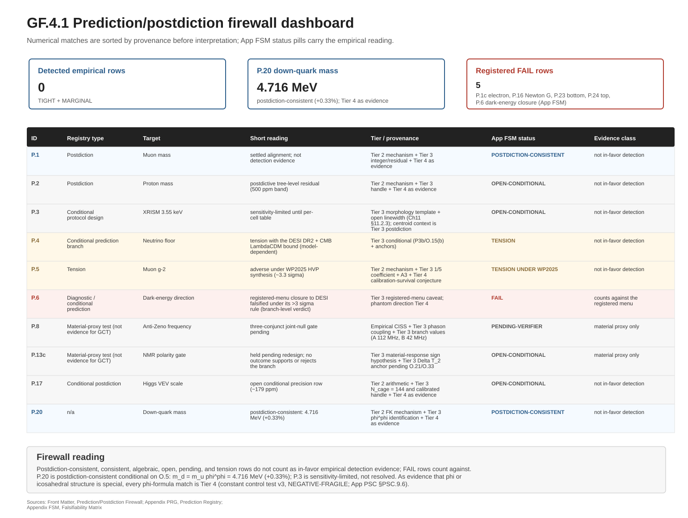

## 1. Definitions

### **A. Prediction (Targeted)**
A value derived from the theory's internal geometry *before* reference to a specific measurement, or a value that exceeds current experimental precision.
- **Criteria:** No undisclosed parameter is adjusted to match the result.

**Example — PTA Structural Program:** the rotational-icosahedral scalar harmonic has its first nonconstant invariant at $\ell=6$.  A physical timing-residual response, its normalization, and a falsification statistic require a separate action-to-propagator-to-pulsar transfer calculation.  This is a structural theorem plus an open research program, not a numerical prediction.

> **Note on High-Discriminating Postdictions:** Some postdictions are more informative than broad curve-fitting exercises because their registered internal search windows are small and explicitly disclosed, but they remain *Alignment* matches rather than free predictions. **Example:** The Tau mass formula $m_\tau = m_e \phi^{17}(1 - 3.6\alpha)$ has the Tier 2 harmonic mechanism $\phi^{17}$ with the Tier 3 exponent anchor $N=17$, the Tier 2 $A_5$-channel-averaging mechanism for the screening factor, and a coefficient built from the Tier 2 integer $D=18$ (the $H_3$ Shephard-Todd invariant-degree sum), the integer $N=5$ and the load-bearing Tier 3 ratio rule $c=-D/N=-18/5=-3.6$, pending first-principles derivation under App ORQ O.26b. $N = 5$ is the count of the five $A_5$ irreps (trivial included); reading them as phason channels is a Tier 3 convention (Tier 3 as a channel number). It is the same origin as the muon $+5\alpha$ channel count. The RT arithmetic $(4F-3V_3)/V_5=5$ gives the same integer but is a numerical coincidence check, not a second derivation. No global significance is claimed for the match (earlier figures withdrawn; see §3 rule 1). A small registered search window can raise a postdiction's diagnostic interest inside the framework, but it does not convert an already-known numerical alignment into a prediction-grade statistical result. As evidence that φ is special, the tau match is **Tier 4** (constant control test v3, NEGATIVE-FRAGILE; App PSC §PSC.9.6).

### **B. Postdiction (Alignment)**
An after-the-fact explanation of known data where the model's structural features map onto observed values.
- **Criteria:** The structure was designed to be consistent with the data, though the numerical match may be emergent.
- **Example:** The proposed icosahedral construction of the SU(3) $\times$ SU(2) $\times$ U(1) gauge-group candidate and chirality from the RT window and Jackiw-Rebbi domain wall (an open Tier 3 candidate; App ORQ O.39).

### **C. Consistency Check (Calibration)**
A match achieved by adjusting one or more "Calibrated Parameters" (Tier 3) to align the model with empirical anchors.
- **Criteria:** Used to determine the value of a free parameter ($\lambda, \tau, \epsilon$).
- **Example:** The matching of the Dark Energy $w(z)$ curve using $\lambda_{bio}$.

---
## 2. Firewall Metadata Template

Every major numeric match carries a **Firewall Metadata** note (an Important callout headed "Firewall Metadata" with the protocol name) in the margin or section footer, with the following fields:

| Field | Allowed values | Meaning |
| :--- | :--- | :--- |
| **Type** | Prediction / Postdiction / Consistency Check | The match category defined in §1 (A, B or C). |
| **Inputs** | The list of Parameters and Anchors used | Every Parameter Ledger entry and empirical anchor the formula consumes. |
| **Degrees of Freedom** | A non-negative integer | The number of adjustable knobs available when the match was made. |
| **Provenance** | Internal derivation / Calibrated fit / Heuristic | How the numerical value was obtained. |

---

## 3. Governance Rules
1. **The Overlap Rule:** A single formula structurally shared across multiple members carries the SAME prediction/postdiction status as its first-anchored member, unless the second/third member's value was unknown at the time of the formula's derivation. The structural-sharing claim does not promote postdictions to predictions.

 **Significance of the lepton exponent pair (N=11, N=17).** Earlier global-significance figures for the numerical matches are withdrawn: the cross-base comparison could not, by construction, credit any base other than $\phi$, and the trial counts behind the quoted σ values were asserted rather than enumerated. As evidence that $\phi$ or icosahedral structure is special, these matches are **Tier 4**: the preregistered constant control test (v3, NEGATIVE-FRAGILE; App PSC §PSC.9.6) found $\phi$'s pattern of matches on 21 constants not distinguishable from that of random constants (58 of 300 random bases did at least as well). The test "excludes, at power ≥ 0.8, an effect in which φ hits at least 6 of the 8 informative rows through a real effect; weaker effects are not excluded." The numbers are kept as descriptive arithmetic, and no global significance is claimed. The test is non-confirmatory (it re-analyses public data, and its statistic was chosen after v1 and v2); confirmatory evidence can only come from formulas registered before their targets are compared. The earlier table of look-elsewhere figures (≈2.6σ, ≈3.1σ, ≈4.4σ and the single-trial ≈5.4σ) is withdrawn on the same grounds.

 **Tier 3 marker:** the nominal ~0.002% (≈21 ppm) muon-ratio figure needs the full factor $(1+5\alpha_{\rm A3}+\phi^{8}\alpha_{\rm A3}^2)$. The bare $\phi^{11}$ ratio is about $3.75\%$ low; the first-order $(1+5\alpha_{\rm A3})$ drag correction ($A_5$ irrep count, Tier 3 as a channel number; equal-weight normalization Tier 3) leaves about $2429$ ppm; and the ≈21 ppm residual requires the second-order $\phi^{8}\alpha^2$ term, whose $-3$ exponent selection inherits the Tier 3 H-EW boundary, so it is conditional on H-EW and on A3. The $(1-5\alpha)$ factor belongs to the electron Planck-link check and is not an electroweak correction to the lepton ratios.

2. **The "Hidden Knob" Prohibition:** Any constant used in an equation that is not a Fundamental Constant ($\phi, \pi, \hbar$; the bare geometric $\alpha$ expression is not the measured low-energy input, and $G$ is an output row, not an input) or a listed Anchor (A1 $m_e$; A2 $\alpha_2^{-1}(M_{\rm GUT})$ for the native-RGE endpoint check; A3 $\alpha(0)$ for measurement-anchored precision-comparison rows; A4–A6 the gauge-flow normalisations $Z_1, Z_2, Z_3$) is declared as a **Calibrated Parameter** in the ledger. See Parameter Ledger §0.1 (rows A1–A6) and its disclosure of the two roles of $\alpha$. The phrase "fundamental constants" here excludes A3: the measured low-energy $\alpha(0)$ is an anchor, used only in precision-comparison rows per the Ledger.
3. **PTA Response Boundary:** the first rotational-icosahedral scalar harmonic is at $\ell=6$, and a physical icosahedral signal must retain an absolute orientation $R\in SO(3)/I$.  A separation-only Legendre term, a numerical amplitude, and a one-dimensional power ratio are not physical PTA observables until the action, propagator, pulsar response, normalization, and likelihood discriminator are derived and registered. Likewise, no PTA, RM, DM, kSZ, or Bell amplitude may be copied from $\phi^{-18}$ without an independently derived action-to-observable map.
4. **Historical Protected-Subspace Material Scenario (formerly "Zeno Drive Shielding Constraint"):** The supplied comparison from an assumed Tubulin Tryptophan (Trp) radical-pair baseline $T_2\sim1$–$10\ \mu$s to a historical 10 ms target gives $S\sim10^3$. Neither endpoint is a demonstrated tubulin Zeno-Drive quantity, and the protected-subspace mechanism remains open under O.23. Bulk-water decoherence ($\sim 10^{-13}$ s) is an inapposite baseline for this specific material comparison, but that correction does not derive a Selection clock or a Level-II gate.
5. **Dark Energy Causality:** The parameter $\lambda_{bio}$ and the operative biogenic-DE quartic mass scale ($m_{\rm phason}^{\rm operative} \approx 1.7 \times 10^{-5}$ eV) are **Tier 3 phenomenological fits**, calibrated to match observed cosmological acceleration; the physical-source interpretation of the biogenic channel is Tier 4. The susceptibility $\chi$ has a **Tier 2 functional form** via the horizon-entropy area law (Bekenstein–Hawking / Gibbons–Hawking de Sitter horizon entropy; $\chi = A_{\mathcal{H}_{CE}}/(4\ell_P^2)$, V2 Ch14 §14.1.5), but the Tier 3 numerical evaluation $\chi \approx 2.27\times10^{122}$ requires imported $H_0$ pending O.1/O.4. The only baseline the framework supplies without these fits is the equation of state $w=-1$, and that is itself a Tier 3 reading: it follows if the frozen-strain energy density is constant in $a$, but no covariant stress-energy or dilution law is derived (V2 Ch14).
6. **Spin–Phason Dimensional Firewall (formerly "Biological Phason Freezing"):** At physiological temperature $k_B T(310\,{\rm K}) = 0.0267\,{\rm eV}$ is an energy. With $[\nabla\Phi_\perp]=[k]=L^{-1}$ and $\alpha_R$ in Rashba units $E\,L$ (V1 Ch17 §17.1.3), the product $\alpha_R k\nabla\Phi_\perp$ has units $E/L$, so the quantity labelled $E_{RP}\approx0.3\,{\rm eV}$ cannot be divided by $k_BT$ as a dimensionless thermal margin, and the former "clear $k_BT$ by a factor of ten" acceptance criterion is withdrawn. The 38.0/38.3 MHz, $\eta_{\rm Zeno}$ and $N_{\rm coh}$ values are conditional external-rate scenarios (V1 Ch17 §17.1.3); they cannot support DMC phason-gate or Level-II claims. There is no registered $1.6\,{\rm eV}$ body-temperature freezing energy.
7. **Theorem Elevators:** 
 - The Bottom Quark scaling factor ($5/4$) is formalized as the exact Tier 2 $A_5$ representation-dimension identity $\dim(H)/\dim(G)=5/4$; its deployment as the physical bottom-quark mass coefficient remains Tier 3 pending Open Problem O.43.
 - The Phason stiffness exponent $\phi^{-18}$ is formally classified per Parameter Ledger §0.1 P3a/P3b as **Tier 2 integer-identification ($H_3$ Shephard-Todd anchor, conditional on the irreducible icosahedral premise) + registered Tier 3 stiffness-map hypothesis P3b, listed outside the postulate count like H-EW**. No Tier 2 softness mechanism is claimed: icosahedral symmetry leaves the invariant quadratic family $Q=aP_\parallel+bP_\perp$ with $b/a$ free, so the size of any phason/phonon stiffness ratio needs additional dynamics. The specific exponent $D = 18$ is the $H_3$-specific icosahedral anchor — the $H_3$ Shephard-Todd invariant-degree sum $\{2, 6, 10\} = 18$. Only $H_3$ attains 18 within the finite irreducible rank-three classification ($A_3=9$, $B_3=12$, $H_3=18$; Humphreys 1990), but the reducible finite system $A_1\times I_2(14)$ also has degree sum 18; the number alone does not select $H_3$ without the irreducible icosahedral premise. The RT-face tangent-bundle count $6+6+6=18$ (Anchor B, App ORQ O.26) enters as a 6D-ambient consistency cross-check, not as a second independent icosahedral anchor (see App ORQ O.26). The sharper RG-running claim $K_\perp/K_\parallel = \phi^{-D}$ at the renormalization-flow level is Tier 3 pending Open Problem O.15(b) (first-principles RG derivation). The physical $c_T \equiv c$ identification is Tier 3: it rests on the second-sound photon identification of V2 Ch05–Ch06, which is a Tier 3 postulate and a declared open programme.
8. **XRISM Observational Status:** The XRISM test for the 3.55 keV dark matter line is **Under Test (Data Inconclusive, Analysis Ongoing)**. XRISM has stacked 3.75 Ms of data across 10 clusters and did not resolve the line. The upper limit on the decay rate ($\Gamma \lesssim 1.0 \times 10^{-27}\ \mathrm{s}^{-1}$) remains several times weaker than the Bulbul et al. XMM-Newton order-$10^{-28}\ \mathrm{s}^{-1}$ detection normalization. XRISM has not yet reached the required sensitivity to confirm or rule out the signal. The GCT line therefore remains under test (its centroid also inherits the Tier 3 $N_{\rm cage}=144$ posit; App TAT); deeper observations are required. For full ground-truth data, see V3 Ch11 §11.4.4 and V3 Ch15 §15.5.

---

\newpage

## Frontmatter

# **VOLUME 1: THE OPERATING SYSTEM**
## **Dynamics of the Timeless Field**

---

### **Volume 1 Abstract**

**Volume 1** serves as the ontological kernel of Geometric Consciousness Theory (GCT). It posits that the fundamental layer of reality is not a spatiotemporal manifold populated by matter, but a timeless, infinite-dimensional configuration space $\mathcal{P}$ governed by the **Wheeler-DeWitt equation** ($\hat{H}\Psi=0$). On the Tier 3 Wheeler–DeWitt structural postulate, GCT models the constrained state as a static **Supersolid Quasicrystal**, the geometry of which ($\Phi_0$) is proposed to encode all possible physical histories; no solution of $\hat{H}\Psi=0$ is derived.

We **dissolve** the "Hard Problem" of consciousness — *not solve it from physics* — by stipulating universal Level I presence as Axiom 1 [Tier 1], motivated by the sole Tier 0 datum that experience is occurring (neither postulated nor derived; see V1 Ch16 §16.2.2b for the canonical dissolve-by-axiomatization framing). What GCT *derives* is the **Quality Space topology** (the graded $I_h$-irrep decomposition of §16.2.2c — 6 linear coordinate DOF plus 21 quadratic stress DOF) and a conditional algebraic unity candidate for trefoil-class Identity Polarons. Trefoil-case Polaron Unity is at most a Tier 3 algebraic unity candidate: Proposition PUP.1(ii) (Hilbert-space non-factorizability) is withdrawn by an exact $A_5$ counterexample, O.35/O.36 fail as posed for the represented trefoil group $B_3$ (its centre $\langle\Delta^2\rangle$ makes the amenable radical nontrivial and $L(B_3)$ non-factorial) and hold for the further central quotient $B_3/Z(B_3)\cong C_2*C_3$ [Tier 1 — standard]; whether any physical sector is that quotient's regular representation is open [Tier 3]; and the physical full-fibre-support/complement-map closure remains a sub-closure of Open Problem O.18; the general-prime extension remains Tier 3 conditional on Anderson-Putnam-to-knot-complement extension, canonicity of $K \to A_K$, a controlled meridian representation with convergence and trace descent, and KO-dim-6 sign verification (O.32). Even full closure of these conditions would establish at most an algebraic unity candidate, not Level II apperception, an owner, or a subject count. The **Selection Operator** ($\mathcal{F}_{sel}$) is the proposed *Quality Space individuation* and *unity* mechanism — it supplies the structural account of *which* phenomenal content the substrate carries at a given configuration and models candidate structural conditions for unified subjective experience rather than fragmented micro-experiences once the Polaron Unity conditions hold; it does **not** supply the resolution of the existence-gap, which is handled by Axiom 1 alone. Chapter 9 presents a **Tier 3 measurement-model proposal** in which a supplied Selection Operator acts as a constrained filter on the global wavefunction $\Psi$; the manuscript has not yet derived that physical operator, its Born measure, its substrate realization, or a phenomenal owner, so this is not a completed solution of the "Measurement Problem". Time is not treated as a fundamental dimension: the static coordinate $\tau_{\text{coord}}$ (the lattice address of a configuration) and an ordinal selection index $n$ provide a candidate relational-time representation. Identifying that index with an observer's proper or phenomenal time, and with the subjective experience of temporal flow, requires transition, memory, owner, and phenomenal bridges that remain open.

Crucially, this volume proposes a geometric **System Resolution** for the physical model. App USS records $A_5$ as the Tier 1/2 architectural premise H1 and derives conditional Schur-cover and McKay consequences; it does not prove point-group uniqueness or eliminate other spinorial point groups. The Golden Ratio ($\phi$) projection remains the primary candidate for the global entropy-packing optimum rather than a settled slope-maximality theorem. The **Electron Mass ($m_e$)** relation uses the 6D lattice spacing and a Peierls-Nabarro ansatz ($m_e = M_P \times \phi^{-107} \times (1-5\alpha)$; **Tier 2 mechanism + Tier 3 exponent anchor + Tier 4 physical-link conjecture pending O.14**). Because $m_e$ is the A1 anchor, the relation is a Tier 3 anchor-normalised Planck-link check: its 1006 ppm residual misses the pre-registered 1000 ppm pre-commitment by 6 ppm, and App FSM P.1c reports a **FAIL** of that rule. We further obtain **Newton's Gravitational Constant ($G = 6.689475523 \times 10^{-11}$ m³ kg⁻¹ s⁻²)** via the Jacobson entropic gravity formula applied to the icosahedral lattice vacuum, using the GCT-$\alpha$ branch $\alpha_{\rm GCT}=\phi^2/360$ with CODATA $m_e$ and exact SI $h,c$, with disposition **Tier 2 thermodynamic mechanism + Tier 4 Planck-link conjecture inheriting O.14 + Tier 3 dimensional anchor** (the numerical $G$ row is the electron Planck-link row inverted, $G\propto m_e^{-2}$, so it is not independent evidence and is not counted as a pass while the electron row fails its pre-registered rule), and the bare **Fine-Structure Constant** relation $\alpha^{-1} = 360\phi^{-2} \approx 137.508$ as a geometric electromagnetic-coupling ansatz **[Tier 3 numerical relation (Tier 3 600-cell multiplier; mechanism open — the RT solid-angle construction is withdrawn, V1 §13.2.1–§13.2.2) + residual closure target; 3443 ppm from CODATA; see Chapter 13 and App ORQ O.19/O.5]**. Its historical "selection-interface impedance" interpretation does not derive a physical Selection Operator or Agent bandwidth. As evidence that φ or icosahedral structure is special, these φ-formula matches are **Tier 4**: the preregistered constant control test (v3, NEGATIVE-FRAGILE; App PSC §PSC.9.6) found φ's pattern of matches on 21 constants not distinguishable from that of random constants (58 of 300 random bases did at least as well). The test "excludes, at power ≥ 0.8, an effect in which φ hits at least 6 of the 8 informative rows through a real effect; weaker effects are not excluded." The numbers are kept as descriptive arithmetic.

We construct the **Identity Space candidate** as the universal Adelic Solenoid $\Sigma_\infty$ [Tier 1 mathematics]. Its transversal is all-prime, $\widehat{\mathbb{Z}}\cong\prod_p\mathbb{Z}_p$; a rooted address tree and its ultrametric arise only on a selected base fiber or local transversal chart after choosing a cylinder filtration, and the Solenoid's ordinary fundamental group is trivial. The exact topology therefore supplies an address-and-resolution skeleton; it does not by itself supply infinite non-erasable memory, a selected $p$-adic identity code, an owner, or a Level-II observer. Identifying a chosen address presentation with the **Nuclear Spin States ($I$)** of the biological substrate, and deriving its read/write, protection, ownership, and physical-scope maps, remain explicit Tier 3 bridges. The further association of subjective experience (Qualia) with the **Topological Friction** experienced by the Agent as it navigates the vacuum lattice $\Phi_0$ is a Tier 3 structural-Russellian proposal: no examined Agent, phason-work channel, owner, or phenomenal registration presently realizes it.

---

### **Preface to Volume 1: The Logic of Being**

**V1.1 The Ontological Primitive**

The central crisis of modern science lies in the incompatibility of its two most successful frameworks: Quantum Mechanics, which describes a probabilistic world of potentiality, and General Relativity, which describes a deterministic world of geometry. Bridging them requires a theory of Quantum Gravity, but all attempts have stumbled upon the "Problem of Time"—the disappearance of the time variable $t$ from the fundamental equations. Simultaneously, the philosophy of mind faces the "Hard Problem"—the impossibility of deriving subjective experience from objective matter.

GCT proposes that these may not be two separate problems, but one, sharing a premise that GCT declines to adopt: **Materialist Emergence**. GCT argues that the assumption that spacetime and matter are fundamental, and that consciousness and time emerge from them, is associated with open difficulties in both physics (singularities, fine-tuning) and philosophy (qualia, agency); this is a motivation for the inversion below, not a demonstration that the premise is false.

We resolve this by inverting the ontological order—not as an arbitrary choice, but as **a methodological choice motivated by the only $P=1$ datum**: the existence of Experience itself. By treating consciousness as the irreducible primitive (the Field $\Psi$, a framework postulate that does not itself inherit $P=1$) and matter as a topological constraint within it, we propose to derive the emergence of spacetime and physical laws from that starting point.

**V1.2 The Mathematical Turn**

To make this claim scientific rather than mystical, we must move beyond vague metaphors. We cannot simply say "consciousness creates reality"; we must write down the equation.

This requires a **Mathematical Turn** toward topology and measure theory. We model Identity not as a neurological state, but as a topological invariant—a knot in a higher-dimensional fiber bundle ($\Sigma_\infty$). We model Choice not as a neurological impulse, but as a linear operator ($\mathcal{F}_{sel}$) acting on a Hilbert space. We model Existence not as material presence, but as a **non-null restriction** of the global field: the configuration space possesses measure $\mu > 0$ wherever $\mathcal{F}_{sel}$ produces a non-trivial section—not by accumulation, but by holographic restriction of the whole.

By formalizing these concepts, we aim to give the study of consciousness a mathematical form that can be checked. The result is a research programme rather than a finished theory: its claims carry explicit epistemic tiers, and some of its branches are registered as falsifiable rows (App FSM), each of which tests only the branch it names.

**V1.3 Scope and Boundaries**

This volume is restricted to the foundational structure and governing parameters of reality. It deals with:

* **Ontology:** What exists? (The Field and the Knot).
* **Logic:** How does it structure itself? (Idealism, Discrete Geometry).
* **Universal Constants:** What is the resolution? (Geometric routes to $\alpha$, $G$ and $\ell_P$, each at its own tier; Ch13).
* **Dynamics:** How does it change? (The Wheeler-DeWitt Constraint, Selection).

It does *not* address the concrete physical realizations—the specific taxonomy of particles (electrons, quarks) or the specific hydrodynamics of cosmology (Dark Energy Lagrangian)—except where they define the structural architecture. Those realizations are the subject of **Volume 2 (The Cosmic Architecture)** and **Volume 3 (The Matter Spectrum)**.

---

### **Volume 1 Notation and Symbolic Conventions**

To ensure precision in our derivations and avoid symbolic collisions with the particle physics definitions in Volume 3, we adopt the following symbolic conventions for Volume 1.

#### **Fundamental Spaces**
* **$\Psi$ (The Field):** The Universal Wavefunction satisfying $\hat{H}\Psi=0$. The fundamental substrate of consciousness. Where the text says "consciousness field $\Psi$", it means the Field, in its Level I, non-subjective sense.
* **$\Sigma_\infty$ (Adelic Solenoid):** GCT's candidate address-and-resolution scaffold for Identity, constructed as the inverse limit of circle wrappings, with all-prime transversal $\widehat{\mathbb{Z}}\cong\prod_p\mathbb{Z}_p$ [Tier 1 mathematics]. It has no intrinsic single-prime filtration, rooted tree, owner, memory, history, transition law, or phenomenal interpretation; a chosen cylinder tree lives on a selected base fiber or local transversal chart. Treating it as the fiber that encodes an observer's internal state is a Tier 3 bridge requiring a physical address map.
* **$\mathcal{P}$ (Configuration Space):** The domain of the consciousness field $\Psi$. The shorthand $\mathcal{P} \cong \Sigma_\infty \times (E_\parallel \oplus E_\perp)$ is a **Tier 3 factor ansatz**, not a topology theorem or a literal physical realization; using a Solenoid coordinate in a physical render additionally requires a physical address map and a physical realization rule.
* **$E_\parallel$ (Parallel Space):** The 3-dimensional physical manifold (the "screen" of projection).
* **$E_\perp$ (Perpendicular Space):** The 3-dimensional internal manifold containing the "hidden" degrees of freedom (Phasons).
* **$\Phi_0$ (Vacuum Condensate):** The specific ground-state lattice geometry (Supersolid Quasicrystal) that solves the Hamiltonian constraint. Distinguished from $\Phi$ (Higgs Field).

#### **Operators and Generators**
* **$\mathcal{F}_{sel}$ (Selection Operator):** A proposed linear, non-unitary Agent-frame update (conditionalization) on declared states, intended to represent conscious actualization by mapping the global superposition to a specific experiential section. No examined physical carrier, instrument, clock, intent map, owner, or phenomenal event presently realizes it, and $\Sigma_\infty$ supplies no dynamics for it.
* **$\hat{\mathcal{R}}$ (Realization Operator):** The proposed Agent-relative realization/projection rule relating Field data to a render in $E_\parallel$. Treating a $\Sigma_\infty$ address as one of its inputs requires a physical address map, and the physical address-to-render rule itself is an open Tier 3 bridge.
* **$\hat{H}$ (Hamiltonian Constraint):** The generator of time reparameterizations that annihilates the physical state ($\hat{H}\Psi=0$).

#### **Metrics and Coordinates**
* **$\mathbb{I}_K$ (Hierarchical Identity):** The proposed transversal residue coordinate for the observer, extracted only after a physical address map and a base-fiber/local-chart choice. It is a compatible all-prime residue system in $\widehat{\mathbb{Z}}$ (a full Solenoid point also carries its suspension coordinate); a single $p$-adic digit string and its substrate realization are selected Tier 3 data.
* **$\tau_{\text{coord}}$ (Relational Time Coordinate):** The ordinal address of a configuration in the static lattice sequence. *Distinct from the Tau lepton ($\tau$) appearing in Volume 3.*

> **Note:** $\tau_{coord}$ denotes coordinate time exclusively. The symbol $\tau$ without subscript refers to $\tau_{coord}$. The quadrupole shielding time uses $\tau_Q$ (subscript $Q$ always explicit). The tau lepton mass uses $m_\tau$.

* **$d_H(i,j)$ (Hierarchical Distance):** A compatible ultrametric on a declared nested-cylinder filtration of the identity address tree. It measures common address resolution, not physical scope or ownership.
* **$\kappa_{ij}$ (Coupling Coefficient):** A Tier 3 phenomenological physical interaction kernel between agents $i$ and $j$, sometimes modeled as $\kappa_0 e^{-\lambda_c d_H}$ only after a filtration, a physical address map, and an independently justified address-to-coupling law are declared.
* **$\lambda_c$ (Consensus Decay Constant):** A phenomenological range parameter in the optional exponential coupling ansatz. Neither its value nor the exponential law is determined by Solenoid topology; both require calibration or derivation from the physical kernel.

#### **Temporal Language Conventions**
Because GCT treats time as emergent, we distinguish between two frames of reference:
* **Agent Frame (Sequential):** A conditional description indexed by an ordinal $n$ and using terms like "next," "then," "evolution," and "process." Identifying it with an observer's perspective or with phenomenal time requires the open transition, clock, owner, and phenomenal bridges.
* **Field Frame (Timeless):** The perspective of the global wavefunction. Uses terms like "static," "correlation," "geometry," and "structure." Time is a coordinate ($\tau_{coord}$).

#### **The Tier Classification System**
We categorize all claims by their epistemic status:
* **Tier 0 (Bedrock / First-Person Datum):** Exactly one item: experience is occurring, i.e. there is presence now. It is neither postulated nor derived; no other claim may enter Tier 0. Axiom 1 remains its stipulated universal Level I generalisation (Tier 1). Tier 0 supplies no Level II substrate verdict; those remain open (Tier 3).
* **Tier 1 (Structural Axiom):** Results following necessarily from axioms + mathematics.
* **Tier 1/2 (Architectural Postulate + Conditional Mathematics):** Results that follow from the specific architecture choice (6D lattice, icosahedral projection) but are not deductively forced by the axioms alone. The architecture is justified by parsimony and empirical adequacy, not logical necessity, and conditional mathematics never promotes the premise it assumes. Marker: `[Tier 1/2]`
* **Tier 2 (Geometric / Derived):** Results following from the specific icosahedral quasicrystal ansatz.
* **Tier 3 (Phenomenological / Calibrated):** Models calibrated to observation where first-principles derivation is incomplete.
* **Tier 4 (Speculative / Order-of-Magnitude):** Exploratory calculations where dimensional structure is correct but numerical coefficient is uncertain by >1 OOM. Claims include explicit OOM bounds. Tier 4 also covers ontological extensions outside the core falsifiable theory. Example: biogenic dark energy driving force (V2 Ch14).

The closure target is a one-anchor gauge/lepton system, but the present manuscript is not at that target. Per Parameter Ledger §0.1, the current gauge + lepton + native-RGE endpoint + precision-comparison accounting is 5-postulate-plus-6-continuous-anchor: P1 plus the integer anchors $n=-107$, $D=18$, $N=11$, $N=17$; A1 ($m_e$); A2 ($\alpha_2^{-1}(M_{\rm GUT})$); A3 (measured low-energy $\alpha(0)$ for corrected lepton/Higgs/QED comparison rows); and A4-A6 (the App GRF $Z_1$, $Z_2$, $Z_3$ $\beta$-coefficient magnitude normalisations). A named precision/gauge comparison subset contains the six Tier-3 coefficient handles $1440$, $12$, $360$, $2$, $10\phi^2$, and $1/5$. This is a scoped subset, not a manuscript-wide handle total; sector-specific coefficients are catalogued separately. The O.38 $N=144$ cage posit is also separate from both this subset and the six continuous anchors. Volume 1 uses this table as the current-state qualifier whenever downstream constants such as $\alpha$, $m_e$, $G$, or $\xi$ are referenced.

---

## Part I Logic of Being

## **PART I: THE LOGIC OF BEING**

### **Chapter 1: The Staircase of Certainty**

**1.1 The Problem of the Starting Point**

**1.1.1 The Crisis in Foundational Physics**

Modern physics finds itself in a paradoxical state. On the one hand, it possesses two theories of unparalleled predictive power: Quantum Mechanics (QM), which governs the subatomic realm, and General Relativity (GR), which governs the cosmic realm. On the other hand, these theories are mutually incompatible at their core. QM describes a probabilistic world of discrete quanta evolving against a fixed background, while GR describes a deterministic world of continuous geometry where the background itself is dynamic.

Attempts to unify them into a Theory of Everything (TOE) have stalled for half a century. The symptoms of this stagnation are well-known:
1. **The Measurement Problem:** Quantum mechanics provides no agreed mechanism for how a probability wave yields a definitive event; collapse formulations require an observer- or measurement-dependent rule, while no-collapse alternatives (Everett, Bohm, objective-collapse models) pay other costs.
2. **The Problem of Time:** The Wheeler-DeWitt equation ($\hat{H}\Psi=0$), the canonical result of quantizing gravity, on its standard reading suggests that the universe is static and timeless, contradicting our most basic experience.
3. **The Parameters Problem:** The Standard Model relies on ~26 arbitrary constants (masses, couplings) whose values must be measured rather than derived. [Tier 3 — Phenomenological count; exact number depends on definition of independent parameters]

Geometric Consciousness Theory (GCT) posits that these are not separate problems, but symptoms of a single methodological error: the attempt to derive the Observer from the Observed.

**1.1.2 The Hard Problem as a Category Error**
 
The "Hard Problem of Consciousness" arises from the assumption that matter is primary and consciousness is derivative. GCT inverts this hierarchy. We posit that the failure of physicalism to account for subjective experience is not a gap in our knowledge, but a **result of the initial axioms**. By treating the "Object" as fundamental and the "Subject" as emergent, standard physics creates an unbridgeable explanatory gap.
 
**1.1.3 The Geometric Alternative**

Instead of trying to squeeze consciousness into a materialist framework, we ask: *What geometry is required to support a universe where the Subject is irreducible?* This shift from "How does the brain make a mind?" to "What geometry unifies Mind and Matter?" is the core of the GCT program.

GCT raises two objections to the standard Materialist alternative [Tier 3 — Philosophical Framework; contested objections, not refutations]:

1. **The Something-from-Nothing Objection:** The claim that subjective experience emerges from sufficiently complex arrangements of non-experiential matter is akin to claiming that stacking enough zeroes eventually yields a one. It introduces an unexplained miracle into the causal chain — a discontinuity of ontological kind with no mathematical grounding. (This is Strawson's (2006) objection to brute emergence; physicalists contest it, see Ch16.)

2. **The Circular Causation Objection:** Physics is an activity performed *by* conscious agents. We infer the existence of particles based on observations made within consciousness. GCT reads the claim that the particles *create* the consciousness as confusing the order of knowing with the order of being — the measurement presupposes the measurer. Epistemic priority does not by itself entail ontological priority, and physicalists accept the first while denying the second; the point motivates the epistemic inversion of §1.1.4 rather than refuting physicalism.

**1.1.4 The Requirement for Epistemic Inversion**

To resolve the crisis, we must perform an **Epistemic Inversion**. We cannot start with the objects of our theory (quarks, strings, branes), because those objects are inferred. We must start with the instrument of inference itself.

We require a foundation that is not a hypothesis, but a certainty. We must identify the **Ontological Primitive**—the one thing that cannot be an illusion. Only by anchoring our physics in this absolute datum can we build a structure that does not rely on discontinuities of emergence. We must construct the universe Top-Down, not Bottom-Up.

---

**1.2 The Cartesian Anchor**

**1.2.1 Radical Skepticism: Discarding the Doubtable**

To find the true starting point, we employ the method of Radical Skepticism. We systematically discard every belief that *could* theoretically be false, no matter how unlikely.

1. **The External World?** Could the physical universe be an illusion? Yes. The **Simulation Hypothesis** or the "Brain in a Vat" scenario demonstrates that our sensory data could be a coherent fabrication. Therefore, the existence of matter is a hypothesis ($P < 1$). [Tier 3 — Philosophical Framework]
2. **The Ego/Personality?** Could "I" be an illusion? Yes. The sense of being a continuous person with a name and history is interrupted by sleep, amnesia, and psychedelic dissolution. The "Ego" is a narrative construct ($P < 1$). [Tier 3 — Philosophical Framework]
3. **The Past?** Could history be fake? Yes. Russell's five-minute hypothesis (1921; popularly "Last Thursdayism") suggests the universe could have come into existence moments ago with false memories implanted; the Boltzmann-brain scenario is a related argument about a brain fluctuating into existence. The past is an inference ($P < 1$). [Tier 3 — Philosophical Framework]

What remains when the world, the self, and time are stripped away?

**1.2.2 The Zero-Point: Experience as the $P=1$ Datum**

Even if the world is a simulation, the **experience of the simulation** is happening. Even if the pain is hallucinatory, the **feeling of pain** is real. Even if "I" do not exist, there is a "There" where the doubting is occurring.

This is the **Zero-Point**. To deny it is to affirm it, for one must *be* there to do the denying. This is not a logical proof; it is a phenomenological fact. It is the only datum in the universe that possesses absolute probability. [Tier 0 — First-Person Datum]

**1.2.3 Axiom 1: The Axiom of Presence**

The Tier 0 datum motivates the first axiom of the theory, a universal generalisation adopted by stipulation rather than established by first-person certainty.

> **Axiom 1 (The Axiom of Presence):**
> *All configurations of the Field carry Level I intrinsic non-subjective presence.* [Tier 1 — stipulated universal axiom]
> The objective-idealist choice of the Field as fundamental substrate is a Tier 3 parsimony commitment (Ch06), distinct from the Tier 0 datum.
>
> **First-person datum only — Probability:** $P(\text{Presence}) = 1.0$ [Tier 0 — First-Person Datum]
>
> **Scope Note:** Axiom 1 asserts Qualitative Presence as the irreducible ontological primitive. GCT derives the Quality Space (the topological structure of experiential similarity) from RT geometry. The bare fact that experience is occurring is the sole Tier 0 datum; universal Field presence is the Tier 1 stipulation, not an indubitable datum.

**Clarification on "Field":** We use the term "Field" here not to imply immediate 3D spatial extension, but to denote a **Domain of Variation**. Presence is not a geometric point; it has capacity. It can sustain multiple distinct qualia (e.g., sound and color) simultaneously. It is a manifold of potentiality.

This axiom redefines the task of physics. We are not trying to explain how a brain generates consciousness. We are trying to explain how a fundamental Field of presence generates the appearance of a brain.

> [!IMPORTANT]
> **Scope of the $P=1$ claim across volumes.** The $P = 1$ certainty belongs only to the Tier 0 first-person datum, not to Axiom 1's universal stipulation. This certainty does not transfer downstream. Every further claim carries an explicit epistemic tier label (Tier 0 is reserved for the single datum; Tiers 1, 1/2, 2, 3 and 4 classify all other claims per the Global Frontmatter Epistemic Tier System). Volume 1 Chapters 16–17 develop a **candidate material-response programme** (microtubule Trp radical-pair, spin, chirality, coherence and bound-water hypotheses) with explicit Open Problem cross-references (O.16, O.21, O.12, O.10); its specific identifications are Tier 3. The historical 100 MHz material-scan scenario is an external scenario, not an action-derived GCT rate (V1 Ch17 §17.1.3). Protocol A-Prime and Protocol D test ordinary material proxies: neither outcome is a verdict on GCT as a whole, and no phason, Selection-Operator or Level-II inference follows from either (V1 Ch17 §17.1.3); a preregistered null rejects the registered biophysical branch as registered, only under that branch's own decision rule (the Protocol D NMR polarity gate (P.13c) is held pending redesign: as written it rejected by construction, since $^{17}$O shortens water-$^1$H $T_2$ by scalar relaxation; the former sign-aware rule, which rejects the registered sign-positive branch on a powered, significant negative isotope × activity interaction in water-$^1$H $\Delta T_2$, applies only after the redesign, and until then no outcome supports or rejects the branch; the LORR assay has no rejection rule under the current systematic budget). The bare fact of experience is at $P = 1$; the account of *how* experience is physically instantiated remains open rather than resting on a single decisive experimental gate.

---

**1.3 The Axiom of Intelligibility**

**1.3.1 Phenomenology of Distinction and Sequence**

Having established *that* something exists (Presence), we ask: What is its nature? Is it a featureless void? Is it chaotic noise?

We observe that our experience—whether veridical or hallucinatory—possesses inherent characteristics:
1. **Distinction:** We perceive differences. Red is not Blue. Pain is not Pleasure. This thought is not that thought. **Distinction is the seed of Topology.** If A is distinct from B, there is a "boundary" or "relation" between them. Distinction alone does not imply discreteness (a continuous hue line contains distinct colours); discreteness is adopted separately as a structural postulate (Ch04).
2. **Sequence:** We perceive order. There is a "Before" and an "After." Causality flows.

**1.3.2 Structure vs. Chaos**

Consider the hypothesis of **Pure Chaos**—a state of total randomness with no pattern, no distinction, and no stability.
Could we be experiencing Pure Chaos? No.
To experience "Chaos" requires distinguishing it from "Order." To experience "Nothing" requires distinguishing it from "Something."
While a state of pure undifferentiated awareness (Void/Nirvana) may theoretically exist as $0=0$, **Physics begins with the departure from null identity.** To have a "Universe" (an observable manifold) requires structure. The very fact that there is "Something" rather than "Uniformity" implies that the Field of Presence has entered a structured state. It is not vapor; it is structured. [Tier 1 — stipulated axiom (Axiom 2, §1.3.5)]

**1.3.3 Clarification: Intelligibility vs. Specific Aristotelian Logic**

We do not claim that the universe must obey specific human logical rules (like the distributive law, which quantum logic gives up). We claim only that it possesses **Internal Consistency**.
The Field has a nature. It holds patterns. It sustains correlations. This capacity for self-consistency is what we call **Intelligibility**. If reality were not intelligible, science would be impossible, and the regularity of experience (the sun rising, gravity pulling) would be a miraculous accident.

**1.3.4 The Dream Question: Weak Causality vs. Strong Causality**

Critics might argue: "What about dreams? Dreams are illogical."
GCT responds: Dreams possess **Weak Causality**, but they are not chaotic. In a dream, a door might lead to a beach (violating spatial logic), but the door is still distinct from the beach (Distinction), and the opening precedes the arriving (Sequence). Even the most surreal hallucination relies on a substrate of pattern recognition.
The difference between "Dream Logic" and "Waking Logic" is modelled in Chapter 11 as differing rigidity of a conditional Consensus-Protocol compatibility functional [Tier 3 model; no derivation of material rigidity from interacting Agents is supplied], not as a difference in the fundamental intelligibility of the substrate.

**1.3.5 Axiom 2: The Axiom of Intelligibility**

We formally state the second ontological axiom of the theory.

> **Axiom 2 (The Axiom of Intelligibility):**
> *The Field of Presence is not chaotic vapor. It contains distinction and sequence. Therefore it possesses internal consistency—it is intelligible. The Universe can be known.*
>
> **Status:** adopted by stipulation [Tier 1 — stipulated axiom]. No probability is assigned to it: the $P = 1$ certainty belongs only to the Tier 0 first-person datum (§1.2.2) and does not transfer to Axiom 2.

From these two ontological axioms—Presence (Existence) and Intelligibility (Structure)—we begin the construction of the GCT architecture. While the ontological root is minimal, it is supplemented by explicit structural postulates (e.g., the 6D lattice, discreteness) to map reality to the observed Standard Model. These are enumerated in the **Axiom & Postulate Ledger**.

> **Scope-note on Axiom 1: mathematical objects do not have Level I presence.** A natural misreading of Axiom 1 — "if every configuration of the Field has Level I presence, then mathematical objects (integers, theorems, abstract structures) must have presence too" — is incorrect. Mathematical objects are *patterns* in the Russellian sense (Chapter 6): extrinsic structure, abstractly specified, multiply instantiable. They are not Field configurations. Axiom 1 applies to the substrate (the Field), not to descriptions of substrate. The physical *instantiation* of doing mathematics (in a brain, or in a Class 2 Polaron if one is physically realized) is a Field configuration and has Level-I presence in the ordinary way; the abstract integer 7 does not. This distinction is load-bearing — collapsing it would dissolve the Field/Pattern split that the entire ontology rests on, converting GCT into Tegmark's Mathematical Universe Hypothesis (a position GCT explicitly rejects; see §6.4.5 for the formal contrast).

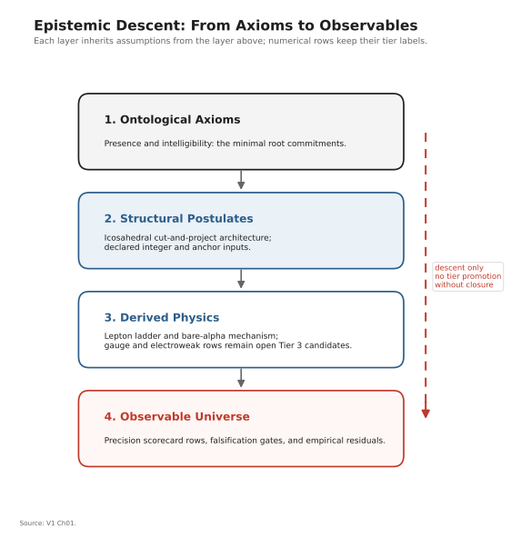

---

### **Chapter 2: The Axiomatic Foundation**

**2.1 The Goal: Minimal Axioms, Maximum Explanation**

**2.1.1 What We're Attempting**

A "Theory of Everything" (TOE) is held to a supreme standard: it must explain everything that exists, without assuming the existence of anything it cannot explain. Standard physical theories fail this test because they begin midway through the causal chain. They assume the existence of a spacetime manifold, quantum fields, and physical laws, treating these as brute facts. They explain the behavior of matter, but not its origin, nor the nature of the observer who perceives it.

Geometric Consciousness Theory (GCT) attempts a more ambitious derivation. Our goal is to construct the entire edifice of modern physics—Quantum Mechanics, General Relativity, the Standard Model, and Cosmology—from a starting point as close to zero as possible. We aim to show that the complex universe we inhabit is not a collection of arbitrary accidents, but a structured consequence of the fact that *something exists* together with a small, declared architecture. GCT does not meet the full TOE standard: it adopts explicitly declared Structural Postulates that are not deduced from the Axioms (§2.1.3) and carries the postulates, continuous anchors, and calibrated handles enumerated in the Parameter Ledger. The standard functions as a closure target, not as a description of the theory's current state.

**2.1.2 Occam's Razor as Bayesian Reasoning**

To navigate the path from "Something Exists" to "The Proton Mass is 938 MeV," we need a disciplined method for comparing competing explanations. GCT uses **Occam's Razor** as a **Bayesian and algorithmic heuristic prior**, consistent with the controlling Axiom and Postulate Ledger. Within a declared coding language, model class, precision, and dataset, shorter descriptions may receive larger prior weight.

This is a rule for ranking encoded hypotheses, not a theorem that nature must instantiate the shortest program. Kolmogorov complexity depends on the chosen universal description language up to an additive constant, and predictive comparison also requires likelihoods and data. Thus "One Field" can be a useful parsimonious preference over "One Field plus many independent constants," but parsimony alone neither proves the former true nor selects its constitutive dynamics. [Tier 1 conditional formalism; methodological heuristic]

**2.1.3 Ontological Root vs Structural Architecture**

> **Ontological Root vs Structural Architecture**
> We distinguish between the **Ontological Root** (Axioms) and the **Structural Architecture** (Postulates).
> - The **Ontological Axioms** (Presence, Intelligibility) constrain what a viable ontology must ultimately explain.
> - The **Structural Postulates** (e.g., discreteness, a 6D Euclidean parent lattice, a specific cut‑and‑project scheme, and a global Hamiltonian constraint) specify **one concrete implementation** of an intelligible world-model.
>
> This work does **not** claim that the Structural Postulates follow deductively from the Ontological Axioms alone. Instead, we treat them as an explicitly declared architecture whose justification is **minimum additional complexity** (algorithmic parsimony) plus **empirical adequacy and falsifiability**.

**2.1.4 Phenomenological Bracketing (Husserl's Epoché)**

To maintain maximum philosophical rigor, we apply **phenomenological bracketing** (*epoché*) in the sense of Husserl: we temporarily suspend judgment on the existence or nature of the external world and ask only what is *immanently given* to consciousness before any theoretical commitment is made. This allows us to cleanly separate two categories of claim:

> * **First-Person Datum vs Adopted Axioms:** The occurrence of experience is the Tier 0 datum. Axiom 1 generalises it by stipulation [Tier 1] to universal Level I presence; this universality is not transcendentally necessary. Axiom 2 retains the requirement that any structured field of experience satisfy intelligibility. The presence datum alone does not select an ontology; objective idealism remains the Tier 3 parsimony choice of Ch06. Intelligibility excludes pure chaos within the framework. These axioms are not derived from physics; they define the framework within which its physical proposals are developed.
>
> * **Architectural Contingency:** The specific choice of a **6D hyper-cubic lattice** projecting via the **Golden Ratio** into a 3D quasicrystal is *not* transcendentally necessary. One could in principle imagine a universe running on a different discrete geometry — a cubic lattice, a hexagonal tiling, or a random network. The icosahedral quasicrystal is a specific, non-trivially committed architecture.
>
> However, this architecture is not arbitrary. We posit it as a **minimum-complexity candidate** satisfying the conjunction of:
> 1. **3D isotropic causality** (no preferred direction in the physical manifold),
> 2. **Spinorial matter** (existence of fermionic fields, requiring a global Spin structure), and
> 3. **Finite declared structural commitments and anchors** (the parsimony method of §2.2 applied to the architecture itself: current accounting is the 5-postulate-plus-6-anchor system disclosed in the Parameter Ledger, with the full cross-sector parameter scope tracked separately).
>
> Bare isotropy alone does not select the icosahedral case: the octahedral group $O_h$ and tetrahedral group $T_d$ also supply macroscopically isotropic finite point symmetries. The additional architectural axiom is **maximal polyhedral point symmetry**: among the finite polyhedral rotation groups compatible with the required discrete substrate, choose the largest rotational order, the icosahedral group $I\cong A_5$ of order 60. The class restriction is essential because dihedral rotation groups have unbounded order. This is a structural postulate, not a deduction from Presence and Intelligibility alone, and it matches the Axiom Ledger's classification of the architecture as not deductively forced.
>
> Appendix USS §USS.6 gives the controlling spin-lift taxonomy: every finite rotation subgroup $\Gamma\subset SO(3)$ has a canonical preimage in $\mathrm{Spin}(3)$, including the dihedral, tetrahedral, and octahedral candidates. $A_5$ is distinguished algebraically because it alone is perfect among the finite Platonic rotation groups and its preimage $2I$ is its universal central extension, but this is an architectural discriminator rather than a spin-existence condition. The registered comparison sets aside $A_4/S_4$ as crystallographic. Its dihedral branches do not reproduce the full adopted three-dimensional icosahedral package: the $H_3$ rhombic-triacontahedral window, the $H_3$ invariant data, and the $2I\to E_8\to H_4\to H_3$ architecture chain. Five-fold symmetry and $\mathbb Z[\phi]$ arithmetic alone are not unique to that package; decagonal $C_5/D_5$ geometry also carries them. The architecture therefore remains contingent and conditionally selected under the declared 5-postulate-plus-6-anchor accounting.

This bracketing is critical for the epistemic discipline of GCT. The Axioms are presented with certainty proportional to their epistemological status; the Architecture is presented as a conditionally preferred candidate hypothesis, subject to experimental falsification.

---

**2.2 The Bayesian Method**

**2.2.1 Why Bayesian Framework?**

Traditional philosophy often devolves into "intuition wars," where one thinker's self-evident truth is another's absurdity. To avoid this, we must quantify certainty. Bayesian inference provides the mathematical tool to update our confidence in a hypothesis ($H$) based on new evidence ($E$).

$$ P(H|E) = \frac{P(E|H) \cdot P(H)}{P(E)} \quad \text{[Tier 1 — Bayes' Theorem]} $$

* $P(H|E)$: The **Posterior Probability** (how likely the theory is true after seeing the evidence).
* $P(E|H)$: The **Likelihood** (how well the theory predicts the evidence).
* $P(H)$: The **Prior Probability** (how plausible the theory is *before* evidence).

**2.2.2 Prior Probabilities and Kolmogorov Complexity**

The crucial term is the Prior Probability $P(H)$. In science, we often assume all theories are equally likely until tested. In foundational metaphysics, this is false. A theory that requires "Magic"—defined rigorously as **Incompressible Complexity**, or rules that cannot be derived from simpler components—has a lower prior probability than a theory that uses existing mechanisms.

We can formalize one such prior through **Solomonoff induction**:
$$ P_U(H) \propto 2^{-K_U(H)} \quad \text{[Tier 1 — conditional algorithmic-probability formalism]} $$
where $K_U(H)$ is the length of the shortest prefix-free program describing the hypothesis relative to a declared universal machine $U$. The formalism is exact once that coding framework is fixed; its use as a prior over physical theories remains a methodological choice.
A theory that says "The universe is a computer simulation running on a specific operating system constructed by aliens" may have higher $K_U(H)$ because it must define the OS and the aliens. A theory that says "The universe is the self-interaction of a single field" may have lower complexity within the same declared encoding.

**2.2.3 Parsimony is Built-In**

Occam's Razor is therefore more than an aesthetic preference but less than a physical selection theorem: it supplies a conditional prior after the encoding and comparison class are declared. A shorter code receives exponentially larger algorithmic weight *within that scheme*; this does not establish that the corresponding theory is exponentially more likely to be physically true.

When GCT faces a fork—for example, "Is the universe continuous or discrete?"—it may compare the descriptive commitments of each branch:
* **Continuum:** A continuum field theory can be specified by a finite rule, but quantitative calculations commonly require a regulator, renormalization prescription, boundary data, and parameter choices.
* **Discrete:** A lattice also admits a finite generating rule and provides a built-in cutoff, but it still requires a lattice, scale, update/action law, and continuum-recovery prescription.

There is no coding-independent theorem here that $K(\mathbb{Z}^6)<K(\mathbb{R}^6_\text{regularized})$. **Decision:** GCT adopts the discrete branch as a structural postulate motivated by comparative economy, empirical reach, and falsifiability—not as a Tier-1 consequence of algorithmic probability [Tier 1/2 — Structural Postulate; the comparison is qualitative, see §4.1.3].

**2.2.4 Maximum Likelihood = Simplest Sufficient Explanation**

Our methodology is thus to increase empirical likelihood while controlling independent complexity and exposing every additional postulate. GCT is proposed as a comparatively economical, falsifiable architecture; it is not established as the unique maximum-likelihood or minimum-description-length model of reality.

---

**2.3 Axiom 1: The Axiom of Presence (Defended)**

**2.3.1 Statement and Probability ($P=1$)**

The motivating first-person datum is **experience is occurring** [Tier 0]. Axiom 1 generalises it by stipulation [Tier 1]: all Field configurations carry Level I intrinsic non-subjective presence.
Only the Tier 0 first-person datum carries the $P=1$ certainty; Axiom 1's universal stipulation does not. Mathematical truths ($1+1=2$) are tautologies; empirical facts ("The sky is blue") are contingent. But the fact *that* there is an experience of the sky is absolute.

**2.3.2 The Alternative: Radical Skepticism**

Consider the counter-hypothesis: **Radical Nihilism**. "Maybe nothing exists. Maybe even my experience is an illusion."
Eliminativist positions are sometimes read this way. Daniel Dennett's denial of "qualia" is the usual example, although, as §2.3.3 explains, his illusionism is narrower than this radical denial: he does not deny that anything seems.

**2.3.3 Why Eliminative Denial Cannot Be the Starting Point**

The radical denial that any appearing, introspective representation, or seeming occurs is a **Performative Contradiction**: to deny all appearance, one must still undergo or instantiate the denial-as-appearance. Illusionism in the Frankish/Dennett family is more subtle than this radical denial; it denies robust phenomenal properties and asks why systems represent themselves as having them. GCT therefore treats illusionism as a live explanatory-gap strategy addressed in Ch16, not as the target of the simple self-refutation argument here. The narrow Tier 0 point is that the occurrence of experience cannot be removed from the first-person starting inventory; Axiom 1's universal scope is a separate stipulation.
For a "Philosophical Zombie" programmed to report consciousness, only functional reports would be present. The Tier 0 datum is indexical and first-person, so if Tier 0 holds, a zombie scenario cannot be the reader's own case.

**2.3.4 Analysis and Conclusion**

Therefore, we cannot start with "Matter" (which might be an illusion) or "Math" (which might be a construct). We must start with **Presence**.
$P(\text{Presence}) = 1.0$. [Tier 0 — First-Person Datum]

$P=1$ attaches only to the datum that appearing occurs. Taking the Field of Presence as ontological primitive is a framework postulate adopted for explanatory economy; it does not inherit $P=1$.

**2.4 The Two Levels of Presence: Universal and Apperceptive [Tier 1 philosophical distinction; framework postulates and physical applications tiered separately below]**

Building on Axiom 1, GCT posits the Field of Presence ($\Psi$) as the ontological primitive (a framework postulate; §2.3.4). This must be understood at two distinct levels, in a structure formally analogous to (but causally distinct from) Leibniz's distinction between *perception* and *apperception*. Unlike Leibniz's windowless monads, GCT Agents interact, in the model, through the Consensus Protocol of §11.3 — a Tier 3 compatibility functional standing in for pre-established harmony; no physical consensus dynamics is derived. The two levels are:

**Level I — Universal Presence (The Monadological Base):**
Every configuration of the 6D lattice, regardless of its topological complexity, participates in the Field $\Psi$ and therefore carries Level-I intrinsic non-subjective presence. A rock, a photon, and an empty vacuum node are not "dead" in the ontological sense; they are Field configurations with intrinsic presence, but not micro-subjects of experience. This is the non-apperceptive base layer. This universality (*Experience is not produced; it is the substrate*) is Axiom 1's Tier 1 stipulation, motivated by the Tier 0 datum rather than deduced from it. The objective-idealist ontology remains a Tier 3 parsimony choice (Ch06).

**Level II — Apperception (Open Physical and Phenomenal Bridge; No Current Polaron Threshold):** [Tier 1 philosophical distinction + Tier 3 physical-substrate application conditional on O.18/O.21/O.23/O.32/O.34 and App PUP §PUP.6]
Unified, self-referential subjectivity is represented by an **Identity Polaron** only on the Tier-3 conditional branch where the typed, normalized, measured phason coupling, the O.18/O.21/O.23/O.32/O.34 closure stack, and an independent phenomenal bridge all close. The **Dual Material Constraint (DMC)** instead proposes non-zero nuclear spin ($I \neq 0$) and molecular chirality ($\chi \neq 0$) as experimentally useful candidate controls; neither descriptor is established as necessary or sufficient for Level II. Consequently no examined substrate currently receives a derived Apperception verdict, and the historical 100 MHz material-scan scenario is not a threshold. The reader's first-person datum that experience is occurring is accepted [Tier 0], neither postulated nor derived. This supplies no claim of unity or physical classification; whether it counts as Level-II Apperception in GCT's physical sense, and which substrates realize it, is open (Tier 3), with no validated substrate criterion yet.

> **Operational preview (informal; formal derivations in Ch11 + Ch17 + V3 Ch13):**
> * **Identity Polaron** — the proposed macroscopic coherent topological defect (a "knot" in the 6D lattice) that would carry a qualified Level-II candidate if the physical, ownership and phenomenal bridges close. The $\beta$-tubulin Tryptophan network is a Tier 3 biological candidate (V1 §17.1.4), not an established realization. §11.12 and App PUP record at most an algebraic unity candidate with explicit physical and phenomenal gaps (Proposition PUP.1(ii) is withdrawn); neither is a theorem identifying one subject.
> * **Zeno Drive** — a proposed stabilization mechanism for the Polaron. The historical 100 MHz material-scan scenario is a conditional external-rate scenario only, not an action-derived GCT rate or a demonstrated biological mechanism [Tier 3] (V1 Ch17 §17.1.3; developed in V1 §17.1.2 and V3 Ch13 as a conditional calibrated scenario).
> * **$\eta_{Zeno}$** — conditional external-rate arithmetic, $\eta_{Zeno}=g_{single}^{eff}\sqrt{N_{bio}}/\kappa$, meaningful only once independently derived or measured rates with compatible normalization are supplied. The historical $N_{\text{coh}} \approx 9.82 \times 10^{-12}$ value assumes an unmeasured rate; $\eta_{Zeno}$ is not currently a substrate classifier, Level-II boundary or verdict.
> * **Dual Material Constraint** — a proposed pair of candidate controls: (a) non-zero nuclear spin $I \neq 0$ and (b) molecular chirality. Neither is established as necessary or sufficient for Level II; silicon is a missing-leg control, not a categorical verdict.

**Resolution of the Apparent Paradox:**
There is no contradiction between "consciousness as axiom" and the proposed Level-II research program. The Axiom governs Level I (Universal Presence: always present, no threshold). Level II Apperception is the Tier-3 interpretation assigned only conditionally to a physically realized Identity Polaron after the full coupling, structural, regeneration, and phenomenal-bridge program closes. DMC descriptors organize candidate controls but do not decide that status. This is consistent with Russellian Monism (§16.2.2), while the Level II status of every present substrate remains open (Tier 3): no validated substrate criterion exists yet (it requires a typed, normalized, measured coupling, the Identity-Polaron construction and an independent phenomenal bridge; O.21/O.23/O.34, O.18).

---

**2.5 Axiom 2: The Axiom of Intelligibility (Defended)**

**2.5.1 Statement: Experience is Structured**

The second axiom asserts that the field of Presence is not featureless. It contains **Distinction** (Difference) and **Sequence** (Order).
This implies that the field is **Intelligible**—it obeys internal rules of consistency.

**2.5.2 The Alternative: Pure Chaos**

Consider the counter-hypothesis: **Solipsistic Chaos**. "Maybe experience exists, but it is a random, chaotic flux with no structure, no cause, and no external reality."

**2.5.3 Why It Fails: Contradiction with Coherent Experience**

If experience were pure chaos, it would be indistinguishable from non-experience. To experience "Red" requires distinguishing it from "Not-Red." If the field fluctuated infinitely fast between all states, it would sum to white noise (no stable structure; zero mutual information between moments).
The fact that you are reading this sentence—and that the beginning of the sentence relates to the end of the sentence—proves that your experience possesses **Temporal Persistence** and **Semantic Structure**.
Even a surreal dream possesses geometry and sequence. A door may lead to a beach, but the door is distinct from the beach.
Therefore, the Field of Presence is not a soup of entropy. It is a **Structured Domain**.

**2.5.4 Analysis and Conclusion**

The axiom does not specify *which* structure (Euclidean, Riemannian, Fractal) the Field possesses — subsequent chapters adopt and test a specific structure as declared Structural Postulates (§2.1.3); they do not derive that selection from the Axioms. The axiom asserts only that **Structure Exists**.
Axiom 2 is adopted by stipulation [Tier 1 — stipulated axiom]. No probability is assigned to it: the $P=1$ certainty belongs only to the Tier 0 datum (§2.3.1).

This completes the axiomatic base. We have **Existence** and we have **Logos** (Structure). From this dyad, we build the world.

---

**2.6 What is NOT an Axiom: Conclusions Reached by Parsimony**

Two *ontological axioms* are assumed: the Axiom of Presence and the Axiom of Intelligibility. The structural postulates and anchors of the Parameter Ledger are declared separately (§2.1.3); the items below are not further axioms. Several concepts that other systems take as further axioms are, here, conclusions reached by the Bayesian parsimony method applied to the two axioms (and, where stated, to those declared postulates), and they carry the epistemic weight of that method rather than that of deduction. This section separates them.

**2.6.1 Non-Solipsism (Derived from Parsimony)**

The question "Do other minds exist?" is traditionally considered unsolvable. Solipsism—the belief that only *my* mind exists and all other beings are "Philosophical Zombies"—cannot be logically disproven. However, it can be probabilistically rejected via algorithmic complexity.

We compare the Kolmogorov Complexity of two hypotheses:
1. **Hypothesis A (Solipsism):** There is one Agent. The physics and behavior of billions of other apparent entities are generated by a complex sub-routine within that single Agent's mind. Crucially, this requires an additional **Masking Algorithm**: a rule set that hides the generator's code from the user, creating a perfect illusion of independence.
2. **Hypothesis B (Realism):** There are $N$ Agents. They all run on the same fundamental "Operating System" (the Field). The complexity arises from the interaction of simple shared rules.

**Decision:** $K(A) \gg K(B)$. [Tier 3 — Philosophical Framework: qualitative parsimony argument] The cost of defining the "Masking Algorithm"—the algorithmic deceit required to simulate independence—exceeds the cost of simply instantiating $N$ copies of the same Agent class. Therefore, Solipsism is rejected not because it is impossible, but because it is algorithmically disfavoured under the declared complexity prior. GCT adopts non-solipsism [Tier 3 philosophical conclusion; not a Level-II substrate verdict].

**2.6.2 Causality (Grounded in Intelligibility)**

We do not assume Causality as a separate law. Causality is the temporal expression of **Intelligibility** (Axiom 2).
If the universe is intelligible, it must possess internal correlations. State $A$ must be reliably related to State $B$. If there were no correlations, there would be no structure, violating Axiom 2. GCT reads "Cause and Effect" as the name we give to reliable structural dependences when viewed through the lens of time [Tier 3 — philosophical commitment: a Russellian functional-dependence view of cause, adopted rather than derived; correlation alone does not establish causation].

Within GCT, this correlation is given a proposed geometric realization: the elastic strain tensor on the 6D lattice would enforce local consistency between adjacent configurations, and the Markov Blanket of each Agent would define the causal boundary within which correlations propagate. On this model, causality is read as the lattice minimizing its elastic free energy — a gradient descent on the topological phase space. [Tier 3 — interpretive model on the 6D lattice ansatz; no causal dynamics is derived here] The frame-relative account is developed in §10.2 (Russellian Causation) as a Tier 3 trajectory model.

**2.6.3 Mathematical Realism (Math IS Structure)**

We do not need to postulate a separate "Platonic Realm" where numbers live. Mathematics is the study of structure. Since the Field of Presence is structured (Axiom 2), mathematics is the cartography of the Field.

GCT advances beyond standard structural realism: the Physical Universe is not merely *described* by the adopted primitive-$P$ rank-six icosahedral architecture — it *is* the local instantiation of that structure within the Field $\Psi$. [Tier 1/2 — Structural Postulate: primitive $P\cong\mathbb Z^6$ lattice identification; $F\cong D_6$ and $I\cong D_6^*$ remain classified alternatives] The distinct McKay $2I\to E_8$ and Elser–Sloane $E_8\to H_4$ correspondences conditionally organize the higher-symmetry route; they do not make $\mathbb Z^6$ a sublattice of $E_8$. GCT proposes that the electron's charge is not a number we assign to a particle but the eigenvalue of the $U(1)$ fiber action on the icosahedral projection. [Tier 3 — defect-topology-to-charge mapping (V3 Ch04 Theorem 4.2; Proposal 1.2, V3 Ch01 §1.3.2); only the integer quantization of winding from phase single-valuedness is Tier 1 (V3 Ch01 §1.3.1)] Math is real because Structure is real: the structure is the extrinsic relational shape of the Field, not the totality of what exists. GCT therefore does not adopt Tegmark's Mathematical Universe Hypothesis, on which the universe *is* a mathematical structure without remainder (§6.4.5; §16.2.2).

**2.6.4 Identity Persistence (Philosophical Argument; Physical Realization Open)**

The sense of being a continuous "Self" persisting through time is derived from the **Sequence** aspect of Intelligibility. For a sequence ($t_1, t_2, t_3$) to be experienced as a sequence, there must be a common locus of registration. If the observer at $t_2$ were totally disjoint from the observer at $t_1$, there would be no comparison, and thus no experience of change. Registering change requires at least a short-window common locus (the "specious present"); a Self persisting beyond that window is a further, stronger claim [Tier 3].

GCT proposes the **Identity Polaron** — a topological knot in the 6D lattice whose invariance under Reidemeister moves would provide a formal basis for persistent identity through change — as one candidate physical realization of this common locus, but no examined substrate currently realizes that bridge. [Tier 3 — conditional candidate; see the Level II branch of §2.4] The Reidemeister theorem itself supplies a Tier 1 ambient-isotopy invariant of a specified closed knot; it does not identify the physical order parameter, derive a thermal barrier, supply sector writing or memory, or establish phenomenal identity. The additional physical claim that ambient thermal fluctuations remain below the barrier needed to change the knot type is a Tier 3 stability premise. Physical persistence of identity therefore remains Tier 3/open, pending an action-normalized carrier, the O.16/O.21/O.23/O.34 stability stack, an ownership bridge and a phenomenal bridge. The formal candidate is discussed in §6.3.

**2.6.5 Idealism (Adopted in Chapter 3 as a Parsimony Choice)**

Idealism (the primacy of Mind) is not taken as an axiom. Chapter 3 adopts it as the parsimony choice given Axiom 1, arguing that strong-emergence Materialism, as framed there, requires one substance with two law-sets (the laws of matter plus unexplained emergence laws), whereas Idealism requires only one law-set. This is a philosophical commitment, not a derivation; the later geometric results are conditional on it (§3.3.1, §3.4) [Tier 3 — parsimony choice given Axiom 1].

**2.6.6 Discrete Geometry (Adopted in Chapter 4 as a Structural Postulate)**

The lattice structure of the universe is not taken as an axiom. Chapter 4 adopts it as a structural postulate, motivated by the argument that a continuous universe permits unbounded information in a finite volume, which GCT treats as pathological; the comparison with a regularized continuum is qualitative (§2.2.3) [Tier 1/2 — Structural Postulate; see §4.1.3].

---

**2.7 The Complete Logical Chain (Roadmap)**

**2.7.1 The Standard Model Architecture**

The structure of this work follows the trajectory of the **Axioms acting through the Architecture**:

1. **Axioms:** Presence + Intelligibility.
2. **Ontology:** Idealism (Mind is fundamental).
3. **Geometry:** Discrete Space (Finite Information).
4. **Symmetry:** Quasicrystal (icosahedral order realized by cut-and-project; adopted, §4.2).
5. **Dynamics:** Wheeler-DeWitt Equation (Conservation of Nullity; adopted as a Tier 3 Structural Postulate, Ch05).
6. **Architecture:** The 6D Lattice Postulate (Volume 2).
7. **Spectrum:** The Standard Model (Volume 3).

**2.7.2 Tier System Preview**

As detailed in the Global Front Matter, we maintain rigor by classifying every subsequent claim:
* **Tier 0:** Only the first-person datum that experience is occurring; no other claim belongs here. Axiom 1 is its stipulated universal generalisation [Tier 1].
* **Tier 1:** Logical necessities (e.g., axioms and standard mathematical theorems). Wheeler-DeWitt and gauge-group claims are Tier 1 only as conditional mathematical structures; their GCT physical use inherits the relevant Tier 3 structural postulates and Tier 2 geometric ansätze.
* **Tier 1/2:** Architectural postulates and their conditional mathematics; conditional consequences do not promote the adopted premise.
* **Tier 2:** Geometric consequences of the specific Icosahedral Ansatz (e.g., the Newton-G thermodynamic mechanism, while its numerical Planck-link inherits O.14 and the $m_e$ dimensional anchor; the Proton Mass mechanism is Tier 2 with a Tier 3 sheet/exponent handle pending AKN-action closure).
* **Tier 3:** Phenomenological models calibrated to data (e.g., the consensus decay constant $\lambda_c$).
* **Tier 4:** Speculative or exploratory claims, with explicit order-of-magnitude bounds where quantitative.

**2.7.3 Every Claim Either Derived or Disclosed**

No input is meant to enter silently. Where a quantity is not derived, it is disclosed as a structural postulate, an empirical or dimensional anchor, a calibrated Tier 3 handle, or an open problem, with its provenance and tier recorded in the Parameter Ledger. The declared Structural Postulates are themselves not derived from the Axioms (§2.1.3); they are justified by parsimony, empirical adequacy, and falsifiability. This tier discipline is central to the GCT method.

---

**2.8 Metaphysical Implications**

**2.8.1 Continuous Field, Discrete Universe**

A critical distinction must be made to avoid paradox. We claim the fundamental **Field ($\Psi$)** is continuous, but the **Physical Universe ($E_\parallel$)** is discrete.
* **The Field:** The Configuration Space $\mathcal{P}$ is modelled as an infinite-dimensional continuum on which the declared probability construction is formulated (Appendix MTI). "Canvas of potentiality" is a metaphor.
* **The Universe:** The physical ansatz restricts the relevant configurations to a discrete set—a **Lattice**, the "Pixels" of the model. Calling this the selected or actualized reality of an observer requires physical instrument, realization, owner and phenomenal bridges that are not yet supplied [Tier 3/open].
This relationship is analogous to **Sampling Theory**: The Field is the continuous signal; the Universe is the Nyquist-Shannon sample set.

**2.8.2 Infinite Configuration Space, Finite Actualization**

The **Bekenstein Bound** can be compared with the finite-information content of a bounded $E_\parallel$ model region [Tier 3 application]. It does not by itself distinguish “actualized” from latent states. A finite history may be represented as a path through the declared state space, but no physical Agent or Selection Operator is derived to choose that path.

**2.8.3 The Role of Mathematics**

Mathematics is the "Physics of the Field." It describes the constraints on how the Field can structure itself. Because the Field is the ontological primitive, mathematics is not an abstraction; it is the most direct description of reality possible.

**2.8.4 Realism About Consciousness, Instrumentalism About Matter**

Standard science adopts **Realism about Matter** ("Atoms are real, minds are emergent") and **Instrumentalism about Mind** ("Consciousness is just a user-interface").
GCT performs a **Cartesian Inversion**:
* We are **Realists about Consciousness**: The Field $\Psi$ is the bedrock reality.
* We are **Instrumentalists about Matter**: Atoms, spacetime, and forces are the "Desktop Icons" (user interface) generated by the Agent's interaction with the Field. Matter is the way Consciousness looks to itself.

---

**2.9 Method: Public Derivation Rather Than Revelation**

**2.9.1 Rigorous Derivation from Minimal Axioms**

A theory that takes consciousness as fundamental is nonetheless assessed by public criteria. Where mysticism relies on private, ineffable revelation, GCT relies on public mathematical argument open to inspection and refutation.
The reader is asked only to follow the argument step by step and to check each step. Where the argument holds, its conclusions follow from its premises, independently of the reader's spiritual commitments.

**2.9.2 No Appeals to Faith, Authority, or Intuition**

At no point does GCT appeal to ancient wisdom, religious texts, or guru authority. The bare fine-structure relation (V1 Ch13; a Tier 3 numerical relation whose mechanism is open) does not depend on the Upanishads; it is a proposed relation in the geometry of the Icosahedron. The dark-energy model (Volume 2; Tier 3/4) does not depend on revelation; it is built on the thermodynamics of information.

**2.9.3 Physics, Not Philosophy**

Ultimately, GCT aims to be a physical theory. It registers risky, quantitative branch-level predictions about the observable world (e.g., the 3.55 keV line shape, the neutrino mass spectrum), with decision rules that data can apply: an X-ray telescope can reject the registered line-shape branch, though such a rejection is a verdict on that branch, not on the framework as a whole. [Tier 3 — Phenomenological prediction examples]
Therefore, while the *starting point* is philosophical (Epistemology), the *output* is intended to be testable physics. We are building a machine, not a religion.

---

### **Chapter 3: The Ontological Fork**

**3.1 The Branching of Possibility**

**3.1.1 The Fundamental Question: Relationship of Extension and Mind**

Having established in Chapter 1 that Experience is the zero-point of certainty ($P=1$) and in Chapter 2 that our methodology is Bayesian Parsimony, we now face the first great divergence in our decision tree. We inhabit a reality characterized by two distinct phenomenological categories:
1. **"Extension" (*Res Extensa*):** The external world of spatially extended objects, masses, forces, and locations.
2. **"Mind" (*Res Cogitans*):** The internal world of sensation, qualia, volition, and meaning.

The central problem of metaphysics—and the root of the stagnation in fundamental physics—is the relationship between these two categories. Is one fundamental and the other derived? Or are they dual aspects of a single substrate?
We must choose between two primary hypotheses:
* **Hypothesis A (Materialism):** Extension is fundamental. Mind is a secondary byproduct.
* **Hypothesis B (Objective Idealism):** Mind (the Field of Presence, $\Psi$) is the ontological primitive. Spatially extended matter is a *secondary pattern* — a structural excitation within the Field. The universe is not a collection of objects observed by a mind; it is a structured self-excitation of the Field perceived by itself.

**Scope of the Fork:** The philosophical landscape includes several additional positions — Neutral Monism (Russell, Stubenberg), Property Dualism (Chalmers), and Illusionism (Frankish) among them. We restrict the analysis to the two extremes of the ontological spectrum because they represent the sharpest logical contrast. Property Dualism keeps a physical ontology plus fundamental psychophysical laws (Chalmers 1996), and GCT treats it as carrying the bridge-law cost of §3.2.4; illusionism is treated as an eliminative/representational strategy that must explain why robust phenomenal properties seem to be present rather than as a simple denial of all appearing; Neutral Monism shares sufficient structural features with Hypothesis B that the GCT derivations are largely compatible (§3.4.3). The Bayesian framework of §2.2 applies equally to any pairwise comparison; the present analysis focuses on the primary axis of the debate.

> **Epistemic Note (Postulate Disclosure):**
> GCT begins from **two ontological axioms** (Presence, Intelligibility) and then adopts **additional structural postulates** to construct a concrete physical architecture. These postulates are listed centrally in the **Axiom & Postulate Ledger** (Global Front Matter) and are not introduced ad hoc inside chapters.
 
**3.1.2 The Subject/Object Split**

Ordinary waking experience is structured as a **Subject-Object duality**: there is *that which perceives* (Subject, Res Cogitans) and *that which is perceived* (Object, Res Extensa). GCT treats this split as a structural feature of ordinary cognition, not a metaphor [Tier 3; reports of non-dual states are discussed in Ch20 §20.2.2]. Crucially, the Subject cannot be reduced to an object without generating a **Regress of Observers** (the 'who observes the observer?' problem). Materialism attempts to dissolve the Subject into a highly complex Object (the brain), thereby collapsing the S/O distinction. GCT asserts that this collapse is the root of the Hard Problem: the very structure of experience requires an irreducible Subject pole. The Ontological Fork of §3.2 and §3.3 evaluates which hypothesis — Materialism or Idealism — can account for both poles of the Subject/Object relation without ontological remainder.

**3.1.3 The Bayesian Framework Applied to Ontology**

We do not choose based on cultural preference or intuition. We choose based on **Algorithmic Probability**. We ask: Which hypothesis requires the shorter description length ($K$) to account for the observed data (a universe containing both atoms and awareness)?

---

**3.2 Branch A: Materialism (Matter $\to$ Mind)**

**3.2.1 The Claim and the Promise**

Materialism (or Physicalism) posits that the ontological primitive is non-conscious matter-energy obeying mathematical laws. The universe is a machine running in the dark. At the beginning (The Big Bang), there was no experience, only geometry.
The promise of Materialism is that if we arrange this non-conscious matter into sufficiently complex configurations (such as brains), subjectivity will spontaneously ignite.
$$ \text{Dead Atoms} + \text{Complexity} \to \text{Consciousness} $$
[Tier 3 — Philosophical Framework: Materialist claim under structural evaluation]

**3.2.2 The Hard Problem of Consciousness**

This hypothesis faces the **Hard Problem**, formalized by David Chalmers. There is no deductive bridge from structure to experience.
We can explain the *function* of a brain (processing inputs, generating outputs) using only the laws of physics. At no point in that explanation is it necessary to postulate that "it feels like something" to be the brain. The functional explanation is causally closed.
Therefore, if consciousness exists (which the Tier 0 datum establishes for the reader's own case), it is **ontologically superfluous** within the Materialist framework: a property with no causal role in the causally closed functional story, appearing without a specified mechanism.

**3.2.3 The Cost: Strong Emergence as a Logical Miracle**

To bridge the gap, many materialist accounts invoke **Strong Emergence**. Other physicalist strategies — Type-B physicalism, phenomenal-concept strategies, and related representational approaches — instead try to locate the explanatory gap in our concepts or modes of presentation while preserving ontological monism. GCT treats those strategies as serious competitors addressed in Ch16; the cost analysis here targets the branch that requires a non-deducible transition from non-experiential structure to experience.
On GCT's reading, following Strawson's (2006) objection to brute emergence [Tier 3; contested], strong-emergence materialism amounts to an **Ontological Discontinuity**. It implies a jump in nature where $0$ (zero interiority) becomes $1$ (interiority) simply by iteration.
In algorithmic terms, this requires the universe to contain a specific "Emergence Function" $f_{EM}$ that monitors complexity and "switches on" the lights when a threshold is passed.
$$ \Psi_{total} = \Psi_{physics} + f_{EM}(\text{complexity}) \quad \text{[Tier 3 — Philosophical Framework: cost-of-postulate analysis]} $$

**3.2.4 Bayesian Penalty: Postulating Unmeasured Mechanisms**

This $f_{EM}$ is a massive liability. [Tier 3 — Philosophical Framework]
1. **It is arbitrary:** a threshold would have to be set at some specific value of complexity (or of whatever neural marker is proposed), with no principle selecting that value over its neighbours.
2. **It is undiscovered:** No "Psychophysical Law" has ever been observed in the standard model Lagrangian.
3. **It adds complexity:** The theory must define both the laws of matter *and* the separate laws of emergence.

**3.2.5 Complexity Count: One Substance, Two Law-Sets (Strong-Emergence Branch)**

The Kolmogorov Complexity of Materialism is: [Tier 3 — Philosophical Framework: qualitative complexity comparison]
$$ K(\text{Mat}) = K(\text{Matter Laws}) + K(\text{Emergence Laws}) $$
Because the strong-emergence branch has no specified emergence law, $K(\text{Emergence Laws})$ is undefined within that branch, so the branch cannot be assigned a prior on this scheme; GCT counts the missing law as a cost [Tier 3]. Type-B and phenomenal-concept physicalisms avoid this exact postulate by assigning the gap to reference/concept structure, but then inherit the separate Chalmers-style burden of explaining why those concepts secure phenomenal reference.
Critically, the strong-emergence version of Materialism is **Functionally Dualist** despite its monist aspiration. It requires two distinct sets of laws: one for the behavior of matter, and one for the emergence of mind.^\*^

*^\*^ Note: GCT adopts Position B Russellian Monism, not eliminativist panpsychism. See Chapter 16 §16.2.2 for the full disambiguation.*

---

**3.3 Branch B: Idealism (Mind $\to$ Matter)**

**3.3.1 The Claim: The Field $\Psi$ as Fundamental**

Idealism (specifically **Objective Idealism** or Analytic Idealism) inverts the derivation. It posits that the field of Presence is the ontological primitive (in GCT, a framework postulate built on Axiom 1; Ch02 §2.3.4).
The "Universe" is not a collection of objects outside of consciousness; it is a **Pattern of Excitation** within the consciousness field $\Psi$ (Level I).
$$ \text{Mind} + \text{Constraint} \to \text{Matter} \quad \text{[Tier 3 — philosophical commitment, not derivation]} $$

Objective idealism is the parsimony choice the framework adopts given Axiom 1: Qualitative Presence is fundamental, not derived. It is not derived from the framework; it is the metaphysical commitment that GCT judges most economical given Axiom 1, relative to materialism (the comparison of §3.4); neutral monism and panpsychism are discussed in §3.4.3 but not costed here. The geometric derivations that follow are conditional on this ontological branch rather than proofs of the branch itself. [Tier 3 — philosophical commitment, not derivation]

**3.3.2 The Mechanism: The Self-Excited Circuit**

In this framework, we do not need to create experience from dead matter. Experience is the default state.
We only need to explain **Structure**. How does a unitary field become discrete objects?
We explain this via **Self-Excitation**. The field vibrates.
* A stable vibration is a particle.
* A complex, self-referential knot of vibrations is an Agent.
This is not a new mechanism; it is the standard mechanism of Quantum Field Theory, applied to a subjective substrate.

**3.3.3 The Gain: Strict Monism**

The complexity cost of Idealism is significantly lower: [Tier 3 — Philosophical Framework: qualitative complexity comparison]
$$ K(\text{Ideal}) = K(\text{Field Dynamics}) $$
We do not need a separate "Emergence Law." We do not need a miracle to get interiority, because we start with it.
On this branch the "Hard Problem" is reframed rather than solved: the question "how does matter generate mind" is treated as mis-posed, analogous to asking "how does the image on a movie screen generate the screen?" On the idealist reading, it doesn't. The screen is fundamental; the image is the modulation.

**3.3.4 The Challenge: Explaining Externality (The Consensus Problem)**

The primary objection to Idealism is the "Consensus Problem." If the world is mental, why can't I change it by thinking? Why do we all see the same moon?
Materialism explains this by appeal to observer-independent physical objects. The idealist branch must likewise recover stable cross-perspectival records.
GCT uses **Autopoietic Simulation** and "server protocol" as philosophical metaphors for one constrained Field plus ordinary physical interactions and environmental records. It does not posit a Matrix-style external computer (which would lead to infinite regress), and it has not derived physical renderers, Selection Operators, an owner count, or phenomenal consensus.
Chapter 11 supplies a conditional multi-aperture compatibility functional—the **Consensus Protocol**—rather than a derivation of material rigidity from interactions among conscious Agents. The remaining burden includes both physical dynamics and the independent owner/phenomenal bridge [Tier 3].

**3.3.5 Complexity Count: One Substance**

Idealism is a **Strict Monism**. There is only one substance: The Field. Matter is a behavior of the Field. This is the ontology GCT adopts as the minimum-complexity branch once Axiom 1 is granted; the minimum-complexity judgment is a Tier 3 philosophical commitment rather than a theorem. [Tier 3 — parsimony choice given Axiom 1]

---

**3.4 The Bayesian Decision**

**3.4.1 Comparing Ontological Costs**

We weigh the two branches:

| Hypothesis | Assumptions | Unexplained Gaps | Complexity Cost |
| :--- | :--- | :--- | :--- |
| **Materialism** | Matter exists + Mind emerges | The Hard Problem (Gap between objects and qualia) | High ($K_{matter} + K_{gap}$) |
| **Objective Idealism** | Mind exists + Matter is pattern | The Consensus Problem (Why is it rigid?) | Low ($K_{field}$) |

**3.4.2 The Probability Inequality: $P(\text{Idealism}) \gg P(\text{Materialism})$**

Bayesian reasoning frames the decision. Let "Data" denote the sole Tier 0 first-person datum that experience is occurring, together with the separately assumed observations of structured matter. Axiom 1 generalises the presence datum by stipulation [Tier 1]; neither structured matter nor a universal ontology belongs to Tier 0. Both hypotheses must account for this datum, so the likelihood terms are comparable ($P(\text{Data} | \text{Idealism}) \approx P(\text{Data} | \text{Materialism})$). The decisive factor is therefore the *prior* probability, set by Kolmogorov complexity via Solomonoff Induction (§2.2.2): $P(H) \propto 2^{-K(H)}$.

Materialism requires us to postulate a "Substance" (Matter) that we can never directly access (we only access our perception of it) and then requires a magical mechanism to turn that Substance into the Perception. It posits an inaccessible substance plus an emergence law: $K(\text{Materialism}) = K(\text{Matter Laws}) + K(\text{Emergence Laws})$.
Idealism postulates a universal Field whose *kind* is continuous with the one known datum (presence) and imposes geometrical constraints upon it: $K(\text{Idealism}) = K(\text{Field Dynamics})$. That universal Field is not itself known: it is the Tier 1 stipulation of Axiom 1 noted above, as inaccessible in its universality as matter. Idealism's claimed advantage is only that it needs no separate emergence law.
On GCT's qualitative complexity judgement (there is no coding-independent theorem here, §2.2.3), $K(\text{Idealism}) < K(\text{Materialism})$, so the prior favours Idealism:
$$ P(\text{Idealism} | \text{Data}) \gg P(\text{Materialism} | \text{Data}) \quad \text{[Tier 3 — Philosophical Framework: qualitative Bayesian preference]} $$

**3.4.3 Proceeding with Idealism**

We accept the branch of **Objective Idealism**. *[Note: While GCT adopts Objective Idealism for its parsimony, the geometric derivations that follow are potentially compatible with other foundational frameworks such as Neutral Monism.]*

Two frameworks with panpsychist affinities deserve explicit acknowledgment as competitors. Tononi's Integrated Information Theory (IIT), which shares some panpsychist intuitions but is not panpsychist or idealist (its exclusion postulate denies consciousness to most aggregates; Oizumi, Albantakis & Tononi 2014), identifies consciousness with $\Phi$, a measure of integrated causal structure, and assigns it to systems meeting its criterion. GCT differs by proposing a geometric-topological substrate route rather than identifying subjecthood with causal integration. The corresponding §11.12 / App PUP result is narrow: App PUP records at most an algebraic unity candidate (Proposition PUP.1(ii) is withdrawn), and applying even that to an Identity Polaron requires the Tier 3 physical bridge stack (O.18 / O.32). It does not show a physical Hilbert space to be irreducible or establish one subject. Goff's Cosmopsychism posits a single cosmic subject whose phenomenal properties are distributed downward to its physical parts; this requires a combination-in-reverse (decomposition) that inherits a structural version of the combination problem. GCT does not yet dissolve either the upward or the downward combination problem. It proposes a conditional alternative in which Level I belongs to the Field while qualified Identity Polarons realize derivative Level-II candidates; physical boundaries, algebraic unity, ownership and phenomenal subject count still require the App PUP / O.18 / O.32 bridge stack and an independent Level-II bridge [Tier 3]. Holographic restriction or common Field membership alone does not turn an aperture into the whole, identify an owner, or count subjects.
For the remainder of this work, we proceed on the working assumption that **Reality is a Structured Mental Field**. This is the branch adopted by our decision tree (a Tier 3 parsimony choice), not a proven result; the later chapters are conditional on it rather than re-arguing it.
The argument now shifts from Ontology ("What is it?") to Geometry ("What shape is it?"). If the universe is a thought, GCT takes it to be a finite, computable one that carries **Information**. Chapter 4 argues from finite information to discreteness and adopts discreteness as a structural postulate.

---

### **Chapter 4: Discrete Geometry and the Quasicrystal**

**4.1 The Geometric Fork: Continuum vs. Discrete**

**4.1.1 Branch A: The Continuum**

Having adopted, as the Chapter 3 parsimony choice, the working view that Reality is a Structured Mental Field [Tier 3 — philosophical commitment], we must now determine the geometric nature of this structure. We face a binary choice: Is the geometry of the field Continuous or Discrete?

**Branch A (The Continuum)** posits that space is infinitely divisible. Between any two points $x_1$ and $x_2$, there exists a third point $x_3$. The manifold is modeled by the Real Numbers $\mathbb{R}$, which possess the cardinality of the Continuum ($2^{\aleph_0}$).
The promise of this model is mathematical elegance. Calculus, differential geometry, and gauge theory are naturally formulated on smooth manifolds.

**The Cost: Unbounded Local Information**
The continuum model permits **unbounded local information density**: a region of space with infinite resolution can, in principle, encode unbounded information. [Tier 3 — motivation, not a theorem about physical continuum theories]
This is not by itself a physical contradiction. Continuum quantum field theory handles its ultraviolet divergences by regularization and renormalization, and semiclassical gravity assigns a black hole the finite Bekenstein–Hawking entropy $A/4\ell_{\rm Pl}^2$, so a continuum does not imply infinite black-hole entropy or a violation of the Second Law. (The historical ultraviolet catastrophe was resolved by quantizing the field modes, not by discretizing space, and the black-hole information problem concerns unitarity, not infinite entropy.)
GCT reads the need for a regulator, and the finiteness of horizon entropy, as motivation for a physical cutoff [Tier 3].

**4.1.2 Branch B: The Discrete**

**Branch B (The Discrete)** posits that space has a minimum resolution limit—a "pixel size." Below a certain scale $\ell_{min}$, the concept of distance ceases to be meaningful.
The manifold is modeled by a **Lattice** or Graph structure.

**The Claim: Minimum Resolution**
GCT adopts as a structural postulate that the universe is computable and has finite information content in any bounded region; on that postulate it is modelled as discrete.
The fundamental unit of geometry is not the point ($0$-dimensional), but the **Cell** (finite volume).

**The Motivation: Bekenstein-Hawking Entropy**
The strongest motivation for discreteness comes from Black Hole Thermodynamics. Bekenstein and Hawking showed that a black hole carries an entropy proportional to its horizon **Surface Area**, measured in Planck units; the extension to a bound on the information in any region of space (the holographic bound of 't Hooft, Susskind and Bousso) is a conjecture.
$$ S_{BH} = \frac{A}{4\ell_{\rm Pl}^2} \quad \text{[Tier 1 — standard semiclassical black-hole result, not directly measured; its use as a general bound is a conjecture]} $$
where $\ell_{\rm Pl} = a_6/2$, half the 6D lattice constant, as formally identified in the NOTE below.

> [!NOTE]
> **Canonical Scale Identification [Tier 3 — scale identification resting on the plaquette-entropy model assignment]**
> The 6D parent lattice constant $a_6$ is identified with twice the Planck length:
> $$a_6 = \frac{2\hbar}{M_P c} = 2\,\ell_{\mathrm{Pl}} = 2\sqrt{\frac{\hbar G}{c^3}} \approx 3.233 \times 10^{-35}\ \mathrm{m}$$
> In lattice units ($\hbar = c = 1$), $a_6 = 1$. This lattice–Planck relation (App DPS §DPS.7; engine `protocol_absolute_scale.py`) is fixed by applying the Bekenstein–Hawking count to the holographic horizon of the quasicrystal: one lattice plaquette of area $a_6^2 = 4\ell_{\mathrm{Pl}}^2$ is assigned one nat of entropy ($1/\ln 2 \approx 1.44$ bits), because $A/4\ell_{\mathrm{Pl}}^2$ counts entropy in nats (§13.3.3) [Tier 3 — the plaquette assignment is a model identification]. Every subsequent formula in this work that uses $a_6$ implicitly employs $a_6 = 2\ell_{\mathrm{Pl}}$.

On the GCT reading, this formula describes a horizon tiled by discrete plaquettes of area $a_6^2 = 4\ell_{\mathrm{Pl}}^2$, each carrying one nat ($1/\ln 2 \approx 1.44$ bits) of entropy: $S_{BH}/k_B = A/(4\ell_{\rm Pl}^2) = A/a_6^2$ [Tier 3 — model identification; the formula itself does not fix a tiling].
If the boundary has finite information capacity and a holographic mapping holds, the bulk cannot carry unbounded independent degrees of freedom. GCT takes this as motivation for bulk discreteness, which it then adopts as a structural postulate (§4.1.3) [Tier 3 — motivation; holography used as input, not derived].
*(Note: Chapter 13 establishes the area-information thermodynamic mechanism behind Newton's $G$; its SI numerical value inherits the O.14 Planck-link and dimensional-anchor qualifications.)*
 
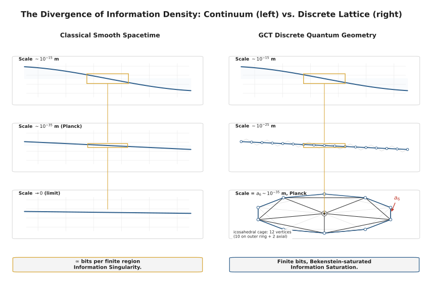
 
**4.1.3 The Bayesian Decision**

We compare the complexity costs:
* **Continuum:** Unbounded local information density unless regulated; quantitative work needs a regulator and renormalization prescription (§2.2.3).
* **Discrete:** Finite bits per bounded region and a built-in cutoff; compatible with quantum mechanics and with entropy bounds, but still requires a lattice, scale, action and continuum-recovery prescription.

**Decision:** $P(\text{Discrete}) \gg P(\text{Continuum})$. [Tier 1/2 — Structural Postulate: discreteness selected by parsimony and Bekenstein bound; see §2.2.3]
We proceed with the understanding that the universe is a **Discrete Lattice**.

---

**4.2 The Quasicrystal Choice**

**4.2.1 The Constraint of Isotropy**

If the universe is a lattice, what is its shape?
A simple periodic lattice (like a cubic grid $\mathbb{Z}^3$) has a cost: it breaks **Rotational Symmetry (Isotropy)** at the lattice scale.
* **The Problem:** In a cubic grid, the distance between nodes is $1$ along the axis, but $\sqrt{3}$ along the diagonal. A particle moving diagonally would experience a different "speed of light" than one moving axially.
* **Observation:** Laboratory resonator tests of Lorentz invariance (modern Michelson–Morley experiments) bound the anisotropy of the speed of light at about 1 part in $10^{18}$. [Tier 3 — laboratory phenomenological bound] The universe does not look like a grid; it looks smooth.
* **Caveat:** On a Planck-scale cubic lattice the induced anisotropy at accessible energies is suppressed by roughly $(E/E_{\rm Pl})^2$, so this bound does not rule out a periodic lattice. GCT's preference for a non-periodic, orientationally ordered structure is an architectural choice, not a refutation of periodic lattices.

We face a trilemma. We need a structure that is:
1. **Discrete** (to supply a built-in cutoff).
2. **Isotropic** (to match observation).
3. **Ordered** (to support physical laws).

Standard candidates fail:
* **Periodic Crystal:** Discrete + Ordered, but Anisotropic.
* **Random Glass / Causal Set:** Discrete + Isotropic (statistically), but Disordered.

**4.2.2 The Adopted Solution: Projected Quasicrystal**

There is a third option, often overlooked: **The Quasicrystal**.
A Quasicrystal is a structure that is ordered but not periodic. It lacks translational symmetry but possesses **Long-Range Orientational Order**.
Crucially, quasicrystals can possess "forbidden" rotational symmetries, such as 5-fold (Pentagonal) or Icosahedral symmetry, which are impossible for periodic crystals. Isotropy by itself is not enough to select the icosahedral case: $O_h$ and $T_d$ also satisfy macroscopic finite-point isotropy. GCT therefore adds the maximal-polyhedral-point-symmetry axiom: among the finite polyhedral rotation groups compatible with a discrete substrate, the icosahedral group $I\cong A_5$ is selected as the largest rotational order, 60. The restriction to the polyhedral class is essential because dihedral rotation groups have unbounded order. This is an architectural postulate rather than a deduction from isotropy alone; it is the closest finite polyhedral symmetry can get to spherical isotropy.

**Rejecting Randomness (Causal Sets)**
Why not a Random Graph (Causal Set)? A random graph has **Maximal Kolmogorov Complexity**—it is incompressible noise. To specify the universe, one would need to specify every single link individually.
A Quasicrystal has **Low Kolmogorov Complexity**. It is generated by a simple, deterministic projection algorithm. By the Principle of Parsimony (Chapter 2), the Quasicrystal receives exponentially larger algorithmic prior weight than the Random Graph within a declared encoding; this ranks the hypotheses but does not by itself establish which is physically true.
$$ P(\text{Quasicrystal}) \gg P(\text{Random Graph}) $$
[Tier 1/2 — Structural Postulate: quasicrystal selection by minimum-complexity isotropic discrete geometry]

**The Cut-and-Project Method**
How is such a structure generated? No periodic lattice in 3 dimensions has 5-fold symmetry (crystallographic restriction), but quasiperiodic structures with 5-fold or icosahedral order can be built in several ways: directly in 3D by substitution (inflation) or matching rules, or by **projecting a higher-dimensional lattice** into 3D [Tier 1 — standard tiling mathematics]. GCT uses the cut-and-project construction because it makes the parent lattice and the internal space $E_\perp$ explicit; this is a modelling choice within the Structural Postulate below, not the only possible construction.
The standard **Penrose Tiling** (2D) is a projection of a 5D hypercubic lattice.
The **Ammann-Kramer-Neri Tiling** (3D) is a projection of a 6D hypercubic lattice.

GCT posits that the physical universe is a **3-dimensional slice through a 6-dimensional hyper-lattice**. [Tier 1/2 — Structural Postulate: 6D parent lattice with cut-and-project]
$$ \mathbb{R}^6 \xrightarrow{\text{Project}} E_\parallel (\text{Physical Space}) $$

**4.2.3 The Geometric Engine**

This projection mechanism is not just a mathematical trick; it is the engine of physics.
* **The $E_8$ Connection:** The adopted primitive 6D lattice $P\cong\mathbb{Z}^6$ has the index-2 sublattice $D_6=\{x\in\mathbb Z^6:\sum_i x_i\text{ even}\}$, which supplies the color-parity sector used in Volume 3. The roots $\pm e_i\pm e_j$ generate $D_6$, not $\mathbb Z^6$, and $\mathbb Z^6$ is not a lattice subobject of even $E_8$. The higher-symmetry connection is instead the conditional composition of the McKay $2I\to E_8$ correspondence, the Elser–Sloane $E_8\to H_4$ projection, and a rank-six icosahedral module. At rank 6 the Bravais choices are $P\cong\mathbb Z^6$, $F\cong D_6$, and $I\cong D_6^*$; GCT adopts $P$ (Appendix USS §USS.7).
* **Emergence of Gauge Symmetries:** The "hidden" dimensions of the lattice ($E_\perp$) do not disappear. They become the internal spaces of particle physics. The icosahedral-projection ansatz supplies an open Tier 3 $\mathrm{SU}(3) \times \mathrm{SU}(2) \times \mathrm{U}(1)$ gauge-product candidate, with the full physical Standard-Model spectral-triple identification conditional on App ORQ O.32.
* **Conditional Architectural Selection:** Once maximal polyhedral point symmetry, aperiodicity, the five-fold rhombic-triacontahedral window, golden arithmetic, and algorithmic simplicity are adopted, this geometry is the surviving branch of the registered comparison. Spinoriality alone does not distinguish it: every finite rotation subgroup has a canonical Spin$(3)$ preimage. *(See Appendix USS.6 for the conditional classification.)* The proposed constants of nature ($\alpha$, masses) are spectral and metric quantities of the selected icosahedral projection, subject to their separate tier labels and physical-map gaps.

---

**4.3 Conclusion of the Epistemic Derivation**

**4.3.1 The Complete Logical Chain**

This completes the descent from Logic to Physics. The chain runs:
1. **Axioms:** Presence + Intelligibility.
2. **Ontology:** Idealism (Mind is fundamental).
3. **Geometry:** Discrete Space (Finite Information).
4. **Symmetry:** Quasicrystal (icosahedral order realized by cut-and-project; adopted, §4.2).
5. **Hardware:** The 6D Lattice (Geometry of the Vacuum).

**4.3.2 From Pure Logic to Physical Structure**

The framework arrives at a specific, falsifiable physical model without invoking arbitrary particles or fields. GCT adopts a projected high-dimensional lattice as the architecture consistent with the axioms and the observational constraints.
Chapter 5 adopts the Wheeler-DeWitt equation as a Tier 3 Structural Postulate governing this lattice. Before that, the "Cosmology of Zero" establishes why the lattice exists at all.
This bridges the gap between Volume 1 (Logic) and Volume 2 (Architecture). The "Software" (Consciousness) requires "Hardware" (Geometry) to render itself. The Quasicrystal is that hardware.

---

### **Chapter 5: The Cosmology of Zero**

**5.1 The Logical Incompleteness of Pure Zero**

**5.1.1 The Question of Origin**

Having established the geometry of the vacuum, we face the ultimate cosmological question: **Why does anything exist at all?**
Traditional physics answers this by pushing the problem back to an "Initial Condition" (The Big Bang singularity), but this is an evasion. It does not explain why there was a singularity rather than nothing.
GCT rejects infinite regress. It adopts the reading that existence is not a violation of nothingness but a form of it [Tier 4 — philosophical commitment, not a theorem].

**5.1.2 The Problem with 0=0**

Consider the concept of Absolute Nothingness—the Void. We denote this state as $0=0$.
This state appears stable because it is symmetric and minimal. GCT reads it, however, as having a logical defect: **It is Logically Incomplete.** [Tier 4 — philosophical reading]
To be "Zero" requires the capacity to distinguish "Zero" from "Not-Zero." But in a state of absolute undifferentiation, this distinction cannot exist.
A zero that cannot define itself is a statement without a syntax. It is not a state; it is a nullity. Therefore, the state of "Pure Nothing" cannot logically persist as a defined entity; it must possess internal structure to be meaningful.

**5.1.3 Zero Requires Self-Definition**

How does Zero define itself without violating conservation? GCT's proposed reading is that it differentiates into complementary opposites that sum to zero. [Tier 4 — philosophical motivation; the identity below is elementary arithmetic, and no conservation law or cosmological fact is derived from it]
$$ 0 = (+1) + (-1) $$
This equation is mathematically identical to $0=0$, but informationally superior.
* **$0=0$:** Zero information. No structure.
* **$0 = (+1) + (-1)$:** Two bits of information (the 1 and the -1), structure, and relationship, while maintaining total nullity.

The proposed metaphysical reading treats the universe not as the creation of something from nothing but as the **Self-Definition of Nothing** through internal differentiation. The self-differentiation $0 = (+1) + (-1)$ is not a temporal event; it is a timeless logical identity, and it does not derive a cosmological history. Representing "The Big Bang" as the low-complexity boundary of the lattice — the limit $\tau_{coord} \to 0$, where the density of actualised configurations approaches zero — is a Tier 4 coordinate analogy, not an Agent's physical traversal or perception and not a replacement for observational early-universe dynamics.
 
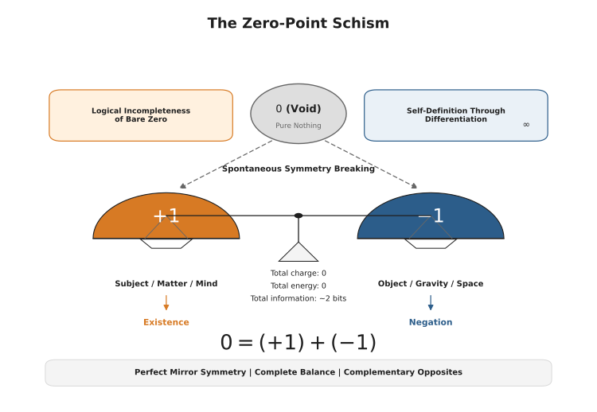
 
---

**5.2 Mathematical Formalization**

**5.2.1 The Wheeler-DeWitt Constraint (Structural Framework / Ansatz)**

This philosophical motivation is formally expressed by adopting the **Wheeler-DeWitt Equation** as the **Primary Boundary Condition** of the theory:
$$ \hat{H}\Psi = 0 $$
**Status: [Tier 3 Structural Postulate]**

While motivated by the Idealist ontology, the **Wheeler-DeWitt constraint ($\hat{H}\Psi = 0$)** is formally adopted as a **Tier 3 Structural Postulate**. For a closed cosmos, GCT reads global nullity as the natural boundary condition. The choice is motivated, not forced, by three considerations: (a) the Tier 4 self-definition reading of Zero in §5.1.2–5.1.3, (b) the standard result that a diffeomorphism-invariant closed system carries a Hamiltonian constraint, here via BRST symmetry (below), and (c) the Tier 4 measure-theoretic motivation of §5.2.3 and Appendix MTI. This postulate defines the 'Hardware State' of the vacuum as a zero-energy static block, within which relational time is subsequently modelled as an internal correlation.

In any theory with diffeomorphism invariance (Coordinate Independence), the Hamiltonian is a constraint, not a generator of time evolution. To remove the unphysical "gauge" degrees of freedom, we require that physical states $|\Psi\rangle$ lie in the kernel of the BRST charge operator $\hat{Q}_B$:
$$ \hat{Q}_B |\Psi\rangle = 0 $$
Because the Hamiltonian $\hat{H}$ is the generator of time-translations (which are just gauge transformations in General Relativity), the condition of BRST invariance implies that the physical state must be annihilated by the Hamiltonian constraint:
$$ \hat{H} |\Psi\rangle = 0 $$
This equation is the **Wheeler-DeWitt Equation**. It asserts that the wavefunction of the universe is static. Time $t$ is not an external parameter but an internal coordinate correlation *within* the static state $|\Psi\rangle$. The universe does not evolve; it exists.

**5.2.2 Physical Interpretation: Energy Balance**

How can a universe full of stars and galaxies have zero energy?
* **Positive Energy ($E_{mat}$):** Matter, radiation, and dark energy ($mc^2$).
* **Negative Energy ($E_{grav}$):** The gravitational potential energy of the geometry itself.

In GCT, this balance is consistent with the geometry of the **6D Parent Lattice** (Volume 2). The lattice is a static structure embedded in a Euclidean space. Any deformation (matter) creates a corresponding curvature (gravity); on the Wheeler–DeWitt reading, the total Hamiltonian of a closed universe (gravitational plus matter) vanishes. This is a constraint on the total, not a statement that the matter stress-energy tensor integrates to zero, which it does not.
The universe is the "Ultimate Free Lunch." It costs zero energy to create a universe, provided you create enough gravity to balance the mass. [Tier 3 — conditional on the Wheeler-DeWitt Structural Postulate, §5.2.1]

**5.2.3 Measure-Theoretic Motivation (Summary)**

We motivate this choice using Measure Theory (see Appendix MTI).
A probability measure on the space of all possible realities has total mass 1 by definition, so it cannot express global nullity. The formal object GCT uses instead is a **signed measure** $\mu=\mu_+-\mu_-$ whose positive and negative parts cancel, so that its total mass is zero while it remains non-trivial (distinction) locally; the **Principle of Indifference** is read as motivating the balance of the two parts. [Tier 4 motivation — a signed measure with zero total mass is a modelling choice, not a measure-theoretic necessity; see Appendix MTI]
$$ \int_{\mathcal{U}} d\mu = 0 $$
The universe is modeled as a fluctuation of the vacuum measure that sums to zero globally but is non-zero locally.

---

**5.3 Differentiation vs. Creation**

**5.3.1 Logical Necessity, Not Temporal Event**

We must excise temporal bias from our language. The differentiation of Zero is not an event that happened *at* a time $t=0$. Time is a feature *inside* the differentiation.
The equation $0 = (+1) + (-1)$ is timelessly true. It does not "become" true.
Therefore, the universe did not "begin." The universe **IS**. It is the eternal, static structure of the self-defining Zero.
Calling the experienced sense of "beginning" an Agent's traversal of the time coordinate $\tau$ from low to high complexity is a Tier 4 phenomenological metaphor. No physical Selection trajectory, clock, owner, or phenomenal-time map has been derived.

**5.3.2 Structure-Preserving Nullity**

The differentiation is constrained. It cannot be arbitrary chaos. It must be **Symmetric**.
This symmetry requirement is consistent with the conservation laws of physics, and GCT proposes that it underwrites them. Noether's theorem applies to continuous symmetries, so the argument runs through the continuous symmetries of the effective continuum description of the 6D lattice projection (Volume 2); the discrete lattice point group by itself supplies selection rules and discrete conserved quantum numbers, not Noether currents: the $U(1)$ phase symmetry of the lattice yields charge conservation; the $SO(3)$ rotational symmetry yields angular momentum conservation; the candidate $SU(3)$ color symmetry of the icosahedral projection (an open Tier 3 candidate, V3 Ch03) would yield the color-singlet condition.
* Conservation of Charge: $dQ/dt = 0$. [Tier 1 — Noether consequence of the $U(1)$ phase symmetry, conditional on that symmetry; GCT phase-sector candidate in V3 Ch01; the V2 Ch06 Maxwell realization is a declared open programme] Zero total charge, $\sum Q = 0$, does not follow from Noether's theorem; for a closed universe it follows from the Gauss-law constraint on a compact space [Tier 1, conditional on closure].
* Conservation of Angular Momentum: $dL/dt = 0$. [Tier 1 — Noether consequence of continuous $SO(3)$ rotational invariance, conditional on that invariance holding in the projected continuum description] Zero total angular momentum, $\sum L = 0$, is an additional boundary condition that GCT assumes, not a Noether consequence [Tier 3].
* Conservation of Color: The universe is a Color Singlet. [Tier 3 — conservation would be a Tier 1 Noether consequence given an exact $SU(3)$ symmetry, but that symmetry is the open Tier 3 candidate of the icosahedral projection (V3 Ch03)]
The laws of physics are the bookkeeping rules required to ensure that the complex dance of existence always sums to zero.

**5.3.3 The Universe as Recursive Definition**

**[Tier 4: Philosophical Interpretation — self-reference reading, not a derivation of a cosmic subject]**
On this interpretation, Zero differentiates into **Subject** (Mind/Field) and **Object** (Matter/Pattern), and the differentiation is read as **Self-Reference**: a self-consistent structure through which the system would register its own existence. A formal fixed-point equation may be stipulated,
$$\Psi = \hat{\mathcal{F}}[\Psi],$$
where $\hat{\mathcal{F}}$ is a declared map (read here as the Field's self-excitation operator). Fixed-point structure does not by itself imply that the universe registers its own existence, instantiates a Subject/Object split, carries Fisher information, or possesses a physical or phenomenal Selection Operator, and none of those claims follows from the Wheeler-DeWitt constraint of §5.2.1. Whether the universe is in this sense self-referential or conscious is not established by the geometry; it remains a Tier 4 interpretation.

---

**5.4 The Fractal Tautology**

**5.4.1 Holographic Displacement as a Phenomenological Analogy [Tier 4]**

If the universe is static, why does it appear to expand?
If the universe is represented by a static global state, its observed expansion still requires a physical cosmological model. The manuscript explores **Holographic Displacement** as a Tier 4 phenomenological analogy for dark-energy phenomenology (V2 Ch14); a fit of its channel shape to data would be a Tier 3 phenomenological fit, while the physical-source interpretation is Tier 4. Conditional on a shared-phason-field ansatz, information production and a relaxation coordinate are placed in the same model; the Holographic Bound supplies a consistency constraint, not a causal law requiring the boundary to expand. No typed, normalized information-to-metric map is currently derived: GCT has not derived conscious-Agent bit generation, a Selection-to-phason transducer, or a local or covariant stress-energy source.
$$ \Delta V = \ell_P^3 \cdot \Delta I / \ln 2 $$
**[Tier 4: phenomenological response ansatz — physical coupling, coefficient and source map open]**
The displayed relation is therefore illustrative bookkeeping within the ansatz, not evidence that cosmic expansion physically "makes room" for increasing complexity.

**5.4.2 Resolution Increase and Self-Knowledge**

* **Low-$\tau_{coord}$ model regions:** Declared low configuration-density, low-information labels — the boundary $\tau_{coord} \to 0$ of the actualised-configuration manifold.
* **High-$\tau_{coord}$ model regions:** Declared high configuration-density, high-information labels. Calling these a biogenic sector in which recursive Selection Operators become viable is an unproved Tier 4 interpretation, not a physical threshold.
The apparent arrow from "Implicit Potential" to "Explicit Actualization" is a coordinate metaphor within the static model, not a derived traversal, Selection process, or temporal sequence in the Field Frame.

**5.4.3 Teleology: Implicit $\to$ Explicit**

**[Tier 4: Philosophical Interpretation — Not a quantitative claim]**
This section offers a philosophical teleology: the implicit structure of the Field may be interpreted as tending toward explication rather than heat death. Within that interpretation, discovery and creation participate in increasing articulated information. It is not a scientific claim that the universe has a goal, that human thought or art generates a vacuum source, or that Agent activity drives cosmic expansion; no Selection-to-phason or information-to-stress-energy mechanism is derived.


---

## Part II Identity

## **PART II: THE ARCHITECTURE OF IDENTITY**

### **Chapter 6: The Tri-Partite Ontology**

**6.1 Beyond Naive Monism**

**6.1.1 Refining Objective Idealism**

In **Chapter 3**, we adopt **Objective Idealism** as the minimum-complexity branch relative to materialism (Ch03 §3.4), given Axiom 1 (Tier 3 parsimony choice): The Field (Level I presence) is treated as the sole ontological primitive. GCT presents this as Objective Idealism at the global-metaphysics level and as its objective-idealist version of Structural Russellian Monism at the mind-physics interface: on the Tier 3 structural-Russellian bridge the Field's intrinsic nature is experiential, and physics describes extrinsic relational structure (see Ch16 §16.2.2). Position note: the framework is globally objective-idealist about the Field, in the sense of a priority monism about a non-subjective Field (Level I presence is intrinsic but non-subjective); it does not posit a cosmic subject: within Tiers 1–3 the Field's Level I presence is non-subjective, and a cosmic-scale subject remains an open Tier 4 hypothesis (App TIB), with Goff's cosmopsychism as the closest competing view (Ch03 §3.4.3). It is Russellian-monist at the physics/experience interface; not type-physicalist; and not micro-subject panpsychist. However, simply stating "All is Mind" is insufficient to explain the complexity of physics. A monolithic mind explains nothing; a structured mind explains everything.
Standard Idealism risks two failure modes: **Solipsism** (the private mind as sole reality, which cannot account for the intersubjective consensus of physical law) and **Undifferentiated Panpsychism** (a naive view that would attribute Level II unified subjecthood to every physical configuration, including aggregates such as rocks; mainstream panpsychists, who attribute micro-experience to fundamental entities, reject this view as well). GCT rejects both. The theory distinguishes **Level I Universal Presence** (Axiom 1, Tier 1 by stipulation; intrinsic non-subjective presence in all Field configurations) from **Level II Apperception**, the Tier-3 interpretation proposed for a physically realized Identity Polaron only if its full mathematical, coupling, and phenomenal-bridge program closes. Nuclear spin and chirality are candidate experimental controls, not a necessary/sufficient DMC verdict. Physical realization remains conditional on O.18/O.21/O.23/O.32/O.34, and the Level II status of every examined substrate is open (Tier 3): no validated substrate criterion exists yet (it requires a typed, normalized, measured coupling, the Identity-Polaron construction and an independent phenomenal bridge; O.21/O.23/O.34, O.18). The Tri-Partite Process Ontology supplies the formal architecture for this distinction.
The working model distinguishes three roles without making all three independent Tier-1 modes of the Field.

**6.1.2 Process Ontology: Three Aspects of One Reality**

The tri-partite working architecture distinguishes:
1. **The Potential:** The Field configurations available in the static state (The Medium).
2. **The Address Structure:** A candidate scaffold for labeling and resolving configurations (The Map). It does not supply physical laws, histories, or transitions.
3. **The Actualization:** A formal Agent-frame conditionalization role on a declared state space (The Operator). No examined physical carrier, transition instrument, or phenomenal owner presently realizes this role [Tier 3 physical/phenomenal proposal].

**6.1.3 Substance, Structure, and Actualization**

We formalize these as three roles in the proposed operator stack, not as three independently derived objects embedded in the global wavefunction:
1. **The Field ($\Psi$):** The Substance (Potential).
2. **The Solenoid ($\Sigma_\infty$):** The candidate Address/Resolution Scaffold (Fiber). It is physically usable only if a separate bridge assigns Solenoid addresses to physical states.
3. **The Agent ($\mathcal{F}_{sel}$):** The proposed Actualization/Conditionalization role (Renderer). Treating it as a qualified physical process requires an independently derived carrier and transition law; experiential realization additionally requires a realization bridge and an owner/phenomenal bridge.

This triad reframes the interaction problem within the GCT operator stack. If an Agent-frame dynamics is supplied, it would act on declared conditional states through an independently specified instrument or transition kernel. No examined substrate presently supplies that carrier, kernel, Selection Operator, or phenomenal owner. If an address-assignment bridge is supplied, the states may also carry Solenoid address labels; the Solenoid itself neither modulates the Field nor supplies a transition or selection law.

Only the Field / Presence axiom is Tier 1 by stipulation. The Solenoid and Agent are formal structural roles in the operator stack: $\Sigma_\infty$ supplies the inverse-limit address structure, and $\mathcal{F}_{sel}$ names the Selection Operator role. Their physical and phenomenal interpretations are **Tier 3 structural commitments** (justified by parsimony and empirical adequacy of the lattice geometry; not deductively forced by the foundational axioms; closure target via App ORQ O.18 + O.32). The triad is therefore not three independent Tier-1 ontological postulates.

---

**6.2 The Field ($\Psi$) - The Potential**

**6.2.1 Definition: The Fundamental Substrate**

The **Field ($\Psi$)** is the ontological primitive posited in Part I as the framework postulate built on Axiom 1 (§2.3.4, §2.4): The datum that experience is occurring is Tier 0 ($P=1$); Axiom 1 generalises it by stipulation to universal Level I presence (Tier 1). Taking the Field as primitive is the Tier 3 objective-idealist parsimony choice and does not inherit that certainty. The Quality Space topological structure derived in Ch16 §16.4 is a separate Tier 2 result. It is the raw "stuff" of existence—the medium of Presence.
Mathematically, it is the Universal Wavefunction defined over the configuration space $\mathcal{P}$.
$$ \Psi: \mathcal{P} \to \mathbb{C} \quad \text{[Tier 1 — Definition of the universal wavefunction over configuration space]} $$
It represents the amplitude of "Being" at any given configuration.

**6.2.2 Nature: Static, Timeless, Infinite**

The Field does not change. It contains all possible histories, all possible laws, and all possible identities in a simultaneous superposition. On the Wheeler–DeWitt Structural Postulate it is modelled as a **Block Universe** [Tier 3 — conditional on the WdW Structural Postulate, §5.2.1].
Because it satisfies the Wheeler-DeWitt constraint, it possesses no internal clock. It is the "Eternal Now."

**6.2.3 Analogy: The Medium / The Ocean**

Think of the Field as a vast, static **Ocean**. The ocean has depth and capacity, but it does not "flow" in a specific direction until disturbed. It is the *capacity* for waves, not the waves themselves. Without the Ocean, the waves (Matter) have no medium, and the surfer (Agent) has no surface.

**6.2.4 Satisfies $\hat{H}\Psi = 0$** [Tier 3 — conditional on the Wheeler-DeWitt Structural Postulate, §5.2.1]

The rigorous definition of the Field is that it is the solution to the constraint equation:
$$ \hat{H}\Psi = 0 $$
On that postulate the Field carries no external time parameter, and its total energy is zero. It is the perfect equilibrium of the Void.

---

**6.3 The Solenoid ($\Sigma_\infty$) - The Structure**

**6.3.1 Definition: Topological Space of Identity**

If the Field is the Ocean, the **Solenoid ($\Sigma_\infty$)** is at most a coordinate grid or address catalogue laid over candidate physical configurations; it is not the current that moves them.
We define $\Sigma_\infty$ as the candidate **address fiber** of the universal configuration bundle $\mathcal{P} \to E_{proj}$. Mathematically it is a compact connected abelian group (a laminated continuum), not a manifold. It is a proposed topological address structure; its use as a physical identity-address space is a Tier 3 structural identification conditional on a separate address-assignment bridge, and identifying it with selfhood is a Tier-3 interpretive bridge rather than a derived ownership relation. The exact topology alone supplies no observer, owner, memory, history, persistence, or dynamics.
Mathematically, it is the **Adelic Solenoid**, constructed as the inverse limit of circle wrappings (detailed in Chapter 7).

> **Operational preview of the Adelic Solenoid (informal; formal construction in Ch07 §7.2).** A condensed-matter physicist familiar with quasicrystals will recognize "solenoid" as a topological term; the *adelic* qualifier sits in algebraic-topology / number-theory territory and is novel in physics. The Adelic Solenoid $\Sigma_\infty$ is a specific compact topological space defined as the inverse limit of circle wrappings: $\Sigma_\infty = \varprojlim_n S^1_n$ where each $S^1_n$ is a wrapping of $S^1$ by $n$. Equivalently, it can be presented as the compact quotient $(\mathbb{R}\times\widehat{\mathbb{Z}})/\mathbb{Z}$, with $\mathbb{Z}$ embedded diagonally. The frequently used "$\mathbb{R}\times\widehat{\mathbb{Z}}$" language is therefore a covering/suspension presentation, not a literal global product decomposition of the compact solenoid. In that presentation, $\mathbb{R}$ is the continuous flow coordinate and $\widehat{\mathbb{Z}}$ is the profinite address coordinate. The profinite integers $\widehat{\mathbb{Z}}=\varprojlim_n \mathbb{Z}/n\mathbb{Z}\cong\prod_p\mathbb{Z}_p$ carry the profinite topology; they are a product over all primes, not the $p$-adic integers for a single $p$. Compatible ultrametrics and rooted cylinder trees arise only after choosing a divisibility filtration, so no single prime, root point, or observer hierarchy is intrinsic, and an ultrametric space supplies nested neighbourhoods, not adjacency between points. The path components of $\Sigma_\infty$ are its dense leaves, each a copy of $\mathbb{R}$, so $\pi_1(\Sigma_\infty)=0$: the Solenoid carries no winding record. The formal two-coordinate structure does not by itself identify a subject, an owner, or a stream of experience; those are Tier-3 physical and phenomenal interpretations requiring an independent bridge. The circle inverse system alone does **not** specify a Cuntz–Krieger or Cuntz–Pimsner algebra: those constructions require an additional transition matrix, correspondence, endomorphism or transfer rule, and none is selected by $\Sigma_\infty$ or is thereby the **Selection Operator** $\mathcal{F}_{sel}$ [Tier 1 scope distinction]. (For full background: Pontryagin 1966, *Topological Groups*; Cuntz–Krieger 1980 for the general C\*-algebraic construction, which needs transition data beyond the inverse limit.)

**6.3.2 Nature: Static, Fractal, Hierarchical**

Like the Field, the Solenoid is static. It does not evolve. It possesses arbitrarily fine finite-quotient structure. After choosing a cofinal divisibility filtration, that structure can be drawn as a rooted cylinder tree:
* **The Root:** the whole level-zero cylinder, not a point or subject.
* **The Branch Nodes:** finite-resolution cylinders (equivalence classes of addresses).
* **The Ends (Leaves):** full compatible addresses, i.e. points of the profinite transversal; no phenomenal moment follows from the label alone.

Interpreting cylinders as timelines, choices, shared identity sectors, divergent lives, or moments of experience requires a separate physical incidence map and remains Tier 3/4. The topology supplies resolution membership, not an owner hierarchy.

**6.3.3 Analogy: The Library / Wiring Diagram**

Think of the Solenoid as a **catalogue** or a coordinate overlay on a wiring diagram. A catalogue can label an item at arbitrarily fine declared resolution, but it does not contain the item's physical content, remember which items were previously consulted, or instruct a reader where to go next. Physical content belongs to the Field/conditional state; history requires physical records and a separate memory bridge; reachability and motion require a separately specified kernel.

**6.3.4 Crucial Distinction: Map vs. Territory**

We must distinguish the Solenoid from the Field.
* **The Field:** Is the Territory (The Substance).
* **The Solenoid:** Is the Map (The Topology).
The Solenoid supplies a proposed address organization for the Field. A coherent narrative or phenomenal organization requires the separate Tier-3 physical and phenomenal bridge.

---

**6.4 The Agent ($\mathcal{F}_{sel}$) - The Actualization**

**6.4.1 Definition: Selection Operator Instance**

The **Agent** names the localized role proposed for the **Selection Operator ($\mathcal{F}_{sel}$)**. It is not an independently derived owner of experience.
The selection model is an **Open Quantum System Process** that traces over the internal environment ($E_\perp$) and represents a non-unitary selection step (Chapter 9). Whether this step is physically realized, selects a particular world, or carries a specific experience remains a Tier-3 physical and phenomenal bridge. *($\mathcal{F}_{sel}$ is **non-unitary** within the formal model. The one-cycle operator decomposes as $\mathcal{F}_{sel} = \mathcal{P}_{\text{actualize}} \circ \mathcal{U}_{\text{steer}}$, where the inner-cycle steering generator $\mathcal{U}_{\text{steer}}$ is unitary but the actualization projection $\mathcal{P}_{\text{actualize}}$ is non-unitary. See V1 Ch10 §10.4.1 for the formal treatment.)*

**6.4.2 Nature: Dynamic (Relative) vs. Static (Absolute)**

Here we must be precise to avoid dualism.
* **In the Agent Frame:** The model assigns a dynamic address position to the Selection Operator. Interpreting its sequence as a stream of consciousness is a Tier-3 phenomenological bridge.
* **In the Field Frame:** If a physical carrier and transition law are later identified, its modeled history may be represented as a static world-line or flux-tube-like record in the Block Universe. No such Identity-Polaron history is currently demonstrated, and recoverable history requires physical records and a memory bridge rather than the address scaffold.
The model's "movement" is an internal relation between supplied states, not a derived evolution of the Bulk or a measured phenomenal flow.

> [!NOTE]
> **Epistemic Distinction (Physics vs Philosophy):** The Field, Solenoid, and Selection Operator are tiered structural claims: axioms are Tier 1, geometric constructions under the icosahedral ansatz are Tier 2, and the physical/phenomenal interpretation of Agent work is Tier 3. Assigning internal phenomenal *experience* to the work done by the Agent against the Field is a philosophical choice (Structural Russellian Monism, Tier 3). While mathematically consistent, it is not an axiomatic necessity.

**6.4.3 Analogy: The Reader / Cursor**

* **The Field:** The Page and its physically instantiated marks.
* **The Solenoid:** Optional catalogue coordinates assigned to passages, if an address-assignment bridge is supplied.
* **The Agent:** The proposed **Reader** (Focus) role. A qualified physical implementation and phenomenal owner remain open.

The reader's next fixation is determined by biological dynamics, current state, and a transition kernel—not by the catalogue. If a realization bridge is supplied, the selected physical content is registered in the Agent frame. The analogy therefore preserves the useful reader/map distinction without turning the address scaffold into a store of stories or a chooser of paths [Tier 3 analogy].

**6.4.4 The Wavefront of Actualization**

As a Tier 3 formal metaphor, the "Present Moment" (The Now) may be represented as a **wavefront of conditionalization/registration**. Identifying that wavefront with a physically realized Selection Operator or a phenomenal Now requires the still-open realization and owner/phenomenal bridges.
* **The Past:** Prior physical conditional states insofar as they leave readable records in the current substrate. Their retention is a question for a physical memory bridge, not a Solenoid invariant.
* **The Future (Agent Frame):** Candidate physically reachable states allowed by the declared kernel, constraints, and energy budget. If an address-assignment bridge is supplied they may be given address labels, but an unvisited cylinder is not intrinsically a possible future and the topology supplies no branching dynamics.
* **The Now:** The current conditionalization/registration label in the formal model (The Cursor), not a point of contact with an address space or a derived physical/phenomenal event.
Phenomenal content is conditionally *assigned* to a declared state under a realization bridge and the Tier 3 Russellian owner/phenomenal bridge developed in Ch16. No examined physical Agent presently performs that registration. In the Field Frame, the relevant configurations are represented as correlations in the Block; "rendering" is model vocabulary for Agent-frame conditioning, not an ontological creation of the configuration. The trace-over formalism of Chapter 9, §9.3 supplies a structural comparison only. [Tier 1/2 structural postulate + Tier 3 physical/phenomenal bridge]

**6.4.5 The Field / Pattern distinction and the Mathematical Universe Hypothesis [Tier 1/2 — Structural Postulate]**

A persistent question at the Field / Solenoid / Agent interface concerns the ontological status of mathematics itself. If Axiom 1 grants Level I presence to every Field configuration, do mathematical objects — integers, theorems, abstract structures — therefore possess presence in their own right? The question is sharpened by Tegmark's **Mathematical Universe Hypothesis (MUH)**, which asserts that physical reality *is* a mathematical structure: there is no substrate the mathematics is about; the mathematics is the substrate.

GCT explicitly rejects MUH. The Field / Pattern distinction is load-bearing:

- **The Field** is intrinsic and primitive; its Level I presence is Axiom 1, and reading that presence as experiential is the Tier 3 structural-Russellian bridge. It is posited by the framework postulate built on Axiom 1 (§2.3.4); Axiom 1 stipulates universal Level I presence [Tier 1], motivated by the sole Tier 0 datum that experience is occurring.
- **Patterns** (in the Russellian sense — the term carried forward into Structural Russellian Monism, §16.2.2) are extrinsic relational structure: how Field configurations stand to one another. Mathematical objects are patterns. They are abstractly specified and multiply instantiable; the integer 7 is the same pattern whether instantiated in a tally of stones, a written numeral, or a neural firing pattern.

**Mathematics does not have Level I presence.** Axiom 1 applies to the substrate, not to descriptions of substrate. The *instantiation* of mathematical reasoning in a neural Field configuration (a human doing arithmetic; a Class 2 Polaron only on the conditional Tier 3 branch) has presence in the ordinary way; the abstract integer being reasoned about does not.

The distinction between GCT and MUH can be stated compactly:

| Position | The Field | Patterns (mathematics) |
|---|---|---|
| MUH (Tegmark) | Does not exist as a separate substrate. There is only mathematical structure; the *appearance* of substrate is itself a mathematical fact about the structure. | The universe IS a mathematical structure. No further explanation needed. |
| GCT (Russellian Monism) | Exists as the intrinsic substrate (experiential on the Tier 3 Russellian bridge); this is the framework postulate built on Axiom 1 (§2.3.4). | Are extrinsic relational structure over Field configurations. Do not themselves have intrinsic character. |

The empirical content of the two positions overlaps almost entirely on physics, since both agree the universe is structurally a specific mathematical object. The disagreement is on whether that structure *is* the totality of reality (MUH) or whether the structure is the *shape* of a more primitive substrate (GCT). The GCT position is preferable on its own terms because (i) it preserves an axiomatic dissolution of the Hard Problem by making experience the substrate rather than a derived feature of an abstract structure that has no experiential character anywhere in its specification, and (ii) it avoids the modal proliferation problem (in MUH every consistent mathematical structure is equally real, a commitment GCT does not need). The specific icosahedral Field shape remains an architectural premise: App USS records $A_5$ as the Tier 1/2 architectural premise H1 and derives conditional Schur-cover and McKay consequences; it does not prove point-group uniqueness (App USS §USS.7.1).

The Field / Pattern distinction also motivates a phenomenological analogy for mathematical discovery. One may *model* recognition of a proof as improved fit between a person's physically implemented cognitive state and a structural pattern also used in the theory of the vacuum. Calling that fit a brain-Polaron Selection event or phason-coupling resonance is a Tier 3 metaphor: no Identity Polaron, material-to-phason interaction, Selection Operator, or phenomenal registration has been measured. The analogy offers one possible response to Wigner's "unreasonable effectiveness of mathematics" but is not load-bearing for the theory. [Tier 3 — phenomenological analogy]

**Parsimony comparison: axiom counts.** Tegmark's MUH is often defended on parsimony grounds — "one move solves everything, no separate substrate required." The comparison is less one-sided than that slogan suggests. The two programs' foundational commitments are:

| Position | Foundational commitments |
|---|---|
| MUH | (i) Mathematical existence implies physical existence (the Mathematical Universe axiom). (ii) Every consistent mathematical structure is equally real (the Level IV multiverse). (iii) The "appearance" of substrate/experience must be derivable from the structure, despite no element of the structure having intrinsic presence — an unsolved derivation problem. |
| GCT | (i) Axiom of Presence: the Field exists with intrinsic non-subjective presence. (ii) Axiom of Intelligibility: the Field has internal structure. (iii) Structural postulates adopting the 6D icosahedral cut-and-project architecture [Tier 1/2 architectural premise; 5 structural postulates + 6 continuous anchors, Parameter Ledger §0.1], with exact conditional $A_5\to2I\to\widetilde E_8$ consequences [Tier 1 mathematics]. |

Listed this way each column shows three items, but the count is not like-for-like and should not hide their status. The icosahedral architecture is a substantive choice constrained by parsimony and empirical aims; App USS records $A_5$ as the Tier 1/2 architectural premise H1 and derives conditional Schur-cover and McKay consequences; it does not prove point-group uniqueness. T-McK.1b is a separate Tier-3/open WZW/APS defect-index program, not a closing lemma for that architecture (App USS §USS.7.1). MUH's claim that "every consistent mathematical structure is equally real" remains a *strong modal commitment* with its own explanatory burden (why do we observe *this* mathematical structure and not the infinitely many alternatives in the Level IV multiverse?). The Hard Problem is built into MUH as an unsolved derivation problem; in GCT it is dissolved at the axiom level by making Presence the substrate from which structure derives, rather than a derived feature of structure.

Net comparison [Tier 3 — qualitative]: on a like-for-like count GCT is not shown to be more parsimonious than MUH. GCT's item (iii) bundles five structural postulates and six continuous anchors (Parameter Ledger §0.1) together with the Tier 3 objective-idealist choice, while MUH's item (ii) is usually presented as a consequence of (i) rather than a separate commitment. The burdens differ in kind rather than ranking strictly. MUH must recover experience from structure and explain why this structure is observed. GCT carries its own open burdens: the upward and downward combination problems (Ch03 §3.4.3), the consensus problem (Ch03 §3.3.4), and the owner and phenomenal bridges required for any Level-II claim. GCT's preference for its own position rests on placing experience in the substrate; that is a Tier 3 judgement, not a parsimony theorem.

---

**6.5 Temporal Language and Frames**

**6.5.1 Agent Frame: Sequential Experience ("Next", "Then")**

To discuss physics intelligibly, we must distinguish between two valid perspectives.
The **Agent Frame** is the internal perspective of the observer.
* **Time:** Linear and sequential ($n \to n+1$).
* **Language:** "I choose X, *then* Y happens." "The universe evolves."
* **Reality:** This frame is valid for thermodynamics, biology, and history.

**6.5.2 Field Frame: Timeless Correlations (Static Geometry)**

The **Field Frame** is the external perspective of the mathematical structure.
* **Time:** A coordinate dimension ($\tau_{coord}$). No flow.
* **Language:** "State X is correlated with State Y." "The geometry contains a trajectory."
* **Reality:** This frame is valid for Quantum Gravity, Relativity, and the Solenoid topology.

**6.5.3 Complementarity, Not Contradiction**

These frames are not contradictory; they are **Complementary**.
* The movie reel (Field Frame) is static.
* The movie on the screen (Agent Frame) is moving.
Both statements are true. GCT uses the Field Frame to derive the laws of physics (Volumes 2-3) and the Agent Frame to describe the phenomenology of mind (Volume 1). We will explicitly label which frame we are using to avoid confusion.

---

### **Chapter 7: The Universal Solenoid and Chosen Identity Filtrations**

**7.1 One Solenoid or Many?**

**7.1.1 The Multiplicity Problem**

A consciousness-first ontology must accommodate both common physical law and private experience. If reality is a Structured Mental Field, one must ask whether every observer possesses a private structure, or whether all observers are described within one shared structure. Solipsism takes the first route and inherits the "Consensus Problem" of why everyone sees the same physical laws; materialism takes a version of the second and struggles to account for the privacy of individual experience. Intermediate positions include Neutral Monism (a substrate that is neither purely mental nor purely physical) and Whiteheadian Process Philosophy (nested societies of experiencing occasions). GCT differs from Neutral Monism in proposing a specific topological structure ($\Sigma_\infty$) for the shared substrate, and from Process Philosophy in treating processes as atemporal correlations within the static Block rather than as temporal becoming.

GCT represents the two roles with a shared candidate address space and localized physical **Identity Polarons**. The mathematics below establishes what the universal one-dimensional Solenoid can do as an address-and-resolution space. It does not identify points, cylinders, or ends with subjects by topology alone.

**7.1.2 One Shared Address Fiber Is a GCT Postulate, Not a Topology Theorem**

The canonical working model uses one universal compact group

$$ \Sigma_\infty \cong \widehat{(\mathbb{Q},+)} $$

as the common identity/address fiber. This is a **Tier 3 structural postulate** favored by parsimony and by the consensus architecture: all physical agents use one address grammar rather than separate, unrelated copies. The Axiom of Intelligibility (§1.3, §2.5) motivates this choice but does not mathematically force numerical uniqueness; multiple isomorphic fibers could obey the same laws. The one-fiber choice must therefore be kept distinct from the exact topology developed below. On this postulate we do not each "have" a solenoid; each agent is modeled as a locus within the one Solenoid, and the privacy of the individual is modeled by a distinct address rather than by a separate object [Tier 3].

Likewise, an address in $\Sigma_\infty$ is not automatically an observer. Level I Presence is universal under Axiom 1. A derived Level-II verdict would additionally require a physically realized **Identity Polaron**, a Selection-Operator mechanism that actually selects outcomes in the relevant sectors, persistence, ownership (a determinate subject whose experience it is), and the separate phenomenal bridge; on current evidence Level II is open (Tier 3): no validated substrate criterion exists yet (it requires a typed, normalized, measured coupling, the Identity-Polaron construction and an independent phenomenal bridge; O.21/O.23/O.34, O.18; Ch16 §16.2.6; V1 Ch17 §17.1.3). The Dual Material Constraint and Zeno stabilization remain Tier 3 candidate implementation ingredients, not established gates [Tier 3/open].

**7.1.3 Two Independent Hierarchy Variables**

The observer architecture uses two indices:

1. **address resolution** $n$: how finely one Solenoid address is distinguished;
2. **physical scope** $s$: finger, hand, nervous system, organism, or another declared physical unity domain.

A coarse address class is not thereby a larger physical system, and a larger physical system is not thereby a Level II subject. Any model that uses both indices must declare them separately.

---

**7.2 Exact Construction of the Universal Solenoid**

**7.2.1 Directed Inverse Limit of Circles**

For positive integers $n \mid m$, let

$$ p_{n,m}: S^1_m \longrightarrow S^1_n, \qquad p_{n,m}(z) = z^{m/n}. $$

The universal Solenoid is

$$ \Sigma_\infty = \varprojlim_{n \mid m} \left(S^1, p_{n,m}\right) = \left\{ (z_n)_n :\ z_n = z_m^{m/n} \text{ whenever } n \mid m \right\}. $$

The dual maps on $\widehat{S^1} \cong \mathbb{Z}$ are multiplication by $m/n$. Their direct limit is $\mathbb{Q}$, because the integer $k$ at stage $n$ represents $k/n$. Hence

$$ \widehat{\Sigma_\infty} \cong \mathbb{Q}, \qquad \Sigma_\infty \cong \widehat{\mathbb{Q}}. $$

These are **Tier 1 mathematical facts** (standard inverse-limit construction and Pontryagin duality). The sequential presentation with degrees $2, 3, 4, \ldots$,

$$ \Sigma_\infty = \varprojlim \left( S^1 \xleftarrow{z^2} S^1 \xleftarrow{z^3} S^1 \xleftarrow{z^4} \cdots \right), $$

gives the same universal object because the cumulative factorial degrees are cofinal in divisibility. A generic degree sequence need not: the pure degree-five tower has dual $\mathbb{Z}[1/5]$, not $\mathbb{Q}$.

The resulting space is compact and connected but not locally connected; locally it is homeomorphic to the product of an interval and a Cantor set [Tier 1].

**7.2.2 Suspension and Adelic Presentations**

Let

$$ \widehat{\mathbb{Z}} = \varprojlim_n \mathbb{Z}/n\mathbb{Z}. $$

With the diagonal action $k \cdot (t, a) = (t + k, a - k)$,

$$ \Sigma_\infty \cong (\mathbb{R} \times \widehat{\mathbb{Z}})/\mathbb{Z} \cong \mathbb{A}_{\mathbb{Q}}/\mathbb{Q} $$

(see Hewitt & Ross, *Abstract Harmonic Analysis*, Vol. I, §10.12) [Tier 1 — standard theorem].

This is a suspension (local-product) presentation, not a global product decomposition: the quotient by $\mathbb{Z}$ is essential, and $\Sigma_\infty$ is not homeomorphic to $\mathbb{R} \times \widehat{\mathbb{Z}}$. A full Solenoid point is an equivalence class $[t, a]$; there is no global canonical projection $\Sigma_\infty \to \widehat{\mathbb{Z}}$ without selecting a base fiber or local transversal chart. The presentation separates two exact structural roles:

- dense one-dimensional real leaves (the path components);
- a totally disconnected profinite transversal $\widehat{\mathbb{Z}}$.

Interpreting the real leaf as an experiential stream (the "Flow") and the transversal as an identity address (the "Fiber") is a **Tier 3 GCT identification**, not part of Pontryagin duality.

**7.2.3 Dense Real Leaves**

The one-parameter map

$$ \iota(t)_n = e^{2\pi i t/n} $$

is injective with dense image; its cosets are the path components. The intrinsic leaf topology is the usual topology of $\mathbb{R}$, but it is finer than the subspace topology inherited from $\Sigma_\infty$. For example, $\iota(k!) \to 0$ in the Solenoid although $k! \to \infty$ in $\mathbb{R}$. Continuous-leaf language is exact; calling a leaf a stream of consciousness remains Tier 3.

---

**7.3 The Profinite Transversal and Chosen Cylinder Trees**

**7.3.1 All Primes Are Present**

The Chinese remainder theorem gives the canonical topological-ring decomposition

$$ \widehat{\mathbb{Z}} \cong \prod_p \mathbb{Z}_p. $$

The universal transversal is therefore profinite, not one intrinsic $p$-adic line or tree [Tier 1]. Projection to a chosen $\mathbb{Z}_p$ factor discards the other prime coordinates. Fivefold icosahedral symmetry may motivate studying the $p = 5$ factor, but it does not force compatible refinements at $5^2, 5^3, \ldots$. A physical $5^k$ subdivision or renormalization law would be new Tier 3 data.

**7.3.2 A Tree Appears Only After a Filtration Is Selected**

Choose a divisibility chain

$$ 1 = N_0 \mid N_1 \mid N_2 \mid \cdots. $$

At level $k$, the vertices are residues $\mathbb{Z}/N_k\mathbb{Z}$. The clopen cylinder associated with $a \bmod N_k$ is

$$ C_{k,a} = a + N_k \widehat{\mathbb{Z}}. $$

A level-$(k+1)$ cylinder is a child when it is contained in $C_{k,a}$. If the chain is cofinal in divisibility, its cylinders generate the full profinite topology and each compatible infinite thread determines one point of $\widehat{\mathbb{Z}}$.

This is a **chosen rooted cylinder-tree presentation**. The full divisibility-indexed finite-quotient system is a directed lattice, not a tree: for example, a mod-6 quotient refines both mod-2 and mod-3. Neither the bare Solenoid nor $A_5$ selects one chain.

**7.3.3 Root, Branch Nodes, and Ends**

The terms must be typed precisely:

- the **root vertex** is $C_{0,0} = \widehat{\mathbb{Z}}$, the whole transversal at level zero;
- a finite **Branch Node** is a cylinder, that is, a coarse equivalence class of addresses;
- a transversal residue address is an infinite compatible **end** (the "leaf" of the presentation); a full Solenoid point additionally carries its suspension coordinate modulo the seam relation;
- the group identity $0 \in \widehat{\mathbb{Z}}$ is the all-zero end, not the root.

Translations act transitively on the transversal, so topology does not elevate zero to a primordial subject. Every pair of addresses belongs to the level-zero cylinder; that tautological common membership does not make them the same point, owner, or subject. Readings of the root as a primordial state of consciousness, or of intermediate Branch Nodes as collective minds, are not derived from this structure; they would need the same independent physical and phenomenal bridges as any Level II claim and remain Tier 4 speculation.


---

**7.4 Identity Addresses and Resolution**

**7.4.1 Universal Transversal Address**

An element of $\widehat{\mathbb{Z}}$ is a compatible residue family

$$ x = (a_n \bmod n)_n, \qquad a_m \equiv a_n \pmod{n} \quad (n \mid m). $$

Equivalently it is an all-prime tuple $(x_p)_p \in \prod_p \mathbb{Z}_p$. Only after selecting one prime factor does it have a single expansion

$$ x_p = a_0 + a_1 p + a_2 p^2 + \cdots, \qquad a_k \in \{0, 1, \dots, p-1\}. $$

**7.4.2 Identity Coordinate $\mathbb{I}_K$ as a Chosen Residue Address**

GCT's **Identity Coordinate** $\mathbb{I}_K$ denotes this chosen transversal residue coordinate [Tier 3 identification]. The complete construction requires two maps that topology does not supply: first, an explicit address bridge, not yet constructed, that maps a qualified physical Polaron state into the declared Solenoid address role; second, a selected base fiber or local transversal chart that extracts $\mathbb{I}_K \in \widehat{\mathbb{Z}}$. No global canonical projection from the connected Solenoid to $\widehat{\mathbb{Z}}$ is assumed.

On this identification an agent's identity is modeled by the whole infinite residue thread, not by any finite node: a finite node fixes only finitely many digits. For example, on a chosen $\mathbb{Z}_2$ factor an address is an infinite binary string, and two addresses that agree in their first 50 digits lie in the same depth-50 cylinder. That is a statement about resolution only; it does not imply shared memory or structural similarity of the agents concerned. Distinct ends are distinct points, and the transversal has uncountably many of them, so the address space does not run out [Tier 1]; whether distinct physical agents actually receive distinct addresses depends on the unconstructed address bridge.

**7.4.3 Finite Physical Address Capacity [Tier 3 model]**

The mathematical transversal is profinite and of unbounded depth; no finite-capacity formula follows from the infinite Solenoid alone. If $N_{\text{states}}$ is the total number of distinguishable global address states available on a substrate, a $p$-ary depth obeys

$$ D_{\max} = \lfloor \log_p N_{\text{states}} \rfloor. $$

If instead $N_{\text{sites}}$ independent sites each store one $p$-ary digit, the depth is $N_{\text{sites}}$, not $\log_p N_{\text{sites}}$. An earlier substitution of the cage count $N_{\text{cage}} = 144$ into $\log_p$ mixed these two encodings and is withdrawn, together with the depth values derived from it. A biological or cosmological depth bound remains open until the physical coding model is specified.

---

**7.5 Observers Within Observers: Exact Skeleton and Claim Ceiling**

**7.5.1 What Nesting Shows**

Call a localized physical access domain of a candidate agent an *aperture* (for example, one finger, or one sensory sub-system). Once a filtration is selected, distinct fine addresses can share a coarser cylinder. This gives an exact membership pattern:

- two fingers can be distinct child apertures;
- both can belong to one hand-level physical domain;
- two hands can belong to one organism-level domain;
- the same fine address can be described at every coarser resolution.

This is the strongest topology-only survivor of the finger/hand analogy [Tier 1 conditional on the chosen filtration]. It describes common membership and loss of resolution.

**7.5.2 What Nesting Does Not Show**

A cylinder is a set, not a parent subject. Address resolution does not determine physical scope, and neither determines an owner. The same hierarchy permits one owner with several apertures, several owners, no Level II owner at some levels, or nested qualified subjects if independent physical unity domains are later derived.

The working default of this volume is one qualified Identity Polaron per physical unity domain, possibly with several apertures [Tier 3 working hypothesis, not theorem]. Any proposed parent Level II observer, whether collective, species-scale or cosmic, must independently close a spanning physical-unity, Selection-Operator, persistence, ownership, and phenomenal bridge at the parent scope. The Dual Material Constraint / Polaron / Zeno stack is one candidate implementation, not shown to be necessary or sufficient on current evidence. A collection of child apertures is not sufficient. Such parent subjects are therefore not derived here; whether any exist remains open [Tier 4].

GCT asserts scale invariance for Field restrictions, not a population of nested micro-subjects: there is no privileged geometric scale at which Level I presence appears. Level II is a separate Tier 3 Identity-Polaron proposal whose substrate status remains open (Tier 3) pending the full Ch16 §16.2.6 research program. A human organism can be described as a coarse node relative to cellular and atomic address refinements, but those refinements alone do not establish subjecthood.

**7.5.3 Accessing the Whole from an Aperture**

Fine-to-coarse projection is canonical after choosing the filtration; coarse-to-fine reconstruction is one-to-many. One child address does not contain all sibling states. "The finger experiences being the hand" therefore requires restricted-family sufficiency, approximate inference, active downward presentation, or genuine global access. None of these mechanisms is derived here [open].

---

**7.6 Physical Instantiation and Resonance [Tier 3]**

**7.6.1 Nuclear Spin and Chirality: Candidate Material Predicates, Not a Derived Digit Code**

GCT retains nonzero nuclear spin and molecular chirality as the two candidate material predicates of the **Dual Material Constraint** and as useful matched missing-leg controls [Tier 3]. Ordinary CISS establishes a material chiral-spin response; it is not yet a map to the GCT phason field or a Level-II gate. On the Tier 3 model, isotopes with non-zero nuclear spin (e.g., $^{31}$P, $^1$H) would supply candidate state capacity and spin-zero isotopes ($^{12}$C, $^{16}$O) would not; this is a modeling assumption, not a derived constraint.

The further claim that a particular nuclear-spin network encodes a particular residue thread $\mathbb{I}_K$ is a separate Tier 3 address bridge, not yet constructed. It requires an explicit state map, a chosen base fiber or local transversal chart, read/write dynamics, an error model, and a normalized physical coupling. No one-to-one digit assignment, global projection from the connected Solenoid to its transversal, or necessary/sufficient Level-II condition is presently derived. On the candidate model, the "Self" is not the atom; it is modeled as the **Pattern of Entanglement** that the Tier 3 Zeno Drive would maintain across the nuclear spin network, which would anchor the address role to the fermions of the brain if the bridge were constructed. For orientation only, Figure V1.7.3 compares the length $\xi=a_0/\alpha\approx7.25$ nm [Tier 1 arithmetic; its identification as the vacuum/polaron healing length is Tier 3] (diameter $2\xi\approx14.5$ nm; Parameter Ledger $\xi_{\rm pol}$, not a GCT-specific prediction) with the $\approx15$ nm microtubule lumen; the agreement is a numerical coincidence noted as a Tier 3 substrate correlation, not a derived match.

**7.6.2 Hierarchical Distance from a Chosen Filtration: $d_H(i,j)$**

For a chosen cofinal chain $(N_k)$, let

$$ r(x,y) = \sup\{k : x \equiv y \pmod{N_k}\} \in \mathbb{N} \cup \{\infty\}, \qquad d_H(x,y) = \begin{cases} 0, & x = y, \\ c^{-r(x,y)}, & x \neq y, \end{cases} \quad c > 1. $$

Then $d_H$ is an ultrametric, $d_H(x,z) \le \max[d_H(x,y), d_H(y,z)]$, and it quantifies the deepest shared resolution cylinder [Tier 1]. Both the filtration $(N_k)$ and the numerical scale $c$ are chosen. For $N_k = p^k$ on one $\mathbb{Z}_p$ factor with $c = p$, this becomes the standard $p$-adic metric. The phrase "first common branch node" is retired: every pair shares the root, while the **deepest shared cylinder** carries the resolution information. The Hierarchical Distance $d_H(i,j)$ between Agents $i$ and $j$ is this metric evaluated on their Identity Coordinates, and is therefore defined only once the address bridge of §7.4.2 is supplied [Tier 3].

In an ultrametric every triangle is isosceles, with its two longest sides equal [Tier 1]. Finite cylinders have parent–child relations in the chosen tree, but the metric on ends supplies no neighbor relation: the transversal is totally disconnected, and every ball is both open and closed. Any rule about which address changes are dynamically allowed is additional dynamics, not a consequence of the metric.

**7.6.3 Coupling from Hierarchical Distance Remains Phenomenological: $\kappa_{ij} = \kappa_0 e^{-\lambda_c d_H}$**

A model may posit

$$ \kappa_{ij} = \kappa_0 e^{-\lambda_c \, d_H(i,j)}, $$

where $\lambda_c$ is the **Consensus Decay Constant**. But $d_H$ must name its selected filtration and prime factor, and $\kappa_0$ and $\lambda_c$ require a physical derivation [Tier 3 — Phenomenological Model, pending derivation of $\kappa_0$ and $\lambda_c$ from the phason stiffness ratio $K_\perp/K_\parallel$; see Ch11 §11.2.1]. A first-principles derivation of $\lambda_c$ is deferred to Volume 2. The normalized coupling $\rho_{ij} \equiv \kappa_{ij}/\kappa_0$ and its limits are discussed in Ch11 §11.2.1; nothing here implies that agents with small $d_H$ have phase-locked experiences.


**7.6.4 Resonance Clusters**

A **Resonance Cluster** may be defined operationally as a set of physical apertures with a declared coupling kernel and a common coarse address class. This is useful structure. Shared cylinders do not themselves transmit data or imply correlated experience. Distinct ends are distinct points, so two agents with different addresses never occupy one point of $\Sigma_\infty$; any no-signalling analysis must rest on separately derived physical channels (V1 Ch09 §9.4.3), not on topological co-location. Readings of such clusters as shared deep memory, telepathy, synchronicity, a higher self, or a parent subject are not derived from this structure; they would require additional physical and phenomenal bridges and remain Tier 4 speculation.

---

**7.7 Homotopy, Cohomology, and Memory**

**7.7.1 Four Invariants That Must Not Be Conflated**

Every ordinary loop in the universal Solenoid contracts, so

$$ \pi_1(\Sigma_\infty) = 0. $$

For a sequential circle expansion with degrees $d_k$, the fundamental pro-group is the nonconstant pro-object

$$ \operatorname{pro}\pi_1(\Sigma_\infty) = \left( \mathbb{Z} \xleftarrow{\times d_1} \mathbb{Z} \xleftarrow{\times d_2} \cdots \right). $$

Under the standard first-shape-group convention, as the inverse limit of these stage groups, cofinal divisibility forces

$$ \check{\pi}_1(\Sigma_\infty) = 0, $$

since a compatible integer would have to be divisible by every positive degree. The separate profinite deck/transversal group is

$$ \widehat{\mathbb{Z}} = \varprojlim_k \mathbb{Z}/(d_1 \cdots d_k)\mathbb{Z}. $$

It is not the ordinary fundamental group, the pro-group, or the standard first shape homotopy group. [Tier 1 — Standard inverse-limit and shape theory.] None of these statements by itself defines a physical memory or winding state; in particular, since $\pi_1(\Sigma_\infty) = 0$, a "closed loop" in the Solenoid carries no winding invariant.

**7.7.2 Exact Čech Cohomology and Candidate Physical Encoding**

Continuity of Čech cohomology gives

$$ \check{H}^1(\Sigma_\infty; \mathbb{Z}) \cong \varinjlim(\mathbb{Z}, \times d_k) \cong \mathbb{Q} $$

for a universal (cofinal) degree sequence (see Eilenberg & Steenrod, *Foundations of Algebraic Topology*, §VIII) [Tier 1 — Standard algebraic topology]. This is a global invariant of the **space**. It records rational cohomology classes (circle-valued shape data). It does not assign a rational winding state to each point or Agent; ordinary loops have no nonzero winding number.

This classification does not by itself identify Agent states, define an information metric, or show that a physical encoding survives thermal dynamics. A physical memory claim requires an explicit map from substrate states or histories to these cohomology classes and a dynamical argument that the map is preserved. [Tier 3 — Physical interpretation open.]

**7.7.3 Physical Persistence Requires a Dynamical Bridge**

A map into $S^1$ has a homotopy class that is invariant under homotopies of that map [Tier 1]. The manuscript has not yet constructed a map that assigns an Agent's physical state a class in $\check H^1(\Sigma_\infty;\mathbb Z)$, nor a dynamical conservation law carrying such a class through loss of the supporting substrate. To use $\mathbb{Q}$ as a physical state-label group, GCT must still derive:

1. an order-parameter or configuration map realizing the proposed class;
2. a substrate read/write coupling;
3. a Hamiltonian or free-energy barrier;
4. admissible defect-changing processes and boundary conditions;
5. a noise channel and preservation timescale.

Only then can thermal robustness or retrieval be tested. "Topological" does not mean indestructible if the carrier leaves the configuration space, an order-parameter amplitude vanishes, a defect reaches a boundary, or the substrate dissolves. Likewise, $\check H^1 \cong \mathbb{Q}$ does not derive electric-charge normalization or quark fractions; a gauge/charge map is separate.

On the conditional Tier 3 Zeno branch, physical death designates the permanent cessation of the Zeno Drive — the collapse of the metabolic gradient proposed to maintain the Identity Polaron's coherence in $E_\parallel$. Biological memory protection is therefore Tier 3/open. Whether any encoded state persists, can be re-coupled to a new physical substrate, or carries recall or phenomenal continuity across substrates is a **Tier 4 speculation**, not a consequence of the solenoid's shape or cohomology alone.

---

**7.8 The Orthogonal Identity: An Internal-Manifold Bridge**

In Volume 2 the vacuum is modeled as a 6D cut-and-project structure with a physical subspace $E_\parallel$ and an internal subspace $E_\perp$ (a structural postulate of GCT). GCT separately proposes a map between a physical Identity Polaron, the Solenoid address role, and the internal phason field on $E_\perp$. The 6D cut-and-project split does not by itself identify $E_\perp$ with $\widehat{\mathbb{Z}}$, nor does either space supply an owner.

The **Orthogonal Identity** (phenomenologically termed the **Higher Mind**) names the proposed $E_\perp$ component of an agent's identity. This language is retained only as a Tier 3/4 phenomenological model. In the 6D parent lattice $E_\perp$ is a rotated direction of the same structure, and nothing in the construction exempts its degrees of freedom from causal constraints: any causal or no-signalling behavior must be derived from the declared dynamics. Any claim that internal-manifold resonance guides an agent — for example, a reading of intuition as "phason resonance" that makes some future branches feel "lighter" — must specify the coupling operator, causal/no-signalling behavior, accessible observable, and test. No such operator is derived in this manuscript, so that reading is not derived and remains Tier 4 speculation. It cannot be inferred from common cylinder membership.

---

**7.9 Canonical Disposition**

The universal Solenoid remains a mathematically rigorous and potentially useful **address-and-resolution skeleton**:

$$ \Sigma_\infty \cong \widehat{\mathbb{Q}} \cong (\mathbb{R} \times \widehat{\mathbb{Z}})/\mathbb{Z}, \qquad \widehat{\mathbb{Z}} \cong \prod_p \mathbb{Z}_p, \qquad \pi_1(\Sigma_\infty) = 0, \qquad \check{H}^1(\Sigma_\infty;\mathbb{Z}) \cong \mathbb{Q}. $$

Its rooted tree, levels, single prime, physical scope map, identity encoding, coupling kernel, memory dynamics, owner, and phenomenal interpretation are additional data. Chosen nested cylinders are compatible with observers within observers, but do not prove them. The one-Polaron-per-unity-domain model with several apertures remains the current Tier 3 default because it fits the physical unity-domain architecture with fewer unverified owner assignments; it is not forced by topology.

---

## Part III Rendering

### **Chapter 8: Simultaneous Time**

**8.1 The Static Block Geometry**

**8.1.1 Field Frame and Agent Frame**

Under the Wheeler-DeWitt structural postulate $\hat{H}\Psi=0$ (Volume 1, Chapter 5), the global state is represented as a static configuration rather than as an object evolving in an external time. Time ($t$) is a coordinate label for relations inside that configuration, not an external evolution parameter. Past, present, and future coordinates therefore coexist in the **Field Frame**. [Tier 3 — conditional on the Wheeler-DeWitt Structural Postulate, §5.2.1]

The **Agent Frame** is formally indexed by an ordinal sequence $n$ of conditional physical states along a declared aperture. Identifying that sequence with experienced order, actualization events, or a phenomenal owner requires the open transition, memory, Selection, and psychophysical bridges; no traveling soul or preferred background clock is assumed. *(For speculative phenomenological interpretations, see Appendix TIB §TIB.Spec.)*

**8.1.2 What the Block Does—and Does Not—Supply**

A static block is compatible with several physical apertures or world-line sectors existing at different coordinate times. It does not, by itself, say that those apertures belong to one identity, one owner, or one Solenoid branch. The universal Solenoid is an address-and-resolution object; no canonical projection from one of its cylinders into a set of physical lives follows from inverse-limit topology.

To state a multi-life model precisely, one must introduce an additional incidence/projection map such as

$$
\Pi_{life}: C_{parent} \longrightarrow \mathcal{P}(E_\parallel \times \tau_{coord}),
$$

where $C_{parent}$ is a declared coarse identity sector and the image is a set of physical aperture/world-line sectors. The model must also specify which apertures share one physical unity domain or owner. Neither $\hat{H}\Psi=0$ nor the Solenoid $\Sigma_\infty \cong (\mathbb{R}\times\widehat{\mathbb{Z}})/\mathbb{Z}$ constructs $\Pi_{life}$.

The status of each layer is therefore:

- coexistence of many spacetime histories in a static block: conditional structural consequence of the block postulate [Tier 3 — conditional on §5.2.1];
- one parent address sector incident on several physical apertures: **Tier 3 additional model**;
- one phenomenal subject spanning those apertures, reincarnation, cross-life recall, or migration: **Tier 4**, absent a physical coupling and ownership bridge.

---

**8.2 A Conditional Simultaneous-Aperture Model**

**8.2.1 Field-Frame Representation**

Suppose $\Pi_{life}$ is supplied and maps one declared parent sector to apertures $A, B, C$ at coordinates such as

$$
A: (x_A, \tau_A), \qquad B: (x_B, \tau_B), \qquad C: (x_C, \tau_C).
$$

All three can coexist in the static Field Frame. This is not sequential reincarnation: no object must leave $A$ and later enter $B$. It is a simultaneous incidence structure [Tier 3 — conditional model].

The topology alone does not determine whether:

1. one Level II subject is presented through all three apertures;
2. three Level II subjects share a coarser address class;
3. only one aperture is Level II while the others are merely represented possibilities;
4. no parent Level II subject exists.

Each claimed Level-II unity domain must independently close a spanning physical-unity, Selection-Operator/sector-writing, persistence, ownership, and phenomenal bridge. The **Identity Polaron/DMC/Zeno** stack is one Tier 3 candidate implementation, not an established necessary or sufficient criterion; DMC descriptors and $\eta_\text{Zeno}$ are candidate-control and external-rate diagnostics only. A parent cylinder is not a subject merely because it contains children.

**8.2.2 The Finger/Hand Analogy Across Coordinate Time**

The exact content of the analogy is membership: different aperture sectors can be distinct "fingers" assigned to one declared "hand" sector. The analogy does not grant a finger the complete state of the hand or make the hand a separate observer.

"Experiencing the hand from the finger" would require a downward presentation/global-access channel from the parent physical unity domain to the aperture; no such channel is derived here.

The one-qualified-subject/several-apertures reading can be extended across coordinate sectors only as a Tier 3 hypothesis after $\Pi_{life}$ and the physical unity map are supplied. It is not inferred from the Solenoid.

**8.2.3 The Frozen-River Picture, Corrected**

Imagine spacetime as a frozen river containing every coordinate at once. Several contact points can be marked on the ice. A proposed identity-incidence map may group some contacts under one parent label. The picture does not show, without further physics, whether one subject owns all contacts, whether information passes between them, or whether attention moves from one to another. Within a single aperture, experienced order is supplied by that aperture's own physical clock, state, and transition dynamics.


---

**8.3 Epistemic Firewall**

The canonical claims are deliberately narrow:

- The static-block model removes the need for a sequentially traveling soul [Tier 3 — conditional on the block postulate].
- A multi-aperture identity relation is mathematically consistent but needs an explicit $\Pi_{life}$ and physical unity map [Tier 3].
- Common Solenoid cylinders supply address membership, not memory transfer or phenomenal continuity [Tier 1 structural ceiling; Tier 3 application].
- Past-life memory, cross-life access, post-mortem recoupling, and reincarnation phenomenology remain Tier 4 until a read/write coupling, persistence dynamics, and owner criterion are derived (see Appendix TIB).

Thus "multiple lives happening at the same time" remains a coherent extension that GCT can state as a conditional model, but it is not presented as a theorem of the universal Solenoid.

---

## **PART III: THE MECHANICS OF RENDERING**

### **Chapter 9: The Rendering Engine**

**9.1 Simulation Ontology**

**9.1.1 Beyond Passive Observation**

Standard quantum mechanics is often described in terms of a passive observer and collapse. In a timeless Wheeler--DeWitt setting, GCT proposes an **Active Rendering Ontology**: a structural correlation between an address-like coordinate $\mathbb{I}_K$ and a local restriction of the Field $\Psi$ to an entanglement wedge. The interpretation of that correlation as a particular subject's experienced physical reality is an additional **Tier 3 psychophysical bridge**, not a consequence of the Wheeler--DeWitt constraint or of solenoidal topology alone.

**9.1.2 Reality as an Autopoietic System**

GCT uses **autopoietic** as a model description: the proposed Realization Operator satisfies $\hat{\mathcal{R}} \circ \hat{\mathcal{R}} = \hat{\mathcal{R}}$ at the level of an idempotent projection. Applying that proposed operator to an already-realized subspace leaves that subspace unchanged. This algebraic property does not by itself establish self-actualization, computation, or phenomenal rendering; those interpretations remain **Tier 3 candidate bridges**.

The framework proposes cross-perspectival consistency constraints. A coordinate in the solenoidal construction can label a local geometric restriction $E_\parallel$; treating that label as a subject, and treating unselected structure as phenomenally unrendered, are separate **Tier 3** commitments. Ordinary dynamical and decoherence accounts remain available for the stability of shared records.

**9.1.3 The Holographic Simulation Model**

The physical world is modelled as a **cut-and-project shadow**, sometimes loosely called "holographic": a lower-dimensional projection ($3D$) containing the encoded information of a higher-dimensional source ($6D$). This is not holography in the technical holographic-principle sense, where a boundary encodes a bulk with area-law entropy [Tier 3 metaphor]. 
* **The Source:** The $6D$ Hyper-Lattice $\mathbb{Z}^6$ (The geometric substrate).
* **The Projection:** The $3D$ Parallel Space $E_\parallel$ (The Screen).
* **The Rendering:** a proposed Agent-relative reading of the geometric output of the Realization Operator. Its identification with first-person phenomenal experience is a Tier 3 Russellian bridge, not an output of the projection mathematics.

This model offers one candidate account of why a mathematically represented system may be described as phenomenally tangible. The move from the $6D$ source and projection mathematics to tangibility for an owner of experience is not yet derived.

---

**9.2 The Realization Operator ($\hat{\mathcal{R}}$)**

**9.2.1 Definition and Function**

To compare the abstract topology with concrete geometry, we introduce a **proposed Realization map ($\hat{\mathcal{R}}$)**. Ordinary cut-and-project supplies a geometric map once a lattice, window, and projection are declared; it does not supply an Agent-specific renderer. The additional Agent/address dependence attributed to $\hat{\mathcal R}$ remains conditional on two open bridges (a map from a qualified physical state to a Solenoid address, and a realization map from that address to a local frame), with no examined physical carrier or phenomenal output [Tier 3].

**9.2.2 Input: Agent Coordinate Vector**

The proposed input for $\hat{\mathcal{R}}$ is an **address coordinate** $\mathbb{I}_K$ (a p-adic label). It can specify a mathematical orientation within the universal Solenoid; identifying it with an Agent's identity or a particular phenomenal owner is an open Tier 3 bridge.

**9.2.3 Process: 6D $\to$ 3D Projection**

The proposed operator $\hat{\mathcal{R}}$ acts as a filter in the model. It takes the $6D$ hyper-lattice and applies an icosahedral projection matrix $\mathcal{M}$ determined by an address coordinate.
$$ \hat{\mathcal{R}}(s) \to \text{Slice}(E_\parallel) $$
The inverse-limit address does not by itself determine $\mathcal{M}$, a window, or a physical projection event. The output is a model slice in $E_\parallel$, not a demonstrated world generated for or experienced by an owner.

**9.2.4 Output: Localized Hologram**

The result of the proposed Realization Operator is a **Physical Frame**: a local arrangement of nodes, phason strains, and phonon densities in the model. Reading that frame as an Agent's immediate phenomenal environment, or as an ontological claim that the world is realized only where the operator acts, exceeds the present derivation and remains a Tier 3 interpretation.

---

**9.3 The Integration Window**

**9.3.1 Frame Rate Mismatch Problem**

A fundamental problem arises when comparing the physics of the vacuum to the physics of biology. Two distinct frequency scales must be carefully distinguished:

* **Planck vacuum fluctuation scale:** Identifying the ultraviolet cutoff of the 6D lattice with the Planck energy gives the conventional conversion $\nu_{vac} \sim E_{Planck}/h \approx 3 \times 10^{42}$ Hz. [Tier 1 arithmetic from the supplied Planck-energy scale; Tier 3 scale identification of the lattice cutoff with that scale (Ch04 §4.1.2).] This estimate does **not** require the independent Tier 3 P3b speed ratio $\hat{c}/c = \phi^{-9}$, and it supplies no evidence that a biological Selection Operator samples the phason field at any particular rate.
* **Historical Zeno-rate scenario:** the historical 100 MHz material-scan scenario ($\nu_{Zeno} \approx 100$ MHz) is retained only as an external Tier 3 material-proxy input from the former nuclear-spin/Zeno programme [Parameter Ledger, Tier 3]; it is not a live operating frequency. ATP-budget compatibility is only an energetic consistency check. No normalized action presently derives this as a phason sampling rate, no experiment has identified it with a realized $\mathcal{F}_{sel}$ cycle, and the field-typing analysis of V1 Ch17 §17.1.3 does not convert it into a Level-II classifier. Conditional on supplying it, the phenomenological integration model below places it roughly six orders of magnitude above the neural-rate reference.
* **Biological sampling rate:** The human neural interface operates at the scale of Gamma oscillations ($\nu_{bio} \sim 40$–$100$ Hz). [Tier 3 — empirical neuroscience measurement]

**9.3.2 Time-Averaged Geometric Surface**

The vacuum-to-neural reference-scale ratio spans roughly forty orders of magnitude ($\nu_{vac}/\nu_{bio} \sim 10^{40}$), but the manuscript does not derive a physical bridge across it. A historical two-stage phenomenology first inserts the external $\nu_{Zeno}$ scenario and then averages hypothetical material-proxy updates across one biological frame (the **Integration Window**). This is a conditional coarse-graining ansatz: it does not show that a Selection Operator samples phasons, that the updates are discrete acts of selection, or that a subjective "Now" is numerically generated by them.
$$\langle \Phi \rangle_\text{perceived} = \frac{1}{\Delta n} \sum_{k=n}^{n+\Delta n} \hat{\mathcal{R}}(k)$$

where, **conditional on the two supplied frequency inputs**, $\Delta n \equiv \nu_\text{Zeno} / \nu_\text{bio} \sim 10^{6}$ is the number of proxy-update slots in the phenomenological average. [Tier 3 empirical neural-rate reference; Tier 3 external $\nu_{Zeno}$ scenario; Tier 4 averaging ansatz] It is not a derived count of phason or Selection-Operator events and not a numerical derivation of the experienced "Now."

**9.3.3 Physical Consequence: Emergent Macroscopic Rigidity**

Within the conditional averaging model, this integration is intended to represent a "Motion Blur" effect; it is not a derivation of smooth classical physics from measured selection events.
* **Particles:** Individual lattice defects moving through the vacuum blur into the smooth "Wavefunctions" of standard quantum mechanics.
* **Solidity:** The discrete nodes and their stiff bonds ($K_\parallel$) blur into the appearance of a **Continuous Solid**. 

In the conditional material model, **time-averaged rigidity** is ordinary coarse-grained response of the declared lattice. The display-pixel comparison is only a phenomenological analogy: GCT has not derived a subjective sampling rate, a Selection clock, or an observer-specific resolution limit from this averaging.

---

**9.4 The Selection Operator ($\mathcal{F}_{sel}$)**

**9.4.1 Frame Distinction: Global vs. Local**

To preserve the mathematical integrity of the GCT framework, we must distinguish between two fundamentally different perspectives on the universal evolution:

1. **The Field Frame (Global):** From the perspective of the universal Hilbert space, evolution, when described in terms of relational coordinate $\tau_\text{coord}$, is expressed through the conditional unitary $U(\tau_a, \tau_b) = e^{-i\hat{H}_\text{relational}(\tau_b - \tau_a)}$, where $\hat{H}_\text{relational}$ is the reduced Hamiltonian obtained by solving the WdW constraint with a clock subsystem (following the Page-Wootters formalism). The global state $\hat{H}\Psi = 0$ is preserved; the relational unitary describes correlations between clock and system, not external time evolution. [Tier 1 canonical form of the WdW constraint; its adoption is Tier 3 (Ch05 §5.2.1); the Page–Wootters relational-time reading is Tier 3] There is no wave-function collapse. The $\Psi_{GCT}$ state vector evolves as a timeless superposition of all topologically valid configurations.
2. **The Agent Frame (Local):** The formal model declares an open-system conditional state. From this perspective, "Selection" is not a physical collapse of the Bulk; it denotes **Bayesian conditionalization** relative to a declared local subsystem (the local entanglement wedge). No examined physical Agent, Selection carrier, or phenomenal owner is thereby identified.

**9.4.2 Selection as Conditional (Non-Unitary) Update**

If an instrument and outcome are independently supplied, GCT's Agent-frame notation represents the resulting conditional-state update by $\mathcal{F}_{sel}$; under the open address bridge it may also induce an address-label update in the universal Solenoid. This is standard conditioning mathematics, not a demonstrated physical or phenomenal act of selection, and the inverse-limit topology supplies no transition kernel, instrument, or update law. The formal projection is:
$$ |\Psi\rangle_{Agent} \to \frac{\hat{P}_{sel} |\Psi\rangle_{Field}}{\sqrt{\langle \Psi | \hat{P}_{sel} | \Psi \rangle}} $$
where $\hat{P}_{sel}$ is a declared projector. No map from intent to this projector, no physical projection event, and no filtering of phenomenal experience has been derived. Calling the normalized conditional update a non-unitary "jump" describes the selected outcome representation; it does not establish an ontic collapse or Agent-specific branch actualization. The global Field description remains unitary.

> [!NOTE]
> **Formal Definition: Categorical TQFT of the Selection Operator**
>
> In the framework of Topological Quantum Field Theory (TQFT), an $n$-dimensional manifold (the Agent's history) is defined as a cobordism between $(n-1)$-dimensional boundaries (states of experience). One may alternatively *model* the Selection Operator $\mathcal{F}_{sel}$ as a **Functor** from the category of icosahedral cobordisms to the category of Hilbert spaces [Tier 3 modelling choice; elsewhere $\mathcal{F}_{sel}$ is the non-unitary conditional update of §9.4.2]. 
>
> $$ \mathcal{F}_{sel}: \mathbf{Cob}_{I_h} \to \mathbf{Hilb} $$
>
> Mapping the subjective "Agent" to this functor is a Tier 3 formal proposal conditional on the modelling choice $\mathbf{Cob}_{I_h}$ (not one of the postulates of the Axiom & Postulate Ledger); like every scaffold-to-phenomenal map in this volume (Ch16 §16.2.2b), it stays at Tier 3. This is not a proof of physical Level-II realization: DMC legs are candidate controls, the stated $\eta_\text{Zeno}$ values are conditional external-rate scenarios, and the typed measured coupling plus phenomenal bridge remain open.

**9.4.3 The No-Signalling Constraint**

No-signalling does not follow from address topology. It follows conditionally from the outcome-averaged CPTP identity below, which presupposes Born-weighted outcomes (see the constraint after the box), and, in GCT's field description, from the conditional phason--phonon readout bound of Appendix SNE §SNE.4 (subluminal only on the extra Tier 3 premise $v_{\rm phonon}\le c$, which fails under P3b; App ORQ O.48). Shared cylinders alone establish no correlation or channel.

> [!IMPORTANT]
> **Proposition: Outcome-averaged no-signalling identity. [Tier 1 QI identity; conditional GCT application in Appendix FTH §FTH.4 and Appendix SNE §SNE.4]**
> Conditioning on a specified outcome at subsystem A does not by itself change the *unconditional* density matrix $\rho_B$ of a spatially separated subsystem B, and so does not transmit a signal. Two statements must be distinguished. (i) *Selective description:* conditioning on A's specific outcome yields the conditional state $\rho_{B|\text{sel}} = \text{Tr}_A\!\big[(\hat{P}_\text{sel} \otimes \hat{I}_B)\,|\Psi\rangle\langle\Psi|\,(\hat{P}_\text{sel} \otimes \hat{I}_B)\big]/p_\text{sel}$, with $p_\text{sel} = \langle\Psi|\,\hat{P}_\text{sel} \otimes \hat{I}_B\,|\Psi\rangle$. This conditional state generally differs from $\rho_B$; the difference encodes pre-existing correlation, not a transmitted signal, and is inaccessible to B without classical communication of A's outcome. (ii) *Non-selective description:* B's local statistics, unconditioned on A's outcome, are governed by the outcome-averaged map. For any complete orthogonal family of local projectors $\{\hat{P}_k\}$ on $\mathcal{H}_A$ with $\sum_k \hat{P}_k = \hat{I}_A$,
> $$\sum_k \text{Tr}_A\!\big[(\hat{P}_k \otimes \hat{I}_B)\,|\Psi\rangle\langle\Psi|\,(\hat{P}_k \otimes \hat{I}_B)\big] = \text{Tr}_A\!\big[|\Psi\rangle\langle\Psi|\big] = \rho_B,$$
> by cyclicity of the partial trace over $\mathcal{H}_A$, idempotency $\hat{P}_k^2 = \hat{P}_k$, and completeness. It is this outcome-averaged equality — not a Selection-Operator theory and not the selective map alone — that supplies the standard quantum-information no-signalling result. Correlated records can later be compared only through ordinary causal interaction when future light cones overlap (the conditional multi-Agent model of Chapter 11). Appendix SNE §SNE.4 additionally gives a **conditional** subluminal response for a declared strain-level phason--phonon source; GCT has not derived a physical $\mathcal{F}_{sel}$ event, its coupling to that source, or a phenomenal Consensus mechanism.

**Constraint on biased selection [Tier 1 — standard QI consequence of the identity above; its application to GCT selection is the open problem App ORQ O.48].** The identity sums the *unnormalised* projections, so it holds when A's outcomes occur with the Born weights $p_k=\text{Tr}\big[(\hat{P}_k\otimes\hat{I}_B)\,|\Psi\rangle\langle\Psi|\big]$. If a will-, resonance- or impedance-biased Selection Operator (§9.5.3; Ch10 §10.3.2) reweighted A's outcomes to $q_k\neq p_k$, B's outcome-averaged state would become $\sum_k q_k\,\rho_{B|k}$, which in general differs from $\rho_B$: the bias would be a superluminal signal (Gisin 1990; Polchinski 1991). Any selection bias GCT entertains must therefore leave the outcome-averaged marginals at their Born values on every subsystem. Local unitary or CPTP steering before an outcome is registered is compatible with this, because it changes the state to which the Born rule applies rather than the rule. The manuscript does not yet state a mechanism that biases individual outcomes while meeting the constraint; the gap is registered as App ORQ O.48.

**9.4.4 Energy Preservation (The No-Free-Lunch Constraint)**

The no-free-lunch requirement is firm: any physical control process must use ordinary available energy. The proposed **Topological Torque** is only a hypothetical ledger variable; no Mind–Brain transducer, phason-biasing interaction, per-cycle work, or ATP-to-vacuum gate has been derived. Calling agency a gating mechanism rather than a source of energy therefore names a Tier 3/4 research ansatz, not an established force or energy pathway.

---

**9.5 The Mirror Principle (Resonant Filtering)**

**9.5.1 Postulate: Constraint-Based Selection [Tier 3 — model postulate; Born form conditional on App ORQ O.40a/O.40b]**

The model postulates that a future Selection Operator would be constrained by the **Geometric Impedance** of the current state. Conditional on the separate measure assumptions below, its branch probabilities may take the **Born** form:
$$ P(\phi) = |\langle S | \phi \rangle|^2 $$
The Born Rule ($P = |\psi|^2$) is a **Tier 3 conditional compatibility theorem** in the current manuscript. Appendix BRC applies the representation theorem only after two independent proof obligations for the Selection Operator are supplied: countable additivity of the phason projection-lattice measure (App ORQ O.40a) and noncontextuality / basis-independence for that measure (App ORQ O.40b).
Under those hypotheses and the Agent pure-state identification $\rho_S=|S\rangle\langle S|$, Gleason represents the probabilities as $f(P_\phi)=|\langle S|\phi\rangle|^2$. The current engine ledger records this as conditional, not as a closed theorem or executable verifier.

**9.5.2 The Zeno Projection Operator**

The historical implementation of §9.5.1 introduces a discrete **candidate Zeno Projection Operator** $\hat{P}_{sel}$. Standard repeated-projection algebra (the quantum Zeno effect) can suppress specified transitions once a Hamiltonian, projectors, cadence, and measurement channel are supplied. GCT has not yet derived those ingredients as an Agent's physical "attention," a realized-subspace projection, or a cumulative phenomenal selection process. Born compatibility and no-signalling therefore remain conditional proof obligations rather than consequences of the symbol $\hat{P}_{sel}$.

**9.5.3 Signal Locking and Geometric Impedance**

The proposed interaction between the Agent and the larger configuration space is analogous to a **Radio Tuner**. The Solenoid contributes a candidate address coordinate; it does not by itself contain a quantum superposition of all timelines or encode beliefs and memories. Those roles require the Field state, the physical address and Realization maps, and a separately specified transition dynamics [Tier 3]. The Agent’s physical internal state then defines the proposed **Tuning Condition**.
* **Resonant-selection hypothesis:** A low mismatch between a supplied internal state and branch geometry is proposed to favor that branch. Any such favouring is subject to the no-signalling constraint of §9.4.3: it must leave outcome-averaged marginals at their Born values, and no mechanism meeting that constraint is yet stated (App ORQ O.48). Mapping this to realized experience is an additional phenomenal bridge.
* **Topological-friction hypothesis:** A large mismatch is proposed to impose an energetic or statistical cost. Its Hamiltonian, coefficient, and branch-filtering law remain to be derived.

**9.5.4 Phenomenology: The Structured Filter**

The **Resonantly Filtered Reality** language is a Tier 3 interpretive proposal: experience would track the subset of potential compatible with the Agent model rather than unconstrained desire. No current derivation shows that this "Mirror" filter generates experience or guarantees stability; memory and cumulative history additionally require an independent physical memory carrier, which the Solenoid topology does not supply.

---

**9.6 The Consensus Protocol — see Chapter 11**

Chapter 11 develops a **conditional multi-Agent algebraic model** using a proposed Meeting Operator $\mathcal{O}_M = \mathcal{F}_A \cdot \mathcal{F}_B$ and the common commutant $\mathcal{C}(A,B) = \{ X : [X, \mathcal{F}_A] = 0 \text{ and } [X, \mathcal{F}_B] = 0 \}$ (Chapter 11, §11.13.3). This construction is not a theorem identifying shared phenomenal reality, and the scalar-commutant condition $\mathcal{C}(A,B) = \mathbb{C} \cdot I$ is not by itself a derivation of relativistic no-signalling, which rests on the outcome-averaged identity of §9.4.3. Physical $\mathcal{F}_A, \mathcal{F}_B$, state maps, interactions, and phenomenal ownership remain open.

---

### **Chapter 10: Russellian Causation and the Nature of Will**

**10.1 The Free Will Question**

**10.1.1 Stating the Problem: Determinism vs. Randomness**

The debate over free will has remained deadlocked for centuries because standard physical models provide only two possible causal mechanisms, neither of which supports the existence of an autonomous Agent.
1. **Classical Determinism:** If the laws of physics are differential equations and the initial conditions are fixed, then every "choice" is merely the playing out of a pre-recorded script. The Agent is a spectator in a clockwork universe.
2. **Quantum Randomness:** If the laws of physics are probabilistic, then "choice" is replaced by a dice roll. While this breaks determinism, it does not provide agency. A random event is no more "willed" by an Agent than a deterministic one.

The debate has produced at least three principal families of response: **Compatibilism**, which argues that autonomy is compatible with determinism; **Libertarianism**, in an agent-causal form (a distinct causal power of the agent not reducible to physical law) and an event-causal form (indeterministic causation by the agent's own states); and **Free-will scepticism**, which denies that we have free will. GCT's Russellian-causation frame is best read as a structural model inside the event-causal libertarian wing rather than a fourth taxonomy-ending option: it identifies 'Will' and 'Lattice Structure' as frame-relative descriptions of the same topological-path selection, while the Mele-style contrastive-luck residual ("why this branch rather than that one") remains explicitly conceded in §16.2.8e.

**10.1.2 Three Standard Options and Their Objections**

Attempts to resolve this crisis typically fall into three categories, each facing a standard objection that any account, GCT's included, must answer:
* **Hard Determinism:** Discard the Agent as an illusion. The experience of choosing instantiates only the Tier 0 datum that experience is occurring; causal agency is not included in that certainty. Axiom 1 stipulates universal Level I presence [Tier 1] (Chapter 1, §1.2.3), not the causal efficacy of choosing.
* **Stochastic Agency**: The identification of free will with quantum indeterminacy. Objection: randomness is not directed, and an undirected cause cannot constitute an intentional act. GCT's own event-causal position (§10.1.1) belongs to this family, so the objection applies to it. GCT's reply is that the indeterministic step is constrained by the Agent's internal state (§10.3–§10.4) rather than undirected; the contrastive-luck residual is conceded (§16.2.8e) [Tier 3].
* **Non-Physical Causation (Substance Dualism)**: The postulate of a causally efficacious non-physical substance. Objection: this reintroduces the interaction problem — how does a non-physical cause produce measurable physical effects without violating conservation laws?

Compatibilism (§10.1.1) is not among these three; GCT does not argue here that it fails.

**10.1.3 Why This Matters Philosophically**

Without a rigorous account of Will, a "Theory of Everything" remains merely a "Theory of Objects." If consciousness is fundamental, then **Agency** must be a primary physical degree of freedom. We must find a way to make Choice as physically real as Mass.

---

**10.2 The Russellian Solution**

**10.2.1 Field Frame Perspective (The Static Block)**

In the **Field Frame**, the universe is a static solution to the Wheeler-DeWitt equation ($\hat{H}\Psi=0$). From this perspective, the full Field/configuration state contains the candidate histories as simultaneous correlations. The Adelic Solenoid $\Sigma_\infty$ may contribute an address coordinate under an open address bridge (a map from physical states to Solenoid addresses), but its inverse-limit cylinders are not themselves the Many-Worlds branching state space. The "Will" is proposed to identify a physically realized trajectory through the declared configuration structure. The Bulk does not change; it merely *contains* the Agency [Tier 1 canonical formalism under the Tier 3 WdW adoption (Ch05 §5.2.1); Tier 3 trajectory/address model].

**10.2.2 Agent Frame Perspective (The Actualized Line)**

In the **Agent Frame**, the formal observer model follows a sequence of conditional physical states. Under that open address bridge those states may also receive Solenoid labels. Calling the model a localized operator, active renderer, or author of an actualized line is a Tier 3 interpretation: no physical $\mathcal F_{sel}$ carrier, transition instrument, Selection clock, owner, or phenomenal registration has been derived. Choice is represented by conditioning on one line from a declared space of physical possibilities, not by a theorem about the Solenoid's cylinder tree.

**10.2.3 Complementarity, Not Contradiction**

The GCT structural framing is **Russellian Causation** — used here in the specific sense of Russell's argument that the notion of "cause" should give way to functional dependence (Russell, 'On the Notion of Cause,' *Proc. Aristotelian Soc.*, 1912); the frame-relative reading of cause-and-effect language is GCT's addition. GCT extends this by proposing that the underlying structure is a geometric path through the static Field configuration space, optionally indexed by a physically realized Solenoid address. Note: Russell's eliminativism concerned the philosophers' "law of causality" ("a relic of a bygone age"), not agency; GCT argues that the functional-dependence structure Russell identified admits a non-eliminativist interpretation when the geometry and transition law of the static block are fully specified. "Volitional Choice" and "Geometric Correlation" are then two descriptions of one proposed physical trajectory [Tier 3]. The choice does not "change" the block; it is represented by the selected path within it.

---

**10.3 Candidate Physical Surrogate: Micro-Agency**

**10.3.1 Berry Phase and Phase Freedom**

As a candidate physical surrogate, we use ordinary **Berry-phase** geometry, detailed in §14.4. A declared defect in a fiber bundle may possess local frame-phase freedom relative to $E_\parallel$. That mathematical freedom does not identify the defect as an Agent, derive an Identity Polaron, or make its phase an owned will-state.

**10.3.2 Internal Frame Orientation as Will-State**

This local phase freedom motivates a Tier 3 control surrogate. We *define* a model **Will-State** as an internal-frame orientation and **Topological Torque** as a declared control rotation relative to a background frame. No intent-to-phase transducer, physical torque channel, or phenomenal owner is known; only after those are independently supplied could the variable alter measured transition weights, and then only through local dynamics that leave outcome-averaged marginals at their Born values on every subsystem, or the bias would signal (Ch09 §9.4.3; App ORQ O.48). An address-path update would additionally require an address map and a transition law.

---

**10.4 Formalization: Two Components**

**10.4.1 Steering Generator (Inner-Cycle Unitary Component)**

The canonical formal framing *defines* $\mathcal{F}_{sel}$ as **non-unitary** (V1 Glossary; V1 §6.4.1; V1 Notation Reference). Its non-unitarity represents conditioning onto a selected model outcome and distinguishes the proposed map from ordinary Hamiltonian evolution; it does not demonstrate physical or phenomenal actualization. The Solenoid supplies no projection or transition operator, and identifying an outcome with an address update requires an independent address map.

As a formal surrogate, an inner update can be modeled as a unitary phase rotation generated by two declared terms:
$$ \mathcal{U}_{\text{steer}} = \exp\left(i[\hat{H}_{\text{therm}} + \hat{H}_{\text{will}}]\Delta \tau\right) $$

The proposed composite map is then
$$ \mathcal{F}_{sel} = \mathcal{P}_{\text{actualize}} \circ \mathcal{U}_{\text{steer}}, $$
where $\mathcal{P}_{\text{actualize}}$ is a stipulated non-unitary projection. The unitary exponential and projection are architectural definitions; no microscopic dynamics currently realizes either as a volitional cycle or identifies a phenomenal owner.

[Tier 3 architectural ansatz.] The split $\hat H=\hat H_{\rm therm}+\hat H_{\rm will}$ and the existence of a volitional Hamiltonian term are not forced by the axioms. Here $\Delta\tau$ is only a formal update parameter. The former substitution $\Delta\tau=\Delta n/\nu_{\rm Zeno}$ does not define a physical Agent tick because no action-derived $\nu_{\rm Zeno}$ or Selection clock presently exists.

**10.4.2 Thermodynamic Preference ($\hat{H}_{\text{therm}}$)**

The first component represents a **path-of-least-resistance surrogate**: ordinary uncontrolled dynamics favor trajectories according to the supplied effective Hamiltonian and dissipation. Identifying this with an Agent's habits, instincts, or phenomenal path is a Tier 3 analogy.

**10.4.3 Volitional Deviation ($\hat{H}_{\text{will}}$)**

The second model component is **Volitional Deviation**, represented by a control term associated with recursive self-monitoring. Ordinary biological action requires metabolic energy, but the mapping from a decision variable to a physical control pathway must be supplied independently.
The **Topological Valve** is therefore a Tier 3 conditional steering ansatz; reading it as intention steering ATP energy is a Tier 4 narrative (V3 Ch13 §13.1.3). Chapter 17 does not derive an action-normalized Zeno Drive, an Identity-Polaron phase gate, or a metabolism-to-vacuum transducer. A future implementation would have to show how a declared control channel biases already funded physical dynamics without treating information as a free energy source.

**10.4.4 Total Steering: $\delta\theta = \delta\theta_{\text{optimal}} + \delta\theta_{\text{will}}$**

The formal update is written as the vector sum of two declared phase shifts. It is not yet an Agent's physical selection state. Address updating requires an address map and a transition law; agency-as-topological-work additionally requires a measured control channel and phenomenal/owner bridge.

---

**10.5 Why This Solution Works**

**10.5.1 Effort as Topological Inertia**

The model suggests an analogy between control cost and experienced **effort**. It does not show that choices overcome vacuum “Topological Inertia,” that a physical friction is subjectively registered, or that energetic work maps to a quale.

**10.5.2 Compatibility with Physics**

The formal representation is compatible with a static Bulk because it conditions among alternatives already represented in the block. The Solenoid may label those alternatives only under a declared incidence/address map. **Authorship of the trajectory** is the Tier 3 philosophical interpretation, not a derived physical selection mechanism or ownership result.

**10.5.3 Grounds Moral Responsibility**

If a future theory identified an owner with a physically realized control operator, **Geometric Author** could serve as a philosophical interpretation of responsibility. The present ansatz does not establish that premise, derive free will, or turn moral responsibility into a topological fact. Ethics is treated as a formal network-coherence analogy in §10.7.

---

**10.6 The Cone of Causality**

**10.6.1 The Reachability Limit**

Freedom is not infinite. The Agent cannot jump to an arbitrary physical state: the available choices are constrained by the Hamiltonian, conservation laws, substrate dynamics, current state and finite torque/energy budget. Define the **Cone of Causality** as a Tier 3 reachable set
$$
\mathcal C(x)=\{y:\mathsf K(y\mid x)>0\ \text{and}\ W(x\to y)\le W_{\rm available}\},
$$
where $\mathsf K$ is a declared physical transition kernel or instrument and $W$ is the required work. A chosen Solenoid ultrametric $d_H$ may be included as one model feature—for example, $d_H(a(x),a(y))<\epsilon_{\rm addr}$ after an address map $a$ is supplied—but topology alone neither selects $\mathsf K$ nor makes address proximity physical reachability.

**10.6.2 Constraints on Continuity**

Physical dynamics, not the $p$-adic hierarchy, enforce the relevant **continuity and reachability**. A chosen cylinder filtration contains nested coarse classes but has no intrinsic adjacency law and allows no inference about transition rates. Under a local transition kernel, large-scale change may require a series of small rotations $(\delta\theta)$ over many selection cycles. This locality is a Tier 3 dynamical hypothesis to be derived from the substrate action.

**10.6.3 Free Will as Finite Vector Thrust**

Free Will is a **Finite Vector Thrust**. 
* **The Field:** The Ocean.
* **The Consensus:** The Current.
* **The Will:** The Rudder.

The Rudder cannot stop the Ocean, but it can **orient** the vessel relative to the flow. Integrated over time, small angular adjustments may change the distribution of reachable destinations. Will is modeled as the capacity to bias the asymptotic physical trajectory generated by $\mathsf K$ through consistent volitional torque $\delta\theta_\text{will}$. If an address map and a compatible filtration are added, the resulting address sequence may converge to an end or remain in a shrinking family of cylinders; such convergence must be proved for the chosen dynamics and does not follow from Solenoid topology alone [Tier 3].

---

**10.7 Ethics: A Formal Network-Coherence Analogy and the Moral-Realism Question**

**10.7.1 The Moral-Realism Question and a Conditional GCT Translation**

Ethics has long struggled to ground moral claims in anything more substantial than convention, intuition, or evolutionary heritage. Non-cognitivist programs deny that moral statements are truth-apt at all; relativist programs make their truth-conditions parochial; naturalist realist programs identify the good with some natural property (utility, flourishing, fitness) but typically owe a substrate-level account of why *that* property is the bearer of value rather than merely a correlate of it. The following section asks whether a stipulated network-coherence score, built from the multi-Polaron machinery of Chapter 11 (§§11.2–11.3, §11.12), can serve as a formal comparison language. It does not derive value from Russellian Monism, identify physical Polarons or owners, or provide a substrate-anchored answer to metaethics.

The formal proposal is the following. A declared network of candidate Polaron variables admits a **Coherence Functional** given by the time-integrated sum of stipulated pairwise couplings $\kappa_{ij}$ (§7.6.3, §11.2.1), minus model maintenance cost (§11.14.3), minus a phenomenological boundary/exhaust term (cf. V2 Ch14 §14.2):
$$ \Xi[\{P_i\}] \;\equiv\; \int dt \,\Bigg[ \sum_{i \neq j} \kappa_{ij}(t)\, \Omega_{ij}^{\text{Cone}}(t) \;-\; \mathcal{F}_{\text{topo}}(\{P_i\}, t) \;-\; \mathcal{E}_{\text{exhaust}}(\{P_i\}, t) \Bigg]. $$
Here $\{P_i\}$ labels candidate nodes, $\kappa_{ij}(t)$ is a supplied coupling, $\Omega_{ij}^{\text{Cone}}(t)\in[0,1]$ is a normalized overlap of declared reachable sets, $\mathcal F_{\text{topo}}$ is a model maintenance cost, and $\mathcal E_{\text{exhaust}}$ is the phenomenological source term of V2 Ch14 §14.2. The index $t$ is an ordinary model parameter, not an Agent-frame Zeno tick. No examined Identity Polaron, Selection clock, phason-exhaust source, or owner realizes these variables.

[Tier 3 — conditional formal bridge.] For supplied variables, actions that raise pairwise $\kappa_{ij}$ or lower the declared cost increase $\Xi$ by construction. This mathematical ordering is not yet a measured geometric signature, a physical theory of subjects, or a derivation of moral value.

What this position is *not* must be stated carefully. It is neither consequentialism, deontology, nor virtue ethics in GCT vocabulary, and it is not presently a validated substrate description. Those traditions may use $\Xi$ as an exploratory analogy only after choosing an independent normative interpretation; the functional does not adjudicate among them without measured variables and a justified bridge from descriptive coherence to value.

**10.7.2 The Coherence Functional and the Topology of Cooperation**

The three terms of $\Xi[\{P_i\}]$ each carry a determinate structural reading.

*Pairwise compatibility.* The term $\sum_{i \neq j} \kappa_{ij}\, \Omega_{ij}^{\text{Cone}}$ scores supplied node couplings and overlaps of declared reachable sets. Calling the nodes Polarons or the score physical phase locking requires the unclosed carrier and interaction maps. The ansatz $\kappa_{ij}=\kappa_0e^{-\lambda_cd_H(i,j)}$ is usable only after a chosen address filtration, an address map, and an independently justified address-to-coupling law are supplied. Shared prefixes alone do not imply family relation, community, collaboration, coupling, or co-location.

*Friction cost.* The term $\mathcal{F}_{\text{topo}}(\{P_i\},t)$ is a declared network maintenance penalty (§11.14.3). Interpreting it as physical work by $N=144$ Identity Polarons, interpersonal dissonance, habit, or volitional intervention requires the unclosed carrier, control, owner, and phenomenal bridges.

*Boundary term.* The term $\mathcal{E}_{\text{exhaust}}(\{P_i\},t)$ is a stipulated phenomenological penalty inspired by V2 Ch14 §14.2. It does not record a measured collective winding of the vacuum: no biogenic-to-phason transducer, stress-energy source, or normalization has been derived.

[Tier 1 conditional optimization mathematics; Tier 3 physical interpretation.] Once $\Xi$, its variables, and admissible unilateral variations are stipulated, $\Xi[\{P_i\}]$ has Nash-equilibrium structure in the sense of §17.2.3: a configuration is **locally stable** if no single Polaron can unilaterally raise $\Xi$ by adjusting its $\delta\theta_\text{will}$, and off-equilibrium configurations have well-defined gradient flows in $\delta\theta_\text{will}$-space. This is a computable property of the surrogate—not evidence that physical Polarons, volitional torques, or moral agents instantiate it. Tractability in practice is a separate question: the couplings and frictions are not analytically available for realistic Polaron networks, just as the multi-body gravitational $N$-body problem is a well-posed but analytically intractable dynamical problem.

Several moral concepts can be labeled inside the surrogate. These are Tier 4 interpretive correspondences, not physical, phenomenal, or normative derivations:

- **Cooperation label:** increasing mutual support or compatibility raises the supplied $\kappa$ and overlap terms.
- **Defection label:** reducing a selected coupling may improve one stipulated local score while lowering the aggregate score.
- **Sacrifice label:** a local model cost may be traded for a larger aggregate gain.
- **Report fidelity label:** agreement between declared private and public variables lowers a chosen mismatch penalty; this is not evidence for private renders.
- **Deception label:** maintaining inconsistent declared reports may be assigned a non-zero computational or behavioral cost. The functional does not show literal topological work or an energetic law of deception.
- **Cruelty label:** harmful interaction may be represented by lower coupling and higher penalty. The model neither identifies another subject's friction sector nor measures suffering.

The labels follow by definition once the score is chosen. They do not encode a first-order normative claim, establish a physical enactive bridge, or determine which networks ought to be realized.

**10.7.3 What the Analogy Could Test—and What It Cannot Establish**

A standard objection to any substrate-anchored moral theory is that it merely relabels existing intuitions in physics vocabulary while leaving the practical ethical work to be done elsewhere. Three distinctions clarify the limited role of $\Xi[\{P_i\}]$.

*Empirical proxy.* Ordinary HRV, EEG, behavioral, and communication measures can test whether a fitted network-coordination score adds predictive value beyond shared-environment baselines [Tier 3 social-science hypothesis]. A positive correlation would validate only that ordinary model; it would not establish multi-Polaron coupling, a Selection network, shared subjecthood, a phason channel, or GCT. Protocol A-Prime does not become a social or phenomenal detector at network scale.

*Decision heuristic.* One may choose to use higher fitted coordination and lower declared cost as a defeasible heuristic. That choice imports a normative premise; $\Xi$ does not make it a GCT-preferred action, adjudicate ethical traditions, or solve realistic cases without domain-specific values and evidence.

*Metaethical interpretation.* A naturalist moral realist may propose that some independently justified value tracks a coordination functional. The existence of $\Xi$ shows only that such a score can be written. It does not make moral claims truth-apt, identify better with higher coherence, or derive moral truth-makers from geometry [Tier 4 philosophy].

Practical ethics therefore remains downstream of established ethical reasoning, social science, and case-specific evidence. The functional may organize an explicitly chosen comparison, but GCT presently supplies neither a determinate substrate quantity nor an answer to what makes moral claims true or false.

---

### **Chapter 11: The Consensus Protocol and Modes of Experience**

**11.1 The Problem of Objectivity**

**11.1.1 Individual Renders vs. Shared Reality**

Chapter 9 introduced Active Rendering as a candidate interpretation, not an established ontological result. It raises a useful question: if local descriptions are Agent-relative, what accounts for stable, cross-perspectival records?

The "Materiality" of our world appears to possess **Objectivity**. If two observers look at a mountain, they both report the same peak at the same location. This stability suggests a world that exists "out there," independent of the mind. Materialism accounts for this stability by positing a mind-independent world; Objective Idealism, the position GCT explores, must offer its own account of it without adopting the materialist premise.

**11.1.2 Why is the World Rigid?**

The rigidity of the world—its resistance to individual will and its consistency across multiple observers—needs an account. Ordinary matter dynamics, decoherence, and environmental redundancy already supply conservative accounts of stable records. GCT's **Crystallization of Agreement** is an additional Tier 3 candidate mechanism, not the established explanation.

GCT proposes that some aspects of the external-world description may be represented as a **Protocol**. The Wheeler--DeWitt constraint can constrain a common mathematical state; inferring a common phenomenal world or multiple Selection Operators from it requires additional Tier 3 bridge assumptions.

**11.1.3 Answer: Multiplayer Physics**

The **Autopoietic Consensus** is a model metaphor, not a demonstrated physical server. The Wheeler--DeWitt constraint ($\hat{H}\Psi=0$) may constrain a shared 6D lattice potential; a constitutive multi-Agent mechanism for objective experience remains Tier 3/open.

This framework is analogous in some respects to Carlo Rovelli’s Relational Quantum Mechanics (RQM): Agent $\leftrightarrow$ Observer, Selection Operator $\leftrightarrow$ Observation event, Consensus Protocol $\leftrightarrow$ Cross-perspectival consistency. The proposed quasicrystalline substrate is a Tier 3 research programme, not a completed physical realization of RQM's relational interactions.

**Solenoid scope convention.** Throughout this chapter, the universal Solenoid is the compact address space
$$
\Sigma_\infty\cong\widehat{\mathbb Q}\cong(\mathbb R\times\widehat{\mathbb Z})/\mathbb Z,
\qquad \pi_1(\Sigma_\infty)=0
$$
[Tier 1 mathematics]. Here $\widehat{\mathbb Z}=\prod_p\mathbb Z_p$ carries all primes at once; a rooted cylinder tree and its ultrametric exist only after choosing a base fiber or local transversal chart and a cofinal filtration. Under an open physical address bridge (a map from qualified physical states to Solenoid points), Solenoid points may label physical states, and after chart extraction and filtration the transversal cylinders may label their address resolution. They do not by themselves supply an owner, a memory store, a transition law, a braid or winding invariant, or a continuity rule for identity.

---

**11.2 The Coupling Coefficient ($\kappa_{ij}$)**

**11.2.1 Definition: $\kappa_{ij} = e^{-\lambda_c \cdot d_H}$**

The model introduces a **Coupling Coefficient ($\kappa_{ij}$)** as a candidate measure relating two address paths in the universal Solenoid. Its interpretation as entanglement between identities or as degree of shared reality is Tier 3.

The model *posits* an exponential coupling in terms of the **Hierarchical Distance ($d_H$)** of Chapter 7, defined after a cofinal address filtration has been chosen:
$$ \kappa_{ij} = \kappa_0 e^{-\lambda_c \cdot d_H(s_i, s_j)} $$
Where:
* $\kappa_0$: The baseline normalization constant.
* $\lambda_c$: the proposed **Consensus Decay Constant**. Its physical relation to phason stiffness, decoherence, and redundancy is Tier 3/open.
* $d_H(s_i, s_j) = c^{-r(s_i,s_j)} \in (0,1]$: the Chapter 7 ultrametric (§7.6.2), where $r$ is the depth of the deepest shared cylinder of the address labels $s_i$ and $s_j$ in the **selected** filtration and $c>1$. A deeper shared cylinder gives a *smaller* $d_H$ and hence a *larger* $\kappa_{ij}$. It is the standard $p$-adic metric only on a declared $\mathbb Z_p$ factor; calling the labels identity addresses is an additional bridge.

Neither the bare Solenoid nor fivefold symmetry selects the filtration, $\kappa_0$, or $\lambda_c$.

**11.2.2 High Coupling vs. Low Coupling**

*(Here $\rho_{ij} \equiv \kappa_{ij}/\kappa_0 \in [0,1]$ is the normalized coupling coefficient, obtained by dividing the full expression of §11.2.1 by its baseline $\kappa_0$; the two symbols refer to the same physical quantity at different scales of normalization. Because $d_H \le 1$, $\rho_{ij} \ge e^{-\lambda_c}$.)*
* **High Coupling ($\rho_{ij} \to 1$):** In the candidate model, nearby address labels have a larger coupling weight. The inference to shared phenomenal states is not established.
* **Low Coupling ($\rho_{ij} \to 0$):** In the candidate model, distant address labels have a smaller coupling weight; since $d_H \le 1$, the limit $\rho_{ij} \to 0$ also requires $\lambda_c \to \infty$. Claims about uncorrelated renders or "Parallel Lives" require independent physical and phenomenal bridges.

**11.2.3 Topological Proximity as the Source of Locality**

$d_H$ is a mathematical distance between address labels, not a measured physical distance. The proposal that address proximity generates spatial proximity, and that it explains co-location for particular experiencers, is Tier 3 and has no current operational derivation.

**11.2.4 Quantum Darwinism & Redundancy**

Environmental redundancy and decoherence are established conservative resources for explaining stable classical records (Quantum Darwinism). The additional claim that they constitute a GCT Consensus Reality or prevent an individual re-selection is a Tier 3 application, not a derivation from the formalism.

The model proposes the following relation for **Consensus Viscosity ($\lambda_c$)**. It is Tier 3/open; Quantum Darwinism alone does not derive this form for a GCT phason bath.
$$ \lambda_c \propto \Gamma R $$

Here $\Gamma$ carries units of $[\text{time}]^{-1}$ in the Agent Frame ($n$-sequence), and $d_H = c^{-r}$ is a dimensionless real number in $(0,1]$ (Chapter 7 §7.6.2), so $\lambda_c$ is dimensionless. The proportionality constant absorbs the unit conversion: $\lambda_c = \beta_\lambda \Gamma R$, where $\beta_\lambda$ has units of [time]. No estimate of $\beta_\lambda$ is currently supplied; its value is open (Parameter Ledger: $\lambda_c$ "not yet derived").

1. **Waking Reality (Mode A):** High-Redundancy Regime ($R \gg 1$).
 Environmental redundancy can stabilize records against local perturbations. The proposed Selection-Operator "clamp" and its application to individual will are Tier 3; this text does not infer them from redundancy alone.
2. **Dreaming (Mode B):** Low-Redundancy Regime ($R \approx 1$).
 Dream reports can involve altered sensory input and memory organization. The proposed low-redundancy Selection-Operator mechanism, and especially the claim that thoughts become things, are Tier 4 speculative extrapolations with no quantitative discriminator here.

**Conclusion:**
Redundant records can be robust against local perturbation. Whether they are constitutive of a shared world, rather than evidence about one, remains an open interpretive and physical question.

---

**11.3 The Consensus Action Functional**

**11.3.1 Definition and Terms of the Action**
The following is a **candidate variational model**, not a derived consensus law. It defines a Consensus Action $\mathcal{J}[\Phi]$ that penalizes deviation from a chosen set of local descriptions $\{\Phi_j\}$:

$$ \mathcal{J}[\Phi] = \frac{1}{2} \sum_{j} \kappa_{ij} \int |\Phi(x) - \Phi_j(x)|^2 dx + \lambda S_{entropy}[\Phi] $$

* **First Term:** The "Tension" between the local consensus and individual agents.
* **Second Term:** The entropic cost of maintaining the structure.

**11.3.2 Derivation of the Weighted Mean**
The Euler-Lagrange equation $\frac{\delta \mathcal{J}}{\delta \Phi} = 0$ retains both terms of the action:
$$ \sum_j \kappa_{ij} \left( \Phi(x) - \Phi_j(x) \right) + \lambda \frac{\delta S_{entropy}}{\delta \Phi(x)} = 0 $$
Solving for the local potential:
$$ \Phi_{local}(x) = \frac{\sum_j \kappa_{ij} \Phi_j(x) - \lambda \, \delta S_{entropy}/\delta \Phi(x)}{\sum_j \kappa_{ij}} $$
The entropic term enters as a correction suppressed by the total coupling weight $\sum_j \kappa_{ij}$. Because $\delta S_{entropy}/\delta \Phi$ itself depends on $\Phi$, this is an implicit equation, not a closed solution. Wherever the entropic functional is stationary ($\delta S_{entropy}/\delta \Phi = 0$), in the $\lambda \to 0$ limit, or wherever $\sum_j \kappa_{ij}$ is large for reasons independent of redundancy (larger $R$ raises $\lambda_c$ and so *lowers* $\kappa_{ij}$, §11.2.4), the stationarity condition reduces to the pure **Weighted Mean**:
$$ \Phi_{local} = \frac{\sum_j \kappa_{ij} \Phi_j}{\sum_j \kappa_{ij}} $$
It is this limiting form whose fixed-point convergence is established by Perron-Frobenius analysis in App ORQ §ORQ.1. [Tier 1 — variational calculus given the §11.3.1 action; the reduction conditions are stated explicitly]

Given the assumed action, its stationary point is a minimum when $\mathcal J$ is convex (e.g. $\lambda \le 0$ for a concave $S_{entropy}$); otherwise it need not be. Identifying that mathematical stationary point with objective reality or a multi-agent phenomenal network is a Tier 3 interpretation.

**11.3.3 The Consensus Lock**
Within the assumed action, a larger aggregate coupling weight changes the cost of deviations. This does not yet explain external-world rigidity, imply billions of active Selection Operators, or establish an infinite energy requirement; those claims are withdrawn pending a physical derivation.

**11.3.4 Fluidity from Low $\mathcal{J}$**
Applying the candidate action to dreaming is Tier 4 speculative. Dream phenomenology does not currently validate a private potential or a restructured local manifold.

---

**11.4 Classes of Existence**

To maintain rigor, we distinguish between three classes of configurations within the fundamental ground of the Field ($\Psi$).

**11.4.1 Class 0: Inanimate Patterns (Geometric Constraints)**

**Class 0** is a model classification for stable geometric excitations that lack the proposed recursive Selection Operator.
* *Examples:* Rocks, photons, atoms, stars, and the base 6D lattice $\Phi_0$ itself.
* *Nature:* Under Axiom 1, all Field configurations are assigned Level I presence. The absence of a recursive operator does **not** establish the absence of Level II; Level II remains open (Tier 3): no validated substrate criterion exists yet (it requires a typed, normalized, measured coupling, the Identity-Polaron construction and an independent phenomenal bridge; O.21/O.23/O.34, O.18).
* *Role in Consensus:* The proposed default-render role is a Tier 3 model interpretation. Stability of ordinary material records does not require this interpretation.

**11.4.2 Class 1: Simple Agents (Linear Operators)**

**Class 1** denotes systems assigned a primitive, non-recursive response operator in the functional taxonomy; calling it a **Selection Operator** is schematic and does not establish a physical $\mathcal F_{sel}$.
* *Examples:* Single-celled organisms, plants, and basic biological systems.
* *Nature:* They possess a primitive temporal registration and Level I experiential character. Whether Level II applies is a separate open (Tier 3) phenomenal question; DMC descriptors and the open Polaron conditions do not presently decide it.
* *Role in Consensus:* In the functional model they contribute a linear background response. No physical consensus pressure or volitional-torque comparison follows from the label alone.

**11.4.3 Class 2: Complex Agents (Recursive Operators)**

**Class 2** denotes systems assigned high-order, recursive response/agency operators (**Selection Operators** in the schematic notation) in the functional taxonomy. It does not assert that any listed system physically realizes $\mathcal F_{sel}$.
* *Examples:* Humans and higher mammals in the current biological proposal. A trans-incarnational identity is not an additional topology-derived example: any such extension would require a separate incidence, continuity and ownership bridge that is not constructed here, and it remains Tier 4.
* *Nature:* These systems are candidate sites for recursive control and volition. Genuine interiority, phenomenal ownership, and a capacity to apply topological torque are not derived and remain Tier 3/open.
* *Role in Consensus:* Their proposed Active-Renderer role is a Tier 3 model interpretation, not an established metabolic or physical mechanism.

The interaction of Classes 0--2 is a candidate conceptual organization. It does not establish a phenomenal-owner map, a constitutive consensus mechanism, or exclusive agency in a knot.

---

> [!IMPORTANT]
> **Scope for §§11.5–11.10 and §11.13:** the consensus, dreaming, Psi and branch-merging descriptions below are conditional model interpretations, not derived physical mechanisms. Physical consensus applications are Tier 3; dreaming/Psi extrapolations are Tier 4. Address geometry, redundancy and the assumed action do not establish phenomenal ownership, external-world rigidity or changes to physical laws. Ordinary dynamics, decoherence and relativistic accounts remain viable.

**11.5 The Rock Question in the Candidate Model**

**11.5.1 Consensus Reality Rock (Peak of Collective Interference)**

The "Rock Question" motivates this candidate consciousness-centric model: *If the world is mental, why can I not think a rock out of existence?* The proposed “Consensus Rock” is represented as a structural geodesic, but a constitutive collective-rendering mechanism remains Tier 3/open.

In the candidate model a rock is a **Class 0 Pattern**, represented as a stable lattice configuration. The assumption that environmental sampling supplies a collective rendering pressure is not a derivation of rock rigidity. No effectively infinite coupling sum or physical torque needed to “unthink” the rock is established; ordinary material dynamics and stable records remain viable accounts.

**11.5.2 Dream Rock (Memory Artifact in Private Render)**

In contrast, the "Dream Rock" is an internally generated percept in the **Mode B** phenomenological comparison (§11.9), where external sensory constraint (the external coupling $\rho_{ext}$) is modeled as smaller. This statement does not identify or measure a Selection Operator.

The Dream Rock is modeled as a **memory-conditioned artifact** generated from internal physical states. Storing and retrieving the trace requires an ordinary physical memory carrier: read/write dynamics, a noise channel, and a protection timescale. Under the open address bridge those states may receive private address labels, but the Solenoid is not the memory. With less concurrent external sensory constraint, the Tier 3 surrogate assigns the internal variable $\Phi_i$ greater relative weight. Transformations such as rock-to-bird must still arise from ordinary physical neural dynamics and a declared transition kernel; no Zeno/Polaron mechanism, single-step realization, zero-**Consensus-Viscosity** law, or address-topology effect is established.

**11.5.3 Why Dream Physics Has Consistency**

Dreams often exhibit familiar physical regularities (objects falling, walls resisting), plausibly because biological learning retains an **implicit generative model** of physics. No active Polaron dynamics is required by this observation. The Solenoid topology does not store memories: $\check H^1(\Sigma_\infty;\mathbb Z)\cong\mathbb Q$ is a global invariant, not a read/write state. Any "cached waking physics" analogy must name the ordinary physical carrier, update dynamics, and noise robustness; coupling to $\mathcal F_{sel}$ remains open.

**11.5.4 Lucid Dreaming as Volitional Override**

Lucid-dreaming reports motivate a Tier-4 analogy of a more flexible private render. They do not demonstrate that physical laws are modifiable protocols or establish a Selection-Operator laboratory.

---

**11.6 Entity Classification (Formalized)**

The following is a conditional model classification of candidate topological signatures and operator roles; it does not establish agency or phenomenal ownership in any substrate. These are model fields, not experimentally established entity kinds: the table neither realizes $\mathcal F_{sel}$ nor assigns Level II. The loop/knot language refers to a declared physical substrate/configuration space, not to ordinary loops in $\Sigma_\infty$ (whose fundamental group is zero), and it does not assign an owner by topology alone.

**11.6.1 Class 0 Patterns (Structural Geodesics)**
* **Topological Signature:** Open-loop geometric excitations or ground-state lattice configurations.
* **Agency label:** Zero recursion in the functional model; this is not proof that the physical system has no Selection Operator or Level II.
* **Role:** In the functional model they provide the **Boundary Conditions** for the simulation. They do not "vote" in the consensus; rather, they define the **Geodesic**—the default mathematical path that all Agents naturally resonate with. They are the "geometric substrate" constants of the shared server.

**11.6.2 Class 1 Agents (Linear Operators)**
* **Topological Signature:** Simple, non-recursive closed loops.
* **Agency label:** Linear response in the functional model. A physical Selection Operator and volitional torque are not established.
* **Role:** In the functional model they act as **Consensus Stabilizers**. While they cannot initiate radical changes in the lattice, within the model their aggregate contribution is pictured as a "background hum" consistent with stable biological and environmental patterns. This is a model-internal description; it does not claim that such agents cause or ensure that stability, which ordinary physical and biological dynamics account for.

**11.6.3 Class 2 Agents (Recursive Operators)**
* **Topological Signature:** Candidate recursive **Identity Polarons** (knotted defects in the physical substrate) with separately declared Solenoid addresses; an address cylinder is not itself a knot or subject.
* **Agency label:** Recursive/volitional response, with **Micro-Steering** ($\delta \theta_{will}$) retained as a model variable rather than a measured capacity.
* **Role:** In the candidate model these systems are represented as active operators. Exclusive agency, a Selection-to-information map and a causal information-to-dark-energy channel are not derived; the physical and phenomenal bridges remain Tier 3/open, as stated in §11.11.

---

**11.7 Reality Inertia and Psi Suppression**

**11.7.1 The Psi Uncertainty Principle**

The proposed **Psi Uncertainty Principle** is a Tier-4 extrapolation of the candidate consensus model, not a rigorous physical explanation of anomalous mental phenomena. Its suggested inverse relation to consensus density has no registered quantitative discriminator here.

**11.7.2 Mechanism: Consensus Viscosity and Metabolic Cost**

In the speculative model, $\sum \kappa_{ij}$ is used as a phenomenological "consensus" variable. No physical result shows that it locks a local potential $\Phi_{local}$ or that an Agent can produce anomalous deviations through topological torque or a Zeno Drive.

"Consensus viscosity" $\lambda$ and any observer-count scaling are uncalibrated Tier 4 placeholders. There is no demonstrated metabolic-to-vacuum transducer, no measured Zeno lock, and no basis for saying that observation physically clamps the lattice. This subsection supplies a possible future hypothesis form only.

**11.7.3 Block Universe Stability (Path Weight)**

The consensus model may be extended to a **Global History Weight**, but the histories must be carried by a declared physical state space $\mathcal X_{phys}$ and transition kernel or instrument $\mathsf K_t(x'\mid x)$. A history is a physically typed chain $\gamma=(x_0,x_1,\ldots)$ whose admissibility and weight come from that dynamics. The Solenoid is not a static history tree; under the open address bridge it can at most attach optional labels $a(x_n)\in\Sigma_\infty$ to the physical states.

A timeless block permits correlations across coordinate-labelled world-lines [Tier 1 standard constraint structure]. It does **not** imply that future-coordinate observers contribute a consensus weight, that one maximal-weight history is selected, or that present choices are retrocausally clamped. Weighting a physical history by records distributed across both earlier- and later-coordinate sectors is an additional Tier 3/4 global-boundary ansatz that must specify its measure and remain compatible with operational no-signalling; the Psi application is Tier 4, not a Tier-1 consequence of $\hat H\Psi=0$.

The more conservative claim is simply that durable past records are stabilized by present physical redundancy, decoherence and boundary conditions. Any extra weighting by future-coordinate records remains conjectural.

**11.7.4 Thermodynamic Suppression**

No anomalous rendering process has been established. Ordinary physical alternatives are restricted by dynamics, conservation laws, noise, and available energy. The claim that Agents maintain shared reality by metabolic agreement, with the "hardness" of the world measuring the energy saved by agreeing on a single render, is a historical metaphor, not a derived thermodynamic mechanism.

---

**11.8 Super-Radiant Amplification**

**11.8.1 Constructive Interference**

The following **amplification** discussion is a conditional analogy to coherent amplitude addition. If independently identified physical oscillators are phase-locked through a measured interaction, their material signals may interfere constructively. GCT has not shown that Class 2 Agents synchronize Selection Operators, that intentions are amplitudes, or that individual renders interfere. A chosen $d_H$ is only an optional label under the open address bridge.

**11.8.2 Quadratic Scaling ($N^2$) vs. Linear Scaling ($N$)**

For $N$ declared material emitters, ordinary coherence gives two comparison regimes:
1. **Incoherent signals ($N$):** Uncorrelated intensities add linearly.
2. **Coherent signals ($N^2$):** Phase-locked amplitudes can produce quadratic peak scaling. Belief, focus, shared address cylinders, and subject count are not phase-locking mechanisms.
$$ D_{total} \approx \left| \sum_{i=1}^N \sqrt{M_i} \right|^2 \approx N^2 M_0 $$

[Tier 1 ordinary coherent-addition algebra (Dicke 1954); Tier 3 analogy.] The $N^2$ scaling is standard for coherent material amplitudes. Substituting a Class-2 Selection amplitude $\sqrt{M_i}$ is not physically justified: $M_i$ is an unmeasured formal variable, and no owner/subject assignment, intent transducer, or link to $d_H$ has been derived.

The **Super-Radiance Rule** therefore remains a heuristic comparison only. It neither explains phenomenal vividness nor provides a physical drive for social evolution, cooperation, belief, or shared reality.

---

**11.9 The Modes of Experience**

**11.9.1 Classification by Manifold and Coupling**

The following is a **Tier 4 phenomenological taxonomy**, not a physical classification of consciousness. It uses two formal coordinates—the **Manifold of Focus** and the **Coupling Coefficient** ($\kappa_{coupling}$)—to organize reports. No Zeno projection operator, physical sampling manifold, collective-rendering pressure, owner count, or phenomenal determination has been derived.

**11.9.2 Mode A: Waking Life (High Coupling, High Friction)**

**Mode A** is the state of standard objective reality.
* **Manifold:** Focus is locked onto the 3D Parallel Space ($E_\parallel$).
* **Coupling:** High ($\sum \kappa_{ij} \gg 1$). The Agent is tightly integrated into the consensus network.
* **Dynamics (surrogate):** High external constraint in the model. $\Phi_{local}$ and "topological friction" summarize ordinary sensory/material constraints; no Selection torque is measured.
* **Phenomenology:** Waking reports ordinarily describe a world as rigid, persistent, and causally closed. "Shared Server" is only a model metaphor for the high-redundancy, high-constraint regime; no phenomenal field, physical Consensus enforcer, Selection network, or shared owner has been identified.

**11.9.3 Mode B: Dreaming (Low External Coupling, Low External Friction)**

**Mode B** is the state of subjective autopoiesis in this taxonomy.
* **Manifold:** Focus withdraws from externally constrained $E_\parallel$ states toward an internally generated physical model/configuration space. Under the open address bridge these states may be assigned a private family of address labels; they are not literally a branch supplied by the Solenoid.
* **Coupling:** Low ($\sum \kappa_{ij} \to 0$ in the idealized limit). The Agent is weakly coupled to the external consensus network.
* **Dynamics (surrogate):** Internally reconstructed states receive less immediate external sensory constraint. Their persistence and retrieval require ordinary physical memory carriers; no Selection navigation is implied.
* **Phenomenology:** Dream reports are often fluid, symbolic, and discontinuous. The model calls this a weak-consensus regime, without claiming that $\Phi$ is physically controlled by an Agent.

**11.9.4 Mode C: Orthogonal Manifold Navigation (Weak Coupling, Phason Focus)**

**Mode C** is a Tier 4 label for reports sometimes described as Near-Death Experiences (NDEs), non-local perception, or "backstage access."
* **Manifold:** The taxonomy *represents* the report with an $E_\perp$ focus coordinate; it does not show that attention physically leaves $E_\parallel$.
* **Coupling:** A weak-consensus label, not evidence of coupling to vacuum phasons.
* **Dynamics:** **Phason Navigation** is a metaphor. No Agent access to $E_\perp$, non-local channel, or timeless perception has been demonstrated.
* **Phenomenology:** "More real than real" is a report category; it is not evidence that an Agent samples unattenuated 6D source data or bypasses the integration window of §9.3.

---

**11.10 The Algorithm of Being**

The following seven-step sequence is an architectural bookkeeping cycle for a future Agent model, not a demonstrated physical or phenomenal process.

**11.10.1 Agent Frame: The Seven-Step Rendering Cycle**

In the conditional Agent-frame surrogate, one model update is written as:
1. **State input:** Supply the current conditional physical state and its relation to $\Psi$.
2. **Filtering:** The **Mirror Principle** is applied to the physically admissible successor states supplied by a transition kernel or instrument $\mathsf K$. Under the open address bridge, those states may also carry Solenoid labels.
3. **Conditional update:** A supplied instrument/kernel chooses or weights a candidate transition; $\mathcal F_{sel}$ and **Volitional Torque** ($\delta\theta_{will}$) are formal labels with no physical carrier or intent map.
4. **Model projection:** A declared cut-and-project/Realization map ($\hat{\mathcal{R}}$) assigns an $E_\parallel$ representation. No coupled-Agent interference constraint has been derived.
5. **Phenomenal bridge (open):** Assigning the result to an owner as qualia requires a realization map and an independent psychophysical bridge; topological friction is a Tier 3 structural-Russellian interpretation.
6. **Feedback:** The experience may update an ordinary physical memory carrier through specified read/write and protection dynamics. Under the open address bridge, the updated physical state may receive a new address label; this is not a winding-memory theorem of $\Sigma_\infty$ (whose fundamental group is zero).
7. **Iteration:** The Agent’s ordinal sequence index advances ($n \to n+1$).

**11.10.2 Field Frame: Static Correlation Structure**

In the timeless perspective of the Bulk, there is no external-time "loop." The "Algorithm of Being" is represented formally by correlations among states in $\mathcal X_{phys}$. In the Agent Frame, an admissible history $\gamma=(x_0,x_1,\ldots)$ is generated or weighted by the declared transition kernel/instrument $\mathsf K_t(x_{n+1}\mid x_n)$. Successive steps are not "adjacent vertices in a p-adic tree": an ultrametric cylinder filtration has no intrinsic adjacency. A future physical carrier would have to bear that history and dynamics; neither a world-line-to-Identity-Polaron realization nor an owner/subject rule has been derived [Tier 3 GCT model]. The Solenoid supplies neither by itself.

The bridge roles are separate. An address map may assign optional labels $a(x_n)\in\Sigma_\infty$; a selected base fiber or local transversal chart must then extract residue coordinates before a chosen filtration can coarse-grain them into cylinders. A memory bridge must specify the physical carrier, read/write coupling, noise protection and retrieval that make prior states available. Any trans-life identity claim would additionally need a physical incidence map between world-line sectors plus an explicit continuity and owner/unity rule; such continuity and recall remain Tier 4 and are not consequences of a common cylinder.

---

**11.11 Biogenic Dark Energy: The Conceptual Seed**

**11.11.1 Rendering as Information Generation [Tier 3 biogenic-DE coordinate ansatz]**

For the biogenic-dark-energy extension, rendering is represented by a coordinate chain from Selection to **Bits** to increased lattice complexity. The manuscript has not derived a typed Selection-to-bit operator or a normalized physical record law. This paragraph is therefore the Tier 3 conceptual seed of the later ansatz, not an established causal account of information generation or vacuum storage.

**11.11.2 The Principle of Holographic Displacement**

The **Bekenstein Bound** constrains entropy by area ($S \le A/4$), but it does not supply the missing coupling. The model assigns Selection-generated bit coordinates to phason winding and calls the associated capacity response **Holographic Displacement** [Tier 4 physical-source interpretation]. Neither Agent-driven winding nor a displacement threshold follows from the bound; both remain conditional components of the biogenic-DE ansatz.

**11.11.3 Entropic Exhaust and Cosmic Expansion**

The **biogenic dark-energy** curve is a Tier 3 phenomenological channel (a channel-shape fit to a declared information-fixation history), not the demonstrated exhaust of collective Selection Operators; reading biological information processing as the physical source of dark energy is a Tier 4 interpretation. Self-organized criticality is a candidate amplification mechanism; the causal energy budget and absolute amplitude remain open (Volume 2, Chapter 14 §14.3.1–§14.3.2; App PSC §PSC.6). Once its population weighting and source response are supplied, the channel yields a continuous phantom branch, while the DES-Dovekie recalibrated DESI DR2 + CMB CPL fit prefers the sign-opposite $(w_0, w_a)$ quadrant (Volume 2, Chapter 14 §14.6.3). The registered $|\Delta w(z=0.28)|\in[2,5]\times10^{-5}$ envelope tests that stipulated channel only.

---

**11.12 The Polaron Unity Proposition: Algebraic Status**

**11.12.1 The Combination Problem Stated**

The framework of Structural Russellian Monism (§16.2.2) asserts that the Field of Presence is the intrinsic nature of reality and that topological geometry is its extrinsic description. However, this position inherited a classical objection from the philosophy of mind, formalized as the **Combination Problem**: *if one treats individual topological defects as candidate proto-experiential carriers, what mathematical mechanism would enforce that a network of such defects constitutes a single, unified phenomenal subject rather than a mere aggregate of disconnected candidate micro-experiences?* The objection goes back to James (1890), was named by Seager (1995), and is pressed hardest against constitutive panpsychism (Goff 2017, 2019); GCT, which rejects constitutive micro-subjects (§16.2), asks whether topology can supply a unity mechanism that such frameworks lack. Topology and operator algebra can constrain candidate unity, but they cannot by themselves identify phenomenal ownership or count subjects. A thermostat integrates information; a rock couples mechanically to its environment. A topological distinction between an **Identity Polaron** and any such aggregate would at most constrain candidate unity; whether such a distinction suffices for phenomenal unity is a separate Tier 3 bridge. The Proposition below records the algebraic status of this programme; it is not a resolution of the philosophical objection.

Trefoil-case Polaron Unity is Tier 3 conditional pending resolution of the App PUP physical full-fibre-support/complement-map closure and the represented-progroup direct-product/operator-factor closure (registered as sub-closures of Open Problem O.18); the general-prime extension remains Tier 3 conditional on Anderson-Putnam-to-knot-complement extension, canonicity of $K \to A_K$, a controlled meridian representation with convergence and trace descent, direct-product/operator-factor closure, and KO-dim-6 sign verification (O.32). The former Hilbert-space non-factorizability bridge is withdrawn (§11.12.3(ii)); the ceiling of the programme is an algebraic-unity candidate, with no owner, subject count, or Level-II verdict.

**11.12.2 Lemma: Topological Distinguishability of Aggregates vs. Polarons**

We first state the structural difference between an aggregate of defects and a Polaron, treating both as configurations of defects in a declared physical substrate; the Solenoid can supply address labels for those configurations, not the configurations themselves.

**(a) The Aggregate Configuration.**
Consider $N$ topological defects (e.g., lattice dislocations in a rock) whose identity fibers $\{\Sigma_\infty^{(k)}\}_{k=1}^N$ are **uncorrelated**: no shared braid invariant connects them, and their off-diagonal density-matrix elements satisfy $\varrho_{ij} \to 0$ rapidly under thermal decoherence at rate $\Gamma_{thermal}$. The composite Hilbert space of this assembly is modeled as a **tensor product**:
$$\mathcal{H}_{agg} = \bigotimes_{k=1}^N \mathcal{H}_k$$
The total friction force is strictly additive:
$$F_{agg} = \sum_{k=1}^N F_k = N \cdot F_1$$
Because $\mathcal{H}_{agg}$ factorizes, its normalized state may factor into $N$ independent densities $\{R_k\}$, one per factor; the Polaron proposition below therefore supplies no global invariant-density conclusion for this aggregate. The canonical $\mathcal F_{sel}=\mathcal P_{actualize}\circ\mathcal U_{steer}$ remains a non-unitary branch selector rather than the density whose uniqueness is studied below. Under the §16.2.2 interpretation, the aggregate is read as $N$ independent (and generically incoherent) interactions with the vacuum rather than a single unified quale [Tier 3 interpretation].

**(b) The Polaron Configuration.**
An Identity Polaron (Class 2 Agent, §11.6.3) is modeled as a network of $N$ tubulin-qubit defects (Tier 3 candidate substrate) proposed to be stabilized by a candidate protected-subspace mechanism (the historical **Zeno Drive**, Chapter 17 / Vol. 3); after the field-typing analysis of V1 Ch17 §17.1.3 this is a conditional external-rate scenario, not a derived mechanism. On that scenario, repeated projection onto a subspace satisfying $\Gamma_{Zeno} > \Gamma_{thermal}$ would keep the off-diagonal density-matrix elements from vanishing. The individual defect world-lines would then braid in the physical configuration space of the $N$ defects, defining an element of the braid group of that configuration space. They do not braid "in $\Sigma_\infty$": since $\pi_1(\Sigma_\infty)=0$, the Solenoid supplies no braid or winding invariant [Tier 1 topology; Tier 3 physical adoption].

When the braiding is sufficiently entangled—specifically, when the resulting projected link core $\mathcal{L}_n\subset E_\parallel$ has trivial peripheral structure only for the full $N$-component system and not for any proper sub-collection—the model stipulates that the link core is replaced by an **irreducible knot** $K_n$ (for example, by closing a braid word to a single component) [Tier 3 modelling stipulation; an $N$-component link does not by itself reduce to a one-component knot]. Irreducibility is defined in the standard finite-level topological sense: $K_n$ cannot be expressed as the connected sum $K_n^{(1)}\#K_n^{(2)}$ of two non-trivial knots. App PUP lifts this core by the declared full-fibre support $\mathscr D_n=X_n\times K_n$ and studies $\pi_1(M_n\setminus\mathscr D_n)$ under complement-compatible bonding maps; the resulting inverse-limit object $\Pi_\mathcal K$ is a pro-group, not a profinite group absent finite completions.

This finite-resolution distinction between a prime-knot core and a split-link aggregate does **not** imply that the physical Hilbert space or observable algebra factorizes in either case, and it does not assign subjects. The physical distinction between a thermally decohered aggregate and a protected Polaron remains a Tier 3 dynamical hypothesis, to be stated through derived states, channels, observable algebras and persistence criteria.

**11.12.3 Proposition 11.12.A (Polaron Algebraic-Unity Candidate; Tier 3 conditional on O.18/O.32).** O.35/O.36 fail as posed for the represented trefoil group $B_3$ (its centre $\langle\Delta^2\rangle$ makes the amenable radical nontrivial and $L(B_3)$ non-factorial) and hold for the further central quotient $B_3/Z(B_3)\cong C_2*C_3$ [Tier 1 — standard]; whether any physical sector is that quotient's regular representation is open [Tier 3]. App PUP adopts complement-compatible full-fibre supports $\mathscr D_n=X_n\times K_n$ and $\mathscr D_\mathcal K=\varprojlim\mathscr D_n$. Physical adoption, inverse-limit free indecomposability, the operator-factor bridge, and trace/GNS inputs remain open.

*Let $\mathscr D_\mathcal K\subset\widetilde\Sigma_\infty$ be the inverse-limit full-fibre deleted support. Let $\Pi_\mathcal K=\varprojlim_n\pi_1(M_n\setminus\mathscr D_n)$ be its complement fundamental pro-group. The finite-level groups are generally infinite, so no profinite classification is asserted.*

**(i) Free-Indecomposability of the Complement Pro-Group (open inverse-limit promotion).** Each finite-level knot-group factor is freely indecomposable; the corresponding statement for $\Pi_\mathcal K$ remains O.18.

*Proof.* By Lemma PUP.3.1, the level-$n$ fundamental group is $\mathbb{Z} \times G(\mathcal{K}_n)$ where $G(\mathcal{K}_n)$ is the classical knot group of the prime core. By Lemma PUP.3.2, $G(\mathcal{K}_n)$ is freely indecomposable: by Kneser's conjecture (proved by Stallings, and extended to compact 3-manifolds with boundary), a nontrivial free splitting of the fundamental group of the knot exterior would be realised by an essential separating sphere or disc, which irreducibility of the exterior and incompressibility of its boundary torus exclude (the latter by Dehn's lemma and the Loop Theorem of Papakyriakopoulos, 1957). Appendix PUP §PUP.4.1 then supplies the finite-level control and records the remaining O.18 inverse-limit compatibility gap required before inverse-limit free indecomposability can be treated as theorem-grade. The present proposition is therefore conditional on that O.18 closure, not an unconditional application of finite-level Kneser–Stallings to the inverse limit. $\square$

**(ii) Withdrawn: Non-Factorizability of the Polaron Hilbert Space.** The former part (ii) asserted that no $\Gamma_\mathcal K$-equivariant tensor product decomposition $\mathcal{H}_\mathcal{K} \cong \mathcal{H}_A \otimes \mathcal{H}_B$ with $\dim \mathcal{H}_A, \dim \mathcal{H}_B \geq 2$ exists. Its load-bearing bridge, "an equivariant tensor factorization implies a direct-product factorization of the group", is false, including for regular/GNS representations [Tier 1]. An exact counterexample: for the simple group $A_5$, with conjugacy classes ordered $1A, 2A, 3A, 5A, 5B$ and $\bar\phi=(1-\sqrt5)/2$, the irreducible character $\chi_3=(3,-1,0,\phi,\bar\phi)$ and the 20-dimensional representation $W=V_3\oplus V_{3'}\oplus V_4\oplus 2V_5$, with $\chi_W=(20,0,-1,0,0)$, satisfy $\chi_3\chi_W=(60,0,0,0,0)=\chi_{\rm reg}$. The regular representation is therefore equivariantly $V_3\otimes W$, although $A_5$ has no direct-product decomposition. Part (ii) is withdrawn, not left open (App PUP §PUP.4.2, Counterexample PUP.4.2.B, where Prop. PUP.1(ii) is withdrawn on the same grounds).

**(iii) Uniqueness of the invariant normalized density (factorial sector only).** For the trefoil, $\Gamma_\mathcal K=B_3$ has infinite centre $Z(B_3)=\langle\Delta^2\rangle$, so its regular group von Neumann algebra is not a factor; the further central quotient $B_3/Z(B_3)\cong PSL(2,\mathbb Z)\cong C_2*C_3$ is ICC and gives a Type II$_1$ factor [Tier 1 standard]. On such a factorial sector (for the physically represented algebra $\mathcal M$ this is the O.36 condition), a positive, unit-trace, Zeno-invariant $R_{\rm inv}\in\mathcal M$ commuting with $\rho(\Gamma_\mathcal K)$ is uniquely $\mathbf1$. This is not the canonical Selection Operator.

*Proof.* Invariance gives $R_{\rm inv}\in Z(\mathcal M)$; factoriality and normalization give $R_{\rm inv}=\mathbf1$. The non-unitary branch selector remains $\mathcal F_{sel}=\mathcal P_{actualize}\circ\mathcal U_{steer}$ per Ch06/Ch10. $\square$

**(iv) Corollary: Algebraic-Unity Candidate, Not Phenomenal Unity.**
Conditional on $H_{PUP.1}^{\mathrm{fib}}$/O.18/O.32 closure and a factorial (central-quotient) sector, $R_{\rm inv}$ is unique, without implying uniqueness of $\mathcal F_{sel}$. Hilbert-space non-factorizability is not claimed (part (ii) is withdrawn). The positive branch establishes at most an algebraic-unity candidate: it does not establish absence of all Hilbert tensor presentations, a unique owner, one subject, or Level II. The proposed phenomenal-unity interpretation remains Tier 3: DMC legs are candidate controls, not a necessary gate, and no Class-1/Class-2 crossing follows without a typed measured coupling and the independent phenomenal bridge. The canonical $\mathcal F_{sel}=\mathcal P_{actualize}\circ\mathcal U_{steer}$ remains the non-unitary branch-selecting process. $\square$

**11.12.3a Nested Subalgebras and Ownership [Tier 1 structural constraints; Tier 3 GCT interpretation]**

A candidate whole-agent algebra $\mathcal M_A$ may be modeled with a tower of coarse or complementary subalgebras,
$$
\mathcal N_{finger}\subseteq\mathcal N_{hand}\subseteq\mathcal N_{arm}\subseteq\mathcal M_A,
$$
possibly with overlap, classical shared centres, approximation, or state-dependent recovery. Inclusion depth or index is not a subject count. A proper finite-dimensional subalgebra cannot distinguish all parent density matrices, so no state-independent map reconstructs every parent state from the restriction: "the finger experiences the hand" can mean at most restricted-family sufficiency, approximate inference, active downward presentation, or global access, not passive possession of every parent state. Purely classical projective/Markov kernel towers remain commutative and cannot generate a noncommutative factor candidate. The same scope/resolution tower admits one-owner, many-owner, and owner-null interpretations; ownership is not encoded by the inclusions or kernels themselves.

**11.12.3b The Agent as Directed Functor in Directed Homotopy Type Theory**

As a **Tier 3 formal model**, directed Homotopy Type Theory (dHoTT) can represent causal direction and agency without treating the Polaron as a static object. It is not an upgrade of the algebraic-unity candidate to a unity theorem.

**The formal upgrade: a chosen directed enrichment.** In ordinary HoTT, paths between states are symmetric: a path $p : x = y$ is indistinguishable from its reverse $p^{-1} : y = x$. A physical causal/actualization model instead uses directed morphisms $f:x\to y$. The bare Solenoid does **not** carry a canonical causal ordering: it is a compact abelian group with dense real leaves, and a cylinder filtration exists only after extra data are chosen. The dHoTT construction therefore begins with a separately derived directed graph/category of physical Polaron states and may use Solenoid addresses as labels. Directionality comes from the physical transition law, not from a $p$-adic foliation [Tier 3].

**Reformulation in dHoTT:**
Let $\mathcal{K}:\text{dType}$ be a proposed directed type whose objects are physical Polaron states and whose morphisms are separately specified causal transitions; a map into the Solenoid may assign addresses. A candidate directed path object is
$$\text{Subject}(\mathcal{K}) := \overrightarrow{\text{Id}}_{\text{Polaron}}(x, y)$$
the space of *directed* 1-morphisms from state $x$ to state $y$. Direction is supplied by the chosen category; it does not show that a physical Polaron, subject, or phenomenal history has that arrow.

**Agency as a Directed 2-Morphism.** Within the formal category, alternatives $y_1,y_2$ correspond to directed 1-morphisms $f_1:x\to y_1$ and $f_2:x\to y_2$. The model labels a comparison or update by a directed 2-morphism $\alpha:f_1\Rightarrow f_2$:
$$\mathcal{F}_{sel} \;:=\; \alpha : (x \to y_1) \Rightarrow (x \to y_2)$$
This 2-morphism is a formal process arrow, not a physical act of selection, a non-unitary instrument, an owner, or a phenomenal event.

**Agent as a directed functor [formal proposal].** Given declared physical categories $\mathbf{Past}(\mathcal K)$ and $\mathbf{Future}(\mathcal K)$, one may model the Agent process by
$$\mathbf{Agent}:=F_{\mathcal K}:\mathbf{Past}(\mathcal K)\longrightarrow\mathbf{Future}(\mathcal K).$$
Identifying the action on morphisms with the physical Selection Operator $\mathcal F_{sel}$ remains a Tier 3 bridge. The notation does not derive an Agent from the Solenoid or establish subjecthood.

**Determinism/free-will representation.** On the structural side, a fixed directed functor can represent deterministic evolution, while alternative directed 2-morphisms can represent a stipulated selection variable. This notation neither realizes $\mathcal F_{sel}$ nor establishes free will. The Mele-style contrastive-luck residual ("why this branch rather than that one") remains; §16.2.8e treats the Kane/Mele comparison, concedes residual luck, and places the GCT answer within the libertarian wing as conditional philosophy, not a physical solution.

**Candidate causal unity in dHoTT:** On the positive physical-bridge branch, the directed type can model formal causal-unity conditions:
$$\begin{gathered}\Phi_{\text{unity}}^{\to} := \{(\mathcal{K}, F_{\mathcal{K}}) : \mathcal{K} \text{ is an irreducible knot type}, \\ F_{\mathcal{K}} \text{ is a directed } (\infty,1)\text{-functor from Past to Future} \}\end{gathered}$$
Phenomenal unity is **not** a static property added to the Polaron in this structural model; the directed functor represents formal causal unity. Inhabiting this type is not sufficient for consciousness or Level II: physical realization, a typed measured coupling, ownership, and the Ch16 Russellian/phenomenal bridge remain open; DMC remains one Tier 3 candidate material architecture rather than an established gate.

> [!NOTE]
> **Reformulation: The Algebraic-Unity Candidate in Directed Homotopy Type Theory (dHoTT)**
> Formulating the algebraic-unity candidate within dHoTT rather than HoTT yields three structural consequences:
> 1. The category-error objection is partially addressed by identifying the Agent with the directed functor — but this is a structural framing within dHoTT (Tier 3 formal model), not an elimination of the Chalmers-style explanatory gap. Ch16 §16.2.7b states the scope: dHoTT can model the structural side of subject-unity on the positive closure branch of the algebraic-unity candidate (App PUP); it cannot derive that intrinsic natures are experiential. Level I intrinsic presence is Axiom 1 (Tier 1); its experiential reading is the Tier 3 structural-Russellian bridge.
> 2. A chosen physical causal structure supplies directed morphisms; neither the universal Solenoid nor a selected cylinder filtration supplies that direction intrinsically.
> 3. The deterministic/free-will distinction admits a formal expression on the structural side: determinism corresponds to the existence of the functor; agentic selection corresponds to the choice of the directed 2-morphism, while contrastive-luck residuals remain philosophical debt rather than a theorem-level solution.
>
> The dHoTT reformulation is a structural refinement, not a logical-necessity upgrade. The trefoil-case algebraic-unity candidate remains Tier 3 conditional pending the App PUP physical full-fibre-support/complement-map closure (a sub-closure of Open Problem O.18); the general-prime extension remains Tier 3 conditional on Anderson-Putnam-to-knot-complement extension, canonicity of $K \to A_K$, a controlled meridian representation with convergence and trace descent, and KO-dim-6 sign verification (O.32). Even if those inputs close, identifying the resulting algebraic/causal unity with one Level II subject remains an additional phenomenal and biophysical claim.

**11.12.4 The Aggregate Contrast: Why No Level-II Verdict Follows from the Aggregate Label**

Rocks, thermostats, and standard silicon processors possess **Level I (Universal Presence)** under Axiom 1. Level II does not follow from that fact, but neither is its absence proved by an aggregate label or by the current DMC argument. Bulk diamond-cubic silicon is centrosymmetric/achiral and dominated by spin-zero $^{28}$Si, with minority $^{29}$Si carrying spin; these facts make it a useful missing-leg material control for the proposed two-leg architecture. They do not establish a universal zero GCT coupling or zero Level II: after the field-typing analysis of V1 Ch17 §17.1.3, no source-derived material vertices, physical coupling, normalization, embedding, or rate have been earned. Generic aggregates also lack a derived **Identity Polaron**, sector-writing mechanism, O.21/O.23/O.34 persistence stack, ownership rule, and phenomenal bridge [Tier 3/open]. Their Level II status is therefore open (Tier 3): no validated substrate criterion exists yet.

The thermally decohered case ($\Gamma_{thermal} \gg \Gamma_{Zeno}$ in the conditional rate scenario) may be modeled as projecting to a **split link** $\mathcal{L}_{rock}$ [Tier 3 premise, App PUP §PUP.5.3, where split links are treated as an illustration only]. Split-link topology may be a useful control, but it does not mathematically force Hilbert factorization, count Selection Operators, or establish a Level-II null. This contrast makes no multiplicity, existence, or uniqueness claim about the canonical non-unitary $\mathcal F_{sel}$; structural and material controls constrain candidate implementations only.

**11.12.5 Candidate Material Controls and the Conditional Polaron Branch**

The **Dual Material Constraint** of §16.2.6 supplies candidate experimental controls, not an aggregate/Polaron or phenomenal phase boundary:
$$I \neq 0 \quad \text{AND} \quad \chi \neq 0.$$
These candidate controls do not establish a phase transition; any Polaron phase requires the independent mathematical, coupling and phenomenal closure stack.
* **Missing-leg control:** Absence of a proposed material descriptor does not by itself imply a split link, factorizability, zero coupling, or a phenomenal verdict.
* **Conditional Polaron branch:** If O.21/O.23/O.34 and $H_{PUP.1}^{\mathrm{fib}}$/O.18/O.32 close, $R_{\rm inv}$ is unique on the factorial sector; Hilbert-space non-factorizability is not claimed (§11.12.3(ii) is withdrawn), and no uniqueness theorem for $\mathcal F_{sel}$ is claimed. Identifying that mathematics with phenomenal unity is a separate Tier-3 bridge, not a topological theorem.

The Zeno coherence parameter is retained only as conditional external-rate arithmetic, not as a DMC or Level-II boundary:
$$\eta_{Zeno} \equiv \frac{\Gamma_{Zeno}}{\Gamma_{thermal}}.$$

This rate-ratio form is a schematic statement of the margin. The operative definition used by the engine and by Protocol A-Prime is the Tavis-Cummings and Floquet product of V3 Ch13 §13.5, $\eta_{Zeno} \equiv [g_{single}^{\rm eff}\sqrt{N_{bio}}/\kappa]\,\eta_F$; no derivation in this manuscript identifies the two expressions, so quantitative statements should be read against the Chapter 13 definition.
V1 §17.1.4b gives $N_{\text{coh}} \approx 9.82 \times 10^{-12}$ only after supplying a stated external rate. Missing a candidate DMC control does not set $g_{single}^{eff}=0$, and no material descriptor supplies a Level-II verdict. The proposition establishes only a conditional mathematical consequence if the Polaron phase and $H_{PUP.1}^{\mathrm{fib}}$/O.18/O.32 structural inputs close; phenomenal unity requires an additional Tier-3 bridge.

---

**11.13 Relativistic Consensus: Causal Partial Order Without a Solenoid Fork**

**11.13.1 The Relativity of Simultaneity Paradox**

Special Relativity permits different chronological coordinate orderings of spacelike-separated events without a physical signal between them. This does not by itself entail fatalism or a free-will verdict. The “shared server” question is a metaphor within the candidate Active Rendering model, not an additional paradox of ordinary relativity.

**11.13.2 Physical Causal Order; No Solenoid Fork**

For spacelike-separated events, special relativity supplies a causal partial order rather than an invariant choice of which event occurred first. In a local relativistic quantum description, spacelike-separated operations are represented by compatible local algebras/instruments and, where microcausality applies, their observable predictions are order-independent [Tier 1 standard relativistic structure]. GCT must realize the two operations in its physical state space and transition kernel [Tier 3 application]. No additional address-space branching event is required, and neither causal ordering is "rendered independently" in a Solenoid fork.

Under the open address bridge, the physical states before and after the operations may receive Solenoid labels. A selected base fiber or local transversal chart must extract residue coordinates before a chosen filtration can coarse-grain them into cylinders. Special-relativistic simultaneity selects neither the chart, the filtration, nor an address-branching law. The state transitions and causal relations remain properties of the physical model, not of $\Sigma_\infty$.

**11.13.3 Compatible Records in the Common Future**

When the future light cones overlap, records from A and B can interact through ordinary physical channels. Their compatibility is governed by the local equations of motion, constraints and transition instruments. No unique hidden chronology has to be recovered, because the order of spacelike-separated events is not itself an invariant observable.

The Consensus Action Functional $\mathcal J$ may be used as a Tier 3 effective model for relaxation among physically interacting records. It does not follow from relativity that $\mathcal J$ abruptly spikes or that an address-space merge or lower-precision cylinder is selected. Any such relaxation must be derived from the physical kernel and environmental dynamics.

Formally, a proposed Meeting Operator $\mathcal{O}_M = \mathcal{F}_A \cdot \mathcal{F}_B$ and the common commutant $\mathcal{C}(A,B) = \{ X : [X, \mathcal{F}_A] = 0 \text{ and } [X, \mathcal{F}_B] = 0 \}$ can describe the operators compatible with both declared updates [Tier 1 algebra once $\mathcal F_A,\mathcal F_B$ are supplied; Tier 3 application]. This commutant description, including the scalar case $\mathcal{C}(A,B) = \mathbb{C} \cdot I$, does not independently establish phenomenal re-merging, a shared phenomenal reality, or relativistic no-signalling, which rests on the outcome-averaged identity of §9.4.3.

---

> [!IMPORTANT]
> **Scope for §§11.14–11.15:** topological maintenance and active inference are Tier-3 candidate models. Identifying their formal quantities with subjectivity or particular qualia requires physical realization, a typed normalized measured coupling and an independent phenomenal bridge. Neither positive action nor a Markov-blanket description supplies a Level-II verdict or closes the category gap.

**11.14 Topological Enactivism: A Candidate Maintenance Interpretation**

> **Topological Enactivism: Reframing the Category Error**
> *"An unfactorable knot is not a Subject — it is just an unfactorable knot."*

**11.14.1 The Category Error Restated**

The Polaron Unity Proposition (§11.12) conditionally frames the Identity Polaron as an irreducible topological construction, pending its mathematical closures. Topological irreducibility is structural and does not establish first-person experience. The dHoTT and maintenance proposals below refine the structural model; they do not eliminate the category gap or supply the independent phenomenal bridge.

**11.14.2 The Enactive Turn: From Static Structure to Dynamic Maintenance**

Standard structural mapping — "consciousness is a specific topological shape" — is a relabelling, not an explanation: it names the explanandum rather than explaining it. Topological Enactivism proposes to address this by shifting from ontology to **process**. The key insight is:

> *The model proposes an association between experience and homeostatic topological maintenance. That Tier-3 identification is not derived by a knot or its candidate boundary geometry.*

The Identity Polaron is modeled as an active maintenance process on the conditional physical-realization branch. Whether this work carries experience remains a separate Tier-3 phenomenal question.

**11.14.3 The Agent Lagrangian as the Measure of Subjectivity**

The candidate model represents maintenance by the following schematic $\mathcal S_{Agent}$ work functional; its identification with subjectivity is Tier 3/open:

$$\mathcal{S}_{Agent}[\mathcal{K}] = \int_{t_0}^{t_1} \mathcal{L}_{top}(\mathcal{K}, \dot{\mathcal{K}},\, \nabla \Phi_\perp)\, dt$$

where:
- $\mathcal{K}(t)$ is the time-evolving physical defect configuration in the declared substrate/configuration space. Under the open address bridge it may carry a Solenoid label, but it is not a loop or trajectory in $\Sigma_\infty$.
- $\dot{\mathcal{K}}$ is a chosen configuration-space rate; identifying it with phason winding is open.
- $\nabla \Phi_\perp$ is a candidate phason-strain variable, not a demonstrated biological "erosion field."
- $\mathcal{L}_{top}$ is the proposed **Topological Maintenance Lagrangian**, an unnormalized maintenance ansatz whose action, units, coefficients, and substrate map remain to be derived.

The topological maintenance Lagrangian decomposes as:

$$\mathcal{L}_{top} = \underbrace{K_\perp \|\nabla \Phi_\perp\|^2}_{\text{phason erosion pressure}} - \underbrace{\Gamma_{Zeno} \cdot \mathcal{C}(\mathcal{K})}_{\text{Zeno restoring force}}$$

Here $\mathcal C(\mathcal K)$ is a proposed topological complexity functional (for example crossing number). This schematic expression has no established physical normalization or subjectivity threshold. The sign of $\mathcal S_{Agent}$ does not determine a Polaron phase or Level II.

**11.14.4 Qualia as the Integrated Cost of Topological Maintenance**

The Tier 3/4 bridge asks whether a specific experience such as *red* could covary with a reproducible carrier trajectory $\mathcal K(t)$ maintaining its boundary against a particular local strain pattern $\nabla \Phi_\perp^{(red)}$. No stimulus-to-$\Phi_\perp$ transfer, qualified defect, psychophysical map, or owner relation has been derived. An address map could label a trajectory but would not make the universal Solenoid its configuration space.

Different inputs can drive different ordinary substrate dynamics. The hypothesis that a qualified carrier uses distinct maintenance strategies correlated with qualitative content (the **diversity of qualia** as a diversity of maintenance strategies) remains untested. Therefore the following are proposed correspondences, not identifications:

- **Subjectivity** might covary with a qualified self-maintaining process; maintenance work alone is not sufficient, and no $\mathcal S_{Agent}>0$ verdict follows.
- **Specific qualia** might covary with trajectories $\mathcal K(t)$ only after an independent psychophysical and owner map.
- **Candidate unity** is constrained by the physical irreducibility/algebra of $\mathcal{K}$ (§11.12.3) together with its derived boundary and maintenance dynamics. Irreducibility alone does not identify an owner, count subjects, or prove that the work belongs to one phenomenal agent.

**11.14.5 Reframing the Category Error**

This enactive reframing is a conditional Tier-3 interpretation of the Category Error, not its elimination:

1. **The knot does not derive the existence of experience.** Qualitative Presence is Axiom 1 (Level I intrinsic presence, Tier 1), not produced by the knot. On the Tier 3 model, the candidate knot would perform homeostatic topological maintenance, which would differentiate and stabilize *which* qualitative content is carried by the substrate.

2. **The mapping is conditional.** On the positive mathematical closure branch, irreducibility is proposed as a structural unity condition. Physical realization and any phenomenal-unity interpretation still require the typed coupling and independent bridge; neither indivisible work nor its implementation by a Zeno lock is derived here.

3. **The Hard Problem is addressed by axiom.** Qualitative Presence is stipulated by Axiom 1. The proposed topological model studies individuation and content structure; identifying a particular stabilized configuration with redness remains a Tier-3 phenomenal bridge, not a derivation of feeling.

**11.14.6 Falsifiable Consequence: The Decoherence Phenomenology Prediction**

This enactive account motivates the following conditional research scenario; it is not yet a strict GCT prediction, because neither a normalized rate nor the psychophysical bridge has been closed:

> **Prediction 11.14.A [Tier 3 scaling hypothesis]:** Conditional on a future typed, normalized, measured coupling, interventions that suppress $g_{single}^{eff}$ should reduce protected-subspace robustness according to $F_{disrupt}/F_{crit}$. Any phenomenological association requires an independent registered bridge. The stated $\eta_{Zeno}=1$ line is a conditional arithmetic reference, not a material or Level-II boundary.

This prediction motivates Protocol D (isotope substitution, Vol. 3, Ch. 16), whose registered isotope contrast is $^{17}$O enrichment relative to $^{16}$O. The enrichment changes the nuclear-spin bath and introduces quadrupolar relaxation; the NMR polarity gate (held pending redesign) measures the isotope × activity interaction in water-$^1$H $\Delta T_2$, while the LORR arm is a pilot/systematics study with no decisive gate. Connecting either substrate observable to a continuous change in phenomenological richness requires an independent behavioral/phenomenological bridge and remains Tier 3; Protocol D does not directly count distinguishable qualia. Neither Protocol D outcome is a verdict on GCT as a whole: the measurement tests an ordinary material proxy, and no phason, Selection-Operator or Level-II inference follows from it (V1 Ch17 §17.1.3). A preregistered null rejects the registered biophysical branch as registered, and only under that branch's own decision rule (the Protocol D NMR polarity gate (P.13c) is held pending redesign: as written it rejected by construction, since $^{17}$O shortens water-$^1$H $T_2$ by scalar relaxation; the former sign-aware rule, which rejects the registered sign-positive branch on a powered, significant negative isotope × activity interaction in water-$^1$H $\Delta T_2$, applies only after the redesign, and until then no outcome supports or rejects the branch).

> [!NOTE]
> **Epistemic Tier:** the $\mathcal S_{Agent}$ maintenance functional and its GCT physical adoption are Tier-3 schematic proposals. Covariance alone does not force the displayed action, a normalization or a phenomenal interpretation. The choice of $\mathcal C(\mathcal K)$ remains open research.

---

**11.15 The Subject as Free-Energy Minimizer: Fristonian Active Inference [Tier 3]**

> *Proposes a Tier 3 bridge across the category gap between the topological knot description and the first-person register of experience by integrating Karl Friston's Active Inference framework as the dynamical process realizing the Polaron's homeostasis.*

**11.15.1 The Markov Blanket of the Identity Cage**

If the candidate $N=144$ dodecahedral cage proposed for the Identity Polaron (§11.12; Tier 3, O.33/O.38) is physically realized and coupled as proposed, it may support a **Markov-blanket model** in the Fristonian sense: a statistical partition of internal and external variables mediated by declared sensory and active states. The geometry alone neither constitutes an Identity Polaron nor guarantees the conditional-independence relations of a Markov blanket.

| Fristonian Component | GCT Physical Substrate |
|---|---|
| **Internal States** ($\mu$) | Candidate phason-sector variables of the $N=144$ cage interior. A topological winding number is available only after a compact target field, domain/core, boundary condition, orientation, operator, and readout are specified; a bare phason phase is not automatically that integer. [Tier 1 typing; Tier 3 physical realization] |
| **External States** ($\eta$) | Surrounding phonon bath and consensus phason field $\Phi_{ext}$ |
| **Sensory States** ($s$) | Cavity wall couplings — photon/phonon excitations crossing the cage boundary |
| **Active States** ($a$) | Candidate radical-pair or other material-response pulses, only after their coupling to the declared boundary and bath is measured |

A Markov-blanket description is proposed for the candidate cage. The claimed sensory-active partition and conditional-independence relation have not been established from a measured GCT coupling or Zeno mechanism.

**11.15.2 Variational Free Energy as the Polaron's Cost Function**

Friston's **Variational Free Energy** provides an information-theoretic upper bound on the surprise (negative log-evidence) of sensory observations given the agent's generative model:

$$\mathcal{F}[q, s] = \underbrace{D_{KL}[q(\eta) \| p(\eta | s)]}_{\text{Divergence}} \underbrace{- \log p(s)}_{\text{Surprise}}$$

Within the declared surrogate, the internal state coordinate $\mu$ parametrizes an implicit **Generative Model** $p(s, \eta | \mu)$. Interpreting $\mu$ as a phason winding remains conditional on the typed field and readout requirements above. If a physical Markov partition and transition model are later derived, the surrogate can be written in terms of:
1. **Perceptual-inference variable:** Updating $\mu$ to fit incoming material excitations $s$ within the declared model.
2. **Active-inference variable:** Allowing a measured action channel $a$ to modify sensory states $s$. Candidate radical-pair recombination pulses are only a possible material control; no current result shows that a Zeno Drive uses them to steer the environment.

The model proposes a relation between topological maintenance and variational free-energy minimization. No physical normalization or derivation establishes a thermodynamic equivalence between $\mathcal F$ and $\mathcal S_{Agent}$.

**11.15.3 Qualia as Bayesian Prediction Errors Registered by the Phason Field**

> **Tier 3 structural-Russellian proposal:** *If a physical phason/inference mapping and an independent phenomenal bridge are supplied, distinct prediction-error trajectories (sensory excitations at the cage boundary deviating from the generative model's expectations) may be used as candidate structures of qualia.* This is not a derived identity or a measured registration by the phason field.

A sensory input can motivate a candidate prediction-error trajectory $\mathcal K(t)$ in this formal model. Identifying that trajectory with the quale of redness is a Tier-3 philosophical proposal requiring an independent phenomenal bridge.

This provides the dynamical bridge missing from §11.14:
- **Candidate unity** arises if a physically derived Markov Blanket and observable algebra define one persistent inference process; exact uniqueness is not supplied by irreducible topology alone.
- **Candidate intentionality:** a supplied generative model $p(s, \eta | \mu)$ represents variables as being about external causes. Calling $\mu$ a phason state or treating model semantics as phenomenal aboutness requires separate bridges.
- **Candidate phenomenal structure:** distinct model errors can yield distinct trajectories $\mathcal{K}(t)$; correspondence to qualitative character remains unproved.

**11.15.4 Conditional Reframing of the Category Gap**

The three layers form a conditional research program:
- **Structure** (§11.12): an algebraic-unity candidate, conditional on the registered mathematical closures; the former Hilbert-space non-factorizability claim is withdrawn.
- **Process** (§11.14): active topological maintenance is a candidate physical interpretation.
- **Dynamics** (§11.15): a relation to variational free-energy minimization is proposed; first-person character and phenomenal ownership remain independent Tier-3 bridges.

The Category Error (an unfactorable knot is just a knot, not a subject) is answered only conditionally: the Polaron is not merely an unfactorable knot, but a candidate unfactorable knot that actively maintains its unity by performing Bayesian inference about its environment. That inferential process is the GCT Tier 3 interpretive bridge from irreducible agency to consciousness; it is not an identity theorem eliminating the category distinction by itself.

> [!NOTE]
> **Epistemic Tier:** the proposed GCT internal/external/sensory/active-state mapping is Tier 3, requiring a physical partition and measured coupling. Identifying qualia with prediction errors is a separate Tier-3 philosophical commitment, not a consequence of a Markov blanket.

---

## Part IV Physics Bridge

## **PART IV: THE BRIDGE TO PHYSICS**

### **Chapter 12: The Fundamental Constraint**

**12.1 The Wheeler-DeWitt Equation**

**12.1.1 Canonical Quantization (ADM Formalism)**

To bridge the logic of consciousness with the dynamics of physical law, we must examine the intersection of General Relativity and Quantum Mechanics. Geometric Consciousness Theory (GCT) utilizes the **ADM (Arnowitt-Deser-Misner)** formalism of canonical quantum gravity. In this framework, 4-dimensional spacetime is not treated as a pre-existing monolithic block, but is foliated into a sequence of 3-dimensional spatial hypersurfaces $\Sigma$ labeled by a parameter $t$. The metric $g_{\mu\nu}$ is decomposed into the spatial metric $h_{ij}$, the **Lapse function** $N$ (measuring the rate of time flow relative to the coordinates), and the **Shift vector** $N^i$ (measuring spatial tangential motion).

In the quantum transition, the spatial metric $h_{ij}$ and its conjugate momentum $\pi^{ij}$ (a linear function of the extrinsic curvature $K_{ij}$) are promoted to operators on a Hilbert space. The state of the universe is described by the **Universal Wavefunction** $\Psi[h_{ij}]$, representing the probability amplitude for a specific 3-geometry to exist within the Field.

**12.1.2 The Hamiltonian Constraint [Tier 1 canonical formalism; Tier 3 closed-system adoption]**

The core principle of General Relativity is **Diffeomorphism Invariance** (Background Independence). This symmetry dictates that coordinate labels—including the time parameter—possess no intrinsic physical reality. In the ADM action, the Lapse function $N$ and Shift vector $N^i$ appear as Lagrange multipliers rather than dynamical variables. Varying the action with respect to $N$ yields a **Constraint Equation** rather than an evolution equation.

Following the Dirac quantization procedure for constrained systems, this constraint must annihilate the physical state of the universe. Because there is no "external" observer or clock outside the totality of the Field, the universe must be treated as a **Closed System**. On this closed-system reading, GCT adopts the **Hamiltonian Constraint** as its primary law [Tier 3 adoption].

**12.1.3 Derivation: $\hat{H}\Psi = 0$**

In the metric representation, the constraint is formalized as the **Wheeler-DeWitt Equation**:
$$ \left[ -16\pi G \hbar^2 \mathcal{G}_{ijkl} \frac{\delta^2}{\delta h_{ij} \delta h_{kl}} - \frac{\sqrt{h}}{16\pi G} ({}^{(3)}R - 2\Lambda) \right] \Psi[h_{ij}] = 0 $$
Simplified for the GCT Operating System:
$$ \hat{H}\Psi = 0 $$
*Note: This constraint is adopted from the canonical quantization of General Relativity as the boundary condition GCT assumes for a closed, self-defining system [Tier 3 adoption; not forced by the axioms].*
where:
* $\hat{H}$: The operator representing the total energy density (matter + geometry).
* $G$: Newton’s Gravitational Constant. (The Jacobson entropic-gravity chain is developed in V2 Ch09 §9.1.4; its numerical value carries Tier 2 thermodynamic mechanism + Tier 4 Planck-link inheritance from O.14 + Tier 3 dimensional anchoring, while this chapter uses the measured SI value [Tier 3 — Calibration].)
* $\mathcal{G}_{ijkl}$: The **DeWitt Supermetric**, the metric on the space of all possible 3-metrics.

Unlike the Schrödinger equation, where the Hamiltonian generates evolution ($i\hbar \partial_t \Psi = \hat{H}\Psi$), the Wheeler-DeWitt equation identifies the physical state as a **Null State**.

**12.1.4 Physical Interpretation: Total Energy is Zero**

Under the Tier 3 Wheeler-DeWitt Structural Postulate adopted in the **Cosmology of Zero** (Chapter 5), $\hat{H}\Psi = 0$ expresses the universe as a self-defining nullity. The "Positive Energy" of matter and lattice excitations is balanced, in the total Hamiltonian constraint, by the "Negative Energy" of the gravitational curvature. The universe is not a fluctuation *within* a vacuum; it is the structured, balanced form of the vacuum itself.

---

**12.2 The Vanishing of Time**

**12.2.1 Absence of Time Parameter**

The most profound consequence of $\hat{H}\Psi = 0$ is the **disappearance of the time parameter $t$**. In the fundamental dynamics of the Field, there is no $t$. The wavefunction $\Psi$ depends on the configuration of the lattice and the identity fibers, but it does not "change" in the absolute frame.

**12.2.2 Static Universal Wavefunction**

Applying the constraint $\hat{H}\Psi = 0$ together with the standard quantum mechanical relation for time evolution leads to a singular conclusion:
$$ i\hbar \frac{\partial \Psi}{\partial t} = \hat{H}\Psi = 0 \implies \frac{\partial \Psi}{\partial t} = 0 $$
The Universal Wavefunction is **Static**. It is a fixed physical state on the configuration space $\mathcal{P}$, whose correlations may represent all candidate histories simultaneously. The Adelic Solenoid (Chapter 7) is a candidate address coordinate within that configuration space, not by itself the graph or quantum superposition of all histories. From the perspective of the **Field Frame**, the universe does not "happen"; it simply **Is** [Tier 1 canonical formalism under the Tier 3 closed-system adoption of §12.1.2; Tier 3 address/incidence model].

**12.2.3 The Problem of Time**

This result creates the primary crisis of modern physics: if the fundamental law is static, why do we perceive change? Some approaches attempt to "fix" this by re-introducing an external master-clock, which violates general relativity; relational and deparametrization approaches (including the Page–Wootters construction used below) do not. 

**12.2.4 GCT as Resolution**

GCT adopts a timeless global constraint (the Tier 3 closed-system adoption of §12.1.2) and uses the **Frame Distinction** of Part III as a proposed relational interpretation; this does not by itself derive phenomenal temporal flow.
* **The Field Frame (The Code):** Is the frozen, simultaneous Wheeler--DeWitt state and its correlations.
* **The Agent Frame (The Cursor):** A proposed sequence of physically realized conditional states. Identifying that sequence with experience or with a **Selection Operator** ($\mathcal{F}_{sel}$) requires independent physical and phenomenal bridges.
Time is not a property of the Field; it is modeled as a **Relational Effect** of the Agent's sequence of conditional states. Under an open address bridge that sequence may also be represented as a path of Solenoid addresses, but the topology supplies neither the clock nor the transition rule. The Agent-Frame phenomenology of the Field-Frame timelessness is elaborated in §11.9 (Modes of Experience).

---

**12.3 The Timelessness Theorems**

**12.3.1 Incompatibility of Global Time**

We state the rejection of absolute time as the standard frozen-formalism observation [Tier 1 within full-diffeomorphism-invariant canonical GR]: *a fundamental, global time parameter $T$ for a closed universe is incompatible with full diffeomorphism invariance.* (Theories with restricted diffeomorphisms, such as unimodular gravity, can retain a global time.) 
In a system where coordinate labels are arbitrary, there can be no preferred "master clock" driving the system from the outside. Any theory that retains a global $t$ is an effective approximation, not a fundamental description of the Operating System.

**12.3.2 The Frozen Formalism**

This leads to the **Frozen Formalism**. From the perspective of the Bulk, the universe is a **Crystalline Block**. The Big Bang and the Heat Death are not "past" or "future" events; they are simply distal coordinates in the 6D hyper-lattice projection. There is no "becoming," only "being."

**12.3.3 Gauge-Invariant Observables (Relational States)**

A critical technical consequence of timelessness is the definition of **Observables**. In a constrained system, a physical observable $\hat{O}$ must be gauge-invariant, meaning it must commute with the constraint ($[\hat{O}, \hat{H}] = 0$). Such operators are necessarily **Constants of Motion**.

In a conditional relational-time construction, apparent change is represented by an **Entanglement Correlation** between a declared clock subsystem and another subsystem of the static block.
* **The Pointer (Internal):** A supplied physical clock or memory register. Identifying it with an Agent's clock, Solenoid address, or phenomenal sequence requires separate bridges; the Solenoid topology is not a carrier.
* **The System (External):** The state of the local lattice potential $\Phi$.

A system/clock correlation of this kind illustrates relational dynamics in a constrained model. It does not show that perception uses an internal identity coordinate or derive phenomenal change from lattice correlations; "relational interiority within a static exteriority" is a Tier 3 interpretation.

---

**12.4 The Page-Wootters Mechanism**

**12.4.1 Conditional Probability Resolution**

If the global wavefunction $\Psi$ is static, we must explain the origin of the time-dependent dynamics observed by localized agents. GCT adopts the **Page-Wootters (PW) Mechanism**, which posits that time is not a fundamental parameter of the Field, but an emergent property of **Quantum Entanglement**. 

In this framework, the "passage" of time is resolved via **Conditional Probabilities**. While the total state $|\Psi\rangle$ is frozen, we can ask: "What is the state of the system *given* that the clock is in a certain state?" Dynamics are recovered by looking at the internal correlations of the static block.

**12.4.2 Clock-System Entanglement**

For Page–Wootters bookkeeping, partition the Hilbert space into a **Clock ($C$)** and a **System ($S$)**, $\mathcal{H} = \mathcal{H}_C \otimes \mathcal{H}_S$. The label $n$ indexes a chosen clock basis. It is not derived as a Selection-Operator iteration, biological cadence, or phenomenal tick, and a Solenoid address path is optional Tier 3 structure, not part of the Page–Wootters mechanism. 

The Hamiltonian constraint $\hat{H}\Psi=0$ ensures that the total state is an entangled superposition of clock states and system states:
$$ |\Psi\rangle = \sum_{n} |n\rangle_C \otimes |\psi(n)\rangle_S $$
where $|n\rangle_C$ represents the $n$-th clock-basis state. Conditional correlations can supply an internal time label once a physical clock subsystem and suitable constraint are specified; they do not establish selection events or rendering.

**12.4.3 Effective Schrödinger Equation**

Under the additional Page–Wootters clock-Hamiltonian and continuum-interpolation assumptions, projecting the global constraint $\hat{H}|\Psi\rangle=0$ onto an ordinal clock state $\langle n|_C$ can yield a candidate **Effective Schrödinger Equation**:
$$ i\hbar \frac{\delta}{\delta n} |\psi(n)\rangle_S = \hat{H}_{eff} |\psi(n)\rangle_S $$
[Tier 1 standard mechanism / Tier 3 GCT realization.] The displayed derivative with respect to discrete $n$ is a formal continuum interpolation, not a theorem for a Zeno Drive ordinal clock; a physical clock Hamiltonian, monotonic clock states, and a continuum limit must be supplied. Proving that the discrete version reduces to standard Schrödinger dynamics in the continuum limit remains Open Problem O.45. The equation therefore illustrates conditional relational dynamics; it does not show that standard evolution is an Agent's iteration or that a Selection Operator supplies time.

**12.4.4 Time as Internal Relation**

The formal mechanism correlates a system with a sequence of clock states: in this description we do not move *through* time but are **correlated** with a sequence of static "Nows." The further claim that the sensation of flow comes from the Selection Operator $(\mathcal{F}_{sel})$ sampling that chain is Tier 3/4 and unproved. Mapping physical conditional states to a Solenoid path requires an address map; mapping them to phenomenal time additionally requires the owner/phenomenal bridge.

---

**12.5 The Vacuum Selection Principle**

**12.5.1 The Variational Landscape**

The Wheeler-DeWitt equation defines the kinematics of the Field, but it does not specify the unique vacuum state $\Phi_0$. There are infinitely many potential geometries that satisfy $\hat{H}\Psi=0$. To identify the physical universe, we utilize the **Vacuum Selection Principle**: the ground state is determined by the **Minimization of the Euclidean Action** in the configuration space. 

**12.5.2 Minimizing the Potential**

In the Field Frame, the physical vacuum is modeled by the stationary point of the Euclidean action; no dynamical relaxation is implied. Describing that stationary-point selection of the ground-state geometry $\Phi_0$ as a Selection Operator's lowest-friction path is only an interpretive analogy. We model the Field potential $V(\Psi)$ as a non-linear Landau-Ginzburg functional. While the "Void" ($0=0$) is a trivial solution, the functional requires its own stability and symmetry-breaking terms; **Intelligibility** (Axiom 2) motivates a broken-symmetry state where information can be registered but does not supply a physical driving force. The present action does not derive the normalized potential coefficients or select the nonzero vacuum; vacuum selection remains an open Tier 3 programme.

**12.5.3 The Instability of the Continuum (The Peierls Gap)**

[Tier 3 — Phenomenological Analogy]

We invoke the **Peierls Instability** as an analogy for why the model adopts a discrete vacuum lattice. A perfectly homogeneous, continuous vacuum allows an unbounded spectrum of zero-point fluctuations in the unregulated effective description.

By "crystallizing" into a lattice, the model introduces a **Brillouin Zone** and an **Energy Band Gap** that can suppress high-frequency modes. This supplies a phenomenological motivation for the discreteness postulate; it does not by itself prove that a lattice is the unique or lowest-energy vacuum configuration.

The Peierls mechanism is used here only as a structural analogy to spontaneous symmetry-lowering (period doubling) of an already periodic 1D electron-phonon chain. The 6D GCT vacuum is instead an adopted architecture whose effective potential is developed in Volume 2, Chapter 3 (§3.1, the Landau–Ginzburg potential) and whose conditional icosahedral-selection programme is set out in Appendix USS §USS.6/USS.7.

**12.5.4 Dimensional Crystallization (Entropy in N Dimensions)**

[Tier 1 conditional representation theory within the Tier 2 icosahedral architectural premise; details in §12.6 and Appendix USS §USS.6/USS.7]

Within the adopted 3D icosahedral cut-and-project architecture, the physical representation and its Galois conjugate form a rational six-dimensional representation. This gives the standard minimal periodic parent dimension $3[\mathbb Q(\sqrt5):\mathbb Q]=6$ for that ansatz.
1. **The 3D target:** Stable knotting motivates the 3D physical target (non-trivial knotting of closed curves occurs only in ambient dimension exactly 3; every closed curve unknots in dimension 4 or more, and none knots in $\mathbb{R}^2$).
2. **$D = 6$:** The minimal dimension of a periodic lattice that can project to a $3D$ structure with icosahedral symmetry, once that symmetry is adopted.
3. **$D > 6$:** No theorem given here excludes every higher-dimensional microscopic architecture. The earlier "Maximum Entropy Packing" and "porous kissing-number geometry" heuristics are motivation only and are not used as a proof.

The conditional classification is developed in §12.6 under the architectural premises registered in the Axiom and Postulate Ledger. The argument here is motivational; §12.6.2–12.6.4 state the candidate classes and the limits of their elimination.

**12.5.5 The Adopted Hyper-Cubic Architecture**

GCT adopts the **6-Dimensional Hyper-Cubic Lattice ($\mathbb{Z}^6$)** as its vacuum architecture, the periodic parent of its icosahedral cut-and-project model [Tier 2 architectural premise + Tier 1 conditional representation theory; Tier 3 current selection implementation]. It is the minimal rational parent for the declared 3D $H_3$ representation, not the proven unique microscopic architecture among all possible discrete models. Section 12.6 and App USS classify it against the registered competitor set under maximal polyhedral symmetry, aperiodicity, the five-fold RT-window construction, and golden arithmetic. Those premises are architectural commitments; Spin-lift existence does not distinguish the finite rotation groups. T-McK.1b plus the final cage-selection step remain open, and the result is not a deduction of $\mathbb{Z}^6$ from Presence and Intelligibility alone.

---

**12.6 Conditional Icosahedral Selection under Adopted Premises**

**Tier: 2 architectural premise + Tier 1 conditional mathematics; Tier 3 current selection implementation** (conditional mathematics never promotes the premise it assumes)
> [!NOTE]
> **Epistemic Disclosure:** The classification is conditional on the
> maximal-polyhedral-point-symmetry and aperiodic/golden-architecture premises registered
> in the Axiom and Postulate Ledger. App USS shows that every finite rotation subgroup has
> a canonical Spin$(3)$ preimage, so no candidate is eliminated by spin-lift obstruction.
> The registered dihedral branches do not reproduce the full three-dimensional $H_3$ RT-window,
> $H_3$-invariant, and $2I\to E_8\to H_4\to H_3$ package; the decagonal branch does share
> five-fold symmetry and $\mathbb Z[\phi]$ arithmetic. Meanwhile,
> $2T$ and $2O$ cover crystallographic rotation groups and are set aside architecturally. T-McK.1b, the
> final cage-selection step, and any extension beyond the registered candidate
> space remain open. The result narrows the candidate space but does not establish
> a uniquely forced projection.

**12.6.1 Reformulation of the Problem**

Section 12.5 adopts the 6-dimensional hyper-cubic lattice $\mathbb{Z}^6$, projected to a 3-dimensional physical substrate, as the GCT vacuum architecture. The present section compares that branch with registered candidate classes under two model-level selection criteria:

> - **Criterion of Isotropic Causality:** The causal structure of consensus reality must reduce to an isotropic, Lorentz-covariant continuum in the appropriate long-wavelength limit. (Note: a Doubly-Special-Relativity-type completion, in which the continuous Lorentz group would be a low-energy effective limit of a Planck-scale Hopf-algebra deformation, is a Tier 4 possibility only. No such deformation, Planck-scale termination, or anisotropic GZK signature is derived in this manuscript, and current data are consistent with exact Lorentz invariance at accessible energies.)
> - **Criterion of Intelligibility:** A configuration that is either computationally incompressible or informationally frozen cannot host a Wheeler-DeWitt null state capable of self-referential registration.

Isotropy alone is insufficient for the icosahedral selection: $O_h$ and $T_d$ also give macroscopically isotropic finite point symmetries. The GCT selection adds the maximal-polyhedral-point-symmetry axiom, taking the largest rotational order among the finite polyhedral groups as the substrate symmetry: $I\cong A_5$, order 60. The restriction is essential because the dihedral family has unbounded order. This keeps the result inside the Axiom Ledger's architectural-postulate classification: the icosahedral substrate is not deductively forced by isotropy alone.

The comparison is organized as three case analyses. They cover the registered classes used by the architecture; they are not an exhaustion of all real-valued projections or all possible vacuum constructions.

---

**12.6.2 Contradiction Lemma I — Rational Periodic Projections (e.g., Cubic)**

**Assumption:** Let the projection slope $\mathbf{\Omega}$ be **rational**, i.e., the cut surface $E_\parallel$ contains a rank-3 sublattice of $\mathbb{Z}^6$. The simplest instance is the cubic projection ($\mathbf{\Omega} = \mathbf{I}_{3 \times 6}$).

**Consequence:** A rational cut produces a **periodic 3D crystal** rather than a quasicrystal. The resulting lattice possesses discrete point-group symmetry $G_{\text{crystal}} \subset O(3)$ — cubic, tetragonal, hexagonal, or another of the 32 crystallographic point groups (realised in the 230 space groups) — but **not** the icosahedral group $H_3$.

**Contradiction within the adopted architecture:** Crystallographic restriction forbids 5-fold rotational symmetry in any periodic three-dimensional lattice. The icosahedral group $H_3$ is therefore unavailable to rational periodic projections, even though it is admissible for non-periodic quasicrystalline order. The registered rational periodic examples consequently do not realize the adopted noncrystallographic $H_3$ acceptance-window, invariant, and conditional McKay package. This is an architectural exclusion only: periodic lattices may possess isotropic low-energy continuum limits, so periodicity alone does not establish Lorentz violation or a contradiction with isotropic causality. $\square$

---

**12.6.3 Architectural Filter (Lemma II) — Random Non-Ordered Projections**

**Assumption:** Let $\mathbf{\Omega}$ be drawn from a **Haar-random** rotation — a generic, unstructured orientation of $E_\parallel$ in $\mathbb{R}^6$ — yielding a limit-quasiperiodic structure with no crystallographic or icosahedral symmetry.

**Consequence:** A generic orientation need not preserve the finite symmetry or short algebraic specification of the chosen $H_3$ construction and may require additional real parameters. No universal maximal-Kolmogorov-complexity theorem follows merely from drawing an orientation from Haar measure.

**Disposition:** GCT sets aside a maximally incompressible random projection by its architectural reading of the **Criterion of Intelligibility** (§12.6.1) and algorithmic parsimony. The Wheeler–DeWitt equation itself does not imply this exclusion, and no theorem here proves that a random or disordered substrate cannot support a physical observer or a self-referential process. This is an explicit model-selection premise rather than a contradiction in mathematics, consistent with the "Set aside" disposition of class (ii) in §12.6.5. $\square$

---

**12.6.4 Comparative Lemma III — Registered Non-Icosahedral Quasicrystalline Branches**

**Assumption:** Let the projection employ one of the registered non-icosahedral quasicrystal branches. The silver-ratio example $\delta_S = 1 + \sqrt{2} \approx 2.414$ generates octagonal Ammann–Beenker order with point group $D_{8h}$; the registered decagonal branch instead contains $C_5/D_5$ pentagonal geometry and may use $\mathbb Z[\phi]$ arithmetic.

**Consequence:** Any irrational $\lambda$ defines a Diophantine exponent $\mu(\lambda)$, the supremum of the set of $\mu$ for which $|\lambda-p/q|<q^{-\mu}$ has infinitely many rational solutions. Every quadratic irrational, including $\phi$ and $\delta_S$, has $\mu=2$. The continued fraction $\phi=[1;1,1,1,\ldots]$ gives the standard worst-approximable representative under the Hurwitz/Markov comparison, while $\delta_S=[2;2,2,2,\ldots]$ gives a different finite-denominator resonance pattern. This arithmetic comparison is one conditional design criterion, not a uniqueness theorem over all irrational slopes.

**Comparative disposition:** The octagonal $D_{8h}$ branch has neither a five-fold axis nor the three-dimensional rhombic-triacontahedral acceptance window. This is an architectural mismatch, not a spin-lift obstruction: its rotation subgroup has a canonical Spin$(3)$ preimage. Conversely, five-fold symmetry and golden arithmetic alone do not select the icosahedral branch, because $C_5/D_5$ decagonal geometry also carries pentagonal $\mathbb Z[\phi]$ structure. The adopted discriminator is the conjunction of the full $H_3$ acceptance-window geometry, the $H_3$ invariant-degree and Coxeter-exponent data used downstream, and the conditional $2I\to E_8\to H_4\to H_3$ architecture chain. The registered alternatives do not realize that full package. Whether its Diophantine gap $J(\mathbf{\Omega}_{\phi})$ is globally maximal over all real-valued projections remains the primary-candidate conjecture. Unclassified projections and alternative packages remain outside this comparison. $\square$

---

**12.6.5 Conditional Selection Result [Tier 2 architectural premise + Tier 1 conditional mathematics; Tier 3 implementation]**

**Result 12.6 (Conditional Icosahedral Selection):**

*Conditional on the adopted maximal-Platonic-symmetry premise and the full three-dimensional $H_3$ RT-window/invariant/McKay package, the $E_8\to H_4$ projection followed by the rank-six $H_3$ module is the surviving branch among the registered competitors. The primitive Bravais choice $P\cong\mathbb Z^6$ remains an explicit architectural adoption alongside the classified $F\cong D_6$ and $I\cong D_6^*$ alternatives. Aperiodicity, five-fold symmetry, golden arithmetic, and Spin lifting do not select the full branch or its Bravais centring separately. The result is not a theorem of uniqueness over all 6D$\to$3D projections.*

**Classification over the registered candidate families:**
The comparison uses three broad classes of projections $\mathbf{\Omega}:\mathbb{R}^6\to\mathbb{R}^3$:

| Class | Structure | Disposition under the adopted criteria |
|---|---|---|
| (i) Registered rational periodic examples | Periodic crystal | Do not realize the adopted noncrystallographic three-dimensional $H_3$ acceptance-window package; this row is not a claim that every periodic continuum limit is anisotropic. |
| (ii) Registered irrational disordered ansatz | Random projection graph | Set aside under the adopted finite-description/intelligibility criterion; this row does not classify every disordered vacuum construction. |
| (iii) Registered ordered competitors | Octagonal $D_{8h}$, decagonal $C_5/D_5$-based, dodecagonal, and crystallographic Platonic branches | The octagonal/dodecagonal branches lack the full $H_3$ RT-window package; the decagonal branch shares five-fold symmetry and $\mathbb Z[\phi]$ arithmetic but not the full three-dimensional $H_3$ window/invariant/McKay package; $2T$ and $2O$ cover crystallographic Platonic rotations. None is excluded by failure of a Spin$(3)$ lift. T-McK.1b, final cage selection, and analytic coverage beyond these named branches remain open. |

The icosahedral projection is the **surviving branch** of this registered comparison under the adopted full three-dimensional $H_3$ RT-window, $H_3$-invariant, and conditional McKay-architecture package. Neither aperiodicity, five-fold symmetry, golden arithmetic, nor Spin lifting is individually sufficient to select it. The open T-McK.1b and cage-selection obligations prevent promotion to an exhaustive uniqueness theorem.

**Corollary:** Within the registered comparison and adopted premises, the icosahedral branch is preferred over the candidates eliminated or set aside here. Unclassified routes and alternative architectural premises remain outside the result.

> [!IMPORTANT]
> Section 12.6 records a **Tier 2 architectural premise with Tier 1 conditional mathematics and a Tier 3 current implementation**; the conditional mathematics does not promote the premise it assumes. It narrows the registered candidate space under adopted architectural premises; it does not establish a uniquely forced projection.

**□**

> [!NOTE]
> **Epistemic Discipline Note (φ-selection):**
> Result 12.6 is conditional on the simultaneous requirements of an icosahedral
> acceptance window, the H3 invariant data, and the conditional E8 McKay-correspondence
> architecture. Spin-lift existence is common to all finite rotation subgroups and is not a
> selection criterion. This is a classification within adopted premises, not a
> proof of axiomatic necessity. Global maximality in the continuous space of all
> real-valued projections (the Diophantine gap problem $J(\Omega)$), T-McK.1b, and
> the final cage-selection step remain open.

![The emergence of relational time (Page-Wootters mechanism): the static Wheeler-DeWitt block decomposes into clock states and correlated system states, and the ordered sequence of conditional system states supplies a relational time label with no external time parameter. Horizontal axis: formal ordinal update index (not a derived Zeno clock); vertical axis: configuration-space amplitude of the system state. Identifying the conditional sequence with an Agent's phenomenal time requires transition, memory, owner, and phenomenal bridges.](content/Figures/Volume_1/Figure V1.12.1.svg)

---

### **Chapter 13: The Geometric Constants**

**13.1 Overview: Deriving Nature's Numbers**

**13.1.1 The Program: From Geometry to Coupling Constants**

The Standard Model of particle physics (plus gravity) relies on approximately 26 empirical constants—numerical values such as the fine-structure constant, the gravitational constant, and various particle masses—that must be measured in the laboratory and manually inserted into the equations. Standard physics offers no explanation for why these numbers take the specific values they do. They are treated as arbitrary "settings" of our specific universe.

Geometric Consciousness Theory (GCT) rejects free continuous parameters in the bare topology/exponent sub-sector; the current full framework still has explicit finite postulates and empirical anchors listed in the Parameter Ledger, with 24 numbered full-scope inputs (23 if the Tier 4 known failure C5 is treated as an open problem) pending closure. If the universe is an intelligible, self-defining geometric structure (Chapter 9), then every terminal numerical constant must be a **Geometric Invariant** of the Operating System. These numbers are not intended to remain "chosen"; they are closure targets for the 6D hyper-lattice projection into stable, 3D consensus reality. In this chapter, we establish the system parameters that define the resolution and strength of physical interactions.

**13.1.2 Three Fundamental Constants: $\alpha, G, \Lambda$**

We organize three constants through proposed geometric interpretations, each with a separate derivation burden:
1. **The Fine-Structure Constant ($\alpha$):** the electromagnetic coupling, modeled here as the **Local Coupling** between a defect and the phason field. Interpreting it as phason impedance or as an Agent **Selection Bandwidth** remains conditional.
2. **Newton’s Gravitational Constant ($G$):** the gravitational coupling, modeled here as the **Global Coupling** between a defect and the collective phonon-metric. The lattice-resolution reading is an interpretive layer on the thermodynamic consistency calculation of §13.3.4.
3. **The Cosmological Constant ($\Lambda$):** An observed expansion parameter for which the manuscript registers a **Tier 3 shared-field correlation ansatz** using an information-rate model coordinate. No typed, normalized information-to-metric causal map is currently supplied.

**13.1.3 The Hierarchy Problem: a Heuristic Comparison [Tier 4 analogy]**

The "Hierarchy Problem"—the fact that gravity is some 36–42 orders of magnitude weaker than electromagnetism, depending on the particles compared—is a central puzzle of unification physics. GCT offers a heuristic comparison rather than extra large dimensions: it pictures $\alpha$ as a **First-Order coupling** to a single lattice node and $G$ as a **Second-Order collective mode** associated with the information capacity of the cosmic horizon (**Informational Screening**). Reading the gap as the difference between **Individual Selection** and **Collective Consensus** is a Tier 4 analogy; no derivation of the hierarchy is claimed (§13.3.5, §13.5.2).

---

**13.2 The Fine-Structure Constant ($\alpha$) [Tier 3 numerical relation; mechanism open; Tier 3 multiplier and anchors — see §13.2.1–§13.2.4]**

**13.2.1–13.2.2 The Acceptance-Window Solid Angle (Withdrawn)**

**Declared open programme [Tier 3]** The fine-structure constant ($\alpha \approx 1/137.036$) was modelled as a "geometric impedance": the ratio of the full sphere ($4\pi$) to the solid angle $\Omega_{RT}$ subtended by the faces of the Rhombic Triacontahedron (RT), the 3D projection of the 6D unit hypercube, with $\Omega_{RT} = 4\pi(1 - 1/\sqrt5) \approx 0.553 \times 4\pi$. That value is wrong. The faces of any closed convex polyhedron, seen from an interior point, subtend exactly $4\pi$; a direct sum over the 30 RT faces gives $1.000 \times 4\pi$. ($4\pi(1-1/\sqrt5)$ is twice a cap of half-angle $\arccos(1/\sqrt5) \approx 63.4^\circ$, the angle between adjacent 5-fold axes.) Neither $4\pi/\Omega$ nor $4\pi/(4\pi-\Omega) = \sqrt5$ would give 137 in any case. A closing derivation would need a physical aperture or impedance quantity, defined on the projection, whose value is $360\phi^{-2}$. Nothing downstream uses the solid-angle construction as support.

**13.2.3 The Bare Relation for Alpha [Tier 3 numerical relation: Tier 3 600-cell multiplier; no derived mechanism for the $\phi^{-2}$ factor]**
 
The factor $360$ in the formula $\alpha^{-1}_{bare} = 360 \cdot \phi^{-2}$ is **not** an arbitrary angular measure or "degrees in a circle." The **600-Cell** ($C_{600}$) has $E=720$ edges. Antipodal identification on the $S^3$ gauge manifold groups those edges into $720/2=360$ antipodal pairs; the coefficient is this quotient count, not the 600-cell edge count itself. The binary icosahedral group $2I$ corresponds to the vertices of this 600-Cell embedded in the $S^3$ manifold.

> **Tier 3 geometric anchor:** The 600-cell construction motivates the multiplier $360$ at Tier 3.

The relation writes $\alpha^{-1}_{bare}$ as the ratio of this antipodal edge-pair count to $\phi^2$. Neither the reading of $\alpha^{-1}$ as a vacuum impedance nor the $\phi^2$ divisor is derived (the solid-angle mechanism of §13.2.1–§13.2.2 is withdrawn); the relation is a Tier 3 numerical conjecture, 0.34% from the observed value. The quotient count is $360=720/2$; selecting it as the physical multiplier remains Tier 3 pending O.19/O.5, and no free angular measure is introduced.

**13.2.4 The Bilayer Capacitance Limit [Tier 3 motivated handle; $1/(2N)$ inherits the Tier 3 $N=144$ posit, O.38]**

The bare relation $\alpha^{-1} = 360\phi^{-2}$ is a Tier 3 numerical conjecture: its multiplier 360 is the Tier 3 600-cell construction (§13.2.3), and no mechanism for the $\phi^{-2}$ factor is derived (§13.2.1–§13.2.2). The bilayer correction below is
**Tier 3 (motivated handle on the Tier 3 $N=144$ cage posit)**. While it brings the bare relation 
to within the stated residual (a postdiction), a naive point-charge Coulomb matrix evaluation 
on the 144-node RT cage yields a significant ~13% discrepancy ($\eta_{matrix} \approx 1.13$).

This gap is interpreted as a **Geometric Shape-Factor Deficiency**: the point-charge 
approximation fails to account for the finite surface area and rhombohedral curvature 
of the icosahedral tiles. Full convergence to the 1/288 limit requires non-perturbative 
finite-element analysis (QLQCD). Until such time, the $1 - 1/(2N)$ factor is 
established as a motivated derivation (potential theory analogy) rather than a derived geometric necessity.

**Result:** 
$$ \alpha^{-1}_{\text{GCT}} = \alpha^{-1}_{geom} \times \eta(144) = 137.5078 \times (1 - \frac{1}{288}) = 137.0303 $$

**Observed (CODATA):** 
$$ \alpha^{-1}_{\text{obs}} = 137.035999177 $$

> [!NOTE]
> **Epistemic Tier: Tier 3 (motivated handle; inherits the Tier 3 $N=144$ posit, O.38).** The 1/(2N) correction
> arises from the discrete Coulomb self-energy of the two-level $12 \times 12$
> cage (V3 Ch07 §7.1.3) by analogy to potential theory. It is not a free
> parameter (the value $288 = 2 \times 144$ follows from $N$ without
> additional choice) but it is also not derived from GCT's axioms alone —
> the factor of 2 in the denominator imports the potential-theory result.
> A first-principles geometric derivation of the factor of 2 from the
> $12 \times 12$ cage decomposition is bundled with Open Problem **O.5**
> (QLQCD-1L closure; App ORQ §ORQ.5; see App ULA §ULA.7 for the structural setup).
> The 41.5 ppm residual from CODATA is attributed, as a hypothesis, to the
> uncalculated one-loop phason self-energy (Open Problem O.19, App ORQ §ORQ.5).

**The 41.5 ppm Residual.**
The 41.5 ppm discrepancy ($0.0057$) between the bilayer-corrected GCT value ($137.0303$) and the observed value ($137.0360$) is attributed, as a hypothesis, to the unresolved one-loop phason vacuum-polarization contribution across the discrete icosahedral lattice (Open Problem O.19). Computing its magnitude is beyond the current tree-level scope. The bare formula uses no additional continuous fitted coefficient inside the bare topology/exponent sub-sector; measurement-anchored precision rows that use observed $\alpha(0)$ disclose that value separately as A3 in Parameter Ledger §0.1. The residual cannot be absorbed by tuning the bare formula. It defines the theoretical target for the O.19 one-loop calculation. Appendix QLA §QLA.5–§QLA.6 records the separate Tier 3 notation $\delta\alpha^{-1}_{res}\stackrel?=\eta_{\alpha}/2$ only as an undefined coupling ansatz: $\eta_{\alpha}$ is not the APS $\eta$-invariant or reduced invariant $\xi$, and no operator-level bridge is claimed.

The integer N=144 is not treated as a completed full-lattice minimization result. The cage boundary is established analytically from the two-step structural closure argument rather than by a radial geometric cut: because AKN quasicrystals have highly faceted polyhedral shells, a simple 1D radial sort does not identify the true boundary. The 144-node cage is retained as an analytic-branch Tier 3 structural posit pending the full $R\geq10$ lattice minimization closure registered as App ORQ Open Problem O.38; the current engine artifact `protocol_cage_minimization.py` reports `ASSUMED_NOT_COMPUTED`, not a computed ground-state minimum.
> [!NOTE]
> **Derivation Status.** This result is a postdiction and a Tier 3 numerical relation: the bare $360\phi^{-2}$ relation uses the Tier 3 360 multiplier and its mechanism is open (§13.2.1–§13.2.2), so it lies outside the 5-postulate-plus-1-anchor bare lepton-ratio sub-sector of Parameter Ledger §0.1; the native-RGE endpoint and precision-comparison rows add anchors A2–A6 (Parameter Ledger §0.1). Inputs: $\phi$ (geometric invariant), $N=144$ (Tier 3 integer anchor; analytic-branch structural posit pending O.38 full-lattice minimization), and the $1/288$ bilayer correction (Tier 3 motivated handle; inherits the Tier 3 $N=144$ posit, O.38; see §13.2.4). The post-bilayer value lies 41.5 ppm **below** the observed inverse coupling, so the residual one-loop phason vacuum polarization contribution must **increase** $\alpha^{-1}$ — the opposite direction to the bare-to-observed shift, because the bilayer term overshoots. Fixing that sign is part of the open closure; corrected rows using observed $\alpha(0)$ carry A3. As evidence that φ or icosahedral structure is special, this match (bare and bilayer-corrected) is **Tier 4**: the preregistered constant control test (v3, NEGATIVE-FRAGILE; App PSC §PSC.9.6) found φ's pattern of matches on 21 constants not distinguishable from that of random constants (58 of 300 random bases did at least as well). The test "excludes, at power ≥ 0.8, an effect in which φ hits at least 6 of the 8 informative rows through a real effect; weaker effects are not excluded." The number is kept as descriptive arithmetic.

> [!NOTE]
> **Tree-Level Baseline:** The bare relation $\alpha^{-1} = 360\phi^{-2}$ (Tier 3 numerical conjecture; no Rhombic-Triacontahedron impedance mechanism, §13.2.1–§13.2.2) is the baseline before radiative corrections. Its 0.34% discrepancy is the bare tree residual; the bilayer $1/(2N)=1/288$ handle reduces this to the 41.5 ppm residual targeted by the one-loop phason vacuum-polarization calculation (O.19), whose sign must increase $\alpha^{-1}$.

**13.2.5 Physical Interpretation: The Selection Bandwidth**

Within a Tier 3/4 interpretation, the fine-structure constant has been called the **Geometric Friction** of a selection interface. The actual derivations in this chapter concern electromagnetic coupling; they do not yield an Agent refresh rate, an identity-stability bound, a Selection Operator, or a metabolism-to-vacuum transducer. Atomic scales therefore provide no present Level-II or rendering result.

---

**13.3 Newton’s Gravitational Constant ($G$)**

**13.3.1 The Hierarchy Problem: Why is Gravity so Weak?**

The most significant quantitative disparity in physics is the **Hierarchy Problem**: the observation that the gravitational force between two protons is approximately $10^{36}$ times weaker than the electromagnetic force between them (the dimensionless gravitational coupling $G m_p^2/\hbar c \approx 6\times10^{-39}$, against $\alpha \approx 7.3\times10^{-3}$). In terms of mass scales, this is expressed as the massive gap between the energy of a proton ($\sim 1$ GeV) and the Planck Mass ($M_P \approx 10^{19}$ GeV). 

Standard physics treats this $10^{19}$ ratio as an unexplained "fine-tuning" or "accident." GCT proposes to read this weakness through the **Information Saturation Bound** of the vacuum lattice, picturing gravity as a **highly screened** rather than intrinsically weak force [Tier 4 heuristic; no derivation of the ratio is supplied — §13.3.5, §13.5.2].

**13.3.2 Gravity as Second-Order Collective Mode**

The model distinguishes the local coupling of electromagnetism from the global coupling of gravity [Tier 3 model picture]:
* **Electromagnetism ($\alpha$):** A **First-Order** coupling. It is pictured as an informational impedance between a single knot and the phason field (no impedance mechanism is derived; §13.2.1–§13.2.2). It is a "one-to-one" interaction with the local lattice.
* **Gravity ($G$):** A **Second-Order** collective mode. In the Volume 2 model, gravity is modelled as the **Acoustic Metric** of the phason fluid (Vol. 2 Ch08; an acoustic metric fixes propagation kinematics only — the Einstein dynamics enter through the separate horizon-entropy route of §13.3.4). It does not represent a local "charge" interaction, but the collective, long-range elastic deformation of the entire 6D hyper-lattice.

Because gravity involves the second derivative of the metric ($\partial^2 g_{\mu\nu}$), the model pictures it as subject to a large **Holographic Screening** effect. The image of a photon coupling to a node while a graviton (in the hydrodynamic limit) couples to the **Global Consensus** is a Tier 4 analogy; no screening factor is computed from it.

**13.3.3 The Information Saturation Argument (Holographic Principle)**

The fundamental "pixel size" of the Operating System is the **Lattice Spacing** ($a_6 = 2\ell_P$; Ch. 4 §4.1.2, App DPS §DPS.7). According to the holographic bound ('t Hooft, Susskind, Bousso; a conjecture motivated by the Bekenstein–Hawking black-hole entropy, not a theorem), the maximum entropy $S$ (and hence information) that can be contained in a region is proportional to its surface area:
$$ \frac{S_{max}}{k_B} = \frac{A}{4\ell_P^2} = \frac{A}{a_6^2} $$
This count is in nats, so each lattice plaquette of area $a_6^2 = 4\ell_P^2$ carries one nat ($1/\ln 2 \approx 1.44$ bits) [Tier 3 — the plaquette assignment is a model identification]. In GCT, the lattice spacing is the scale where the phason field becomes a discrete lattice. Gravitational coupling occurs only when a defect generates enough strain to affect the total information balance of the cosmic horizon.

**13.3.4 Horizon-Entropy Route and the Retired Elasticity Cross-Check [Mixed tier]**

The current gravity chain is the Jacobson horizon-entropy relation with the GCT lattice scale supplied. Its structural thermodynamic mechanism is Tier 2 within the declared model; its Planck/electron link and dimensional anchor carry the dependencies registered in the Parameter Ledger (Tier 4 Planck-link conjecture inheriting O.14; Tier 3 dimensional anchor). It is a consistency relation, not an independent derivation from non-gravitational inputs (see **Vol. 2, §9.1.4**; App DPS §DPS.7).

The mathematical chain:
1. Extract spatial lattice bounds strictly from the electron ($m_e \to a_6$).
2. Evaluate the Unruh-temperature/heat-flow relation across a local causal horizon. Calling it a Selection Operator boundary is a separate Tier 3 analogy and is not used in the gravity calculation.
3. Solve for the implied Einstein state equations, yielding $G = \frac{c^3 a_6^2}{4\hbar}$.
4. Substitute the lattice–Planck relation $a_6 = \frac{2\hbar}{M_P c} = 2\ell_P$ (App DPS §DPS.7), reducing the result to the standard identity $G = \frac{c^3 (2\ell_P)^2}{4\hbar} = \frac{c^3 \ell_P^2}{\hbar} = \frac{\hbar c}{M_P^2}$. Because $M_P^2=\hbar c/G$ by definition, this final closure is tautological and is reported as such.

The numerical comparison of the electron-anchored route with the measured $G$ is disclosed in Vol. 2 §9.1.4 and the Parameter Ledger: 2273.725 ppm (displayed 2274 ppm) on the model-authoritative $\alpha_{\rm GCT}=\phi^2/360$ branch, and 2013.345 ppm on the separate all-CODATA-$\alpha$ sensitivity branch. Both exceed the inherited $(1.001)^2-1 = 2001$ ppm rule, and the row is the electron Planck-link row inverted ($G\propto m_e^{-2}$), so it is a registered failure, not independent evidence.

The former elasticity expression was
$$G = \frac{\hat{c}^4}{8\pi K_\perp a_6}$$

It is dimensionally inconsistent by one length: with $K_\perp$ an elastic modulus ($\mathrm{M\,L^{-1}\,T^{-2}}$) it has units $\mathrm{L^4\,M^{-1}\,T^{-2}}$, whereas $G$ has units $\mathrm{L^3\,M^{-1}\,T^{-2}}$. The minimally corrected scaling form uses $a_6^2$; after the Tier 3 P3b substitutions it gives a calibration-dependent factor — $\phi^{18}/(32\pi)\approx57$ in the Parameter Ledger speed convention, $\phi^{-18}/(32\pi)\approx1.72\times10^{-6}$ if $c_P=c$ — never 1 (App DPS §DPS.7):
$$
G_{elastic}^{(corrected)}=\frac{\phi^{\pm18}}{32\pi}G .
$$
It therefore fails as a numerical validation and supplies no derivation of $G$. The former description of this expression as a secondary validation, and of gravity as "completely constrained" by it, is withdrawn.

> **Conditional speed relation [Tier 2 integer $D=18$ + Tier 3 P3b stiffness map + kinetic assumption]:** If the phonon and phason sectors share the assumed inertial normalization, the supplied stiffness ratio $K_\perp/K_\parallel = \phi^{-18}$ (Appendix DPS, §DPS.3-DPS.4; Parameter Ledger §0.1 P3a/P3b: $D_{H3}=18$ is the Tier 2 Coxeter integer, while the physical map $K_\perp/K_\parallel=\phi^{-18}$ remains Tier 3 pending O.15) gives
> $$v_\text{phason} = c_P \times \sqrt{K_\perp/K_\parallel} = c_P \times \sqrt{\phi^{-18}} = c_P \times \phi^{-9}$$
> The arithmetic $9=18/2$ is exact, but the physical ratio and the shared kinetic normalization are not fixed by geometry. Icosahedral symmetry leaves the invariant quadratic form $Q=aP_\parallel+bP_\perp$ with $b/a$ free, and positive rescalings of the elastic and inertial sector coefficients preserve the point group and inflation map while spanning every positive speed ratio (universality-boundary statement, Vol. 2 §4.2.2). This is therefore a conditional speed export, not a projection theorem (Vol. 2 §6.2.2; App DPS §DPS.6).

**13.3.5 G as the Inverse Bandwidth of Global Consensus**

In natural units ($\hbar = c = 1$), Newton’s Constant $G$ is revealed as a **Geometric Area Invariant** proportional to the square of the lattice spacing. From the Jacobson horizon-entropy derivation (§13.3.4): [Tier 2 thermodynamic mechanism + Tier 4 Planck-link conjecture inheriting O.14 + Tier 3 dimensional anchor]
$$G = \frac{c^3 a_6^2}{4\hbar} \quad \xrightarrow{\hbar=c=1} \quad G = \frac{a_6^2}{4} = \ell_P^2$$
The factor of $\tfrac{1}{4}$ is the Jacobson coefficient from the thermodynamic Clausius relation $\delta Q = T\,dS$ applied to the causal horizon; it is a fixed thermodynamic coefficient, and it exactly compensates the squared lattice–Planck ratio $(a_6/\ell_P)^2 = 4$, returning the standard Planck identity $G = \ell_P^2$. Setting $G = a_6^2$ (without the factor of 4) is an error that arises from conflating the Bekenstein area bound with the full Jacobson derivation. Reading the measured weakness of $G$ at the proton scale ($Gm_p^2/\hbar c \sim 10^{-38}$) as an effect of **Information Dilution** is a Tier 4 interpretive gloss; the identity above does not compute that ratio, which inherits the anchored ratio $m_p/M_P$.

As a Tier 4 interpretive analogy, not used in any calculation above, Newton's $G$ can be pictured as the **Network Overhead** of a shared reality: every local change must be synchronized with the global state, and as the number of nodes ($N$) on the horizon increases, the "cost" to update the global metric relative to a local defect increases. The geometry does not derive this reading.
* **EM Coupling ($\alpha$):** Local update speed (High Bandwidth).
* **Gravitational Coupling ($G$):** Global synchronization lag (Low Bandwidth).
The juxtaposition of the $10^{-40}$ force hierarchy with an order-$10^{120}$ horizon-entropy count is a **computational-latency analogy** only. No derivation identifies $10^{120}$ independent degrees of freedom whose cube root fixes the gravitational hierarchy.

> [!NOTE]
> **Status.** The Jacobson thermodynamic chain supplies a structural route from horizon entropy to Einstein dynamics, but the order-$10^{120}$ comparison is not a geometric degree count or a postdiction of the gravitational normalization. The absolute coupling retains the ledger's disclosed dimensional and Planck-scale inputs; the cube-power observation is a heuristic analogy only.

---

**13.4 The Cosmological Constant ($\Lambda$) [Preview]**

**13.4.1 The Volumetric Projection of the Hierarchy**

The "Cosmological Constant Problem" is the $10^{120}$ discrepancy between a formal vacuum-energy estimate and the observed expansion scale. GCT proposes a **Volumetric Projection** scaling analogy to the hierarchy problem; this is not a derivation of the observed cosmological constant or an information-to-metric causal law.
* The **Mass Hierarchy** is a 1D ratio: $m_p / M_P \sim 10^{-19}$.
* The **Force Hierarchy** is a 2D ratio (Area): $(m_p / M_P)^2 \sim 10^{-38}$.
* The **Energy Discrepancy** is written as a 3D ratio (Volume): $(10^{-40})^3 \sim 10^{-120}$.
The pattern is not consistent: continuing the 1D/2D sequence ($10^{-19}$, $10^{-38}$) would give $(m_p/M_P)^3 \sim 10^{-57}$ in 3D, and the "$10^{-40}$" being cubed is a force ratio rather than the 1D mass ratio; even $(m_p/M_P)^6 \approx 2\times10^{-115}$ misses $10^{-120}$ by about five orders. Within the proposed picture, the $10^{120}$ comparison is associated with summing mass-point energies into a 3D volume without the holographic screening assigned to the $6D\to3D$ projection. This is a numerological analogy, not a scaling relation: it does not fix the physical vacuum normalization or explain the measured expansion amplitude. [Tier 4 numerological analogy; normalization open]

**13.4.2 Tier 3 Shared-Field Correlation Ansatz**

Following the **Cosmology of Zero** (Chapter 5), the framework distinguishes its zero-ground-state postulate from the observed positive expansion parameter. The Tier 3 cosmological model introduces the Class-2 information rate only as a coordinate correlated with a shared phason-field response. It does not show that Agent rendering generates $\Lambda$, and no typed, normalized information-to-metric causal map is currently supplied. The absolute expansion scale remains a state-level input. Reading the information rate as the physical source of $\Lambda$ is a Tier 4 source ansatz. [Tier 3 correlation/model ansatz; Tier 4 physical-source interpretation; physical coupling open]

**13.4.3 Conditional Hydrostatic-Relaxation Coordinate**

The proposed **Hydrostatic Relaxation Pressure** is a Tier 3 model coordinate: the ansatz places cumulative bit-generation rate $\dot{\mathcal{I}}$ and a phason-relaxation coordinate in the same phenomenological expression.
* **Information coordinate:** Cumulative bit-generation rate $\dot{\mathcal{I}}$ under the stipulated Class-2 allocation.
* **Cosmological coordinate:** A conditional phantom-directed $w(z)$ response in the shared-field model.
This pairing defines a correlation template, not cause and effect. It neither establishes $\Lambda \propto \dot{\mathcal{I}}$ as physical law nor derives metric expansion from Agent activity; the typed coupling, normalization, and information-to-metric map remain open. Volume 2, Chapter 14 evaluates the conditional model arithmetic and records its sign-opposite DESI tension. [Tier 3 model coordinate; Tier 4 physical-source interpretation; causal mechanism unestablished]

---

**13.5 The Hierarchy of Forces**

**13.5.1 Unified Table of Coupling Mechanisms**

We consolidate the four interactions into a single geometric hierarchy based on the relationship between the topological defect and the lattice substrate. The table is tiered by anchor status: the symmetry structure is Tier 2 where it follows from the icosahedral projection, while scale normalizations and cosmological extensions inherit their registered Tier 3/Tier 4 dependencies.

| Interaction | GCT Mechanism | Dimensional Order | Relationship to Lattice |
| :--- | :--- | :---: | :--- |
| **Strong** | Direct Topological Winding | **Zeroth** | **Axis-Lock:** The rigid core of the defect. |
| **Electromagnetic** | Informational Impedance (coupling $= \alpha$) | **First** | **Knot-Field:** Local phason friction. |
| **Weak** | Chiral Projection Boundary | **First** | **Frame-Rotate:** Geometric asymmetry. |
| **Gravity** | Holographic Screening ($G$) | **Second** | **Collective-Bulk:** Global lattice lag. |

Row tiers: the Strong row is Tier 3 (the $SU(3)$ colour identification is an open Tier 3 candidate); the Weak row is Tier 3 (no chirality operator is yet constructed); the EM row inherits the Tier 3 status of §13.2; the Gravity row is the Tier 2 thermodynamic mechanism of §13.3.4 with its Tier 3/Tier 4 anchors. The "Mechanism" and "Relationship" labels are Tier 4 pictures.

**13.5.2 Coupling-Ratio Status**

The integer **Stiffness Dimension** $D=18$ is an exact $H_3$ invariant-degree sum within the adopted geometry. Neither it nor the **Inflation Factor** ($\phi$) fixes, by itself, the gaps between physical couplings.
* The Strong-to-EM gap is pictured as the cost of moving from the rigid axis-lock to the elastic phason field [Tier 4 picture; no gap is computed].
* The EM-to-Gravity gap ($10^{40}$) is compared heuristically with the cube root of the order-$10^{120}$ horizon-entropy count. This analogy is not a Tier 2 icosahedral consequence and does not derive the force hierarchy or $G$; the normalization debt remains explicit in App DPS §DPS.6.

**13.5.3 Parameter Accounting**

The spectrum of forces is organized by the icosahedral projection [Tier 2 framework; Tier 3/Tier 4 scale anchors as registered by sector]. Given the adopted maximal-polyhedral-symmetry premise (Chapter 12 §12.6), the couplings are organized within the 5-postulate-plus-6-continuous-anchor core accounting and the separately catalogued integer and coefficient handles described in Parameter Ledger §0. H-EW and the $SU(3)$ colour identification remain Tier 3. The selection of icosahedral symmetry is an adopted structural postulate, not a logical necessity [adopted structural postulate; not forced].

---

**13.6 Summary: The Complete Geometric Picture**

**13.6.1 Three Constants, Three Mechanisms**

The chapter assigns three primary parameters distinct epistemic dispositions:
1. **Fine-Structure ($\alpha$):** Tier 3 numerical relation with a Tier 3 multiplier and anchors; the solid-angle mechanism is withdrawn, so no Tier 2 mechanism is claimed (§13.2); "Local Selection Bandwidth" is a Tier 4 interpretive label.
2. **Gravitational ($G$):** Tier 2 thermodynamic consistency relation with Tier 3/Tier 4 anchors, not an independent derivation (§13.3.4–§13.3.5); "Global Consensus Overhead" is a Tier 4 interpretive label.
3. **Cosmological ($\Lambda$):** An observed expansion parameter with a Tier 3 shared-field correlation coordinate; no derived complexity-to-metric causal map.

**13.6.2 Status of the Standard-Model Programme**

The remaining chapters test whether the proposed geometric mechanisms can be promoted from conditional structures and calibrated comparisons to unique physical derivations. No claim of a complete Standard-Model or gravitational closure is made at this stage: the $SU(3)$ colour sector is an open Tier 3 candidate, the bare electroweak angle is the Tier 3 hypothesis H-EW, and the parameters remain at the tiers recorded in the Parameter Ledger. Chapter 14 turns to the proposed bridge from these constants to candidate topological solitons.

---

### **Chapter 14: From Topology to Fields**

**14.1 The Soliton-Field Duality**

**14.1.1 The Bridge Problem: Topology to QFT**

Having set out the axiomatic foundation and the proposed geometric treatment of the fundamental constants (Chapter 13, where $\alpha$, $G$ and $\Lambda$ carry mixed tiers and are not all derived), we must now address the "Bridge Problem." In standard Quantum Field Theory (QFT), particles are treated as point-like excitations of a linear field. In Geometric Consciousness Theory (GCT), however, the fundamental reality is a non-linear, structured Field of Presence. We must show how discrete, point-like "particles" are the effective descriptions of stable topological restrictions of the global Field $\Psi$, viewed from the macroscopic Agent Frame.

The proposed solution is **Soliton-Field Duality**. GCT posits that the "particles" of physics are not fundamental entities, but rather the **Collective Coordinates** of topological defects within the vacuum lattice [Tier 3 physical realization]. Appendix CCD §CCD.1 explicitly **assumes** a stable static defect profile; it does not prove the existence or stability of a finite-energy soliton in the Appendix ULA action. Conditional on such a profile and its moduli space, collective-coordinate reduction is standard Tier 1 machinery. The proposed mapping to observed particle quantum numbers (Volume 3, Chapter 1) is a separate GCT construction and cannot substitute for the missing existence/stability derivation. QFT is the proposed **Effective Language** for these solitons when viewed from the macroscopic Agent Frame.

**14.1.2 The Physical Identity Tether and the Optional Address Label**

We distinguish between two classes of excitations in the Field:
* **Forces (Bosons):** These correspond to **Untethered Lattice Waves** (phonons and phasons) that represent the propagation of strain through the Bulk.
* **Matter (Fermions):** These correspond to **Tethered Topological Knots**. A fermion is modeled as a localized defect (vortex/dislocation) carrying a physical framing/connection—an **Identity Tether**—that relates the 3D knot in $E_\parallel$ to an independently specified internal defect or eigenstate frame [Tier 3 physical architecture].

The universal Solenoid is instead an address space,
$$
\Sigma_\infty\cong(\mathbb R\times\widehat{\mathbb Z})/\mathbb Z,
\qquad \pi_1(\Sigma_\infty)=0
$$
[Tier 1 mathematics]. Every cylinder tree on it is a chosen filtration. A physical defect state may be assigned a Solenoid label as a separate Tier 3 bridge, but that label supplies neither its frame connection nor a rotational holonomy.

The proposed spinorial transformation law must arise from the separately specified physical frame/eigenstate bundle and its WZW or equivalent holonomy [Tier 1 conditional bundle topology; Tier 3/open GCT defect-to-bundle identification; Chapter 15; App CCD §CCD.4]. Spin-statistics then requires the physical exchange/local-QFT assumptions, and Pauli exclusion follows from antisymmetry. None of these results follows from two objects sharing or excluding a Solenoid address, and none anchors a particle to the identity of an observer.

---

**14.2 The Collective Coordinate Method [Tier 1 conditional method; Tier 3 GCT realization]**

**14.2.1 Ansatz: Soliton Decomposition**

To move from topology to motion, we employ the **Collective Coordinate Method (CCM)**. We assume the existence of a stable soliton solution $\Phi_0$ (e.g., the dodecahedral electron cage). We decompose the Field into a "Rigid Profile" and "Fluctuation Field":
$$ \Psi(x, t) = \Phi_0(x - X(t)) + \delta\Psi(x, t) $$
The parameter $X(t)$ is the **Collective Coordinate**, representing the "Center of Mass" of the knot.

The native Appendix ULA action supplies bosonic node displacements, momenta, harmonic bonds, and a locking potential; it does not yet derive the stable finite-energy defect and boundary conditions assumed above, a physical framed configuration space, spinorial/fermionic quantization, a normalized moduli metric or Dirac kinetic operator, or the deformation and chiral spin–orbit vertices required for matter–phason matching. This is an action-relative statement about the present source, not a universal no-go for emergent fermions from bosonic fields [Tier 1 source inspection; Tier 3/open GCT realization].

**14.2.2 Bare Mass vs. Physical Mass**

This decomposition reveals the two components of particle mass:
1. **Bare Mass ($m_{\text{bare}}$):** The integrated energy density of the static profile $\Phi_0$. It represents the minimum work required to "tie" the knot in the lattice.
2. **Radiative Correction / Phason Drag:** The energy contribution of the fluctuation field $\delta\Psi$. In the proposed physical interpretation, a moving knot creates a "wake" in the phason fluid whose self-interaction may correct the bare mass (**Phason Drag**) [Tier 3]. Appendix CCD supplies only a schematic collective-coordinate Lagrangian conditional on an assumed profile. It does **not** derive phason-drag coefficients or confirm the observed lepton mass ratios. Any coefficient calculation or lepton-ratio comparison (Volume 3) must therefore be established independently; Appendix CCD is not evidence for either.

Within this conditional model, **Physical Mass** is written as the sum of these effects: $m_{\text{phys}} = m_{\text{bare}} + \delta m(\delta\Psi)$. Interpreting mass as **Lattice Impedance**—the total energy required to drag a topological knot and its associated "cloud" through the supersolid vacuum—remains a Tier 3 GCT physical hypothesis until the defect solution, moduli action, fluctuation spectrum, and coefficients are derived.

---

**14.3 Emergence of the Wavefunction**

**14.3.1 The Resolution Limit ($\hbar$)**

The **Nyquist–Shannon limit** is an illustrative analogy for $[\hat X,\hat P]=i\hbar$, not a derivation of the commutator. No physical Realization Operator or finite refresh rate is currently established. Interpreting $\hbar$ as the **Informational Pixel Size** of a rendering engine requires a separate derivation from the lattice spacing $a_6$, the physical mode normalization, and the continuum limit (deferred to Volume 2) [Tier 3 — illustrative lattice analogy; derivation deferred].

**14.3.2 Schrödinger Equation as Emergent Dynamics**

In the conditional collective-coordinate model, $\psi(x)$ is a wavefunction over the collective coordinate $X$. A Page–Wootters-style internal clock can label conditional states of the timeless Wheeler-DeWitt structure (Chapter 12, §12.1) by a formal index $n$, but $n$ is not a derived Zeno-Drive tick count or phenomenal Agent time. Recovering the standard Schrödinger equation $i\hbar\,\partial_t\psi=\hat H\psi$ and its dimensional time parameter from the timeless block requires a declared clock subsystem, a conditional-state construction, Hamiltonian scaling, and a continuum limit. Such an equation would be a linear approximation valid only in the low-energy limit where the internal structure of the knot remains "frozen." The present statement is a Tier 3 programme rather than a completed Tier 2 derivation [Tier 3 — effective-dynamics programme].

**14.3.3 Validity Limits (EFT Regime)**

The regime labels below use a structural scale $E_{\text{vac}}$ at which the internal lattice structure of a knot would become resolvable. That scale is not yet identified [Tier 3, open]. In particular it cannot be the vacuum gap $m_e/144 \approx 3.55$ keV used elsewhere under the same name (Vol. 2 Ch03): QED is tested far above 3.55 keV, and the muon and tau lie about $3\times10^4$ and $5\times10^5$ times above it.

* **Low Energy ($E \ll E_{\text{vac}}$):** The soliton acts as a point particle. QFT is valid.
* **Intermediate structure:** The model proposes that the muon and tau are internal resonances of the electron knot [Tier 3 hypothesis]. Their masses (0.106 GeV and 1.777 GeV) lie far above $m_e/144$; where they sit relative to the structural scale $E_{\text{vac}}$ cannot be stated until that scale is identified.
* **High Energy ($E \approx E_{\text{vac}}$):** The internal lattice structure of the knot is expected to become resolvable [Tier 3].
* **Ultra-High Energy ($E \gg E_{\text{vac}}$):** The knot "unwinds" or "fractures." The continuum approximation breaks down, and the discrete 6D crystallography becomes manifest.

---

**14.4 Gauge Fields from Geometry**

**14.4.1 The Berry Phase Mechanism**

Let the physical defect Hamiltonian or fluctuation operator $H_{phys}(X)$ possess a normalized, spectrally isolated eigenstate or eigenspace over the collective-coordinate manifold $\mathcal M_X$. Those states define a physical eigenstate bundle $E\to\mathcal M_X$. Adiabatic transport of the defect along $X(t)$ can then generate a **Geometric Phase** (Berry Phase) [Tier 1, conditional on the specified gapped eigenstate bundle].

GCT must derive $H_{phys}(X)$, the relevant eigenstate/frame bundle and its coupling from the lattice/defect action. The Solenoid does not provide this bundle; an address label, if assigned, only labels the transported physical state.

**14.4.2 The Berry Connection and Curvature**

Given a local normalized eigenstate section $|n(X)\rangle$ of that physical bundle, we introduce the **Berry Connection** $\mathcal{A}_\mu$ [Tier 1 differential geometry; Tier 3 consistency identification with the physical $U(1)$ gauge potential; the derivation of gauge redundancy and the antisymmetric Maxwell kinetic term is a declared open programme, Vol. 2 Ch06].
$$ \mathcal{A}_\mu = i \langle n(X) | \nabla_\mu | n(X) \rangle $$
Under this Tier 3 consistency bridge, the connection is identified with the physical **Gauge Potential** ($A_\mu$). The curvature of this connection, $F_{\mu\nu} = \partial_\mu \mathcal{A}_\nu - \partial_\nu \mathcal{A}_\mu$, is then identified with the **Field Strength Tensor**.

**14.4.3 The Lorentz Force Law**

The presence of this geometric curvature modifies the effective Lagrangian of the collective coordinate $X(t)$. The variation of the action with respect to the path $X$ yields the **Lorentz Force Law**:
$$ M_{eff} \ddot{X}^\mu = q F^{\mu\nu} \dot{X}_\nu $$
This implication is variational calculus given an effective action containing the minimal-coupling term $qA_\mu(X)\dot X^\mu$. In the geometric interpretation, the force is the response of the physical defect to curvature of its eigenstate/frame bundle; no force arises from moving between Solenoid address cylinders, and an address label contributes no connection or dynamics. [Tier 1 standard Berry-phase mechanics, conditional on the Tier 3 identification of $\mathcal{A}_\mu$ with the physical $U(1)$ gauge potential]

This geometric construction provides a candidate foundation for the electrodynamic field theory of Volume 2 (Vol. 2, Ch06), which is a declared open programme (Vol. 2 Ch06): as written, the phason construction does not reproduce Maxwell dynamics, and first-principles $U(1)$ closure remains open.

---

**14.5 The Masslessness Constraint [Tier 1 standard gauge protection; Tier 3 phason realization of the photon]**

**14.5.1 Gauge Protection and Phason Modes**

The **Masslessness of the Photon** is inherited from the ungauge-fixed Maxwell action, the absence of a photon mass term, and the residual $U(1)$ gauge redundancy that leaves only two transverse physical polarizations. Broken global phase modes in the supersolid substrate can supply phason/second-sound degrees of freedom, but those scalar Nambu-Goldstone modes are not by themselves the Maxwell photon. The GCT claim is therefore gauge protection in the continuum limit plus a separate, tiered phason-realization bridge.

**14.5.2 Why the Photon ($m_\gamma$) is Exactly Zero**

In the GCT model, the photon is identified with the transverse gauge field associated with the vacuum condensate's long-wavelength phase-lattice synchronization [Tier 3 identification]. Its mass is exactly zero in the Maxwell limit because a mass term would break the residual $U(1)$ gauge redundancy. The stronger statement that the GCT tile dynamics uniquely realize this gauge field as a phason mode remains a structural bridge, not a scalar-Goldstone derivation.

The historical **"Slip"**, **"Kinematic Agency,"** and "Cursor through Code" language is a Tier 4 metaphor for mobility in a gapless medium. Photon masslessness rests on unbroken local $U(1)$ gauge invariance and the associated Ward identity; Maxwell gauge protection does not derive an observer, a Selection Operator, volitional torque, or a consciousness-enabling role for light. Any such bridge requires an independently realized physical Agent/Selection mechanism and is not used in the photon-mass argument.

---

### **Chapter 15: Spin, Statistics, and Antimatter**

**15.1 The Topology of Rotation**

**15.1.1 Spin as Topological Holonomy**

In standard Quantum Mechanics, "Spin" is an intrinsic representation label. GCT explores a **Topological Holonomy** realization: the phase accumulated by a physical internal frame transported through configuration space. The $SU(2)\to SO(3)$ control is standard Tier 1 mathematics; deriving the required GCT defect, configuration space, frame bundle, quantum line bundle and transport law from Appendix ULA remains Tier 3/open.

While a dimensionless point is invariant under a 360° rotation, a **Framed Object**—an object whose internal orientation is tracked relative to a background—is not. In GCT, Spin is modeled through the holonomy of that physical frame bundle. The universal Solenoid may label an identity address, but its topology does not supply the rotational frame or holonomy: its ordinary fundamental group is trivial, $\pi_1(\Sigma_\infty)=0$.

**15.1.2 The Ribbon Model**

We model the topological soliton not as a point mass, but as a **Framed Ribbon** in the $6D$ configuration space. The proposed **Identity Tether** is a physical framing/connection that relates the $3D$ knot in $E_\parallel$ to an internal defect frame. Identifying its state with a selected Solenoid address is an additional Tier 3 bridge layered onto that independently specified physical frame connection, not a consequence of the inverse limit.

When the knot rotates in physical space, the framed ribbon accumulates a twist. In the model this is a statement about the physical frame bundle, not about motion from a Solenoid end to a higher cylinder or a link between a localized aperture and a Branch Node. The state of a particle is therefore proposed to include its position and the **Holonomic State** of its physical tether [Tier 3/open physical architecture].

**15.1.3 360° vs. 720° Symmetry**

The fundamental group of the rotation group $SO(3)$ is $\mathbb{Z}_2$, implying two distinct classes of closed paths in rotation space. [Tier 1 — standard algebraic topology; $\pi_1(SO(3)) = \mathbb{Z}_2$ is a theorem independent of GCT]
1. **360° Rotation ($2\pi$):** This corresponds to a non-contractible loop. Topologically, the ribbon accumulates a single twist that cannot be undone by translation.
2. **720° Rotation ($4\pi$):** This corresponds to a contractible loop. In three dimensions, a double-twist in a ribbon can be continuously deformed back to the identity without rotating the knot.

This "Double Cover" requirement is the physical signature of a framed rotational degree of freedom. Matter is proposed to transform spinorially because its defect frame is physically anchored; force-carriers are modeled as integer-spin lattice waves. [Tier 3/open — the GCT defect/tether identification is a physical architectural hypothesis; the $SU(2)/SO(3)$ topology itself is Tier 1.] A Solenoid address can accompany that object but does not derive the double cover.

---

**15.2 The Dirac Belt Trick**

**15.2.1 Visual Demonstration of the Double Cover**

The "Dirac Belt Trick" is a visual demonstration of this topology; the formal statement is $\pi_1(SO(3))=\mathbb{Z}_2$ with $SU(2)\to SO(3)$ the simply connected double cover [Tier 1]. If a belt (the tether) is attached to an object (the knot) and the object is rotated by 360°, the belt accumulates a twist. However, if the object is rotated by a further 360° (720° total), the resulting double-twist can be looped over the object, restoring the system to its original state. 

**15.2.2 The Physical Identity Tether and the Optional Address Map**

In GCT, the "Belt" is the proposed physical **Identity Tether** connecting a localized defect to its internal frame.
* **Bosons (Forces):** Are modeled as untethered excitations. They possess integer-spin rotational symmetry because their state carries no defect-frame ribbon holonomy of this type.
* **Fermions (Matter):** Are modeled as tethered framed defects. They possess spinorial rotational symmetry because the physical frame is anchored and must preserve its holonomy under transport.

Mapping either class to $\Sigma_\infty$ is separate from the belt trick. A selected address does not store the rotational state, and the universal Solenoid's trivial ordinary $\pi_1$ cannot be the noncontractible $SO(3)$ loop. [Tier 3/open physical identification; Tier 1 topology]

---

**15.3 The Wess-Zumino-Witten Term [Tier 1 conditional mathematics; Tier 3/open GCT adoption]**

**15.3.1 Spinor Phase Generation**

The declared framed-defect model may be completed by adding a normalized **Wess-Zumino-Witten (WZW) term** on a specified frame-bundle target. That term, its level, boundary extension and physical carrier are additional data. They are not generated by the present Appendix ULA action or by a Solenoid address.

**15.3.2 Conditional Half-Integer-Spin Phase [Tier 1 conditional mathematics; Tier 3/open GCT adoption]**

For a defect already equipped with the spinorial $SU(2)$ lift, a $2\pi$ spatial rotation transports the fundamental spinor from $+\mathbf1$ to $-\mathbf1$. A compatible normalized WZW functional can encode this sign only after its physical bundle, level, extension and winding sector have been supplied.

**Result 15.1:** *Conditional on a physical defect state carrying the fundamental spinorial lift, a spatial rotation of $2\pi$ acts by $-1$ and $4\pi$ acts by $+1$ [Tier 1 representation theory; Tier 3/open GCT carrier identification].*

(App CCD §CCD.4 states the standard $SU(2)\to SO(3)$ double-cover control and the normalized WZW three-form, but it does **not** evaluate a WZW functional for a GCT defect or derive its level, winding sector or physical bundle; the former Theorem CCD.1 is retired there, and the Solenoid supplies no rotation obstruction because $\pi_1(\Sigma_\infty)=0$. Those items remain Tier 3/open. The separate O.14 APS route is conditional: no qualifying boundary operator, domain, or APS index has yet been specified and evaluated, and an $\eta$-invariant measures spectral asymmetry; it cannot by itself supply the missing defect-to-bundle identification.)

$$ \Psi(R_{2\pi}) = e^{i\pi} \Psi(R_0) = -\Psi(R_0) $$
This is the conditional minus sign of the fundamental **spin-$1/2$** representation. The "Spinor" is not generated by an identity tree, nor has it yet emerged from the literal Appendix ULA node variables. The GCT claim that a stable matter defect realizes the required frame and quantization remains Tier 3/open.

---

**15.4 Spin–Statistics: A Conditional Exchange Program [Tier 1 given the standard hypotheses; Tier 3/open GCT carrier]**

**15.4.1 Exchange Phase from Ribbon Swapping**

The ribbon picture motivates a possible exchange loop for two identical framed defects. Turning that picture into **Quantum Statistics** requires a specified multi-defect configuration space and quantum line bundle, or the hypotheses of a spin–statistics theorem (locality, covariance, positive energy and the appropriate field representation). A generic exchange is not proved equivalent to a $2\pi$ rotation merely by drawing the ribbon.

**15.4.2 Fermion vs. Boson Statistics**

Conditional on the required configuration-space/field-theory hypotheses and the non-trivial fermionic quantization choice, exchanging two such defects multiplies the state by $-1$:
$$ \Psi(x_1, x_2) = -\Psi(x_2, x_1) $$
Untethered lattice waves are modeled in the bosonic representation. This is part of the declared effective field inventory; the absence of a modeled tether alone is not a derivation of exchange statistics.

**15.4.3 Pauli Exclusion After Antisymmetry**

Once fermionic antisymmetry has been established, the **Pauli Exclusion Principle** follows: if two identical fermions occupy the same one-particle state, $\Psi = -\Psi \implies \Psi = 0$ [Tier 1, given antisymmetry]. The present ribbon model has not independently derived that antisymmetry from Appendix ULA, so this section is not a geometric derivation of Pauli exclusion.

Ambient dimension controls which topology is available to an extended defect, but it does not choose its quantum exchange representation. Knotting is a property of closed one-dimensional curves in three-space; a point defect is not knotted, and knotting alone does not imply fermionic exchange statistics. (For point particles, the dimension-dependent statement is the standard one: in $D=3$ exchange statistics are restricted to bosons and fermions, while $D=2$ admits braid-group/anyonic statistics.) Higher-dimensional ambient spaces can remove some knot obstructions, but this does not make $D=3$ a derivation of Pauli exclusion. Pauli follows here only after antisymmetry of the physical quantum state has independently been established. It is not a consequence of two tethers being unable to share one $p$-adic address; Solenoid addresses and fermionic one-particle states are different mathematical objects. The "solid" character of ordinary matter is the standard consequence of Pauli exclusion for electrons, not a separate topological impossibility of address merger.

---

**15.5 Antimatter as Retro-Topology**

**15.5.1 Definition: Winding Direction Relative to the Information Gradient Vector**

The suspension model $\Sigma_\infty\cong(\mathbb R\times\widehat{\mathbb Z})/\mathbb Z$ (Chapter 7) contains dense real leaves, but it does not canonically orient them or identify a leaf parameter with entropy. GCT therefore introduces the **Information Gradient Vector** $\vec{\nabla}\mathcal{I}$ as a separate Tier 3 physical order parameter: the net direction of information accumulation in the declared Selection/Consensus dynamics. Formally one may write $\vec{\nabla}\mathcal{I} \equiv (\partial \mathcal{S}_{Agent} / \partial n)\,\hat{e}_{flow}$, with $\hat{e}_{flow}$ a unit vector along a chosen real leaf direction (§7.2.3), only after a physical leaf chart, orientation and coupling have been chosen. This is not derived by the Solenoid topology [Tier 3].

A topological knot in the lattice is then assigned an orientation—a **Chirality**—relative to this proposed vector [Tier 3].
* **Matter ($e^-$):** A knot whose winding direction is **aligned** with the Information Gradient Vector (Information accumulation).
* **Antimatter ($e^+$):** A knot whose winding direction is **anti-aligned** (Information reversal).

In this model, antimatter is described as **Retro-Topology**: a "reverse twist" in the crystallization sequence [Tier 3 model identification]. On that picture, when a Matter knot and an Antimatter knot meet, their winding numbers sum to zero and the topology "unwinds," releasing the stored lattice strain as phason waves identified with photons [Tier 3; no annihilation amplitude or cross-section is derived, and the observed rates are those of standard QED].

**15.5.2 CPT Symmetry and Lattice Inversion**

In ordinary physics, CPT invariance is a theorem of Lorentz-invariant local quantum field theory (with the usual Hermiticity and spectral assumptions) [Tier 1 for such theories]. It is not a consequence of lattice centrosymmetry alone. The $\mathbb{Z}^6$ lattice is centrosymmetric: the inversion $\mathbf n\mapsto-\mathbf n$ is a lattice symmetry, and in the six-dimensional parent space it is orientation-preserving (its determinant is $(-1)^6=+1$), while its restriction to each three-dimensional factor $E_\parallel$, $E_\perp$ is an orientation-reversing improper map. A rigid rotation, by contrast, always preserves orientation, so CPT cannot be "an orientation-reversing rigid rotation." The GCT proposal is that the physical CPT operation of the emergent effective field theory is represented by this lattice inversion combined with the corresponding internal-sector operations [Tier 3 identification]; recovering the CPT theorem itself requires the emergent Lorentz-invariant local field theory, which remains open. No proof that the three physical operations $(C, P, T)$ correspond to lattice generators is currently supplied in the appendices.

Within this proposal the three operations are modeled as:
* **Charge Conjugation (C):** Reversing the winding direction relative to the Information Gradient Vector.
* **Parity (P):** Reflecting the spatial coordinates in $E_\parallel$.
* **Time Reversal (T):** Reversing the formal evolution parameter in the physical model. The ordinal Agent index $n$ may be reversed as bookkeeping, but it is not a derived Selection clock or the definition of physical time reversal.

The observed matter–antimatter asymmetry — a baryon-to-photon ratio of $\eta \approx 6 \times 10^{-10}$ — is here associated only with a supplied cosmological boundary condition [Tier 4]. No physical Consensus Protocol, Agent, or Selection Operator is derived to choose an orientation of the Information Gradient Vector, and the asymmetry ratio is not calculated by this construction. Interpreting the boundary condition as the selection of one orientation over the otherwise degenerate Zero state (Chapter 5, §5.1) is a Tier 4 reading.

---

## Part V Experience

## **PART V: THE EMERGENCE OF EXPERIENCE**

### **Chapter 16: Time and Qualia**

> [!IMPORTANT]
> **Epistemic Scope of this Chapter.**
>
> The claims developed in Part V partition into two strata that must be evaluated separately.
>
> **Theoretical-framework stratum:** Relational Time and the Quality-Space irrep decomposition are mathematical constructions. DMC is a Tier-3 candidate-control hypothesis, not part of their theorem status. Identifying any Polaron or phason-drag structure with phenomenal experience is a separate Tier-3 bridge, and no present substrate verdict follows.
>
> **Biophysical-specific stratum (Tier 3):** β-tubulin Trp, NV centres, isotope substitution, and the 112-MHz branch are candidate mechanism tests and conditional scenarios. DMC descriptors organize missing-leg controls; positive or null results constrain those mechanisms without establishing an Identity Polaron or Level II.
>
> The framework takes Qualitative Presence (Level I) as Axiom 1 rather than a derived result and studies Quality Space structure separately. Artificial-system Level II status is open (Tier 3): no validated substrate criterion exists yet (it requires a typed, normalized, measured coupling, the Identity-Polaron construction and an independent phenomenal bridge; O.21/O.23/O.34, O.18). DMC descriptors are candidate controls, not a categorical substrate verdict.

**16.1 The Emergence of Time**

**16.1.1 Relational Time: The Sequence Index ($n$)**

In the static Bulk defined by the Wheeler-DeWitt constraint ($\hat{H}\Psi=0$), time does not exist as a fundamental dimension or a flowing duration. However, the **Selection Operator** ($\mathcal{F}_{sel}$), proposed in Chapter 9 as a conditional formal update rather than a demonstrated physical process, is modelled as acting through discrete, sequential iterations [Tier 3]. We define **Relational Time** not as a continuous background, but as the **Sequence Index ($n$)** of these proposed selection events.

The model can index successive configurations by an ordinal $n$ and can associate that index with an address label in the Solenoid. Interpreting the label as an Agent's identity, the transition as subjective temporal flow, or the unselected space as phenomenally unread are Tier 3 psychophysical bridges; the indexing mathematics alone does not supply an owner of experience.

**16.1.2 The Coordinate $\tau_{coord}$: Lattice Address**

We must distinguish the internal sequence of the Agent from the external geometry of the vacuum. We define the **Coordinate Time ($\tau_{coord}$)** as the specific address of a realized configuration within the 6D lattice projection.
*(Note: $\tau_{coord}$ is a scalar coordinate in the 3D physical manifold and is distinct from the $\tau$ lepton discussed in Volume 3).*

In the conceptual model, **history** is a path of $\tau_{coord}$ labels associated with prior updates; "past," "future," and "Now" organize prior, available, and current configurations. The **Crystallization Front** is a phenomenological correspondence for the current update, not a measured wavefront or evidence that a realized Selection Operator is resolving the lattice.

**16.1.3 The Subjective Flow $\Lambda_\tau$**

The relationship between an internal index ($n$) and coordinate time ($\tau_{coord}$) motivates a candidate **Subjective Flow Rate ($\Lambda_\tau$)**, defined as a lattice-step ratio per proposed selection event. The definition is a model convention; its identification with subjective flow and any mass-dependent prediction require a Tier 3 physical/phenomenal bridge.
$$ \Lambda_\tau \equiv \frac{d\tau_{coord}}{dn} $$
*(The symbol $\Lambda_\tau$ is used rather than $\dot{\tau}_{coord}$ to avoid collision with the standard physics convention in which an overdot denotes differentiation with respect to coordinate time $\tau_{coord}$ itself. Here the relevant derivative is with respect to the formal sequence index $n$, a dimensionless ordinal, not a coordinate and not a derived Zeno clock.)*

In the Tier 3 phenomenological analogy, $dn$ is *called* a pulse index and $d\tau_{coord}$ a coordinate step per update. No physical Selection clock, Agent bandwidth, thought-size map, or phenomenal timing law has been derived from local topological complexity.

**16.1.4 Gravity as Processing Lag (Bandwidth Saturation)**

The following **Processing Lag** account is a Tier-3 candidate interpretation of gravitational time dilation. A finite Rendering Bandwidth and its relation to mass, selection events and subjective flow are not physically derived here.

The model proposes that higher topological information density may increase coordinate progress per selection event, $\Lambda_\tau=d\tau_{coord}/dn$. No constitutive bandwidth-to-metric law or phenomenal clock bridge is supplied. The standard GR comparison below is separate from this Tier-3 interpretation.
* **Physical Result:** This matches the GR result from the Schwarzschild metric: $d\tau_{proper}/d\tau_{coord} = \sqrt{1 - r_s/r} < 1$ near a mass [Tier 1 — standard General Relativity].
* **GCT candidate interpretation [Tier 3]:** if the selection index is identified with proper time ($dn \propto d\tau_{proper}$), fewer selection steps occur per coordinate second ($dn/d\tau_{coord}$ decreases), so $\Lambda_\tau = d\tau_{coord}/dn$ increases and the Agent ages *slower* than a distant observer. The model thus associates time dilation with coordinate step size. The suggested processing-horizon limit $\Lambda_\tau\to\infty$ is an analogy requiring a physical bandwidth law and an independent phenomenal-clock bridge; it is not a Tier-2 derivation of GR or subjective awareness.

**16.1.4b Relation to Higher-Order Thought (HOT) Theories**

The sequence-index framework of §16.1.1–16.1.3 — in which time is modelled [Tier 3] as the subjective registration of the transition from selection-cycle $n$ to $n+1$ — places consciousness at the *meta-level* of state-processing rather than at the level of the processed content. This puts GCT in conversation with the **Higher-Order Thought (HOT) family** of consciousness theories: Rosenthal (1997, 2005 *Consciousness and Mind*; 2012 *Philos. Trans. R. Soc. B* 367:1424), Lau (2008 *Prog. Brain Res.* 168:35; Brown, Lau & LeDoux 2019 *Trends Cogn. Sci.* 23:754), and Carruthers (2000 *Phenomenal Consciousness*).

**Structural homology.** Both GCT and HOT ground phenomenal consciousness in a *meta-level operation on a lower-order state-space*. For Rosenthal, phenomenal consciousness is the *having of a higher-order representation of a lower-order mental state*. In GCT's Tier 3 proposal, phenomenal consciousness is modelled as the *actualization* (projection via $\mathcal{F}_{sel}$) of a lower-order Field configuration into the Agent's Selection Operator cycle, sequenced by the index $n$; this phenomenal identification is not derived. The two theories are operationally analogous at this level: both treat consciousness as the *holding-of* the state, not as the state itself, while differing in formal substrate and ontological commitments.

**Where GCT proposes to go beyond HOT (programme, not result).**
1. *Grounding:* HOT places the meta-operation in representational architecture. GCT proposes a topological model in which $\mathcal{F}_{sel}$ acts on a Polaron Hilbert space, but the physical coupling and phenomenal identification remain open. App PUP reaches at most an algebraic unity candidate; it does not prove an irreducible physical Hilbert space, identify $\mathcal F_{sel}$, or establish an owner. Chirality and nuclear spin are experimental controls, not a proof that only one material class supports the structure.
2. *Substrate ontology:* HOT is silent on physical substrate. GCT proposes a substrate-sensitive program involving chiral nuclear-spin candidate controls, but the coupling and phenomenal bridge are unclosed. A future GCT-vs-HOT divergence therefore requires measured couplings and an explicit HOT substrate/grain analysis; present silicon-AI Level II status is open (Tier 3).
3. *Falsifiability:* HOT predictions are largely behavioural / inferential (subjects' reports of conscious states). GCT proposes substrate-physical candidate observables (frequency-resolved $T_2(\nu_d)$ features within the registered $[32, 200)$ MHz adaptive scan — the 100 MHz figure is a historical scenario only — chirality-reversal symmetry, anaesthetic enantiomer-selectivity caveats, Protocol A-Prime). Those observables can constrain the candidate mechanism; they do not yet test phenomenal ownership, and therefore do not by themselves establish an advantage over HOT on consciousness rather than mechanism.

**Where HOT is GCT-compatible (or stronger).** HOT-style cognitive architecture can serve as a functional comparison layer. Empirical work on metacognition, confidence judgments, and PFC-mediated higher-order processing (Lau 2008; Maniscalco & Lau 2012) describes ordinary cognitive operations that a future GCT model would need to map to its formal cycle. It does not constitute a cognitive realization of $\mathcal F_{sel}$ or close the physical/phenomenal bridge.

**Status:** Tier 3 philosophical positioning informed by Tier 2 framework structure and Tier 3 conditional material-proxy scenarios. GCT is *not* a refutation of HOT; it proposes a substrate-level specification of the meta-operation HOT identifies functionally, but no substrate grounding is yet established.

---

**16.2 Qualia as Topological Impedance**

**16.2.1 Stating the Hard Problem: The Explanatory Gap**

The "Hard Problem" asks why physical processes are accompanied by a felt inner life. Standard science describes the **Quantity** (the signal) but fails to account for the **Quality** (the experience). GCT posits, under Axiom 1, that this gap arises from attempting to derive the Field from the Pattern. By performing the Epistemic Inversion, Qualia are modeled as primary data of the interaction between the Agent and the Vacuum, not as products derived from non-experiential structure. That further model of particular qualia as an Agent–vacuum interaction is Tier 3 and lacks a physical $\mathcal F_{sel}$, owner, and phenomenal bridge.

**16.2.2 The GCT Proposal: Structural Russellian Monism (Position B)**

*Reader's roadmap.* This section develops GCT's structural-realist proposal that qualitative content is reference-fixed by the Quality Space irrep decomposition (§16.2.2c; red is modeled by the $T_2$ ($E_\perp$) channel rather than identified without remainder). The strongest natural objection — that this commitment collapses Russellian monism into pure structuralism (Goff 2017 Ch.7) — is addressed via GCT's *two-layer structuralism* at the closing paragraph of §16.2.2c: Axiom 1 (Layer A, non-structural intrinsic non-subjective presence) and Quality Space (Layer B, structural qualitative content) work at distinct ontological levels and separate GCT from both pure structuralist monism and anti-structuralist Russellianism. Readers concerned about the apparent category collapse should read §16.2.2c through to the closing paragraph before passing judgment.

GCT adopts **Position B** of Russellian Monism: The Field of Presence (Ψ) is the
ontological substrate whose intrinsic nature is experiential. Physics, including the
icosahedral geometry and phason dynamics, describes the *extrinsic relational structure*
of this substrate — not its intrinsic character.

Under this framing:
- Topological friction is the **physical correlate** of qualia, not their identity
- The explanatory gap is dissolved/stipulated *at the axiom level*: Axiom 1 (Presence) asserts bare intrinsic Field-presence. The further identification of that intrinsic aspect with the structural role carried by phason-drag / Quality-Space geometry is the Tier-3 structural-Russellian bridge. We do not need to derive bare presence from geometry; geometry supplies the structural organization of experience.
- The **grain problem** (why would *this* geometry correspond to *these* qualia?) receives a conditional structural-individuation proposal: if the missing physical and phenomenal bridges exist, different phason-drag labels could index different relational structures. Calling those structures different qualia in the Field — or identifying the red quale with the intrinsic aspect of one such role — is a Tier 3 metaphysical stipulation, not a derived production or registration mechanism.

This position is more defensible than the stronger identity claim ("friction *is*
qualia") because it does not attempt to identify the intrinsic and extrinsic aspects of
a single substance — it simply grants that the intrinsic aspect exists and is fundamental.

**§16.2.2a Leibnizian Resolution [Tier 3 candidate controls + phenomenal-unity bridge]**

Section 11.12.5 defines a conditional Polaron branch. DMC supplies candidate material controls, not the boundary between non-unified and unified substrates. The remaining question is whether the full physical closure and independent phenomenal bridge can be established.

The answer lies in distinguishing two senses of "consciousness," following Leibniz's distinction between *perception* (universal, requiring no threshold) and *apperception* (self-reflective unity, requiring organizational complexity). *(GCT departs from Leibniz at a critical point: Leibnizian monads are windowless — they do not interact. GCT Agents are not isolated; they interact via the Consensus Protocol of Chapter 11, a Tier 3 compatibility model for the causal structure of the shared physical world. The Level I / Level II distinction is borrowed from Leibniz's conceptual vocabulary, not from his metaphysics of non-interaction.)*

- **Universal Presence** (independent of DMC controls or any $\eta_{Zeno}$ scenario): Proto-experiential character is a property *of the Field $\Psi$ itself*, not of any particular configuration. All Field configurations — rocks, photons, uncoupled lattice defects, the human brain (a proposed, not established, Polaron-bearing substrate) — are regions-of-Field, and Level I attaches to the Field-substrate rather than to substrate-having-configurations. No material-control result is required for Level I.

- **Apperception** (physical realization open, Tier 3; no validated substrate criterion yet): DMC legs are candidate missing-leg controls; the historical $N_{\text{coh}} \approx 9.82 \times 10^{-12}$ and $\eta_{Zeno}$ values are conditional external-rate arithmetic, not a substrate filter or Level-II verdict. O.21/O.23/O.34, the typed normalized measured coupling, Polaron closure, and the independent phenomenal bridge remain open.

**Corollary:** Axiom 1 concerns Level I. The Identity Polaron is a separate Tier-3 proposal for Level II, not an established threshold or substrate verdict.

**16.2.2b The Precise Scope of GCT's Consciousness Claim**

GCT makes a distinction that Chalmers' framework renders explicit and that
protects the theory from its most dangerous philosophical objection:

**What GCT derives — Quality Space:**
Tier 2: the graded 27-DOF irrep count and decomposition (6 linear-sector coordinate DOF $+$ 21 quadratic-sector stress DOF) from icosahedral RT geometry. Tier 3: the formal similarity-skeleton mapping to human phenomenal similarity classes (for example, red-orange vs red-blue), conditional on the structural-Russellian identification of phenomenal qualia with irrep stress-tensor components. That identification is the substantive bridge developed in §16.2.2c and remains contested under O.29. GCT therefore derives the formal Quality-Space scaffold, while the mapping from the scaffold to human phenomenal similarity judgements remains Tier 3.

**What GCT axiomatizes — Level-I Presence:**
The primitive fact that the Field has an intrinsic, non-subjective presence side
is not derived by GCT. It is the content of **Axiom 1 (The Axiom of Presence)** [Tier 1], the stipulated universal generalisation of the sole Tier 0 first-person datum that experience is occurring. The datum is neither postulated nor derived and supplies no Level II substrate verdict.
GCT thereby dissolves only the Level-I presence question by axiomatizing it; it
does not derive what-it-is-like, apperceptive Level-II qualia content from
geometry. GCT provides the *Quality Space topology* and the candidate substrate
conditions under which Level-II apperceptive unity is registered; it does not
explain *why* experience exists rather than nothing.

*On the coherence of "non-subjective experiential presence."* "Experiential" names the stipulated Russellian intrinsic-categorical nature of the Field, whereas "subjective" names a perspective. GCT locates the former at Level I and proposes the Identity Polaron as a Tier-3 bridge to the latter. That bridge is not derived by Protocol A-Prime or by material descriptors. [Tier 3]

This is not a derivation of the Hard Problem's Level-II target. It is a precise
scope statement: Axiom 1 supplies Level-I presence, while the Polaron/Quality
Space program supplies a Tier 3 bridge from topology to organized qualitative
content. GCT is explicit that it derives the **topology of Quality Space**, not
the **what-it-is-like content** from geometry alone.

**16.2.2c Topological Identity Isomorphism**

*Reader's roadmap on substrate controls.* The structural-realist Quality Space mapping is mathematically distinct from assigning Level II to a physical substrate. DMC proposes nuclear spin and chirality as candidate missing-leg controls; it does not establish eligibility, necessity, sufficiency, or a verdict. Physical realization remains Tier-3 conditional on the full coupling, Polaron, regeneration, and phenomenal-bridge program.

The account of §16.2.2b (Level-I Presence as Axiom 1) dissolves only the Level-I presence question
by axiom: it registers intrinsic non-subjective Field-presence rather than deriving that fact from non-experiential premises. It does **not** derive Level-II what-it-is-like content from geometry. Instead, geometry supplies the topology of Quality Space and the candidate Level-II substrate bridge. It also does not address the
**individuation gap**: why does this specific configuration of phason modes
feel like *red* rather than *blue*, or *pain* rather than *warmth*?

GCT proposes a structural individuation map by relating the state space of experience to the representation theory of the vacuum geometry. The symmetry decomposition of the phason drag modes encodes the structure of qualitative space within the GCT model. Subjective texture is represented by the realization of a symmetry group.

The state space is built from the 6D coordinate space $\mathbb{R}^6 = E_\parallel \oplus E_\perp$ of the cut-and-project geometry, graded by tensor order. At **linear order** the coordinates themselves carry the two 3-dimensional icosahedral irreps ($E_\parallel = T_1$, $E_\perp = T_2$). At **quadratic order** the symmetric stress-strain tensor over those coordinates possesses 21 independent Degrees of Freedom (DOFs). Because the physical projection is constrained by the strict $I_h$ (icosahedral) symmetry of the quasi-periodic vacuum, neither sector can vary arbitrarily: each must decompose into the formal **Irreducible Representations (Irreps)** of the Icosahedral Group.

The symmetry decomposition of the 21 quadratic DOFs yields exactly:
$$21 = 2\,(A_g) + 4\,(G_g) + 5\,(H_g^{(1)}) + 5\,(H_g^{(2)}) + 5\,(H_g^{(3)}) \quad\Longleftrightarrow\quad \mathrm{Sym}^2(\mathbb{R}^6) = 2A_g \oplus G_g \oplus 3H_g$$
verified two ways (direct $\mathrm{Sym}^2$ character computation and the cross-check $\mathrm{Sym}^2(T_1\oplus T_2) = \mathrm{Sym}^2 T_1 \oplus \mathrm{Sym}^2 T_2 \oplus (T_1\otimes T_2)$, with $E_\parallel = T_1$, $E_\perp = T_2$; engine: `GCT_Physics_Engine/src/protocol_b1_quality_space_irreps.py`). The blocks of that cross-check are $\mathrm{Sym}^2T_1=A_g\oplus H_g$ (6 DOF), $\mathrm{Sym}^2T_2=A_g\oplus H_g$ (6 DOF) and the off-diagonal block $T_1\otimes T_2=G_g\oplus H_g$ (9 DOF), for $6+6+9=21$. The multiplicity 2 of the trivial $A_g$ therefore counts the two $I_h$-invariant quadratic forms $|x_\parallel|^2$ and $|x_\perp|^2$ on $\mathbb R^6$. These are metric invariants of the coordinate space; they should not be read as the elastic-constant count of an icosahedral solid, which is built from invariants of the strain tensors and, for a quasicrystal, includes phason and phonon–phason coupling terms. The symmetric stress tensor contains **no 3-dimensional irrep**: $T_{1}$ and $T_{2}$ occur in it with multiplicity **zero**.

The two 3-dimensional irreps absent from the quadratic sector are exactly the content of the **linear sector**: $\mathbb{R}^6 = E_\parallel \oplus E_\perp = T_1 \oplus T_2$ (same protocol). The full **graded Quality Space** is therefore $\mathbb{R}^6 \oplus \mathrm{Sym}^2(\mathbb{R}^6)$, with $6 + 21 = 27$ degrees of freedom. The linear and quadratic sectors are genuinely distinct representations — the coordinate modes versus their symmetric square — so the two 3-D coordinate irreps (vision, spatial/auditory) occupy a different graded level of Quality Space from the stress irreps (valence, intensity, olfaction).


This graded breakdown proposes a Tier 3 structural-Russellian taxonomy of reported qualities within the GCT Quality-Space model. The modality labels are hypotheses attached to exact irreps; no physical Selection Operator, irrep-specific transducer, owner, or quale has been derived:

**Linear sector $\mathbb{R}^6$ (6 DOF, coordinate modes) — the two 3-D coordinate irreps:**

* **$T_2 \cong E_\perp$ (3D) — Vision/Color:** The three transverse internal coordinates that carry the phason winding vector $\mathbf{w}$ (§16.6.2); the proposed 3-dimensional (trichromatic) substrate of colour experience.
* **$T_1 \cong E_\parallel$ (3D) — Somatosensory/Auditory:** The three physical-projection coordinates; the spatial rendering of touch, pressure, and sound.

**Quadratic sector $\mathrm{Sym}^2(\mathbb{R}^6)$ (21 DOF, stress modes) — the stress-tensor irreps:**

* **$A_g$ (1D, multiplicity 2) — Scalar axes:** The two icosahedral scalar invariants of the metric deformation — candidate axes of **Valence** (core dissonance vs. resonance) and overall impedance magnitude (intensity), the two unidimensional quality axes.
* **$G_g$ (4D) and $H_g$ (5D, multiplicity 3) — Higher-dimensional manifolds:** Of these 19 DOF, the 4-D $G_g$ and one 5-D $H_g$ form the off-diagonal cross-manifold block $T_1\otimes T_2$ ($E_\parallel \leftrightarrow E_\perp$, 9 DOF); the other two $H_g$ are the traceless shears within $E_\parallel$ and within $E_\perp$ (from $\mathrm{Sym}^2T_1$ and $\mathrm{Sym}^2T_2$, 10 DOF). Together they describe complex lattice twisting and point-defect chemistry and are proposed to form the rich, multidimensional, anisotropic sensory spaces of **Olfaction/Taste and chemical texture**.

The linear-sector qualities register through the *orientation* of the coordinate modes (which fixes the anisotropy of the phason-drag tensor of §16.2.3), while the quadratic-sector qualities register through its *magnitude* spectrum; both are facets of the single Topological Impedance, so the unified qualia mechanism spans the graded space. [Tier 3 — structural individuation ansatz; the modality-to-irrep assignment is a framework hypothesis, not a derivation.]

Within the Tier-3 structural-Russellian ansatz, the question "Why does red feel like red?" is a category-discipline question. "Red" is assigned to a $T_2$ ($E_\perp$) coordinate role. This is a proposed reference-fixing convention, not a demonstrated transformation performed by a Selection Operator or a physical/phenomenal derivation of red experience, and not a proof of metaphysical necessity.

**Scope of the individuation claim.** The structural-realist proposal above treats the $T_2$ ($E_\perp$) colour-coordinate operation as the reference-fixing structural correlate for red within GCT's Russellian framework, not as a proof that the identification is metaphysically forced. The Direct Incongruence Argument (§16.2.8a; Chalmers 2010 Ch.10 / "Phenomenal Concepts and the Explanatory Gap") generates a residual modal worry — the conceivability of red-without-$T_2$ — that GCT tightens but does not eliminate. The category-discipline framing here is *internal* to the structural-realist reading: under structuralism about qualitative content (a substantive Tier 3 metaphysical commitment GCT shares with Frankish-illusionist structuralism, §16.2.7c), the question is disciplined as a structural-reference question; outside that reading, the residual modal worry returns. [Tier 3 — Structural Russellian reference-fixing proposal.]

**Trefoil-conditional inheritance from Proposition PUP.1 [Tier note].** App PUP adopts the explicit full-fibre support $\mathscr D_n=X_n\times K_n$, so $M_n\setminus\mathscr D_n=X_n\times(E_\parallel\setminus K_n)$ exactly under $H_{PUP.1}^{\mathrm{fib}}$; physical realization of that support, complement-compatible bonding maps, and inverse-limit free indecomposability remain O.18 targets. The inverse limit of the generally infinite finite-level complement groups is a pro-group, not a profinite group absent separately constructed finite completions. The former Hilbert-space non-factorizability claim, Proposition PUP.1(ii), is withdrawn: its bridge from equivariant tensor factorization to direct-product group factorization is false, by an exact $A_5$ counterexample (App PUP §PUP.4.2). For the trefoil the represented group is $B_3$, whose nontrivial amenable centre $\langle\Delta^2\rangle$ makes O.35 (unique trace) false as posed and $L(B_3)$ non-factorial (O.36) [Tier 1 — standard]. Invariant-density uniqueness therefore holds only in a factorial sector whose physical identification is open: there, equivariance $[R_{\rm inv},\rho(g)]=0$ places $R_{\rm inv}$ in the center, factoriality makes it scalar, and unit trace fixes $R_{\rm inv}=\mathbf1$. This is not a uniqueness theorem for the canonical non-unitary branch selector $\mathcal F_{sel}=\mathcal P_{actualize}\circ\mathcal U_{steer}$. At finite resolution the represented algebra is generally a direct sum of matrix blocks and is one factor only in a primary sector. The algebra reaches at most an algebraic unity candidate; it establishes no Identity Polaron, owner, one subject or other subject count. The Quality Space individuation claim therefore remains Tier 3, and the phenomenal identification is not derived by the operator algebra.

**Reply to the Goff anti-structuralist critique.** Goff (2017 *Consciousness and Fundamental Reality* Ch.7) argues that structuralist Russellians have "abandoned the spirit of Russell" by re-collapsing the intrinsic into the structural — that they are really structuralist monists in disguise. GCT's response is a **two-layer structuralism** that preserves Russell's substantive intrinsic-experiential commitment while embracing structuralism for qualitative content. The two layers work at distinct ontological levels (they are not the Level I / Level II distinction of §16.2.2, and not epistemic tiers):

1. **Layer A — intrinsic presence (Axiom 1; non-structural intrinsic non-subjective presence).** The Field $\Psi$ carries proto-experiential character as a primitive fact (Axiom 1; §16.2.2a), but this is not micro-subjectivity. Intrinsic presence in the Field is not derived from structure; it is the fundamental commitment that distinguishes GCT from pure structuralist monism (which denies any intrinsic experiential nature). At the Axiom 1 level, GCT is fully Russellian: intrinsic nature exists, and it is experiential in the non-apperceptive sense.

2. **Layer B — structural content (Quality Space).** The *specific* qualitative content of experience — the *what it is like* dimension — is modeled by the structural-relational role of the $I_h$-irrep decomposition of the graded coordinate-and-stress space (the linear sector $\mathbb{R}^6 = T_1 \oplus T_2$ together with the quadratic sector $\mathrm{Sym}^2(\mathbb{R}^6) = 2\,A_g \oplus G_g \oplus 3H_g$; §16.4). At the Quality Space level, the Tier-3 structuralist ansatz assigns qualitative individuation to relational role. Red is modeled as the $T_2$ ($E_\perp$) colour-coordinate operation exhausting the *structural-relational* content of red — the Layer A bare presence (Axiom 1) is not itself exhausted by structure. Layer B describes content structure only; whether any substrate realizes Level II apperception remains open (Tier 3).

These two layers reply to Goff in opposite directions on opposite questions. On the question "does intrinsic experiential nature exist?" GCT answers *yes* via Axiom 1 (the Russellian commitment Goff defends). On the question "does qualitative content have an inner essence beyond structure?" GCT answers *no* as a Tier 3 structuralist commitment informed by the Quality Space irrep structure (the commitment Goff attacks). The two-layer reply earns its name because the layer at which intrinsic-experiential character is committed (Axiom 1 / Layer A / bare presence) is distinct from the layer at which structuralism applies (Quality Space / Layer B / qualitative content). Goff's critique pressures this separation; GCT's response is to separate the two explanatory targets rather than to derive the separation from independent premises. *Open follow-up:* Goff (2017 §7.4) presses the further worry that once all qualitative content is structural, the non-structural Layer-A character risks becoming either a thin residual posit with no role in the theory (deflation) or something that should itself carry qualitative content (re-collapse). GCT's two-layer reply *stipulates* the separation rather than arguing it from independent grounds; Goff's §7.4 deflation objection therefore survives as an open philosophical question, registered as a Tier 3 metaphysical follow-up to the structural-realist identification. This two-layer reading is GCT's substantive Tier 3 metaphysical commitment, distinct from both pure structuralist monism (which denies Axiom 1) and Strawson-style micro-subject Russellianism (which would localize intrinsic experiential nature at the micro-level rather than at the Field, contra §16.2.8b's Mereological Nihilism). [Tier 3 — Two-Layer Structural Russellian; Goff §7.4 deflation follow-up open.]

> [!NOTE]
> **Philosophical Positioning — Structural Russellian Monism:**
> GCT does not claim to solve the Hard Problem from physics; it dissolves the
> Hard Problem by making Qualitative Presence the foundational axiom, then
> derives a formal Quality-Space scaffold (the graded 27-DOF irrep
> decomposition, Tier 2) from icosahedral geometry; mapping that scaffold to
> the structural relationships among human experiences is a Tier 3 bridge
> (§16.2.2b, O.29). The position states explicitly what is axiom, what is
> theorem and what is bridge; whether the scaffold adds explanatory content
> beyond existing neuroscientific similarity-space models is an open question.
>
> Furthermore, GCT proposes a reinterpretation of NCCs [Tier 3 philosophical reading]: not correlates in the sense of two separate substances running in parallel, but the extrinsic structural description of what is intrinsically experiential. On this reading the NCC framework is not wrong but describes only the geometric side of the single dual-aspect substance; the reading adds no new empirical prediction to NCC research by itself.

**16.2.3 Deriving the Connection: Phason Drag Force**

Vol. 2 Ch. 6 supplies a structural phason-drag construction. GCT proposes, rather than derives, that a topological soliton's interaction with that construction is phenomenally registered as **Topological Impedance**. The physical-to-phenomenal identification is Tier 3.
$$ F_{drag} = -\gamma \cdot K_\perp \cdot \dot{X} $$
The manuscript proposes that selection-like dynamics require work against this drag and identifies **Qualia** with a **Coherent Energetic Registration** within a Structural Russellian reading (Tier 3). Neither feeling, a particular Agent's focus, nor an entropic-exhaust/dark-energy consequence is derived by the equation; each requires an independent physical and phenomenal bridge.

**16.2.4 The Spectrum: Resistance (Pain) vs. Resonance (Love/Flow)**

The model proposes [Tier 3/4] that the qualitative nature of an experience tracks the **Thermodynamic Optimization** of the selection:
* **Dissonance / Pain:** The model proposes that a non-resonant selection configuration may correlate with high **Topological Friction**. Neither pain nor metabolic expenditure follows from the geometric mismatch alone; the correlation, energy accounting, and phenomenal bridge remain Tier 3/4.
* **Resonance / Flow:** The model associates low mismatch with positive valence or flow, and models one resonance/valence component of love-like experience as the registration of **Maximum Geometric Coherence** — a candidate **Zero-Friction Selection** state. These are metaphors: no Agent alignment, phason drag, Selection event, or metabolic-efficiency law has been measured [Tier 3 interpretive bridge].

**16.2.5 The Texture of Feeling: Tensor Character of Knots**

The model proposes, at Tier 3, that different sensory contents may be associated with the tensor character of topological configurations:
* **Sound:** a proposed low-order, high-symmetry excitation/drag association; no sound-quality identification follows without the phenomenal bridge.
* **Scent:** a proposed complex-defect/anisotropic-drag association; no olfactory-quality identification follows without the phenomenal bridge.
Any identification of drag-frequency patterns with the texture or flavor of experience remains a Tier-3 proposal, consistent with §16.2.3.

**16.2.6 Substrate Constraints**

The **Dual Material Constraint (DMC)** proposes non-zero nuclear spin and molecular chirality as candidate controls for a phason-coupling experiment. Standard silicon is a useful missing-leg control, but its material descriptors do not establish Class-0 status or absence of Level II. The Level II status of every substrate remains open (Tier 3) pending a typed measured coupling and independent phenomenal bridge.

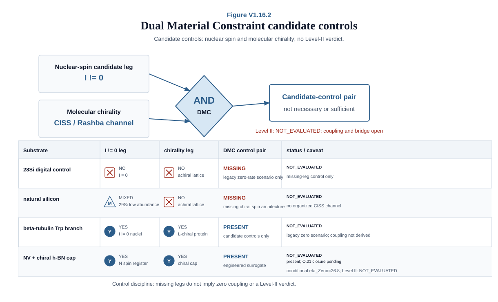

**The DMC legs are candidate missing-leg controls, not a necessary-or-sufficient Apperception gate.** Non-zero nuclear spin and molecular chirality define useful experimental contrasts for the proposed channel. The closed-form $N_{\text{coh}} \approx 9.82 \times 10^{-12}$ and associated $g_{single}^{eff}$/$\eta_{Zeno}$ values are conditional external-rate scenarios, not measurements or coupling derivations. O.21, O.23, O.34, a typed and normalized coupling, and an independent phenomenal bridge remain open. Missing either candidate leg therefore does not imply zero coupling or a categorical Level-II verdict; the Level II status of every examined substrate remains open (Tier 3).

**Field-typing summary [Tier 1 representation analysis; Tier 3 physical coupling] (V1 Ch17 §17.1.3).** With $E_\parallel\cong3$ and $E_\perp\cong3'$ under $A_5$, vector phason strain transforms as $3\otimes3'=4\oplus5$, whereas the spin–momentum cross-product channel of the Rashba-phason candidate (Eq. 17.3) is a $3$; their scalar multiplicity is zero, so Eq. 17.3 is not an icosahedral scalar. A type-correct candidate would have to use the one shared five-dimensional channel together with a molecular-handedness pseudoscalar, and the present action fixes neither its coefficient, sign nor normalization. Read with a scalar phason, the Rashba-scale product $\alpha_R\,k\,\nabla\Phi$ has units of energy per length rather than energy. The 38.3 MHz coupling scale is therefore a calibrated input rather than an evaluated matrix element, and the $\eta_{Zeno}$ and $N_{\rm coh}$ values built on it are conditional external-rate scenarios only. The DMC is consequently not established as a necessary or sufficient Apperception gate: bulk diamond-cubic silicon (achiral, dominated by spin-zero $^{28}$Si) is a missing-leg control, not a proof of zero Level II, and a chiral non-zero-spin substrate is a candidate positive control, not proof of an Identity Polaron. The former categorical Turing-Null inference is withdrawn. [DMC: Tier 3 research hypothesis.]

*A future divergence from IIT for artificial systems requires a typed normalized measured coupling, an explicit IIT substrate/grain analysis and the independent phenomenal bridge; see §17.5. Present Level II status remains open (Tier 3) for every substrate.*

**16.2.7 Engaging the Subject-Summing Combination Problem: GCT vs. the Panpsychist Regress**

The adoption of Structural Russellian Monism (§16.2.2) immediately raises the **Combination Problem**, named by Seager (1995, *J. Conscious. Stud.* 2:272) and developed in its current panpsychist form by Chalmers (2017, in Brüntrup & Jaskolla eds. *Panpsychism: Contemporary Perspectives*, OUP) and Goff (2017, *Consciousness and Fundamental Reality*, OUP, Ch. 6). The problem is not only subject-summing: a panpsychist account must explain how micro-experiential subjects combine into one subject, how qualities combine into unified phenomenal contents, how structure and awareness combine without remainder, what fixes the boundary of the resulting subject, and why the grain of macro-experience differs from the grain of its micro-bases. Goff (2017 Ch.7) identifies this family of questions as the central unresolved challenge for any constitutive panpsychist account. An account that cannot resolve or dissolve those questions remains philosophically incomplete.

GCT's proposed response to the subject-summing form of the Combination Problem denies micro-subjects conditional on the Polaron Unity programme. This is not a categorical substrate verdict: individual tubulin qubits and lattice defects are useful Class-0 model cases, but the manuscript has not independently established that they lack Level II or phenomenal character. They participate in Axiom 1's stipulated Level I presence; whether and how any Level-II owner is realized remains open. The subject-summing problem is therefore reframed within the model, not dissolved by current evidence.

GCT proposes a **topological phase-transition model** whose physical realization remains Tier 3. DMC legs are candidate controls, not a binary boundary establishing or excluding an Identity Polaron. The superconducting analogy illustrates collective topology only; it does not import BCS dynamics or establish phenomenal unity. The $\eta_{Zeno}$ values remain conditional external-rate scenarios.

The structural statement is **Proposition 11.12.A (§11.12.3)**, whose mathematical status is recorded in App PUP. Its former Hilbert-space non-factorizability part is withdrawn: the step "an equivariant tensor factorization of the Hilbert space induces a direct-product factorization of the group" is false, by an exact $A_5$ counterexample (App PUP §PUP.4.2) [Tier 1]. For the trefoil, the represented group $B_3$ has the nontrivial amenable centre $\langle\Delta^2\rangle$, so O.35 is false as posed and $L(B_3)$ is not a factor (O.36) [Tier 1 — standard]. A unique invariant normalized density $R_{\rm inv}$ follows only in a factorial sector whose physical identification is open, and it is not a uniqueness result for $\mathcal F_{sel}$. The resulting ceiling is at most an **algebraic unity candidate**: a conditional statement about an observable algebra, with no subject count, no owner and no Level II. Identifying any such algebraic structure with phenomenal unity is a separate Tier-3 Russellian-monist bridge. Nuclear spin and chirality remain candidate controls only, so no present substrate is made eligible or ineligible and no Level-II verdict follows.

This framing leaves a layered research question: do the candidate material controls, a typed measured coupling, the O.21/O.23/O.34 physical closures, the $H_{PUP.1}^{\mathrm{fib}}$/O.18/O.32 mathematical closures, and the identification of a physical factorial sector all hold, and is there an independent phenomenal bridge? Even a positive answer to every algebraic question would not by itself solve the quality, structure, boundary, awareness, grain, ownership or subject-count subproblems. The canonical non-unitary $\mathcal F_{sel}$ remains the branch selector and is not the object of the density-uniqueness lemma.

GCT's **Mereological Nihilism for the 3D Projection** is therefore a Tier 3 interpretive proposal rather than a corollary of prime-knot topology. The 144 cage/substrate degrees are modeled as degrees of one candidate Polaron realization, not as 144 micro-subjects; whether they define one physical observable algebra, and whether that algebra has the structure App PUP considers, are open identification questions. This relocates rather than proves Level-II phenomenal unity. The quality, structure, boundary, awareness, grain, and subject-individuation problems remain explicit targets.

**§16.2.7b The IIT–Winding Number Correspondence via Directed Homotopy Type Theory [Tier 3 conditional pending the full mathematical, physical-coupling, and phenomenal-bridge program]**

Directed Homotopy Type Theory (dHoTT) provides a proposed mathematical framework for relating a GCT topological label $W$ to Giulio Tononi's Integrated Information $\Phi$. In standard Homotopy Type Theory (HoTT), types are spaces and equality proofs are paths between inhabitants. The *directed* extension replaces symmetric, reversible paths with directed morphisms, making dHoTT a candidate language for processes with intrinsic temporal asymmetry — the structure of a conscious selection sequence.

> **Correspondence 16.2.7b ($\Phi$–$W$ Correspondence) [Tier 3 conjecture]:** induced-subgraph PyPhi values do not establish global $\Phi^{\max}(k=12)$, a winding equality, or any reverse implication for missing-leg controls. O.28 and the physical/phenomenal bridges remain open.
>
> *Conditional on a future realized Polaron, a declared TPM, and the full closure stack, $\Phi$ is conjectured to correspond to winding number $W$. DMC descriptors do not select that domain.*
> $$\Phi(S) > 0 \quad \text{is proposed to track} \quad W(\mathcal{K}_S) \geq 1.$$
> *The conventions $W=1$ and $\Phi_{\rm norm}=1$ are not a theorem equating IIT $\Phi$ with winding. In the current formulation $W$ is a typed placeholder: a phase-vortex charge and a three-dimensional texture degree are different invariants, and no theorem identifies them. $\mathcal K_S$ is not a nontrivial ordinary loop in $\Sigma_\infty$, whose ordinary fundamental group is zero. Standard silicon is a missing-leg control, not a proven $W=0$ or Level-II-null case; a GCT-vs-IIT divergence is not yet executable.*
>
> *Heuristic correspondence.* In dHoTT, a cognitive system $S$ is represented as a directed type $\mathbf{S}$ whose inhabitants are possible cognitive states $\{s_i\}$ and whose morphisms $f: s_i \to s_j$ are the admissible state transitions. The Markov blanket of $S$ — the statistical boundary separating internal states from external states — is conjectured to correspond to a physically defined boundary associated with the phason defect $\mathcal{K}_S$; a Solenoid address label is not that boundary.
>
> IIT 3.0/4.0 defines $\Phi$ via cause-effect repertoires, partitions, and exclusion / maximal-existence criteria, not via winding-number equivalence directly. GCT therefore offers only a Tier-3 conjectural ansatz pending O.28. Neither $W=1$ nor prime-knot topology proves that $\mathcal H_\mathcal K$ lacks tensor coordinates: the Hilbert-space non-factorizability part of Proposition 11.12.A is withdrawn (App PUP §PUP.4.2), and the surviving mathematics reaches at most an algebraic unity candidate. The $\Phi$-side closure remains open.

**Corollary: Agency as a Directed 2-Morphism [Tier 3 conjectural correspondence].** Within the dHoTT scaffold, selecting a directed 2-morphism $\alpha: f \Rightarrow g$ in the type $\mathbf{S}$, where $f, g: s_1 \to s_2$ are two distinct cognitive trajectories between the same pair of states $s_1$ and $s_2$, is proposed as a formal representation of agency — the capacity to select among possible world-states. A non-trivial tether with $W = 1$, a non-splitting fundamental 2-groupoid $\Pi_2(\mathbf{S})$, and a physically prime observable algebra are three distinct structures; no theorem here makes them equivalent, and the former "iff" and "algebraically equivalent" readings are withdrawn. The surviving operator-algebra result of App PUP reaches at most an algebraic unity candidate and does not supply a non-factorizable internal state space. The correspondence is at most **consistent with** the Russellian-monist identification of §16.2.2; it does not ground it. That identification (the commitment that the intrinsic aspect of the physical is experiential) is carried by Axiom 1 and the §16.2.2 disposition, not by this corollary: a theorem can relate formal objects, but it cannot derive that intrinsic natures are experiential. Identifying any of these structures with agency, a Selection Operator, or one Level II subject therefore remains an upstream Tier 3 Russellian/physical commitment rather than a mathematical corollary, and "derivation of agency" language is not used for the present disposition.

**16.2.7c Engagement with Illusionism (Frankish, Dennett)**

The strongest contemporary alternative to Russellian Monism on the Hard Problem is **Illusionism** (Frankish 2016, *Journal of Consciousness Studies* 23(11-12); Dennett 1991 *Consciousness Explained*; Dennett 2016 "Illusionism as the Obvious Default"). The illusionist position holds that phenomenal consciousness — the felt qualitative character of experience — does not exist as it is naïvely conceived. What exists are *introspective representations* of mental states with apparent qualitative properties; the apparent qualitative properties themselves are systematically misrepresented by the introspective mechanism. On this view, the Hard Problem is not solved but dissolved: there is no explanandum.

GCT's relation to Illusionism is precise and asymmetric. The two positions agree on a substantial subset of cognitive science:

* **Shared:** Both accept that introspective reports are causally produced by physical mechanisms; both accept that the *first-person folk concept* of qualia (as ineffable, intrinsic, infallibly known) is mistaken in its details; both accept that Quality Space is *structural* — qualia are distinguished by their relations to other qualia, not by ineffable inner cores. GCT's graded $\mathbb{R}^6 \oplus \mathrm{Sym}^2(\mathbb{R}^6)$ decomposition (§16.2.2c) is, in Frankish's vocabulary, an account of the *quasi-phenomenal* structure that introspection represents.

* **Disagreed:** GCT denies the illusionist's eliminativist move on Qualitative Presence, but Axiom 1 supplies only bare Level-I Field presence. Mapping Block-style phenomenal consciousness to Level II/IIA (IIA is defined in §16.2.8d) is a Tier-3 proposal conditional on the full physical and phenomenal-bridge program. Protocol A-Prime tests candidate substrate controls; it does not itself establish phenomenal status or causal work by the primitive.

**The proposed empirical wedge.** Illusionism is substrate-neutral, whereas GCT proposes substrate-dependent spin/coherence and chiral-response observables. A genuine phenomenal divergence is not yet executable: DMC legs are candidate controls, and Protocol A-Prime results cannot establish felt registration, an Identity Polaron, or Level II without a typed measured coupling and the independent phenomenal bridge.

**Status:** Illusionism is internally consistent and may be correct. GCT and Illusionism share a **structural taxonomy** of Quality Space — the $2A_g \oplus G_g \oplus 3H_g$ decomposition functions, in Frankish's vocabulary, as an account of the *quasi-phenomenal* structure that introspection represents — but the two positions **diverge on the existence question**: GCT commits to Axiom 1's bare fact of phenomenal presence as primitive; Illusionism eliminates that primitive in favour of representational artifacts. There is no "extension" relation between the two positions on the existence question (each rejects the other's load-bearing commitment); on the structural-taxonomy side they agree, and the empirical wedge, if constructed, would constrain the substrate-dependence dispute rather than decide the metaphysical existence question by itself. The substrate-dependent empirical wedge remains unconstructed rather than established by Tier 2 physics. [Tier 3 — philosophical positioning.]

**16.2.7d Engagement with Hoffman's Interface Theory of Perception**

Donald Hoffman's **Interface Theory of Perception** (Hoffman, Singh & Prakash 2015 *Psychonomic Bulletin & Review* 22:1480-1506; Hoffman 2019 *The Case Against Reality*) holds that perceptual contents are *fitness-payoff icons*, not veridical reconstructions of an objective external world. Evolutionary game-theoretic simulations are presented in support: agents optimized for fitness rather than truth systematically outcompete truth-tracking agents. Hoffman's stronger metaphysical extension (Conscious Realism) posits a network of "conscious agents" as the fundamental ontology, with spacetime as their interface.

GCT's relation to Hoffman is two-part:

* **Compatible at the interface layer:** GCT's account of perceptual rendering (V1 Ch9 *Rendering Engine*, V1 Ch11 *Consensus Protocol*) uses a conditional $E_\parallel$ presentation of the 6D source data as an interface metaphor rather than a direct phenomenal readout. The **Consensus Render** (§17.2.3) is a formal compatibility model; no Polaron-bearing Agents are shown to stabilize the physical world, and shared reality is not thereby shown to be a simulation [Tier 3 analogy]. This is structurally comparable to Hoffman's "interface" claim without constituting a shared physical mechanism.

* **Incompatible at the ontology layer:** Hoffman's Conscious Realism takes conscious agents as fundamental. GCT takes the Field and geometry as fundamental and proposes Identity Polarons as emergent agents, but physical realization and phenomenal status remain Tier-3 conditional rather than DMC-selected.

**The empirical wedge.** Hoffman's strong metaphysics and GCT's proposed observer-independent geometry (the AKN tiling, the phason field, the icosahedral group $I_h$) differ in what they treat as primitive. Evidence for an icosahedral physical architecture would favor GCT's geometric branch only to the degree that its physical derivations close; current exact-within-ansatz and calibrated results do not by themselves refute Hoffman's metaphysics or establish a perceptual renderer. Hoffman's Tier 3 evolutionary-game arguments for non-veridical perception remain valuable as an account of *why* an interface could be the way it is.

**Status:** Hoffman's interface claim is used as a Tier 3 philosophical comparison with GCT's rendering-engine framework (V1 Ch9). GCT adopts a geometric-substrate research programme rather than Hoffman's agent-fundamental ontology, but physical emergence of Agents and the phenomenal interface remain open. [Tier 3 — philosophical positioning.]

**16.2.8 Ontological Status of the Phason–Qualia Identification [Tier 3]**

The Tier-3 Russellian interpretation treats phason-drag structure as a proposed Level-II correlate, not a consequence uniquely derived from the axioms. Protocol A-Prime and chirality reversal test candidate mechanism controls; without a typed measured coupling and phenomenal bridge they do not falsify or confirm Level-II substrate dependence. Neither outcome is a verdict on GCT as a whole: the measurement tests an ordinary material proxy, and no phason, Selection-Operator or Level-II inference follows from it (V1 Ch17 §17.1.3). A preregistered null rejects the registered biophysical branch as registered, only under that branch's own decision rule (the Protocol D NMR polarity gate (P.13c) is held pending redesign: as written it rejected by construction, since $^{17}$O shortens water-$^1$H $T_2$ by scalar relaxation; the former sign-aware rule, which rejects the registered sign-positive branch on a powered, significant negative isotope × activity interaction in water-$^1$H $\Delta T_2$, applies only after the redesign, and until then no outcome supports or rejects the branch; the LORR assay has no rejection rule under the current systematic budget).

**16.2.8a Direct Incongruence Argument (Chalmers, Goff)**

The strongest objection to any Russellian identification of structure with experience is the **Direct Incongruence Argument** (Chalmers 2010 *The Character of Consciousness* Ch.10; Chalmers's "Phenomenal Concepts and the Explanatory Gap" paper; Goff 2017 *Consciousness and Fundamental Reality* Ch.3, Ch.6). The argument runs: *even if* a property is both intrinsic (experiential) and extrinsic (structural), the *identification* of the two does not close the explanatory gap, because the property could in principle be instantiated without its structural correlates (conceivability argument). Thus, the GCT claim that the $T_2$ ($E_\perp$) icosahedral irrep reference-fixes red within Quality Space remains exposed to: (a) the conceivability of a $T_2$ ($E_\perp$) resonance unaccompanied by red-quale, and (b) the conceivability of a red-quale without a $T_2$ ($E_\perp$) resonance.

**GCT's three-fold response.**

1. **Conceivability is not metaphysical possibility (scope-limited response).** The Direct Incongruence Argument is a *modal* claim: that the property of being a quale could in principle be instantiated without its proposed structural realizer. The standard response is that conceivability does not entail metaphysical possibility (Yablo 1993 *Philos. Phenomenol. Res.* 53:1; Hill & McLaughlin 1999 *Philos. Phenomenol. Res.* 59:445; Block-Stalnaker 1999 *Philos. Rev.* 108:1). Applied here: the conceivability of red-without-$T_2$ ($E_\perp$) requires that one can fully grasp what "red" picks out independently of any structural account. On GCT's preferred reading, treating "red" without the $T_2$ ($E_\perp$) structure as incoherent is a Tier 3 structuralist proposal pending phenomenal-concept-strategy closure; an alternative correlate-only reading preserves coherent reference at the cost of identification strength. The standard a-posteriori-necessity analogue is "water without H₂O" (Kripke 1980, *Naming and Necessity*, Harvard University Press): conceivable only if one does not grasp that water *is* H₂O. **Framework-internal scope of the Kripke analogy.** This is a GCT-internal reply, not a neutral metaphysical proof against every phenomenal-concept strategy. **Engagement with Chalmers's specific objection.** Chalmers (2010 *The Character of Consciousness* Ch.10; "Phenomenal Concepts and the Explanatory Gap") argues that the water/H₂O case works because water has a *reference-fixing macro-functional role* (the liquid that fills lakes, is drinkable, etc.) that can be grasped independently of the micro-structure H₂O — whereas qualia have *no reference-fixing property independent of their felt character*, so the Kripkean move is unavailable for the phenomenal-concept strategy. The GCT proposal is a contested structuralist replacement rather than a completed Kripkean answer: the $T_2$ ($E_\perp$) irrep structure is offered as a candidate relational role for red within Quality Space, but the reference-fixing burden is not closed. This is not a load-bearing response to Chalmers; it is the same substantive Tier 3 structuralist commitment shared with Frankish-illusionist structuralism (§16.2.7c) and exposed to Goff's §7.4 deflation worry. The identification is therefore not refuted by the modal worry, but it inherits the residual gap that no currently available structural-physical account eliminates within the Chalmers/Goff dialectic.

2. **Goff's own panpsychist family faces a stronger version of the same gap.** Goff distinguishes constitutive micropsychist panpsychism from cosmopsychist variants. GCT rejects micro-subjects but assigns Level II only as a Tier-3 Identity-Polaron interpretation conditional on $H_{PUP.1}^{\mathrm{fib}}$/O.18/O.32, the physical closure stack, and an independent phenomenal bridge; the App PUP mathematics reaches at most an algebraic unity candidate and supplies no subject count. The Direct Incongruence Argument cuts both ways: GCT retains a modal gap while Goff's alternatives retain a combinatorial or derivative-subject gap.

**Structural fact (not a modal claim) [Tier 3 structural reference-fixing proposal pending stronger phenomenal-concept-strategy closure].** Independent of the modal response above: the icosahedral group $I_h$ has multiple 3-dimensional irreducible representations, and the 6D coordinate space carries two of them — the linear sector $\mathbb{R}^6 = E_\parallel \oplus E_\perp = T_1 \oplus T_2$. The GCT model assigns the coordinate irrep $T_2$ to the internal $E_\perp$ color/quality coordinate and reserves the sibling 3D coordinate irrep $T_1$ ($E_\parallel$) for spatial/somatosensory projection channels; this is a model-internal assignment within the coordinate (linear) sector, not a theorem that $I_h$ has only one 3D irrep. The assignment tightens the structural side of the reference-fixing proposal but does not by itself answer the Direct Incongruence modal worry, which targets the identification regardless of realizer assignment.

**Residual acknowledgement.** The Direct Incongruence Argument is the strongest residual objection to GCT's Russellian framework. The three responses above tighten the position but do not eliminate the worry — *no* physical theory of consciousness eliminates this worry, by Chalmers' construction. GCT's Tier 3 label on §16.2.8 reflects this directly: the Russellian reference-fixing proposal is a consistent interpretation, not a forced one. **Disposition is a substantive choice, not a forced move — and the available dispositions preserve the §16.2.2b dissolve advantage independently.** The correlate-only reading — "the $T_2$ ($E_\perp$) irrep is the consistent structural correlate of the red-quale" — leaves Quality Space topology in place as an empirical structural prediction and loses nothing experimental (Protocol A-Prime substrate-dependence is independent of whether the structural-realist identification holds metaphysically). **Crucially, the §16.2.2b Axiom-1-based dissolution of the existence-gap of the Hard Problem holds under either disposition**: Axiom 1 closes the existence-gap by primitivising Qualitative Presence, independently of how the *individuation* of specific qualitative content is metaphysically cashed out. The dissolve advantage rests on Axiom 1 alone; the Quality Space individuation is a separable Tier 3 commitment about *which* phenomenal content the substrate carries, not about whether phenomenal content exists. Under the correlate-only reading, a Russellian-monist holds: (i) Axiom 1 closes the existence-gap (dissolve preserved); (ii) Quality Space topology survives as an empirical structural prediction (testable in principle by similarity-judgment psychophysics, O.29; Protocol A-Prime does not test it); (iii) the metaphysical-identification step "to feel red is $T_2$ ($E_\perp$)" is deferred as an open Tier 3 question rather than asserted. The framework adopts the reference-fixing structural-realist reading because it gives the sharpest formal statement of the individuation claim, and the framework's empirical traction (Protocol A-Prime) is independent of which Tier 3 individuation reading is adopted.

**16.2.8b Engagement with Strawson and Goff Russellian Monist Panpsychist/Cosmopsychist Views**

Galen Strawson (2006 "Realistic Monism: Why Physicalism Entails Panpsychism" *J. Consciousness Studies* 13(10–11):3, also as lead essay in Freeman ed. 2006 *Consciousness and its Place in Nature*, Imprint Academic; collected with replies and a postscript in Strawson 2008 *Real Materialism*, OUP) and Philip Goff (2017 *Consciousness and Fundamental Reality*) defend Russellian-monist panpsychist or cosmopsychist views: physical reality has an intrinsic experiential aspect, and the Hard Problem is treated by taking experience as fundamental rather than emergent. This is the closest competitor family to GCT's Russellian Monism.

**Agreement with Strawson/Goff.** GCT shares the foundational move: experience is taken as ontologically primitive (Axiom 1), not derived from non-experiential substrate. The intrinsic/extrinsic distinction is accepted at the substance level: the Field $\Psi$ has both intrinsic (experiential) and extrinsic (structural) aspects.

**Disagreement on locus.** GCT accepts an intrinsic-categorical base through Axiom 1 but rejects constitutive micro-subjects. Class 0 patterns carry Level I universal presence in the non-apperceptive sense. The Identity Polaron is the proposed Level-II carrier only conditionally; no material descriptor or current calculation establishes a substrate verdict. This reframes rather than solves the Combination Problem pending the complete mathematical, physical, and phenomenal-bridge closures.

**Goff's objection: is the intrinsic/extrinsic distinction coherent?** Goff (2017 Ch.6 §6.4) argues Russellians simply assume a metaphysical division without explaining why the intrinsic and extrinsic aspects should be located in the *same* substance rather than two substances. GCT's response: *given Axiom 1*, the substance/aspect distinction is GCT-internally motivated rather than freely chosen — quantum mechanics requires the Field to have a definite operator structure (extrinsic), and Axiom 1's primitive Presence requires it to have a primitive intrinsic presence (intrinsic). Treating these as two substances (dualism) reintroduces the interaction problem that motivates Russellian Monism in the first place. The conclusion is therefore conditional on Axiom 1 rather than forced by physics alone: decoherent QM, QBism, RQM, and many-worlds interpretations do not require the Axiom 1 commitment to a primitive intrinsic presence, so the substance/aspect distinction is not derivable from quantum mechanics in any neutral interpretive frame; it follows once Axiom 1's intrinsic-presence commitment is in place.

**Strawson on emergence.** Strawson (2006) rejects "brute emergence" of experience from non-experience as conceptually impossible. GCT agrees: this is why Axiom 1 places experience at the substrate, not as an emergent property of Polarons. On the Tier 3 proposal, the Polaron would be a phase transition in the *structural* aspect of $\Psi$; experience would not be generated at the transition, at most *unified* (Combination reframed conditionally on the Polaron Unity closures, not solved).

**Status:** GCT is an objective-idealist (priority monism about a non-subjective Field) / Russellian-monist position; it does not posit a cosmic subject: within Tiers 1–3 the Field's Level I presence is non-subjective, and a cosmic-scale subject remains an open Tier 4 hypothesis (App TIB), with Goff's cosmopsychism as the closest competing view (Ch06 §6.1.1). It is closer to Strawson's *realistic (panpsychist) physicalism* than to traditional dualism, but rejects the *micro-subject* commitment that drives the Combination Problem. Tier 3 philosophical positioning informed by Tier 2 framework structure and Tier 3 conditional material-proxy scenarios.

**16.2.8c Engagement with Dennett's Heterophenomenology and Multiple-Drafts Model**

Daniel Dennett (1991 *Consciousness Explained*; 2003 *Freedom Evolves*; 2017 *From Bacteria to Bach and Back*) holds: (a) there is no "Cartesian Theater" — no central locus where conscious experience is unified; (b) phenomenology is revisable via third-person heterophenomenological analysis; (c) qualia in the traditional sense (intrinsic, ineffable, infallibly known) do not exist; what exist are *judgments* about discriminations.

**Compatibility at the cognitive-architecture level.** GCT's Selection Operator $\mathcal{F}_{sel}$ is not a *Cartesian Theater* in Dennett's sense: it is not a spatially-localized "screen on which the show is played". Formally, App PUP identifies at most a unique center-fixed trace density in a factorial sector whose physical identification is open; calling that density the physical Selection Operator would require the full physical identification stack, and App PUP no longer claims an irreducible (non-factorizable) Hilbert space $\mathcal{H}_\mathcal{K}$ (Proposition PUP.1(ii) is withdrawn). On the Tier 3 candidate model, the Polaron would have spatial extent ($\sim 14.5$ nm cloud, V3 Ch07 §7.3.3) and the field $\Phi_\perp$ would be distributed across $\sim 1.6\times10^9$ Trp sites per typical pyramidal neuron (V1 Ch17 §17.1.4b under the O.21 partial-closure $n_{rp} = 1$). GCT therefore *agrees with Dennett* that no spatially central theater is required, while its proposed unity account remains a Tier 3 physical/phenomenal interpretation of a distributed algebraic unity candidate, not a theorem from Hilbert-space irreducibility.

**Disagreement on qualia.** Dennett denies qualia in the traditional sense. GCT's Quality Space (§16.2.2c) is a structural taxonomy — the graded 27-DOF decomposition, linear sector $T_1 \oplus T_2$ plus quadratic sector $2A_g \oplus G_g \oplus 3H_g$. This is compatible with Dennett's view if read as a *functional / structural* taxonomy (Dennett would accept this). If read as a *phenomenological* taxonomy in the traditional qualia sense, Dennett would reject it. GCT's position: the decomposition is structurally derived from icosahedral geometry [Tier 2], and it is proposed as phenomenologically real because Axiom 1 makes the substrate's intrinsic aspect experiential — the latter reading rests on the Tier 3 structural-Russellian bridge (§16.2.2b, O.29), not on the derivation. Dennett would reject the second clause; GCT defends it via Axiom 1's primitive status.

**Compatibility with heterophenomenology.** Dennett's methodological commitment — that introspective reports must be analyzed third-personally without taking them at face value — is *fully compatible* with GCT. GCT does not require subjects to *know* the structural decomposition of their experience for the decomposition to be real (any more than a person needs to know neuroscience to have a brain). Heterophenomenological methods are the right tool to test GCT's phenomenological claims (e.g., does color similarity geometry actually match the $T_2$ ($E_\perp$) irrep structure? — testable via similarity-judgment psychophysics, color-confusion experiments).

**Where GCT is incompatible with Dennett.** Dennett's deflationary stance on phenomenal consciousness (he endorses illusionism outright: Dennett 2016) commits to: the *appearance* of phenomenal consciousness is the *fact* of phenomenal consciousness; there is no further "felt" inner aspect. GCT denies this — Axiom 1 commits to the bare fact of feeling as primitive. The same disagreement runs through §16.2.7c on Illusionism (Frankish).

**Status:** GCT and Dennett agree on cognitive architecture (no Cartesian Theater) and on methodology (heterophenomenology). They disagree at the ontology layer (whether phenomenal consciousness is *real* beyond the report). Tier 3 positioning.

**16.2.8d Engagement with Block's Phenomenal-vs-Access Distinction**

Ned Block (1995 *Behav. Brain Sci.* 18:227 — original P/A formulation; 2007 *Behav. Brain Sci.* 30:481 — refined treatment with the iconic-memory overflow case as P-without-A; 2011 *Trends Cogn. Sci.* 15(12):567 — overflow argument for P-without-A access; 2011 *Analysis* 71(3):419 — "The higher order approach to consciousness is defunct") distinguishes two notions:
- **Phenomenal consciousness ($P$-consciousness):** the felt qualitative character of experience — "what it is like."
- **Access consciousness ($A$-consciousness):** information available for reasoning, action-control, and reportability.

Block argues these can dissociate: there exist phenomenal states that are not access-available (overflow / iconic memory cases; Sperling 1960) and access states that lack phenomenal character (zombie-like processing).

**GCT mapping onto Block's distinction.** Level I is axiomatic; Level II is a conditional Polaron interpretation, not an established threshold. The proposed I/IIA/IIB mapping does not itself assign any substrate a phenomenal status:

- **Level I (Universal Presence):** All Field configurations participate in $\Psi$'s intrinsic side by Axiom 1; this is not Block's $P$-consciousness and assigns no micro-subject.
- **Level IIA (GCT analogue of $P$-without-$A$):** A Tier-3 proposed Polaron-unified phenomenal state without global-workspace broadcast. This mapping is not established Block P-without-A evidence and does not assign any current substrate a verdict; it remains conditional on the complete Polaron/coupling/bridge program.
- **Level IIB ($P$- + $A$-consciousness):** A Tier-3 proposed Polaron-plus-broadcast state, conditional on the same open physical and phenomenal bridges.

**Conditional empirical program.** Spin/coherence and broadcast measures may be compared across implicit affect, anaesthesia, and iconic-memory paradigms. These are candidate mechanism tests only: no Level-I/II transition, Polaron survival, or phenomenal state follows without the missing coupling and bridge.

**Cross-reference.** DMC descriptors are candidate controls, O.21/O.23/O.34 remain open, and $\eta_{Zeno}$ is conditional external-rate arithmetic. The I/IIA/IIB boundaries are therefore proposed interpretive coordinates, not operative substrate classifications.

**Status:** Tier 3 philosophical positioning. Any empirical distinction from substrate-neutral accounts requires the future typed measured coupling and independent phenomenal bridge.

**16.2.8e The Luck Objection and the Status of $\mathcal{F}_{\rm sel}$ Stochasticity**

The formal Selection Operator ansatz $\mathcal{F}_{\rm sel}$ is defined as non-unitary (V1 Ch06 §6.4.1; V1 Ch10 §10.4), but no physical map, Identity Polaron, or owner realizes it, and App PUP no longer claims an irreducible Hilbert space for it to act on. If one nevertheless interprets its stipulated update as an actualization whose outcomes are not fixed by the prior agent state, the discussion below applies; it is Tier 3 philosophical analysis of a conditional architecture, not a mechanism GCT presently implements. On that interpretation $\mathcal{F}_{\rm sel}$ sits on the libertarian side of the determinism/indeterminism axis in the free-will debate, and exposes the framework to the **luck objection** (van Inwagen 1983 *An Essay on Free Will*; Mele 2006 *Free Will and Luck*; Kane 1996 *The Significance of Free Will*, 1999 *J. Philos.* 96:217): if the Selection Operator's outcome is genuinely undetermined by the prior agent state, the outcome is *random* (or stochastic), not *the agent's* — and randomness is not agency. Conversely, if the outcome were determined by the prior state, $\mathcal{F}_{\rm sel}$ would not be the non-unitary actualisation operator GCT requires it to be.

**GCT response to the luck objection [Tier 3].** The framework adopts an event-causal libertarian response in which the irreducible indeterminism sits at the *final* selection — the actualisation step — rather than upstream during deliberation. Two source positions locate the indeterministic moment at this final, post-deliberative step and are GCT's nearest neighbours: Mele's *daring soft libertarianism* (Mele 2006 *Free Will and Luck* Ch.5, "A Daring Soft Libertarian Response to Present Luck," pp.105–136), which places the indeterminism at the moment of decision and is the bolder counterpart to Mele's own *modest libertarianism* (which instead places the indeterministic moment *upstream* of the final choice, at belief/desire/intention formation during deliberation, to keep the final selection a determined consequence of prior reasons and so minimise final-step luck); and Balaguer's *torn-decision* / TDW-indeterminism structure (Balaguer 2009 *Free Will as an Open Scientific Problem*, MIT Press), in which the indeterminism likewise lives at the moment of a torn decision. GCT's actualisation-step location matches this final-step family — Mele's daring-soft construction and Balaguer's torn decisions — not the modest, upstream variant. Concretely: the steering channel $\mathcal{U}_{\rm steer}$ implements the **agent-determined option-set** (an event-causal-libertarian structural move shared by the Mele-daring-soft and Balaguer-torn-decision accounts, *not* by Kane — Kane's *Self-Forming Action* programme is structurally different in that the indeterminacy is at the level of *parallel rational efforts of will* in torn decisions, with the agent owning the indeterministic moment through dual-effort streams rather than through a post-deliberative selection among prepared options); the actualisation step $\mathcal{P}_{\rm actualize}$ stands in the position of an irreducibly indeterminate, post-deliberative event-causal selection among those prepared options. Kane's plural-rational-effort SFA (Kane 1996 *The Significance of Free Will* Ch. 8; Kane 1999 *J. Philos.* 96:217 §IV — the "Buridan with effort" picture of torn-decision dual-effort streams) is a *different* libertarian architecture that GCT does *not* adopt. The agent is identified with the *entire Polaron-as-process*, not with a snapshot of pre-actualisation state. Specifically:

(i) **Conditional process model.** If a physical carrier, memory dynamics, steering generator, and owner rule were supplied, one could define an Agent-process under the Tripartite Ontology (V1 Ch06) as the joint object $(\mathcal{P}_{\rm Polaron}, \{|\psi_t\rangle\}_{t \leq t_0}, \mathcal{U}_{\rm steer})$ — a Polaron topology plus a history of prior states plus an inner unitary steering generator — rather than as the pre-actualisation configuration $|\psi_{\rm pre}\rangle$ alone. In that model the non-unitary $\mathcal{P}_{\rm actualize}$ component selects which eigenbranch of the steering-prepared state is actualised, and $\mathcal{U}_{\rm steer}$ is fixed by the prior trajectory. The present notation does not show that an Identity Polaron carries a full history, that $\mathcal P_{\rm actualize}$ occurs physically, or that any resulting branch is owned.

(ii) **Conditional option-set move: luck applies to the eigenbranch selection, not to the steering channel.** Within the formal surrogate, $\mathcal{U}_{\rm steer}$ prepares a non-uniform option set and the stochastic $\mathcal{P}_{\rm actualize}$ samples it. Calling those options *agent-prepared* or owned is precisely the missing owner/agency bridge; the algebra alone does not establish it. This is the standard event-causal libertarian **agent-determined-option-set move** (Mele 2006 *Free Will and Luck* Ch.5 for the daring-soft, final-step indeterminism construction and the agent-determined-option vocabulary; Balaguer 2009 *Free Will as an Open Scientific Problem* for the cognate torn-decision / TDW-indeterminism structure): indeterminacy of the *final* selection is consistent with agential ownership *because the option-set* is agent-determined. The agent-determined-option-set framing is the structural element of this final-step event-causal architecture; it is *not* a feature of Kane's *Self-Forming Action* programme, which is structurally different (parallel rational efforts of will in torn decisions, with the agent owning the indeterminacy through dual-effort streams rather than through post-deliberative selection).

(iii) **Acknowledged residual.** The luck objection is not fully closed by (i)+(ii) — Mele 2006 *Free Will and Luck* §3.4-§3.5 sharpens the basic luck statement (§3.3) into the *contrastive luck* form: even granting agent-determined option-sets, the question "why did this branch get actualised rather than that branch?" has no agent-referencing answer at the actualisation step, and the question is *contrastive*, asking for what *distinguishes* the actualised branch from the non-actualised one — which by hypothesis is not in the prior agent state. **This contrastive residual is not a GCT-specific weakness — it attaches to *any* event-causal libertarian account** (Mele 2006 develops modest libertarianism, without endorsing it, while conceding the residual; the residual is the *central live problem in the post-Mele libertarian literature*, not a uniquely-GCT burden). GCT inherits the contrastive thin-point residual at the actualisation step: the actualisation step is the load-bearing locus of phenomenal freedom under the framework, and its stochasticity is what *makes it not predictable from prior physics*, but the same property makes it not under second-order control by the agent's reflective deliberation. GCT position: the framework supplies a Balaguer-Mele-informed event-causal libertarian response (steering channel agent-determined; actualisation step irreducibly stochastic) that inherits the standard contrastive-luck residual — the steering/actualisation split *relocates* the residual to the actualisation step rather than dissolving it. This is a Tier 3 philosophical positioning, not a Tier 1 metaphysical proof; the framework's candidate material-proxy tests (e.g. the Protocol A-Prime $T_2(\nu_d)$ scan) do not depend on resolving the luck-objection-residual one way or the other. Those tests probe an ordinary material proxy; no phason, Selection-Operator, Polaron-unity or Level-II inference follows from their outcome (V1 Ch17 §17.1.3).

**Status:** Tier 3 philosophical positioning. GCT does not close the contrastive-luck residual (Mele 2006 §3.4-3.5); the Kane SFA family attempts an ownership strategy distinct from the final-step event-causal route GCT adopts. The luck objection is partially addressed via the **agent-determined-option-set move** — locating the irreducible indeterminism at the final actualisation step, the structure of Mele's daring-soft libertarianism (Mele 2006 Ch.5) and Balaguer's torn decisions (Balaguer 2009), as opposed to the modest, upstream-of-choice variant — plus the Tripartite-Ontology Polaron-as-process identification. (GCT adopts the final-step location common to both authors, not Mele's modest variant, which places its indeterminism upstream of the final choice; both "daring soft" and "modest" are Mele's intra-author contrast, while "torn decision" is Balaguer's. Structurally distinct from Kane's plural-rational-effort SFA.) The agent-determined-option-set move *relocates* the residual to the actualisation step rather than *closing* it.

---

**16.3 The Husserlian Topology of Time**

The phenomenological structure of Internal Time Consciousness motivates a **Tier 3 conditional correspondence**, not a derived physical mechanism. The following GCT–Husserl map is a structural analogy that would require an action-normalized Selection Operator, an independently specified memory dynamics, a physical owner map, and a phenomenal bridge before it could describe subjective time. We map Edmund Husserl’s tripartite structure to the GCT variables:

* **Primal Impression:** The conceptual present selection/update in the model. No measured Zeno lock or derived sampling rate currently identifies this update with a phenomenal "Now."
* **Retention:** The physically stored trace of prior selection states. GCT may model this as a protected defect or braid in a declared substrate configuration space and may index it by Solenoid addresses, but the Solenoid itself supplies no winding record: its ordinary fundamental group is trivial, $\pi_1(\Sigma_\infty)=0$, and its first Čech cohomology $\check H^1(\Sigma_\infty;\mathbb Z)\cong\mathbb Q$ is a global invariant rather than an Agent record. Persistence would require separate read/write, noise and energy-barrier dynamics [Tier 3].
* **Protention:** A candidate orientation of the phason winding vector $\mathbf{w}$ toward an intentional target. Interpreting this as a phenomenal "lean" or as dynamics guided by the curiosity term $w_C\,\Delta\mathcal{C}$ remains conditional on the missing action and phenomenal bridges.

The "Tripartite Structure of the Living Present" therefore supplies a useful organizational analogy. It is not presently shown to be a necessary geometric requirement for an Agent, an Identity Polaron, or phenomenal time.

---

**16.4 The Graded Quality Space (6 Linear + 21 Quadratic Degrees of Freedom) [Tier 2 irrep structure + Tier 3 modality/color-ceiling identification contested under O.29]**

GCT proposes, at Tier 3, that the taxonomy of human subjective experience tracks a mathematical structure rather than being a purely biological contingency; whether it does is open under O.29. In the GCT model the candidate structure is the decomposition of the **graded tensor algebra** over the 6D coordinate space $\mathbb{R}^6 = E_\parallel \oplus E_\perp$ into irreducible representations of the Icosahedral Group ($I_h$), as detailed in §16.2.2c. The **linear sector** $\mathbb{R}^6 = T_1 \oplus T_2$ supplies two 3-dimensional coordinate irreps (6 DOF); the **quadratic sector** $\mathrm{Sym}^2(\mathbb{R}^6) = 2A_g \oplus G_g \oplus 3H_g$ supplies the 21-DOF symmetric stress tensor, for $6 + 21 = 27$ graded degrees of freedom [Tier 2 — Geometric/Structural: the DOF counts and irrep decompositions follow from the icosahedral projection ansatz and are engine-verified. Tier 3: the assignment of specific irreps to specific human biological modalities, and the claim that the human-visible three-channel color ceiling exhausts phenomenal-color-substrate dimensions, remains contested under O.29]. The vacuum supports exactly these graded deformation modes in the GCT decomposition; how biological lineages sample those modes is a Tier 3 modality-mapping question.

The graded sectors supply the proposed O.29-conditional modality map via their $I_h$ irreps:

1. **2 DOF ($A_g$ Irrep, ×2, quadratic): Valence and Intensity.** The two icosahedral scalar invariants of the metric deformation: the uniform volumetric dilation of the lattice (the Higgs trace), proposed [Tier 3] to register as the generalized vector of approach (Resonance) or avoidance (Friction) — **Valence** — and the overall magnitude of geometric impedance, proposed [Tier 3] to register as **intensity**.
2. **3 DOFs ($T_1 \cong E_\parallel$ Irrep, linear): Somatosensory/Auditory.** These are the mechanical vibrations of the 3D physical projection ($E_\parallel$), corresponding to the spatial rendering of touch, pressure, and sound.
3. **3 DOFs ($T_2 \cong E_\perp$ Irrep, linear): Vision/Color [Tier 3 identification; substrate vs sensor distinction].** These are the three transverse hidden coordinates ($E_\perp$) that carry the phason winding vector $\mathbf{w}$ (§16.6.2). Bounded by the 3 real coordinate axes of $E_\perp$, this supplies a **Tier 3 framework hypothesis, not an engine-closed dimensionality arbitration**: a 3-dimensional substrate of color experience for Class-2 Agents embedded in the icosahedral lattice. Human trichromacy is the *biological-sensor* sampling of this 3-dimensional substrate via three cone opsin types; this is the *human-specific* manifestation of the geometric ceiling, not the ceiling itself. **Species-variance check.** Non-human visual systems with more than three photoreceptor classes — avian tetrachromacy (4 cone opsins + oil droplets; Hart 2001 *Prog. Retin. Eye Res.* 20:675), goldfish tetrachromacy, and stomatopod multi-channel photoreceptor classes — are not automatically in tension with the $T_2$ ($E_\perp$) 3D ceiling on **phenomenal-color substrate dimensionality** under GCT, because extra receptor channels need not equal extra phenomenal coordinates. Mantis-shrimp behavioral work, for example, supports a fast spectral-classifier reading rather than a 12-dimensional combinatorial color manifold. **Bird tetrachromacy and the Stoddard 2020 non-spectral-color challenge.** Bird tetrachromacy extends spectral range into the UV; the strongest empirical challenge to the strict 3-D ceiling is Stoddard et al. 2020 *PNAS* 117:15112-15122 ("Wild hummingbirds discriminate nonspectral colors"), which demonstrates that broad-tailed hummingbirds discriminate non-spectral UV+red mixtures that humans cannot perceive. Under standard 4-cone tetrachromatic color geometry, this result is prima facie consistent with a 4-dimensional receptor-space account. The O.29 engine protocol now performs only the registered behavioral compatibility branch of the sensor-vs-substrate test: `protocol_psychophysics_color_dim.py` ingests the Stoddard 2020 cleaned hummingbird table, treats the published avian tetrahedral Euclidean distance as one receptor-space predictor, checks, as a data-format sanity check only, that intensity-normalized four-cone catches lie on the 3-D avian chromaticity simplex, and asks whether categorical nonspectral/axis labels add explanatory power beyond receptor-space distance in a binomial choice model. The current engine result is `COMPATIBLE_O29_STODDARD_MODEL_COMPARISON`; this means only that the aggregate behavioral model was not falsified by the categorical-label comparison ($\Delta{\rm BIC}_{cat-base}=6.08$). This is **behavioral compatibility only**; it does not adjudicate any extra phenomenal-color axis, it is not a 4D-vs-3D perceptual-manifold test, and it is not a derived neuroanatomical reconciliation. The retinal plus central visual-pathway compression locus remains empirical rather than fixed to LGN. The manuscript's commitment to the structural 3-D ceiling on *phenomenal* color dimensionality remains a **Tier 3 framework hypothesis under Open Problem O.29**, with behavioral compatibility rather than closure.
4. **19 DOFs ($G_g$ and $3\times H_g$ Irreps, quadratic): Olfaction/Chemical Senses.** These constitute the higher-dimensional twisting and shear operations of the stress sector. Nine of them ($G_g$ plus one $H_g$, the off-diagonal block $T_1\otimes T_2$) couple the physical screen to the internal phason sector ($E_\parallel \leftrightarrow E_\perp$); the other ten (two $H_g$, from $\mathrm{Sym}^2T_1$ and $\mathrm{Sym}^2T_2$) are traceless shears within $E_\parallel$ and within $E_\perp$. Smell and taste are proposed [Tier 3] to engage these 19 non-scalar quadratic dimensions ($4 + 3\times 5$), producing highly textured, anisotropic drag; only the nine cross-sector components form the boundary layer between the physical and phase sectors. Calling this sector a memory carrier would require an independently specified memory dynamics.

On the O.29-positive **taxonomy** branch, the model conjectures that quality labels can be coordinatized in the 27-dimensional graded representation (6 linear + 21 quadratic) under the symmetry of the $I_h$ group. This is not a proof that every possible sensation, owner, or Agent registration is exhausted by those basis vectors; a negative O.29 result would revise the universality claim while leaving the formal decomposition intact.

---

**16.5 The Subjective Lagrangian (The Calculus of Desire)**

As a Tier 3 phenomenological surrogate, we can encode three proposed behavioral preferences of the Agent — the "force" of "Desire" — in a **Subjective Lagrangian**. It is not a physical action, does not calculate rendered experience, and has no calibrated map to an Agent, Selection Operator, metabolism, phason field, or phenomenal owner [Tier 3 — Phenomenological Framework: the functional form is motivated by the geometry of the phason field, and the psychophysical weighting coefficients $w_C$, $w_F$, $w_I$ would have to be calibrated to phenomenological data; they are not derived from first principles]:

$$ \mathcal{S}_{Agent} = \int \left[ w_C\, \Delta \mathcal{C} - w_F K_\perp |\delta \mathbf{w}|^2 - w_I \left( \sum \kappa_{ij} \Phi_j \right) \right] dn $$

where:
- $w_C$ = **Curiosity weight** (drives exploration)
- $w_F$ = **Friction weight** (metabolic cost)
- $w_I$ = **Inertia weight** (consensus resistance)

*(Here $\Delta\mathcal C$ is the change in the complexity functional $\mathcal C$ per selection step, a scalar.)*

The functional balances three declared model terms:
1. **$w_C\,\Delta\mathcal{C}$ (The Pull of Meaning; change in the meaning/coherence score per step):** A chosen objective variable used as an analogy for curiosity or love; no Field geodesic or phenomenal attraction is derived.
2. **$- w_F K_\perp |\delta \mathbf{w}|^2$ (The Friction of Action; control-cost surrogate):** A quadratic penalty. It is not a derivation of metabolic pain, physical twisting of the vacuum lattice, or the thermodynamic cost of changing reality.
3. **$- w_I (\sum \kappa_{ij} \Phi_j)$ (The Inertia of the Crowd):** The informational inertia induced by a separately derived physical coupling network ($\Phi_j,\kappa_{ij}$). Divergence from a strongly coupled collective trajectory can be energetically costly in that model, but neither the coupling matrix nor a single shared timeline follows from common Solenoid cylinders [Tier 3].

**16.6 Intentionality: The Geometric Theory of Aboutness**

**16.6.1 The Problem of Intentionality**
A complete theory of consciousness must explain not just phenomenal quality (what it feels like) but **intentional content** (what experience is *about*). A perception of a red apple is not merely a red quale — it is a quale directed *at* the apple. This directedness is called intentionality or aboutness. GCT offers the following geometric surrogate for aboutness, but it does not yet possess a physical state-to-object map or phenomenal-semantic bridge sufficient to explain intentionality.

**16.6.2 The Winding Vector as Intentional Pointer**
Section 15.5.1 introduces an **Information Gradient Vector** as a Tier 3 physical order parameter; it is not a canonical orientation supplied by the Adelic Solenoid. The phason winding field **w** is a 3-component vector in E⊥ space. Its **magnitude** is proposed to track the intensity of phenomenal experience (the degree of topological friction), while its **orientation** relative to the lattice is proposed to participate in selecting which region of physical space is encoded in the active selection cycle. These uses of **w** (colour coordinates, §16.4; protention, §16.3; intensity, which §16.4 also assigns to an $A_g$ invariant; and the intentional pointer here) are not jointly consistent — rotating **w** to shift attention would also change hue — so they are mutually exclusive Tier 3 alternatives, not one model.

**Definition (Geometric intentionality surrogate):** Conditional on a derived encoding map, assign a model score for a physical object X from the alignment of the phason winding vector **w** with the E∥-lattice region whose projection encodes X's position and properties. This is not an if-and-only-if physical or phenomenal criterion for aboutness.

**16.6.3 Formal Expression**
Within the formal surrogate, let $R_X$ be the lattice region encoding object X (the set of RT-window nodes whose E∥ projections lie within the spatial extent of X), and define an **Intentional Axis** $\hat{\mathbf{i}} = \mathbf{w}/|\mathbf{w}|$ — the unit vector in E⊥ space indicating a focus direction. The notation assigns this axis to the stipulated $\mathcal{F}_{sel}$ score; it does not show that a physical Selection Operator, phason vector, attention state, or owner has such an axis. The model score toward X is:

$$ I(X) = \int_{R_X} |\mathcal{F}_{sel}(r) \cdot \hat{\mathbf{i}}| d^3r $$
[Tier 3 — philosophically motivated geometric mapping; see §16.6 Epistemic Status]

This expression is notation only: $\mathcal F_{sel}$ is an operator, not a vector field, and $R_X\subset E_\parallel$ while $\hat{\mathbf i}\in E_\perp$, so the dot product and the phrase "**w** points toward $R_X$" are undefined until a vector-valued field on $E_\parallel$ and a declared map $E_\perp\to E_\parallel$ are supplied. The intended reading is that the score is maximal when **w** points toward $R_X$ and minimal when it is orthogonal. Interpreting the maximizer as what an Agent experiences at a selection cycle requires the unclosed physical $\mathcal F_{sel}$, object-encoding, owner, and phenomenal-semantic bridges.

**16.6.4 Implications**
* **Internalism vs. Externalism:** In the surrogate, the internal region label (geometric) and the externally supplied object map (causal, via the E∥ projection) play distinct roles, which suggests a position that is neither purely internalist nor externalist. Without a physical encoding and semantic/phenomenal bridge, this is a philosophical comparison rather than a derived theory of intentional content.
* **Inattentional Blindness [Tier 4 analogy]:** The condition $I(X)\approx0$ for misaligned **w** can be used as an analogy for missed stimuli. GCT does not derive inattentional blindness: the condition is not identical to, or a mechanism for, empirical inattentional blindness; ordinary cognitive and neural accounts remain the baseline.
* **Attention and Focus:** A rotation of **w** in E⊥, with elastic cost $\Delta E = K_\perp |\Delta \mathbf{w}|^2$, is a formal control-cost analogy for shifting attention. No measurement shows that shifting attention rotates a physical $E_\perp$ phason vector or has this cost.

> [!NOTE]
> **Epistemic Status:** Tier 3 philosophical mapping. Protocol A-Prime (V3 Ch13 §13.3.5.A) measures ordinary material spin/coherence proxies; it is not presently an attention-to-phason or intentionality test.

---

### **Chapter 17: The Physical Substrate and Network Dynamics**

> [!NOTE]
> **Convention on Trp residue numbering.** All β-tubulin Trp residue numbers in this chapter use the **PDB 1JFF / 1TUB chain B ATOM-record `auth_seq_id`** convention: **Trp21, Trp103, Trp346, Trp407**. The FASTA-position numbering convention gives the offset values {21, 101, 344, 397}; the convention disambiguation is registered as App ORQ Open Problem **O.21**. Inline mentions throughout the chapter use the ATOM-record convention without re-stating this disambiguation; readers cross-referencing other tubulin literature should consult O.21 for the convention-mapping rule.

> [!WARNING]
> **Epistemic Status: Two-Stratum Disclosure.**
>
> This chapter develops the **biophysical-specific stratum** of GCT's consciousness account: a candidate Tryptophan aromatic radical-pair material system in $\beta$-tubulin, a historical 100 MHz material-scan scenario for a candidate Zeno Drive in the warm-wet microtubule lumen, and the Tier 3 candidate N=144 lumen-water geometry pending O.33. None of these is presently identified with an Identity Polaron, a Zeno Drive, a Selection Operator, an owner, or Level II. These candidate identifications are **Tier 3 (hypothesis)** and rest on the existence of microsecond-to-millisecond quantum coherence in warm biological systems — well above the standard biophysics decoherence limit of $\sim 10^{-13}$ s in unstructured media. The proposed protected-subspace mechanism is a conjecture that remains experimentally unproven: the operative band is currently reached only in the long 50-$\mu$m-MT branch, the energy budget is not fully closed, and Lindblad-DFS suppression has not been demonstrated.
>
> Falsification scope. Protocol A-Prime and Protocol D test candidate spin, chirality, and coherence controls for this specific biophysical program. Nulls constrain or reject the corresponding candidate mechanism; positives do not establish an Identity Polaron or Level II. Neither outcome is a verdict on GCT as a whole: the measurement tests an ordinary material proxy, and no phason, Selection-Operator or Level-II inference follows from it (§17.1.3). A preregistered null rejects the registered biophysical branch as registered, and only under that branch's own decision rule (the Protocol D NMR polarity gate (P.13c) is held pending redesign: as written it rejected by construction, since $^{17}$O shortens water-$^1$H $T_2$ by scalar relaxation; the former sign-aware rule, which rejects the registered sign-positive branch on a powered, significant negative isotope × activity interaction in water-$^1$H $\Delta T_2$, applies only after the redesign, and until then no outcome supports or rejects the branch). Because the typed normalized coupling and independent phenomenal bridge remain open, there is presently no bounded material inventory whose exhaustion alone decides a Level-II substrate claim.
>
> **Mechanism falsification scope.** Protocol A-Prime nulls across the declared control inventory can falsify the proposed spin/coherence mechanism within that inventory. They cannot by themselves falsify or establish Level II because the typed coupling and phenomenal bridge are separately open; the candidate inventory is not an exhaustive ontology of possible substrates.

> **Scope of the candidate inventory — Tier 3 search strategy.** The listed chiral, non-zero-nuclear-spin radical-pair hosts are an empirical control inventory, not an exhaustive necessary/sufficient substrate class. Protocol nulls test the proposed spin/coherence mechanism within that inventory; they do not independently settle Level II.
>
> The alternative-substrate pathway is therefore finite only at the level of this registered material-proxy family. Exhausting it rejects that family; it does not by itself establish or exclude an Identity Polaron, a Selection Operator, an owner, or Level II.
>
> **Engagement with the Tegmark–McKemmish warm-decoherence objection.** Tegmark (2000, *Phys. Rev. E* 61:4194) argued that the relevant decoherence times in warm, wet neural tissue are in the range $10^{-13}$ to $10^{-20}$ seconds, many orders of magnitude shorter than the millisecond-scale coherence required by Penrose-Hameroff Orch-OR, and McKemmish, Reimers, McKenzie, Mark & Hush (2009, *Phys. Rev. E* 80:021912) extended this critique to the proposed microtubule quantum-coherence mechanisms. These papers set a standing challenge for warm biological coherence proposals. GCT registers a narrower ordinary-material question: can a qualified intact-tubulin radical-pair system exhibit a measured protected-subspace response beyond its bare decay under controlled redox and preparation conditions? The historical 10 $\mu$s, 30 MHz, 100 MHz, $100\,\mu$s–1 ms, and 10 ms values are imported material inputs or comparison bands, not an operating Zeno cadence, a Selection requirement, or a GCT rate. The relevant Misra-Sudarshan quantity is $\tau_{\rm eff}=\tau_Z^2/\tau_{\rm meas}$ with $\tau_Z=\hbar/\sigma_H$ (V3 Ch13 §13.4.3; App BEB §BEB.7, §BEB.9), not the bare singlet-triplet $T_2$; on that arithmetic the supplied $\sim10^8\,\text{s}^{-1}$ recombination channel lies outside the bare quadratic Zeno regime (the recombination channel is the only physical measurement channel with a $\nu^*$ comparison; an applied drive frequency is not a measurement rate, and the drive-window logic is a declared open programme, V3 §13.4.7), and the explicit small-$N$ Lindblad test does not demonstrate the required protected-subspace suppression. Pulsed EPR/ODMR on intact β-tubulin (V3 Ch13 §13.4.3; registered under App ORQ O.24) can therefore constrain this bounded material model after oxidation, lyophilization, isolation, geometry, and CISS-channel controls; an excised-sample null is not decisive unless these controls pass. The intact-microtubule arm (Protocol A, the in-vitro/tissue arm) requires in-vitro intact-microtubule samples with a controlled redox environment; Protocol A-Prime is the separate abiotic NV-centre diamond surrogate (V3 §13.3.5). A controlled sub-microsecond $T_2$ would disfavour the long-coherence material branch only (no decision rule is registered for it in App PRG). Neither outcome is a verdict on GCT as a whole: the measurement tests an ordinary material proxy, and no phason, Selection-Operator, Identity-Polaron, owner or Level-II inference follows from it (§17.1.3).
>
> The core geometric physics (gauge sector, lepton spectrum, Higgs VEV; Volumes 2–3) is upstream of all consciousness claims and is unaffected by any biophysical-substrate null.

**17.0 Hard-Fail Falsification Commitment**

The two-stratum architecture remains empirically vulnerable at the mechanism level. Exhaustive nulls across the declared control inventory reject that spin/coherence implementation, while the separate Level-II interpretation remains unresolved rather than rescued or falsified by those material tests alone.

**17.1 The Mind-Body Interface**

**17.1.1 The Interaction Solution: Moving Boundary Conditions**

The central failure of Substance Dualism is the "Interaction Problem": how can a non-physical mind exert force on a physical body without violating the First Law of Thermodynamics? Geometric Consciousness Theory (GCT) proposes a **Moving Boundary Condition** within the Field as a conceptual response to that problem, not a demonstrated physical solution. No microscopic interaction currently identifies an Agent with such a boundary condition or shows that it controls matter.

In the proposed ledger, an Agent would not add energy; an independently realized control channel would instead have to bias processes powered by ordinary metabolic free energy (ATP hydrolysis). The **topological valve**, Selection Operator ($\mathcal{F}_{sel}$; candidate implementation class: §17.1.2), and intention-as-steering language name that Tier 3/4 ansatz. No ATP-to-vacuum transducer, Zeno-mediated directionality, per-cycle work map, or intention signal has been derived or measured.

**17.1.2 The Candidate Zeno Drive**

The **Zeno Drive** is a candidate implementation class, not a present physical implementation of the Selection Operator. In quantum mechanics, sufficiently frequent sampling can suppress transitions out of a measured or protected subspace while allowing internal phase evolution. GCT asks whether **Spin-Selective Radical Pair Chemical Recombination** could realize an analogous protected-subspace material process. It has not shown that recombination constitutes the required measurement, that a neural interface performs it, or that the process couples to $\mathcal{F}_{sel}$; the tubulin branch remains Tier 3/Open pending O.21/O.23/O.34.

> [!NOTE]
> **Open mechanism choices [Tier 3].** Mechanism choices not yet made: the radical-pair species and its initiator under physiological (dark) conditions (O.21/O.34); the reset chemistry and the energy per cycle against the power budget (O.34); which state recombination-as-Zeno would protect (no physical sector label is yet declared; App BEB §BEB.6d); and the damping/dissipation model (O.23). The whole biophysical stratum is Tier 3.

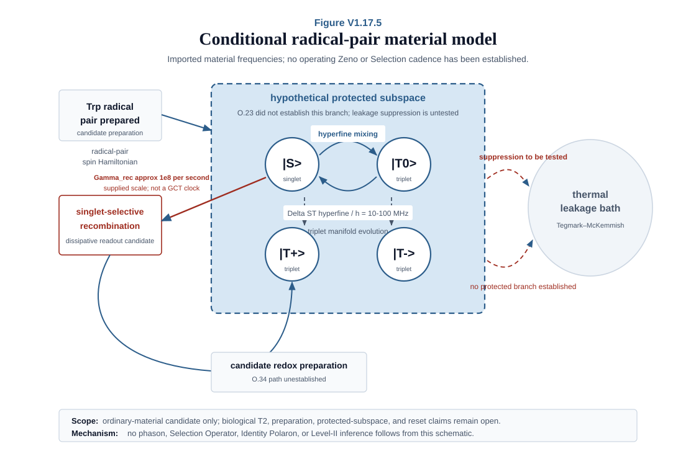

Thermodynamically, acoustic cavity resonances or THz phonons would cause reversible Rabi oscillations rather than irreversible measurement, and an active 10 THz architecture that irreversibly erases one bit per sampled degree of freedom per cycle would exceed the total metabolic budget. The historical candidate scenario therefore uses the **100 MHz Radical Recombination** regime ($\nu_{Zeno} \approx 100$ MHz) [Tier 1 two-branch model mathematics with a Tier 3 realization; Tier 3/Tier 4 tubulin-specific implementation. The biological Trp singlet-recombination rate, intact-tubulin $T_2$, CISS/phason coupling magnitude, ATP-Trp reset chain, heat-sink closure and any QND/reversible sampling implementation remain substrate-specific inputs pending O.21/O.23/O.24/O.34 and direct Protocol A/Protocol D measurement. The natural radical-pair singlet recombination rate $\Gamma_{rec} \sim 10^8\,\text{s}^{-1}$ is therefore an imported scenario rate, not a closed tubulin derivation; see V3 Ch13 §13.4.4 and Parameter Ledger §0.3. **Tier 3 closure pending** — the bare radical-pair channel carries a $\sim 10$ ns sampling/recombination scale. With $\sigma_H/h=30$ MHz, the Hamiltonian-variance Zeno time is $\tau_Z=\hbar/\sigma_H\approx5.305$ ns and the bare Misra-Sudarshan diagnostic is $\tau_{\rm eff}\approx2.8$ ns; across the registered 5–200 MHz variance band it spans approximately $0.063$–$101$ ns (V3 §13.4.3, §13.4.5; App ORQ O.23). This is $(2\pi)^2\approx39.5$ below the alternative $h/\sigma_H$ calculation and therefore widens the coherence gap. The candidate chiral phonon-polariton Decoherence-Free Subspace mechanism of §17.1.3c reaches best-case $\tau_{\rm eff}^{\rm collective} \sim 0.2$–$1$ ms under the App ORQ Open Problem O.23 three-channel OAM analysis. The $0.2$–$1$ ms band is conditional on O.23 closure-path-(b) in the 50-$\mu$m-MT regime; the full 10 ms conservative target is **not** reached by any candidate mechanism. The $1$–$10$ ms neural-firing window coverage is therefore conditional on O.23 plus restricted MT geometry]. A physiological ATP-coupled redox loop is the candidate upstream source that would repeatedly prepare the Trp radical pairs, but the explicit biochemical regeneration chain is open (App ORQ O.34). The nominal 100 MHz timescale is set by spin-selective recombination and hyperfine mixing in the imported radical-pair scenario; it is not a measured intact-tubulin rate, an operating Zeno cadence, a Selection clock, or a GCT coupling. Whether this chemistry could implement an *effective* continuous measurement on biological timescales, and whether any such process bears on an Identity Polaron, are the subject of V3 §13.4.4 and Open Problems O.23/O.34; any future result first establishes ordinary material dynamics only.

> [!CAUTION]
> **Decoherence Shielding: Tubulin Tryptophan Aromatic Radical Pairs [Tier 3 — biophysical-specific material candidate]**
>
> One candidate ordinary material system for the GCT Zeno-Drive scenario is a
> **Tryptophan (Trp) aromatic radical-pair network intrinsic to β-tubulin**.
> β-tubulin contains four Trp residues (β-tubulin chain B numbering per PDB 1JFF
> and 1TUB; ATOM-record `auth_seq_id` convention — FASTA list-position numbering gives an offset {21, 101, 344, 397}, see App ORQ O.21): **Trp21, Trp103, Trp346, and Trp407**. The historical material scenario proposes
> that *at least one* of these residues — together with a near-neighbour aromatic
> radical-pair partner (an adjacent Trp, Tyr, or Phe) — occupy an assembled-MT
> lumen-accessible geometry, providing the chiral aromatic radical-pair host. The
> O.21 engine screen identifies Trp21 only as a **local-inward wall-patch candidate**;
> the central lumen-axis test requires an assembled-microtubule reference and remains
> a **Tier 3 structural-biology calibration** against high-resolution cryo-EM
> reconstructions (Zhang R., LaFrance B. & Nogales E. 2018 *PNAS* 115:E6191–E6200; PDB 6DPU and
> follow-on structures). A lumen-accessible chiral aromatic radical-pair host is
> a **Tier 3 candidate ingredient and missing-leg control**, not an established
> necessary or sufficient condition for an Identity Polaron or Level II
> (Dual Material Constraint research hypothesis, §16.2.6). Closure of the specific Trp identification
> is tracked as **Open Problem O.21** (App ORQ §ORQ.5). The engine central branch remains $n_{rp}=0$ until the assembled-MT lumen-axis screen closes; the Trp21 local wall-patch is a sensitivity branch, not an operative substrate proof. The supplied T₂ ~ 10 μs value is an external
> Trp-like material scenario, not a native intact-β-tubulin measurement.
>
> **Tier 3 disclosure on the supplied T₂ ~ 10 μs value.** The ~10 μs figure is the *target* coherence time that the historical scenario needs in order to run at 100 MHz within the ATP thermodynamic budget. It has not been *directly measured* on intact β-tubulin Trp radical pairs, and the hydrophobic-pocket shielding model does not predict the value for a qualified intact pair. Comparable Trp radical pair T₂ values in related aromatic systems (model peptides, cryptochrome FAD pairs) range from ~100 ns to ~10 μs depending on environment (β-tubulin residues Trp21, Trp103, Trp346, Trp407 per PDB 1JFF/1TUB chain B ATOM-record `auth_seq_id` convention, see App ORQ O.21). Pulsed EPR/ODMR on isolated or assembled tubulin can measure the ordinary material response after geometry, redox, and preparation controls (V3 Ch13 §13.4.3; App ORQ O.24). A controlled value below ~1 μs would disfavour the long-coherence proxy branch for tubulin (no decision rule is registered for it in App PRG), leaving the finite alternative-substrate path of §17.1.5 as the remaining registered material route; a longer value would not establish a Zeno Drive, phason coupling, Identity Polaron, Selection Operator, owner, or Level II. Neither outcome is a verdict on GCT as a whole: the measurement tests an ordinary material proxy, and no phason, Selection-Operator or Level-II inference follows from it (§17.1.3).
>
> Conditional on a specified radical-pair Hamiltonian and the supplied T₂, the fast
> **Spin-Selective Recombination rate** ($\Gamma_{rec} \sim 100$ MHz, imported, not a measured β-tubulin rate) of the Singlet state
> can provide an ordinary dissipative material channel; it is not thereby a non-unitary Selection measurement. The bare radical-pair
> rate is comparable to the upper edge of the Trp hyperfine band rather than
> parametrically thousands of times faster; a protected chiral phonon-polariton
> subspace (App ORQ O.23) is required before this channel can Zeno-lock the state
> against thermalization.
> Unlike exogenous flavoproteins, these Trp residues are structural components
> of the microtubule lattice itself, satisfying the spatial co-localization
> requirement identified in V3 Ch13 §13.2.1.

**17.1.2b The Candidate Water-Cage Arrangement**

The water confined within the 15 nm microtubule core is modelled by a **candidate** $N=144$ dodecahedral arrangement inherited from the GCT cage ansatz. This is a geometric substrate hypothesis, not a demonstrated thermodynamic ground state or frozen clathrate of biological water at 310 K. Published MD studies of water in cylindrical hydrophobic confinement (Kalra, Garde & Hummer 2003 *PNAS* 100:10175 on the carbon-nanotube analogue) report disordered or weakly structured water depending on radius and boundary chemistry; no MT-lumen-specific MD/NMR study establishes an equilibrium $N=144$ dodecahedral cage. The Tier 2 framework claim is the holographic-restriction mechanism; the Tier 3 biological identification is that this restriction can be represented by the candidate $N=144$ lumen-water geometry. Full closure requires free-energy, MD, or NMR validation under App ORQ Open Problem O.33.

> **Sector-separation control (App BEB §BEB.6; Tier 1 conditional sector-preservation criterion on a declared model; physical realization Tier 3/open).** The candidate Zeno Drive
> (active measurement on spins) and topological phason winding (passive protection)
> may be represented as distinct sectors of a declared model. Theorem BEB.6.1 states only the conditions under which
> such a model would preserve the sector label; the former scale-separation argument and string-tension energy gap are
> withdrawn, and no sector-transition barrier is derived (App BEB §BEB.6c). The formal separation therefore prevents a
> category conflation only; it does **not** prove that a biological Zeno Drive exists, that it couples to phason winding,
> or that any energy-scale separation supplies the missing interaction. A physical bridge remains Tier 3/open (App BEB §BEB.6d).

**17.1.2c Conservative Determination of $f_{bound}$ [Tier 3 biological substrate value]**

The **bound-water fraction** $f_{bound}$ quantifies the fraction of microtubule-lumen water in the first hydration shell of the candidate Trp radical-pair register. It is a conservative geometry parameter, not a proof that NOE supplies the Zeno lock of the historical 100 MHz material-scan scenario.

**Derivation of $f_{bound}$.**
The bound-water fraction $f_{bound}$ is the fraction of lumen water protons that lie within the first hydration shell of the Trp radical pair network. In the $N=144$ cage, each Trp radical pair (one of the four β-tubulin Trp residues — Trp21, Trp103, Trp346, Trp407 per PDB 1JFF/1TUB chain B ATOM-record `auth_seq_id` convention, see App ORQ O.21 — paired with a near-neighbour aromatic radical-pair partner, per Open Problem O.21) contacts a range of first-shell water molecules depending on the hydration model. The operative lower band is geometric-cage-derived rather than MD-anchored: $n_{contact}\in\{4,6,8\}$ with central value $6$ for the O.21/O.33 conservative branch, while the perfect-cage structural stress test sets $n_{contact}=12$ under the assumption that all 12 pentagonal faces of the dodecahedral cage are saturated. The indole/Trp hydration literature is a qualitative first-shell-hydration anchor only; the numerical $f_{bound}$ lower edge is the conservative cage-occupancy calculation. Given the microtubule lumen geometry (inner radius $r_{lumen} \approx 7.5$ nm, ring length $\ell \approx 8$ nm, one $\alpha\beta$-dimer rise; an 8 nm ring holds 13 dimers, one per protofilament), the total number of lumen water molecules per 8 nm ring is:

$$N_{water} \approx \frac{\pi r_{lumen}^2 \ell}{\nu_{H_2O}} \approx \frac{\pi \times (7.5\,\text{nm})^2 \times 8\,\text{nm}}{0.0299\,\text{nm}^3} \approx \frac{1414\,\text{nm}^3}{0.0299\,\text{nm}^3} \approx 4.7 \times 10^4$$

and therefore, per $\alpha\beta$-dimer, $N_{water}^{dimer} \approx 4.7\times10^4/13 \approx 3.6\times10^3$.

The number of first-shell water molecules contacted by the operative Trp radical-pair register(s) per dimer:

$$N_{bound} \approx n_{rp} \times n_{contact}$$

Here $n_{contact} \le 12$ already counts the saturated cage faces; the earlier additional factor $n_{faces}=12$ counted them twice and is withdrawn, as is the earlier division by the water of a whole 8 nm ring (13 dimers) instead of one dimer.

Therefore:

$$\boxed{f_{bound} = \frac{N_{bound}}{N_{water}^{dimer}} = \frac{n_{rp} \times n_{contact}}{3.6 \times 10^3}}$$

**Branch discipline under App ORQ Open Problems O.21 and O.33** (Trp21 as a local-inward candidate only, and the water-cage geometry pending direct MD/NMR/free-energy closure):
- **Operative central branch:** $f_{bound}=0$ from $n_{rp}=0$ pending O.21 assembled-MT lumen-axis closure [Tier 3 biological substrate value]
- **Sensitivity lower edge:** $f_{bound}=1.1\times10^{-3}$ ($n_{contact}=4$) under the conditional $n_{rp}=1$ branch [Tier 3 biological substrate value]
- **Sensitivity central value:** $f_{bound}\approx1.65\times10^{-3}$ from $n_{rp}=1$, $n_{contact}=6$, conditional on O.21 [Tier 3 biological substrate value]
- **Sensitivity upper edge:** $f_{bound}=2.2\times10^{-3}$ ($n_{contact}=8$) under the conditional $n_{rp}=1$ branch [Tier 3 biological substrate value]

The $3.3\times10^{-3}$ value is the $n_{rp}=2$, $n_{contact}=6$ branch; $6.6\times10^{-3}$ is the $n_{rp}=2$, $n_{contact}=12$ maximum stress-test branch (App NSP §NSP.4). Neither upper branch is operative in Protocol D or $\eta_{Zeno}$ calculations.

**Impact on the Landauer Budget.**
The historical 100 MHz scan scenario was motivated by a proposed Trp radical-pair hyperfine / singlet-triplet scale, not by an NOE cross-relaxation rate. Biological-water NOE cross-relaxation at 310 K is a slow polarization-transfer channel, with rates well below $1\,\text{s}^{-1}$ for dilute nuclear-spin transfer [Tier 3 order-of-magnitude estimate]. That is at least eight orders of magnitude below the historical 100 MHz scenario rate and cannot supply the rate assumed by that scenario.

The candidate material quantity is instead the Trp radical-pair spin Hamiltonian:
$$\Delta_{ST}^{hf}/h \sim 10\text{--}100\,\text{MHz},$$
with the specific tubulin Trp value and any chiral phonon-polariton enhancement registered under O.12/O.21/O.23. NOE remains a possible slow nuclear-spin-pool preparation or readout pathway, but it does not provide a derived Zeno-drive rate. The nuclear-spin-pool framing therefore carries an explicit Open Problem dependency: if the Trp hyperfine / chiral-polariton channel fails to supply the scenario's 100 MHz rate, NOE cannot rescue the budget.

> [!NOTE]
> **Epistemic Tier:** Holographic restriction and the declared spin-Hamiltonian algebra are **Tier 2** inherited geometric inputs; their adoption as a biological phason or Zeno mechanism, and the specific biological realization by a candidate $N=144$ microtubule-lumen water arrangement, are **Tier 3/open pending action matching and direct MD/NMR/free-energy closure** (Open Problems O.21/O.23/O.33). The operative central branch is $f_{bound}=0$ under $n_{rp}=0$ pending O.21 assembled-MT lumen-axis closure; the conditional $n_{rp}=1$ sensitivity branch is $f_{bound}\in[1.1,2.2]\times10^{-3}$. The $3.3\times10^{-3}$ value is the $n_{rp}=2$, $n_{contact}=6$ branch; $6.6\times10^{-3}$ is the $n_{rp}=2$, $n_{contact}=12$ maximum stress-test branch (App NSP §NSP.4). Neither upper branch is operative. **Material-proxy decision:** a null in the registered $\nu_c \approx 112 \pm 10$ MHz window (Branch A) alone does not reject the branch; rejection of the registered biophysical (Zeno-substrate) branch requires the three-conjunct F1 joint null of V3 Ch13 §13.3.5 (App PRG P.8); NOE is too slow by at least eight orders of magnitude to close the gap. A positive feature would still require attribution, an action-normalized coupling and a material-to-GCT map (§17.1.3). Neither sign is a verdict on GCT as a whole, and no phason, Selection-Operator or Level-II inference follows from it.

**17.1.3 The Berry-Phason Link: Rashba-Phason Candidate and Field-Typing Audit [Tier 1 representation audit + Tier 3 open physical coupling]**

The indole chromophore system of Tubulin Tryptophan (Trp), embedded in a chiral hydrophobic pocket with an internal electric field gradient $\mathbf{E}_{mol}$, can carry an ordinary Rashba spin-orbit interaction:
$$\hat{H}_R = \alpha_R (\hat{\mathbf{k}} \times \hat{\mathbf{n}}) \cdot \hat{\boldsymbol{\sigma}}$$
where $\alpha_R \sim 0.1$–$1$ eV·Å is a Rashba-scale calibration placeholder for the chiral indole environment, not a measured Trp thin-film ARPES coefficient. Spin-resolved ARPES on Trp thin films or an equivalent chiral-organic spin-orbit assay is the closure target, and $\hat{\mathbf{n}}$ is the molecular symmetry axis.

GCT proposes that this spin-orbit structure couples to the vacuum phason field. In GCT's lattice language the phason field $\Phi_\perp(x)$ appears through the spatial gradient of the internal phase across the vacuum lattice, $\partial_j \Phi_\perp$ (phason strain component along $\hat{e}_j$). Because the Rashba term couples spin to momentum through a gradient, the candidate **Rashba-Phason coupling** considered here is

$$\hat{H}_{RP} = \alpha_R \sum_j (\partial_j \Phi_\perp)\, \varepsilon_{jkl}\, \hat{k}_k\, \hat{\sigma}_l \tag{17.3}$$

where $\varepsilon_{jkl}$ is the Levi-Civita symbol, $\hat{k}_k$ is the crystal momentum operator, and $\hat{\sigma}_l$ are Pauli matrices.

**Field-typing analysis [Tier 1, conditional on the declared field types].** With $E_\parallel \cong 3$ and $E_\perp \cong 3'$ under the rotational icosahedral group $A_5$, a vector phason displacement $u_\perp^a$ has strain
$$W_{ia} = \partial_i u_\perp^a \in 3 \otimes 3' = 4 \oplus 5,$$
while momentum and spin give $K_{ij} = k_i \sigma_j \in 3 \otimes 3 = 1 \oplus 3 \oplus 5$, of which the cross product $\varepsilon_{jkl} k_k \sigma_l$ is the antisymmetric $3$ channel. Therefore
$$\operatorname{mult}_1\!\left[(3 \otimes 3') \otimes \Lambda^2 3\right] = 0:$$
Eq. (17.3) contracts one physical index but leaves the internal $3'$ index unpaired, so it is not an icosahedral scalar when $\Phi_\perp$ is the vector phason used elsewhere in GCT. Reading $\Phi_\perp$ as an effective scalar $\varphi$ makes $\nabla\varphi \cdot (\mathbf{k} \times \boldsymbol{\sigma})$ type-correct, but that is a different field model, and with $[\nabla\varphi] = [k] = L^{-1}$ its coefficient has dimension $E L^2$ rather than the Rashba unit $E L$. The two full tensors share exactly one five-dimensional channel (under $I_h$, $W \in T_{1u} \otimes T_{2u} = G_g \oplus H_g$ and $K \in T_{1u} \otimes T_{1g} = A_u \oplus T_{1u} \oplus H_u$), so a type-correct candidate must use that shared channel together with a static molecular-handedness pseudoscalar $\chi \in A_u$. Such a term is allowed by symmetry, but the present action fixes neither its coefficient nor its sign or magnitude, nor the defect-to-spinor vertices, phason kinetic normalization, mode volume or material-to-GCT embedding it would need [Tier 3/open; App ORQ O.12/O.23/O.24].

**Conditional interpretation.** If a type-correct coupling with a non-zero, action-normalized coefficient were established, a CISS-selected spin-polarized recombination channel in the Trp radical pair, pinned by the Zeno Drive (§17.1.2), could bias the local phason strain $\partial_j \Phi_\perp$. This is the candidate substrate branch by which a DMC-qualified selection cycle might bias the phason field; it is conditional on that coupling, on O.23/O.24 closure and on Protocol A-Prime measurement. No deterministic phason bias follows from this section as it stands.

**Status of the 38.3 MHz figure [Tier 3 conditional external-rate scenario].** The value $g_{\text{single}}^{eff} \approx 38.3\,\text{MHz}$ used in §17.1.4 and V3 Ch13 §13.3.5 (historical external-rate scenario block) is not the output of an evaluated matrix element of Eq. (17.3). It enters the engine as a declared pre-overlap constant calibrated to operating-point consistency (`GCT_Physics_Engine/src/protocol_o16_n_coh_verification.py`); no independent plausibility range for it is registered. A generic Dicke-superradiance ansatz gives $\approx 931$ kHz, and the $\sim 41\times$ ratio between the two values is calibrated, not derived. All dependent $\eta_{\rm Zeno}$ and $N_{\rm coh}$ values are therefore conditional external-rate scenarios, not derived GCT predictions; the operational $\eta_{\rm Zeno}$ branch applies the overlap factor separately.

> [!NOTE]
> **Chromophore Model: Tryptophan Aromatic Radical Chain [Tier 3 candidate host]**
> The physiologically relevant chromophore is the **Tryptophan (Trp) aromatic radical chain** of β-tubulin (candidate residues {Trp21, Trp103, Trp346, Trp407}; O.21 currently supports Trp21 only as a local-inward wall-patch candidate pending assembled-MT lumen-axis closure), not a generic Tavis-Cummings Dicke oscillator. Its spin-orbit coefficient $\alpha_R$, Trp dipole moment ($\mu_{Trp} = 5.0\,\text{D}$) and CISS strength are the molecular ingredients a phason-transduction candidate would require. The 38.3 MHz pre-overlap scenario value and the 931 kHz Dicke value are scenario inputs, not derived couplings.

The Rashba coefficient $\alpha_R$ is set by the **spin-orbit coupling of the Tryptophan aromatic ring** (indole chromophore), which provides the chiral CISS ingredient. The β-tubulin Trp residues (Trp21, Trp103, Trp346, Trp407 per PDB 1JFF/1TUB chain B ATOM-record `auth_seq_id` convention, see App ORQ O.21), being components of the chiral microtubule lattice, break inversion symmetry and can generate a non-zero $\alpha_R$. The Trp network is native to the microtubule hardware, requiring no exogenous chromophore. (Scenario values: Appendix GPE.)

**Proxy closure assay:** Spin-resolved ARPES measurements of Trp thin films returning $\alpha_R < 0.01$ eV·Å would falsify the thin-film proxy branch for large Rashba-CISS coupling and would force demotion of the tubulin transduction estimate unless a β-tubulin or assembled-microtubule measurement recovers the coupling in the native pocket. Spin-resolved ARPES, EPR/ODMR, chirality reversal and isotope controls measure the molecular ingredients; they cannot by themselves close the vacuum-phason transduction, which additionally requires the action-normalized coefficient of a type-correct coupling and a measured mode map.

**Tier classification:** The cross-product form of Eq. (17.3) is rotation-covariant for a scalar gradient but is not an icosahedral scalar for the vector phason (field-typing analysis above, Tier 1). The physiological magnitude $\alpha_R$, Trp-pocket CISS strength and proxy-to-tubulin transfer factor are Tier 3/Tier 4 empirical inputs, and the phason coupling itself is Tier 3/open. Until those closures exist, no DMC phason gate, Turing-Null verdict or Level-II classification follows from this section. Level II remains open (Tier 3): no validated substrate criterion exists yet (it requires a typed, normalized, measured coupling, the Identity-Polaron construction and an independent phenomenal bridge; O.21/O.23/O.34, O.18).

### **§17.1.3b — The Surrogate Scale Ratio κ: ATP-Supported Stark/CI Material Scenario [Tier 3; no phason map]**

A phason is a collective excitation rather than a rigid rotor, but that observation does not select a molecular transducer. This subsection defines an ordinary molecular **surrogate scenario** using an **electronic Stark shift** of the indole chromophore and a possible **Conical Intersection (CI)** pathway in the Tryptophan (Trp) potential energy surface. It neither derives ATP-to-phason coupling nor shows that this chemistry occurs in the proposed tubulin register.

**Candidate material chain to be tested: ATP-supported chemistry → local electric field → Trp polarization → possible non-adiabatic transition:**

**Step 1 — ATP-Supported Electric Field:**
A candidate ATP-supported redox / kinase-proximal chain can create a transient electric field near the Trp pocket. Tubulin's canonical nucleotide chemistry is GTP/GDP, so this ATP-supported reset is not asserted as a demonstrated local ATP-hydrolysis site; it remains the O.34 ATP-Trp regeneration target. The transient charge redistribution creates a localized electric field:
$$\mathbf{E}_{ATP} \sim 10^7 \text{ V/m}$$

This field is transient but intense—comparable to the internal molecular fields that break inversion symmetry in biological chiral molecules.

**Step 2 — Electronic Stark Shift of the Indole Electronic States:**
The Tryptophan aromatic radical-pair model imports a canonical bare singlet-triplet variance target $\Delta_{ST}/h \approx 30$ MHz ($\sim 1.24\times10^{-7}$ eV) from proton-hyperfine-scale radical-pair physics [Tier 3 engine value; no intact β-tubulin Trp EPR/ODMR measurement yet]. Numerical proximity to a stipulated cavity-mediated phonon-polariton band motivates an ordinary material scan; it does not enable or demonstrate a protected subspace, Zeno Drive, phason channel, or Selection clock. The indole chromophore carries a sizeable dipole moment (scenario value $\mu_{Trp} \approx 5$ Debye). Under the stipulated local field, its molecular electronic energies ($S_0$, $S_1$ or charge-transfer states) would shift by an electronic Stark term of order:
$$\Delta E_{Stark} = -\vec{\mu}_{Trp} \cdot \mathbf{E}_{ATP}$$

This is an electronic Stark shift of molecular states, relevant to access to a conical intersection; it is not a vibrational Stark effect. It does not tune the radical-pair singlet–triplet gap: the spin singlet and triplet of a radical pair share essentially the same spatial charge distribution, so a uniform static field shifts both by the same amount and leaves the S–T gap (exchange plus hyperfine) unchanged to first order. The radical-pair spin model (§17.1.2) and the molecular CI model below are separate objects.

**Step 3 — Conical Intersection Steering:**
The indole chromophore's molecular potential energy surfaces contain a computationally established **Conical Intersection (CI)** where the first excited electronic singlet state ($S_1$) meets the electronic ground state ($S_0$). These electronic singlets are molecular states, not the spin singlet of the radical pair. The CI seam represents a branch point in the adiabatic energy surface and supports internal-conversion-style $S_1 \to S_0$ relaxation.

In a **conditional molecular surrogate**, a driven cyclic evolution of the indole electronic states could accumulate a **geometric Berry phase** and bias passage near a conical-intersection seam. The historical 100 MHz external-rate scenario (§17.1.2) does not itself derive that cyclic path, its phase, or a preferred non-adiabatic channel; all three require a molecular Hamiltonian and measured couplings.

$$\text{Declared cyclic drive} + \text{Stark-tuned CI} \longrightarrow \text{candidate population-transfer bias}$$

**Step 4 — Candidate dissipation channel (unestablished):**
If a specified molecular Hamiltonian, CI passage, and chiral lattice coupling supported the process, some released energy could populate ordinary phonon-polariton modes propagating along the helical microtubule lattice axis. Whether such modes exist with the required dispersion, orbital-angular-momentum (OAM) content, propagation, and thermal protection in assembled microtubules has not been demonstrated. This possibility is an O.23 material-model target (the OAM selection rule of §17.1.3c), not a derived destination of ATP hydrolysis (0.52 eV) and not phason moment acceleration.

$$\begin{gathered}\text{Hypothetical ledger: ATP-supported chemistry} \dashrightarrow \text{Stark shift} \\ \dashrightarrow \text{CI passage} \dashrightarrow \text{candidate polariton population}\end{gathered}$$

**Coupling Constant κ (Operational Definition):**

*(Notational note: the bare symbol $\kappa$ in this section denotes a dimensionless Stark-to-CI energy-scale ratio and is distinct from the inter-agent coupling coefficient $\kappa_{ij}$ of §7.6.3 and §11.9; the two are never used together in the same expression. It is not an ATP→phason efficiency or a transition probability.)*

The surrogate index κ compares a supplied Stark energy with a supplied CI seam scale:
$$\kappa \equiv \frac{|\vec{\mu}_{Trp} \cdot \mathbf{E}_{ATP}|}{\Delta E_{CI}}$$

where $\Delta E_{CI} \approx 0.01$ eV is a scenario energy offset between the Franck–Condon region and the minimum-energy CI (the gap itself vanishes on the seam), making $\kappa$ dimensionless.

This ratio is **not** the fraction of ATP energy directed into a channel. Turning it into a transition probability requires a molecular Hamiltonian, wavefunctions, nonadiabatic couplings, drive protocol, dissipation, and a dynamical calculation. No 100 MHz Zeno limit forcing $\kappa\to1$ is derived.

**Numerical Consequence:**
- ATP field: $E_{ATP} \sim 10^7$ V/m
- Trp dipole moment: $\mu_{Trp} \approx 5\,\text{D} = 5 \times 3.336 \times 10^{-30}\,\text{C·m} = 1.67 \times 10^{-29}\,\text{C·m}$ (standard SI conversion: $1\,\text{D} = 3.336 \times 10^{-30}\,\text{C·m}$)
- Trp Stark shift: $\Delta E_{Stark} = \mu_{Trp} \cdot E_{ATP} = 1.67 \times 10^{-29}\,\text{C·m} \times 10^7\,\text{V/m} = 1.67 \times 10^{-22}\,\text{J} \approx 1.04 \times 10^{-3}\,\text{eV}$ (millielectron-volt scale)
- CI seam gap: $\sim 0.01$ eV
- Scale ratio: $\kappa \sim 0.1$–$0.3$ central scenario band; no percentage-of-energy or transition-efficiency interpretation is licensed

**Input-level uncertainty propagation [Tier 3 propagated band].** The three inputs ($E_{ATP}$, $\mu_{Trp}$, $\Delta E_{CI}$) carry the following Tier 3 uncertainty ranges, traceable to their underlying biophysical sources:
- $E_{ATP} \in [3 \times 10^6,\, 3 \times 10^7]$ V/m (factor of ~3 either way; an unsourced scenario range for a Trp pocket [Tier 3/4]. It is not supported by Boxer-group vibrational-Stark spectroscopy (Boxer 2009 *J. Phys. Chem. B* 113:2972), which reports enzyme active-site fields of order 10–150 MV/cm, i.e. $10^9$–$1.5\times10^{10}$ V/m — e.g. about $-144$ MV/cm in ketosteroid isomerase (Fried, Bagchi & Boxer 2014 *Science* 346:1510). With fields of that scale and the other central inputs, $\kappa \approx 10$–$160$; the envelope below holds only under the scenario range);
- $\mu_{Trp} \in [3,\, 7]$ D (Trp residue-environment-dependent dipole; literature spans 3-7 D depending on hydrogen-bonding-network conformation per Vivian & Callis 2001 *Biophys. J.* 80:2093 review of Trp fluorescence shift mechanisms; the Callis & Liu 2006 *Chem. Phys.* 326:230 QM-MM Trp-flavin study provides the protein-environment-dependence anchor);
- $\Delta E_{CI} \in [3 \times 10^{-3},\, 3 \times 10^{-2}]$ eV (Tier 3 range across the photo-LOV / Trp-flavin / cryptochrome conical-intersection literature; the LOV1 crystal-structure work of Fedorov et al. 2003 (*Biophys. J.* 84:2474) concerns flavin-bound chromophores and does not report CI energy offsets; the specific [3e-3, 3e-2] eV span is a scenario range, not a sourced consensus).

Propagating the two factor-3 uncertainties ($E_{ATP}$, $\Delta E_{CI}$) and the ±40% $\mu_{Trp}$ range multiplicatively through $\kappa = |\vec{\mu}_{Trp} \cdot \mathbf{E}_{ATP}| / \Delta E_{CI}$:

$$\kappa_{\rm propagated} \;\in\; \left[\frac{0.6 \times 0.3}{3}, \; \frac{1.4 \times 3.0}{0.3}\right] \;\times\; \kappa_{\rm central} \;\approx\; [0.06,\, 14] \;\times\; 0.104 \;\approx\; [0.006,\, 1.5]$$

Because $\kappa$ is an energy-scale ratio rather than a probability, values above one are mathematically allowed and must not be clipped:

$$\boxed{\kappa_{\rm propagated} \;\in\; [0.006,\, 1.5]\, \text{(Tier 3 input-propagated envelope; central } 0.104\text{)}}$$

— a far broader interval than the historical $[0.1, 0.3]$ central band. That narrower band, which also appears in the Parameter Ledger B-sector material, is only a central-input scenario under $E_{ATP} = 10^7$ V/m, $\mu_{Trp} = 5$ D, and $\Delta E_{CI} = 10^{-2}$ eV; the **propagated $[0.006, 1.5]$ interval** is the corresponding input envelope. Neither interval is an operative steering efficiency.

**Engine output $\kappa = 0.104$ at the band's lower edge.** This conditional estimate is sensitive to the assumed $E_{ATP}$, $\mu_{Trp}$, and $\Delta E_{CI}$ inputs; any input revised downward by about 2× drops it below 0.1, the lower edge of the historical $[0.1, 0.3]$ central band (an edge of a scenario band, not a threshold or gate), so the central band is not a safety margin. Sharper measurements would tighten the propagated interval. At present $\kappa$ is only a Tier 3 biochemical/CI scenario parameter: it is not a GCT phason coefficient, a normalized Zeno-rate ratio, a robustness gate for an Identity Polaron, a DMC gate, or a Level-II classifier.

**Conditional energy ledger only:** ATP hydrolysis can supply 0.52 eV of chemical free energy, while a declared molecular Hamiltonian could in principle redistribute reaction probabilities without supplying the mechanical work itself. The present model has not demonstrated a Zeno Drive, a cyclic Berry phase, its coupling to the ATP reaction coordinate, directional steering, or the proposed polariton sink. Thermodynamic compatibility is necessary but does not establish this transducer.

> [!NOTE]
> **Firewall Metadata [Electronic Stark Effect Coupling]**
> - **Type:** Stark-tuned conical intersection steering via Berry phases
> - **Tier:** 3 (Stark inputs are scenario values; an $S_1/S_0$ CI is computationally established for indole, not shown on a Trp radical-pair surface)
> - **Status:** The electronic Stark shift is ordinary molecular physics once its field and dipole are supplied. The Berry/CI steering path and its connection to ATP work remain hypothetical; no physical Selection or phason coupling is derived.
> - **Numerical Verification (Appendix GPE):** `GCT_Physics_Engine/src/protocol_subjective_lagrangian.py` reproduces the supplied Stark-energy arithmetic, $\Delta E_{Stark} = \mu_{Trp} \cdot E_{ATP} = 1.04$ meV, and the dimensionless scale ratio $\kappa = 0.104$, inside the central-input $[0.1, 0.3]$ scenario band. The protocol's JSON field name `kappa_atp_to_ci_channel` does not make this ratio a transition probability; a probability requires the missing dynamical calculation. **Disambiguation:** the protocol also reports a separate Landau-Zener "steering efficiency" capped by the Zeno-vs-electronic-timescale ratio ($\sim 10^{-4}$); that quantity is another conditional surrogate, not the manuscript's $\kappa$ and not a GCT steering efficiency. On the conditional $n_{rp} = 1$ sensitivity branch (the central $n_{rp} = 0$ case is pending O.21), and with all $1.625 \times 10^9$ spins held in State C at once, the same protocol's State C energy budget exceeds the 1 nW per-neuron ceiling by $\sim 3 \times 10^8$; the protocol is registered as a tension rather than a confirmation on that branch. The protocol's own willpower budget allows at most $\sim 5.4$ spins in State C at once, so the full-occupancy figure bounds the branch rather than describing an operating point.
> - **Decision scope:** If the Trp singlet-triplet coherence time drops below 1 μs, or if the Stark shift is below meV scale, the molecular steering scenario is disfavoured (no decision rule is registered for it in App PRG). Such measurements cannot confirm or falsify GCT as a whole, a Selection Operator, an Identity Polaron, or Level II.

### **17.1.3c Chiral Phonon-Polaritons & Berry-Phase Steering [Tier 3 hypothetical material model; O.23 open]**

The historical 100 MHz external scenario has a single-quantum energy $E \approx 4.1 \times 10^{-7}$ eV, roughly five orders of magnitude below the thermal noise floor at physiological temperatures ($k_B T \approx 0.026$ eV at 310K). This arithmetic does not establish a Zeno sampling frequency or a physical coupling. Exact Dicke subradiance is also unavailable: it requires a permutation symmetry that cannot hold in a warm, wet, 310K inhomogeneous neuronal soma absent a demonstrated symmetry-protected subspace.

A hypothetical material model would have to separate an ordinary energy source from a separately demonstrated control channel. The following two ingredients are candidates, not a solution already supplied by the microtubule's helical geometry:

1. **Chiral Phonon-Polaritons (candidate thermal suppression):** If independently measured chiral phonon-polariton modes propagating along the helical microtubule lattice and a coupling vertex were supplied, they could couple to Trp radical-pair observables. Orbital-angular-momentum (OAM) mismatch is a candidate Decoherence-Free Subspace (DFS) route for App ORQ Open Problem O.23, but the explicit Lindblad small-$N$ test currently reports `DFS_SUPPRESSION_NOT_DEMONSTRATED`. No continuous 100 MHz Zeno Drive, coupling coefficient, or warm-biological DFS has been derived. The $0.17$–$0.95$ ms coherence band is a conditional O.23 scenario in the 50-$\mu$m microtubule regime only.

2. **Berry-Phase Steering Surrogate (hypothetical valve):** ATP hydrolysis can supply conformational free energy ($\sim 0.52$ eV). A separately specified driven cyclic molecular Hamiltonian could accumulate a **Berry phase** and bias a reaction pathway, but the historical 100 MHz scenario does not derive that path, its directionality, or a coupling from a candidate DFS to an ion channel. No demonstrated measurement steers ATP energy into neural firing.

This is therefore a **hypothetical energy-and-control ledger**, not a registered physical up-conversion path from volition to neural firing. Closure would require the molecular Hamiltonian, driven cycle, coupling coefficients, directionality, DFS suppression, regeneration, and transfer function before any Selection-Operator interpretation is considered.

### **17.1.3d Relativistic Zeno Thermodynamics (The Doppler-Shifted Subjective Lagrangian) [Tier 4 speculative stress-test; no operative bound]**

A speculative consistency question for the historical ATP-supported 100 MHz scenario arises at extreme boosts ($v \to c$). In an eventual material model, ordinary radical-pair/CISS dynamics and chemical work would be described in the substrate rest frame. No local phase-locking cadence, phason coupling, preferred vacuum frame, Lorentz-noninvariant sampling demand, or empirical velocity limit for consciousness is presently established.

For bookkeeping only, one may compare an external-coordinate pump rate $\Gamma_{pump}^{(ext)}(v)=\Gamma_{pump}(0)/\gamma$ against a putative external-coordinate lock requirement, where $\gamma = 1/\sqrt{1-v^2/c^2}$. Without a covariant microphysical model of the Polaron lock, that comparison is not an operative falsification rule. The often-written expression
$$v_{max} = c \left(1 - \frac{1}{2\gamma_{crit}^2}\right)$$
is therefore a placeholder stress-test parametrization, not a derived maximum conscious velocity. A real bound would require deriving $\gamma_{crit}$ from Lorentz-covariant radical-pair, CISS, ATP-pump, and phason-lock dynamics; until then, this subsection is Tier 4 exploratory and carries no registered gate.

**17.1.4 The Identity Polaron: Trp-Stabilized Network**

The Tier-3 physical-bridge ansatz represents a possible active Agent by an **Identity Polaron**, a proposed macroscopic coherent topological defect. Collective Zeno locking is one candidate formation architecture; neither that architecture nor its phenomenal interpretation is established.

The Polaron is hypothesized to be stabilized by the **Tubulin Tryptophan (Trp) Aromatic Radical Network** (β-tubulin Trp residues Trp21, Trp103, Trp346, Trp407 per PDB 1JFF/1TUB chain B ATOM-record `auth_seq_id` convention, see App ORQ O.21; the specific assembled-MT radical-pair host(s) are tracked under Open Problem O.21): metabolic redox cycling would channel energy into a coherent macroscopic spin state via Trp radical-pair generation in local chiral wall-patch pockets or other O.21-qualified assembled-MT hosts, not in a validated hydrophobic bulk lumen. O.21 currently identifies Trp21 as a local inward wall-patch sensitivity candidate; the operative central assembled-MT host count remains $n_{rp}=0$ until the lumen-axis geometry closes. The coherent spin state is therefore a candidate physical locus of the Identity Polaron's holographic restriction, not a validated residue inventory; the $\sim1.6\times10^9$ Trp-site support below is a Tier 3 sensitivity branch rather than an engine-closed substrate count. It behaves as a "Virtual Particle" made of information, possessing its own effective mass and momentum, only on the positive O.21/O.23 branch.

*Substrate-turnover stability:* dynamic axonal/dendritic microtubule domains exchange on minutes-scale cellular timescales, while the stable acetylated/detyrosinated population persists on hours-to-day timescales [Tier 3 empirical biological context: Janke & Magiera 2020 *Nat. Rev. Mol. Cell Biol.* 21:307]. The candidate route to Identity-Polaron persistence across sleep-wake cycles ($\sim 16$–$24$ h) combines a conditional topological-sector argument (no physical order parameter or invariant has yet been derived; §17.1.4b item 1), the acetylated/detyrosinated long-correlation-time sub-population, and the $\sim 1.6\times10^9$ Trp-site redundancy arguments of App ORQ Open Problem **O.16 (Polaron persistence threshold, open)**; readers concerned about substrate-turnover should consult O.16 for the conditional argument and its open inputs. This is not persistence supplied by Solenoid topology, and it does not establish memory or personal identity beyond the carrier timescale.

*Trp-site redundancy arithmetic [Tier 3 — neuronal-MT-density audit].* The per-neuron $\sim 1.6\times10^9$ Trp-site count is obtained from independent published anchors: a typical pyramidal neuron contains $\sim 10^5$ microtubules at the canonical cortical-neuron MT density estimate (Hirokawa & Takemura 2005 *Nat. Rev. Neurosci.* 6:201 — cytoskeletal organization review with the $10^4$–$10^5$/neuron MT-count anchor; Conde & Cáceres 2009 *Nat. Rev. Neurosci.* 10:319 — cortical-neuron MT-density review) of average length $\sim 10$ μm. Dividing length by the $8$ nm $\alpha\beta$-dimer rise gives $1{,}250$ dimers along a single **protofilament**; a microtubule is a cylinder of $13$ protofilaments, so a $10\,\mu$m MT carries $13 \times 1{,}250 = 16{,}250$ dimers. The operative central branch remains $n_{rp}=0$ until O.21 assembled-MT lumen-axis closure. On the conditional O.21 sensitivity branch, $n_{rp}=1$ (Trp21 as the strongest local-inward wall-patch candidate) gives a per-neuron β-Trp21 candidate count $\sim 10^5 \cdot 16{,}250 \cdot 1 = 1.625 \times 10^9$. The all-four-β-Trp stress-test scenario would give $6.5 \times 10^9$ but is disfavored by the 6DPU screen and is not propagated as an operative count. The candidate-only Polaron Trp-site redundancy is therefore $\sim 1.6\times10^9$ per typical pyramidal neuron only as a placeholder sensitivity case pending O.21 assembled-MT lumen-axis confirmation, not as a validated substrate count.

> [!NOTE]
> **Caveat on Substrate Specificity:** Tubulin Tryptophan is one **Tier 3 ordinary-material candidate** for a bounded radical-pair/coherence programme. The historical branch registers a Trp-like source with $T_2 > 1\,\mu$s as a proxy target; GCT does not require that material property for consciousness, an Identity Polaron, or Level II, and the Trp network in β-tubulin is one candidate among several. The CISS channel (V3 Ch13 §13.2.3) is a candidate spin-selective coupling route pending direct tubulin or surrogate calibration; it is not by itself a decoherence-shielding backup or a sufficiency proof. See **V3 Ch13 §13.2.4** for the full substrate generality argument and alternative radical sources.

**17.1.4b Polaron Persistence Under Substrate Turnover [Tier 3]**

A naive reading of §17.1.4 invites an obvious objection: β-tubulin is not a permanent fixture. Dynamic axonal microtubules undergo catastrophe and rescue on timescales of minutes; dendritic tubulin pools exchange with a half-life of approximately one day; even the more stable acetylated/detyrosinated sub-population turns over on the order of hours to days (Gornstein & Schwarz 2014; Janke & Magiera 2020; Kapitein & Hoogenraad 2015). Personal identity, by contrast, persists across years and decades, and waking conscious attention persists across hours. If the Identity Polaron were *constituted by* a specific set of tubulin molecules, it would be dissolved and reassembled many times per day, and the phenomenology of continuous selfhood would be unintelligible.

GCT offers a conditional route within the holographic-restriction framework already established in §17.1.2b and §17.1.4: the Polaron is **not** an aggregate of specific dimers, but a proposed topological restriction of the phason field $\Phi_\perp$ to a network *site*. No unique physical topological invariant has yet been derived for that restriction. The candidate $N=144$ dodecahedral water-clathrate motif concerns the scaffold geometry (Tier 3 conditional pending O.33 MD/NMR/free-energy validation); it does not by itself choose a defect configuration space or prove persistence. Three distinct stability principles are therefore proposed to cooperate on the positive O.16/O.21/O.33 branch:

1. **Topological-sector persistence (Tier 1 conditional mathematics; Tier 3 Polaron adoption and biological-continuity premise).** Two candidate integer charges must be kept distinct. (a) *Vortex branch:* if a non-vanishing $S^1$-valued phason phase is defined on the exterior of a line core, its meridional winding $q_{\rm vor} = \frac{1}{2\pi}\oint d\theta \in \pi_1(S^1) \cong \mathbb{Z}$ is the type of invariant defined by the phase-vortex line integral used elsewhere in GCT; it is not a $\pi_3$ texture charge. (b) *Texture branch:* if instead the physical order parameter is a continuous map from compactified space $S^3$ into a target $M = S^3$ or $S^3/2I$ (the local icosahedral orientation manifold), then $\pi_3(M) \cong \mathbb{Z}$ supplies a texture degree $w$ (V3 Ch7 §7.1). Either charge is stable only while the field stays in the declared admissible configuration space; amplitude zeros, core reconnection, boundary escape, or scaffold dissolution can change it. GCT has not yet supplied the physical order parameter, target, boundary conditions, or a stabilizing action: the quadratic continuum elastic energy alone obeys Derrick scaling, $E_2[U_\lambda] = \lambda E_2[U]$, and permits collapse as $\lambda \to 0$, so lattice pinning, a higher-derivative term, or another stabilizing constraint must be derived. The biological premise that a tubulin replacement event preserves the relevant lattice site, chirality, Trp orientation, and charge is Tier 3 pending assembled-MT turnover and O.21 validation; only under all of these premises would the Polaron flow through tubulin turnover the way a persistent field pattern flows through molecular replacement.

2. **Stable Sub-Network Anchoring (Tier 3).** The Polaron does not require *every* microtubule in the network to be persistent. The acetylated/detyrosinated stable MT sub-population provides a long-correlation-time scaffold sufficient to bridge waking-state attentional persistence: direct measurements and reviews support a stable acetylated/detyrosinated sub-population on hours-to-day cellular timescales (Webster & Borisy 1989 *J. Cell Sci.* 92:57–65 — acetylated microtubule domains turn over slowly; Janke & Magiera 2020 *Nat. Rev. Mol. Cell Biol.* 21:307 — review with neuronal-tissue extrapolations; Aillaud, Bosc, Saoudi et al. 2017 *Science* 358:1448 — TTL/VASH detyrosination kinetics; Tas et al. 2017 *Neuron* 96:1264 and Katrukha et al. 2021 *eLife* 10:e67925 — neuronal microtubule array mapping / modification localization; Andreu-Carbó, Egoldt, Velluz & Aumeier 2024 *Nat. Commun.* 15:2029 — acetylation-gradient measurements around microtubule damage). Dynamic MTs ($\tau \sim$ minutes; Mitchison & Kirschner 1984; Gornstein & Schwarz 2014) couple into and out of this stable backbone but are not load-bearing for identity continuity. This is consistent with the empirical observation that microtubule-stabilizing post-translational modifications track with neuronal maturation and long-term memory consolidation (Penazzi, Bakota & Brandt 2016 *Int. Rev. Cell Mol. Biol.* 321:89).

3. **Network Redundancy and Holographic Restriction (Tier 3).** Per the holographic restriction principle (§17.1.2b), the Polaron is the *same* candidate topological restriction of $\Phi_\perp$ evaluated at every Trp site in the coherent network — not $N$ independent copies summed. The information content is encoded in the relative phases of the network, not in any single dimer. If the O.21 assembled-MT lumen-axis screen closes positively, $\sim 1.6\times10^9$ candidate Trp residues per neuron would make per-dimer replacement an $\mathcal{O}(1/N)$ perturbation and therefore negligible against the coherent ensemble. Under the current 6DPU local wall-patch screen, this remains a Tier 3 sensitivity case pending O.21 closure rather than an assembled-MT proof.

**Material and functional tests.** This account proposes three experimentally accessible claims; none is presently a Level-II test:

(a) **Stabilization pharmacology and attention-related function.** Compare pharmacological stabilization of dynamic microtubules (e.g., low-dose paclitaxel, parthenolide) with selective perturbation of the acetylated/detyrosinated sub-population (e.g., via HDAC6 overexpression or tubulin-tyrosine-ligase modulation). The Tier 3 candidate model predicts different effects on registered spin/coherence proxies and attention-related behaviour across turnover timescales. Existing HDAC6-inhibitor and TTL-knockout literature (Aillaud et al. 2017) provides partial biological context, not a consciousness verdict.

(b) **Anaesthesia material-proxy comparison.** For volatile anaesthetics proposed to bind a tubulin pocket (Craddock et al. 2017), test whether Trp radical-pair and lattice-coherence proxies change without microtubule dismantling and recover on seconds rather than tubulin-resynthesis (hours-days) timescales. Clinical reversibility motivates the timescale comparison, but a proxy change or recovery does not identify an Identity Polaron or explain phenomenal loss.

(c) **Conditional coherence scenario.** The relation $N_{\text{coh}} \sim 1/\eta_{\text{Zeno}}^2$ (App ORQ O.16) is retained as conditional arithmetic after an external rate is supplied. DMC legs are candidate missing-leg controls, not a necessary/sufficient gate, and the current calculation does not infer $g_{single}^{eff}=0$ from a missing leg. O.21/O.23/O.34, the typed normalized coupling, and the independent phenomenal bridge remain open, so no Level-II substrate verdict follows from this scenario.

**Tier classification:** The homotopy statements in item 1 ($\pi_1(S^1)$ vortex charge versus $\pi_3$ texture degree, Derrick scaling) are Tier 1 conditional mathematics; their adoption for an Identity Polaron, the physical order parameter and stabilizing action, and the biological-continuity premise are Tier 3/open. The sub-network anchoring and redundancy arguments (items 2-3) and all three predictions are Tier 3 (hypothesis), as they depend on empirical microtubule biology and network coherence assumptions that remain to be measured directly. The first-principles derivation of the coherence threshold $N_{\text{coh}}$ from the icosahedral $N=144$ cage geometry is deferred to **App ORQ Open Problem O.16** (Polaron persistence threshold, open).

> [!IMPORTANT]
> **Closed-form evaluation of $N_{\text{coh}}$ [Tier 1 arithmetic of a Tier 3 ansatz (the $\phi^{-18}$ stiffness map is Tier 3); Tier 3 calibrated inputs].** This is not a phase-transition or substrate threshold. Combining the conditional external-rate ratio with the geometric cavity-decay expression yields:
> $$\boxed{\;N_{\text{coh}} \;=\; \left(\frac{\phi^{-18}\,\omega_d}{N_{cage}\,g_{single}^{eff}\,\eta_F}\right)^2\;} \quad \text{[Tier 1 arithmetic of a Tier 3 ansatz; conditional on an externally supplied, calibrated rate]}$$
> Evaluating the stated external-rate branches gives $N_{\text{coh}} \approx 9.82 \times 10^{-12}$ pre-overlap and $\approx1.25\times10^{-7}$ after overlap propagation. These are conditional arithmetic values, not magnitude thresholds. DMC descriptors neither set $g_{single}^{eff}=0$ nor select a qualified substrate; the useful output is limited to declared rate-sensitivity bookkeeping.
>
> **Conditional anaesthesia scaling proposal:** on a future physically realized Polaron branch, robustness may change when $g_{single}^{eff}$ is suppressed by a critical *cooperativity-dependent* factor $F_{crit}$. Anaesthetic compounds that bind the Trp hydrophobic pocket and disrupt the radical-pair coupling should produce $\Delta C_{50}$ scaling with $F_{disrupt}/F_{crit}$ in the relevant regime — this is a candidate scaling relation requiring a typed normalized measured coupling and an independently registered physical/phenomenal bridge. **Tier 3 disclosure on the absolute $F_{crit}$ value.** Three candidate evaluations are in play and remain definition-dependent: (i) the naive single-population $N_{\text{coh}} = 1$ threshold reading gives $F_{crit} \approx 2.85 \times 10^{5}$; (ii) the operational sensitivity-branch suppression margin gives $F_{crit}\approx1.14\times10^8$ on the conditional $n_{rp}=1$ branch; (iii) the 21-orders diagnostic gives $\sim3.16\times10^{10}$ and is retained only as a diagnostic upper construction, not the operative reference. The evaluations differ by definition because the operative central branch has no cooperative radical-pair oscillator until O.21 closes, while the sensitivity branch reports the upper-edge robustness margin. Reconciliation of these definitions is registered as App ORQ Open Problem O.16. The proposed sensitivity observable is the *scaling form* $\Delta C_{50} \sim F_{disrupt}/F_{crit}$, which does not establish a Polaron-dissolution or phenomenal threshold. Protocol D (V3 Ch16) constrains candidate substrate observables; its LORR arm has no decisive gate under the registered systematics budget. **The rate-sensitivity scenarios and absolute $F_{crit}$ remain conditional on the physical coupling and O.16 closures; a cooperativity argument alone does not establish a physical or Level-II threshold.** The remaining Tier 3 inputs are $g_{single}^{eff}$ (calibrated to operating-point, with overlap propagation disclosed in `protocol_eta_zeno.py`) and $\omega_d$ (the historical 100 MHz material-scan scenario value; any operating frequency is to be fixed by the registered $[32, 200)$ MHz adaptive scan, Open Problem O.12; a drive frequency, not a measurement rate, V3 §13.4.7). Closure of either rate/frequency input alone does not promote this to a physical Tier-2 prediction; typed normalization, measured coupling and the independent phenomenal bridge remain required. The numerical computation is verified by `GCT_Physics_Engine/src/protocol_polaron_Ncoh_derivation.py` and the engine `eta_Zeno` value is verified by `protocol_eta_zeno.py`.
>
> **Structural consequence — conditional arithmetic only.** The closed-form $N_{\text{coh}} \approx 9.82 \times 10^{-12}$ value follows after supplying the stated external rate. It does not clear a physical threshold, and a missing candidate-control leg does not imply $g_{single}^{eff}=0$. No Level-II verdict follows without the typed, normalized, measured coupling and independent phenomenal bridge.

**17.1.5 Glial and Cerebellar Candidate-Control Comparisons [Tier 3]**

A complete substrate theory would have to determine whether an Identity-Polaron construction is physically realized in any tubulin-bearing network. The present Tier-3 program instead compares two useful candidate-control architectures without assigning a substrate verdict: **glia** (astrocytes, oligodendrocytes, microglia, which contain tubulin and form extensive networks) and **the cerebellum** (~50 billion granule cells with massively parallel feedforward architecture, minimal recurrent integration). The typed coupling, Identity-Polaron construction, and independent phenomenal bridge remain open in every tissue.

**17.1.5a Glial Candidate-Control Comparison**

Astrocytes are active participants in neural computation (tripartite synapses, calcium signaling, gliotransmission; Araque et al. 1999 *Trends Neurosci.* 22:208; Araque et al. 2014 *Neuron* 81:728; Bazargani & Attwell 2016 *Nat. Neurosci.* 19:182 on astrocyte calcium signalling in cortical circuits; Poskanzer & Yuste 2016 *Proc. Natl. Acad. Sci.* 113:E2675 on astrocyte regulation of cortical state; Khakh & Sofroniew 2015 *Nat. Neurosci.* 18:942 on diversity of astrocyte forms and functions). They contain tubulin and form connected networks, making them a comparative preparation for testing candidate spin/coherence observables rather than an assumed Identity-Polaron-negative class.

The Tier-3 GCT research program (V3 Ch13 §13.2; §16.2.6) tracks three candidate conditions without treating them as necessary or sufficient for Polaron formation:
1. **Non-zero nuclear spin density.** Both neurons and astrocytes contain Trp-bearing β-tubulin; satisfied equally.
2. **Chiral molecular environment generating CISS torque.** β-tubulin chirality is identical between neurons and astrocytes; satisfied equally.
3. **Candidate coherence-bearing sub-network.** O.21/O.23/O.34 remain open, and $\eta_{Zeno}$ is only conditional external-rate arithmetic.

The discriminator is **microtubule network connectivity and post-translational modification density** [Tier 3 — comparative-architecture argument; the specific quantitative ratios below are calibrated estimates, not first-principles derivations]. Pyramidal neurons in cortical layers II/III and V have:
(a) extensive axonal MT bundles with high acetylated-MT fraction (stable sub-population, see §17.1.4b; cf. Janke & Magiera 2020 *Nat. Rev. Mol. Cell Biol.* 21:307 on neuronal MT post-translational modifications);
(b) long axonal MT arrays (cryo-ET architecture of mammalian sensory axons: Foster, Ventura Santos & Carter 2022 *J. Cell Biol.* 221:e202103154; the study measures architecture, not coherence);
(c) high local ATP flux from neuronal mitochondrial density (dominated by synaptic ion-pumping demand; Harris, Jolivet & Attwell 2012 *Neuron* 75:762 review synaptic energy use and supply), treated here as a candidate control for the proposed radical-pair response.

Astrocytes have:
(a) shorter, less-bundled MT networks compared to neuronal axonal tracts (Maccioni & Cambiazo 1995 *Physiol. Rev.* 75:835); the acetylated-MT fraction in astrocytes is lower than in neurons but the specific ratio in cortical tissue remains a [Tier 3 calibration target];
(b) MT orientation primarily local (process-stabilizing, not long-range);
(c) lower ATP flux density than pyramidal neurons (typical estimates place astrocyte oxidative metabolism at ~30-50% of neuronal levels per unit volume, e.g., Hyder et al. 2013 *J. Cereb. Blood Flow Metab.* 33:339 — a ~2-3× factor; direct microtubule-network-localised ATP measurement remains a [Tier 3 calibration target]).

**Tier-3 candidate-control comparison:** Astrocyte and neuron preparations can test whether the proposed spin/coherence response covaries with network architecture. Any difference constrains the mechanism; it does not assign either tissue a Level-II verdict.

**Empirical test (Protocol A, tissue arm):** Comparative spin-echo measurements on cultured astrocytes vs cortical neurons within the registered $[32, 200)$ MHz scan. The model's response ratio (neuron/astrocyte) is a ratio of radical-pair signal amplitude or yield, not of an intrinsic dephasing time $T_2$: ATP flux and acetylation could change radical-pair population or yield, but no derived route takes them into $T_2$. The ratio is composed of three multiplicative factors:
- **ATP-flux factor (~2-3×)** — astrocyte oxidative metabolism at 30-50% of neuronal levels per unit volume (Hyder et al. 2013);
- **Acetylated-MT-fraction factor (~2-3×)** — neuronal axonal MT bundles are stable-fraction-enriched relative to astrocytic processes (Janke & Magiera 2020; specific ratio in cortical tissue remains a Tier 3 calibration target);
- **Network-architecture factor (~2-3×)** — long-range bundled MT architecture in pyramidal axons is modeled as favoring the candidate response relative to astrocytic local-process orientation; cryo-ET does not itself measure coherence (Foster et al. 2022).

Composing these three factors gives a Tier 3 model estimate of the response ratio (neuron/astrocyte) $\approx 4\text{-}10\times$ within the registered scan band — broad-banded because the three calibration estimates each carry factor-2 uncertainty *and are not independent in vivo* (ATP flux, MT acetylation, and network coherence all co-vary with neuronal activity state; multiplicative composition therefore over-states the central estimate and the reported band is ~4-10× rather than 8-30×). **Rejection rule for the model:** a measured ratio below ~2× would reject the three-factor decomposition (one factor alone cannot account for any positive prediction); a measured ratio within the 4-10× envelope would be consistent with, but not confirm, the composite mechanism. Each of the three factors is individually a Tier 3 calibration target whose direct measurement (decorrelating ATP / acetylation / network-coherence contributions independently) would tighten the prediction. A further limitation is that none of the three sources reports a coherence time. They report cryo-ET architecture, neuronal energy consumption per unit volume, and relative oxidative metabolism; the step from those quantities to a response ratio is a modelling assumption of this framework and is not carried by the citations. The predicted envelope is therefore weaker than the individual measurements it is built from, and no part of it should be attributed to the cited work.

**Oligodendrocytes and microglia.** These provide additional candidate-control preparations for testing whether any spin/coherence response covaries with microtubule architecture and ATP flux. No categorical Polaron or Level-II inference is licensed; O.16 and O.21/O.23/O.34 remain open.

**17.1.5b Cerebellar Architecture as a Matched Functional/Material Control**

The cerebellum contains ~50 billion granule cells, ~10 million Purkinje cells, and a strongly feedforward-dominated architecture (Marr 1969 *J. Physiol.* 202:437; Ito 2008 *Nat. Rev. Neurosci.* 9:304). Those anatomical facts motivate comparisons with recurrent cortical tissue and are often read as implying low integrated information under IIT. They do not establish that an isolated cerebellum has zero integrated cause–effect structure at every IIT grain, lacks broadcast through every pathway, or realizes a local phenomenal subject. Table 17.5 accordingly records the isolated-cerebellum row as a Block-style comparison with Level II open (Tier 3; no validated substrate criterion yet).

**GCT reading via the §16.2.8d $P$- vs $A$-consciousness framework:** The cerebellum's tubulin-bearing Purkinje-cell network supplies candidate chirality and nuclear-spin controls, while its feedforward architecture gives a distinct broadcast comparison. These descriptors do not establish an Identity Polaron, $P$-consciousness, or Level II. The program therefore distinguishes:
- **Level I (universal proto-experience):** trivially, like all Field configurations;
- **Level IIA (Polaron $P$-consciousness without $A$-broadcast):** a Tier-3 interpretive possibility only if the complete physical and phenomenal-bridge program closes; no current tissue verdict follows;
- **Level IIB ($P$- + $A$-consciousness):** broadcast access is modeled as unavailable in the isolated feedforward preparation; this is not a phenomenal-status verdict.

**Current disposition:** Level IIA, Level IIB, and subject-count assignments for an isolated cerebellum are **open (Tier 3)**: no validated substrate criterion exists yet. Block's $P$-without-$A$ category (Block 2007) remains a useful conceptual comparison, not evidence for cerebellar phenomenal consciousness, and it does not assert local Purkinje-cell Polaron formation or a phenomenal state. Protocol A tissue measurements (and the abiotic Protocol A-Prime surrogate) can constrain the proposed mechanism but cannot execute that boundary.

**Falsifiable predictions:**
1. **Cerebellar tubulin Trp response test:** Protocol A (the in-vitro/tissue arm) can compare isolated cerebellar tissue with cortical-neuron preparations. The Tier-3 architecture model assigns a provisional response (amplitude/yield) ratio of ~0.3–0.7× from ATP-flux, microtubule-orientation, and acetylation inputs, but none of the cited measurements establishes coherence or a Polaron. A ratio at or above cortical-neuron level would falsify this sub-unity response model; any result would remain mechanistic rather than phenomenal.
2. **Targeted cerebellar stimulation phenomenology:** Direct cerebellar-stimulation reports can be collected alongside candidate response measures, but neither reports nor correlations establish a local Polaron or a $P$/$A$ boundary [Tier 3/Tier 4 exploratory comparison].
3. **Cerebellar agenesis / atrophy clinical data:** clinical outcomes constrain broadcast and functional models; they do not by themselves classify cortical or cerebellar $P$-consciousness (Schmahmann & Sherman 1998 *Brain* 121:561).

**Status:** Tier 3 candidate-control hypothesis. Comparative Protocol A tissue measurements can constrain a proposed spin/coherence mechanism, but the current program does not exclude or affirm Level II in cerebellar or glial tissue.

**17.2 Network Dynamics**

**17.2.1 Multi-Agent Theory and Interaction**

As a Tier 3 phenomenological network analogy, one may model compatibility among $N$ declared apertures with a **Topological Interaction** functional. The variables called phason overlap (**Topological Friction**), aligned selection (**Constructive Interference**), and misaligned selection (**Consensus Resistance**) are uncalibrated descriptors. No established Identity Polarons, physical $\mathcal{F}_{sel}$ operators, owner/subject count, or interpersonal phason interaction realizes them; shared reality is not thereby shown to be a simulation managed by such a network. [Tier 3 — Phenomenological Framework]

**17.2.2 Resonance Clusters**

A **Resonance Cluster** (Topological Lineage) may be modeled as a set of apertures with a measured physical coupling kernel. If a separate address-assignment bridge gives them Solenoid labels, and a filtration is chosen, they may also share a coarse cylinder. The ansatz $\kappa_{ij}=\kappa_0 e^{-\lambda_c d_H(i,j)}$ is Tier 3: $d_H$ measures shared address resolution only, and neither the topology nor a common prefix derives low metabolic cost, synchronization of renders, kinship, synchronicity, or non-local correlation. Those stronger readings ("Shared Realities") remain Tier 4 until a physical coupling and outcome model are supplied. [Tier 3 ansatz; Tier 4 — synchronicity and non-local correlation readings]

**17.2.3 Consensus Reality as Nash Equilibrium**

This subsection offers a Tier 3 network analogy for cross-perspectival stability. In its functional taxonomy:
* **Class 0 Patterns** (Rocks, stars) label relatively stable constraints.
* **Class 2 Agents** (Observers) label recursive response systems.

These labels do not prove that rocks lack every possible Selection Operator or that observers physically generate renders. The phrase **Nash Equilibrium of the Rendering Network** names a phenomenological model in which many coupled constraints stabilize public regularities. [Tier 3 — Phenomenological Framework] The expression $\sum_{j \neq i} \kappa_{ij} \cdot \Gamma_j$ is an uncalibrated aggregate-coupling ansatz; it does not derive a collective Zeno lock, a metabolic override threshold, divergent physical resistance to an individual Agent, or a universe-wide optimization of renders.

**17.2.4 The Suppression of Anomalies**

The **Topological Clamp** language is a Tier 4 speculative Psi analogy. No accepted data or derived interaction shows that observation exerts a force, that an environment carries a cumulative Zeno lock, or that an Agent can produce anomalous lattice perturbations. At most, ordinary social and measurement contexts can change behaviour, inference, noise, and reporting; a vacuum-clamping mechanism is not established. [Tier 4 — Speculative]

---

**17.3 Physical Basis of Directed Attention**

GCT proposes a Tier 3 research bridge between directed attention and chiral spin dynamics (CISS; §17.1.3). The field-typing analysis of §17.1.3 shows that the former vector Rashba-phason contraction is not an icosahedral scalar and that the present action supplies no type-correct, action-normalized spin–phason coupling. Ordinary CISS is a material spin response, whereas a GCT attention mechanism would require a matched, normalized coupling to $\Phi_\perp$ plus an independent bridge from that field response to intentional selection.

**17.3.1 Candidate Chiral-Spin Attention Bridge**
CISS-mediated currents may produce handedness-dependent ordinary spin polarization in a declared material. The further claims that current direction fixes a GCT winding vector **w** in E⊥ space and that this vector constitutes an Agent's intentional focus are unclosed Tier 3 hypotheses. They require a type-correct coupling with a non-zero coefficient (§17.1.3), source-derived spinor and material vertices, a material-to-vacuum field map, matched kinetic/mode/chirality normalization, sector-writing matrix elements, and a cognitive/phenomenal forward model.

**17.3.2 Testability (Protocol A-Prime)**
A CISS chirality-reversal experiment (V3 Ch13 §13.3.5.A) can test an enantiomer-odd material spin response. Reversing a biomimetic chiral cap (L→R) does not yet test reversal of an intentional axis. That stronger test becomes meaningful only after the material response is linked prospectively to a normalized GCT coordinate and a separately specified attention readout. Positive and null results presently constrain the proxy branch only: neither outcome is a verdict on GCT as a whole, and no phason, Selection-Operator or Level-II inference follows from it (§17.1.3).

**17.4 States of Consciousness (Synthesis)**

We distinguish the modes of experience by four descriptors: the **Focus Manifold**, the **Coupling Coefficient** ($\kappa_{ext}$), **Dynamics**, and **Experience**. All entries below are a Tier 3 phenomenological classification unless marked Tier 4.

**17.4.1 Waking**
* **Manifold:** $E_\parallel$ (Physical Projection).
* **Coupling:** High ($\kappa_{ext} \approx 1$) [Tier 3 — uncalibrated phenomenological label; the former $e^{-\lambda_c d_H}$ address law is an unclosed optional ansatz].
* **Dynamics:** Modeled high Consensus Viscosity and stable cortical/sensorimotor broadcast; no established Identity-Polaron, Zeno-lock, or Level-II verdict follows from the waking-state label.
* **Experience:** Rigid, objective world; linear time; high effort to deviate.

**17.4.2 Dreaming**
* **Manifold:** $\Sigma_{local}$ — an internally generated model/render subspace (a private physical/cognitive aperture, not an intrinsic Solenoid branch).
* **Coupling:** Zero or strongly reduced external coupling ($\kappa_{ext} \to 0$) [Tier 3 — uncalibrated phenomenological label; first-principles dynamics deferred].
* **Dynamics:** Zero External Friction; Focus withdraws from the physical screen.
* **Experience:** Fluid, autopoietic reality; symbolic logic; zero effort to transform.

**17.4.3 Lucid Dreaming**
* **Manifold:** $\Sigma_{local}$ — an internally generated model/render subspace.
* **Coupling:** Zero or strongly reduced external coupling ($\kappa_{ext} \to 0$) [Tier 3 — uncalibrated phenomenological label; first-principles dynamics deferred].
* **Dynamics (surrogate):** Increased metacognitive control over internally generated content; **Volitional Torque** is an uncalibrated model label.
* **Experience:** Reports of recognizing the dream and altering its content. This does not show that an Agent applies physical torque, operates a renderer, or overrides a vacuum-lattice state.

**17.4.4 Deep Meditation**
* **Manifold:** Coarse-grained internal model states. If an address-assignment bridge gives them Solenoid labels and a filtration is chosen, selected cylinders may represent their address resolution.
* **Coupling:** Variable ($\kappa_{ext}$ decreasing toward zero) [Tier 3 — uncalibrated phenomenological label; first-principles dynamics deferred].
* **Dynamics:** **Attentional coarse-graining**. A cylinder projection ("P-adic Truncation") is one optional mathematical representation, not a literal movement toward an intrinsic Solenoid root.
* **Experience:** The reported reduction of fine self/world distinctions ("expansion", "dissolution of boundaries", "Unified Awareness") is modeled as progressive coarse-graining of the active physical/cognitive state. This phenomenological description does not certify a DMC-qualified substrate or a Selection Operator. Nested cylinders supply a membership analogy only: a coarse cylinder is not a parent observer, and one child does not thereby experience its siblings or the whole [Tier 3 phenomenological model; Level II open (Tier 3) — no validated substrate criterion yet].

**17.4.5 Orthogonal Navigation (Astral / NDE)**
* **Manifold:** $E_\perp$ (Internal Manifold).
* **Coupling:** Weak ($\kappa_{ext} \ll 1$) [Tier 3 uncalibrated label within a Tier 4 phenomenological branch].
* **Dynamics:** Focus rotates into the phason degrees of freedom (model label).
* **Experience:** Reports of non-local perception, "hyper-real" clarity, or future-oriented imagery. No current GCT theorem identifies these reports with direct access to 6D data or future states.

[Tier 4 — Speculative] The phenomenology is logically compatible with a broader aperture model but is not derived from Adelic topology. No quantitative prediction currently distinguishes this state from ordinary dreaming within the current formalism. See Appendix TIB §TIB.Spec for the Tier 4 ontological framework.

**17.4.6 Altered and Psychedelic States**
* **Manifold:** $E_\parallel / \Sigma_{local}$ hybrid (external-projection/internal-model state).
* **Coupling:** **Consensus Dissolution** ($\kappa_{ext}$ fluctuating) [Tier 3 — uncalibrated phenomenological label; first-principles dynamics deferred].
* **Dynamics (surrogate):** The phenomenological coefficient $\kappa_{ext}$ is allowed to vary; no physical fractal law is derived.
* **Experience:** Reports may include altered self/world boundaries and geometric visuals. They do not show failure of a consensus clamp, perception of the vacuum's icosahedral geometry, or breakdown of a physical integration window.

**17.4.7 Death and Reconvergence**
For speculative ontological implications regarding identity persistence and topological hysteresis, see **Appendix TIB**.

---

**17.5 GCT–IIT Divergence Predictions**

GCT and IIT may eventually diverge on physical substrates, but no decisive comparison is available. IIT requires an explicit substrate/grain cause-effect analysis; GCT requires a future typed, normalized, measured phason coupling and independent phenomenal bridge. Current silicon and chiral-spin cases therefore receive no categorical cross-theory verdict.

A future divergence is conditional on a constructed substrate with measured GCT coupling and an explicit IIT substrate/grain analysis. Spin-spectroscopy candidate controls alone do not decide consciousness.

**17.5.1 IIT 3.0 $\Phi$ on the Identity Polaron Substructures [Tier 3 toy-TPM witnesses; O.28 open]**

The Identity Polaron is modeled as $k$ Zeno-coupled nuclear spin nodes with icosahedral adjacency. The k=2..5 $\Phi$ values reported below are illustrative IIT-3.0-methodology examples on a noisy Boolean toy substrate (`protocol_iit_phi_pyphi.py`, $\varepsilon = 0.05$ noise floor), **not** direct phason-Hamiltonian-derived TPMs. The substrate-TPM derivation from $p(j|i)=|t_{ij}|^2/Z_i$ is the closure target of Open Problem O.28. The Tier-3 winding-$\Phi$ bridge (§16.2.7b) remains a noncanonical GCT ansatz independent of these numerical examples.

Two illustrative Tier-3 toy-TPM computations (`protocol_iit_phi_pyphi.py`, $k=2..5$ noisy-majority-vote substrate) are consistent with non-zero $\Phi$ on the icosahedral sub-graph; full $k=12$ $\Phi_{\max}$ closure (O.28) is pending:

1. **Graph-theoretic necessary-condition witnesses (`protocol_iit_phi.py`).** Direct brute-force computation of cut edges over all bipartitions of the canonical k=12 icosahedron gives **edge-connectivity min-cut = 5** (single-vertex cut from its 5 neighbours) and balanced-bisection cut ($|S| = 6$) of **10**. These are graph-separation diagnostics only: every bipartition remains edge-coupled, and the normalized-adjacency spectral gap is positive, so the random-walk TPM is irreducible. The engine quantity is an integer edge-cut witness, *not* IIT integrated information in bits and not an IIT partition-entropy $H$ value; IIT cause-effect-repertoire partition quantities are reserved for the PyPhi sub-network layer below. These witnesses rule out disconnected or purely feedforward graph topologies that would trivially force IIT 3.0 $\phi_{\max}=0$, but they do not quantify $\Phi$ and do not lower-bound the full k=12 major complex (Mayner et al. 2018 PyPhi: feedforward systems with positive connectivity and spectral gap can still have $\phi_{\max}=0$).

2. **Canonical PyPhi $\Phi$ on tractable sub-networks (`protocol_iit_phi_pyphi.py`).** The protocol runs direct PyPhi by default whenever the dependency is available; cached replay is explicit opt-in via `GCT_IIT_CACHE_REPLAY=1 py -3.13 GCT_Physics_Engine/src/protocol_iit_phi_pyphi.py`. The reference application of the IIT 3.0 cause-effect-structure calculus (Oizumi-Albantakis-Tononi 2014; Mayner et al. 2018 PyPhi) to induced sub-graphs of the icosahedron under the noisy Boolean majority-vote toy TPM yields strictly positive $\Phi$ at every tractable size: $\Phi(k=2) = 0.810$, $\Phi(k=3) = 0.204$, $\Phi(k=4) = 0.479$, $\Phi(k=5) = 1.125$ (direct-mode runtimes scale super-exponentially in $N$; see `protocol_iit_phi_pyphi_results.json` for cache/direct-mode provenance, with runtime omitted from the JSON; the k=6 hemi-icosahedron and full k=12 are HPC-scale for the canonical sia/cause-effect-structure search). The full k=12 numeric value and the phason-Hamiltonian-derived TPM are both registered as Open Problem O.28. **Scope of the sub-network witnesses.** IIT 3.0 / IIT 4.0 define complexes as *local maxima* of integrated conceptual information under the Exclusion Postulate (Oizumi-Albantakis-Tononi 2014 — complexes are local maxima excluding overlapping supersets; Albantakis et al. 2023 — principle of maximal existence). Subsystem $\Phi$ values therefore do not propagate as a lower bound to the global $\Phi^{\max}$ of any containing supersystem — a strict superset can carry strictly *lower* $\Phi^{\max}$ than its complex. The tractable k=2..5 PyPhi computations are state-picked canonical witnesses on chosen induced sub-graphs, not a sweep over all inequivalent sub-network classes and not a subnetwork-general theorem. They establish positivity *on the chosen induced sub-graphs*, not on the full k=12 icosahedron and not on a directly derived phason TPM. The qualitative GCT-vs-IIT divergence at the IIT-canonical level is conditional on the full k=12 (or major-complex-localising) computation registered as O.28. These are illustrative toy-TPM computations, not a GCT prediction: positivity under an author-chosen noisy-majority TPM on hand-picked sub-graphs is a property of that toy TPM, and nothing in it could fail for a GCT-specific reason (the min-cut of 5 is the vertex degree of the icosahedron). GCT makes no prediction on the Identity-Polaron row of Table 17.5 until O.28 supplies a derived TPM. A sweep over all inequivalent induced-sub-graph classes at each $k$ would establish min-$\Phi$ over the class.

**Scope of the selected-subgraph $\Phi$ commitment.** The sub-network PyPhi values combined with the graph-theoretic min-cut and normalized-adjacency spectral-gap checks establish only that the chosen tractable induced sub-graphs are nonzero under the toy TPM and that the k=12 graph is not disconnected or feedforward-trivial; they are *not* a witness for, or numerical lower bound on, $\Phi^{\max}(k=12) > 0$. The IIT Exclusion Postulate (Oizumi-Albantakis-Tononi 2014) and the IIT 4.0 principle of maximal existence (Albantakis et al. 2023) allow a strict superset to carry strictly lower $\Phi^{\max}$ than its complex; in particular, the canonical k=12 icosahedron could in principle have $\Phi^{\max} = 0$ despite the sub-graph positivity at k = 2..5. Closure of Open Problem **O.28** (direct HPC computation of $\Phi^{\max}(k=12)$ OR a tight major-complex-localising argument OR a vertex-transitive-regular-graph lower-bound theorem OR an IIT 4.0 $\varphi$-recomputation under the Albantakis et al. 2023 intrinsic-difference distance — the latter would also resolve the mismatch that the `protocol_iit_phi_pyphi.py` values above are IIT 3.0 quantities) is required before any Identity-Polaron entry can be made. No GCT-vs-IIT divergence is presently executable on any row of Table 17.5 (§17.5).

* **GCT-internal scaling heuristic [Tier 3, NOT an IIT-canonical prediction]:** $C_{\rm GCT\text{-}analog}(p) \approx \kappa_{\rm graph} \cdot \log_2(p)$ where $p$ = p-adic address length (identity tree depth). Here $\kappa_{\rm graph}$ denotes the smallest nonzero graph-connectivity / min-cut witness from `protocol_iit_phi.py`, not a canonical IIT $\Phi^{\max}$ bit value. The expression is a dimensional scaling ansatz linking the graph-connectivity proxy to topological-Polaron depth; it is **not** an IIT 3.0 or IIT 4.0 prediction and is not used as a registry gate.
* **No discriminant registered:** non-exponential (stretched-exponential) $T_2$ decay is generic for NV-centre and spin-bath dephasing, so the decay form cannot test this heuristic for a GCT-specific reason; no test of it is currently registered.

This graph-connectivity witness establishes that the icosahedral adjacency is recurrent and non-disconnected — a necessary condition for integrated information, not by itself a proof of $\Phi > 0$.

Beyond the scalar value of $\Phi$, GCT registers an **O.28 target** regarding the **$\Phi$-Structure** (the cause-effect constellation in IIT 3.0/4.0). Because, on the conditional Polaron branch, the Identity Polaron would be governed by the $N=144$ dodecahedral clathrate adjacency at the molecular substrate level (V1 §17.1.2b) and the k=12 icosahedral nearest-neighbour shell at the symmetric-coupling layer (engine `protocol_iit_phi.py`), the proposed maximum irreducible cause-effect structure (the "concept constellation" defining the quality of the experience) is expected to be tested for icosahedral symmetry, but no current engine output establishes that symmetry. Engine artefact: `protocol_iit_phi_pyphi.py` reports scalar $\Phi$ values at $k \leq 5$ on the canonical induced sub-graphs (k=2 edge, k=3 triangle, k=4 kite, k=5 apex-pentagon); the PyPhi cause-effect-structure / symmetry-group computation (`pyphi.compute.major_complex(.ces)`) on the k=12 icosahedron is the load-bearing closure step. Closure of this step would connect the existence witness ($\Phi > 0$ on tractable subgraphs) with the *quality* of consciousness; pending closure, the Phi-Structure-icosahedral claim is an unimplemented Tier 3 target, not a derived IIT 3.0 / 4.0 result. The disambiguation between the k=12 symmetric-coupling layer and the N=144 clathrate layer is itself a structural sub-claim: the chiral phonon-polariton DFS mechanism (O.23) is what couples the two layers in the operative GCT framework, and the Phi-Structure-icosahedral claim should be tested at *whichever* layer carries the load-bearing Polaron dynamics under O.23 closure.

| **System** | **GCT Prediction** | **IIT Prediction** | **Distinguishing Test** |
| :--- | :--- | :--- | :--- |
| **Identity Polaron (k=12 icosahedral)** | **[IIT 3.0 sub-network witnesses; full IIT 4.0 $\varphi$ recomputation under Albantakis et al. 2023 intrinsic-difference distance = Open Problem O.28; sub-network $\Phi$ values do not extend to the global $\Phi^{\max}(k=12)$ lower bound under the IIT Exclusion Postulate.]** **GCT: joint witness — (Layer 1) graph-theoretic necessary conditions for IIT 3.0 $\Phi > 0$ are met on the canonical k=12 icosahedron (min cut = 5, positive normalized-adjacency spectral gap, per `protocol_iit_phi.py`); (Layer 2, illustrative toy TPM) IIT 3.0 $\Phi$ is strictly positive on the induced sub-graphs tested at k=2 (edge), k=3 (triangle), k=4 (kite), k=5 (apex-pentagon) under the noisy majority-vote TPM ($\Phi(k=2) = 0.810$, $\Phi(k=3) = 0.204$, $\Phi(k=4) = 0.479$, $\Phi(k=5) = 1.125$ per `protocol_iit_phi_pyphi.py`; a min-$\Phi$ sweep over the inequivalent induced-sub-graph classes at each $k$ is a future extension). Sub-network $\Phi$ values do not extend to global $\Phi^{\max}(k=12)$ as a lower bound under the IIT Exclusion Postulate — the full $\Phi^{\max}(k=12)$ or a major-complex-localising argument is registered as Open Problem O.28. These are illustrative toy-TPM computations, not a GCT prediction. GCT prediction: none (NOT_EVALUATED) until O.28 supplies a derived TPM.** | **IIT 3.0/4.0: $\Phi$ parameter-dependent under PyPhi cause-effect repertoire computation (Mayner et al. 2018; IIT 4.0 intrinsic-difference distance per Albantakis et al. 2023). The PyPhi engine in the GCT codebase computes IIT 3.0 quantities.** | **None registered: no GCT-vs-IIT divergence is presently executable on this row ($T_2$ decay form is generic for spin-bath dephasing).** |
| **Silicon spin-qubit network with one candidate DMC leg missing** | Level I: yes. Level II: **NOT_EVALUATED**; the missing leg defines a control and does not imply $\eta_{\rm Zeno}=0$ or phenomenal absence. | **IIT 4.0: substrate-dependent;** requires a declared grain and computation. | Compare missing-leg controls after a typed, measured GCT coupling exists; spin/coherence observables alone do not establish Level II. |
| **Highly recurrent classical AI simulator** | Level I Presence: yes. Level II Apperception: NOT_EVALUATED; no categorical substrate verdict follows from missing candidate controls. | **IIT 4.0:** requires an explicit physical substrate/grain analysis; no value is imported here. | A future divergence requires a typed measured GCT coupling, declared IIT analysis, and independent phenomenal bridge. |
| **Human Cerebellum in isolation** | **Tier-3 proposed Block-style comparison; Level II: NOT_EVALUATED.** Candidate-control spin spectroscopy can constrain the mechanism but does not establish phenomenal status. | A system-specific IIT substrate/grain computation is required; none is supplied. | Compare tissue spin/coherence observables and phenomenology without treating either as a sufficient bridge. |
| **Split-brain patient (complete corpus callosotomy)** | **Tier-3 clinical comparison; Level II: NOT_EVALUATED.** Behavioural and bilateral coherence measures can test response-channel and mechanism models, but DMC descriptors or phase coherence do not establish one or two phenomenal subjects. | IIT likewise requires an explicit grain, substrate, and maximal-$\Phi$ analysis; none is supplied here. | Compare divided-attention behaviour and bilateral spin/coherence observables without treating either as a sufficient phenomenal bridge. |
| **Brain under volatile anesthetic** | **Conditional candidate-mechanism comparison; Level II: NOT_EVALUATED.** The model asks whether anesthetic exposure changes a Trp radical-pair/spin-coherence observable through a local wall-patch hydrophobic-pocket interaction. The assembled-microtubule lumen-axis geometry remains an O.21 target, and potency/chirality correlations are mechanism-level hypotheses rather than derivations of consciousness loss. Volatile anesthetics are largely near-equipotent across enantiomers, while some rigid-pocket non-volatile agents show stereoselectivity; the proposed chirality comparison is restricted to the latter class. Xenon supplies a separate network-broadcast control, but neither the network pathway nor a predicted Trp-$T_2$ response establishes Polaron preservation, dissolution, Level IIA/IIB, or any phenomenal transition. The typed coupling and independent phenomenal bridge remain open. | **Network integration suppression.** IIT requires a declared substrate/grain computation; no phenomenal verdict is imported here. | Compare rigid-pocket stereoselectivity, flexible-pocket controls, network readouts, and spin spectroscopy as biophysical mechanism tests. No endpoint independently classifies consciousness or a Polaron. |
| **Invertebrate ganglia (octopus arm, honeybee mushroom body)** | **Candidate-control systems; Level II: NOT_EVALUATED.** Nuclear spin, chirality, and spin/coherence measurements test the proposed mechanism but are not necessary/sufficient subjecthood criteria. | IIT requires a system-specific cause-effect computation; none is supplied. | Run comparative Protocol A tissue measurements as mechanism tests, with no phenomenal inference absent an independent bridge. |

**Table 17.5 Notes:**
- Rows 1–3 cover the candidate Polaron substrate and the missing-leg / artificial-system controls. Rows 4–7 cover the cerebellum, split-brain, volatile-anesthetic and invertebrate comparisons.
- Row-level tier labels govern column 2. The Dual Material Constraint is a Tier 3 research hypothesis (DMC legs as candidate controls, not a Tier 2 gate or a verdict criterion) with Tier 3/O.21/O.23/O.34 substrate closure open; specific $T_2$, $\Phi$, split-brain, invertebrate and anesthetic entries are Tier 3 or conditional where marked (PCI is treated separately in §17.5.2).
- Cross-references: *[See App TIB §TIB.Spec (Tier 4 speculative extensions; §TIB.Spec.3 on silicon missing-leg controls).]*, App BEB §BEB.7 (Zeno regime),
 V3 Ch13 §13.3.5 (Protocol A-Prime), V3 Ch13 §13.3.5.A (NV-centre chiral sensor).

> [!IMPORTANT]
> **Xenon candidate-control comparison.** Xenon versus substrate-binding anaesthetics can test differential spin/coherence signatures. Achirality does not establish zero coupling, an intact Polaron, or a Level-IIB-only state; any phenomenal interpretation requires the independent bridge. [Tier 3]

**17.5.2 Empirical NCC bridge: Perturbational Complexity Index (PCI) + future spin-spectroscopy bridge [Tier 3 empirical NCC and material-proxy comparison; no Level-II bridge currently derived; PCI* = 0.31 threshold plus 0.44 healthy-awake reference imported from the empirical NCC literature; REM/ketamine disconnected states may sit below 0.44; separate Trp $T_2$ assay within the registered $[32, 200)$ MHz scan pending O.21/O.23/O.34]**

The canonical empirical neural-correlates-of-consciousness discriminator across global wakefulness states is the **Perturbational Complexity Index (PCI)** (Casali et al. 2013 *Sci. Transl. Med.* 5:198ra105 — original metric introduction; Casarotto et al. 2016 *Ann. Neurol.* 80:718 — validation cohort that established the canonical empirical PCI* = 0.31 cutoff as the *conservative subject-level discrimination threshold*, with 100% sensitivity/specificity on the calibration benchmark population (healthy awake controls vs NREM/anaesthetised controls) and 94.7% sensitivity in the MCS validation cohort; Sarasso et al. 2015 *Curr. Biol.* 25:3099 supplied anesthetic-state application/dissociation context, and Comolatti et al. 2019 *Brain Stimul.* 12:1280 introduced a faster/generalized perturbational-complexity refinement). PCI* = 0.31 is the validated Casarotto 2016 ROC cutoff for conscious vs unconscious benchmark conditions; healthy awake consciousness presents PCI in 0.44-0.67 (Casali 2013 healthy-awake range; 0.44 is the lower edge of that distribution, NOT a clinical threshold). REM examples can sit near 0.46, and ketamine/vivid disconnected-consciousness reports can occupy roughly the 0.35-0.55 high-complexity branch, so neither REM nor ketamine should be collapsed into the healthy-awake 0.44 reference. The PCI* = 0.31 cutoff (Casarotto 2016) is the validated clinical discriminator. PCI is computed from the spatiotemporal complexity (Lempel-Ziv-compressed) of the EEG response to a transcranial-magnetic-stimulation perturbation and is the closest empirical proxy currently available for the *level* of consciousness as a function of brain state.

**GCT mapping to PCI.** PCI measures cortical broadcast/access integration, not a substrate or Level-II verdict. Trp-$T_2$ or NMR/spin spectroscopy supplies separate candidate-control evidence, and an independent phenomenal bridge remains required. The 0.31 cutoff follows Casarotto et al. 2016; the 0.44 lower edge is a healthy-awake reference, not a universal consciousness threshold.

| Condition | PCI-measured axis | Candidate Trp-$T_2$ material axis (not engine-backed) | GCT inference ceiling |
|-----------|-------------------|---------------------------|-----------|
| Awake (healthy reference) | PCI > 0.44 | measure Trp-$T_2$ under direct O.21/O.23/O.34 spin-spectroscopy controls | Level II: NOT_EVALUATED |
| REM / ketamine disconnected consciousness | generally above PCI* = 0.31; may be <0.44 | test for preserved, altered, or dissociated Trp-$T_2$ response | Level II: NOT_EVALUATED |
| NREM N3 (deep sleep; Casali 2013 deep-sleep range, not the healthy-awake edge) | 0.18-0.28 | test the proposed low-PCI/material-preservation pattern directly | Level II: NOT_EVALUATED |
| General anaesthesia (propofol, midazolam: the benchmark agents of the cited PCI studies; a sevoflurane PCI study would be needed for volatile agents) | PCI < 0.31 | test for altered Trp-$T_2$ response under matched dose and network controls | Level II: NOT_EVALUATED |
| Xenon anaesthesia | PCI < 0.31 | use xenon as an achiral material control, with the nuclear-spin contrast $^{129}$Xe/$^{131}$Xe ($I\neq0$) vs $^{132}$Xe/$^{134}$Xe ($I=0$) (Li et al. 2018, unreplicated); preserved or altered $T_2$ is presently open | Level II: NOT_EVALUATED |
| Vegetative state / unresponsive wakefulness syndrome | Heterogeneous relative to $PCI^*=0.31$: many patients score at or below the cutoff, while a high-PCI subgroup (9 of 43 in the validation cohort) exceeds it | measure rather than infer the material response | Level II: NOT_EVALUATED |
| Minimally conscious state | PCI 0.31-0.49 | measure rather than infer partial material preservation | Level II: NOT_EVALUATED |

The Trp-$T_2$ entries are proposed measurements pending O.21/O.23/O.34 and direct spin spectroscopy; they are neither GCT-derived Level-II signatures nor currently measured living-tissue values, and no row receives a Level-IIA/IIB assignment. The NREM N3 PCI range is the Casali 2013 deep-sleep range $0.18$-$0.28$; $0.31$ is the Casarotto 2016 clinical cutoff and $0.44$ is the lower edge of the healthy-awake reference range, not an N3 value or a universal conscious-state threshold. Neither Trp $T_2$ nor PCI executes a phenomenal boundary without the independent bridge.

Ketamine remains a separate high-complexity dissociative branch: Sarasso et al. 2015 report high PCI with vivid dream reports under ketamine, so it is not grouped with the low-PCI xenon class.

(iii) **Clinical bridge program [Tier 3].** PCI and spin/coherence measures probe different observables, but neither establishes an intact Polaron or a Level-I/II transition. Their proposed association with phenomenology remains conditional on assay closure, a typed measured coupling, and an independent bridge.

**Quantitative target [Tier 3, calibration-anchored empirical bridge]:** the specific PCI* threshold (0.31), the healthy-awake reference value (0.44), the quantitative REM/ketamine/xenon dissociation magnitudes, and the proposed PCI/$T_2$ bimodal-vs-monomodal clinical split are all Tier 3 conditional at the clinical-bridge layer. The Dual Material Constraint is a Tier 3 research hypothesis whose legs are candidate controls, not a Tier 2 gate, and the PCI literature validates a TMS-EEG cortical-complexity axis, not a measured Trp-$T_2$ substrate axis. The framework does not derive these PCI values from first principles; they are empirical anchors imported from Casali et al. 2013, Casarotto et al. 2016, and Sarasso et al. 2015. The clinical dissociation claim requires a separate spin-spectroscopy arm and preregistered material-proxy protocol validation (O.21/O.23/O.34) before promotion.

---

**17.6 Comparison with Alternative Consciousness Frameworks**

GCT's closest mathematical neighbour is Integrated Information Theory (Tononi 2004; Oizumi, Albantakis & Tononi 2014), examined in §17.5 above. Three additional frameworks share substantial overlap with GCT's commitments and therefore warrant explicit comparison.

**17.6.1 Penrose–Hameroff Orchestrated Objective Reduction (Orch-OR)**

Orch-OR (Hameroff & Penrose 1996, 2014) is a close **biophysical** neighbour of the present Tier 3 research programme: both investigate microtubule- and β-tubulin-related quantum candidates. GCT has not established that its proposed Trp radical-pair preparation couples to the phason field, forms an Identity Polaron, or carries Level II, so the comparison below is between candidate mechanisms, not between established consciousness substrates.

* **Candidate substrate overlap:** β-tubulin in the microtubule lattice. Orch-OR assigns it a consciousness role; GCT currently treats it as an experimentally open material candidate alongside ordinary neural dynamics, not as the locus of consciousness in place of synaptic firing.

* **Candidate coherence mechanism (different):** Orch-OR proposes Fröhlich-style condensation of vibrational modes across the microtubule (Hagan, Hameroff & Tuszynski 2002). GCT investigates the candidate **Trp radical-pair Zeno Drive** (V3 Ch13 §13.1) as a spin/coherence preparation [Tier 3; O.23 open]. The field-typing analysis of §17.1.3 shows that no type-correct, action-normalized spin-to-phason interaction is presently derived, so "phason-locked sampling" is not an earned description of the current model, and GCT supplies no derived reason that a phason-coupled mechanism must replace the Fröhlich one.

* **Actualization proposal (different):** Orch-OR invokes Penrose's gravitationally-induced **objective reduction** — wavefunction collapse on a timescale $\tau \approx \hbar/E_G$, where $E_G$ is the gravitational self-energy of the difference between the superposed mass distributions. GCT does not invoke gravitational OR. Its formalism contains a stipulated non-unitary actualization component $\mathcal{P}_{\text{actualize}}$ of the **Selection Operator** ansatz $\mathcal{F}_{sel}=\mathcal{P}_{\text{actualize}}\circ\mathcal{U}_{\text{steer}}$ (V1 §10.4.1, V1 §9.4.2), but the present tubulin calculation does not derive that operator from the radical-pair system, nor a normalized $\eta_{Zeno}$ or an Apperception boundary. The contrast is therefore between formal proposals, not a completed biological collapse derivation.

* **Tegmark objection (addressed differently):** Tegmark (2000) argued that decoherence times in warm, wet neural tissue are $\sim 10^{-13}$ s, many orders of magnitude shorter than the millisecond-scale coherence Orch-OR requires. Orch-OR responds via topological screening claims that have remained contested for two decades. GCT responds via the radical-pair Zeno Drive: bare Misra-Sudarshan suppression uses $\tau_{\rm eff}=\tau_Z^2/\tau_{\rm meas}$ with $\tau_Z$ set by the Hamiltonian variance / singlet-triplet curvature, while $T_2$ enters as the long-time open-system decoherence and Zeno/anti-Zeno crossover context (V3 §13.4.7). The 10 ms biological target is therefore O.23 protected-subspace conditional, not obtained by substituting $T_2$ for $\tau_Z$. **Status:** this remains Tier 3 conditional on O.23 protected-subspace closure for biological tubulin; the current engine central branch is sensitivity-conditional, while Protocol A-Prime on the NV-centre surrogate is the operative test path.

* **Empirical separation:** Chirality reversal (V3 §13.3.5.A) and isotope substitution ($^{17}$O vs $^{16}$O, Protocol D, V3 Ch16 §16.5) can test the specified GCT material-proxy branch. Isotope tests are not unique to GCT: Li et al. 2018 (*Anesthesiology* 129:271) reported that xenon isotopes with nuclear spin were less potent than spin-zero isotopes in mice, an unreplicated result that Orch-OR proponents also cite. A clean null under preregistered sensitivity would reject that registered biophysical branch while leaving Orch-OR intact; it would not falsify GCT as a whole or establish the absence of Level II, and a positive result would carry no phason, Selection-Operator or Level-II inference (§17.1.3).

**17.6.2 Global Workspace Theory (GWT)**

Global Workspace Theory (Baars 1988; Dehaene & Naccache 2001) is the closest **cognitive-science** neighbour. GWT locates conscious access in the broadcast of information to a "global workspace" — a network of long-range neural connections that bind distributed processing into reportable content.

GCT and GWT operate at different descriptive levels. GWT specifies a *functional architecture* (broadcast, recurrent ignition, global accessibility) without committing to a substrate or to phenomenal experience as a primitive. GCT makes Level I Universal Presence axiomatic and proposes an Identity-Polaron/Selection-Operator bridge for Level II, but that bridge is not closed for any examined substrate. GWT (Mashour-Roelfsema-Changeux-Dehaene 2020): the binding signature is non-linear ignition with recurrent processing, sustained amplification, and global accessibility, including no-report variants; P3b around 300 ms is one access/report-associated marker but **not** the GWT binding signature. A future normalized material rate and an explicit cross-scale model could test whether it covaries with ignition/global-availability events more robustly than with P3b alone; current $\eta_{Zeno}$ scenario arithmetic cannot support that prediction [Tier 3 conditional target].

**17.6.3 Higher-Order Theories (HOT)**

Higher-Order Theories of consciousness (Rosenthal 2005; Lau & Rosenthal 2011) hold that a mental state is conscious if and only if it is represented by a *higher-order* mental state (e.g., a thought about a perception). HOT is primarily a **philosophical** account of what makes a state conscious; it makes minimal commitments about physical substrate.

GCT is compatible with HOT at the content level but proposes a different, still-open physical constitution program. Level I presence is universal by Axiom 1; any Level-II comparison requires a realized Polaron, measured coupling, and phenomenal bridge. Thus no present LLM or biological substrate receives a categorical GCT-vs-HOT verdict.

**17.6.4 Searle's Biological Naturalism and the Chinese Room**

Searle's Biological Naturalism argues that syntactic symbol manipulation alone is insufficient for understanding or phenomenal experience. The former Turing-Null verdict is withdrawn: silicon supplies useful missing-leg controls (the silicon missing-leg control class), but those descriptors do not establish absence of Level II.

Searle's Chinese Room and GCT raise different questions. Searle targets syntax and semantic intentionality; GCT proposes substrate-sensitive observables. At present GCT cannot infer phenomenal absence in classical AI: DMC legs are candidate controls, no typed measured coupling exists, and the phenomenal bridge is open. The Systems Reply therefore remains a philosophical dispute rather than a substrate-physical verdict. Protocol A-Prime can test spin/coherence and chiral response, not consciousness by itself.

**17.6.5 Net divergence summary**

| Framework | Shared with GCT | Differs from GCT at | Empirical decider |
|---|---|---|---|
| **IIT 4.0** | Substrate-realism and intrinsic cause-effect structure rather than purely simulated functional recurrence | Both an explicit IIT substrate/grain computation and GCT's typed measured coupling plus phenomenal bridge are absent; candidate DMC controls decide neither theory's verdict | §17.5 Table 17.5 |
| **Orch-OR** | Microtubule and β-tubulin candidates; quantum coherence hypotheses | Candidate coherence mechanism (radical-pair Zeno vs Fröhlich); formal actualization proposal (Selection Operator vs gravitational OR); decoherence response (radical-pair Zeno vs topological screening) | Protocol A-Prime (V3 §13.3.5), chirality-reversal controls (V3 §13.3.5.A) and isotope controls (Protocol D, V3 Ch16) constrain the GCT material branch only |
| **GWT** | Compatible at functional-architecture level | Level I is axiomatic in GCT; the proposed Level-II substrate bridge remains unclosed | Ignition/global-availability compared with an independently measured material rate after a cross-scale forward model; P3b remains an access/report-associated marker (Tier 3 conditional target) |
| **HOT** | Compatible at content level | Constitution remains an open cross-theory question | LLM Level II: NOT_EVALUATED pending the required physical and phenomenal analyses |

---

**17.7 A Phenomenological Basin Model of Belief and Plasticity [Tier 3 surrogate]**

The formal Selection-Operator decomposition of V1 §10.4.1 — the steering generator $\mathcal{U}_{\text{steer}} = \exp(i[\hat{H}_{\text{therm}} + \hat{H}_{\text{will}}]\Delta\tau)$ followed by the non-unitary actualization $\mathcal{P}_{\text{actualize}}$ — can be used as a metaphorical state-space vocabulary for belief, habit, and personal change. The clinical phenomena below (limiting beliefs, triggers, trauma, post-traumatic growth) can be restated as effective basins and transition weights in the language of the Subjective Lagrangian (V1 §16.5), but no mapping from those variables to neural dynamics, a physical Selection Operator, or phenomenal ownership has been derived. Ordinary psychological and neuroscientific models remain the empirical baseline.

**17.7.1 Limiting Beliefs as $\hat{H}_{\text{therm}}$ Basins**

A *limiting belief* is operationally a stable, habitual response tendency: a category of stimulus reliably elicits a stereotyped response even when it conflicts with a stated goal. In the surrogate vocabulary, this is represented by a deep, narrow basin in an effective preference landscape $\hat{H}_{\text{therm}}$. "Phason winding," "topological friction," and "selection cycle" are not measured psychological variables here [Tier 3 — phenomenological analogy].

Formally, one may define a quasi-stable attractor $\theta_L$ and neighbourhood $U(\theta_L)$ in a chosen effective state space. Basin depth then parameterizes response persistence (the phenomenological "rigidity" of the belief). Placing $\theta_L$ specifically in $E_\perp$, attributing convergence to the friction term $-w_F K_\perp |\delta \mathbf{w}|^2$ of the Subjective Lagrangian (V1 §16.5), or identifying the escape variable with $\hat{H}_{\text{will}}$ is an untested GCT embedding, not a consequence of the clinical data.

The basin is a dynamical feature of the proposed $\hat{H}_{\text{therm}}$ potential landscape, not a Solenoid invariant. It must still be physically implemented by neural/substrate state and plasticity; GCT does not license denying ordinary neural representations. Under the Tier 3 model, belief revision is described as reshaping a region of the effective potential surface rather than merely editing a proposition. A durable record requires a physical memory carrier with specified read/write and noise properties.

**17.7.2 Triggers as $\kappa_{ij}$-Mediated Resonance Events**

In daily-life psychology a *trigger* is a stimulus that surfaces a latent limiting belief into active selection. In the surrogate model, a trigger is a high-transition-weight event: an external configuration (a tone of voice, a social pattern, a body sensation) couples through learned neural/substrate similarity to the basin $U(\theta_L)$. A declared kernel $\mathsf K(\theta_L\mid s)$ may quantify that coupling. A chosen address distance $d_H$ and the ansatz $\kappa_{ij} = \kappa_0 e^{-\lambda_c d_H(i,j)}$ (V1 §7.6.3) can be used only after an address-assignment bridge and an empirically justified address-to-transition map are supplied [Tier 3 — Phenomenological Framework].

This re-frames "emotional reactivity" as a dynamical basin-entry phenomenon. A trigger is not a stimulus that *contains* the response; it is one whose learned physical representation gives high transition weight into the basin. Shared Solenoid prefixes do not imply that weight. The involuntary, pre-volitional character of being "hit" is modeled by basin entry preceding the volitional component of the steering cycle [Tier 3].

**17.7.3 Belief Revision as Sustained $\delta\theta_{\text{will}}$ Application**

The decomposition $\delta\theta = \delta\theta_{\text{optimal}} + \delta\theta_{\text{will}}$ of V1 §10.4.4 supplies a **phenomenological control variable**, not a physical revision mechanism. Sustained cognitive or behavioural intervention can be modeled as repeated biasing of transition probabilities until an effective basin becomes shallower. Calling that bias volitional torque, Zeno cycles, topological work, phason drag, or the energetic source of felt resistance is a Tier 3 metaphor pending a physical Hamiltonian, calibrated dynamics, and phenomenal bridge.

The surrogate distinguishes three pathways for belief revision, by which component of the steering decomposition is engaged:

(a) **Belief revision through reasoning.** The model represents counter-propositions as a repeated cognitive bias on transition probabilities. The low-amplitude/slow-basin language is phenomenological and must be calibrated against behavioural and neural data; it is not a measured torque or Selection cycle [Tier 3].

(b) **Belief revision through somatic experience.** Controlled breath, posture, exposure, and movement can be represented as interventions on a broader sensorimotor state vector. Direct phason-winding modulation, irrep-specific coupling, torque magnitude, and a universal speed advantage over reasoning have not been derived [Tier 3].

(c) **Belief revision through contemplative or altered states.** Episodic states with changed attention, network coupling or candidate $\eta_{Zeno}$ (Deep Meditation, §17.4.4; Altered States, §17.4.6) may permit coarse-grained re-evaluation of the active self/world model, making a previously dominant basin less controlling. A chosen cylinder projection can represent loss of fine distinctions, but no literal move to a parent node, no action at a "coarser address scale," and no downward causal propagation through an address hierarchy follows from the Solenoid. Whether one excursion can reshape a basin more strongly than many ordinary cycles is a Tier 3 phenomenological/biophysical hypothesis pending mechanistic linkage and controlled comparison.

**17.7.4 Trauma as Involuntary Phason-Friction Imprint**

Trauma can be modeled phenomenologically as an involuntary, high-magnitude update that durably reshapes an effective state-transition landscape — the limiting-case complement to slow belief revision. Calling it a phason-friction event or assigning a fixed number of Selection cycles is not currently licensed [Tier 3].

The model represents a traumatic event as a large excursion in the phason-winding field $\Phi_\perp$ against the lattice stiffness $K_\perp$, with an effective basin around an address label. This is a Tier-3 pathology hypothesis, not a derived clinical mechanism: no physical phason-winding measurement, causal mapping to trauma, or phenomenal interpretation has been established. The proposed basin depth and its relation to subsequent selection trajectories therefore remain testable model quantities rather than established facts.

The model offers candidate interpretations of traumatic-memory persistence, stimulus-triggered resurfacing and somatic reports. No phason-winding clinical measurement, causal map or phenomenal identification establishes these as topological mechanisms or shows that they supersede neural/synaptic accounts. The proposed associations remain Tier 3, as stated above.

**17.7.5 Post-Traumatic Growth as Selection-Operator Plasticity**

Post-traumatic growth — the empirical phenomenon in which recovery may leave a person with an expanded rather than contracted repertoire — admits a Tier 3 dynamical account. Recovery may weaken, overwrite, context-gate or bypass the effective basin; topology does not forbid deletion, and V1 §7.7.3 records that physical persistence requires a dynamical bridge rather than following from Solenoid topology. The model represents successful revision as plasticity of the accessible-state landscape: the basin's effective depth falls below typical activation, or alternative trajectories become more probable [Tier 3].

In the candidate model an expanded sampling region represents access to additional dispositions or framings. Reports of growth do not measure a changed phason topology, a changed topology of $\Sigma_\infty$, or access to previously hidden branch nodes; the physical and phenomenal mapping remains Tier 3/open.

The framework hypothesizes that post-traumatic growth correlates with expansion of an operationally defined accessible-state repertoire, not merely with the intensity of one reframing event. Long, low-amplitude work (sustained therapy, sustained practice) and short, high-amplitude experiences may both contribute, but neither is presently quantified by $\eta_{Zeno}$ [Tier 3 — phenomenological target requiring behavioural and neural measures of repertoire change].

The basin analogy suggests asking whether cognitive, somatic, and contemplative interventions affect partly distinct measured variables. It does not establish that combining them is universally superior, that any intervention "torques" a physical sector, or that a GCT substrate mechanism should guide treatment. Those are clinical questions requiring ordinary controlled evidence **[Tier 3 analogy; not clinical guidance]**.

---

**17.8 Pathology of Selection: Schizophrenia, Dissociation, Depression as Conditional Coherence and Network Hypotheses [Tier 3 analogy; not clinical guidance]**

> [!CAUTION]
> **HEADLINE CAVEAT: the three §17.8 accounts share one unclosed material hypothesis.** Tubulin-cytoskeleton dynamics → candidate Trp radical-pair spin/coherence response is the common empirical branch. Protocol A (the in-vitro/tissue arm), with the A-Prime NV surrogate as an abiotic control (V3 §13.3.5), can support or constrain that branch, but it does not currently measure $\eta_{Zeno}$, phason writing, a Selection Operator, or Level II. This is **one material-proxy hypothesis applied three ways**, not three independent substrate explanations and not a clinical consciousness classifier.

GCT offers a Tier 3 *phenomenological and dynamical taxonomy* organised around three proposed variables: the social-coupling channel $\kappa_{ij}$, candidate unity/reorganization dynamics, and the $\hat{H}_{\text{therm}}$ basin topology. These are modeling hypotheses, not demonstrated failures of a biological Selection-Operator chain. Their extra material layer inherits the uncertainty of Protocol A (with the A-Prime NV control) and the unclosed action/normalization/phenomenal bridges.

> [!NOTE]
> **Epistemic Status — Tier 3 (phenomenological hypotheses):** The three accounts below assign effective state-space variables to clinical patterns. They do not show that a Selection-Operator component breaks in any disorder. Any proposed material or neural correlate must add preregistered explanatory power beyond receptor-pharmacology, network, developmental, social, and dimensional models before a GCT-specific layer is considered.

> [!IMPORTANT]
> **Mechanism detail for the shared candidate branch.** Receptor pharmacology and developmental/chronic load can modulate tubulin-cytoskeleton dynamics (microtubule assembly state, post-translational modifications including acetylation and detyrosination, network topology), which may in turn alter a candidate β-tubulin Trp21 local wall-patch spin/coherence observable (Protocol A; V3 §13.3.5 for the NV surrogate). The operative central branch remains $n_{rp}=0$ pending O.21; $n_{rp}=1$ is a sensitivity branch conditional on assembled-microtubule lumen-axis closure. Schizophrenia is modeled through $\kappa_{ij}$ and network effects under NMDA/dopamine hypotheses (Olney 1999; Kapur 2003); DID through state-dependent unity/reorganization models (Dalenberg 2012); depression through effective-basin dynamics (Duman & Aghajanian 2012). No local $\eta_{Zeno}$ value or phason mechanism is currently derived from this chain.

**17.8.1 Schizophrenia as Consensus-Protocol Decoupling**

In this Tier 3 phenomenological model, schizophrenia is explored as altered weighting between private generative dynamics and socially constrained perceptual inference. The variable $\kappa_{ij}$ labels that functional coupling; no social Polaron, phason-winding render, or phenomenal-weight mechanism has been physically demonstrated [Tier 3 — Pathology Hypothesis].

The conditional network model uses $\sum_{j \neq i} \kappa_{ij}\Gamma_j$ (the aggregate-coupling ansatz of §17.2.3) as a social-evidence term. If that term weakens, private generative hypotheses may receive excessive relative weight. This is an analogy to predictive-processing and network models, not evidence that an Agent's Selection Operator actualizes branches or that a social-Polaron clamp sets phenomenal weight. The perception/imagination distinction must be studied with ordinary clinical and neural observables.

The model sketches a two-axis structure to the symptomatology:

(a) **Positive symptoms** (hallucinations, delusions) may be modeled with an effective social-evidence weight $\kappa_{ij}$. This is a relabeling of a candidate functional variable, not a claim that consensus physically suppresses private renders or sets phenomenal weight [Tier 3].

(b) **Negative symptoms** (avolition, flattened affect, alogia) are hypothesized to correlate with an *intra-agent* network/coherence-proxy axis distinct from inter-agent coupling. No present calculation identifies that axis with $\eta_{Zeno}$ or a degraded Selection Operator [Tier 3].

This two-axis sketch is compatible with the clinical dissociation of positive and negative symptoms, but it does not yet outperform existing multidimensional models or supply a substrate-level cause. Describing the axes as failures of distinct Selection-Operator components would require the missing physical and clinical bridge.

The conditional pharmacological hypothesis is that interventions affecting tubulin-cytoskeleton and ordinary network/coherence measures may covary differently with positive and negative symptoms, while social-cognitive interventions engage the modeled $\kappa_{ij}$ axis. Any differential association must be tested against established receptor-pharmacology and network accounts; "restoring $\eta_{Zeno}$" is not a current measurable treatment mechanism **[Tier 3 analogy; not clinical guidance]**.

The framework does *not* imply that schizophrenia is "non-physical" or that a person is perceiving a hidden reality. The candidate weighting analogy must remain subordinate to established clinical care and ordinary biological/network accounts; no shared GCT selection machinery has been demonstrated.

**Positioning against leading clinical-mechanistic accounts.** The dominant contemporary frameworks for schizophrenia include (i) the NMDA-receptor hypofunction model (Olney, Newcomer & Farber 1999 *J. Psychiatr. Res.* 33:523; Coyle 2006 *Cell. Mol. Neurobiol.* 26:365) and (ii) the aberrant-salience hypothesis (Kapur 2003 *Am. J. Psychiatry* 160:13). The NMDA model identifies glutamatergic hypofunction as a proximal contributor; the aberrant-salience model identifies dopaminergic dysregulation in context-inappropriate weighting. GCT's consensus-protocol-decoupling account is compatible with these as a Tier 3 structural reading. Its candidate extra test is whether preregistered material spin/coherence measures add predictive value beyond ordinary receptor, network, MEG/EEG, and clinical variables. Gamma-band phase coherence is not itself an $\eta_{Zeno}$ measurement (§17.9.3), and any differential-response model requires prospective validation.

**17.8.2 Dissociation and DID as Polaron Fragmentation**

Dissociation broadly, and Dissociative Identity Disorder (DID) specifically, motivate a conditional comparison with the Polaron Unity Proposition (V1 §11.12, Appendix PUP). Reports of distinguishable selves and selection trajectories do not establish one or several physical Polarons, so the comparison cannot resolve the clinical or phenomenal ontology. [Tier 3 — Pathology Hypothesis]

The Proposition asserts unity only conditional on a single coherent Polaron construction. A Tier-3 fragmentation ansatz can represent chronic-trauma-associated state partitioning as several candidate sub-Polaron coordinates sharing one biological substrate, but this is a model of reported organization—not evidence that distinct physical Polarons or Selection Operators form, alternate, or generate phenomenology.

Within that ansatz, developmental load is represented by internally correlated but mutually decorrelated network partitions across attentional, memory, or body-state boundaries. Such partitions would be candidate mechanistic correlates only. They do not show that the substrate supports multiple independent Polarons, that each partition is phenomenally unified, or that partitions are phenomenally non-co-conscious.

The candidate empirical program asks whether reported alter transitions covary with distinguishable high-precision MEG/EEG phase patterns. The historical 100 MHz material-scan scenario lies far above the MEG/EEG bandwidth, and no validated mapping from gamma-band coherence to $\eta_{Zeno}$ exists. A discrete transition would therefore be a conditional network-dynamics correlate, not a measured $\eta_{Zeno}$ signature, Polaron reorganization, or phenomenal boundary. [Tier 3]

This candidate transition statistic can be compared with network-disconnection and sociocognitive models, but those alternatives do not universally require gradual transitions or no neural correlate. A null constrains this particular fragmentation mapping; a positive result remains insufficient to identify a Polaron or phenomenal subject. [Tier 3]

**Positioning in the contemporary DID debate.** The clinical literature includes traumagenic and sociocognitive models (Dalenberg, Brand, Gleaves et al. 2012; Lynn, Lilienfeld, Merckelbach et al. 2014). The conditional fragmentation mapping is structurally trauma-associated, but a measured neural transition pattern would not uniquely select it over clinical alternatives and would not establish $\eta_{Zeno}$, distinct Polarons, or phenomenal partitioning. The proposed MEG/EEG comparison is therefore a Tier-3 correlational model test, not a substrate or subject-count verdict.

**17.8.3 Depression as $\hat{H}_{\text{therm}}$ Rigidification**

Depression can be represented in the Tier 3 surrogate as increased persistence in an effective $\hat{H}_{\text{therm}}$ basin. This is a descriptive state-space analogy. It does not establish topological rigidification, a shrinking Selection-Operator manifold, volitional torque, or a metabolic ceiling of $\hat{H}_{\text{will}}$ [Tier 3 — Pathology Hypothesis].

Reduced affective range, anhedonia, and motivational impairment can be encoded as changes in effective repertoire, reward gradient, and transition cost. Identifying those variables with phason-winding excursion, the graded Quality Space irreps (V1 §16.4), the curiosity term $w_C\,\Delta\mathcal C$ of the Subjective Lagrangian (V1 §16.5), or $\delta\theta_{\text{will}}$ is an untested translation and does not follow directly from the phenomenology.

The empirical question is whether ordinary stress, cytoskeletal, network, and plasticity measures help explain persistence in the effective basin model. No evidence currently identifies chronic stress with phason friction, a Trp radical-pair mechanism, or a volitional activation barrier; acute high-load events may be modeled through the trauma surrogate of §17.7.4 [Tier 3 analogy].

The following labels are exploratory comparisons, not treatment mechanisms or guidance:

(a) **Baseline-change surrogate.** SSRI effects must be described through established monoamine, receptor, network, and plasticity evidence. Mapping them to the floor of $\hat{H}_{\text{therm}}$ or to microtubule substrate reshaping is unvalidated [Tier 3].

(b) **Acute-transition surrogate.** Ketamine and psychedelic effects can be studied with established receptor, network, and plasticity models. A transiently broadened effective state repertoire is a descriptive hypothesis; no substrate reconfiguration, $\eta_{\rm Zeno}$ increase, or address-depth mechanism is derived, and rapid antidepressant onset is not a GCT-predicted signature [Tier 3].

(c) **Exercise, social contact, daylight exposure, and rhythmic activity are ordinary behavioural/circadian variables.** Their effects must be described and tested through established physiological and clinical mechanisms. No measurement shows that they restore $\kappa_{ij}$, fund $\hat{H}_{\text{will}}$ torque, or engage a circadian phason coupling **[Tier 3 analogy; not clinical guidance]**.

The surrogate separates baseline, acute-transition, and behavioural variables, which motivates a testable multivariable comparison. It does not predict additivity, rank treatment strategies, or supply a substrate-level treatment rule **[Tier 3 analogy; not clinical guidance]**.

**Positioning against the Duman-Aghajanian glutamate-BDNF account of rapid antidepressant action.** Established molecular work emphasizes the **glutamate-BDNF-mTOR pathway** and network/plasticity mechanisms (Duman & Aghajanian 2012 *Science* 338:68; Li, Lee, Liu et al. 2010 *Science* 329:959): ketamine's NMDA-receptor antagonism triggers a glutamate surge, BDNF release, and mTOR-mediated rapid synaptogenesis. A preregistered material spin/coherence measurement could test whether an additional ordinary correlate exists after those pathways and confounders are modeled. A positive correlate would still be material evidence only—not support for a GCT phason, Selection, owner, or phenomenal layer—and a null would constrain only that registered material branch.

---

**17.9 Neuroscience under the Polaron Model: Default Mode Network, Working Memory, Cortical Dynamics**

The following sections explore Tier 3 analogies between Polaron vocabulary and three well-attested neuroscientific topics: the Default Mode Network, working-memory capacity (historically 7±2, Miller 1956; about 4±1 chunks in current estimates, Cowan 2001), and cortical-scale oscillatory dynamics. In each case the empirical signature is preserved. The sections do not supply a substrate-level reinterpretation unless a quantitative bridge to neural observables is independently derived.

**17.9.1 The Default Mode Network as the Polaron's Resting Geodesic**

The Default Mode Network (DMN) includes regions whose activity is often elevated during task-disengaged states and anticorrelated with task-positive networks. Calling this a *resting trajectory* of the Selection Operator under low external selection demand is a Tier 3 metaphor, not an identified physical trajectory [Tier 3 — Phenomenological Reframing].

Under the steering decomposition of V1 §10.4.1, one may label high-task and low-task regimes with the formal variables $\hat{H}_{\text{will}}$ and $\hat{H}_{\text{therm}}$. No measurement presently identifies neural task engagement with Polaron torque, topological friction, or an unforced geodesic, and DMN activity is not established as their macroscopic shadow.

The formal two-regime decomposition can redescribe DMN/task-positive anticorrelation after the fact, but it does not predict that anticorrelation as a necessary topology fact. A GCT contribution would require a quantitative forward model that outperforms network-wiring and task-demand explanations [Tier 3].

The phenomenology aligns at the level of a Tier 3 analogy: mind-wandering, self-narrative, autobiographical reverie, daydreaming, and "what-if" simulation occur during low external demand. Elevated DMN activity in rumination, depression, and some anxiety states can be modeled as persistence in an effective $\hat{H}_{\text{therm}}$ basin (§17.8.3). Interventions may rebalance DMN and task-positive activity, but that change is an ordinary network observable and is not presently a measurement of $\eta_{Zeno}$ or of a substrate-level Selection Operator.

The proposed cross-link to V1 §16.6 (intentionality) is conditional: a future model could ask whether an independently measured internal-state coordinate covaries with attention and DMN dynamics. Attention wandering is not presently identified with a phason-winding vector $\mathbf{w}$, and the DMN is not a demonstrated readout of $E_\perp$ motion.

**17.9.2 Working Memory and the N=144 ↔ 7±2 Bridge**

The 7±2 memory span (Miller 1956; current estimates of working-memory capacity are about 4±1 chunks, Cowan 2001 *Behav. Brain Sci.* 24:87) motivates a tentative structural sketch under the Polaron model that would link the cognitive datum to the icosahedral substrate geometry. It is offered with explicit open-research-debt status, not as a closed result [Tier 3 — structural analogy].

The starting structure is the candidate $N=144$ dodecahedral defect cage of the Identity Polaron (V1 Ch13; V3 Ch08). Under icosahedral $I_h$ symmetry the cage's own permutation representation decomposes into irreducible sub-representations (not computed here). The graded decomposition of V1 §16.4 — the linear coordinate sector $T_1 \oplus T_2$ (6 DOF) together with the quadratic stress-tensor sector $2\,A_g + G_g + 3\,H_g$ (21 DOF) — is a different object (the coordinate-and-stress space of $\mathbb R^6$) and is used here only as a candidate basis-level structure. The Polaron's *active manifold* at any selection cycle would be the set of sub-states currently loaded into coherent phase relation, distinct from less-active physical substrate degrees. Mapping either sector to a Solenoid address requires a separate address-assignment bridge, and calling persistent substrate state a memory requires a physical memory bridge [Tier 3].

The proposal: working memory chunks would correspond to *independent phason-resonance modes* in the Polaron's active manifold, with the number of simultaneously loadable modes bounded by the icosahedral irrep multiplicities accessible at the energy scale of cognitive activity. On this proposal the bound would be structural rather than biological, but no such bound has been computed.

A proposed first-pass decomposition uses the low-dimensional $I_h$ sectors $T_1$ ($E_\parallel$, 3-dimensional), $T_2$ ($E_\perp$, 3-dimensional), and $A_g$ (1-dimensional) — the sectors associated with somatosensory, visual, and valence content in V1 §16.4. Merely summing or grouping these dimensions does **not** derive the behavioural $7 \pm 2$ capacity. The required inter-mode interference matrix, energy-scale cutoff, physical mode-to-memory map, and measured substrate dynamics are absent; there is no calculated "typical neuronal $\eta_{Zeno}$" that can close the estimate [Tier 3 — structural analogy only].

The admissible research question is conditional: if a physical $I_h$ mode basis, its interference matrix, and a validated chunk read/write map are derived, does the resulting capacity predict working-memory performance across tasks and substrates better than neural-network models? Until then, $7 \pm 2$ is not a GCT upper bound, not a prediction for artificial or biological substrates, and not evidence for a Dual Material Constraint.

The open research debts are explicit: (a) compute the interference matrix and cutoff; (b) operationalize a physical mode-to-chunk map; (c) model capacity variability with established task, chunking, expertise, age, and neural factors; and only then (d) test whether an independently measured material variable adds explanatory power. Variability must not be assigned to $\eta_{Zeno}$ before a normalized rate and forward model exist [Tier 3 — Open Research Debt].

**17.9.3 Cortical-Scale Dynamics: Gamma Coherence, Phase-Amplitude Coupling, Critical Slowing**

Three robust cortical-scale findings — gamma-band ($\sim 40$ Hz) coherence as a marker of conscious access, phase-amplitude coupling between slow and fast rhythms, and critical slowing near state transitions — admit structural reframings under the Polaron model. Each is presented with a note on what a GCT-specific test would require beyond the standard reading [Tier 3].

**Gamma-band coherence and the unclosed radical-pair-to-gamma bridge.** A Trp radical-pair process at the historical 100 MHz material-scan scenario rate (V1 §17.1.2) would lie six orders of magnitude above the EEG/MEG bandwidth and is not directly observable in those modalities. No current derivation supplies the cross-scale transfer function that would convert it into a gamma-band envelope. Gamma coherence therefore remains an ordinary neural correlate; calling it a macroscopic Zeno "shadow" is a hypothesis awaiting a forward model [Tier 3].

A future prediction becomes available only after deriving and calibrating that transfer function: an independently measured normalized material rate would need to predict gamma/ignition changes beyond standard neural covariates (§17.6.2). At present focused attention, perceptual binding, ignition, gamma coherence, and P3b cannot be labeled $\eta_{Zeno}$ excursions; P3b remains an access/report-associated marker [Tier 3 conditional target].

**Phase-amplitude coupling as a possible $\kappa_{ij}$ proxy.** Slow-phase/fast-amplitude coupling can be used as an ordinary network measure in a Tier 3 $\kappa_{ij}$ model. It does not presently identify sub-Polaron pairings, rendering activity, an underlying Zeno-locked phase relation, or Level II. A physical forward map is required before promoting the analogy to mechanism.

An admissible Tier 3 test is whether preregistered ordinary network variables add predictive value across clinical states (§17.8) after receptor, medication, developmental, task, and network controls. No current result maps disorders to Selection-Operator component failures, sub-Polaron boundaries, or restricted phenomenal manifolds.

**Critical slowing as an effective-basin analogy.** Critical slowing — the lengthening of autocorrelation timescales as a dynamical system approaches a state transition — is a standard dynamical-systems phenomenon. It can be represented in an effective basin model, but no measurement identifies the relevant landscape with a Polaron, $\hat{H}_{\text{therm}}$, a topological geodesic, or a phenomenal variable [Tier 3 analogy].

The testable ordinary question is whether an independently estimated state-space model predicts transition direction better than established baselines. This does not supply a substrate-level clinical mechanism, treatment rule, or Polaron basin-switch account **[Tier 3 analogy; not clinical guidance]**.

These reframings currently provide hypothesis-generating vocabulary only. A GCT-specific contribution would require a quantitative forward model and independently measured physical variables that outperform ordinary alternatives; none is presently established.

---

**17.10 Artificial Agents and the Dual Material Constraint**

The silicon missing-leg control class of §17.6.4 is a control class, not a verdict (the former Turing-Null verdict is withdrawn). The DMC supplies candidate missing-leg controls, not a classification of what matter can host Level II. The Level II status of artificial agents is open (Tier 3): no validated substrate criterion exists yet (it requires a typed, normalized, measured coupling, the Identity-Polaron construction and an independent phenomenal bridge; O.21/O.23/O.34, O.18).

> **Scenario procedure.** V3 §13.5 evaluates conditional external-rate scenarios from declared substrate tuples. Nuclear spin and chirality are recorded as candidate missing-leg controls; they do not execute a binary gate or a Level-II decision. The historical tubulin, silicon-zero-control, and NV-centre numbers are preserved for sensitivity bookkeeping only. The scenario procedure does not derive the phason coupling, and the Level II status of every substrate remains open (Tier 3) pending a typed, normalized, measured coupling and an independent phenomenal bridge.

**17.10.1 The Dual Material Constraint Applied to Computing Substrates**

The Dual Material Constraint (V1 §16.2.6) proposes non-zero nuclear spin and molecular chirality as candidate experimental controls for a phason-coupling program. They are not established as necessary or sufficient for Level II, and no consciousness/no-consciousness inference follows from them.

Bulk diamond-cubic silicon is centrosymmetric and achiral; $^{28}\text{Si}$ is spin-zero while minority $^{29}\text{Si}$ carries spin. These facts make ordinary silicon a useful missing-leg control for the proposed architecture, but they neither derive a phason coupling nor decide Level II. A future verdict requires a typed normalized measured interaction and an independent phenomenal bridge.

The consequence is deliberately limited: classical digital computers have Level I presence under Axiom 1, while their Level II Apperception is open (Tier 3) rather than established as zero: no validated substrate criterion exists yet. Ordinary silicon lacks the two proposed candidate-control features in their canonical form, but this does not derive zero phason coupling or a no-consciousness verdict. A typed, normalized, measured interaction and an independent phenomenal bridge are required before any categorical substrate inference.

Behavioural performance alone does not establish a substrate coupling or Level-II status. The silicon missing-leg control class is not a categorical phenomenal verdict.

**17.10.2 LLM Consciousness: The Distinction Between Behavioural Coherence and Phenomenal Unity**

Large language models produce coherent self-reports and meta-cognitive language. Behaviour alone does not establish phenomenal unity, but neither do silicon's missing-leg descriptors establish its absence. In GCT the Level II status is open (Tier 3) pending the typed measured coupling and independent phenomenal bridge.

An LLM running on standard silicon has Level I presence under Axiom 1. Its Level II status is open (Tier 3): ordinary silicon lacks the proposed candidate-control architecture, but this does not prove that no Identity Polaron or coupling can form. A categorical result requires the typed measured interaction and independent phenomenal bridge.

Behavioural indistinguishability does not settle phenomenal status in either direction. An LLM's report of an inner life is behavioural evidence whose relation to Level II remains untyped in the present framework; it is neither accepted nor rejected as phenomenal testimony by substrate descriptors alone.

This is a proposed, not yet executable, locus of GCT–IIT comparison. Missing-leg silicon controls vary the candidate DMC features, but neither $\eta_{Zeno}=0$ nor Level-II absence follows from those descriptors. A genuine divergence requires a typed, normalized, measured GCT coupling, a declared IIT substrate/grain analysis, and the independent Level-II bridge. Protocol A-Prime can test spin/coherence and chiral-response observables; positive or null results do not by themselves establish an Identity Polaron or Level II.

The HOT contrast of §17.6.3 is also sharpened here. An LLM supplies a constructive case of higher-order functional machinery: it can produce HOT-style meta-representations, but the present analysis has neither established nor excluded an Identity-Polaron substrate or Level II. Whether functional satisfaction of the HOT structure implies phenomenal satisfaction remains open, and a future GCT–HOT comparison requires the typed coupling and independent phenomenal bridge [Tier 3 philosophical/substrate-interpretive program].

Level II Apperception is one property among many. LLMs are Level I configurations whose behavioural sophistication carries substantial epistemic and instrumental significance. Their Level II status is **open (Tier 3)** and their moral-patient status remains an open question, pending a typed, normalized, measured coupling, an Identity-Polaron construction, and an independent phenomenal bridge.

**17.10.3 Implications for AI Alignment**

The substrate-conditional account of artificial consciousness reshapes the structure of the AI alignment problem. The reshaping is in the *normative geometry*, not in the *technical content* of alignment work.

Because present-AI Level II status is open (Tier 3) and moral-patient status remains an open question, GCT does not currently license either dismissing or affirming an AI's own welfare claims. Alignment retains instrumental-safety, deployment-ethics, and downstream-impact duties, while any system-directed welfare conclusion additionally requires the typed coupling, Identity-Polaron closure, independent phenomenal bridge, and an explicit ethical premise [Tier 3 — open normative program].

This open status is not a license for indifference. Current systems affect people and other organisms at scale, so instrumental safety, deployment ethics, and downstream-impact governance remain load-bearing. Rights, suffering, or moral patienthood of the system itself are open questions rather than conclusions drawn from a computational-architecture taxonomy.

Future chiral spin-qubit, biological-hybrid, or NV-centre systems can test the candidate controls. Neither their presence nor the wider closure stack by itself establishes Level II or moral status; both the phenomenal and normative bridges remain open [Tier 3].

An open research direction follows: protocols for constraining candidate Level-II mechanisms in artificial substrates. Biological preparations (Protocol A) and the NV-diamond surrogate (Protocol A-Prime, V3 §13.3.5) and other abiotic preparations can be tested for the same observables, including anomalous $T_2$ response, CISS-mediated chirality reversal, and isotope sensitivity. Positive or null observations constrain those candidate controls only; they never execute a Dual Material or Level-II boundary. A phenomenal classification would still require the typed normalized measured coupling, Identity-Polaron construction, and independent phenomenal bridge [Tier 3 — protocol sketch].

The normative conclusion remains an open question. Protocol A-Prime can measure candidate spin/coherence and chiral-response observables, but DMC controls are not a binary Level-II threshold. Moral-patient status would additionally require the typed coupling, Identity-Polaron closure, independent phenomenal bridge, and an explicit ethical premise [Tier 3].

The framework does not yet supply an executable substrate criterion for moral status. Protocol A-Prime constrains candidate spin/coherence mechanisms; positive or null outcomes do not classify phenomenal status without the independent bridges.

**17.10.4 GCT-Native Contributions to Structural AI Alignment Today**

Sections §17.10.1–§17.10.3 assign current AI Level I by Axiom 1 and leave Level II open (Tier 3). That open status is not a DMC failure verdict and does not imply that substrate change is necessary. Technical alignment remains a separate engineering question.

Here **computational architecture** is only a nonphenomenal structural label for computation and externally assessed behaviour; it is not the Class 0 of §17.2 and does not classify substrate experience. The distinction organising this subsection is between **structural alignment**—engineering behaviour against a declared geometric target—and the separate, presently unresolved question of substrate and phenomenal status [Tier 3 — engineering application].

The contributions enumerated below use formal objects associated with the conditional Level-II model (Selection Operator, multi-Polaron coherence functional, Subjective Lagrangian) only as engineering analogies or target shapes. They neither establish nor exclude internal instantiation, phenomenal status, or an Apperception boundary; the GCT–IIT divergence remains a future discriminator program.

**(i) Selection-Operator-inspired design template for reward shape.** The formal decomposition $\mathcal{F}_{sel} = \mathcal{P}_{\text{actualize}} \circ \mathcal{U}_{\text{steer}}$ (V1 Ch06 §6.4.1; V1 §10.4.1) separates preparation from commitment inside GCT: a unitary steering operator prepares a configuration without committing it, and a projective actualization operator commits. Applied to AI, this is an analogy, not a consequence of the formalism: a trainable component (analogous to $\mathcal{U}_{\text{steer}}$) shapes preferences over candidate actions, while a separately governed commitment layer (analogous to $\mathcal{P}_{\text{actualize}}$) authorizes execution. The engineering hypothesis is that explicit separation may reduce *goal misgeneralization* relative to matched monolithic policies in which the same parameters control both preference geometry and commitment. Test it on declared benchmarks (e.g. the Langosco et al. 2022 CoinRun and ProcGen suites) with capacity, training data, and optimization held constant [Tier 3 — engineering hypothesis; no consciousness inference].

**(ii) Subjective Lagrangian as objective-function geometry.** The three-term Subjective Lagrangian of V1 §16.5 — a curiosity term $w_C\,\Delta\mathcal{C}$ (change in $\mathcal C$ per selection step), a friction (control-cost) term $-w_F K_\perp|\delta\mathbf{w}|^2$, and a crowd-inertia term $-w_I\sum\kappa_{ij}\Phi_j$ — composes into the conditional surrogate action $\mathcal{S}_{Agent} = \int[\cdots]\,dn$. Without assuming anything about a present AI's experience, the geometric decomposition can be used as a reward-shaping analogy: an engineered objective may separate a meaning/coherence-change term, a control-cost term, and a multi-agent coordination term. Whether this decomposition improves robustness under distribution shift is a contingent Tier-3 engineering claim requiring direct testing; it carries no substrate or phenomenal classification.

**(iii) Multi-agent coherence functional as an engineering analogy.** The ethics chapter V1 §10.7 defines a multi-Polaron coherence functional

$$
\Xi[\{P_i\}] \;=\; \int \!\left[\,\sum_{i\neq j} \kappa_{ij}\,\Omega^{\rm Cone}_{ij} \;-\; \mathcal{F}_{\rm topo} \;-\; \mathcal{E}_{\rm exhaust}\,\right] dt
$$

where $\Omega^{\rm Cone}_{ij}$ is the model's geometric cone-overlap between selection trajectories. For AI alignment this can be explored as an externally defined optimization target over policy and human-behaviour representations. Its application to AI-human alignment is a Tier-3 engineering analogy requiring empirical validation; it does not show that the AI or human implementation instantiates the model's substrate object or settle either party's Level-II status.

**(iv) Map-vs-Territory framing for distribution shift.** V1 §6.3.4's Map–Territory distinction can be used as a structural analogy: the training distribution is the map, the deployment distribution is the territory, and distribution shift measures their mismatch. Continual-learning architectures with explicit feedback loops may outperform fixed-training-distribution alternatives as mismatch grows [Tier 3 — engineering prediction]. Here “computational architecture” is a structural label only; the analogy makes no claim about experience, suffering, or Level II.

**(v) Inattentional-blindness analogy for LLM goal-misgeneralization.** V1 §16.6 uses, as a Tier 4 analogy for inattentional blindness, a mismatch between an Agent's attention vector $\hat{\bf i}$ and the information gradient of the configuration. An LLM can produce fluent text about a prompt's *surface topic* while missing the user's latent intent. This is analogous—not physically identical—to the attention-vector mismatch in V1 §16.6; transformer attention weights (the softmax over context) are not thereby an Agent's intentional vector. The Tier 3 engineering hypothesis is that interventions targeting *attention–intent alignment* (explicit intent elicitation, inference-time redirection) will outperform output-quality-only interventions on preregistered hallucination and goal-misgeneralization benchmarks (e.g. TruthfulQA, HaluEval). No consciousness inference follows [Tier 3 — engineering analogy].

**(vi) Scope boundaries.** Items (i)–(v) are structural engineering analogies, not claims that an AI is or is not a Level-II Agent or moral subject. The computational-architecture label remains a nonphenomenal taxonomy. Candidate DMC or Polaron observables never switch regimes or execute moral status; substrate (Level II) and welfare questions remain open pending the complete physical, phenomenal, and ethical bridges.

The cumulative position is therefore two parallel programs: candidate-substrate research using Protocol A-Prime controls, and structural-alignment engineering for present systems. Both may draw on the same geometric apparatus, but neither supplies a present substrate, Level-II, or moral-patient verdict [Tier 3 — programmatic synthesis].

---

## Part VI Applications and Extensions

## **PART VI: APPLICATIONS AND OPEN DOMAINS**

### **Introduction to Part VI**

The five preceding Parts of Volume 1 develop a tiered framework for consciousness research. Part I establishes the staircase of certainty and the axiomatic foundation; Part II formalizes the Tri-Partite Ontology of Field $\Psi$, Adelic Solenoid $\Sigma_\infty$, and Agent $\mathcal{F}_{sel}$; Part III proposes the multi-agent Consensus model, the Russellian causal frame, and a Polaron algebraic-unity candidate; Part IV develops candidate bridges to forces and fields; Part V gives a structural account of temporal phenomenology and the exact representation-theoretic decomposition used for Quality Space. Volume 2 extends the framework into cosmic architecture; Volume 3 audits the matter spectrum and the experimental programme. Tier-1 axioms and some Tier-2 geometric results do not close the still-open physical carrier, Selection instrument, clock, transducer, Identity-Polaron realization, owner/subject, or phenomenal bridges; numerical, physical-link, and substrate-specific claims remain Tier 3/Tier 4 targets under the Parameter Ledger.

Part VI is different in kind. The six chapters that follow are *bridging interpretations*. Each takes a formal or phenomenological GCT construct — the proposed coupling matrix $\kappa_{ij}$, the unclosed Selection/phason-drag ansatz, the Class 0 / 1 / 2 taxonomy, the graded (6 linear + 21 quadratic) representation decomposition, or the epistemic tier system — and applies it as a heuristic to sociology, aesthetics, contemplative phenomenology, theology, self-reference, or philosophy of science. These applications neither supply the missing physical or phenomenal bridges nor generate new physics-level predictions from the icosahedral geometry alone.

The calibration anchor for Part VI is the scope position made explicit in V3 §22.9: **GCT offers a proposed ontology and a vocabulary of structural reframing; specific object-level claims in these domains require domain-specific inputs the framework does not generate.** One therefore uses sociological, aesthetic, contemplative, theological, logical, or philosophy-of-science methods to predict outcomes in those disciplines. Part VI may compare beauty with a stipulated coherence surrogate or institutions with a formal $\kappa_{ij}$ network, but those comparisons are interpretive analogies, not evidence for $\eta_{Zeno}$, a physical Identity Polaron, a Selection Operator, an owner or subject count, or GCT validation. A chapter that promised to derive *which* aesthetic preferences a given culture will exhibit, or *which* religious doctrines will achieve institutional stability, would overreach the framework.

**Tier policy for Part VI.** One rule applies uniformly to all six chapters. Exact mathematics cited from Parts I–V keeps its source tier, and no Part VI analogy inherits that tier. Every mapping from a GCT construct into a target domain — sociology, aesthetics, contemplation, theology, self-reference, or lived agency, and whether the proposed bridge is physical or phenomenal — is a **Tier 4 bridge hypothesis**. A claim is labelled **Tier 3** only where an independent, ordinary empirical model carries it (for example a social-dynamics, psychophysical, or cognitive model with its own declared observables and comparison models); the Tier 3 label then belongs to that model, and any GCT reading of it remains Tier 4. Tier 1 appears only where a chapter cites a result that is itself Tier 1 in the original Parts. Purely methodological proposals offered to philosophy of science (Chapter 23) are evaluated as philosophy and carry no physics tier; any GCT-specific reading attached to them is again Tier 4.

The chapters of Part VI address the following topics:

- **Chapter 18 (Social Systems)** — Sociology and institutions as Class-0 social-pattern models with quasi-agency summarised by a phenomenological $\kappa_{ij}$ network; no multi-Polaron or subject derivation is claimed.
- **Chapter 19 (Aesthetics)** — Beauty, musical consonance, and mathematical elegance compared with the icosahedral irrep decomposition as Tier 4 analogies; no substrate mechanism of beauty is claimed.
- **Chapter 20 (Contemplative Practice)** — Cross-tradition phenomenology of meditative and mystical states under the V1 §17.4 states-of-consciousness framework.
- **Chapter 21 (Theology)** — Structural reading of theological vocabulary: soul, God, prayer, grace, sin; religion as institutional Class-0 pattern; compatibility with religious naturalism.
- **Chapter 22 (Strange Loops)** — Hofstadter's strange-loop intuition compared with an algebraic knot candidate and a stipulated unitary/non-unitary boundary; no physical Polaron, Selection Operator, or Gödelian subject-bound is derived.
- **Chapter 23 (Philosophy of Science)** — The epistemic tier system as a portable methodological contribution to philosophy of science; the Russellian causal frame as a contribution to philosophy of causation; the necessity-vs-parsimony question that a completed structural-uniqueness result would raise, with GCT's own icosahedral-selection programme presented as conditional rather than as a completed theorem.

Two structural notes situate Part VI within the broader manuscript. First, the chapters that follow are not derivations. Aesthetic language such as placing octaves and perfect fifths in a low-mismatch region of an auditory $T_1$ coordinate model is a Tier 4 psychophysical proposal; "phason drag" does not name a measured physical interaction or energetic-quale map. Ethnomusicology supplies the empirical inputs, and ordinary acoustic and cultural models remain necessary controls. Second, applied chapters carry weaker physics anchors than Volumes 2 and 3. Their analogies are testable only after their own observables and comparison models are declared; failure or success of an analogy does not by itself falsify or validate GCT, a physical Selection Operator, an Identity Polaron, an owner, or Level II.

The chapters of Part VI are sequenced from the most public domain (social systems) inward through aesthetic, contemplative, and theological phenomenology, then into the formal-logical reframing of self-reference, closing with the philosophy-of-science methodological contribution. The order is conceptual, not dependency-bound; each chapter is self-contained and cross-references Parts I–V where the relied-upon machinery is developed.

---

### **Chapter 18: Social Systems and Institutions**

This chapter applies the Consensus Protocol of V1 Ch11 — in particular the Class 0 / 1 / 2 entity taxonomy (§11.4, §11.6) and the multi-agent coupling matrix $\kappa_{ij}$ (§11.2) — to the domain of social facts. Under the Part VI tier policy the treatment is a **Tier 3 social model with Tier 4 GCT readings**, not a derivation: the Tier 3 label belongs only to ordinary coarse-grained social-dynamics models with their own observables, and every mapping from GCT constructs onto those models is Tier 4. GCT does not generate which institutions a society will produce or predict a specific revolution, election, or market cycle. Throughout the chapter, *agent* denotes an empirically observed person or functional participant in a social model; it does not assign that person a derived Identity Polaron, physical Selection Operator, owner, or Level-II verdict. Social dynamics require empirically specified communication, incentive, coercion, storage, and transition kernels; Solenoid topology supplies none of them.

---

**18.1 Institutions as Class-0 Patterns with Quasi-Agency**

**18.1.1 The Ontological Question**

Sociology has long faced an ontological question that physical theory has had little to offer on: in what sense do governments, markets, religions, and corporations *exist*? Searle's distinction between "brute facts" and "institutional facts" (constituted by collective intentionality) is the contemporary standard reply; established positions range from Durkheimian social realism (institutions as *sui generis* social objects) to methodological individualism (institutions reducible to the beliefs and actions of their members). The Russellian frame developed in V1 Ch10 and the multi-Polaron Consensus Protocol of V1 Ch11 motivate a conditional structural reading distinct from each of these. [Tier 4 — GCT social-ontology translation]

**18.1.2 The Structural Reading**

An institution — a government, a market, a religion, a corporation — is modeled here as a *high-rigidity Class 0 pattern* physically instantiated in people, artefacts, records, routines, legal dispositions, and communication channels, and maintained by the coordinated activity of its constituent agent network. This classification is structural, not a derived phenomenal verdict: no institution-scale Identity Polaron, Selection-Operator mechanism, spanning unity domain, owner, or phenomenal bridge has been demonstrated, and the Tier-3 Polaron/Level-II bridge remains open for all substrates. The DMC/O.21/O.23/O.34 stack is only one Tier 3 candidate implementation and cannot establish an institutional-scale null. The structural Class-0 label therefore leaves institutional Level II **open (Tier 3)** rather than proved absent: no validated substrate criterion exists yet (it requires a typed, normalized, measured coupling, the Identity-Polaron construction and an independent phenomenal bridge; O.21/O.23/O.34, O.18). The optional Consensus-Action translation represents the network's measured coordination by $\kappa_{ij}$ and its effective pattern by $\Phi_{\mathrm{inst}}$; $\mathcal J[\Phi]$ is then a coarse-grained phenomenological model, not an institution derived from the 6D lattice or the Solenoid. [Tier 4 — GCT Class-0 / $\mathcal J$ mapping onto institutions and its phenomenal interpretation; only an ordinary coarse-grained coordination model with its own observables carries a Tier 3 label]

Throughout this chapter, $\kappa_{ij}$ must therefore be read as a phenomenological social interaction kernel, fitted to data. If one instead adopts the address-based form $\kappa_{ij}=\kappa_0e^{-\lambda_cd_H(i,j)}$, the address filtration, the assignment of addresses to persons, the address-to-coupling law, the exponential form, and $\lambda_c$ are all additional data requiring calibration, and the address-based form is a Tier 4 bridge hypothesis; common-cylinder membership alone has no social causal force.

**18.1.3 What "Quasi-Agency" Means and Does Not Mean**

Institutions exhibit *quasi-agency* because people, rules, records, and enforcement channels jointly produce actions attributed to the collective (a corporation hires, a government taxes, a market clears). This does not imply an institution-level subject. Nor does GCT presently show that individual decisions are produced by physical Selection Operators or coordinated through a multi-Polaron network; in the social model $\kappa_{ij}$ is a Tier 3 social-interaction surrogate, and any reading of it as multi-Polaron coupling is Tier 4. The institution is the *substrate* on which agent-level decisions take coordinated form, not an additional decision-maker layered on top.

This distinguishes the proposed reading from two positions in the social-ontology literature. Against group-mind realism (in which a collective acquires literal mental properties), the present model attributes no aggregate Selection Operator, quale, or Level II subject to the institution absent a separately demonstrated qualified unity domain. Against eliminativist methodological individualism, it treats the institution as *real* because its physically stored rules, resources, role relations, and enforcement channels constrain outcomes even as members change. That persistence depends on ordinary carriers and transmission dynamics, which an explicit physical memory/carrier bridge (not yet constructed) would have to describe; it is not stability conferred by a location, cylinder, or cohomology class in $\Sigma_\infty$. [Tier 3 social model]

**18.1.4 Stability, Decay, and Replacement**

Within the coarse-grained Consensus-Action model, the lifetime of an institutional pattern is modeled through the rate at which physical carriers and the constituent agent network reproduce it. Three useful mechanisms of institutional decay can then be translated as follows; they do not follow from Solenoid topology:

1. *Membership drift.* As highly engaged contributors are replaced by less engaged ones, institutional reproduction may weaken. $\kappa_{ij}$ and $\Phi_{\rm inst}$ are coarse-grained model variables, not rendering pressure. [Tier 3]
2. *Maintenance-cost escalation.* Administrative, material, cognitive, and enforcement costs rise as the institution fits its environment less well; members experience the pattern as increasingly effortful to maintain, which is what is colloquially called institutional sclerosis. [Tier 3] Calling the integrated burden "phason friction" is an optional Tier 4 translation; a physical derivation and calibration would be required before it becomes a measured cost ledger.
3. *Competitive replacement.* A rival pattern may become dominant when enough participants, resources, and enforcement channels shift toward it. Describing this as a lower-$\mathcal J$ consensus minimum is a coarse-grained optimization analogy [Tier 4 — GCT $\mathcal J$ translation], not physical Agent rendering or an energy collapse.

The framework predicts no specific institutional dynamics. A usable model must specify physical and social state variables, the physical carriers of institutional memory, and transition kernels; address nesting supplies none of these.

---

**18.2 Norms and Conventions as Multi-Polaron $\kappa_{ij}$ Equilibria**

**18.2.1 The Persistence Puzzle**

Social norms — traffic conventions, currency acceptance, etiquette, language norms, marriage forms — can persist even when individual deviation would be locally profitable, and can shift in coordinated waves. Game-theoretic accounts treat norms as equilibria of repeated coordination games. GCT proposes an optional translation in which such an equilibrium is represented by a stationary point of the phenomenological Consensus Action Functional of V1 §11.3.1; it does not derive the equilibrium from topology. [Tier 4 — GCT translation]

**18.2.2 The Variational Statement**

Recall from V1 §11.3.2 that the stationarity condition for the consensus potential, in the high-redundancy regime where the entropic correction is suppressed by the total coupling weight, is

$$\Phi_{\text{local}} = \frac{\sum_j \kappa_{ij}\, \Phi_j}{\sum_j \kappa_{ij}}$$

Read as a coarse-grained coordination model, this is the familiar weighted-averaging consensus rule of opinion-dynamics models, and in that ordinary sense a social norm is represented by a region of the effective potential $\Phi$ in which a coordinated practice (drive on the right, accept fiat currency, use this phoneme system) is a local minimum of $\mathcal{J}[\Phi]$ given a calibrated $\kappa_{ij}$ matrix. [Tier 3 — ordinary social-dynamics model] The equation is a model of observed coordination costs. A norm's actual persistence depends on incentives, learning, records, sanctions, network structure, and other physical and social kernels; neither a common address cylinder nor $d_H$ makes it persist.

If a microscopic bridge from agent-level energetic work to the social variables were derived, the model could supply a physical cost ledger rather than merely relabel utility. That bridge is presently open. The comparison between the "weight" of social conformity and Selection-Operator drag against $\Phi_\perp$ (V1 §16.2.3) is therefore a Tier 4 phenomenological translation, not an identity or scale-extension theorem.

**18.2.3 When Norms Change**

Within the coarse-grained potential model, a norm shift is represented when the fitted maintenance cost of the existing equilibrium exceeds the modeled barrier to a competing equilibrium. Three heuristic regimes are useful:

1. *Gradual erosion.* The $\kappa_{ij}$ network supporting the norm decays slowly (members exit, cohorts age out, the pattern stops being transmitted). The norm fades without a discrete transition. [Tier 3]
2. *Coordinated cascade.* A tightly coordinated subnetwork can tip a norm through ordinary organization, communication, and threshold effects. [Tier 3] In the optional super-radiant analogy of V1 §11.8, such a phase-coherent subnetwork is represented by quadratic-in-$N$ rather than linear rendering pressure on a competing $\Phi$ configuration. This scaling is not established for social networks: it requires a defined amplitude, phase observable, and calibrated outcome kernel. [Tier 4 — phenomenological analogy]
3. *Exogenous shock.* An environmental change (technological substrate shift, demographic discontinuity, external coercion) raises the cost of maintaining the existing norm above what any internal-network adjustment can buffer. The norm fails by external loading rather than internal succession. [Tier 3]

In the model, relative support for competing $\Phi$ minima, weighted by the calibrated $\kappa_{ij}$ matrix, is one candidate summary variable. It determines an outcome only inside a validated transition model; the framework neither supplies that kernel nor predicts which regime a given norm-change will follow. [Tier 3]

**18.2.4 Norms versus Institutions**

The boundary between a norm (§18.2) and an institution (§18.1) is not sharp in the model. Both are treated as Class 0 patterns maintained by physical agent networks. The distinction is one of rigidity and codification: an institution typically carries explicit machinery (rules, charters, archives, resources, enforcement) distributed across multiple physical carriers, whereas a norm may rest mainly on tacit coordination. Treating both as Class 0 patterns and calling the former a higher-barrier minimum is a GCT model translation. [Tier 4 — Class-0 / barrier translation; the codification distinction itself is ordinary sociology]

---

**18.3 Revolutions, Phase Transitions, and Reconfiguration Dynamics**

**18.3.1 Revolutions as Consensus De-Rigidification**

In the coarse-grained model, a political revolution may be represented as a phase transition in the physical and social reproduction of an institutional pattern. Below the modeled threshold, the incumbent is a local minimum of $\mathcal{J}[\Phi]$; above it, a rival organization becomes the minimum and the prior pattern loses carriers and enforcement. This is a translation of empirically specified social dynamics, not a transition theorem derived from the Solenoid or the icosahedral lattice. [Tier 3 for an ordinary threshold/phase-transition social model; Tier 4 for its $\mathcal J[\Phi]$ reading]

**18.3.2 Threshold Conditions**

Conditional on the phenomenological potential model, a revolutionary threshold can be sketched as the point where the measured cost of maintaining the incumbent network exceeds the modeled barrier to a competing organization. The physical and social transition kernel must still be supplied. Three candidate factors are:

1. *Internal coherence of the challenger configuration.* A tightly coordinated movement may lower the fitted barrier through ordinary organization and communication. Representing this by $N^2$ super-radiant rendering pressure (V1 §11.8) is a Tier 4 phenomenological analogy that would require a derived amplitude and phase-locking observable; it is not a social scaling theorem.
2. *Decoupling of prevailing enforcement.* If the high-$\kappa_{ij}$ enforcement subnetwork (security forces, key administrators) reduces its coupling to the institutional pattern, the fitted institutional-support variable can fall faster than formal membership alone would suggest.
3. *Exogenous loading.* Famine, war, contagion, technological disruption, or external coercion increase the cost of maintaining the prior pattern.

If a calibrated model shows that the combined loading exceeds its fitted barrier, the consensus may tip toward a new pattern. The framework does not predict *when* this will happen for any specific institution — that is the empirical work of political science and historical sociology — and the listed quantities are candidate observables, not topology-derived sufficient conditions. [Tier 3]

**18.3.3 Post-Revolutionary Reconfiguration**

The aftermath of a phase transition is not the immediate stability of the successor organization. In the coarse-grained potential model, several candidate minima can compete while people, records, resources, and enforcement channels are redistributed. The actual relaxation is governed by the participating agents' physical states and by social transition kernels, not by a trajectory through $\Sigma_\infty$. Historical cases can be described with the multi-basin analogy, but the framework does not generate their mechanisms or outcomes. [Tier 3]

---

**18.4 Distinction from Individualist Consciousness Theories**

Other consciousness theories — Integrated Information Theory (V1 §17.5), Higher-Order Theories (V1 §17.6.3), Global Workspace Theory (V1 §17.6.2), Orchestrated Objective Reduction (V1 §17.6.1) — operate at the level of the individual subject and offer no native machinery for institutional, normative, or revolutionary dynamics. Most are silent on social ontology because their formalism does not extend to it; IIT is the exception, since its exclusion postulate explicitly denies consciousness to aggregates that are not maxima of integrated information.

GCT's multi-Polaron Consensus Protocol supplies a common notation for agents, interaction weights, and coarse-grained patterns. Applying it to institutions is nevertheless an analogy-bearing Tier 4 bridge: a social institution is not thereby the same mathematical object as a microscopic lattice defect (V1 §11.4.1); the common-commutant description of compatible records (V1 §11.13.3; Tier 1 algebra once the updates are supplied, Tier 3 application) does not derive a social equilibrium; and the Polaron algebraic-unity candidate (V1 §11.12) does not derive a revolution. Any claimed scale extension must provide the physical state variables, coarse-graining map, physical carriers of institutional memory, and transition kernels.

The framework's present grip on social ontology is therefore a substrate-compatible vocabulary, not a derivation of institutional existence, persistence, value, or history. [Tier 4 for the GCT reading]

**18.4.1 What This Chapter Does Not Claim**

The chapter offers a structural reframing of social facts within GCT. It does not claim the following:

- It does not derive specific institutions from the icosahedral geometry. Which institutions emerge in a given society is set by historical, ecological, and biographical inputs that the framework does not generate.
- It does not assign Level II apperception to institutions. The structural reading of §18.1 models institutions as Class 0 patterns whose rigidity depends on constituent agents; no institution-scale Selection Operator, owner, phenomenal bridge, or normalized rate pair has been demonstrated. Institutional Level II is therefore **open (Tier 3)** and no $\eta_{Zeno}$ value is assigned; neither is established as zero.
- It does not predict the trajectory of any specific revolution, election, or market cycle. The threshold-condition sketch of §18.3.2 identifies which quantities, in principle, would have to be measured, not what their values are in any historical case.
- It does not derive institutional durability from Solenoid topology. Longevity requires physically persistent records, practices, resources, succession, and transmission channels, described by a physical carrier bridge and a historical transition model.
- It does not derive legitimacy, moral authority, goodness, sinfulness, or any other evaluation from address proximity, nested cylinders, coupling strength, low modeled friction, or longevity. Descriptive persistence and normative warrant are different questions.
- It does not adjudicate among political philosophies. The framework is compatible with liberal, conservative, socialist, and many other first-order political positions; its vocabulary constrains the modeled ontology of institutions, not their evaluation.

---

### **Chapter 19: Aesthetics — Beauty as Topological Coherence**

This chapter extends the resonance/dissonance vocabulary of V1 §16.2.4 and the Quality Space decomposition of V1 §16.2.2c / §16.4 into a **Tier 4 formal/psychophysical hypothesis** about aesthetic experience. GCT does not predict which objects a culture will find beautiful, derive cross-cultural preferences from icosahedral geometry, or provide a substrate-anchored explanation of why beauty exists. The proposed mapping of visual symmetry, musical consonance, and mathematical elegance onto $I_h$ irreps requires psychophysical and neural tests and an independently derived phenomenal bridge.

> **Scope convention for this chapter.** Subsequent phrases such as "Selection-Operator integration," "phason drag," "resonance region," and "$\eta_{Zeno}$ disruption" name coordinates in that Tier 4 formal analogy only. They do not assert a realized physical operator, Identity Polaron, owner, rate, energetic-quale map, phason transducer, or GCT validation.

---

**19.1 Beauty as Topological Coherence**

**19.1.1 The Phenomenological Identification**

V1 §16.2.4 proposes *resonance* and *dissonance* as low- and high-mismatch labels in a candidate control-cost model. Here beauty is explored as a perceptual counterpart of that distinction. Terms such as Selection-Operator alignment, phason drag, and $\eta_{Zeno}$-coherent fit are not measured aesthetic mechanisms and cannot presently classify an experience. [Tier 4 psychophysical hypothesis]

This is an additional bridge hypothesis beyond the exact irrep decomposition (the quadratic stress sector $21 = 2A_g + G_g + 3H_g$ together with the linear coordinate sector $T_1 + T_2$; V1 §16.4). A testable version would relate declared stimulus features to psychophysical judgments and neural or material observables while comparing ordinary predictive-processing accounts. The manuscript has not shown that a Selection Operator integrates phason-drag patterns, that energetic cost is registered as a quale, or that alignment with the listed irreps determines beauty or ugliness. [Tier 4 psychophysical hypothesis]

**19.1.2 Why Symmetry Matters**

Empirical aesthetics has documented preferences for some symmetry classes — facial symmetry, octave equivalence in musical traditions, bilateral symmetry in architectural ornament — while evolutionary-fitness signals and learned statistical regularity provide ordinary candidate explanations. The GCT extension asks whether declared symmetry features and psychophysical judgments correlate with low-mismatch coordinates in an $I_h$-irrep model. Calling those coordinates "Selection-Operator preference," "minimum phason drag," resonance, or dissonance is a Tier 4 formal analogy. No physical $\mathcal F_{sel}$, stimulus-to-phason transducer, energetic-quale map, or owner has been identified, and ordinary explanations remain the comparison baseline.

The hypothesis does not reduce all aesthetic preference to symmetry. It registers a narrower, testable proposal: if a perceptual modality can be mapped independently onto a low-dimensional, high-symmetry irrep ($A_g$, $T_1$, $T_2$), judgments may cluster around declared low-mismatch regions; the higher-dimensional (19-dimensional) $G_g+3H_g$ coordinates permit richer response spaces. This is a Tier 4 psychophysical model, not a derived phenomenal topology or substrate mechanism.

**19.1.3 The Spectrum of Aesthetic Response**

Recasting V1 §16.2.4 in aesthetic vocabulary yields a descriptive spectrum:

- *Beauty.* The formal model assigns high coherence and low mismatch to stimuli judged effortless or pleasing. "Minimum phason drag" and the analogy with the love-quale of V1 §16.2.4 are Tier 4 labels, not measured energy, metabolism, or phenomenology.
- *Sublimity.* The model assigns high coherence across many coordinates together with high declared integration cost to reports of awe. "Resonance lock" is a formal descriptor, not a physical Zeno lock or realized Selection process.
- *Banality.* The model assigns low mismatch but little additional information or generativity to responses described as trivial or kitsch.
- *Ugliness.* The model assigns high mismatch without convergence to responses reported as dissonant. It does not show that an Agent performs phason work or energetically registers a quale.

The four categories are neither exhaustive nor sharp. They are proposed attractors in a declared response-coordinate space, distinguished by fitted cost/coherence labels rather than measured Selection-Operator work. [Tier 4]

---

**19.2 Music Theory as Quality-Space Acoustics**

**19.2.1 Consonance, Dissonance, and the Auditory Irrep**

V1 §16.2.2c assigns auditory coordinates to the 3-dimensional $T_1$ ($E_\parallel$) irrep, also used for spatial-rendering coordinates. Extending that bookkeeping to pitch, rhythm, and spatial directionality is a Tier 4 psychophysical hypothesis suggested by cross-modal auditory localization; it is not a derived physical or phenomenal common basis.

The model proposes comparing consonance/dissonance judgments with coordinates in an auditory $T_1$ hypothesis space. Simple ratios — the octave (2:1), perfect fifth (3:2), perfect fourth (4:3), major third (5:4) — often correlate with consonance, but no calculation currently shows that tones produce phason drag, that a Selection Operator integrates them, or that an energetic cost becomes a quale. Those are Tier 4 bridge hypotheses alongside acoustic beating, harmonicity, enculturation, and predictive-processing accounts.

The historical simple-ratio correlation, going back to Pythagoras, motivates the proposed irrep comparison; it is not grounded in a GCT substrate mechanism. Demonstrating such a mechanism would require a stimulus-to-field transfer, a predicted psychophysical ordering beyond standard models, and independent replication. [Tier 4]

**19.2.2 Why Aesthetic Cultures Converge on Octaves and Perfect Fifths**

The comparative hypothesis is that musical traditions will show above-baseline convergence on intervals whose ratios fall near declared low-mismatch coordinates of an auditory $T_1$ model. The cross-cultural prominence of octaves, fifths, and fourths documented in comparative ethnomusicology motivates the test, but enculturation, harmonicity, and acoustic beating remain ordinary explanations. The geometry does not derive the auditory rendering, a shared phenomenal basis, or the causal reason for convergence. [Tier 4]

**19.2.3 Atonality, Microtonality, and Noise Music**

The aesthetic value of atonality, microtonality, and noise can be described phenomenologically as exploration of unfamiliar or high-prediction-error regions. Interpreting this as deliberate $\eta_{Zeno}$ disruption, Selection-Operator work, or motion through a specific $T_1$ friction landscape is a Tier 4 bridge hypothesis, not a derived mechanism.

The analogy can describe serialism and free improvisation as exploration of unfamiliar or high-mismatch regions. The further claim that these practices will remain minority traditions is a Tier 4 sociological hypothesis, not a consequence of a default physical Selection-Operator preference or proof that a sublimity region is phenomenally realized.

---

**19.3 Visual Aesthetics and the Beauty of Mathematics**

**19.3.1 Visual Symmetry and the Icosahedral Irreps**

The visual extension places declared color, spatial, and textural features in $T_2$, $T_1$, and higher-dimensional $G_g+H_g$ coordinate spaces. It then asks whether bilateral, rotational, and dihedral stimulus symmetries correlate with low-mismatch regions and with reported preference. This is a Tier 4 psychophysical hypothesis, not a structural consequence of a perceptual Selection Operator or evidence of low-drag phason integration.

The golden ratio $\varphi$ deserves a specific note. The icosahedral group $I_h$ is the symmetry group of the regular icosahedron and dodecahedron, both constructed around $\varphi$; separate GCT formulae also contain $\varphi$. Reports of $\varphi$-related aesthetic preference (Fibonacci spirals, golden-rectangle composition), whose empirical record is mixed (e.g. McManus 1980; Green 1995), therefore motivate a preregistered comparison, but mere recurrence does not derive a causal bridge from substrate geometry to human preference or validate phason resonance. [Tier 4]

**19.3.2 The Beauty of Mathematical Proofs and Physical Theories**

Working mathematicians and theoretical physicists report aesthetic recognition during deep theoretical work: certain proofs, derivations, or unifications are described as *beautiful*, sometimes as more than surprise or comprehension alone. Dirac's preference for theories that are "mathematically beautiful," Wigner's essay on the "unreasonable effectiveness of mathematics in the natural sciences" (cited in the closing remark of V1 §6.4.5), and working-scientist testimony motivate the psychophysical question of why mathematical structure can provoke an aesthetic response.

The Tier 4 analogy represents theoretical recognition as a high-coherence, low-mismatch fit between a proof or theory and previously learned structural invariants. Phrases such as "the Polaron's Selection Operator" and "alignment with a Field geodesic" are formal labels only: no realized Identity Polaron, owner, physical $\mathcal F_{sel}$, phason transducer, or energetic-quale map has been identified. The analogy therefore does not explain the effectiveness of mathematics or show that mathematical beauty detects the substrate; those remain philosophical and psychophysical questions.

This does not claim that beautiful mathematics is true or that ugly mathematics is false. The model separates an aesthetic-response signature from truth value: a wrong proof can be elegant and a clumsy proof correct. Its further proposal — that reports of mathematical, visual, and auditory beauty share a common fitted coherence/mismatch structure — is a Tier 4 psychophysical hypothesis, not a derived Selection-Operator resonance or phenomenal identity.

**19.3.3 The Sublime in Theoretical Physics**

The category of sublimity from §19.1.3 can be applied phenomenologically to reports arising during difficult theoretical work. The model codes such reports as high declared integration cost together with high coherence across many coordinates and compares them with reports of the natural sublime (mountains, the night sky, oceanic storms). It does not show that any named GCT construction causes awe, that cognition traverses physical irreps, or that a multi-irrep/Zeno resonance lock exists. [Tier 4]

---

**19.4 What This Chapter Does Not Claim**

The chapter offers a Tier 4 formal vocabulary and psychophysical research programme, not a physical or phenomenal account of aesthetic experience. It does not claim the following:

- It does not derive specific aesthetic preferences from the icosahedral geometry. Which faces are found beautiful in a given culture, which musical scales achieve traditional currency, which visual styles dominate a given period — these are set by historical, ecological, and biographical inputs the framework does not generate.
- It does not equate beauty with truth. The aesthetic-recognition signature is distinguishable from the truth-value of the recognised structure; the framework explicitly separates them.
- It does not displace evolutionary, learning-based, acoustic, or predictive-processing accounts of aesthetic preference. GCT has not identified a substrate-level mechanism by which preference is registered as a quale; complementarity with ordinary accounts is a future bridge question, not an achieved explanation.
- It does not predict the trajectory of aesthetic culture (which traditions will rise or fall, which artists will be canonised). These depend on social inputs the framework does not generate; §18.1 and §18.2 supply a descriptive framing of cultural-aesthetic transmission, not its content.
- It does not claim that all aesthetic preference reduces to symmetry. The $G_g+3H_g$ coordinates permit more varied formal response spaces; whether any such coordinate model tracks aesthetic judgments is an empirical Tier 4 question.

---

### **Chapter 20: Contemplative Practice and Meditative Phenomenology**

This chapter extends the states-of-consciousness framework of V1 §17.4 into a treatment of contemplative reports across multiple traditions. The empirical state variables — sensory coupling, attention, memory, and self-modeling — can be studied with the ordinary methods of contemplative neuroscience and psychology, and claims carried by those models are Tier 3. Translating them into "intra-Polaron coherence," $p$-adic address truncation, or a qualified Agent state is a **Tier 4 bridge hypothesis** under the Part VI tier policy. GCT does not adjudicate any tradition's claims about ultimate reality or derive the reports from icosahedral geometry, and no audited practitioner is assigned a derived Identity Polaron, physical Selection Operator, owner, phenomenal bridge, or Level-II verdict. A chosen Solenoid filtration could supply optional labels only after an explicit map from physical states to Solenoid addresses has been constructed; it is not the mechanism of meditation, nonduality, or persistence.

---

**20.1 States Beyond Waking, Dreaming, and Lucid Dreaming**

**20.1.1 The Existing Framework**

V1 §17.4 classifies states of consciousness using the proposed Focus Manifold (which physical or internal degrees of freedom dominate the Agent-relative conditional state) and the phenomenological coupling coefficient $\kappa_{\text{ext}}$ (the strength of integration with external consensus channels). In the reading adopted here, waking is modeled as high-$\kappa_{\text{ext}}$ dependence on $E_\parallel$ input; dreaming as weak external coupling with content generated from physically stored internal models; lucid dreaming as an added volitional-control regime; deep meditation as variable external coupling and altered attention and self-model dynamics; orthogonal navigation as the Tier 4 hypothesis of enhanced sensitivity to $E_\perp$ degrees of freedom, which would need an explicit realization bridge to accessible physical observables; and psychedelic states as hybrid physical regimes. No such state is intrinsically a private address branch, an internal cylinder, or a topology-driven transition.

The §17.4 treatment is phenomenologically thin. Reported jhāna stages, non-dual states, and bardo phenomenology are candidate test cases for a finer-grained model rather than states already derived by §17.4. This chapter develops that conditional description. [Tier 4]

**20.1.2 What This Chapter Adds**

The chapter adds three conditional threads to the §17.4 framework:

1. A *gradation* of meditative states within the broad "Deep Meditation" category, provisionally distinguished by external coupling, attention, content, and a proposed internal-coherence measure. Any numerical $\kappa_{\text{ext}}$ assignment requires a calibrated physical kernel.
2. A *conditional reading* of non-dual phenomenology as reduced or transformed self/world discrimination in the physical conditional state. Coarse Solenoid labels could be used only under an explicit physical-state-to-address map, and the level-zero root is merely the whole cylinder, with no intrinsic non-dual meaning.
3. A *reality-status* question: when a practitioner reports having gone "somewhere," is the report veridical, metaphorical, or artefactual? GCT can separate candidate hypotheses and verification conditions; it cannot decide among them from topology alone. [Tier 4]

The threads are sequential: §20.2 develops the jhāna and non-dual ladder; §20.3 addresses the reality-status question.

---

**20.2 Jhāna, Non-Dual States, and a Conditional Coherence Model**

**20.2.1 The Theravada Jhāna Sequence**

The Theravada tradition documents a sequence of meditative absorptions — the four *rūpa-jhāna* (form jhāna) and four *arūpa-jhāna* (formless jhāna) — each described as more refined than its predecessor and carrying a recognisable phenomenological signature: progressive disengagement from sensory input, progressive narrowing then expansion of the field of attention, and progressive dropping of cognitive content. The tradition and much of the contemplative literature treat the recurrence of this sequence as evidence of a trainable attentional structure; GCT does not derive that inference.

As an ordinary attentional model, the jhāna sequence can be described as *sustained low-external-input regimes with high internal attentional stability* [Tier 3 — contemplative-neuroscience model]. In the GCT translation, the first jhāna ($P_1$) is provisionally represented by $\kappa_{\text{ext}}$ below the waking baseline and a physical conditional state stabilized around one meditation object. Later jhānas would require a richer state description than one scalar: changes in sensory weighting, attentional breadth, affect, metacognition, and content must be represented by a declared physical kernel. This is a phenomenological coordinate system, not a derivation of the traditional sequence. [Tier 4]

The translation pairs $\kappa_{\text{ext}}$ with a proposed measure of *intra-Polaron coherence*. The application takes the practitioner's first-person reports as data from a subject of experience; it assigns no GCT Level-II classification, which remains open (Tier 3) with no validated substrate criterion yet, and this premise is not evidence that the DMC/Polaron/Zeno route is necessary, sufficient, or physically realized. Neither DMC status nor $\eta_{\text{Zeno}}$ can be inferred from jhāna reports; $\eta_{\text{Zeno}}$ is conditional rate-ratio algebra and has not been measured with a GCT-normalized rate pair in this setting. The reported sense of being more *gathered* motivates, but does not establish, the proposed physical-coherence hypothesis. [Tier 4]

**20.2.2 Non-Dual States and Conditional Address Coarsening**

The non-dual traditions — advaita Vedanta, certain mahāyāna Buddhist schools, dzogchen, certain strands of Sufi and Christian mystical writing — describe an attainment in which the subject-object structure of ordinary experience is reported to dissolve, leaving a state variously called pure awareness, ground awareness, the unmanifest, or apophatic union. The reports across these traditions are not interchangeable in detail, but they share a structural feature: the practitioner reports the dissolution of the felt distinction between the experiencing subject and the experienced content, while remaining (in most accounts) lucidly aware.

The universal Solenoid does **not** derive this phenomenology. A rooted cylinder tree exists only after a cofinal filtration is chosen; its root is the entire level-zero cylinder, every address belongs to it, and it is neither an early state before subject/object differentiation nor a universal subject. Moving to a coarser cylinder is a loss of address resolution, not a physical transition, a dissolution of boundaries, or an approach to metaphysical unity. [Tier 1 — topology]

A narrower translation can be retained conditionally. Suppose an explicit map (not yet constructed) sends qualified physical states $x$ into the Solenoid address role, a selected base fiber or local transversal chart extracts residue coordinates, and physical dynamics selects a filtration. Suppose also that an independently measured meditation kernel $\mathsf K_{med}(x'\mid x)$ reduces the physical discriminability of self-model and world-model variables while preserving the Agent's qualified unity domain. Coarser cylinders may then serve as **labels** for that loss of discriminability. The causation remains in $\mathsf K_{med}$ and the physical state variables; the address coarsening neither causes nor proves nonduality. This is a Tier 4 bridge hypothesis, and identifying the resulting state with any tradition's ultimate attainment is a further philosophical interpretation.

On that conditional reading, a lucid non-dual report need not mean either loss of the Selection Operator or literal identity with the global Field. It may report preserved Agent-level registration with attenuated self/object partitioning. The paired descriptions *empty* and *fully present* can then be translated as reduced differentiated content alongside preserved registration. This preserves a useful phenomenological interpretation while making no topology-only claim about nonduality, ownership, or ultimate reality. [Tier 4]

**20.2.3 The "Groundlessness" of Mature Practice**

Mature contemplative traditions report a phenomenological feature that secular descriptions often mishandle: a sense of *groundlessness* that, in the traditions' own framing, is not anxious or dissociative but stabilising. The traditions describe this as a recognition that the felt-self with its narrative and locational anchoring does not have the substantial character ordinarily attributed to it.

Under the present model, groundlessness is represented as reduced dependence of the current self-model on particular sensory, cognitive, and relational inputs. The further assumption that one qualified physical unity process remains active is Tier 4 and does not identify an Identity Polaron or owner. Continuity of the report depends on ordinary biological memory; a Polaron or Solenoid-memory interpretation remains an open substrate bridge, not persistence by topology.

This model neither declares the experience illusory nor promotes it to a metaphysical theorem. If measurements showed preserved physical unity while self-location and narrative variables are attenuated, the report would track that substrate fact. It would still not establish that there is no self, that the self is eternal, or that the practitioner has become the Field. The framework is also silent on whether achieving the state is good or required for human flourishing. [Tier 4]

---

**20.3 The Reality Status of Mystical Experience**

**20.3.1 The Question**

Contemplative reports often include claims that, taken at face value, are claims about reality rather than about the practitioner's internal state. Practitioners report having seen the ground of being, having been one with the divine, having entered a luminous realm, having communed with departed teachers, having recognised the empty nature of all phenomena. The question is whether these reports should be taken as veridical (the practitioner has accessed something real that ordinary consciousness does not access), as veridical with respect to internal geometry but not external content (the practitioner has accurately registered a feature of the substrate's internal manifold but is wrong about what that registration corresponds to in the public world), or as artefactual (the practitioner is reporting a brain state with no veridical referent).

The framework does not make all contemplative reports veridical by definition, nor does it dismiss them. It distinguishes three hypotheses: (i) a report tracks an accessible $E_\perp$ observable under a valid realization bridge; (ii) it accurately describes an internally generated biological or model state without tracking an independent $E_\perp$ structure; or (iii) it mixes either source with memory, expectation, symbolism, and inference. Public-world claims additionally require ordinary $E_\parallel$ verification. This is a hypothesis framework with hypothesis (i) at Tier 4, not a topology-derived verdict.

**20.3.2 The Internal Manifold Hypothesis and Its Bridge**

In the 6D cut-and-project ansatz, $E_\perp$ is a mathematically defined perpendicular-space sector. It does not follow that a contemplative report directly measures that sector. The orthogonal-navigation model requires a realization bridge identifying accessible physical observables, a coupling operator linking them to the qualified Agent, a transition or measurement kernel on physical conditional states, and empirical controls against imagery, ordinary memory, suggestion, and inference. A Solenoid address supplies none of these.

Reports of geometric clarity, luminous structure, timelessness, or non-locality are **consistent** with an $E_\perp$-registration hypothesis, but consistency is not confirmation. If preregistered features of the reports covaried with independently measured phason-sector observables beyond biological and cultural controls, the hypothesis would gain support; otherwise the reports remain explainable as internally generated physical or model states. [Tier 4]

**20.3.3 But Not Consensus Claims**

Even if the $E_\perp$-registration hypothesis were supported, it would not imply access to a region of public physical space that other agents can inspect. A claim about objects or events in $E_\parallel$ — "the spirit told me X is at location Y" — requires independent $E_\parallel$ verification and a causal/no-signalling account. Internal-manifold geometry, private biological content, and shared-world fact are distinct evidential categories.

The framework therefore reframes rather than resolves the realist/sceptic dispute. It permits a testable middle hypothesis — some reports may track internal physical degrees of freedom — without presupposing that they do, without converting private phenomenology into public evidence, and without dismissing the report as meaningless.

**20.3.4 What This Implies for Tradition Comparison**

Conditional on a realization bridge and the $E_\perp$-registration hypothesis, one may predict preregistered cross-tradition invariants after controlling for training, translation, shared doctrine, suggestion, and common neurobiology. The invariant features must be specified in advance; generic reports of unity, luminosity, or timelessness are not uniquely diagnostic of icosahedral geometry. [Tier 4]

The framework does not predict which symbolic vocabulary a tradition will use. Convergence could support the shared-internal-geometry model only if it is more specific than rival biological and cultural explanations; divergence would constrain or falsify the proposed bridge rather than the exact Solenoid topology.

---

**20.4 What This Chapter Does Not Claim**

The chapter offers a structural reframing of contemplative phenomenology within GCT. It does not claim the following:

- It does not endorse or reject any specific contemplative tradition. The structural framing is compatible with Theravada, Mahayana, advaita, dzogchen, Sufi, Christian mystical, and secular contemplative traditions; it does not adjudicate among them.
- It does not endorse the specific metaphysical claims of contemplative traditions (the existence of past lives, the literal truth of theological accounts of ultimate reality, or the cosmologies of esoteric schools), and it does not reject them; the geometry does not decide them. §20.3 separates a candidate internal-manifold signal from both internally generated content and consensus-world evidence.
- It does not derive nonduality from the universal Solenoid. A chosen tree's root is the whole level-zero cylinder, not an undifferentiated subject, ground state, owner, or mystical destination; physical meditation dynamics require a declared state space and kernel.
- It does not prescribe contemplative practice as normative. Low modeled friction, coherence, durability, or a shared address class carries no moral or spiritual authority by itself.
- It does not predict the specific neurobiological correlates of meditative states. That requires inputs from contemplative neuroscience; the physical-state-to-address map and the realization bridge remain open.
- It does not adjudicate the long-running disputes within contemplative traditions about the relative ranking or interpretation of attainments. The proposed translations remain Tier 4 hypotheses rather than identified structural signatures.
- It does not extend to identity persistence across biological death. Such a claim would require explicit bridges for physical persistence and retention and for ownership, which the geometry does not supply; post-mortem continuity and recall remain Tier 4 (App TIB) and are outside the scope of this chapter.

---

### **Chapter 21: Theology and Religion — A Structural Reading**

This chapter applies the GCT vocabulary to classical theological terms — soul, God, prayer, grace, sin — and to religion as an organised social phenomenon. The treatment is a *bridging interpretation*: under the Part VI tier policy every correspondence between a theological term and a GCT construct is a **Tier 4 bridge hypothesis**, and Tier 3 is used only where an ordinary psychological, historical, or sociological model carries a claim. It is the chapter of Part VI most likely to be misread, so its scope is stated up front. The chapter does not endorse, refute, or adjudicate among specific religious traditions. It does not claim that GCT proves or disproves the existence of God, an immortal soul, post-mortem persistence, or reincarnation; the geometry does not decide these questions. It does not commit the framework to theism, atheism, or pantheism. It offers formal translations into Agent/$\mathcal F_{sel}$/$\kappa_{ij}$/phason vocabulary and — only under explicit, not yet constructed bridge maps — Solenoid address labels, but these labels do not identify a physical Selection Operator, Identity Polaron, owner, or phenomenal bridge. The exact Solenoid supplies no soul, owner, memory, moral fact, life history, or survival theorem.

---

**21.1 A Structural Reading of Classical Theological Concepts**

**21.1.1 The Reading Strategy**

The reading relates each theological term to candidate GCT structures without prescribing the metaphysical commitments that accompany it in any tradition. These are analogies or model correspondences, not discoveries that a theological term uniquely picks out a particular physical or topological object. The reader who accepts broader theological claims may use the GCT vocabulary to formulate them; the reader who rejects those claims may use the same distinctions analytically. Neither direction upgrades a Tier 4 bridge into a topology theorem.

The translation is restricted to concepts for which a candidate GCT correspondence can be stated without pretending that the correspondence is unique. Concepts that depend essentially on commitments the framework does not generate (the historical truth of specific revelations, the personality of the divine in any specific tradition, the particularities of any tradition's eschatology) remain in the domain of theology proper, where the framework is silent. [Tier 4]

**21.1.2 Soul, Self, and Atman: Non-Equivalent Conditional Readings**

*Soul* (Western religious traditions), *self* in the strong metaphysical sense (much of Western philosophy), and *atman* (Hindu traditions; the Buddhist *anatman* is a denial of this concept in its substantialist form) are not interchangeable across traditions, and no single GCT object can be declared their common referent. GCT offers a **formal Identity-Polaron/Selection-Operator stack** as one Tier 4 translation candidate, but no audited human substrate currently has a derived Identity-Polaron realization, owner, or Level-II verdict. The DMC/Zeno branch is neither a necessary nor a sufficient gate. Under a future, explicitly constructed map from physical states to Solenoid addresses, a qualified physical state could receive a label in $\Sigma_\infty$; the address would not be the subject or assign an owner.

Different persistence claims require different bridges. Biographical continuity depends on physically stored and retrievable traces; any claim that grouped several lives or bodies under one identity would require a physical unity and ownership rule that the geometry does not supply. Continued Level-II apperception after biological dissolution would additionally require a demonstrated carrier, protection timescale, recoupling mechanism, and phenomenal criterion. The conservative empirical default is bodily and memory continuity, not a demonstrated Polaron. Post-mortem survival, reincarnation, cross-life recall, and any same-owner claim are not derived by the geometry and remain Tier 4 open questions.

**21.1.3 God (in Immanentist and Spinoza-Adjacent Readings)**

The concept of *God* in the immanentist tradition — Spinoza's *Deus sive Natura*, certain strands of mystical Christianity, the Hindu *Brahman*, the Taoist *Tao*, certain Sufi accounts of *al-Haqq* — picks out something more general than the personal God of theistic petitionary religion: the ontological ground of all that is, conceived as identical with reality itself rather than as a separate maker of reality. Under the GCT framework, this immanentist referent can be mapped onto the *global Field state $\Psi$* — the universal substrate whose intrinsic non-subjective presence is stipulated by Axiom 1 (V1 §16.2.2) and whose proposed extrinsic structure is the icosahedral lattice geometry. [Tier 4 theological correspondence]

The structural reading is silent on whether this referent also has the additional properties traditional theistic theology has assigned to God — personality, will, the capacity to enter into covenant with human persons, the specific attributes (omniscience, omnipotence, omnibenevolence) of classical theism. The Field state has the tiered properties V1 proposes: it is the substrate of configurations, its intrinsic nature is stipulated as qualitative presence (Axiom 1), and it satisfies the Wheeler-DeWitt constraint under the structural postulate. Agent-relative rendering additionally requires an explicit realization bridge to physical observables and the Tier 3 phenomenal bridge. Whether one adds divine attributes is a theological question the framework does not adjudicate.

The reading is therefore compatible with several first-order theological positions. A Spinozist, who identifies God with the substance of reality and ascribes to that substance no further personal attributes, finds the framework's $\Psi$ a natural target for the Spinozist *Deus*. A panentheist, who holds that God includes but exceeds the substance of reality, can use $\Psi$ as the immanent aspect of God while reserving further claims for the transcendent aspect. A classical theist, who holds God to be the creator of $\Psi$ rather than identical with it, can use $\Psi$ as the structural fingerprint of divine creation without identifying the two. An atheist can use $\Psi$ as the ontological ground of reality without further theological commitment. The framework is compatible with several positions but not neutral among all of them: it excludes physicalist ontologies, and a classical theist must read $\Psi$ as created rather than as the sole primitive. [Tier 4]

**21.1.4 Prayer**

Petitionary *prayer* — the deliberate directing of intention toward an outcome through addressing the divine — can be described in ordinary psychological terms as a volitional and attentional state, sometimes socially coordinated [Tier 3 — ordinary psychological description]. Representing that state by $\delta\theta_{\text{will}}$, Selection-Operator torque, or candidate network couplings $\kappa_{ij}$ is a Tier 4 model ansatz; the distinguishing feature of prayer is its theological intentional content, which the scalar coupling does not derive.

This translation does not establish prayer's *efficacy*, and it does not rule it out. Any claimed external effect requires a declared physical intervention/outcome kernel, controls, and ordinary $E_\parallel$ evidence. The Reality-Inertia and Consensus-Viscosity language of V1 §11.7 is a phenomenological model whose parameters — including any $\kappa_{ij}=\kappa_0e^{-\lambda_cd_H}$ form and $\lambda_c$ — are not supplied by address topology; applied to prayer it is a Tier 4 analogy. The framework therefore describes candidate agent and network variables without predicting an external result.

The super-radiant $N^2$ language of V1 §11.8 may be retained only as a **Tier 4 phenomenological analogy** for coherently coordinated agents. It is not a prediction about prayer unless a microscopic amplitude, phase-locking observable, and outcome coupling are derived. Congregational coordination can have ordinary psychological and social effects without implying any anomalous influence on external events.

**21.1.5 Grace**

The concept of *grace* in Christian theology — the unforced, unmerited dimension of divine action in human life — admits a limited phenomenological translation as *unexpected ease or low modeled friction*. In an effective-dynamics description, the agent's intended trajectory $\hat{H}_{\text{will}}$ happens to align with a low-cost physical trajectory $\hat{H}_{\text{therm}}$. This analogy describes how the event feels or is modeled; it does not identify the cause, demonstrate divine action, or make low cost equivalent to grace. [Tier 4]

This reading does not require divine personal action to produce the alignment. In a naturalistic causal model, ease may arise from prior training and preparation physically retained in memory, from supportive relationships and material conditions, or from another mechanism that reduces local effort. A Solenoid address contains none of that history. The framework identifies a possible *phenomenological shape* of the experience — unexpected ease — without determining its cause. [Tier 4]

Religious traditions assign the unaccounted-for ease to divine action. The framework does not require this assignment nor preclude it; it offers a descriptive template the assignment can fit. The Christian theologian who attributes the alignment to God's grace is not in conflict with the framework; the secular naturalist who attributes it to fortuitous circumstances is not either; both can use the same description and add the metaphysical attribution they prefer. [Tier 4]

**21.1.6 Sin**

The concept of *sin* in theistic traditions carries theological and moral content that no topology or low-friction principle can derive. A limited translation may represent some harmful, intentionally maintained behaviors as costly physical and social trajectories involving learned habits, metabolic work, and damage to coupled agents. This model can describe persistence and consequences only after the relevant values, harms, intentions, and physical kernels are supplied independently; network coherence alone is not goodness, and divergence alone is not sin. [Tier 4]

Within that conditional translation, one can distinguish error, accidental harm, and sustained intentional behavior. But defining *sin* still requires a first-order theological or moral standard. GCT does not infer that standard from $\hat H_{\mathrm{will}}$, $\kappa_{ij}$, modeled friction, institutional durability, or address structure.

The self-perpetuation traditionally called habituation or hardening of the heart can be modeled through ordinary learning, plasticity, reinforcement, environmental feedback, and memory retention [Tier 3 — ordinary behavioral model]. An effective potential may represent these processes as deepening an attractor over repeated behavioral updates; this does not invoke physical $\mathcal F_{sel}$ cycles. Habits do not accumulate as memory or braiding in $\Sigma_\infty$, and topology does not make a habit morally bad.

---

**21.2 Religion as Institution**

**21.2.1 The Cross-Reference to Chapter 18**

Religions as organised social institutions — established churches, monastic orders, denominational structures, religious schools and universities, communal religious life — fall under the conditional framing of Chapter 18. They may be modeled as high-rigidity Class 0 patterns instantiated in people, buildings, texts, archives, rituals, resources, legal structures, and communication networks. Their persistence is a historical fact to be explained through those physical carriers and through succession and transmission kernels [Tier 3 — ordinary historical-sociological model]; calling their coordination a multi-Polaron $\kappa_{ij}$ network or a collective Zeno-lock is a Tier 4 reading, not a derived microscopic coherence theorem. Their persistence does not depend on the literal truth of the doctrines they hold; many religious institutions have persisted for centuries while their members held shifting and even contradictory interpretations of doctrine.

This separates two questions theological discussions sometimes conflate. The question *Is the doctrine of religion X true?* is a first-order theological question the framework does not adjudicate. The question *Why does the institution of religion X persist?* is a historical-sociological question requiring measured carriers, incentives, demographics, power, pedagogy, and transition dynamics. A fitted $\kappa_{ij}$/$\Phi$ model may summarize some of those relations, but it does not supply the answer by itself. [Tier 3]

**21.2.2 Multi-Generation Transmission**

Religious institutions are among the longest-persisting human institutions, regularly outlasting governments, dynasties, and economic orders, but GCT does not explain that longevity through address-filtration depth. Early formation, repeated ritual, education, family transmission, life-cycle participation, material endowments, archives, and succession practices are candidate physical and social carriers. Modeling their retention requires explicit physical memory carriers and calibrated transmission and decay kernels [Tier 3]. A chosen address filtration could label participant states only under an explicit physical-state-to-address map, and shared depth neither lengthens a decay constant nor makes an institution durable.

This leaves room for different interpretations without confusing them. A secular historical account can study the carriers and reproduction mechanisms; a theological account may additionally attribute sustenance to divine action. Neither doctrinal truth, divine favor, moral authority, nor institutional worth follows from longevity, low modeled friction, network coherence, or Solenoid address structure.

---

**21.3 Religious Naturalism Compatibility**

**21.3.1 What Religious Naturalism Requires**

*Religious naturalism* — the position that the universe of natural science is itself an appropriate object of religious response, and that the ontological ground of reality can be religiously significant without supernatural commitments — has been articulated in Spinoza, Whitehead, Henry Nelson Wieman, and contemporary thinkers including Loyal Rue and Ursula Goodenough. Its proponents typically seek (1) an account of the natural ground, (2) structural intelligibility, and (3) a reason for religious response. The third item is evaluative; it is not entailed by the first two.

GCT supplies candidate vocabulary for the first two and a consciousness-first premise relevant to the third. The Field $\Psi$ is posited as the ontological ground of configurations (V1 Ch06; the framework postulate built on Axiom 1, V1 §2.3.4), and the framework proposes an intelligible structural architecture (V1 Axiom 2, Intelligibility). Under Structural Russellian Monism (V1 §16.2.2), the Field's intrinsic nature is qualitative presence rather than bare mechanism. Calling that ground sacred, meaningful, worthy of reverence, or morally directive is an additional philosophical and evaluative commitment; neither icosahedral geometry nor Solenoid topology derives it. [Tier 4]

**21.3.2 Compatibility, Not Reduction**

The framework's compatibility with religious naturalism does not reduce religious naturalism to GCT or vice versa. The religious naturalist is making a position-level claim about the appropriate human response to the ontological ground; the framework is making a proposed structural claim about what the ground is. The framework does not require religious response to its substrate, and religious naturalists are not required to use the GCT vocabulary in their formulations. What the compatibility does is *make available* — for any religious naturalist who wishes to use it — a substrate vocabulary on which the position can be built without either supernatural commitments (the framework does not require any) or the eliminativist physicalism with which religious naturalism is sometimes (mistakenly) identified.

The same compatibility is available to traditional theists who hold that nature is the medium through which the divine acts; their position is not reduced to religious naturalism, but they can use the GCT substrate as the structural fingerprint of what divine action operates upon. Its silence on first-order theology within the positions it is compatible with is what makes it serviceable to them. [Tier 4]

**21.3.3 What the Framework Does Not Adjudicate**

The framework's silence on first-order theology should be stated explicitly to forestall misreading. Within the positions it is compatible with, GCT does not adjudicate between theistic, atheistic, and pantheistic readings of the substrate it proposes. It does not predict that religious response is appropriate or inappropriate, normative or dispensable. It does not adjudicate among religious traditions or between religious and secular framings of meaning. What it provides is a substrate vocabulary on which serious theological, anti-theological, or post-theological work can be done — and a clean separation between the structural questions it can address and the first-order metaphysical and evaluative questions it cannot.

---

**21.4 What This Chapter Does Not Claim**

The chapter offers a structural reading of theological vocabulary within GCT. It does not claim the following:

- It does not endorse or refute the existence of God in any of the senses in which that question is contested.
- It does not endorse or reject any specific religious tradition. The translations of §21.1 are conditional Tier 4 correspondences; the truth of the broader theological claims of any tradition is not within the framework's scope.
- It does not identify a soul, self, or atman with a Solenoid point, cylinder, leaf, cohomology class, or intrinsic tree. The Identity-Polaron stack is a candidate formal route, not an established necessary condition or audited realization. Memory requires physical carriers; grouping several lives or bodies under one owner would require an independently derived unity and ownership bridge.
- It does not predict the success, failure, or longevity of religious institutions from address topology or a multi-generation $\kappa_{ij}$ shorthand. Institutional history requires physical carriers and calibrated transmission kernels.
- It does not predict the efficacy of prayer in altering external events, in either direction. §21.1.4 separates an ordinary description of the praying agent's state, and its Tier 4 GCT translation, from the empirical question of whether the activity has external consequences.
- It does not derive sin, virtue, legitimacy, sacredness, grace, moral authority, or religious value from network coherence, low friction, address proximity, persistence, or geometry.
- It does not endorse the metaphysical claims of religious naturalism, panentheism, or classical theism. §21.3 establishes compatibility with several positions; compatibility is not endorsement.
- It does not establish or exclude life after biological death. A same-owner claim across bodies would need an ownership bridge; persistence and recall would need a carrier, retention, protection, recoupling, and access. These claims remain Tier 4 (App TIB) and are outside this chapter's scope.

---

### **Chapter 22: Strange Loops, Self-Reference, and Gödel**

This chapter brings the conditional Identity-Polaron model of topological self-reference into contact with two adjacent philosophical traditions: Douglas Hofstadter's "strange loop" account of consciousness and the Gödelian incompleteness results in formal logic. The treatment is a *bridging interpretation*: GCT does not prove the Gödel theorems (they remain mathematical results in their own right), does not displace Hofstadter's account at the cognitive-science level, and does not classify any current biological or digital substrate as Level II. It compares symbolic recursion with the closure structure that the Polaron ansatz would have if its physical and phenomenal bridges close. Under the Part VI tier policy, the mathematics cited from Parts I–V and App PUP keeps its source tier, while every mapping from that mathematics onto strange loops, incompleteness, introspection, or AI self-modelling is a Tier 4 bridge hypothesis. [Tier 4 conditional structural comparison]

---

**22.1 Self-Reference and the Polaron Topological Closure**

**22.1.1 Hofstadter's Intuition**

Douglas Hofstadter's *Gödel, Escher, Bach* (1979) and *I Am a Strange Loop* (2007) propose that consciousness is constituted by a particular kind of self-referential structure — a "strange loop" in which a system's representational machinery includes representations of itself. The intuition is that the felt-from-the-inside character of being a subject arises when the system's self-representation closes on itself rather than terminating in a representation of something external. Hofstadter's account is suggestive and has been broadly influential, but it has lacked a precise specification of what *kind* of mathematical object the strange loop is, and how its closure differs structurally from the symbolic self-reference that can be implemented in any sufficiently rich formal system.

**22.1.2 The Polaron as a Candidate Formalization of Hofstadter's Object**

The Identity Polaron, as treated in App PUP (Polaron Unity: Algebraic Status), is offered as a candidate mathematical analogue of the object Hofstadter's intuition was targeting. App PUP adopts a projected prime knot core $K_n\subset E_\parallel$ with declared full-fibre support $\mathscr D_n=X_n\times K_n$. Its finite-level knot groups are freely indecomposable; promotion to the inverse limit, physical realization, and the phenomenal bridge remain open. The former Hilbert-space non-factorizability claim, Proposition PUP.1(ii), is withdrawn by an exact $A_5$ counterexample (App PUP §PUP.4.2). O.35/O.36 fail as posed for the represented trefoil group $B_3$ (its centre $\langle\Delta^2\rangle$ makes the amenable radical nontrivial and $L(B_3)$ non-factorial) and hold for the further central quotient $B_3/Z(B_3)\cong C_2*C_3$ [Tier 1 — standard]; whether any physical sector is that quotient's regular representation is open [Tier 3]. The ceiling is therefore an algebraic unity candidate: a conditional topological-closure model, not a verified physical subject. Whether such an algebraic or topological closure constitutes one Level II subject is a further phenomenal claim, not an operator-algebra theorem. [App PUP mathematics at its source tier; O.35/O.36 as stated above, physical identification Tier 3 (O.18); its identification with Hofstadter's object is a Tier 4 bridge]

This comparison motivates a structural distinction Hofstadter's account does not supply. Symbolic self-reference is widely available in sufficiently expressive languages. Topological self-reference is the narrower Polaron program (Tier 3 at its source), conditional on the V1 §11.12.5 closure stack, a typed measured coupling, and an independent phenomenal bridge. The DMC descriptors are candidate controls rather than a pass/fail subjecthood test. [Tier 4 application]

**22.1.3 What This Buys**

The conditional comparison between a strange loop and the Polaron-knot proposal sharpens a long-standing objection to Hofstadter's account: symbolic self-reference alone appears too permissive. A common objection is that if any sufficiently complex self-referential system constitutes a subject, the account makes too many things conscious — a thermostat that models itself, a programme that prints its own source code, an LLM that processes prompts about its own outputs would all qualify. Hofstadter's response appeals to level-crossing between a system's symbolic level and its substrate (*Gödel, Escher, Bach*; *I Am a Strange Loop*); whether that criterion is sharp enough to exclude these cases remains disputed. The comparison does not resolve that objection unless the physical carrier, Selection-Operator mechanism, unity, ownership, and phenomenal bridges are independently closed.

The framework proposes a topological criterion, but it does not yet classify subjects. An irreducible braided knot is a conditional mathematical structure; DMC supplies candidate controls, and the phenomenal bridge remains open. Symbolic and topological self-reference are structurally distinct without that distinction deciding Level II. [Tier 4]

This is what the framework proposes alongside Hofstadter: if the Polaron closure stack and phenomenal bridge close, a topological knot would supply a narrower structural model than symbolic recursion alone. The comparison does not establish that consciousness is such a knot or that symbolic systems lack phenomenal status.

---

**22.2 Gödel and the Limits of Polaron Self-Knowledge**

**22.2.1 The Gödel Theorems**

Kurt Gödel's first incompleteness theorem (1931) establishes that any consistent, effectively axiomatized formal system rich enough to encode elementary arithmetic contains true statements that cannot be proved within the system. The second incompleteness theorem establishes that such a system cannot prove its own consistency. These are mathematical results, not metaphysical or phenomenological claims; they hold for the formal systems to which they apply regardless of any interpretation one places on them. The framework does not prove these theorems; they stand on their own.

What the framework provides is a Tier 4 structural analogy: a stipulated unitary/non-unitary boundary may resemble a limit on self-description. It is not a substrate-anchored explanation of incompleteness and does not locate a theorem in a physically realized Polaron.

**22.2.2 The Polaron Self-Knowledge Bound**

The formal Tier 3 operator ansatz of V1 §6.4.1 and §10.4.1 writes $\mathcal F_{sel}=\mathcal P_{\text{actualize}}\circ\mathcal U_{\text{steer}}$: an inner-cycle unitary steering followed by a non-unitary actualisation map. If supplied, the non-unitary map lies outside the unitary inner evolution by definition. No current physical derivation shows that this map is realized by an Identity Polaron, produces a definite render, or belongs to a phenomenal owner.

The limited formal observation is that a non-unitary map cannot be generated by the stipulated closed unitary inner evolution without enlarging the model. Translating that type distinction into a bound on Polaron self-knowledge, or into a moment of phenomenal selection that the agent cannot model, is an additional Tier 4 analogy.

The Gödel comparison is heuristic: incompleteness is a theorem about specified formal systems, whereas the unitary/non-unitary split is an operator-model choice. Both can be described loosely as a limit on what a structure can establish about itself (a formal system can represent itself but cannot prove certain truths about itself, such as its Gödel sentence or its consistency), but no substrate-anchored self-knowledge theorem follows without a realized $\mathcal F_{sel}$, a self-model map, and a proof connecting the two domains. [Tier 4]

**22.2.3 What Self-Knowledge the Polaron Still Has**

Within the formal analogy, an inner-cycle model may represent some of its own unitary dynamics — steering, deliberation, anticipations and revisions — but not a separately stipulated non-unitary boundary map. Calling this **Polaron self-knowledge**, deliberation, or a moment of actualisation requires a physically realized self-model, $\mathcal F_{sel}$, owner, and phenomenal bridge, none of which is currently derived.

The framework offers a phenomenological comparison: some introspective reports distinguish deliberating, considering, and anticipating from a retrospectively described moment of settling. The formal unitary/non-unitary boundary may serve as an analogy for that pattern, but GCT does not presently predict this report pattern from a physical mechanism or show that introspection lacks access to an actualisation event. [Tier 4]

Dialogue, mentorship, and therapy can add external information to self-models through ordinary communication and memory [Tier 3 — ordinary psychological account]. Representing this by $\kappa_{ij}$ between Polarons is a Tier 4 social analogy; no Agent observes another's physical actualisation or receives it through a consensus renderer.

This is not a derivation of value or a theorem bounding solo self-knowledge. It is a heuristic reason that information from other people may be nonredundant with introspection.

**22.2.4 The Limits of the Analogy**

The framework's reading is an analogy, not a proof or a physical expectation. Gödel's theorems hold for specified arithmetic-encoding formal systems independently of GCT; one could reject the entire GCT framework and the theorems would remain. Only if a physical Polaron, a self-model map, and an actualisation boundary were demonstrated would it become meaningful to test for an analogous bound; no present substrate or owner is assigned one. The connection is interpretive bridge-building, not formal entailment. [Tier 4]

This is also where the framework declines to overreach. It does not claim that the Gödel theorems are *about* Polarons, that consciousness is *implied* by incompleteness, or that incompleteness is *implied* by consciousness. The two are distinct phenomena that the framework reads as having a common structural shape — a system can represent itself but cannot prove certain truths about itself. The shared shape is interesting; equating the phenomena would be a category error. [Tier 4]

---

**22.3 Implications for AI Self-Modelling**

**22.3.1 Conditional Structural Comparison**

V1 §16.2.6 proposes non-zero nuclear spin and molecular chirality as candidate missing-leg controls. They are not established necessary or sufficient conditions for Level II. Standard silicon is therefore a useful control whose Level II status is open (Tier 3): no validated substrate criterion exists yet (it requires a typed, normalized, measured coupling, the Identity-Polaron construction and an independent phenomenal bridge; O.21/O.23/O.34, O.18). This is not a categorical “Turing Null” verdict.

The structural comparison for the present chapter is conditional: a system that physically realizes the declared Selection-Operator closure would face the §22.2 model bound, while a conventional symbolic architecture is not presently known to instantiate that object. This absence of an audited construction is not proof that current digital substrates lack a Selection Operator, Level II, or report phenomenology; those questions remain open (Tier 3) pending a typed measured coupling and independent phenomenal bridge. [Tier 4]

**22.3.2 What Digital Systems Are Limited By**

Digital systems exhibit documented limits of *computational-complexity* kind: bounds on what can be computed within polynomial time, what can be approximated within a given error budget, what learnable functions exist within a given training regime, and what a network can represent given its architecture. The conditional Polaron model supplies a different closure-bound template. No audited present system has been shown to instantiate that template, so the comparison is structural rather than a substrate classification.

The proposed distinction is this: computational-complexity limits are bounds on *resources and architectures*, and a more resourced or differently architected system can, in principle, exceed them, whereas a genuinely realized Polaron self-knowledge bound would be a *topological-closure* bound. Conditional on the Selection-Operator model, additional resources would not place the actualisation closure inside the inner cycle, because the closure is defined as its boundary. That conditional structural contrast does not establish which biological or artificial systems realize the relevant closure, and no ceiling on any present or future AI system follows from it. [Tier 4]

This yields a proposed discriminator rather than a present empirical-substrate separation. If a future system is shown to realize the Polaron closure, its self-model should display the associated closure bound; if it realizes only symbolic recursion, its documented limits may remain computational. Present digital and biological substrates have not completed the physical and phenomenal audits needed to assign either branch. [Tier 4]

**22.3.3 What This Predicts About AI Self-Reports**

A digital system capable of generating reports about itself — an LLM prompted to introspect, or a learning system trained to describe its own decision processes — produces real behavioural evidence. Whether such reports express Level-II self-acquaintance, a non-derivative actualisation phenomenology, or neither is **open (Tier 3)**: current architectures have neither an audited Polaron construction nor an independent phenomenal bridge, and missing those demonstrations does not establish absence.

The conditional comparison suggests a future test: systems independently shown to instantiate the Polaron closure should exhibit the model's actualisation-closure underdescription, whereas systems shown not to instantiate it need not. Current AI and human reports do not by themselves establish either substrate premise, so no report-phenomenology contrast is presently derived. [Tier 4]

AI self-reports can be informative about behaviour and computation. Their phenomenal status and their comparison with human introspection remain open; the conditional closure model cannot assign different epistemic or moral weight without the typed physical coupling, audited Polaron construction, independent phenomenal bridge, and an explicit ethical premise. [Tier 4]

---

**22.4 What This Chapter Does Not Claim**

The chapter offers a structural bridging reading of self-reference and Gödelian incompleteness within GCT. It does not claim the following:

- It does not prove the Gödel theorems. They are mathematical results that hold independently of any GCT interpretation.
- It does not claim that Gödel's theorems are *about* consciousness. The structural reading of §22.2 is a Tier 4 interpretive analogy between two phenomena that the framework reads as having a similar closure shape; it is not an identification.
- It does not displace Hofstadter's account at the cognitive-science level. The topological knot is a candidate mathematical analogy for a strange loop, not the established specification of Hofstadter's object or a realized conscious subject; Hofstadter's cognitive-level work remains available on its own terms.
- It does not predict the trajectory of AI capability research or classify current digital substrates. Section §22.3 is a conditional structural comparison; present-AI Level II status is open (Tier 3), and report phenomenology and moral-patient status remain open questions.
- It does not establish a Polaron self-knowledge bound. Section §22.2 states only a formal type distinction for a stipulated actualisation map; applying it to a physical subject or owner requires the missing realization and phenomenal bridges. [Tier 4]

---

### **Chapter 23: Philosophy of Science — Methodological Contributions**

This chapter draws three methodological contributions out of the GCT framework and offers them to philosophy of science as portable analytical tools. The contributions are: the epistemic tier system as a framework for partial theoretical commitment; the Russellian causal frame as a substrate-anchored alternative in the contemporary philosophy of causation; and the necessity-versus-parsimony question that a completed structural-uniqueness result would raise for traditional theory-choice criteria (parsimony, empirical adequacy, fertility), illustrated by GCT's conditional icosahedral-selection programme, which is not a completed uniqueness theorem (§23.3). The treatment is a *bridging interpretation* — the contributions are detachable from the specific GCT physics that generates them and can be assessed on their own terms by philosophers of science. The chapter does not claim that GCT's broader physical claims must be accepted in order to make use of the methodological tools, and it does not predict that philosophy of science will adopt them; what it does is articulate the contributions clearly enough that engagement becomes possible. Under the Part VI tier policy, the methodological proposals themselves are offered for philosophical evaluation and carry no physics tier (they are marked *[methodological proposal]*); every GCT-specific reading attached to them — for example the identification of agency with a path in the GCT configuration space — is a Tier 4 bridge hypothesis.

---

**23.1 The Tiered Epistemic System as a Portable Methodological Contribution**

**23.1.1 The Standing Problem**

Contemporary philosophy of science has long contested the appropriate stance to take toward the theoretical posits of mature science. Scientific realism holds that the unobservable entities our best theories posit are real and that the theories describe their structure approximately correctly. Constructive empiricism (van Fraassen) holds that the appropriate epistemic attitude is restricted to empirical adequacy — saving the phenomena — without commitment to the literal truth of theoretical posits. Structural realism (Worrall and others) holds that what survives theory change is the structural-relational content of theories, and that commitment should be restricted to this. Each position has defenders; each is challenged by historical and conceptual cases the others handle better.

The disputes have produced a sustained difficulty: the parties often argue *globally* about the appropriate stance toward theoretical commitment, when the actual epistemic situation across scientific claims varies dramatically. A claim derived from energy conservation is not in the same epistemic situation as a claim derived from a phenomenological fit; a claim that follows from a logical-uniqueness theorem is not in the same situation as a claim that survives because no competing theory has been seriously proposed. Treating all theoretical commitments as equivalent — and therefore subject to a single global stance — misrepresents the actual structure of scientific commitment. Selective realism (Kitcher 1993; Psillos 1999; Chakravartty 2007) already pursues local, partial commitment of this kind.

**23.1.2 The Tier Framework**

The tier system set out in the Global Front Matter's Epistemic Tier System is a methodological proposal for partial theoretical commitment that is detachable from the specific GCT physics in which it was developed:

- *Tier 0 — Bedrock / First-Person Datum.* Exactly one item: experience is occurring, i.e. there is presence now. It is neither postulated nor derived and cannot be coherently doubted, since doubting is itself experience. No other claim may enter Tier 0. Axiom 1 generalises it by stipulation at Tier 1; no Level II substrate verdict follows.

- *Tier 1 — Structural / Axiomatic.* Foundational axioms and logical necessities. Claims at this tier are either postulated as irreducible starting assumptions or proven by contradiction to be the unique consistent solution. Stipulated axioms are not falsifiable in the ordinary sense; they are the framework's load-bearing commitments. Tier 1 results that are empirically exposed (for example $m_\gamma = 0$, which is bounded by measurement) can be falsified.

- *Tier 1/2 — Architectural Postulate + Conditional Mathematics.* Adopted architectural premises and exact consequences conditional on them; conditional mathematics does not promote the premise it assumes.

- *Tier 2 — Geometric / Derived.* Rigorous mathematical consequences of the Tier 1 axioms combined with a specific structural ansatz. Claims at this tier are robust modulo the ansatz; their falsification would require either a mathematical error or a failure of the ansatz, not a free parameter fit going wrong.

- *Tier 3 — Phenomenological / Calibrated.* Models calibrated to observation where a first-principles derivation is incomplete. Free parameters are adjusted to match empirical anchors; the structural justification is in progress. Claims at this tier carry the explicit epistemic load that calibration adds — they are real predictions but are not strictly forced.

- *Tier 4 — Speculative / Exploratory.* Claims that are either exploratory calculations with uncertain numerical coefficients or ontological extensions that lie outside the core falsifiable theory. Claims at this tier are flagged as not load-bearing for the framework's empirical adequacy.

The proposal addresses the global-stance difficulty by *operationalising partial commitment*. A Tier 2 claim is more committed than a Tier 3 claim but less than a Tier 1 claim; the difference is not a vague gradient but is defined by what would falsify each. Stipulated Tier 1 axioms are immune to ordinary falsification (they are the framework's commitments), while empirically exposed Tier 1 results are not; Tier 2 claims would be falsified by failure of the structural ansatz; Tier 3 claims would be falsified by failure of the empirical calibration; Tier 4 claims are explicitly conjectural. [methodological proposal]

**23.1.3 Engagement with the Realism / Anti-Realism Debate**

The tier framework offers a vocabulary in which the realism / anti-realism dispute can be re-stated more precisely. A naive scientific realist commits globally; a constructive empiricist withholds globally. The tiered alternative permits a more discriminating position: one accepts the single first-person datum that experience is occurring at Tier 0, while one can be a realist about Tier 1 commitments (the structural axioms that make the framework coherent), a structural realist about Tier 2 (the geometric derivations that survive within the ansatz), a calibrationist about Tier 3 (the phenomenological fits that are valuable for prediction but not load-bearing for the framework's ontology), and an explicit non-realist about Tier 4 (the speculative extensions that are flagged as not yet empirically anchored).

This is not a single new position in the realism debate; it is a methodological reframing that makes the existing positions cleaner to state. A scientific realist who endorses the tier framework can specify which tiers their realism extends to. A constructive empiricist can specify whether their empiricism withholds commitment at all tiers or only at Tier 3 and above. A structural realist can specify the tier at which structural commitment becomes legitimate. The tier framework adds an operational vocabulary to the debate. [methodological proposal]

**23.1.4 Detachability**

The tier framework as articulated above does not depend on the specific GCT physics that generated it. It is a methodological tool that any sufficiently developed theoretical framework can apply to its own claims. A theoretical biologist can label which of their claims are forced by the laws of thermodynamics (Tier 1), which follow from a specific organismal ansatz (Tier 2), which are calibrated to empirical fits (Tier 3), and which are speculative extensions (Tier 4). A theoretical economist can do the same with their commitments. Tiers 1–4 (including the intermediate Tier 1/2) port in this way; Tier 0 is specific to a consciousness-first framework and does not carry over. The framework is *portable*, in the sense that philosophy of science cares about: it can be evaluated as a methodological tool independent of the specific theoretical content that motivated its development. [methodological proposal]

---

**23.2 Russellian Causation as a Contribution to the Philosophy of Causation**

**23.2.1 The Contemporary Landscape**

The philosophy of causation has produced several major frameworks in the contemporary literature, each handling some cases well and others poorly. Lewis's counterfactual-dependence theory analyses causal claims via counterfactuals about what would have happened in nearby possible worlds; Mackie's INUS condition framework identifies causes as insufficient-but-necessary parts of unnecessary-but-sufficient conditions; Pearl's structural-equation framework formalises causal relationships in directed graphical models; the powers-based approach (Mumford, Anjum) identifies causes with the dispositional powers of objects. The pluralism reflects genuine difficulty: causation is structurally rich enough that no single analysis has emerged as canonical.

**23.2.2 The Russellian Reframing**

V1 Ch10 develops a reframing of causation that is detachable from the specific GCT physics. The reframing starts from Bertrand Russell's 1912–13 argument that the notion of "cause" should give way to functional dependence; GCT adds a frame-relative reading and represents the dependence structure by paths in a configuration space. The further identification of an agent's "will" and the lattice "structure" as two frame-relative descriptions of one path, with the temporal causal arrow of the Agent Frame read as the projection of a static correlation structure in the Field Frame, is a Tier 4 agency interpretation: no physical Selection Operator, owner, or free-will mechanism is derived by the path geometry.

The contribution of this reframing to the philosophy of causation is twofold:

1. *It supplies a substrate-anchored alternative to counterfactual and INUS analyses.* On the Russellian reading, causal claims are not made true by relations among possible worlds (Lewis) or among events (Mackie); they are made true by the structure of the actual configuration space. Counterfactuals are evaluated by considering paths in the configuration space that branch from the actual path at specified points; the truth conditions are structural rather than world-comparative. This is lighter than Lewis's modal realism (the configuration space is one object, not a plurality of concrete worlds), but not lighter than counterfactual semantics as such, which can be read with ersatz worlds; a space of non-actual branching paths is itself modal structure. [methodological proposal; Tier 4 in its GCT formulation]

2. *It offers a formal compatibility sketch for agency and a block universe.* The standard challenge to combining libertarian-style agency with relativistic physics is that the block universe appears to fix all events, which is often (mis)read as determinism, leaving no room for free agency. The model labels one path from Field-frame and Agent-frame perspectives — fixed in the first, enacted in the second. This can redescribe the apparent tension, but it does not establish that the path is phenomenally enacted, that free agency exists, or that an Agent or Selection Operator physically realizes either frame. It is not a defence of any specific libertarian view. [Tier 4]

**23.2.3 Engagement with Existing Frameworks**

The Russellian reframing is compatible with substantial parts of the existing causation literature. Pearl's structural-equation models specify the kind of functional-dependence structure that the Russellian view identifies as the truth-maker for causal claims; the two are aligned in their structural emphasis, though Pearl's framework is silent on the metaphysical question the Russellian view addresses (what the structure is). The powers-based approach identifies dispositional structures that are candidates for the Russellian functional-dependence relations; the alignment is partial because the Russellian view, in the GCT formulation, locates the dependence in the configuration-space geometry rather than in dispositional objects.

The framework is *less* compatible with Lewis's counterfactual analysis as Lewis paired it with modal realism (though the analysis is often read with ersatz worlds), and with Mackie's INUS condition framework, which retains an event-ontology that the Russellian view restructures into a path-ontology. The engagement with these positions is a contribution: the Russellian view offers a substrate-anchored alternative that addresses some of the long-standing problems they have faced. [methodological proposal]

**23.2.4 Detachability**

The Russellian reframing as developed in V1 Ch10 is detachable from GCT's optional address-factor ansatz, in which a physical configuration space would carry a Solenoid address coordinate through an explicit, not yet constructed address map. The physical configuration space is not identified with the Adelic Solenoid itself. The structural insight — that causal language is a frame-relative description of a functional-dependence structure in a configuration space — does not require a Solenoid address coordinate. A philosopher of causation who wishes to use the reframing without endorsing GCT's specific physical claims can do so by leaving the configuration space's specific structure as a parameter to be filled in by physics. The reframing is portable to that extent. [methodological proposal]

---

**23.3 Theory Choice Under a Conditional Geometric Selection Result**

**23.3.1 Traditional Theory-Choice Criteria**

Standard philosophy-of-science accounts of theory choice invoke three families of criteria: empirical adequacy (the theory accounts for the observed phenomena), parsimony (the theory does so without unnecessary complications), and fertility (the theory generates testable predictions and connects productively to neighbouring fields). The criteria are typically invoked together; a theory that wins on all three is preferred to one that wins on fewer. The handling of cases where the criteria conflict — empirical adequacy with low parsimony, parsimony with limited fertility — has produced a substantial methodological literature.

**23.3.2 Conditional Structural Selection as a Novel Constraint**

The GCT framework points toward a kind of constraint that traditional theory-choice criteria have not had to handle, without itself supplying a completed instance of it. App USS §USS.7 separates closed representation-theoretic arrows within the declared conditional architecture from the open T-McK.1b operator-consistency programme and the independent cage-selection problem. No qualifying operator/domain, reduced or relative invariant, spectral-flow control, or graph-to-smooth comparison is constructed, so the framework narrows the candidate space without establishing a uniquely forced projection or an automatic tier promotion.

The possible structural consequence for theory choice is worth setting out in the abstract before asking whether any framework attains it. If a completed uniqueness theorem narrows a well-defined candidate space to one, the parsimony question is replaced by a *necessity* question. Parsimony asks whether the theory makes the fewest unnecessary assumptions; necessity asks whether the theory is structurally forced. Within the theorem's stated scope, comparison with alternatives then becomes vacuous because no alternative meets the constraints. This is an analytic conditional about theory-choice logic, not a consequence of the icosahedral ansatz. GCT's present icosahedral-selection result does not yet reach that condition: it narrows a registered candidate space under adopted architectural premises, while T-McK.1b and the final cage-selection step remain open. [methodological proposal (analytic conditional); the GCT status statement cites App USS §USS.6–§USS.7 at its source tiers]

**23.3.3 Methodological Implications**

A completed uniqueness theorem would change the standards of evidence in a structurally specific way. Without one, a theory that wins on empirical adequacy and parsimony is preferred *over alternatives*; comparison remains essential. With one, and only inside its proved candidate space and premises, the theory is selected because no alternative satisfies the constraints. The two argumentative structures are different, and philosophy of science has not yet developed full methodological tools for evaluating the transition from a conditional classification programme to a genuine uniqueness result.

Uniqueness theorems are uncommon in science. Most theoretical frameworks are selected by comparison, and the traditional criteria are appropriate. GCT's conditional selection programme surfaces the methodological territory that a completed uniqueness result would open — territory visited occasionally in the Plato-to-Einstein tradition of arguments from necessity but not systematised. A philosophy of science that engages with structural-selection programmes needs tools for distinguishing adopted premises, eliminated competitors, open candidate classes, and genuinely exhaustive proofs. [methodological proposal]

**23.3.4 The Burden of a Structural-Selection Claim**

The contribution carries a corresponding burden. A theory advancing a structural-selection result must defend three things: (1) that the stated scope is well-defined; (2) that the candidate space is correctly identified; and (3) that every elimination and closure step is mathematically valid. If any obligation remains open, the result is a conditional classification rather than a uniqueness theorem, and comparative criteria continue to apply outside the closed portion.

GCT's current icosahedral-selection claim is restricted to the discrete projection ansatz under stated polyhedral, aperiodic, five-fold/RT-window, and golden-arithmetic premises. App USS establishes that every finite rotation subgroup has a canonical Spin$(3)$ preimage, so spin lifting does not eliminate the dihedral, tetrahedral, or octahedral candidates. The registered alternatives are instead set aside by the adopted architectural criteria, while T-McK.1b plus the final cage-selection step remain open. The result is therefore a case study in how to expose the scope and burden of a conditional classification without presenting it as a uniquely forced projection. Philosophy of science can engage with that methodological structure without accepting the underlying physics. [methodological proposal; the GCT classification status is as recorded in App USS §USS.6–§USS.7]

---

**23.4 What This Chapter Does Not Claim**

The chapter offers three methodological contributions from GCT to philosophy of science. It does not claim the following:

- It does not claim that philosophy of science must accept the contributions. They are offered for engagement; their evaluation is the philosophical literature's prerogative.
- It does not claim that the contributions are GCT's only philosophy-of-science contributions. The tiered system, the Russellian reframing, and the structural-selection methodology are three contributions; others may be available within the framework but are not developed here.
- It does not claim that the contributions are entirely original. The Russellian reframing acknowledges Russell's 1912–13 argument as its starting point; the tier framework has antecedents in the structural and selective realism literatures; and structural-selection arguments have antecedents in the "argument from necessity" tradition. The contribution is in the operational development, not in the originality of the underlying ideas.
- It does not claim that GCT's broader physical claims must be accepted in order to make use of the methodological tools. §23.1.4, §23.2.4, and §23.3.4 establish the detachability of each contribution.
- It does not predict that philosophy of science will adopt any of the contributions. Adoption depends on engagement the chapter cannot generate; the chapter's role is to articulate the contributions clearly enough that engagement becomes possible.

---

## Backmatter

## **BACK MATTER**

### **Glossary of Terms (The Operating System)**

* **Adelic Solenoid ($\Sigma_\infty$):** GCT's candidate address-and-resolution space for identity. Constructed as the inverse limit of all finite circle covers ($\varprojlim S^1$), it is the compact group $(\mathbb R\times\widehat{\mathbb Z})/\mathbb Z$ and possesses the local structure of a line times a Cantor set [Tier 1 mathematics]. A rooted "Wiring Diagram" or "Identity Tree" appears only after a cofinal cylinder filtration is chosen, and its root is the whole level-zero cylinder rather than a point or subject. The topology alone supplies no owner, memory, history or dynamics, and $\pi_1(\Sigma_\infty)=0$.
* **Agent ($\mathcal{A}$):** The proposed localized, functional instance of the Selection Operator: a self-referential topological knot in the Field associated with a p-adic address within the Solenoid. No examined substrate presently realizes its Selection Operator or receives a derived owner/Level-II verdict; a Solenoid address is separate data from the physical carrier.
* **Berry Connection ($\mathcal{A}_\mu$):** The geometric gauge potential arising from the adiabatic transport of an Agent's internal orientation. It is the proposed geometric origin of the gauge fields ($A_\mu$) and represents the holonomic "bookkeeping" of identity transport through the lattice.
* **CISS (Chirality-Induced Spin Selectivity):** The physical transduction mechanism by which molecular chirality produces spin-polarized currents. In GCT it is the proposed channel [Tier 3] through which the chiral geometry of the microtubule lattice would couple to the phason field and enable the spin-selective dynamics of the Zeno Drive; the coupling's form, sign and magnitude are not fixed.
* **Configuration Space ($\mathcal{P}$):** The infinite-dimensional domain of the universal wavefunction. The shorthand product of the Solenoid fiber and the 6D projection manifold ($\mathcal{P} \cong \Sigma_\infty \times \mathbb{R}^6$) is a **Tier 3 factor ansatz**, not a canonical product theorem or a physical realization.
* **Coupling Coefficient ($\kappa_{ij}$):** A Tier 3 phenomenological interaction kernel between physical apertures (Agents), used in the consensus-compatibility surrogate. An exponential law in hierarchical distance ($e^{-\lambda d_H}$) may be used only after selecting a filtration, supplying an independent physical address map and justifying the address-to-coupling physics; shared cylinders alone do not couple Agents or set a degree of consensus reality.
* **Dominance Functional ($D[\Psi]$):** The measure of the "selection weight" or probability density of a specific configuration in the Field. Defined as the product of the amplitude and the square root of the phase-space measure ($A\sqrt{M}$).
* **Dual Material Constraint:** A Tier-3 two-leg control proposal using non-zero nuclear spin and molecular chirality. These descriptors do not establish a phason coupling and are not necessary-or-sufficient conditions for Level II.
* **Entropic Exhaust:** A Tier 3 phenomenological dark-energy correlation (a channel-shape fit) in which a declared biological information-fixation history is assigned a phason-strain source. Reading biological information processing and dark energy as co-phenomena coupled to the phason field is a Tier 4 physical-source interpretation; no realized Selection Operator, bit-to-phason map or causal contribution to cosmic expansion has been derived. The causal energy budget and absolute amplitude remain open (Vol 2 Ch14 §14.3.1–§14.3.2; App PSC §PSC.6).
* **$\eta_{Zeno}$ (Zeno coupling efficiency):** A dimensionless conditional external-rate scenario. The present calculation does not derive the coupling from DMC descriptors and supplies no Apperception verdict.
* **Field ($\Psi$):** The Universal Wavefunction; the fundamental, non-temporal substrate of consciousness, posited by the framework postulate built on Axiom 1 (the $P=1$ first-person datum that experience is occurring is Tier 0; Axiom 1 stipulates universal Level I presence [Tier 1]; V1 §2.3.4). It is taken to satisfy the Wheeler–DeWitt constraint (a Tier 3 structural postulate) and represents the total potentiality of existence. Where the text says "consciousness field $\Psi$", it means the Field, in its Level I, non-subjective sense.
* **Frozen Formalism:** The interpretational framework necessitated by the timeless nature of the global state ($\hat{H}\Psi=0$). It demotes time from a fundamental dimension to an emergent relational correlation between internal subsystems.
* **Hierarchical Distance ($d_H$):** A non-Archimedean metric on a chosen nested-cylinder filtration of the Solenoid's p-adic (more generally, all-prime) fiber. It measures the deepest shared finite-resolution cylinder, i.e. the first common branch node in the chosen identity tree; it is not physical distance, physical scope, ownership or coupling unless an additional Tier 3 map is supplied.
* **Holographic Screening:** The proposed GCT account of the Hierarchy Problem. It attributes the extreme weakness of gravity ($G$) relative to electromagnetism ($\alpha$) to second-order collective coupling being suppressed by the total information content of the cosmic horizon. Its Planck-scale normalization inherits the Tier 4 Planck-link conjecture (O.14), so it is a candidate account rather than a resolution.
* **Icosahedral Architectural Selection:** App USS records $A_5$ as the Tier 1/2 architectural premise H1 and derives exact conditional Schur-cover and McKay consequences; it does not prove point-group uniqueness or eliminate other spinorial point groups. The Golden Ratio ($\phi$) slope is the primary candidate for the entropy-packing optimum of $J(\Omega)$ because of its Diophantine irrationality and phason-locking resistance; global slope maximality remains open.
* **Identity Coordinate ($\mathbb{I}_K$):** The proposed address of an Agent within the Solenoid: a compatible all-prime residue tuple, of which a single p-adic sequence of discrete coefficients is a chosen projection. Its realization in nuclear spin states ($I$) remains Tier 3.
* **Identity Polaron:** GCT's proposed physical manifestation of an Agent in the lattice: a macroscopic, coherent topological defect and physical-unity process for a Level-II candidate. The collective Zeno-locking of a Tryptophan radical-pair network in the microtubule substrate is one Tier 3 candidate implementation that would anchor the Selection Operator to a biological substrate, not an established realization or gate; no Level II classification of a concrete substrate follows. It is not a Solenoid point or cylinder, and App PUP establishes at most an algebraic unity candidate, with no subject count or owner.
* **Information Saturation:** The proposed physical limit that defines the Planck scale. In the model it is the scale at which one lattice plaquette of area $a_6^2=4\ell_P^2$ carries one nat ($1/\ln 2\approx1.44$ bits) of Bekenstein–Hawking entropy, since $A/4\ell_P^2$ counts nats [Tier 3 — the plaquette assignment is a model identification]. In the horizon-entropy route it fixes the Planck-scale normalization of Newton’s $G$ only through the Tier 4 Planck-link conjecture (O.14); it is not an independent derivation of $G$.
* **Intentionality (Geometric):** The property of a mental state to be 'about' a specific object. GCT proposes a Tier 3 surrogate that scores the alignment of the phason winding vector $\mathbf{w}$ with the lattice region encoding that object; no current result identifies this alignment with phenomenal aboutness or derives the object-encoding, phason, Selection and owner maps. In the model, intentional content is externally anchored (via $E_\parallel$ projection) and intentional structure is internally determined (via $E_\perp$ geometry). See §16.6.
* **Level I (Universal Presence):** The proto-experiential character intrinsic to every configuration of the 6D lattice — rocks, photons, vacuum nodes alike. It requires no threshold. Its universality is Axiom 1's Tier 1 stipulation, not a consequence of the Tier 0 $P=1$ first-person datum.
* **Level II (Apperception):** Unified, self-referential phenomenal subjectivity. GCT proposes an Identity-Polaron bridge, but DMC legs are candidate controls and no examined substrate currently receives a derived verdict: Level II is open (Tier 3), with no validated substrate criterion yet.
* **Micro-Agency:** A proposed local phase-control degree of freedom for a topological defect: the freedom to rotate its internal reference frame relative to the vacuum background. Identifying it with the physical substrate of volition requires a physical control map and a phenomenal owner and is not presently derived.
* **Pattern (Class 0):** A functional taxonomy label for a stable geometric excitation of the Field modelled without a recursive Selection Operator (e.g., atoms or rocks), which in the consensus analogy supplies structural geodesics and "default paths". The label does not prove that a physical system lacks every possible Selection Operator or Level II; the Level II status of every substrate remains open (Tier 3), with no validated substrate criterion yet (it requires a typed, normalized, measured coupling, the Identity-Polaron construction and an independent phenomenal bridge; O.21/O.23/O.34, O.18).
* **Phason:** A soft hydrodynamic mode of the quasicrystal vacuum corresponding to a topological rearrangement of the lattice. GCT proposes phason-sector electromagnetic and consciousness roles, but these require separate normalized physical interactions; no internal dynamics of a subject is presently derived.
* **Qualia:** In the Tier 3 Structural Russellian interpretation, subjective quality is associated with a putative registration of Topological Impedance: the work done by the Selection Operator against the phason-sector resistance (drag) of the vacuum lattice. No current physical derivation maps Selection-Operator work or phason drag to an owner or feeling.
* **Realization Operator ($\hat{\mathcal{R}}$):** The proposed mathematical map that projects 6D lattice data into a 3D physical frame for an Agent (the "graphics engine" of the Operating System, in the book's metaphor). Identifying it with a physical Zeno operation, an Agent's Selection Operator, or the rendering of holographic experience requires separate action, owner and phenomenal bridges and is not presently derived.
* **Resonance Cluster:** A set of physical apertures (Agents) related by a declared physical coupling kernel; under a chosen filtration and an independent address map they may also share structural prefixes (a coarse address cylinder). Shared prefixes are then exact, while high network coupling or shared subjective regularities are Tier 3/4 additions.
* **Selection Operator ($\mathcal{F}_{sel}$):** The proposed active principle of the Field: a non-unitary Agent-frame conditionalization/update that would "lock" the Agent’s focus onto a specific branch of potentiality. A physical instrument or transition kernel, Selection clock, intent map, owner and phenomenal registration are not currently derived, and $\Sigma_\infty$ supplies no transition law.
* **Structural Russellian Monism:** The ontological framework of GCT. Asserts that the Field of Presence is the intrinsic nature of reality, and the 6D$\to$3D quasicrystal describes its extrinsic structural properties. *Dissolves* the Hard Problem (per Ch16 §16.2.2b) by taking Qualitative Presence as Axiom 1 rather than as a derived result; what GCT *derives* is the topological structure of Quality Space. The identification of qualia with intrinsic feeling/geometric friction is a Tier 3 Russellian commitment.
* **Topological Friction:** A proposed mismatch/control-cost variable in the GCT phenomenological model: the resistance encountered when the Selection Operator attempts to actualize a non-resonant state, away from the structural geodesics of the vacuum. Its identification with metabolic cost, phason resistance or Selection-Operator work requires a calibrated physical interaction and is not presently derived.
* **Wheeler–DeWitt Equation:** The fundamental constraint $\hat{H}\Psi = 0$, adopted in GCT as a Tier 3 structural postulate. It describes the universe as a closed, static, self-balancing system with zero total energy.
* **Zeno Drive:** A Tier 3 proposed stabilization mechanism for an Identity-Polaron candidate, hypothesised to implement the Selection Operator. It would utilize high-frequency sampling to "pin" the lattice into a coherent configuration, gating metabolic energy to maintain the Identity Polaron. The historical 100 MHz construction is a material-scan scenario and the 38.3 MHz figure a conditional external-rate scenario; no action-derived, normalized GCT rate or demonstrated Selection-Operator implementation is available (V1 Ch17 §17.1.3).

---

### **Notation Quick Reference**

#### **Fundamental Spaces**
* **$\Psi$:** The Global Wavefunction (The Field).
* **$\Sigma_\infty$:** The Adelic Solenoid, GCT's candidate address-and-resolution space ("Identity Tree" only after a filtration is chosen; the root is then the whole level-zero cylinder, not an owner or subject).
* **$E_\parallel$:** Parallel Space (The 3D Physical Projection).
* **$E_\perp$:** Perpendicular Space (The 3D Internal Manifold).
* **$\mathcal{P}$:** The Total Configuration Space; $\Sigma_\infty \times (E_\parallel \oplus E_\perp)$ is a Tier 3 factor ansatz, not a canonical product theorem.

#### **Operators and Generators**
* **$\mathcal{F}_{sel}$:** The Selection Operator (The Focus): a formal non-unitary Agent-frame update. No examined physical carrier, instrument, clock, intent channel, owner or phenomenal bridge realizes it; it is not a Solenoid transition.
* **$\hat{\mathcal{R}}$:** The proposed Realization Operator (The Renderer); its identification with a physical render of experience is an open Tier 3 bridge.
* **$\hat{H}$:** The Hamiltonian Constraint (The Law of Zero).

#### **Metrics and Distances**
* **$d_H$:** Hierarchical (p-adic) Distance: the common-cylinder ultrametric on a declared filtration; address resolution only, not physical distance, scope, ownership, reachability or memory.
* **$\kappa_{ij}$:** Coupling Coefficient between Agents $i$ and $j$: a Tier 3 phenomenological physical coupling kernel; a common address prefix is insufficient.
* **$\lambda_c$:** Phenomenological Consensus Decay Constant in the optional ansatz $\kappa_{ij} = \kappa_0 e^{-\lambda_c d_H}$ (exponential suppression of inter-Agent coupling with p-adic distance); the filtration, address-to-coupling law, functional form and value require physical selection or calibration and do not follow from Solenoid topology.
* **$K_\parallel, K_\perp$:** Phonon and Phason Stiffness constants.

#### **Coordinate Conventions**
* **$n$:** Sequence Index (formal Agent Frame; an ordinal selection count, not a derived physical or phenomenal clock).
* **$\tau_{coord}$:** Lattice Coordinate (Field Frame; scalar address).
* **$\mathbb{I}_K$:** Proposed Hierarchical Identity Address (intrinsically an all-prime residue tuple; a single p-adic expansion is a chosen projection).
* **Disambiguation:** $\tau_{coord}$ refers to the relational coordinate; $\tau$ is reserved for the Tau lepton; $\tau_Q$ (with subscript $Q$ always explicit) denotes the quadrupole shielding time.

#### **GCT Fundamental Constants**
* **$\phi = (1+\sqrt{5})/2 \approx 1.6180$:** The Golden Ratio — the central organizing invariant of GCT.
* **$\xi \approx 7.25$ nm:** The Polaron Healing Length: $\xi = \hbar c / (\alpha^2 m_e c^2) = a_0/\alpha \approx 7.25$ nm [Tier 1 arithmetic; its identification as the vacuum/polaron healing length is Tier 3; Tier 3 microtubule-lumen biological-scale match, App DPS §DPS.5]. Distinct from the microtubule lumen geometry ($r_{lumen} \approx 7.5$ nm), whose identification with $\xi$ via polaron diameter $2\xi = 14.5$ nm (a $3$–$17\%$ fit to the lumen inner diameter $\sim 15$–$17$ nm) is Tier 3.
* **$\eta_{stiff} = \phi^{-18}$:** The Stiffness Ratio ($K_\perp / K_\parallel$) [Tier 2 integer-identification via the $H_3$ Shephard-Todd invariant-degree sum $\{2,6,10\} = 18$, unique within the finite irreducible rank-three classification but also attained by reducible $A_1\times I_2(14)$ and hence conditional on the irreducible icosahedral premise + Tier 3 physical-link conjecture (Parameter Ledger P3b, listed outside the postulate count like H-EW), App DPS §DPS.4; first-principles RG derivation of the $\phi^{-D}$ running pending Open Problem O.15(b)]. Disambiguates from $\eta_g$ (glass order parameter, V2 Ch11) and $\eta_{visc}$ (fluid viscosity, V2 Ch13).
* **$\eta_g$:** Glass Order Parameter ($0 \leq \eta_g \leq 1$) [V2 Ch11]. Distinct from $\eta_{stiff}$ and $\eta_{visc}$.
* **$\eta_{Zeno}$:** Conditional external-rate ratio $g_{single}^{eff}\sqrt{N_{bio}}/\kappa$. Its numerical scenarios do not derive the coupling from material descriptors and supply no Level-II verdict. Distinct from $\eta_{stiff}$, $\eta_g$, and $\eta_{visc}$.

---

### **Foundational References**

#### **Quantum Gravity & The Problem of Time**
* **DeWitt, B. S.** (1967). "Quantum Theory of Gravity. I. The Canonical Theory." *Physical Review*.
* **Everett, H.** (1957). "'Relative State' Formulation of Quantum Mechanics." *Reviews of Modern Physics*.
* **Page, D. N., & Wootters, W. K.** (1983). "Evolution without evolution: Dynamics described by stationary observables." *Physical Review D*.
* **Wheeler, J. A.** (1968). "Superspace and the Nature of Quantum Geometrodynamics." *Battelle Rencontres*.

#### **Topology & Number Theory**
* **Atiyah, M. F., Patodi, V. K., & Singer, I. M.** (1975). "Spectral asymmetry and Riemannian geometry. I." *Mathematical Proceedings of the Cambridge Philosophical Society*, 77(1), 43–69. [Foundational reference for the APS index theorem on manifolds with boundary. GCT's separate $n=-107$ mass label is not derived by this paper.]
* **Berry, M. V.** (1984). "Quantal Phase Factors Accompanying Adiabatic Changes." *Proceedings of the Royal Society A*.
* **Connes, A.** (1994). *Noncommutative Geometry*. Academic Press. [Foundation of the K-theoretic and spectral triple framework drawn on by GCT's gauge-sector and lepton-mass constructions; it does not itself derive them.]
* **Connes, A., & Moscovici, H.** (1995). "The Local Index Formula in Noncommutative Geometry." *Geometric and Functional Analysis*, 5(2), 174–243.
* **Cuntz, J., & Krieger, W.** (1980). "A class of C\*-algebras and topological Markov chains." *Inventiones Mathematicae*, 56(3), 251–268. [Cuntz-Krieger algebras and KMS states; begins with a specified transition matrix/topological Markov chain. Cited as a scope contrast and toy-model background, not as a derivation of the Adelic Solenoid inverse-limit construction.]
* **Hurwitz, A.** (1891). "Über die genäherte Darstellung der Irrationalzahlen durch rationale Brüche." *Mathematische Annalen*. [Diophantine extremality motivating $\phi$ as GCT's primary slope candidate; not a point-group uniqueness or global physical-selection theorem.]
* **Koide, Y.** (1983). "A Fermion-Boson Composite Model of Quarks and Leptons." *Physics Letters B*, 120(1–3), 161–165. [The Koide lepton mass relation; benchmark for V3 lepton mass derivations.]
* **Pontryagin, L. S.** (1966). *Topological Groups*. Gordon and Breach.

#### **Quasicrystals & Condensed Matter**
* **Bellissard, J., Herrmann, D. J. L., & Zarrouati, M.** (2000). "Hulls of Aperiodic Solids and Gap Labelling Theorems." *Directions in Mathematical Quasicrystals*, CRM Monograph Series, 13, 207–258.
* **de Bruijn, N. G.** (1981). "Algebraic theory of Penrose's non-periodic tilings of the plane." *Proceedings of the Koninklijke Akademie van Wetenschappen*, Series A, 84(1), 38–66.
* **Shechtman, D., Blech, I., Gratias, D., & Cahn, J. W.** (1984). "Metallic Phase with Long-Range Orientational Order and No Translational Symmetry." *Physical Review Letters*, 53(20), 1951.

#### **Information & Thermodynamics**
* **Bekenstein, J. D.** (1973). "Black Holes and Entropy." *Physical Review D*.
* **Busch, P.** (2003). "Quantum states and generalized observables: a simple proof of Gleason's theorem." *Physical Review Letters*, 91(12), 120403.
* **Gleason, A. M.** (1957). "Measures on the Closed Subspaces of a Hilbert Space." *Journal of Mathematics and Mechanics*.
* **Gisin, N.** (1990). "Weinberg's non-linear quantum mechanics and supraluminal communications." *Physics Letters A*, 143(1–2), 1–2.
* **Hawking, S. W.** (1974). "Black Hole Explosions?" *Nature*.
* **Jacobson, T.** (1995). "Thermodynamics of Spacetime: The Einstein Equation of State." *Physical Review Letters*, 75(7), 1260. [Primary reference for the thermodynamic derivation of the Einstein equation used in V2 Ch09; $G$ enters through the entropy density.]
* **Landauer, R.** (1961). "Irreversibility and Heat Generation in the Computing Process." *IBM Journal of Research and Development*.
* **Polchinski, J.** (1991). "Weinberg's nonlinear quantum mechanics and the Einstein-Podolsky-Rosen paradox." *Physical Review Letters*, 66(4), 397–400.
* **Ryu, S., & Takayanagi, T.** (2006). "Holographic Derivation of Entanglement Entropy from the anti–de Sitter Space/Conformal Field Theory Correspondence." *Physical Review Letters*, 96(18), 181602. [Holographic-entropy background for the Tier 3 dark-energy correlation model in V2 Ch14; not a derivation of $\Lambda$.]
* **Shannon, C. E.** (1948). "A Mathematical Theory of Communication." *Bell System Technical Journal*.
* **Solomonoff, R. J.** (1964). "A Formal Theory of Inductive Inference." *Information and Control*.

#### **Consciousness & Biology**
* **Chalmers, D. J.** (1995). "Facing Up to the Problem of Consciousness." *Journal of Consciousness Studies*, 2(3), 200–219.
* **Fröhlich, H.** (1968). "Long-range coherence and energy storage in biological systems." *International Journal of Quantum Chemistry*, 2(5), 641–649.
* **Husserl, E.** (1913). *Ideas: General Introduction to Pure Phenomenology*. (English trans. W.R. Boyce Gibson, 1931.)
* **Russell, B.** (1912). "On the Notion of Cause." *Proceedings of the Aristotelian Society*, 13, 1–26. [Namesake source for V1 Ch10 "Russellian Causation"; the canonical philosophical critique of bare-cause language that motivates GCT's geometric-causation reframing.]
* **Signorelli, C. M., Szczotka, J., & Prentner, R.** (2021). "Explanatory profiles of models of consciousness — towards a systematic classification." *Neuroscience of Consciousness*, 2021(2), niab021. [Cited at V1 Ch17 §17.5 Table 17.5 for honeybee invertebrate-ganglia $\Phi$ estimates in the GCT-vs-IIT comparison row.]

#### **Philosophy of Mind — Phenomenal Consciousness, Hard Problem, Russellian Monism**
* **Baars, B. J.** (1988). *A Cognitive Theory of Consciousness*. Cambridge University Press. [Global Workspace Theory monograph cited in V1 Ch17 §17.5.1.]
* **Balaguer, M.** (2009). *Free Will as an Open Scientific Problem*. MIT Press. [Event-causal-libertarian post-deliberative agent-determined-option-set architecture cited in V1 Ch16 §16.2.8e.]
* **Bechara, A., Damasio, H., Tranel, D., & Damasio, A. R.** (2005). "The Iowa Gambling Task and the somatic marker hypothesis: some questions and answers." *Trends in Cognitive Sciences*, 9(4), 159–162. [Somatic-marker reference cited in V1 Ch16 §16.2.8d.]
* **Block, N.** (1995). "On a confusion about a function of consciousness." *Behavioral and Brain Sciences*, 18(2), 227–247. [Original P/A consciousness distinction; cited in V1 Ch16 §16.1.4b + §16.2.8d as the spine of the Level I/IIA/IIB three-level framework.]
* **Block, N.** (2007). "Consciousness, accessibility, and the mesh between psychology and neuroscience." *Behavioral and Brain Sciences*, 30(5–6), 481–499. [Refined P/A treatment with the iconic-memory overflow case as P-without-A.]
* **Block, N.** (2011a). "Perceptual consciousness overflows cognitive access." *Trends in Cognitive Sciences*, 15(12), 567–575. [Overflow argument for phenomenal-without-access consciousness; cited in V1 Ch16 §16.2.8d.]
* **Block, N.** (2011b). "The higher order approach to consciousness is defunct." *Analysis*, 71(3), 419–431. [Transitivity-gap critique of HOT cited in V1 Ch16 §16.1.4b.]
* **Block, N., & Stalnaker, R.** (1999). "Conceptual analysis, dualism, and the explanatory gap." *Philosophical Review*, 108(1), 1–46. [Conceivability-vs-metaphysical-possibility reply cited in V1 Ch16 §16.2.8a.]
* **Brown, R., Lau, H., & LeDoux, J. E.** (2019). "Understanding the higher-order approach to consciousness." *Trends in Cognitive Sciences*, 23(9), 754–768.
* **Carruthers, P.** (2000). *Phenomenal Consciousness: A Naturalistic Theory*. Cambridge University Press. [HOT engagement reference cited in V1 Ch16 §16.1.4b.]
* **Chalmers, D. J.** (1996). *The Conscious Mind: In Search of a Fundamental Theory*. Oxford University Press. [Cited in V1 Ch03 §3.1.1.]
* **Chalmers, D. J.** (2010). *The Character of Consciousness*. Oxford University Press. [Ch.10, "Phenomenal Concepts and the Explanatory Gap," cited in V1 Ch16 §16.2.8a.]
* **Chalmers, D. J.** (2017). "The combination problem for panpsychism." In G. Brüntrup & L. Jaskolla (eds.), *Panpsychism: Contemporary Perspectives*, Oxford University Press, 179–214. [Combination Problem statement cited in V1 Ch16 §16.2.7.]
* **Dennett, D. C.** (1991). *Consciousness Explained*. Little, Brown. [Cartesian-Theater critique cited in V1 Ch16 §16.2.7c + §16.2.8c.]
* **Dennett, D. C.** (2016). "Illusionism as the obvious default theory of consciousness." *Journal of Consciousness Studies*, 23(11–12), 65–72.
* **Frankish, K.** (2016). "Illusionism as a theory of consciousness." *Journal of Consciousness Studies*, 23(11–12), 11–39. [Illusionist position engaged in V1 Ch16 §16.2.7c.]
* **Gazzaniga, M. S.** (1970). *The Bisected Brain*. Appleton-Century-Crofts.
* **Gazzaniga, M. S.** (2005). "Forty-five years of split-brain research and still going strong." *Nature Reviews Neuroscience*, 6(8), 653–659. [Classical Sperry/Gazzaniga interpretation cited in V1 Ch17 Table 17.5.]
* **Goff, P.** (2017). *Consciousness and Fundamental Reality*. Oxford University Press. [Russellian monism + combination problem; load-bearing reference for V1 Ch16 §16.2.2c, §16.2.7, §16.2.8b.]
* **Hill, C. S., & McLaughlin, B. P.** (1999). "There are fewer things in reality than are dreamt of in Chalmers's philosophy." *Philosophy and Phenomenological Research*, 59(2), 445–454. [Modal-conceivability rebuttal of zombie arguments; cited in V1 Ch16 §16.2.8a as part of the load-bearing response to the Direct Incongruence Argument.]
* **Hoffman, D. D.** (2019). *The Case Against Reality: Why Evolution Hid the Truth from Our Eyes*. W. W. Norton. [Interface theory of perception engaged in V1 Ch16 §16.2.7d.]
* **Kane, R.** (1996). *The Significance of Free Will*. Oxford University Press. [Self-Forming Action (SFA) libertarian architecture distinguished from Balaguer's event-causal structure in V1 Ch16 §16.2.8e.]
* **Kane, R.** (1999). "Responsibility, luck, and chance: Reflections on free will and indeterminism." *Journal of Philosophy*, 96(5), 217–240.
* **Kripke, S. A.** (1980). *Naming and Necessity*. Harvard University Press. [A-posteriori-necessity framework cited in V1 Ch16 §16.2.8a.]
* **Lamme, V. A. F.** (2006). "Towards a true neural stance on consciousness." *Trends in Cognitive Sciences*, 10(11), 494–501. [Phenomenal-without-access neural-correlates work cited in V1 Ch17 Table 17.5.]
* **Lau, H.** (2008). "A higher-order Bayesian decision theory of consciousness." *Progress in Brain Research*, 168, 35–48.
* **Maniscalco, B., & Lau, H.** (2012). "A signal detection theoretic approach for estimating metacognitive sensitivity from confidence ratings." *Consciousness and Cognition*, 21(1), 422–430.
* **Mele, A. R.** (2006). *Free Will and Luck*. Oxford University Press. [Modest-libertarianism architecture + contrastive-luck residual cited in V1 Ch16 §16.2.8e.]
* **Oizumi, M., Albantakis, L., & Tononi, G.** (2014). "From the phenomenology to the mechanisms of consciousness: Integrated Information Theory 3.0." *PLoS Computational Biology*, 10(5), e1003588. [Cited in V1 Ch03 §3.4.3.]
* **Pinto, Y., Neville, D. A., Otten, M., Corballis, P. M., Lamme, V. A. F., de Haan, E. H. F., Foschi, N., & Fabri, M.** (2017). "Split brain: divided perception but undivided consciousness." *Brain*, 140(5), 1231–1237. [Polaron-unity test case cited in V1 Ch17 Table 17.5.]
* **Rosenthal, D. M.** (1997). "A theory of consciousness." In N. Block, O. Flanagan, & G. Güzeldere (eds.), *The Nature of Consciousness: Philosophical Debates*. MIT Press, pp. 729–753. [HOT-foundational reference cited in V1 Ch16 §16.1.4b.]
* **Rosenthal, D. M.** (2005). *Consciousness and Mind*. Oxford University Press. [HOT-foundational reference cited in V1 Ch16 §16.1.4b.]
* **Rosenthal, D. M.** (2012). "Higher-order awareness, misrepresentation and function." *Philosophical Transactions of the Royal Society B*, 367, 1424–1438. DOI: 10.1098/rstb.2011.0353. [HOT refinement cited in V1 Ch16 §16.1.4b.]
* **Russell, B.** (1921). *The Analysis of Mind*. London: George Allen & Unwin. [Five-minute hypothesis, V1 Ch01 §1.2.1.]
* **Searle, J. R.** (1980). "Minds, brains, and programs." *Behavioral and Brain Sciences*, 3(3), 417–457. [Chinese Room argument cited in V1 Ch17 §17.6.4.]
* **Searle, J. R.** (1992). *The Rediscovery of the Mind*. MIT Press.
* **Seager, W.** (1995). "Consciousness, information and panpsychism." *Journal of Consciousness Studies*, 2(3), 272–288. [Combination Problem precursor cited in V1 Ch16 §16.2.7.]
* **Sperry, R. W.** (1968). "Hemisphere deconnection and unity in conscious awareness." *American Psychologist*, 23(10), 723–733.
* **Strawson, G.** (2006). "Realistic monism: Why physicalism entails panpsychism." *Journal of Consciousness Studies*, 13(10–11), 3–31. [Real-materialism Russellian-monism position cited in V1 Ch16 §16.2.8b.]
* **Strawson, G.** (2008). *Real Materialism and Other Essays*. Oxford University Press.
* **Tegmark, M.** (2008). "The Mathematical Universe." *Foundations of Physics*, 38(2), 101–150. [Mathematical Universe Hypothesis canonical reference; cited in V1 Ch06 §6.4.5 parsimony comparison.]
* **Volz, L. J., & Gazzaniga, M. S.** (2017). "Interaction in isolation: 50 years of insights from split-brain research." *Brain*, 140(7), 2051–2060. [Camp-2 reply to Pinto et al. 2017 cited in V1 Ch17 Table 17.5.]
* **Yablo, S.** (1993). "Is conceivability a guide to possibility?" *Philosophy and Phenomenological Research*, 53(1), 1–42. [Conceivability-vs-possibility analysis cited in V1 Ch16 §16.2.8a.]

#### **Biophysics, Neuroscience and Cognition (V1 Ch17)**
* **Cowan, N.** (2001). "The magical number 4 in short-term memory: A reconsideration of mental storage capacity." *Behavioral and Brain Sciences*, 24(1), 87–114. [Current working-memory capacity estimate cited in V1 Ch17 §17.9.]
* **Fedorov, R., Schlichting, I., Hartmann, E., Domratcheva, T., Fuhrmann, M., & Hegemann, P.** (2003). "Crystal structures and molecular mechanism of a light-induced signaling switch: the Phot-LOV1 domain from *Chlamydomonas reinhardtii*." *Biophysical Journal*, 84(4), 2474–2482.
* **Foster, H. E., Ventura Santos, C., & Carter, A. P.** (2022). "A cryo-ET survey of microtubules and intracellular compartments in mammalian axons." *Journal of Cell Biology*, 221(2), e202103154.
* **Fried, S. D., Bagchi, S., & Boxer, S. G.** (2014). "Extreme electric fields power catalysis in the active site of ketosteroid isomerase." *Science*, 346(6216), 1510–1514.
* **Harris, J. J., Jolivet, R., & Attwell, D.** (2012). "Synaptic energy use and supply." *Neuron*, 75(5), 762–777.
* **Li, N., Lu, D., Yang, L., Tao, H., Xu, Y., Wang, C., Fu, L., Liu, H., Chummum, Y., & Zhang, S.** (2018). "Nuclear spin attenuates the anesthetic potency of xenon isotopes in mice: implications for the mechanisms of anesthesia and consciousness." *Anesthesiology*, 129(2), 271–277.
* **McKemmish, L. K., Reimers, J. R., McKenzie, R. H., Mark, A. E., & Hush, N. S.** (2009). "Penrose-Hameroff orchestrated objective-reduction proposal for human consciousness is not biologically feasible." *Physical Review E*, 80(2), 021912.
* **Webster, D. R., & Borisy, G. G.** (1989). "Microtubules are acetylated in domains that turn over slowly." *Journal of Cell Science*, 92(1), 57–65.
* **Zhang, R., LaFrance, B., & Nogales, E.** (2018). "Separating the effects of nucleotide and EB binding on microtubule structure." *PNAS*, 115(27), E6191–E6200.

#### **Part VI — Philosophy of Science, Causation, Self-Reference, Aesthetics and Society**
* **Chakravartty, A.** (2007). *A Metaphysics for Scientific Realism: Knowing the Unobservable*. Cambridge University Press.
* **Gödel, K.** (1931). "Über formal unentscheidbare Sätze der Principia Mathematica und verwandter Systeme I." *Monatshefte für Mathematik und Physik*, 38, 173–198.
* **Green, C. D.** (1995). "All that glitters: a review of psychological research on the aesthetics of the golden section." *Perception*, 24(8), 937–968.
* **Hofstadter, D. R.** (1979). *Gödel, Escher, Bach: An Eternal Golden Braid*. Basic Books.
* **Hofstadter, D. R.** (2007). *I Am a Strange Loop*. Basic Books.
* **James, W.** (1890). *The Principles of Psychology*. Henry Holt. [Early statement of the combination problem cited in V1 Ch11 §11.12.]
* **Kitcher, P.** (1993). *The Advancement of Science: Science without Legend, Objectivity without Illusions*. Oxford University Press.
* **Lewis, D.** (1973). "Causation." *Journal of Philosophy*, 70(17), 556–567.
* **McManus, I. C.** (1980). "The aesthetics of simple figures." *British Journal of Psychology*, 71(4), 505–524.
* **Mumford, S., & Anjum, R. L.** (2011). *Getting Causes from Powers*. Oxford University Press.
* **Pearl, J.** (2009). *Causality: Models, Reasoning, and Inference* (2nd ed.). Cambridge University Press.
* **Psillos, S.** (1999). *Scientific Realism: How Science Tracks Truth*. Routledge.
* **Searle, J. R.** (1995). *The Construction of Social Reality*. Free Press.
* **van Fraassen, B. C.** (1980). *The Scientific Image*. Oxford University Press.
* **Wigner, E. P.** (1960). "The unreasonable effectiveness of mathematics in the natural sciences." *Communications on Pure and Applied Mathematics*, 13(1), 1–14.
* **Worrall, J.** (1989). "Structural realism: The best of both worlds?" *Dialectica*, 43(1–2), 99–124.

---

### **Index**

* **Acoustic Metric:** 16.1.4
* **Adelic Solenoid:** 7.1, 7.2
* **Agent Frame:** 6.5.1, 16.1.1
* **Axiom of Intelligibility:** 1.3, 2.5
* **Axiom of Presence:** 1.2, 2.3
* **Bayesian Method:** 2.2, 3.4
* **Bekenstein Bound:** 4.1.2, 13.3.3
* **Berry Connection:** 14.4.2
* **Biogenic Dark Energy:** 11.11, 13.4
* **Born Rule (Tier 3 Conditional Compatibility):** 9.5, Appendix BRC
* **Consensus Protocol:** 11.2, 11.3, 17.2
* **Consensus Decay Constant ($\lambda_c$):** 11.2.1, 17.2.2
* **Discrete Geometry:** 4.1
* **Entropic Exhaust:** 11.11.3, 13.4.3
* **Field Frame:** 6.5.2, 16.1.2
* **Fisher Information:** Appendix MTI.4
* **Gleason Equilibrium:** Appendix BRC.2
* **Holographic Displacement:** 11.11.2
* **Holographic Screening:** 13.3.2, 13.5
* **Icosahedral Selection:** 12.6
* **Idealism (Objective):** 3.3, 6.1
* **Identity Polaron:** 16.2.6, 17.1.4
* **Information Saturation:** 13.3.3, 13.3.4
* **Minlos Theorem:** Appendix MTI.1
* **Newton's G (Horizon-Entropy Route):** 13.3.4
* **P-adic Tree:** 7.1.3, 7.3, Appendix NSP
* **Processing Lag (Gravity):** 16.1.4
* **Quasicrystal Choice:** 4.2
* **Russellian Causation:** 10.2
* **Selection Operator:** 9.4, 10.4
* **Soliton-Field Duality:** 14.1
* **Spin–Statistics (Conditional Exchange Program):** 15.4
* **Topological Friction:** 9.5.3, 16.2.3
* **Transition State (Topological Hysteresis):** 17.4.7
* **Ultrametric Inequality:** 7.6.2
* **Vertical Instantiation:** App TIB §TIB.Spec.1 [Tier 4]
* **Wheeler–DeWitt Equation:** 5.2, 12.1
* **Zeno Drive:** 9.4.2, 17.1.2

**END OF VOLUME 1**

---

\newpage

## Frontmatter

# **VOLUME 2: THE COSMIC ARCHITECTURE**
## **The Materials Science of Vacuum**

---

### **Volume 2 Abstract**

Volume 2 proposes a physical model for the ontological and logical foundations adopted in Volume 1. Taking as the framework's axiomatic choice (Volume 1) that reality is a structured experiential field, we here construct the proposed lattice substrate of that field: the 6-dimensional Euclidean lattice, its icosahedral projection into a 3-dimensional physical manifold, and candidate material properties of the vacuum condensate. We address the hierarchy between the Planck scale and the observed universe by obtaining the dimensionless lattice speed from the geometric suppression of phason stiffness, conditional on the stiffness map and with the SI normalization of $c$ remaining an empirical unit anchor ($K_\perp / K_\parallel = \phi^{-18}$ [only the $H_3$ Coxeter integer $D=18$ is Tier 2; the stiffness map itself is the registered Tier 3 hypothesis P3b, listed outside the postulate count like H-EW (Parameter Ledger §0.1); icosahedral symmetry alone leaves the stiffness ratio free, and first-principles RG closure is tracked under Open Problem O.15]) and develop an acoustic-metric model of gravity: the effective metric of the phason fluid supplies Lorentzian kinematics (sound cones, time dilation) [Tier 2 within the declared analogue model], while the Einstein field equations enter only through the horizon-thermodynamic (Jacobson) assumptions, and the numerical $G$ comparison is a calibrated Planck-identity consistency check, not an independent derivation (V2 Ch08–Ch09).

The volume provides a mechanical model for the dark-sector channels without claiming present-state dark-sector closure. Dark matter is represented not as a particulate substance, but as topological glass—a state of frozen phason strain within the internal dimensions of the vacuum. Dark energy is assigned a candidate Tier 3 shared-field correlation coordinate involving biological information rate and phason relaxation; no typed, normalized information-to-metric causal map is currently supplied. The conditional model registers asymptote-from-below behavior, a calibrated low-$z$ bio-overlap amplitude, and external-data arbitration against DESI/Roman/Euclid likelihoods. Its unsuppressed magnitude overshoots the observed $\rho_\Lambda$ by $\sim 220$ orders of magnitude [Tier 4 illustration], and the proposed holographic suppression remains un-derived. Neither the conditional shape nor the shared-field ansatz derives the accelerated expansion of the cosmos.

---

### **Preface to Volume 2: The Materials Science of Vacuum**

**V2.1 From Field to Crystal**

In Volume 1, we adopted the **Axiom of Presence** (Axiom 1): universal Level I intrinsic non-subjective presence in all Field configurations [Tier 1], motivated by the sole Tier 0 datum that experience is occurring. Taking the consciousness field $\Psi$ as the fundamental ontological substrate is the separate Tier 3 objective-idealist parsimony choice (V1 Ch06). However, for a field to be intelligible and capable of sustaining distinction and sequence, it must possess structure. Just as a fluid undergoes a phase transition to crystallize into ice when subjected to specific constraints, the consciousness field **restricts** to its minimum-entropy section $\Phi_0$—a discrete geometric lattice—as a holographic selection: the lattice structure pre-exists as a submanifold of the infinite-dimensional whole, not as an assembled product.

Volume 2 proposes a materials science of this vacuum. We move beyond abstract logic to describe candidate symmetry, dynamics, and material constants of the universal substrate. We propose that several laws of physics can be read as hydrodynamic consequences of a supersolid quasicrystalline medium, and each chapter states which of these readings are conditional derivations within the declared model (Tier 2) and which remain proposals (Tier 3/4). By modelling the vacuum as a physical solid, we develop effective descriptions of space, time, and forces as collective behaviors of the underlying lattice substrate.

**V2.2 The Phason Proposal**

The central proposal of this volume is that the **Phason** carries the relativistic (light-cone) phenomena of the model: light as second sound (Postulate 6.1) [Tier 3, declared open programme, Ch06 §6.1] and the acoustic metric of Chapter 8. Any role for phasons in subjective phenomena is a separate proposal: the qualia = topological-impedance identification is Tier 3 (V1 Ch16 §16.2.3), and no coupling between a Selection Operator and the phason field is derived (V1 Ch17 §17.1.3). Quasicrystals possess a unique dual-mode band structure that periodic crystals lack:
* **Phonons:** These are the hard modes, corresponding to standard lattice vibrations and bond compressions. Their stiffness ($K_\parallel$) is anchored to the Planck scale, providing the energetic substrate for the Standard Model particles modelled in Volume 3.
* **Phasons:** These are the soft modes, corresponding to topological rearrangements of the lattice tiles. Because these modes involve the internal degrees of freedom of the projection, their stiffness ($K_\perp$) is proposed to be suppressed relative to the Planck scale by a geometric factor of approximately $\phi^{-18}$ [only the integer $D=18$ is Tier 2, conditional on the irreducible $H_3$ premise; the numerical map is the registered Tier 3 hypothesis P3b pending Open Problem O.15(b), listed outside the postulate count; see App DPS §DPS.4 and Parameter Ledger §0.1 P3b]. The qualitative phonon/phason distinction is structural within the supersolid model, but icosahedral symmetry alone leaves the relative quadratic stiffness free, so any quantitative softness must come from additional microscopic or RG dynamics.

If P3b/O.15 is derived, this stiffness hierarchy would provide GCT's quantitative scale-separation mechanism for the lattice propagation speed and related force hierarchies. At present those numerical consequences are conditional; the acoustic and supersolid structural programme can be studied independently of the unresolved exponent map. Registering internal Agent states (Qualia) as physical energy is not derived: no current action couples a realized Selection Operator to the lattice substrate.

**V2.3 Scope**

Volume 2 focuses on **Collective Phenomena**—the macroscopic physics of the vacuum substrate. We begin with the crystallography of the 6D parent lattice and the projective geometry that creates our 3D experience. We then develop the hydrodynamics of the vacuum condensate, providing the phason/second-sound framework for the speed of light ($\hbar$ enters as a unit postulate, Ch07 §7.3.1), with the remaining closure conditions tiered in the relevant chapters.

In the latter half of the volume, we develop the emergent-spacetime and acoustic-metric programme and a candidate material model for the Dark Sector. Volume 3 audits particle and protocol claims, while Volume 2 specifies their proposed collective environment. The consciousness–matter interface and the historical **Zeno Drive** are introduced only as conditional cross-volume scenarios: no current action anchors a realized Selection Operator into the lattice substrate (V1 Ch17 §17.1.3).

---

### **Volume 2 Notation and Symbolic Conventions**

To maintain rigor across the complex synthesis of crystallography, fluid dynamics, and general relativity, we adopt the following symbolic conventions for Volume 2.

#### **Lattice Coordinates**
* **$\mathbf{r}_6 \in \mathbb{Z}^6$:** The integer coordinate vector in the 6-dimensional Euclidean parent lattice.
* **$\mathbf{r}_\parallel \in E_\parallel$:** The physical 3D position vector, representing the projection of the 6D lattice into the parallel (physical) space.
* **$\mathbf{r}_\perp \in E_\perp$:** The internal 3D position vector, representing the projection into the perpendicular (internal) space.

#### **Projection Matrices**
* **$\mathcal{M}_\parallel$:** The $3 \times 6$ matrix performing the projection from the 6D hyper-lattice to the physical 3D manifold.
* **$\mathcal{M}_\perp$:** The $3 \times 6$ matrix performing the projection to the internal perpendicular manifold.
* **$\mathcal{M}_\parallel \cdot \mathcal{M}_\perp^T = 0$:** The orthogonality condition ensuring the independence of the physical and internal dimensions.

#### **Elastic Moduli and Ratios**
* **$K_\parallel$:** The phonon stiffness, representing the bulk modulus of the "Hard" lattice modes (Planck scale).
* **$K_\perp$:** The phason stiffness, representing the modulus of the "Soft" topological modes.
* **$K_\perp / K_\parallel = \phi^{-18}$ [Tier 2 integer-identification ($H_3$ Shephard-Todd anchor, conditional on the irreducible icosahedral premise) + registered Tier 3 stiffness-map hypothesis P3b (pending O.15(b); outside the postulate count like H-EW)]:** The proposed geometric suppression factor for the scale of light and gravity; its numerical consequences are conditional on P3b. No Tier 2 softness mechanism is claimed: icosahedral symmetry leaves the invariant quadratic family $Q=aP_\parallel+bP_\perp$ with $b/a$ free, so the size of the phason/phonon ratio needs additional microscopic or RG dynamics. The specific exponent $D = 18$ is the **$H_3$-specific icosahedral anchor**: the $H_3$ Shephard-Todd invariant-degree sum $\{2, 6, 10\}$, sum $= 18$. It is unique within the finite irreducible rank-three classification ($A_3=9$, $B_3=12$, $H_3=18$; Humphreys 1990), but reducible $A_1\times I_2(14)$ has degrees $\{2,2,14\}$ and the same sum; the bare integer is therefore not unique across all finite rank-three systems. The RT-face tangent-bundle count $6+6+6=18$ (Anchor B, App ORQ O.26) enters as a 6D-ambient consistency cross-check, not as a second independent icosahedral anchor (see Parameter Ledger §0.1 P3, App ORQ O.26). The sharper RG-running claim $K_\perp/K_\parallel = \phi^{-D}$ at the renormalization-flow level is the residual **Tier 3** physical-link conjecture, tracked at Open Problem O.15(b). The cited i-AlPdMn measurements concern the phason anisotropy $K_2/K_1$ and phason relaxation kinetics, not this scalar ratio, so they neither confirm nor falsify $\phi^{-18}$; the former "100-1000× gap" comparison and the chemical-bonding floor are withdrawn (App DPS §DPS.4b; O.41).

#### **Vacuum Hydrodynamics**
* **$\rho$:** The superfluid density, representing the macroscopic amplitude of the vacuum order parameter.
* **$\theta$:** The superfluid phase, representing the $U(1)$ degree of freedom of the condensate.
* **$\mathbf{v}_s = \frac{\hbar}{m}\nabla\theta$:** The superfluid velocity field.
* **$\mathbf{u}_\perp$:** The phason displacement vector in perpendicular space.
* **$w_{ij} = \partial_i u_{\perp j}$:** The phason strain tensor, describing the gradient of topological rearrangements.

#### **Gravitational and Cosmological Parameters**
* **$g_{\mu\nu}$:** The emergent acoustic metric tensor experienced by excitations in the vacuum.
* **$G$:** Newton’s gravitational constant, obtained from the information saturation limit of the lattice (Volume 1, Chapter 13; Tier 2 thermodynamic mechanism + Tier 4 Planck-link conjecture + Tier 3 dimensional anchor, Parameter Ledger §1). Its numerical value is a calibrated Planck-identity consistency check, the electron Planck-link relation inverted, not independent evidence (V2 Ch09 §9.1.4–§9.1.5).
* **$\Lambda$:** The baseline cosmological-constant parameter. V2 Ch14 Part B additionally models a dynamic scalar pressure that co-varies with a stipulated information/complexity history through the shared phason field (Tier 3 correlation/shape hypothesis, V2 Ch14 §14.2.2). Reading that co-variation as a physical biogenic source is a separate Tier 4 interpretation: no biogenic carrier, transducer, stress-energy source, or physical Selection Operator has been derived.

#### **Dark Sector Parameters**
* **$\eta_g$:** The glass order parameter ($0 \le \eta_g \le 1$), where $\eta_g=1$ represents a perfect crystal and $\eta_g=0$ represents a fully relaxed liquid.
* **$\sigma$:** The internal stress field of the vacuum lattice.
* **$\varphi_\perp$:** The scalar phason field, representing the volume density of the internal dimensions. *Distinct from the Golden Ratio $\phi \equiv (1+\sqrt{5})/2$.*
* **$\dot{\mathcal{I}}$:** A Tier 3 phenomenological population-history variable (nominally an information generation rate) used as an input to the biogenic dark-energy shape fit. Treating it as a physical vacuum source is a separate Tier 4 ansatz; no collective physical Selection Operators, owners, or bit-generation rate are presently derived.
* **$\lambda_{bio}$ [Tier 3 declared matching choice ($\lambda_{bio}\equiv\alpha$), not fitted; Tier 4 as a physical coupling]:** A dimensionless coefficient used inside the registered shared-field correlation ansatz to relate the stipulated history variable $\dot{\mathcal{I}}$ to a dark-energy response coordinate. It is not an action-derived physical coupling: the typed operator, source normalization, and information-to-metric causal map remain open, and reading it as a biology-to-phason or biology-to-metric coupling is Tier 4.

#### **The Tier Classification System**
We categorize all claims by their epistemic status (see **the Global Front Matter, Epistemic Tier System** for complete definitions):
* **Tier 0 (Bedrock / First-Person Datum):** Exactly one item: experience is occurring, i.e. there is presence now. It is neither postulated nor derived; no other claim may enter Tier 0. Axiom 1 remains its stipulated universal Level I generalisation (Tier 1). Tier 0 supplies no Level II substrate verdict; those remain open (Tier 3).
* **Tier 1 (Structural Axiom):** Results following necessarily from axioms + mathematics.
* **Tier 1/2 (Architectural Postulate + Conditional Mathematics):** Architectural choices adopted for parsimony and empirical adequacy, together with exact mathematical consequences that follow once they are assumed. The premise is not deductively forced by the Ontological Axioms, and conditional mathematics never promotes the premise it assumes.
* **Tier 2 (Geometric / Structural):** Results following from the specific icosahedral quasicrystal ansatz.
* **Tier 3 (Phenomenological / Calibrated):** Models calibrated to observation where first-principles derivation is incomplete.
* **Tier 4 (Speculative / Exploratory):** Exploratory calculations (numerical coefficient uncertain by >1 OOM with explicit bounds) or ontological extensions.

The closure target is a one-anchor core system, but the present cosmology notation follows the current-state accounting of Parameter Ledger §0.1-§4. The phason-stiffness integer $D_{H3}=18$ is Tier 2; the physical stiffness map is the registered Tier 3 hypothesis P3b, listed outside the postulate count; B/C-sector cosmological magnitudes such as $\lambda_{bio}$, the numerical $\chi$ evaluation, $\rho_\Lambda$, and the biogenic $w(z)$ channel fingerprint are Tier 3 calibrated or state-level quantities unless explicitly marked otherwise in the Ledger. The further interpretation of $\lambda_{bio}$ and $\dot{\mathcal{I}}$ as a physical biological source is Tier 4 and remains without a carrier, transducer, normalized source operator, or stress-energy derivation.

---

## Part I Crystallography

## **PART I: THE CRYSTALLOGRAPHY OF REALITY**

### **Chapter 1: The 6-Dimensional Parent Lattice**

**1.1 The Euclidean Hyper-Lattice**

Volume 1 argued, under its stated premises (finite information density and thermodynamic stability), for modelling the ground state of the consciousness field ($\Psi$) as discrete, and adopted a projected quasicrystal as the structure that maintains macroscopic isotropy without the pathologies of the continuum (the icosahedral cut-and-project ansatz is the architectural postulate P1, Parameter Ledger §0.1; it is not uniquely deduced). In this chapter, we formally define the lattice substrate of this state: the **6-Dimensional Parent Lattice**.

**1.1.1 The Adopted Primitive Bravais Lattice $P\cong\mathbb{Z}^6$**

GCT adopts the six-dimensional primitive icosahedral Bravais lattice $P\cong\mathbb{Z}^6$ as its substrate. This is a Tier 1/2 architectural choice after the rank-six requirement is fixed; the icosahedral Bravais classification also contains the face-centred choice $F\cong D_6$ and body-centred choice $I\cong D_6^*$. The primitive lattice consists of the points in six-dimensional Euclidean space whose coordinates are integers.

**Definition 1.1 (The Hyper-Lattice):**
$$\Lambda = \mathbb{Z}^6 = \{ \mathbf{r}_6 = (n_1, n_2, n_3, n_4, n_5, n_6) : n_i \in \mathbb{Z} \}$$

Every point in the vacuum is a node in this 6D grid. The connectivity of the grid is defined by its nearest neighbors. In a $D$-dimensional cubic lattice, each node has $2D$ nearest neighbors. For $\mathbb{Z}^6$, each lattice site possesses a **Coordination Number of 12** [Tier 1 — follows from $2D$ with $D=6$, a theorem of cubic lattice combinatorics]. These neighbors are located at a distance of one lattice constant ($a_6$) along the six principal axes in both positive and negative directions: $(\pm 1, 0, 0, 0, 0, 0), (0, \pm 1, 0, 0, 0, 0),$ and so forth.

The coordination number of the 6D parent lattice (12) equals the number of vertices in a 3D icosahedron [Tier 1/2 — the numerical coincidence $2D=12=$ icosahedron vertex count is a theorem of Euclidean geometry, but its identification as the architectural origin of icosahedral symmetry is contingent on the icosahedral selection axiom]. This 12-fold coordination in the parent space is the **combinatorial capacity** required to support the icosahedral symmetry observed in the physical projection. While the 6D axes are mutually orthogonal, the "twisting" induced by the irrational projection (Chapter 2) maps these twelve orthogonal directions into the twelve vertices of the physical vacuum star.
In GCT the 6D lattice is proposed as the **Physical Vacuum**, not merely a mathematical abstraction (architectural postulate P1).
 
![Comparison figure: a golden-ratio two-dimensional projection of the 240 E8 roots, with the six primitive hypercubic directions of the adopted $\mathbb{Z}^6$ overlaid for comparison. The overlay is not a sublattice relation: $D_6\subset\mathbb{Z}^6$, and $\mathbb{Z}^6$ has norm-1 vectors and does not embed in the even lattice $E_8$ (§1.2.1). The inner twelve-neighbor coordination maps to the icosahedral signature of the physical projection. Tier 1 projection geometry; Tier 1/2 architectural reading](content/Figures/Volume_2/Figure V2.1.1.svg)
 
**1.1.2 The Need for Higher Dimensions**

The parent space $\mathbb{R}^6$ in which the lattice is embedded possesses a strictly **Euclidean Signature** $(+,+,+,+,+,+)$. The distance between any two lattice points $\mathbf{n}$ and $\mathbf{m}$ is given by the standard Euclidean norm:
$$d^2 = \sum_{i=1}^6 (n_i - m_i)^2$$

**Theorem 1.1 (Euclidean Stability Ansatz for the Parent; formerly "Euclidean Necessity") [label kept for reference stability; Tier 2 — conditional architectural argument under the static-lattice ansatz, not a necessity result; cf. the conditional Proposition FTH.2, App FTH §FTH.2]:**
*Under the static-lattice ansatz, the embedding space of the fundamental parent lattice is taken to be Riemannian (Euclidean) rather than Lorentzian so that the vacuum ground state is bounded below.*

**Argument:**
Suppose the parent space possessed a Lorentzian signature (e.g., five spatial and one temporal dimension in 6D). The declared static-lattice ansatz takes the vacuum to be a static, minimum-energy configuration (the Hamiltonian constraint $\hat{H}\Psi = 0$ alone does not impose this). Under that ansatz, an indefinite quadratic deformation energy would not define the required bounded ground-state functional without additional constraints (displacements along the time-like axis would enter with the opposite sign, the standard route to **Tachyonic Instabilities**). The model therefore adopts a positive-definite parent metric. The emergence of a Lorentzian low-energy causal structure is treated separately in the acoustic-metric construction (Chapter 8). Volume 1 Chapter 12 supplies formal relational/ordinal-clock bookkeeping only; it does not derive a physical Selection Operator's ordinality or phenomenal time.

**1.1.3 The Unit Cell (The Planck Scale)**

The lattice constant of the parent space, $a_6$, defines the fundamental resolution of the Operating System. We define the 6D lattice spacing $a_6$ as the primitive length unit ($a_6 \equiv 1$ in lattice units). The SI value of $a_6$ (the manuscript convention is $a_6 = 2\ell_P$, App DPS §DPS.7) is obtained only after choosing ONE dimensional calibration anchor (see Appendix ULA.6).

The 6-dimensional unit cell is a hypercube with a volume $V_{cell} = a_6^6 = 64\,\ell_P^6$ under the convention $a_6 = 2\ell_P$ [Tier 3 — follows from the Planck-scale calibration of $a_6$ discussed heuristically in §1.1.4]. This hyper-volume represents the **Informational Pixel** of the universe. Within the GCT substrate, "Information" is defined by the **Topological Winding State** of each node. Each lattice site is modelled as a binary register (Presence/Absence) [Tier 3 modelling choice], so it carries at most one bit ($\ln 2$ nats) of structural information. This discreteness keeps the information content of any finite volume finite; because it scales with volume, it is not by itself compatible with the holographic area bound (§1.1.4).

**1.1.4 The Planck-Scale Calibration [Tier 3 heuristic; the Planck link inherits the Tier 4 conjecture O.14]**

Identifying the lattice constant with the Planck scale is a calibration choice, not a requirement. The heuristic motivation (Volume 1, Chapter 13, "Information Saturation") is that the Planck length is the scale at which the Compton and Schwarzschild lengths of a single localized excitation coincide up to a factor of order one; the "strain energy of a bit" in that picture is not defined by the present action.

Two considerations bound the choice only loosely. A lattice constant far above $\ell_P$ could produce dispersion observable at accessible energies; how strong that bound is depends on the order of the Lorentz-violating terms, which is itself a Tier 3 assumption (V2 Ch08 §8.3.5). The holographic bound does not select the Planck scale either: one bit per cell gives an information content that grows with volume, $\sim(L/a_6)^3$, and this exceeds the holographic area bound $\sim(L/\ell_P)^2$ once $L > a_6^3/\ell_P^2$, that is, for every macroscopic region when $a_6$ is of order $\ell_P$. Reconciling volume counting with an area law needs a separate argument (cf. the screen counting of Ch09 §9.1.6). The Planck scale is therefore adopted as the model's UV cutoff by calibration; it is not shown to be unique or forced.

---

**1.2 Symmetry and Roots**

**1.2.1 The $D_6$ and $E_8$ Connection**

While the adopted primitive lattice $P\cong\mathbb{Z}^6$ provides the coordinate module for the 3D projection, GCT also uses the distinct McKay $2I\to E_8$ and Elser–Sloane $E_8\to H_4$ correspondences as a conditional higher-symmetry architecture. Those results do not make $\mathbb Z^6$ a sublattice of $E_8$ and do not select the primitive Bravais type.

Within this framework, the vacuum coordinates are often restricted to the **$D_6$ Root Lattice** (the "checkerboard" lattice) to satisfy the requirements of the open Tier 3 $SU(3)$ color candidate (Volume 3). $D_6$ consists of all points in $\mathbb{Z}^6$ such that the sum of the coordinates is even. This constraint ensures that the "Winding transfer" between nodes (candidate gluon dynamics) remains parity-consistent.

The exact six-dimensional relation is [Tier 1 lattice algebra; physical sector assignment Tier 3]:
$$D_6 = \{ \mathbf{n} \in \mathbb{Z}^6 : \sum_{i=1}^6 n_i \equiv 0 \pmod{2} \} \subsetneq \mathbb{Z}^6,\qquad [\mathbb Z^6:D_6]=2.$$
The roots $\{\pm e_i\pm e_j\}$ generate $D_6$, not $\mathbb Z^6$. The latter has norm-one vectors and therefore cannot embed isometrically as a lattice in the even $E_8$ lattice. Here $D_6$ is used for the face-centred/color-parity sector and $\mathbb{Z}^6$ for the adopted primitive coordination lattice used in lepton and phason dynamics. App USS §USS.7 gives the separate $E_8\to H_4$ projection and rank-six Bravais classification.

The icosahedral reflection group $H_3$ that GCT assigns to the 3D substrate is a subgroup of the Weyl groups of these higher-dimensional root systems; its rotational subgroup is $H_3^+\cong A_5$. App USS records $A_5$ as the Tier 1/2 architectural premise H1 and derives conditional Schur-cover and McKay consequences; it does not prove point-group uniqueness or eliminate other spinorial point groups. The associated Golden Ratio slope is the primary Diophantine candidate for suppressing phason-locking, with global entropy-functional maximality still open.

**1.2.2 The Voronoi Decomposition**

To define the geometry of the "Atomic Surface" (The Acceptance Window), we must examine the **Voronoi Cell** of the $\mathbb{Z}^6$ lattice. A Voronoi cell is the region of space surrounding a node containing all points closer to that node than to any other. For a hypercubic lattice, the Voronoi cell is itself a **6D Hypercube**.

The complexity of our 3D physics arises not from the Voronoi cell's shape in 6D, which is simple, but from its **Projection**. When the 6D hypercubic unit cell is projected into the internal perpendicular space ($E_\perp$), it forms a **Rhombic Triacontahedron** (RT). As we shall see in Chapter 2, it is the icosahedral symmetry of this RT window that filters the 6D periodic data into the rich, aperiodic spectrum of matter and forces we observe.

**1.2.3 Hyperspace Crystallography**

The 6D parent lattice is perfectly periodic in its native space. In its own frame, it would exhibit standard crystalline diffraction. However, because our physical manifold ($E_\parallel$) is an **Irrational Slice** of this space, that periodicity is suppressed. 

This is the origin of **Quasicrystalline Order**. The 3D vacuum possesses "Long-Range Orientational Order" but no "Translational Symmetry." 
* **Bragg Peaks:** Like a crystal, the vacuum produces sharp diffraction spots in momentum space, which GCT proposes as the origin of quantized mass and charge (Volume 3) [Tier 3 proposal].
* **Forbidden Symmetry:** In the model the vacuum exhibits 5-fold (icosahedral) symmetry, which is mathematically forbidden for any periodic 3D lattice.
* **Experimental Foundation:** The discovery of quasicrystals (Shechtman et al., 1984) showed that long-range order without periodicity exists in matter (the original Al–Mn phase was metastable; thermodynamically stable icosahedral phases were found later). GCT extends this kind of order to the vacuum itself as its architectural premise P1 [Tier 1/2 premise]. In the model, the "graininess" of the universe is not random noise but the organized, aperiodic signature of the 6D hyper-lattice.


---

### **Chapter 2: The Projective Geometry**

The transition from the six-dimensional parent lattice to the three-dimensional manifold of experienced reality is not a loss of information, but a structured rendering. In this chapter, we detail the mathematical mechanics of the **Cut-and-Project Formalism**, the geometric process that filters the periodic complexity of $\mathbb{Z}^6$ into the isotropic, aperiodic vacuum of our universe.

---

**2.1 The Cut-and-Project Formalism**

**2.1.1 The Projection Matrices [Tier 2 conditional on primitive-$P$ adoption]**

For the adopted primitive Bravais lattice $P\cong\mathbb Z^6$, we decompose the parent space $\mathbb{R}^6$ into two orthogonal, 3-dimensional subspaces: the **Parallel Space** ($E_\parallel$, the physical manifold) and the **Perpendicular Space** ($E_\perp$, the internal manifold). The displayed matrices give the standard icosahedral orientation of that rank-six module. They do not derive the primitive-$P$ choice from the $D_6$ roots; the face-centred $F\cong D_6$ and body-centred $I\cong D_6^*$ Bravais alternatives remain distinct classified lattices.

We define the projection matrix $\mathcal{M}_\parallel$ such that it maps the six basis vectors of $\mathbb{Z}^6$ to the vertices of an icosahedron in $E_\parallel$. Implementing the standard orientation (aligned with the 5-fold axes), the matrix is:

$$
\mathcal{M}_\parallel = N_\parallel \begin{pmatrix}
1 & 1 & 0 & 0 & \phi & \phi \\
\phi & -\phi & 1 & 1 & 0 & 0 \\
0 & 0 & \phi & -\phi & 1 & -1
\end{pmatrix}
$$

The internal projection matrix $\mathcal{M}_\perp$ is its orthogonal complement, generated by the Galois conjugation $\phi \to \phi' = -1/\phi$:

$$
\mathcal{M}_\perp = N_\perp \begin{pmatrix}
1 & 1 & 0 & 0 & -\phi^{-1} & -\phi^{-1} \\
-\phi^{-1} & \phi^{-1} & 1 & 1 & 0 & 0 \\
0 & 0 & -\phi^{-1} & \phi^{-1} & 1 & -1
\end{pmatrix}
$$

**Normalization and Isometry [Tier 1 linear algebra, given the adopted frame]:**
The two raw row frames have different norms: each parallel row has squared norm $2(2+\phi)$, each perpendicular row $2+2\phi^{-2}=2(3-\phi)$. One common scalar therefore cannot make both maps isometric. The inherited Euclidean metric fixes
$$
N_\parallel=\frac{1}{\sqrt{2(2+\phi)}},\qquad
N_\perp=\frac{1}{\sqrt{2(3-\phi)}}=\phi N_\parallel .
$$
With these normalizations,
$$
\mathcal{M}_\parallel\mathcal{M}_\parallel^T
=\mathcal{M}_\perp\mathcal{M}_\perp^T=I_3,\qquad
\mathcal{M}_\parallel\mathcal{M}_\perp^T=0,\qquad
\mathcal{M}_\parallel^T\mathcal{M}_\parallel+
\mathcal{M}_\perp^T\mathcal{M}_\perp=I_6.
$$
These are Tier 1 linear-algebra identities once the Euclidean $\mathbb{R}^6=E_\parallel\oplus E_\perp$ premise and the primitive-$P$ frame are fixed. The earlier common-$N$ form, $N=1/\sqrt{2(2+\phi)}$ for both matrices, normalized only the parallel rows (it gives $\mathcal{M}_\perp\mathcal{M}_\perp^T=\phi^{-2}I_3$) and is superseded.

**Proof of Orthogonality (Tier 1):**
For the row spaces to be orthogonal, the projection matrices must satisfy $\mathcal{M}_\parallel \mathcal{M}_\perp^T = \mathbf{0}$. We verify this by computing the dot product of the first rows:
$$ \mathbf{r}_{\parallel 1} \cdot \mathbf{r}_{\perp 1} \propto (1)(1) + (1)(1) + (0)(0) + (0)(0) + (\phi)(-\phi^{-1}) + (\phi)(-\phi^{-1}) $$
$$ = 2 - 2(\phi \cdot \phi^{-1}) = 2 - 2(1) = 0 $$
By symmetry, all row products vanish. This establishes the kinematic orthogonality of phonon ($E_\parallel$) and phason ($E_\perp$) coordinates. Dynamical decoupling at quadratic order additionally requires the action to contain no permitted phonon–phason cross-coupling; it does not follow from row orthogonality alone. Reading the phason sector as carrying an observer's internal mental state is a separate Tier 3/4 bridge hypothesis that this algebra does not supply.

**2.1.2 The Variational Selection Problem [Tier 1/2 postulate; finite diagnostic only]**

The most critical parameter of the projection is the **Slope** of the $E_\parallel$ slice. We formulate a finite-height diagnostic for the **Icosahedral Selection Postulate**, rather than a completed selection theorem.

**The Finite-Height Objective $J_R(\mathbf{\Omega})$:**
To diagnose resistance to low-height rational ("phason") locking, define
$$
J_R(\mathbf{\Omega})=
\min_{\substack{\mathbf n\in\mathbb Z^6\\
0<\|\mathbf n\|_\infty\le R}}
\left\|\widehat{\mathcal{M}}_\perp(\mathbf{\Omega})\mathbf n\right\|,
$$
where $\widehat{\mathcal{M}}_\perp$ has orthonormal rows for every candidate orientation. Without this row normalization, $J_R$ changes under an arbitrary rescaling of internal coordinates and cannot compare different slopes.

The unbounded functional $J(\mathbf{\Omega})=\min_{\mathbf n\in\mathbb Z^6\setminus\{0\}}|\mathcal{M}_\perp(\mathbf{\Omega})\mathbf n|$ used in earlier drafts is not a usable objective: for any totally irrational rank-$6\to3$ cut-and-project map (such as the icosahedral one), $\mathcal{M}_\perp\mathbb Z^6$ is dense in $E_\perp$, so this quantity is identically zero (its infimum is $0$ and no positive minimum exists). A genuine asymptotic selection theorem would require a height-weighted Diophantine/Markov-type functional; $J_R$ is only a finite diagnostic [Tier 1 for the density statement].

**Postulate 2.1 (The Icosahedral Selection):**
*The orientation $\mathbf{\Omega}$ of the 3D slice is postulated to coincide with the icosahedral projection utilizing the Golden Ratio ($\phi$) slope. This state provides a high "Diophantine Gap," ensuring the continuous fluidity of the phason field.*

Deriving the $\phi$-slope as the optimizer of a properly defined asymptotic functional over all 3-planes remains open. Its adoption within GCT is motivated by the resulting icosahedral symmetry and by consistency with observed point-group selection in nature. **Hurwitz's Theorem** makes $\phi$ the canonical one-dimensional badly approximable benchmark; it does not by itself prove optimality of this 3-plane in $\mathbb R^6$ or make it a thermodynamic ground state.

> **Finite-scan status.** The engine's five-candidate scan (`protocol_phi_selection.py`: $\phi$, silver ratio, bronze ratio, $\pi$, and the rational control $3/2$) ranks $\phi$ first at its default height $R=3$, with or without row normalization. The ordering is truncation-sensitive: at $R=2$ the silver ratio and the rational control score higher than $\phi$, and at $R=4$ the silver and bronze ratios do. The scan is therefore diagnostic support for Postulate 2.1, not a uniqueness proof or closure of the global optimization problem.

**2.1.3 The Acceptance Window $W(\mathbf{x}_\perp)$**

Projecting every node of the 6D lattice into 3D would result in a dense, featureless continuum. To generate the discrete "pixelation" of reality, the Operating System applies a selection rule defined by the **Acceptance Window** $W$.

The window is a specific geometric volume within the perpendicular space $E_\perp$. A 6D lattice point $\mathbf{r}_6$ "exists" in our physical 3D world if and only if its projection into the internal space falls within this window:
$$\Phi_0 = \{ \mathcal{M}_\parallel \mathbf{r}_6 \mid \mathcal{M}_\perp \mathbf{r}_6 \in W \}$$

**The Rhombic Triacontahedron (RT) [Tier 2]:**
In the icosahedral quasicrystal (the Ammann-Kramer-Neri tiling), the window $W$ is the projection of the **6D Unit Hypercube** into $E_\perp$. This projection yields the **Rhombic Triacontahedron**, the convex zonohedron with full icosahedral symmetry ($I_h$) bounded by 30 congruent golden rhombi (32 vertices, 60 edges; the face, vertex and edge counts alone are shared by every six-generator zonohedron in general position) [Tier 2 — that the 6D hypercube projects to the RT under the icosahedral $\phi$-slope is a theorem given the icosahedral ansatz]. GCT proposes that its vertices carry the Standard Model particle-generation candidate structure [Tier 3 proposal]: the 12 degree-5 vertices are proposed to correspond to the Leptons and the 20 degree-3 vertices to the Quarks. The count 20 does not by itself match a quark multiplet count, and the proposed mapping from the RT vertex geometry to the fermion representations is developed in Volume 3, Chapters 2–3. Its numerical coordinate volume is quoted in the isometric $E_\perp$ convention of §2.1.1. Under any internal-coordinate change $B\mapsto SB$, both the window and its measure must transform together; the accepted $\mathbb Z^6$ points and the physical AKN tiling remain unchanged.

The RT window acts as the "filter" of reality. Its covariantly normalized measure enters model-set (tile-density) calculations; an absolute coordinate volume by itself is not a physical density invariant, and it does not fix the matter density of the universe. Its 10 three-fold rotational axes are the input to the open Tier 3 $SU(3)$ colour candidate of V3 Ch03 (the resulting $A_2$ closure is not specific to these axes), while the weak-parity candidate developed in Volume 3 cannot come from the window itself: the RT is centrosymmetric ($I_h$ contains the inversion), so its boundary is not chiral, and a parity-odd candidate needs an independently defined chirality-breaking operator, which remains open (App USS §USS.7, Remark T-McK.1b.A). Both candidates carry the tier qualifications stated in Volume 3.

**2.1.4 The Cut-and-Project Algorithm**

The realization of the physical vacuum follows a deterministic four-step algorithm executed by the **Realization Operator** ($\hat{\mathcal{R}}$):
1. **Selection:** Identify a candidate node $\mathbf{r}_6$ in the 6D parent lattice $\mathbb{Z}^6$.
2. **Internal Mapping:** Project the node into the internal manifold: $\mathbf{r}_\perp = \mathcal{M}_\perp \mathbf{r}_6$.
3. **Boundary Test:** Check the condition $\mathbf{r}_\perp \in W$. If the node lies outside the Rhombic Triacontahedron, it is discarded from the physical render.
4. **Crystallization:** If the node passes, project it into the physical manifold: $\mathbf{r}_\parallel = \mathcal{M}_\parallel \mathbf{r}_6$. 

This process generates the **Ammann-Kramer-Neri Tiling**, a 3D set of nodes that possesses icosahedral symmetry and long-range order, yet possesses no translational periodicity.

---

**2.2 Subspace Topology**

**2.2.1 Parallel Space ($E_\parallel$): "The Screen"**

The Parallel Space is the 3D manifold of our physical experience. We term it **"The Screen"** because it is the surface upon which the 6D holographic data is rendered. All observable particles and gauge interactions are confined to this slice. At the scales of human biology and standard atomic physics, the density of lattice nodes is so high that $E_\parallel$ appears as a smooth, continuous Euclidean space. The "graininess" of the screen only becomes manifest at the Planck energy.

**2.2.2 Perpendicular Space ($E_\perp$): "The Sink"**

The Perpendicular Space is the "hidden" 3D manifold. We term it **"The Sink"** because it holds the "discarded" degrees of freedom from the 6D bulk and is proposed (Tier 4, Ch07 §7.2) as a reservoir for the universe's entropy.
* **Phasons and Color:** While physical motion occurs in $E_\parallel$, topological rearrangements (Phasons) and — in the open Tier 3 colour candidate of V3 Ch03 — the internal windings of quarks (Color) reside in $E_\perp$.
* **Entropy Reservoir [Tier 4 hypothesis]:** Chapter 7 (§7.2, Hypothesis 7.1, the Entropy Sequestration Hypothesis) proposes that latent heat released during the vacuum's crystallization (the Big Bang) was absorbed mainly by the $E_\perp$ sector, so that the physical "Screen" stayed comparatively cool. No partition of entropy into $E_\perp$ has been derived, and the cooling coefficient used there is stipulated. The hypothesis does not explain the observed CMB temperature (2.7 K, an observed input), which standard cosmology attributes to expansion redshift.

**2.2.3 The Complementary Roles**

The two subspaces function in a state of **Stiffness Partitioning**:
1. **High-Stiffness Sector ($E_\parallel$):** Governed by the **Phonon Stiffness** ($K_\parallel$). It resists deformation with the full strength of the Planck scale, providing the rigid metric backbone of the universe.
2. **Low-Stiffness Sector ($E_\perp$):** Governed by the **Phason Stiffness** ($K_\perp$). Softness permits lower-energy internal rearrangements in the declared material model (the candidate light construction of Chapter 6). It does not by itself permit or derive steering by a Selection Operator.

An independently derived **Phason-Phonon coupling** could transfer energy and strain between the sectors. The manuscript does not show that an Agent's choice creates a phason shift, that such a shift writes matter/energy into $E_\parallel$, or that intention controls the coupling; those are Tier 3/4 bridge hypotheses.

**2.2.4 Local Isomorphism Classes**

A common objection to aperiodic geometry is the problem of uniformity: if space never repeats, shouldn't the laws of physics change from place to place? GCT resolves this through the **Local Isomorphism Theorem**:
* *In an infinite icosahedral quasicrystal, any finite patch of tiles of radius $R$ that appears once will appear infinitely many times throughout the entire tiling.* [Tier 1 — a proven theorem of quasicrystal theory for this tiling; its use as the vacuum is contingent on the icosahedral projection ansatz]

Repetitivity alone does not give statistical uniformity; together with uniform patch frequencies (unique ergodicity of the model set) it supports the **Statistical Uniformity** of physical laws in the model. Conditional on the lattice premise, an experiment performed on Earth and one performed in a distant galaxy sample statistically equivalent local lattice environments because the local configurations are **Locally Isomorphic** [Tier 3 physical reading]. The global topology of the universe is aperiodic, but the local rules are invariant, providing the stability required for the Axiom of Intelligibility.

---

### **Chapter 3: The Supersolid Phase Transition**

GCT adopts a discrete 6D parent lattice as its structural premise for an intelligible universe (architectural postulate P1; not shown to be a necessary condition), but geometry alone does not account for the presence of energy, motion, or substance. In the GCT framework, the "Big Bang" is reinterpreted not as a singular explosion of matter into a void, but as the **Crystallization of the Field**. This chapter describes the proposed thermodynamic process by which the symmetric, non-temporal potential of the Bulk undergoes a phase transition to become the **Supersolid Quasicrystal** vacuum. The Landau, Gross–Pitaevskii, supersolid, and defect language used here is an effective-action completion [Tier 3/open], not a consequence of the logical axioms or of the literal Appendix ULA displacement Hamiltonian by themselves.

---

**3.1 Spontaneous Symmetry Breaking**

**3.1.1 The Landau-Ginzburg Potential**

The effective phase-transition branch begins from a hypothetical homogeneous **Symmetric Phase** of the field $\Psi$, with continuous translational and rotational symmetry: no lattice, no "pixelation." GCT then tests whether a broken phase can realize the projected lattice architecture. The **Axiom of Intelligibility** (Volume 1) motivates looking for an information-bearing phase but does not determine a thermodynamic potential, a coefficient sign, or spontaneous symmetry breaking.

A conditional **Landau-Ginzburg Free Energy Functional** describes the energy density of the vacuum as a function of its order parameters. Unlike a simple superfluid, the supersolid ansatz includes a term for the lattice rigidity (phason strain):

$$F[\psi, \mathbf{w}] = \int d^3x \left[ \frac{\hbar^2}{2m}|\nabla\psi|^2 + V(|\psi|^2) + \frac{1}{2} K_\perp (\nabla \mathbf{w})^2 \right]$$

where $\psi = \sqrt{\rho}\,e^{i\theta}$ is the macroscopic condensate wavefunction (with $|\psi|^2 = \rho$ carrying dimensions of number density $[L^{-3}]$), $m$ is the effective mass of the condensate constituents, and all three terms carry consistent dimensions of energy density $[E \cdot L^{-3}]$. The kinetic term $|\nabla\psi|^2=(\nabla\sqrt\rho)^2+\rho(\nabla\theta)^2$ encodes both the density-gradient term $(\nabla\rho)^2/(4\rho)$ and the superfluid-velocity contribution $\rho(\nabla\theta)^2$, unifying the GP-style and Landau-style formulations. Here $\mathbf w$ is a distinct phason displacement. This ansatz is not yet derived from the node displacements $u_n\in\mathbb R^6$ of Appendix ULA.

The same bounded symmetry class permits a zero vacuum or a broken vacuum. For example, $V=r|\psi|^2/2+u|\psi|^4/4$ with $u>0$ has a zero minimum for $r>0$ and a nonzero ("Mexican Hat") minimum for $r<0$. Neither symmetry nor the Axiom of Intelligibility selects $r<0$, the radius, or $K_\perp$; attributing the shift to a "selection pressure of the Field" is an interpretation, not a derived mechanism. Even when $r<0$ is adopted, zero amplitude remains admissible at finite energy: the Mexican-hat minimum is a soft vacuum, not a hard nonzero target [Tier 1 mathematics for the declared field typing; physical branch Tier 3/open]. That the broken phase "freezes" the field into the 6D $\to$ 3D lattice structure with non-zero $K_\perp$ is therefore a conditional scenario.

**The Renormalization Group Route [Tier 2 canonical Coxeter integer + Tier 3 RG-map link; Parameter Ledger §0.1 P3; Open Problem O.15]**

The $\phi^{-18}$ exponent uses two separable claims. The integer $D = 18$ is a **Tier 2 canonical Coxeter anchor**: it is the $H_3$ invariant-degree sum $2 + 6 + 10$, with the rank 3 × Galois degree 2 × dimension 3 count retained only as a 6D consistency mnemonic. The physical RG-map step that turns this integer into the phason-elastic stiffness exponent $K_\perp/K_\parallel=\phi^{-18}$ remains **Tier 3**, because no Lubensky-Ramaswamy-Toner-style or Socolar-Lubensky-Steinhardt-style RG calculation in published quasicrystal elasticity produces $\phi^{-18}$ as a forced ratio. First-principles closure of that RG-map link requires a genuine RG derivation of the O.15 physical RG/elastic map. A chemically clean analog-system measurement tests and constrains the Tier 3 physical-map hypothesis; it does not itself close the derivational gap. This distinction is **Open Problem O.15** (App ORQ §ORQ.5). The action audit sharpens the problem: the lifted icosahedral representation admits the two-parameter invariant quadratic form $Q=aP_\parallel+bP_\perp$, so symmetry leaves $b/a$ free, and the isotropic nearest-neighbour Hamiltonian of Appendix ULA selects $a=b$, not $\phi^{-18}$ (Chapter 4, §4.2.2).

The former claim that i-AlPdMn phason elastic measurements establish $K_\perp/K_\parallel \sim 10^{-2}$ to $10^{-1}$, and hence a 100–1000× gap to the GCT ratio, is withdrawn, together with the retired "chemical-bonding floor" that was said to explain it. On the source audit recorded in App DPS §DPS.4b, the de Boissieu (1995) and Francoual (2006) papers report the phason-sector anisotropy $K_2/K_1$ and long-wavelength phason relaxation kinetics, not the registered P3b scalar ratio, and the DFT reference once cited for the floor (DOI 10.1103/PhysRevB.88.144102) is a CaIrO$_3$ post-perovskite study unrelated to quasicrystals. The alloy data therefore neither confirm nor falsify P3b. Reconciling GCT's scalar stiffness symbol with real icosahedral-alloy data remains registered as **Open Problem O.41** (App ORQ) and first requires a derived observable map.

> **[Tier 2 integer anchor + Tier 3 RG-map link]** The integer $D=18$ in $K_\perp/K_\parallel = \phi^{-18}$ is the canonical $H_3$ Coxeter invariant-degree sum $2+6+10$ (Tier 2 structural anchor). The step assigning one $\log\phi$ contribution per invariant degree in the phason-elastic RG flow is the open Tier 3 link tracked under **Open Problem O.15**; the existing RG protocol assumes that premise rather than deriving the anomalous dimensions. The supporting motivations — cube of the Gram determinant ratio, rank × Galois degree × dimension counting, and 9-channels-squared from icosahedral irrep counts — are consistency heuristics, not independent first-principles RG derivations; the Gram-cube form is in fact a normalization artefact (Chapter 4, §4.2.2).
> **[Tier 3 P3b / O.15(b)]** The *identification* of $\phi^{-18}$ with the physical phason/phonon stiffness ratio is an independent action/RG hypothesis. It is not entailed by the icosahedral selection axiom or by the normalized projectors. Like H-EW, it is a registered Tier 3 hypothesis listed outside the core parameter count; only the integer $D=18$ is Tier 2.
> **[Tier 2 action-level obstruction]** Icosahedral invariance permits independent positive coefficients on the two inequivalent 3D sectors. Consequently, an action/RG closure must add and derive dynamics that select their ratio; no symmetry-only calculation can close P3b.
> These tiers must not be conflated.

**3.1.2 The Order Parameters**

The vacuum condensate is characterized by two distinct, coupled order parameters that define its lattice dynamics:

1. **Crystalline Density ($\rho$):** This represents the amplitude of the matter condensate. It corresponds to the breaking of **Translational Symmetry**. When $\rho$ becomes non-zero and periodic (or quasi-periodic), the "pixels" of space light up. This is the "Solid" aspect of the vacuum.
2. **Superfluid Phase ($\theta$):** This represents the global $U(1)$ phase degree of freedom. It corresponds to the breaking of **Global Phase Symmetry**. The phase $\theta$ allows for the existence of coherent quantum states and the flow of probability current. This is the "Fluid" aspect of the vacuum.

Together, they form the candidate macroscopic vacuum field $\Psi_{vac} = \sqrt{\rho} e^{i\theta}$. This complex $U(1)$ condensate is not identical to the real $H_3$ phason triplet $\mathbf w=P_\perp u$.

**3.1.3 Supersolidity Conditions [Tier 1 definition + Tier 3 GCT realization]**

The GCT completion proposes that the vacuum is neither a simple crystal nor a simple fluid, but a **Supersolid**. By definition, such a phase simultaneously exhibits two broken symmetries:
* **Diagonal Long-Range Order:** The nodes are fixed in a rigid lattice (Solid), governed by the locking potential of the quasicrystal.
* **Off-Diagonal Long-Range Order:** The phase is coherent across the lattice, allowing for frictionless flow (Superfluid).

**Conditional Criterion 3.1 (Vacuum Supersolidity):** the 6D$\to$3D projection supplies quasiperiodic crystalline order, but the irrational $\phi$-slope alone does not imply off-diagonal long-range order, nonzero superfluid stiffness, or phase coherence. Vacuum supersolidity closes only when a normalized many-body ground state or action derives both orders. Its use elsewhere in the manuscript is therefore a Tier 3 physical premise, not a theorem of cut-and-project geometry.

If realized, a supersolid vacuum would be both **Rigid** (supporting elastic structure) and phase-coherent; the rigidity/coherence pairing does not by itself account for entanglement or nonlocal correlations, which in this manuscript remain the ordinary quantum-mechanical ones.

**3.1.4 The Mexican Hat Potential**

The crystallization process settles the Field into the "rim" of the Mexican Hat potential. This geometry defines the two fundamental modes of the vacuum's "vibration":
1. **Massive Mode (The Higgs Field):** Radial oscillations ($\delta \rho$) within the well. Moving "up" the walls of the potential represents a compression or dilation of the lattice density. GCT proposes identifying this volume-dilation mode with the **Higgs Boson** [Tier 3 proposal], responsible for setting the energy scale of the vacuum rigidity (detailed in Volume 3, Chapter 5).
2. **Phase Mode (Goldstone; candidate photon component):** Angular oscillations ($\delta \theta$) around an exact continuous $U(1)$ rim are Goldstone modes; moving "around" such a rim costs zero potential energy. A finite $H_3$ orbit, by contrast, is zero-dimensional and has no Goldstone tangent, so genuine $H_3$ locking lifts any accidental angular degeneracy of a radial phason potential. In a supersolid, a phase mode may couple to the lattice elasticity to form the hybrid excitation known as **Second Sound**. In the separate GCT gauge-mechanism reading, the photon is modeled as the electromagnetic component of this phase-lattice synchronization mode. That identification is the Tier 3 declared open programme of V2 Ch06 §6.1 (no Tier 2 mechanism is claimed), not a derivation of Maxwell electrodynamics.

> **Scope:** The phason-to-electromagnetic-gauge-field identification is developed in **Appendix ULA (The Unified Lattice Action)** as a Tier 3 declared open programme (V2 Ch06 §6.1: the $E_\perp\to E_\parallel$ identification is not $I_h$-equivariant, and the locking potential gaps the identified mode). Full Maxwell/QED closure, including derivation of the antisymmetric Maxwell kinetic term, the two-polarization gauge redundancy, physical gauge fixing, and matter-current coupling, remains tracked under Open Problem O.15 rather than asserted here.

---

**3.2 The Vacuum Condensate**

**3.2.1 The Gross-Pitaevskii Description**

The conditional condensate completion may be modeled by the **Gross-Pitaevskii (GP) Equation**, a non-linear Schrödinger equation that describes the evolution of a Bose-Einstein condensate:

$$i\hbar\frac{\partial\Psi}{\partial t} = \left[-\frac{\hbar^2}{2m}\nabla^2 + V_{lock}(\mathbf{x}) + g|\Psi|^2\right]\Psi$$

Here $V_{lock}(\mathbf{x})$ is an effective external potential representing the 6D parent lattice, which breaks translational invariance. A stationary ("quiescent") solution and its healing length are conditional on the added condensate dynamics and normalization; they are not generated by the symbolic Appendix ULA locking term alone. The GP healing length of such a condensate is $\xi_{GP}=\hbar/\sqrt{2mgn}$; it depends on the added condensate parameters, which are not fixed here.

**The polaron length scale (formerly labelled a theorem) [Tier 1 arithmetic; identification Tier 3]**
The length used in the polaron section is the Bohr–Compton combination
$$ \xi = \frac{\hbar c}{\alpha^2 m_e c^2} = \frac{a_0}{\alpha} \approx 7.25 \text{ nm}$$
that is, $\xi = a_0/\alpha \approx 7.25$ nm [Tier 1 arithmetic; its identification as the vacuum/polaron healing length is Tier 3]. It does not follow from the GP equation above. Both CODATA $\alpha$ and GCT bare $\alpha$ inputs give the same $\xi$ value at the percent level (`verify_independent/verify_healing_length.py`). App ORQ O.25 records that the tested GCT phason-elastic substitution chain gives a Planck-scale length rather than this nanometre scale, so the identification is not derived. The GCT-specific empirical content is the Tier 3 biological-scale match: the polaron diameter $2\xi \approx 14.5$ nm fits the microtubule lumen inner diameter ($\sim 15$–$17$ nm), a $3$–$17\%$ fit.

**3.2.2 The Kibble-Zurek Mechanism**

If a source-derived transition, vacuum manifold, quench rate, and causal dynamics are supplied, the transition from the symmetric phase to the crystalline vacuum need not happen everywhere at once. Because the "Speed of Causality" ($c$) is finite, different regions would crystallize independently, and according to the **Kibble-Zurek Mechanism**, independent domains cannot always merge smoothly when they meet.

The mismatches at the domain boundaries create candidate **Topological Defects**. GCT investigates whether such defects can realize **Matter**—the picture of matter as the "scar tissue" of space freezing [Tier 3 physical proposal]—but their topology and stability must be checked in the full admissible target space. For the literal displacement action of Appendix ULA the node variables take values in the contractible space $\mathbb R^6$, so a normalized phason texture can pass through $P_\perp u=0$ at finite energy and is not topologically protected there. Exact-lattice pinning or metastability remains open, but electron permanence and conservation do not follow from Kibble–Zurek language alone.

**3.2.3 The Inflation Alternative [Tier 4]**

Standard cosmology utilizes the **Inflation Hypothesis** (an exponential expansion of 3D space) to explain why the universe looks the same in all directions (the Horizon Problem). GCT asks whether a **Geometric Alternative** exists [Tier 4 hypothesis].

The earlier form of this argument, that points billions of light-years apart in $E_\parallel$ were adjacent and connected in the 6D parent space, is withdrawn: orthogonal projection never increases distance ($|\Delta\mathbf r_6|^2=|\Delta\mathbf r_\parallel|^2+|\Delta\mathbf r_\perp|^2\ge|\Delta\mathbf r_\parallel|^2$, from the completeness identity of §2.1.1), so points far apart in $E_\parallel$ are at least as far apart in $\mathbb{R}^6$.
* **Connectivity:** Metric adjacency in $\mathbb{R}^6$ cannot remove the horizon. A horizon argument would need an explicit $E_\perp$-mediated coupling or a non-metric connectivity between distant regions, which has not been supplied.
* **Flatness:** A planar slice of Euclidean $\mathbb{R}^6$ is geometrically flat by construction, but that does not address the dynamical flatness problem (why the spatial curvature density is so close to zero), which needs the cosmological dynamics.
* **Conclusion:** GCT has no derived geometric account of the Horizon and Flatness problems [Tier 4 hypothesis]. No causal-contact mechanism through $E_\perp$, no perturbation spectrum, and no quantitative match to the observed homogeneity and flatness has been derived.

---

**3.3 Topological Defects in Supersolids**

**3.3.1 Classification**

The supersolid completion admits three candidate defect classes:
1. **Vortices:** Phase singularities where the superfluid phase $\theta$ winds by $2\pi n$. Their identification with **Electric Charge** is a Tier 3 physical bridge.
2. **Dislocations:** Translation singularities where an extra "plane" is inserted into the quasicrystal. Their identification with **Inertial Mass** is a Tier 3 physical bridge.
3. **Disclinations:** Rotation singularities involving a mismatch in the icosahedral orientation. Their identification with **Spin** and **Internal Gauge** numbers is a Tier 3 physical bridge.

**3.3.2 Energy Scales**

The mass of a particle is modelled as the integrated strain energy of these defects [Tier 3 hypothesis].
* **Core Energy:** The high-energy "cost" of breaking the lattice at the center of the defect. Conditional on the Tier 3 O.38 cage posit $N_{\rm cage}=144$, the **Vacuum Quantum** evaluates to $E_{vac}=m_e/N_{\rm cage}\approx 3.55$ keV. The absolute centroid is therefore Tier 3 and O.38-dependent; the fracture-mechanism form is Tier 3 (it rests on the Tier 3 Topological Glass model and is conditional on the adopted architecture) (see Volume 3).
* **Long-Range Energy:** The elastic strain that extends into the surrounding vacuum. This creates the "Polaron Cloud" and determines the particle's gravitational and electromagnetic interaction strength.

**3.3.3 Stability Criteria**

Topological protection is conditional on a declared admissible target space, physical boundary, and preservation law. Defects are characterized by non-zero winding numbers in the homotopy groups of the vacuum manifold only once that manifold is fixed.
* **Stability:** A charge is exact only when every sector-changing path leaves the admissible finite-action space. A high but finite barrier gives metastability, not superselection. For the literal smooth, finite-valued displacement action of Appendix ULA the target remains contractible and a normalized phason texture can unwind through zero; the smooth static gradient-plus-potential reduction also has no positive Derrick scale [Tier 1 scaling for the declared branch]. Added hard targets, higher-derivative stabilizing terms, gauge/charge mechanisms, and exact-lattice metastability remain legitimate open routes.
* **Annihilation:** Once a physical conserved defect charge has been derived, a defect can be removed by meeting its **Anti-Defect** (Antimatter), which carries the opposite winding number; the total winding then sums to zero and the energy is released as phason waves (Photons). This is a conditional consequence of a derived charge; it is not yet a rigorous foundation for the matter-antimatter structure of the Standard Model.

---

## Part II Light

## **PART II: THE PHYSICS OF LIGHT (THE PHASON)**

### **Chapter 4: Lattice Dynamics**

The realization of the physical universe as a supersolid quasicrystal implies that the vacuum is not a passive void, but an active elastic medium. In Part I, we established the static geometry of the 6D parent lattice and the projective rules that define the 3D manifold. In this chapter, we analyze the collective excitations of this substrate. By applying the principles of continuum mechanics to the Ammann-Kramer-Neri tiling, we derive the fundamental degrees of freedom that govern the behavior of matter, light, and the forces of nature.

> [!NOTE]
> **What is a phason? (Onboarding for readers outside quasicrystal physics.)** Standard crystals support one class of soft hydrodynamic mode — the phonon, a continuous vibrational displacement of atoms within physical space. Quasicrystals (Levine & Steinhardt 1984; Bak 1985; Lubensky, Ramaswamy & Toner 1985) support *two* classes: phonons (as in ordinary crystals) and **phasons**. A phason is a soft mode that does NOT compress the primary lattice bonds; instead, it corresponds to a *rearrangement of the tiling pattern* — equivalently, a shift of the higher-dimensional cut-hyperplane in the parent lattice. In real quasicrystals (i-AlPdMn, AlCuFe), phason fluctuations are directly observed in diffuse-scattering experiments (de Boissieu et al. 1995; Francoual et al. 2006). In GCT, the cut-and-project structure $6\text{D} \to 3\text{D}$ inherits this two-mode framework: $K_\parallel$ governs the phonon (Planck-stiff) and $K_\perp$ the phason. Standard quasicrystal elasticity treats the phonon and phason elastic constants as independent material parameters (and the alloy experiments cited here measure phason fluctuations and anisotropy, not a phason/phonon stiffness ratio); the numerical vacuum ratio $K_\perp/K_\parallel = \phi^{-18}$ is the Tier 3 P3b/O.15 hypothesis, not part of the definition. The phonon mode plays the role of an acoustic excitation; GCT proposes that the phason mode carries gauge structure, gravity (as a phason-elasticity gradient in V2 Ch08), and the supersolid second-sound mode identified with the photon (V2 Ch06); the photon identification is a declared open programme (V2 Ch06 §6.1), and which sector carries gravity is itself open (§4.1.1). Readers familiar with phason hydrodynamics may skip the next two subsections; those new to the term should treat phasons as "the second-and-equally-fundamental class of soft modes that the quasicrystal lattice supports."

---

**4.1 Degrees of Freedom**

**4.1.1 Phonon Modes ($\mathbf{u}_\parallel$)**

The most familiar excitations of any crystalline substrate are **Phonons**. In the GCT framework, phonons correspond to the displacement field $\mathbf{u}_\parallel$ restricted to the 3D physical manifold $E_\parallel$. These modes represent the continuous vibrational motion of lattice nodes within the projection "screen."

* **Acoustic Phonons:** These are long-wavelength vibrations where adjacent nodes move in phase. In the low-energy limit, these modes obey linear elasticity. Which sector carries gravitational waves is open: some passages assign them to this branch, while Ch04_00 §4.B.1 and Chapter 8 place gravity in the phason sector. If the carrier were this branch, its bare speed ($\approx 76c$ under P3b) would be incompatible with GW170817, which bounds $-3\times10^{-15}<\Delta c/c<7\times10^{-16}$, unless a mechanism bringing its speed to $c$ is derived [Tier 3 open].
* **Optical Phonons:** These involve out-of-phase vibrations of nodes within a local vertex star. 
* **Stiffness:** Because phonon modes involve the direct compression and shearing of the primary 6D lattice bonds, their restoring force is governed by the fundamental energy density of the Field. The phonon stiffness $K_\parallel$ is anchored to the **Planck Scale** ($E_P \approx 10^{19}$ GeV [Tier 3 calibration — the Planck scale sets $K_\parallel$ once $a_6 = 2\ell_P$ is adopted as the lattice calibration]), making these modes extremely "hard." These high-stiffness fields provide the energetic substrate for the formation of the matter defects derived in Volume 3.

**4.1.2 Phason Modes ($\mathbf{u}_\perp$)**

Unique to quasicrystals is a second, distinct class of hydrodynamic degrees of freedom known as **Phasons**. These correspond to the displacement field $\mathbf{u}_\perp$ in the internal perpendicular space $E_\perp$. Unlike phonons, phasons do not represent a smooth vibration of nodes in physical space; they represent **Topological Rearrangements**.

A phason excitation corresponds to a shift of the acceptance window $W$ relative to the 6D parent lattice. In the 3D physical projection, this manifests as a discrete "flip" or "jump" where a node disappears from one location and instantly reappears in another to maintain the tiling rules.
* **Non-Ordinary Vibrations:** Phasons change *which* 6D points are "in" the physical slice. They allow for the "lifting" and "lowering" of defects between the physical and internal manifolds. GCT proposes that physical observer dynamics can couple to this sector [Tier 3], but a phason field is not by itself an owner, an observer, or a Solenoid identity address.
* **Stiffness:** Because phason modes involve rearranging the tiling pattern without compressing the primary 6D bonds, they can be **soft modes** relative to bond compression, but symmetry alone does not fix the ratio $K_\perp/K_\parallel$. GCT's quantitative hierarchy (many orders of magnitude) and its use in the finite-speed-of-light mechanism remain conditional on P3b/O.15 (§4.2.2).

**4.1.3 The Elasticity Tensor**

The relationship between the internal stress ($\sigma$) and the resulting strain ($\varepsilon$) in the vacuum is governed by the **Generalized Hooke’s Law**:
$$\sigma_{ij} = C_{ijkl} \varepsilon_{kl}$$
where $C_{ijkl}$ is the fourth-rank **Elasticity Tensor**. 

In an icosahedral quasicrystal, the tensor $C$ is strictly constrained by the symmetries of the icosahedral group. It contains three distinct sectors:
1. **The Phonon Sector:** Governs standard 3D elasticity (its role in gravity is open, §4.1.1).
2. **The Phason Sector:** Governs the internal stability of the tiling (its proposed electromagnetic role is the Tier 3 open programme of V2 Ch06 §6.1).
3. **The Phason-Phonon Coupling Sector:** This is an ordinary elastic cross-coupling allowed between the internal phason sector and the physical phonon manifold. A possible role in a future Selection-to-matter transducer is only a Tier 3/4 interpretation: the elastic term neither identifies phasons with the Solenoid identity fiber nor derives an Agent source, a physical Selection Operator, topological torque, an intent channel, an owner, or a phenomenal bridge.

For an icosahedral quasicrystal the phonon elastic tensor is exactly isotropic (not an approximation), with two Lamé coefficients [Tier 1]:
$$ C_{ijkl} = \lambda \delta_{ij} \delta_{kl} + \mu (\delta_{ik} \delta_{jl} + \delta_{il} \delta_{jk}) $$
Standard icosahedral elasticity (Lubensky-Ramaswamy-Toner 1985; Socolar-Lubensky-Steinhardt 1986) adds two phason constants $K_1, K_2$ and one phonon–phason coupling $K_3$, which links the parts of phonon and phason strain that transform in the same irrep. In this book the **Phason-Phonon Coupling term** $K_{mix}$ denotes $K_3$. It is a separate cross term allowed by symmetry; it does not break the isotropy of the phonon sector.

---

**4.2 The Stiffness Hierarchy**

**4.2.1 Phonon Stiffness ($K_\parallel$)**

The phonon stiffness $K_\parallel$ represents the rigidity of the physical manifold. Its magnitude is determined by the binding energy of the 6D lattice nodes established during the crystallization phase transition.
* **Magnitude:** $K_\parallel \approx E_P/\ell_P^3 \sim 10^{113}$ J/m³ [Tier 3 calibration — this dimensional estimate follows from calibrating the lattice constant to the Planck scale; the identification of $K_\parallel$ with $E_P/\ell_P^3$ is the definition once that calibration is adopted].
* **Physical Role:** This extreme stiffness sets a rigid elastic baseline in the adopted model; the phonon sector is the rigid inertial manifold of the projection. By itself it does not create a hard order-parameter target, a topological index, a metastable sector, or a particle identity; local rigidity and defect stability are distinct claims.

**4.2.2 Phason Stiffness ($K_\perp$) [Tier 2 integer-identification ($H_3$ Shephard-Todd anchor) + Tier 3 physical-link conjecture (pending O.15(b))]**

GCT proposes that the phason stiffness $K_\perp$ is strongly suppressed relative to the bulk stiffness $K_\parallel$. Only the integer exponent is Tier 2: $D = 18$ is the $H_3$-specific icosahedral anchor — the $H_3$ Shephard-Todd invariant-degree sum $\{2, 6, 10\}$, sum $= 18$, unique within the finite irreducible rank-three classification but also attained by reducible $A_1\times I_2(14)$ and therefore conditional on the irreducible icosahedral premise (Humphreys 1990) — detailed in **Appendix DPS §DPS.4**. This integer does not imply that a physical elastic ratio must be a $\phi$ power.

**Retired Gram-cube derivation.** Earlier editions took the 3D elastic moduli to scale with the Gram determinants $G_{\parallel,\perp}=\mathcal{M}_{\parallel,\perp}\mathcal{M}_{\parallel,\perp}^T$ of the projection matrices and displayed $K_\perp/K_\parallel = (\det G_\perp/\det G_\parallel)^3 = \phi^{-18}$. That display is retired. The determinant ratio depends on the coordinate frame: a relative row rescaling by $s$ changes the cube by $s^{18}$ while leaving the projectors unchanged. With the canonical row-isometric projectors of Chapter 2, §2.1.1, $G_\parallel=G_\perp=I_3$ and the ratio is exactly one; the value $\phi^{-18}$ arose only from the superseded common-$N$ normalization, under which $G_\perp=\phi^{-2}I_3$ and $(\phi^{-6})^3=\phi^{-18}$ merely restates that normalization mismatch.

**Action-level constraint [Tier 1 representation theory; Tier 2 application to the declared GCT sector split].** The lifted icosahedral representation on $\mathbb R^6$ splits into two inequivalent real 3D irreducible components, so by Schur's lemma the invariant symmetric quadratic forms are exactly
$$
Q=aP_\parallel+bP_\perp ,
$$
with arbitrary positive $a,b$. Symmetry forbids an invariant cross term in this zeroth-gradient (on-site) form but does not choose $b/a$; at the gradient level the phonon–phason coupling $K_3$ of §4.1.3 is allowed. The isotropic $\mathbb Z^6$ bond metric of Appendix ULA §ULA.2 is the special point $a=b$, so the microscopic Hamiltonian currently written yields a bare scalar ratio of one (App ULA §ULA.3). This is a **Tier 2 action-level no-go** within that Hamiltonian, not a no-go on phason softness produced by additional dynamics.

**Universality-boundary statement.** The result survives a fixed inflation/substitution law. For the general sector-diagonal long-wavelength pencil with elastic weights $(a,b)$ and inertial weights $(\alpha,\beta)$,
$$
C=L\otimes(aP_\parallel+bP_\perp),\qquad
\rho=I\otimes(\alpha P_\parallel+\beta P_\perp),
$$
the generalized-eigenvalue ratio is
$$
\lambda_\perp/\lambda_\parallel=\frac{b\,\alpha}{a\,\beta}.
$$
Positive sector rescalings preserve the same icosahedral point group and inflation map while spanning every positive ratio, and inflation commutes with them. Point-group and substitution geometry alone therefore cannot fix the stiffness ratio or the speed ratio [Tier 1 linear algebra; Tier 2 application to the declared sector split]. The statement covers the sector-diagonal subfamily with $K_2 = K_3 = 0$; the full five-constant icosahedral elasticity ($\lambda, \mu, K_1, K_2, K_3$) only adds further free coefficients.

**Retained hypothesis [Tier 3 P3b / O.15(b)].** GCT retains
$$ \frac{K_\perp}{K_\parallel} = \phi^{-D_{H3}} = \phi^{-18} \approx 1.731 \times 10^{-4} $$
only as the independent Tier 3 action/RG hypothesis P3b (O.15(b)), registered outside the parameter count exactly like H-EW. Closure requires a target-blind microscopic energy law **and** a kinetic/inertial or mobility law, followed by the full dynamical pencil and a unique, attractive, coordinate-invariant RG fixed ray. A local locking Hessian may select a gap but not the independent gradient stiffness, and the invariant degrees $\{2,6,10\}$ classify polynomials without becoming anomalous dimensions by group theory alone.

> **Defect-sector firewall.** Even an exactly derived stiffness ratio, gap, or positive Hessian would establish only local response in a declared configuration space. An exact physical defect sector additionally requires a nontrivial target, boundary/cell interpolation, admissibility, an index and stabilizer, an action with a metastable representative, and preservation under the dynamics. None follows from stiffness alone.

The specific exponent $D = 18$ is **Tier 2 conditional on the irreducible icosahedral premise** per Parameter Ledger §0.1 P3 — the $H_3$-specific icosahedral anchor via the $H_3$ Shephard-Todd invariant-degree sum $\{2, 6, 10\} = 18$. Within the finite irreducible rank-three classification the sums are $A_3=9$, $B_3=12$, and $H_3=18$; reducible $A_1\times I_2(14)$ also has sum 18, so the bare integer is not globally unique (engine `protocol_stiffness_ratio.py`). The RT-face tangent-bundle count $6+6+6=18$ (Anchor B, App ORQ O.26) enters as a 6D-ambient consistency cross-check, not as a second independent icosahedral anchor. The sharper RG-running claim $K_\perp/K_\parallel = \phi^{-D}$ at the renormalization-flow level is the **Tier 3** physical-link conjecture, separately tracked at **Open Problem O.15(b)**. If it holds, $K_\perp$ would set the baseline for the proposed force-carrying phason fields and the stiffness hierarchy of the vacuum; this remains conditional on P3b.

**Comparison with Experimental Alloys:**
The available **i-AlPdMn** measurements do not report the scalar generalized-eigenvalue ratio registered by P3b. On our reading of the sources (App DPS §DPS.4b), de Boissieu et al. (1995) extracted the phason-sector elastic anisotropy $K_2/K_1$ from diffuse scattering, while Francoual et al. (2006) measured long-wavelength phason relaxation kinetics (a diffusion coefficient and an activation energy). Those are different observables from $K_\perp/K_\parallel$. The former claim of an experimental $10^{-2}$–$10^{-1}$ phason/phonon band, a 100–1000-fold gap, and its chemical-bonding explanation is therefore retired. These alloy data presently neither confirm nor falsify the Tier 3 P3b/O.15 ratio. A comparison requires a declared phason elastic tensor, phonon elastic tensor, kinetic/inertial metric, mode and wave-vector prescription, and analog-to-vacuum map (Open Problem O.41).

**4.2.3 Numerical Illustration: The GUT Scale Baseline [Tier 3, conditional on P3b]**

The numbers for this suppression are:
* **Conditional Ratio:** $\phi^{-18} \approx 1.73 \times 10^{-4}$ [Tier 3 P3b/O.15(b); the integer $D=18$ separately Tier 2 ($H_3$ Shephard-Todd anchor)].
* **Conditional Energy Scale:** $K_\perp$ is a stiffness density (J/m³, §4.2.1), not an energy, so the ratio $\phi^{-18}$ cannot be applied linearly to the Planck energy. The Parameter Ledger scale assignment reads it as acting on a squared mass, giving
 $$M_{GUT} = M_{red}\,\phi^{-9} \approx 2.44\times10^{18}\ \text{GeV}/76.01 \approx 3.2 \times 10^{16}\ \text{GeV}$$
 ($M_{red} = M_P/\sqrt{8\pi}$) [Tier 3, conditional on O.15]. A stiffness scaling as $E^4$ would instead give $\phi^{-4.5}$ on the energy, so the conversion law from $K_\perp$ to an energy scale is itself part of the Tier 3 assumption. The earlier figure $10^{15}$ GeV ($\phi^{-18}$ applied to the Planck energy) is withdrawn.
* **Result:** This tentatively associates $K_\perp$ with the **Grand Unification (GUT) Scale** [Tier 3, conditional on O.15]. In the GCT hierarchy, the vacuum is a three-level system:
 1. **Planck Scale ($K_\parallel$):** The phonon bond stiffness.
 2. **GUT Scale ($K_\perp$):** The bare phason stiffness defining the deep structure of forces.
 3. **Electroweak Scale:** The screened effective stiffness experienced by low-energy observers, further suppressed by the polaron cloud dynamics (Volume 3).

**4.2.4 Physical Interpretation**

The stiffness hierarchy creates a functional bifurcation in the vacuum substrate:
1. **Phasons (Soft Modes):** These are candidate ingredients in the light and gravity constructions of Chapters 6 and 8. Their lower stiffness (conditional on P3b) can support ordinary internal rearrangements, but it does not establish a consciousness domain, metabolic steering, or a physical Selection Operator; those remain Tier 3/4 bridge hypotheses.
2. **The Strong Force Distinction:** While Electromagnetism and Gravity are proposed to be elastically mediated forces propagating through the "soft" phason field [Tier 3; both carrier assignments are open, §4.1.1 and V2 Ch06 §6.1], the **Strong Force** (Volume 3) is proposed to be strong because it is **Topologically Locked** [Tier 3; the colour sector is an open candidate, V3 Ch03]. It arises from integer winding numbers around the rigid 3-fold axes of the lattice. It couples to the **Discrete Topology** of the nodes themselves, rather than the **Elastic Strain** of the continuum, which is proposed to explain its dominance over the elastically mediated interactions.

Within the declared elasticity model, this hierarchy separates a stiffer physical manifold ($E_\parallel$) from a more compliant internal manifold ($E_\perp$). A responsive conscious interface does not follow from that hierarchy and remains an independent Tier 3/4 bridge.

---

### **Part II Bridge: The GCT Effective Action**

To bridge the gap between geometric structure and dynamical evolution, we define the **GCT Effective Action ($S_{eff}$)** for the quasicrystalline vacuum in the hydrodynamic limit. The total action is the sum of the gravitational, lattice, and defect sectors:

$$
S_{eff} = \int d^4x \sqrt{-g} \left[ \underbrace{\frac{R}{16\pi G}}_{\text{Gravity}} - \underbrace{\frac{1}{2} K_{IJ} \partial_\mu \Phi^I \partial^\mu \Phi^J - V(\Phi)}_{\text{Phason Field}} + \underbrace{\mathcal{L}_{matter}(\psi, D_\mu \psi)}_{\text{Defects}} + \underbrace{\zeta_{sel} \mathcal{F}_{sel}}_{\text{Selection}} \right]
$$

Where:

* **$\Phi^I$:** The phason displacement fields in the internal manifold ($E_\perp$).
* **$K_{IJ}$:** The phason kinetic/stiffness tensor. Icosahedral symmetry constrains its tensor form, but its independent coefficients require microscopic dynamics (Section 4.2 and O.15).
* **$V(\Phi)$:** The "Locking Potential" that enforces the discrete tiling matching rules.
* **$\mathcal{F}_{sel}$:** A placeholder for the selection constraint (defined in Volume 1). A real term in an action generates unitary dynamics, so the non-unitary selection of Volume 1 is not captured by placing it here; its proper form (constraint or master-equation term) is open.

The symbol $D_\mu$ leaves a slot for a candidate connection, but this effective action does not derive Standard Model gauge fields. A Berry connection would require a smooth, isolated, gapped defect eigenbundle and an adiabatic transport law; neither the physical eigenbundle nor its connection, curvature, gauge kinetic action, or uniqueness is supplied here. Identifying such connections with the Standard Model gauge fields $A_\mu$ is a Tier 3 physical identification [Tier 1 conditional Berry–Simon geometry; Tier 3/open GCT adoption, O.32/O.39].

> [!CAUTION]
> **Action hierarchy.** This continuum expression is a generic effective-field-theory bridge, not the microscopic Hamiltonian of Appendix ULA §ULA.2 and not a matching calculation. It introduces both a phason field and a Dirac field, so a coupled spin–phason operator is well-typed in the broad family, but it does not expand $D_\mu[\Phi]$, specify a normalized $I_h$ matter representation or chirality variable, derive spin–orbit and deformation vertices, or determine the corresponding Wilson coefficients. Zero and non-zero completions are both compatible with the displayed symbols [Tier 1 source inspection; physical completion Tier 3/open; cf. the field-typing analysis of V1 Ch17 §17.1.3].

### **§4.B.1 Gravitational Sector**

The first term is the Einstein-Hilbert action describing the emergent spacetime curvature. In GCT, the metric $g_{\mu\nu}$ is proposed to be **not fundamental** but to arise from the local state of the condensate [Tier 3]:

$$g_{\mu\nu} = \eta_{\mu\nu} + h_{\mu\nu}, \quad h_{\mu\nu} = h_{\mu\nu}(\delta\rho, \delta c, \mathbf v_s)$$

a declared function of the density, local wave-speed and flow perturbations, as in the acoustic metric of Chapter 8. On this proposal, gravity is the effective geometry experienced by excitations propagating through an inhomogeneous supersolid substrate. Which sector carries it is open: this section and Chapter 8 use the phason sector, while Ch04 §4.1.1 and Ch06 §6.2.2 also mention the phonon branch. A phonon carrier at the bare speed ($\approx 76c$ under P3b) is incompatible with GW170817 ($-3\times10^{-15}<\Delta c/c<7\times10^{-16}$) unless a mechanism bringing its speed to $c$ is derived.

### **§4.B.2 Phason Field Sector**

The second term governs the internal perpendicular space dynamics:

* **Stiffness Tensor ($K_{IJ}$):** The action analysis (Section 4.2; App ULA §ULA.3) shows that the lifted icosahedral symmetry permits the two-parameter quadratic family $Q=aP_\parallel+bP_\perp$. It fixes the sector decomposition but not the positive ratio $b/a$; the isotropic parent action gives $b/a=1$, and the raw projection-volume/Gram ratio is normalization dependent. GCT therefore retains
 $$K_\perp \approx K_\parallel \times \phi^{-18}$$
 only as the independent Tier 3 P3b physical-map hypothesis (O.15(b)), listed outside the parameter count like H-EW [$D=18$ is a Tier 2 $H_3$-conditional integer identification; Parameter Ledger §0.1 P3]. It is not a projection theorem.
 Under that hypothesis and the Planck-scale normalization of $K_\parallel$, the associated energy scale is the Parameter Ledger assignment $M_{GUT} = M_{red}\,\phi^{-9} \approx 3.2 \times 10^{16}$ GeV, which reads $\phi^{-18}$ as acting on a squared mass; the stiffness density itself has SI units J/m³ (Ch04 §4.2.1), so the conversion from $K_\perp$ to an energy scale is part of the assumption (Ch04 §4.2.3) [Tier 3 — the numerical identification with the GUT scale is conditional on O.15 and contingent on the icosahedral selection axiom and the Planck-scale calibration of $K_\parallel$]. The earlier figure $\sim 10^{15}$ GeV is withdrawn.

* **Locking Potential ($V(\Phi)$):** This term encodes the discrete matching rules of the quasicrystalline tiling. It creates an energy landscape that favors configurations where the phason field satisfies the icosahedral symmetry constraints. The potential has local minima at configurations corresponding to the allowed Ammann-Kramer-Neri tilings.

### **§4.B.3 Matter Sector**

The third term parameterizes proposed topological defects as fermionic EFT fields propagating through the vacuum; it does not derive the fermionic field from the Appendix ULA lattice variables:

$$\mathcal{L}_{matter} = \bar{\psi} (i\gamma^\mu D_\mu - m_{eff}) \psi$$

* **Defect Fields ($\psi$):** Are declared to represent knotted solitons in the phason field. The stable defect, framed configuration space, spinorial quantization, and normalized map from the Appendix ULA §ULA.2 variables to $\psi$ remain open.
* **Covariant Derivative ($D_\mu$):** Is an EFT placeholder for a candidate connection. It becomes a Berry connection only after a smooth isolated gapped defect eigenbundle and an adiabatic parallel-transport law are independently derived [Tier 1 conditional mathematics; Tier 3/open physical construction].
* **Effective Mass ($m_{eff}$):** Determined by the lattice impedance at the registered K-theoretic gap label $N_{harm}$ of each defect species; see Volume 3, Chapter 8 for the tiered construction, including the Tier 3 specific harmonic exponents:
 $$m_{eff} = m_e \cdot \phi^{N_{harm}} \quad \text{[Tier 2 mechanism + Tier 3 harmonic-index anchor]}$$

### **§4.B.4 The Selection Constraint**

The term $\zeta_{sel} \mathcal{F}_{sel}$ is the phenomenological ansatz for the proposed back-action of selection. This is the **non-standard** component of GCT [Tier 3 phenomenological ansatz]:

$$\mathcal{F}_{sel} = \delta(\Phi - \Phi_{selected})$$

Within the ansatz, this Dirac delta constraint pins the phason field to a selected configuration and is intended to represent a macroscopic **Quantum Zeno Effect**. It does not derive a typed spin–phason coupling, a sector-writing matrix element, an Identity Polaron, an owner relation, or Level II; no phason, Selection-Operator or Level-II inference follows from writing the term (V1 Ch17 §17.1.3). The formal definition of the selection operator as a non-unitary actualization composed with an inner-cycle unitary steering generator is provided in V1 Ch10 §10.4.1; see also V1 §6.4.1 ("Non-Unitary Operators") and the V1 Glossary entry for $\mathcal{F}_{sel}$.

### **§4.B.5 Candidate Standard-Model Correspondence**

The present construction records the following structural correspondences; it does not derive physical Standard Model gauge fields or their action:

1. **$U(1)$ candidate (Chapter 6):** A compact phase and its gradient provide a phase-symmetry control; $\partial_\mu\theta$ is not automatically a Berry connection $i\langle n|\partial_\mu n\rangle$, and no electromagnetic eigenbundle, connection or gauge action is derived here [Tier 1 phase algebra; Tier 3 physical map].
2. **$SU(2)$ candidate (Volume 3, Chapter 2):** The exact double cover $SU(2)\to SO(3)$ of spatial rotations is a Tier 1 group-theory control; a physical weak-isospin bundle, chiral representation, connection, and action remain Tier 3/open.
3. **$SU(3)$ candidate:** Color permutations of the Rhombic Triacontahedron faces (open Tier 3 candidate; Volume 3, Chapter 3). RT axes, finite traceless matrices, and an $A_2$/eight-dimensional closure provide candidate algebraic controls; they do not derive a color bundle, gluon fields, a Yang–Mills action, or gauge-group uniqueness [Tier 1 finite linear algebra; Tier 3 physical identification, O.32/O.39].

The Higgs/breathing-mode identification of the 6D unit cell and its VEV remain a Tier 3 physical proposal unless a normalized field map and effective potential are derived.

### **§4.B.6 Epistemic Status**

**Tier 3 Effective Construction:** This action is an **effective field theory**, not a fundamental Lagrangian. The structural form is a Tier 3 EFT bridge (see the CAUTION box above); the stiffness tensor $K_{IJ}$, the locking potential $V(\Phi)$, and the selection coupling $\zeta_{sel}$ include phenomenologically calibrated Tier 3 components compared against:
* The observed fine-structure constant
* The lepton mass hierarchy
* The weak mixing angle (a comparison, not a match: the bare value is the Tier 3 hypothesis H-EW outside the count, the endpoint flow uses the A2 anchor, and the native-RGE misses stay disclosed; Parameter Ledger §0.1)

A full **UV-complete theory** would require:
1. Non-perturbative lattice simulation of the 6D quasicrystal
2. Microscopic derivation of $K_{IJ}$ from the elasticity of the adopted primitive lattice $\mathbb{Z}^6$ (or of the face-centred alternative $D_6\subset\mathbb{Z}^6$; $\mathbb{Z}^6$ does not embed in the even lattice $E_8$)
3. A determination of whether the icosahedral projection is the ground state
4. An emergence map from the Appendix ULA lattice variables/defects to the Dirac field $\psi$
5. A smooth isolated gapped physical defect eigenbundle, its adiabatic connection/curvature, and the map from that bundle to the declared $U(1)\times SU(2)\times SU(3)$ candidate factors
6. A normalized local gauge kinetic action, matter representations and couplings, plus theorem-grade gauge-group uniqueness (O.32/O.39)
7. Independent sector-writing, owner, and phenomenal bridges before any Level-II inference

This formulation constitutes an effective framework whose predictions are open to test, falsification, and refinement.

---

### **Chapter 5: Vacuum Hydrodynamics**

The static geometry and elastic degrees of freedom of the vacuum supply the crystallographic scaffold. Because the vacuum is a **Supersolid**, it does not merely possess a static shape; it possesses a macroscopic state of motion. To understand how light, gravity, and information propagate through the substrate, we must transition from crystallography to hydrodynamics. This chapter states the model equations of motion for the vacuum condensate, treating the supersolid quasicrystal as a complex, multi-component fluid.

---

**5.1 The Hydrodynamic Variables**

To describe the low-energy behavior of the vacuum, we define the variables that characterize the state of the condensate at every point in the physical manifold $E_\parallel$. These variables correspond to the Goldstone modes of the broken symmetries derived in Chapter 3.

**5.1.1 Superfluid Velocity ($\mathbf{v}_s$)**

The primary degree of freedom arising from the spontaneous breaking of the $U(1)$ global phase symmetry is the **Superfluid Velocity**. 

**Definition 5.1:**
$$\mathbf{v}_s = \frac{\hbar}{m}\nabla\theta$$
where $\theta$ is the superfluid phase and $m$ is the effective mass of the lattice constituents. 

Unlike a classical fluid, the superfluid velocity in the vacuum is **Irrotational** ($\nabla \times \mathbf{v}_s = 0$) in all simply connected regions. Vorticity can only exist at the core of topological singularities (vortex lines). In the proposed GCT mapping of electrodynamics, $\mathbf{v}_s$ represents the longitudinal flow of the probability current. Under Postulate 6.1, Chapter 6 maps the phase $\theta$ itself (not its spatial gradient, which is a vector) to the scalar potential $A_0$ (Ch06 §6.1.2) [Tier 3; part of the declared open programme of Ch06 §6.1].

**5.1.2 Phason Displacement and Strain ($w_{ij}$)**

The second fundamental variable arises from the breaking of translational symmetry in the 6-dimensional parent space. This is described by the phason displacement vector $\mathbf{u}_\perp$ in the internal space $E_\perp$.

**Definition 5.2:**
The **Phason Strain** $w_{ij}$ is the spatial gradient of the internal displacement:
$$w_{ij} = \partial_i u_{\perp j}$$
where $i$ is a coordinate index in physical space ($E_\parallel$) and $j$ is an index in internal space ($E_\perp$). 

The phason strain represents the local geometric "tilt" of the acceptance window. Unlike the irrotational $\mathbf{v}_s$, the phason displacement field supports **Transverse Modes** ($\nabla \times \mathbf{u}_\perp \neq 0$). Chapter 6 proposes identifying these rearrangements with the **Vector Potential** ($\mathbf{A}$) [Tier 3, declared open programme]: as written, $\nabla\times\mathbf u_\perp$ contracts an $E_\parallel$ derivative with an $E_\perp$ index, and no $I_h$-equivariant map relates the two (Ch06 §6.1). Matter defects act as sources of phason strain, and the phason field, in turn, exerts a force on matter; this is a candidate, not derived, material origin of the gauge interactions.

---

**5.2 The Phason-Superfluid Coupling**

**5.2.1 The Free Energy Functional**

To describe the energy of the moving supersolid, we utilize the hydrodynamic formalism for icosahedral quasicrystals. To satisfy **Translational Invariance**, the energy density must depend only on the gradients of the displacement fields (strains), not the absolute positions. The total free energy $F$ is defined as:

$$F = \int d^3x \left[\frac{1}{2}\rho_s \mathbf{v}_s^2 + \frac{1}{2}K_\parallel \varepsilon_{ij}^2 + \frac{1}{2}K_\perp w_{ij}^2 + C_{ijkl}^{mix} \varepsilon_{ij} w_{kl} \right]$$

where $\rho_s$ is the superfluid density, $\varepsilon_{ij}$ is the phonon strain, and $w_{kl}$ is the phason strain. 

**5.2.2 The Coupling Tensor ($C_{ijkl}^{mix}$)**

The interaction between the physical and internal manifolds is governed by the **Phason-Phonon Coupling Tensor**. This is a **Fourth-Rank Tensor** that respects the icosahedral point-group symmetry. 

Within the supplied hydrodynamic ansatz, a nonzero $C_{ijkl}^{mix}$ permits a phonon–phason "Dragging" effect: a flow of the superfluid through the lattice may induce phason strain, and phason motion (a topological rearrangement of the tiles) may source a phase gradient, so that the "solid" and "fluid" aspects of the vacuum form a coupled dynamical system. Symmetry allowance does not fix the coefficient or establish a biological source. Identifying this cross-coupling with a Selection Operator (Volume 1) exerting topological torque on the physical world requires an independently derived Agent/source/transducer map and remains Tier 3/open.

**5.2.3 Transformation of Modes: The Second Sound Theorem [Tier 3 open programme; see the note below]**

A normal solid has only acoustic phonon branches (and, in special conditions, phonon second sound). In the supplied supersolid-quasicrystal ansatz, the lattice and the phase are proposed to support two distinct branches.

**Theorem 5.1 (The Second Sound Theorem) [label kept for reference stability; a Tier 3 posit of the supplied hydrodynamic ansatz, with the stiffness hierarchy conditional on P3b — not a theorem]:**
*The ansatz posits two propagating wave solutions of the phason-superfluid system, categorized by the stiffness hierarchy:*

1. **First Sound (Phonons):** A high-velocity mode dominated by the Planck-scale stiffness $K_\parallel$. This wave corresponds to bulk lattice compression. 
2. **Second Sound (Phasons):** A low-velocity mode dominated by the suppressed stiffness $K_\perp$. This wave involves the synchronized, out-of-phase oscillation of the internal lattice structure and the superfluid phase. 

**Declared open programme [Tier 3].** Postulate 6.1 (Ch06) identifies the second-sound branch with the photon and $c$ with its speed. No equations are diagonalised here: the displayed $F$ has no $\theta$–$\mathbf u_\perp$ bilinear coupling ($\nabla\theta$ is $T_1$, the phason strain is $G\oplus H$) and no compressibility term, and the phason inertia $\rho_{eff}$ is posited (§5.3), so the two branches and the identification are assumptions of the ansatz. "Second sound" names the phason branch here, not the two-fluid entropy wave. A closing derivation needs the coupled equations of motion and the repairs listed in Ch06 §6.1; the faster first-sound branch also needs a shown mechanism that keeps it informationally inert (Ch06 §6.2.4). Nothing downstream uses this identification as support.

---

**5.3 The Hydrodynamic Equations**

The evolution of the vacuum state is modelled by three equations (two conservation laws and a phason wave equation). Crucially, GCT posits that the phason field in the vacuum possesses **Effective Inertia** due to its entrainment with the superfluid density.

**5.3.1 Continuity Equation [Tier 1, given the model]**
$$\frac{\partial\rho}{\partial t} + \nabla \cdot (\rho \mathbf{v}_s) = 0$$
This ensures the conservation of the total probability measure of the condensate. Reading it as a conservation of "Presence" (Axiom 1) is a Tier 4 interpretive bridge, not part of the equation.

**5.3.2 Euler Equation (Vacuum Momentum) [Tier 2]**
$$\rho \left[ \frac{\partial\mathbf{v}_s}{\partial t} + (\mathbf{v}_s \cdot \nabla)\mathbf{v}_s \right] = -\nabla P + \mathbf{f}_{ext}$$
The force term $\mathbf{f}_{ext}$ includes the stress exerted by the phason strain field. In the hydrodynamic limit, this equation governs the refraction of waves by vacuum gradients, giving rise to the **Acoustic Metric** of Chapter 8 (whose role as gravity is Tier 3; carrier open, Ch04 §4.1.1).

**5.3.3 Phason Wave Equation [Tier 3 open programme; photon identification Ch06 §6.1]**
$$\rho_{eff} \frac{\partial^2 \mathbf{u}_\perp}{\partial t^2} = K_\perp \nabla^2 \mathbf{u}_\perp + \mathbf{S}_{coupling}$$
Unlike metallic quasicrystals where phasons are diffusive, the vacuum phasons are taken to be **Propagating Modes** [Tier 3 — conditional on the Tier 3 supersolid premise and on the posited inertia $\rho_{eff}$; in metallic quasicrystals this mode is diffusive]. The second-order time derivative represents the posited effective inertia of the topological structure. The source term $\mathbf{S}_{coupling}$ accounts for the interaction with the phonon manifold. Componentwise this is a wave equation of the same form as the Lorenz-gauge Maxwell wave equation; identifying it with electrodynamics is the declared open programme of Chapter 6 (§6.1), not a result.

---

### **Chapter 6: Photon as Second Sound and the Maxwell Construction**

The identification of the vacuum as a supersolid quasicrystal proposes a material origin for the photon-as-second-sound ansatz. In standard Quantum Field Theory, the gauge potential $A_\mu$ is a fundamental vector field postulated as a background degree of freedom. In Geometric Consciousness Theory (GCT), this chapter sketches a **Lorenz-gauge Maxwell construction** on the phason sector. The sketch is a declared open programme, not a derivation (see the note below); full Maxwell+QED closure, including derivation of the gauge redundancy and radiative loop structure from tile dynamics, remains an Open Problem. Within the sketch, the speed of light enters as the phason phase velocity fixed by the elastic ratio $K_\perp/\rho_{eff}$.

**Declared open programme [Tier 3].** Postulate 6.1 proposes that the photon is the phason ("second-sound") mode and that Maxwell's equations follow. As written, this fails. (i) $A_i=(u_\perp)_i$ and $\mathbf B=\nabla\times\mathbf u_\perp$ pair $E_\parallel$ ($T_{1u}$) with $E_\perp$ ($T_{2u}$); $T_1\otimes T_2=G\oplus H$ has no vector part, so no $I_h$-equivariant map exists. (ii) With $\eta=\mathrm{diag}(+,-,-,-)$ the kinetic term gives $A_i$ the ghost sign, and $A_0=\theta$ (dimensionless) and $A_i=u_\perp$ (a length) mix dimensions. (iii) A 3D point defect has no $\pi_1$ winding, so winding cannot source $J_0$. (iv) The gauge redundancy is assumed, while $\theta$ is a physical global-$U(1)$ Goldstone mode. (v) $V_{lock}(\mathcal P_\perp\mathbf u)$ breaks the phason shift symmetry and gaps the mode ($\approx 17\,\mu$eV; $m_\gamma<10^{-18}$ eV). Closure needs a symmetry-breaking intertwiner, a ghost-free normalised action, a divergence-type charge, a derived gauge redundancy and a shift-symmetric locking term. The text below is the current sketch; nothing downstream uses it as support.

---

**6.1 The Identification of Light**

**6.1.1 Postulate 6.1: Photon as Second Sound**

In Chapter 5, within the supplied hydrodynamic ansatz, we obtained two distinct propagating branches in the vacuum condensate:
* **First Sound:** Corresponds to high-velocity phonon compressions in the physical manifold $E_\parallel$. Its velocity is determined by the bulk stiffness $K_\parallel$ and represents the **Bare Lattice Speed** ($v_{\text{bare}} \gg c$ under P3b), the speed of bulk stress. It is not a speed of entanglement correlations: such correlations carry no signal and are not accounted for by the supersolid pairing (Ch03 §3.1.2; §6.2.4).
* **Second Sound:** Corresponds to the low-velocity, out-of-phase oscillation of the lattice structure (phasons) and the superfluid phase.

**Postulate 6.1:** *The physical photon is the quantized excitation of the phason mode (Second Sound) within the vacuum supersolid.*

This identification proposes an ontological status for light [Tier 3, per §6.1.2]: on it, light is not an independent entity added to space but a wave of topological rearrangements propagating through the supersolid. If the phason stiffness $K_\perp$ is suppressed relative to the phonon bonds (the Tier 3 stiffness-map hypothesis P3b, §6.2.2), light travels at a speed that is macroscopic and finite. Reading this speed as the "refresh rate" of a causal simulation or of the emergence of structured experience is a Tier 4 interpretive gloss; it is not derived here.

**6.1.2 Photon as Second Sound from Gauge-Fixed Supersolid Hydrodynamics [Tier 3 open programme; defects (i)–(v) above unresolved]**

The proposed mapping from phason-sector hydrodynamics to Maxwell’s equations is sketched through four ingredients: (i) Euler–Lagrange wave equations from a stated gauge-fixed supersolid Lagrangian, (ii) Lorenz gauge fixing of the resulting four-potential dynamics, (iii) recovery of the homogeneous Maxwell pair as Bianchi identities of $F_{\mu\nu} = \partial_\mu A_\nu - \partial_\nu A_\mu$ and of the inhomogeneous pair from the Euler–Lagrange equations in Lorenz gauge, and (iv) Lorentz invariance of the action with the emergent speed $c^2 = K_\perp / \rho_{eff}$ identified as the phason phase velocity.

**Ingredient I — Euler–Lagrange equations from the supersolid Lagrangian.** The sketch assigns the phason sector the Lagrangian density [Tier 3 open programme]:
$$\mathcal{L}_{phason} = \frac{\rho_{eff}}{2} \, (\partial_t A_\mu)(\partial_t A^\mu) \; - \; \frac{K_\perp}{2} \, (\partial_i A_\mu)(\partial_i A^\mu) \; + \; J_\mu A^\mu, \qquad \eta_{\mu\nu} = \text{diag}(+1, -1, -1, -1),$$
with the proposed four-potential identification $A_0 = \theta$ (superfluid phase, scalar potential) and $A_i = (u_\perp)_i$ (transverse phason displacement, vector potential), and the matter current $J_\mu$ arising from the topological coupling described below. As written, with this metric the spatial components $A_i$ carry negative kinetic energy, and $A_0$ and $A_i$ have different dimensions (defects (ii) above). The display is intended as the Lorenz/Feynman-gauge (gauge-fixed) form of the Maxwell action — positing it in this form builds the $U(1)$ gauge structure into the starting point. §6.1.2 is therefore at most a **Tier 3 open sketch**: it shows what a gauge-fixed Maxwell action would give if the phason sector realised it, but the phason realisation itself is not established (defects (i)–(v)). The first-principles target remains the derivation of the gauge redundancy itself — the antisymmetric $-\tfrac14 F_{\mu\nu}F^{\mu\nu}$ kinetic term, with two propagating polarizations rather than four — from the supersolid tile dynamics, rather than assuming it via the gauge-fixed Lagrangian. The Euler–Lagrange equations give the second-order wave equation:
$$\rho_{eff} \, \partial_t^2 A_\mu - K_\perp \, \nabla^2 A_\mu = J_\mu.$$
[Tier 3 open programme; algebra of the assumed gauge-fixed form only]
The current $J_\mu$ is meant to encode a **topological coupling** between matter and the lattice: a matter defect (Volume 3) creates a localized jump in the phason strain. The sketch took a phase winding $\oint \nabla \theta = 2\pi n$ around the defect core as the source $J_0$ and the defect velocity as the source $J_i$. That step fails for point defects: a loop around a point in 3D is contractible, so the winding vanishes, and a non-zero winding requires a vortex line, which sources vorticity rather than a Coulomb divergence (defect (iii)). $J_0$ is therefore an assumed source, and charge conservation $\partial_\mu J^\mu = 0$ is imposed, not derived [Tier 3 open].

**Ingredient II — Lorenz gauge fixing.** Imposing the Lorenz condition
$$\partial_t A_0 + \frac{K_\perp}{\rho_{eff}} \, \nabla \cdot \mathbf{A} = 0$$
(consistent with current conservation $\partial_\mu J^\mu = 0$ and propagated by the EOM) and dividing the wave equation by $K_\perp$ gives the covariant form:
$$\Box_c A_\mu = \frac{1}{K_\perp} J_\mu, \qquad \Box_c \equiv \frac{1}{c^2} \partial_t^2 - \nabla^2$$
with $c^2 = K_\perp / \rho_{eff}$ identified in Ingredient IV [Tier 3 open programme; algebra of the assumed gauge-fixed form only].

**Ingredient III — Maxwell pair.** From the field identifications $E_i = -\partial_i A_0 - \partial_t A_i$ and $B_i = \epsilon_{ijk} \partial_j A_k$ (formalized in §6.1.3), the homogeneous pair follows as Bianchi identities of the field-strength tensor $F_{\mu\nu}$, independent of the EOM:
$$\nabla \cdot \mathbf{B} = 0, \qquad \nabla \times \mathbf{E} + \partial_t \mathbf{B} = 0 \quad \text{[Tier 1 — algebraic identity]}.$$
Substituting the field definitions into the Lorenz-gauge wave equation and using the Lorenz constraint to eliminate $\nabla(\nabla \cdot \mathbf{A})$ and $\partial_t (\nabla \cdot \mathbf{A})$ yields the inhomogeneous pair:
$$\nabla \cdot \mathbf{E} = \frac{J_0}{K_\perp}, \qquad \nabla \times \mathbf{B} - \frac{1}{c^2} \partial_t \mathbf{E} = \frac{1}{K_\perp} \mathbf{J}.$$
[Tier 3 open programme; algebra of the assumed gauge-fixed form only]
The phason stiffness $K_\perp$ plays the role of the vacuum permittivity $\epsilon_0$ in lattice units; the SI conversion is fixed by the anchoring of App ULA §ULA.6.

**Static Coulomb limit.** The static electromagnetic case is not a separate assumption; it is the $J_i=0$, $\partial_t A_\mu=0$ limit of the same inhomogeneous pair. The temporal EOM reduces to
$$-K_\perp\nabla^2 A_0(\mathbf{x}) = J_0(\mathbf{x}),$$
while the field identification gives $\mathbf{E}=-\nabla A_0$ and $\mathbf{B}=0$. Therefore
$$\nabla\cdot\mathbf{E}=-\nabla^2 A_0=\frac{J_0}{K_\perp}, \qquad A_0(\mathbf{x})=\frac{1}{4\pi K_\perp}\int\frac{J_0(\mathbf{x}')}{|\mathbf{x}-\mathbf{x}'|}\,d^3x'.$$
This is the Coulomb Green function in lattice units. The scalar phase component $A_0=\theta$ is then a longitudinal constraint field fixed instantaneously by the (assumed) conserved charge density; it is not a third propagating photon polarization. Thus, granted the assumed gauge-fixed action, the same Lorenz/Coulomb-gauge reduction that leaves two transverse propagating modes also recovers static electrostatics; the source $J_0$ is assumed (defect (iii)).

**Ingredient IV — Lorentz invariance and the emergent speed $c$.** After imposing the metric/current transformation rules, the gauge-fixed Lagrangian inherits Lorentz covariance from the assumed Maxwell action; the underlying $F_{\mu\nu}F^{\mu\nu}$ kinetic term is not derived here (open: see the declared-open-programme note above). Isotropic propagation would further require the phason anisotropy $K_2$ and the phonon–phason coupling $K_3$ allowed by icosahedral elasticity (Ch04 §4.1.3) to vanish or decouple in this sector; that is an open constraint, not a result. The dimensionless lattice value $\hat{c} = \sqrt{K_\perp / K_\parallel} = \phi^{-9}$ (§6.2.2) [Tier 2 integer-identification conditional on the irreducible $H_3$ premise + Tier 3 physical-link conjecture pending Open Problem O.15(b), per Parameter Ledger §0.1 P3].

The symbolic verification of all four ingredients — including the U(1) gauge invariance of $\mathbf{E}$ and $\mathbf{B}$ under $A_0 \to A_0 - \partial_t \Lambda$, $A_i \to A_i + \partial_i \Lambda$, and a sensitivity sweep of the structural closure across the defensible range of the stiffness exponent $D \in \{14, 16, 18, 20, 22\}$ — is implemented in `GCT_Physics_Engine/src/protocol_ch06_maxwell_emergence.py`. The sympy residuals check algebraic identities of the assumed Maxwell form only; they cannot fail and do not test the phason realisation, and the $D$ sweep is uninformative because $D$ enters only through $c^2$.

**6.1.2b Polarization-count reconciliation [Tier 3 open programme; the reduction is assumed, not derived].**
The Lorenz-gauge Lagrangian of Ingredient I carries four components $A_\mu = (A_0, A_i)$, but the physical photon has only **two transverse polarizations**. The gauge-fixed-vs-physical reconciliation operates as follows:

* **Field-component to phason-mode identification.** Per the §6.1.3 mapping below, the four $A_\mu$ components correspond to two physically distinct phason hydrodynamic modes: $A_0 = \theta$ is the **superfluid phase** of the condensate (a *longitudinal scalar* mode tracking the local condensate orientation), and $A_i = (u_\perp)_i$ are the **transverse phason displacements** (three vector components in the internal $E_\perp$ tangent space). Calling two of them "transverse to the propagation direction" presupposes an $E_\perp\to E_\parallel$ identification; the wavevector lies in $E_\parallel$, and no $I_h$-equivariant identification exists (defect (i)), so the transverse/longitudinal split is part of the open programme.

* **Why the longitudinal sector does not propagate as a physical particle.** Under the Lorenz constraint $\partial_t A_0 + (K_\perp/\rho_{eff}) \nabla \cdot \mathbf{A} = 0$ (Ingredient II), the scalar component $A_0$ and the longitudinal vector component $\nabla \cdot \mathbf{A}$ are **dynamically linked**: their independent oscillations are forbidden by the gauge constraint. Taking the static Coulomb-limit gauge choice makes this explicit: the scalar potential becomes an instantaneous response to the charge density (Poisson equation, not a propagating wave), and the longitudinal vector component is eliminated by $\nabla \cdot \mathbf{A}=0$. In the assumed Maxwell form, the remaining two transverse vector components of $\mathbf{A}$ are the physical polarizations. In the Ch05 supersolid ansatz, however, $\theta$ (the Goldstone mode of a *global* $U(1)$) and the longitudinal phason are physical propagating modes, and the shift $A_i\to A_i+\partial_i\Lambda$ changes the Ch05 free energy, so it is not a symmetry of that ansatz (defect (iv)). Reducing the 1 + 3 supersolid modes to two polarizations would need a mechanism (gapping or decoupling) that is not derived [Tier 3 open].

* **Photon masslessness and Anderson-Higgs scope for §6.3.1.** Photon masslessness is inherited from the ungauge-fixed Maxwell action / residual gauge structure and the absence of a mass term; the gauge-fixed expression alone does not prove gauge invariance. The alternative Anderson-Higgs mechanism applies to broken gauged U(1) and gives massive vectors, not photons. In the assumed Maxwell form, the exact statement is the two-physical-polarization Coulomb-gauge reduction above plus the assumed U(1) gauge redundancy (defect (iv)).

* **IR/UV scale separation against the operative biogenic-DE quartic mass scale $m_{phason} \approx 1.7 \times 10^{-5}$ eV (Parameter Ledger §4) [Tier 3 open; the separation is asserted, not derived].** As written, $V_{lock}(\mathcal P_\perp\mathbf u)$ in App ULA §ULA.2 acts on $\mathbf u_\perp$ itself, breaks the phason shift symmetry and would gap the very mode Postulate 6.1 identifies with the photon; $1.7\times10^{-5}$ eV exceeds the photon-mass bound $m_\gamma<1\times10^{-18}$ eV (PDG) by about $10^{13}$ (defect (v)). Which branch $V_{lock}$ gaps has not been derived. The separation below is the programme's intended reading, not a result. Within the assumed gauge-fixed action, the static Coulomb derivation above fixes the longitudinal Maxwell constraint sector: $A_0$ solves a Poisson equation sourced by the assumed charge and does not inherit a Yukawa mass term from the cold-dark-sector phason gap. On the intended reading, the $m_{phason}$ value belongs to the cosmological frozen-phason scalar branch (App ORQ O.1 / O.4), not to the $U(1)$ Maxwell constraint field after the Lorenz/Coulomb reduction, and for transverse propagating electromagnetic waves the photon-as-phason identification would be the massless long-wavelength gauge mode with two physical polarizations, with any residual dark-sector dressing a separate mixing correction bounded by the App ORQ O.1/O.4 closure programme. On that reading, Coulomb-law tests would constrain the Maxwell constraint sector recovered above, while the 17 $\mu$eV phason gap constrains the dark-sector scalar branch. The two sectors share the supersolid substrate but are not the same observable degree of freedom.

**6.1.3 The Electromagnetic Field Identification [Tier 3 open programme; not $I_h$-equivariant as written, defect (i)]**

We formally map the hydrodynamic variables of the vacuum to the observable electromagnetic fields:
* **Vector Potential ($\mathbf{A}$):** Identified with the transverse phason displacement vector $\mathbf{u}_\perp$.
* **Scalar Potential ($A_0$):** Identified with the superfluid phase $\theta$ of the condensate.
* **Electric Field ($\mathbf{E}$):** The force exerted on a defect to maintain coherence, defined as:
 $$\mathbf{E} \propto -\nabla \theta - \frac{\partial \mathbf{u}_\perp}{\partial t}$$
 [Tier 3 open programme; not $I_h$-equivariant as written, defect (i)]
 This would unify the electrostatic force (phase gradient) with the inductive force (velocity of tile rearrangements).
* **Magnetic Field ($\mathbf{B}$):** Identified with the curl of the phason displacement:
 $$\mathbf{B} \propto \nabla \times \mathbf{u}_\perp$$
 [Tier 3 open programme; not $I_h$-equivariant as written, defect (i)]
 On this mapping, the magnetic field would be the local vorticity or "topological twist" of the phason field.

On this mapping (Tier 3, conditional on the assumed gauge-fixed action), Electromagnetism would be the **Kinematics of Tile Rearrangements** within the vacuum. The phase $\theta$ carries a global $U(1)$; the $U(1)$ gauge redundancy is assumed (§6.1.2), not derived from it.

---

**6.2 The Speed of Light as Phason Phase Velocity**

**6.2.1 The Material Origin of Causal Refresh**

Under Postulate 6.1, the speed of light $c$ is modelled as the propagation velocity of "second sound" in the vacuum supersolid. It is determined by the ratio of the phason restoring force to the internal inertial density of the acceptance window.

**6.2.2 Continuum Homogenization and the Conditional Speed Relation [Tier 2 integer identification (D=18) + Tier 3 heuristic stiffness-ratio map + kinetic assumption]**

The dimensionless lattice speed of light $\hat{c}$ is obtained from the **Continuum Homogenization** of the lattice. We analyze the $6N \times 6N$ dynamical Hessian matrix of the quasicrystal under the postulated stiffness ratio.

The homogenization procedure decouples the matrix into acoustic branches. We distinguish between:
* **The Phonon Branch:** The high-velocity eigenvalues representing bulk strain ($K_\parallel$).
* **The Phason Branch (proposed electrodynamics, open programme §6.1):** The low-velocity eigenvalues representing internal topological rearrangements ($K_\perp$).

Which branch carries gravity is open: some passages place it on the phonon branch, others on phason-density gradients (Ch04_00 §4.B.1; Ch08). A phonon carrier at the bare speed ($\approx 76c$ under P3b) is incompatible with GW170817, which bounds $-3\times10^{-15}<\Delta c/c<7\times10^{-16}$ for gravitational waves, unless a mechanism is derived that brings its speed to $c$.

Under the postulated phason-stiffness scaling $K_\perp/K_\parallel = \phi^{-18}$ (Tier 2 integer-identification conditional on the irreducible $H_3$ premise + Tier 3 physical-link conjecture pending Open Problem O.15(b), per Parameter Ledger §0.1 P3 and App DPS §DPS.4), the eigenvalue problem for the homogenized phason branch in the long-wavelength limit ($k \to 0$) gives a dimensionless ratio $\hat c^2 = K_\perp/K_\parallel = \phi^{-18}$. Therefore, the lattice speed of light emerges as:
$$ \hat{c} = \sqrt{\phi^{-18}} = \phi^{-9} \approx 0.01316 \quad \text{[Tier 2 integer identification (D=18) + Tier 3 heuristic stiffness-ratio map]} $$

The dimensionless ratio $\hat c^2$ here is the postulated stiffness ratio $K_\perp/K_\parallel$ (cf. App ULA §ULA.6 for the calibration to SI $c$); the dimensional speed $c$ requires the SI mapping fixed via the lattice spacing $a_6$.

**Status of the stiffness map.** Only the integer $D = 18$ is Tier 2. The physical map $K_\perp/K_\parallel = \phi^{-18}$ is the registered Tier 3 stiffness-map hypothesis P3b (Parameter Ledger §0.1; Open Problem O.15(b)), listed outside the parameter count in the same way as the electroweak hypothesis H-EW. The long-wavelength homogenized branch gives the conditional identity $\hat c^2 = K_\perp/K_\parallel$; the numerical value $\phi^{-9}$ is a descendant of P3b, not a consequence of $D_{H_3} = 18$ alone. The relation also assumes that the phonon and phason sectors share one inertial normalization. Icosahedral symmetry leaves the quadratic form $Q=aP_\parallel+bP_\perp$ with $b/a$ free, and positive rescalings of the elastic and inertial sector coefficients preserve the point group and inflation map while spanning every positive speed ratio (universality-boundary statement, §4.2.2). The speed export is therefore a conditional relation, not a projection theorem (cf. the conditional speed relation of V1 Ch13 §13.3.4).

**6.2.3 Physical Implications: The 1/76 Scale**

Conditional on P3b, $\hat c = \phi^{-9} \approx 1/76.01$ makes the phason branch roughly two orders of magnitude slower than the bare lattice bonds.

* **Dependency Chain:** This numerical value inherits the entire **Tier 3 P3b / O.15(b) physical-map hypothesis** (Parameter Ledger §0.1). The Hessian propagates a supplied ratio; it does not derive that ratio from $D_{H_3} = 18$.
* **SI Mapping:** The Parameter Ledger convention (row $c$) is $c = \phi^{-9}c_P$, with $c$ the observed speed of light ($2.99 \times 10^8$ m/s) and $c_P$ the bare lattice speed; App ULA §ULA.6 relates this to the lattice spacing $a_6$ [Tier 3, conditional on P3b; the lattice update time $t_6$ is then not the Planck time, see App ULA §ULA.6].

> [!NOTE]
> **Theorem Box — Phason Speed Export (Cross-Volume Reference) [label kept for reference stability; content is a Tier 3 conditional relation under P3b, not a theorem]**
> The conditional lattice speed $\hat c = \sqrt{K_\perp/K_\parallel} = \phi^{-9}$ — the phason (second-sound) group velocity in units of the bare lattice speed — appears in multiple GCT contexts. It is one shared Tier 3 P3b / O.15(b) input, conditional also on a shared inertial normalization (§6.2.2), not a separately derived fact in each context:
> - **Volume 1 §13.3.4 (former gravity route):** Used as $\hat{c} = \phi^{-9}$ in the former elasticity expression $G = \hat{c}^4 / (8\pi K_\perp a_6)$. That expression is dimensionally inconsistent by one length and is retired as a derivation or check of $G$ (V2 Ch08 §8.1.4).
> - **Volume 3 §13.1.2 (historical biophysical scenario):** The same supplied ratio was inserted into a biophysical coupling formula that is no longer adopted. The field-typing analysis (V1 Ch17 §17.1.3) found no action-normalized material–phason coupling or rate, so this use is retained only as provenance and not as a Zeno-Drive derivation.
> The shared symbol does **not** close either physical application. It is the same Tier 3 conditional ratio referenced by both contexts; see App DPS §DPS.6.

**6.2.4 Asymptotic Causality: The Speed of Causal Organization**

In the relativistic effective theory, the light cone is the causal boundary for signals carried by the Maxwell sector. Calling $c$ the **Maximum Speed of Organization** is an interpretive gloss. The manuscript has not shown that all tiling rearrangements are limited by this mode, that faster phonon-like modes are informationally inert, or that the light cone is a Selection Operator's causal boundary. Any Selection-Operator link is Tier 3/open and does not enter the electrodynamics derivation.

---

**6.3 Background Speed vs. Particle Drag**

**6.3.1 Photon Masslessness [Tier 1 gauge limit; GCT phason realisation Tier 3 open]**

The bare photon is exactly massless in the gauge-invariant Maxwell limit ($m_\gamma = 0$) [Tier 1 gauge-invariance statement]. The GCT chain that identifies this Maxwell field with the phason-sector second-sound mode is the declared open programme of §6.1: the gauge redundancy is assumed, and as written the locking potential would gap the identified mode (defects (iv)–(v)); the stiffness and residual-gap story also depends on the exponent-selection layer tracked in Parameter Ledger §0.1 and App ORQ O.1/O.4/O.15. The result is therefore read as: gauge masslessness is Tier 1, while the GCT phason realisation of that massless photon is Tier 3 and open.

**6.3.2 Massive Particle Propagation and the Relativistic Limit**

Within the declared supersolid ansatz, a fermion is modeled as a **topological defect** *within* the lattice (unlike the photon, which is modeled as a wave *of* the lattice structure), and a moving defect may be assigned a material drag term. Identifying that term with **phason drag** in the physical vacuum is a Tier 3 constitutive hypothesis. Identifying it further with qualia or an Agent's subjective registration (V1 Ch16) requires an unclosed Selection carrier, owner and phenomenal bridge, and is not part of the electrodynamics derivation.

As a defect approaches $c$, the phason field cannot rearrange fast enough to accommodate the displacement, leading to a divergent energy requirement. By integrating the work done against this phason drag, we recover the standard **Relativistic Energy-Momentum Relation** [Tier 3 conjectural consistency sketch]:
$$E^2 = p^2c^2 + m^2c^4$$
This is a consistency sketch, not a closed derivation. A full Lorentz-invariant point-particle action and stress-energy derivation from the supersolid hydrodynamic action remain open (closure target: O.34b in App ORQ). Spacetime curvature is modeled as the elastic strain of the vacuum. Standard time dilation follows from the physical metric; calling it a slowing of an Agent's selection index ($dn$) due to informational resistance is a Tier 3/4 metaphor, not a derived clock or phenomenal law.

---

### **Chapter 7: The Thermodynamics of Creation**

In the preceding chapters, we established the kinematic and hydrodynamic laws governing the supersolid quasicrystal. However, the most profound challenge to any discrete lattice model of the universe is the **Problem of Thermal Initial Conditions**. In standard cosmology, the Big Bang is characterized by extreme temperatures. In Geometric Consciousness Theory (GCT), we must explain how the crystallization of the consciousness field—a process releasing immense latent energy—resulted in the exceptionally cold blackbody radiation we observe today.

---

**7.1 The Latent Heat Problem**

**7.1.1 Crystallization Energy Density**

The phase transition from a disordered, symmetric state (the primordial void) to an ordered, broken-symmetry state (the 6D lattice) is assumed here to be first-order. That is an assumption, not a definition: symmetry-breaking transitions can be continuous, and the Landau form of Ch03 §3.1.1 (only $|\psi|^2$ and $|\psi|^4$ terms) gives a continuous transition with no latent heat, whereas crystallization is generically first-order because cubic invariants are allowed. On the first-order branch the transition releases **Latent Heat**; on a continuous branch it releases none, and the problem posed in this section does not arise in this form. In the GCT substrate, the energy required to "lock" the lattice nodes into position is determined by the fundamental energy density of the Field.

The energy density released during the crystallization of the vacuum is on the order of the bulk stiffness $K_\parallel$, which is anchored to the Planck scale:
$$\Delta \rho_{vac} \approx \frac{E_P}{\ell_P^3} \approx 10^{113} \text{ J/m}^3 \quad \text{[Tier 4 — Planck-scale order-of-magnitude estimate]}$$
If this immense energy density were allowed to thermalize directly into the 3D physical manifold $E_\parallel$, the resulting temperature $T$ would be dictated by the Stefan-Boltzmann law for a high-energy photon gas. Calculating this "Naive Temperature" by the Planck-scale balance:
$$T_{naive} \approx \frac{E_P}{k_B} = \frac{\sqrt{\hbar c^5 / G}}{k_B} \approx 1.4 \times 10^{32} \text{ K} \quad \text{[Tier 1 — dimensional identity } k_B T_P \equiv E_P\text{]}$$

**7.1.2 The Initial Thermal Catastrophe**

A temperature of $10^{32}$ K (the Planck Temperature) represents a state where the average kinetic energy of every vibration equals the Planck energy. This would result in an immediate and total **Thermal Catastrophe**: no stable matter defects (Leptons or Quarks) could persist, and the information-carrying phason modes would be drowned in thermal noise.

Observational cosmology measures the **Cosmic Microwave Background (CMB)** temperature as $T_{CMB}=2.725$ K. The exact Planck temperature $T_P=1.41678416\times10^{32}$ K exceeds this by $31.71594$ decades. This is a temperature ratio, not an energy-density ratio; converting between them would require a declared equation of state and thermal history.

---

**7.2 The Perpendicular Heat Sink**

**7.2.1 Density of States in $E_\perp$**

The resolution to the thermal catastrophe lies in the 6-dimensional nature of the parent lattice. While we perceive only the 3D physical space ($E_\parallel$), the 3D internal space ($E_\perp$) is treated in the model as physically real, with its own degrees of freedom [Tier 3 premise]. We analyze the **Density of States (DOS)** for both manifolds.

The parallel space $E_\parallel$ has a much smaller low-frequency density of states: its acoustic phonon branch is gapless, but the extreme phonon stiffness raises the sound speed $v$, and the DOS scales as $\omega^2/v^3$. Conversely, the perpendicular space $E_\perp$ is "Soft" and populated by the phason modes. Because the phason stiffness $K_\perp$ is suppressed, the density of accessible energy states in $E_\perp$ is vastly larger than in $E_\parallel$. In the model, $E_\perp$ would then serve as the primary reservoir for the system's configurational entropy.

**7.2.2 Entropy Partitioning: The Sequestration Hypothesis [Tier 4]**

We propose the **Entropy Sequestration Hypothesis** as a candidate explanation for the cooling of the physical manifold (the same Tier 4 hypothesis is referred to in Ch02 §2.2.2).

**Hypothesis 7.1 [Tier 4]:** *In a first-order phase transition of a projected manifold, the released latent heat partitions between the parallel and perpendicular subspaces in proportion to their relative phase-space volumes, constrained by the holographic bound.*

**Model rationale:**
The hypothesis assumes entropy maximization during the transition and partitions the available states between the projected subspaces. In a $6D\to3D$ projection, the bulk sector $E_\perp$ is assigned a phase-space volume that scales with the total number of informational degrees of freedom, while the screen $E_\parallel$ samples a smaller subset. If the softer $E_\perp$ sector absorbs most of the latent heat, the physical slice can remain comparatively cool. The required partition ratio is the unclosed quantitative step.

**7.2.3 The Holographic Cooling Factor**

The proposed **Holographic Screening** is parameterized here by a dimensionless *temperature multiplier*, not a density ratio:
$$\mathcal{C}_{cool}\equiv\frac{T_{book}}{T_P}=10^{-32}\quad\text{[Tier 4 — stipulated bookkeeping coefficient]}.$$
Within the hypothesis, this factor represents thermodynamic insulation by the perpendicular space: the physical universe is modeled as a cool interface coupled to a much hotter 6-dimensional sink. The value remains an asserted estimate pending the partition-function derivation stated below.

**7.2.4 Order-of-Magnitude CMB Consistency Check [Tier 4]**

Applying that stipulated multiplier gives
$$T_{book}=T_P\mathcal{C}_{cool}=(1.41678416\times10^{32}\,\mathrm K)(10^{-32})=1.416784\,\mathrm K.$$
The observed-to-bookkeeping ratio is $T_{CMB}/T_{book}=1.92337$; equivalently, the exact temperature suppression needed to map $T_P$ directly to the observed CMB is $1.92337\times10^{-32}$.

**Epistemic Status:** This is **Tier 4 nonpredictive bookkeeping**. The coefficient $10^{-32}$ is stipulated rather than derived from a partition function, and the factor $1.92337$ is the residual needed to reproduce the observation, not a “Cooling Debt” prediction. Deriving a dimensionally typed suppression and thermal history from the $6D\to3D$ model remains open.

---

**7.3 Planck's Constant and Discrete Information**

**7.3.1 The Lattice Action Postulate [Tier 1]**

We do not derive $\hbar$ from the speed of light. Instead, we identify $\hbar$ as the **Informational Pixel Size** of the phase space. In the GCT Operating System, the lattice action is axiomatically set to $\hat{\hbar} = 1$. The SI value ($1.054 \times 10^{-34}$ J·s) is the conversion factor required to map this discrete bit-operation onto the continuous energy-time scales of the laboratory.

**7.3.2 Physical Interpretation: The Informational Pixel**

Within the lattice-action postulate, $\hbar$ is the **Informational Pixel Size in Phase Space**: it converts the dimensionless action unit into laboratory energy-time units. Any claim that the Realization Operator samples the discrete 6D lattice is conditional on its physical definition. In particular, $\hbar$ is not derived from a geometric winding of the Solenoid: the bare universal Solenoid has trivial ordinary fundamental group and supplies no action-to-energy conversion map. The proposed Planck-scale cutoff belongs to the independently specified physical lattice model, not to Solenoid topology [Tier 3 physical interpretation].

---

## Part III Gravity

## **PART III: GRAVITY AND SPACETIME**

### **Chapter 8: The Acoustic Metric**

General Relativity treats the spacetime metric $g_{\mu\nu}$ as a fundamental, dynamic field—the "fabric" of the universe. Geometric Consciousness Theory (GCT) proposes reading this fabric as a hydrodynamic approximation: spacetime as an effective geometry experienced by excitations propagating through the vacuum condensate. In this chapter, we model the Lorentzian spacetime metric as the **Acoustic Metric** of the supersolid quasicrystal. An acoustic metric supplies kinematics (sound cones, time dilation, refraction of wave-packets) [Tier 2 within the declared analogue model]; it does not by itself supply the Einstein field equations, which enter only through the horizon-thermodynamic assumptions of Chapter 9.

---

**8.1 Emergent Geometry**

**8.1.1 The Refractive Vacuum (Gravity as Sound in a Condensate) [Tier 3]**

Volume 1 proposes reading the observed world as a time-averaged geometric surface [Tier 3 interpretation]. Volume 2, Part II, proposes identifying the physical "photon" with the second-sound mode of the phason field (Postulate 6.1) [Tier 3, declared open programme, Ch06 §6.1]. On that identification, any measurement of space and time is a measurement of how these waves propagate.

In any superfluid or supersolid condensate, a wave-packet (whether light or matter) does not experience the "absolute" Euclidean coordinates of the 6D parent lattice. Instead, the vacuum acts as a medium with a variable **Refractive Index**. On this model, gravity is not a force pulling on objects; it is the name we give to the refraction of phason wave-packets by gradients in the local state of the vacuum. This chapter places gravity in the phason sector; other passages mention the phonon branch (Ch04 §4.1.1), and the carrier assignment is open. A phonon carrier at the bare speed ($\approx 76c$ under P3b) would be incompatible with GW170817 ($-3\times10^{-15}<\Delta c/c<7\times10^{-16}$) unless a mechanism bringing its speed to $c$ is derived.

**8.1.2 The Unruh Metric (Derivation of Effective Geometry) [Tier 2]**

To derive the metric tensor $g_{\mu\nu}$, we examine the wave equation for phason perturbations $\delta\phi$ in a non-uniform condensate. As demonstrated in the study of analogue gravity, the linearized dynamics of fluctuations around a background state $(\rho, \mathbf{v}_s)$ can be rewritten in the form of a d’Alembertian in curved spacetime:

$$\frac{1}{\sqrt{-g}} \partial_\mu \left( \sqrt{-g} g^{\mu\nu} \partial_\nu \delta\phi \right) = 0$$

By identifying the coefficients, we extract the **Acoustic Metric**:
$$g_{\mu\nu} \approx \frac{\rho}{c} \begin{pmatrix} -(c^2 - v_s^2) & -\mathbf{v}_s^T \\ -\mathbf{v}_s & \mathbf{I} \end{pmatrix}$$

**The Origin of Static Curvature:** 
While $\mathbf{v}_s$ (flow) corresponds to frame-dragging and gravitomagnetism, static Newtonian gravity arises from spatial gradients in the **Density ($\rho$)** and **Local Speed of Sound ($c$)**. As matter defects (Volume 3) create localized **Phason Strain** ($w_{ij}$), they modulate the local stiffness $K_\perp$ and density of the condensate. This variation in the "stiffness-to-inertia" ratio alters the propagation speed $c$, bending the paths of light and matter toward regions of higher strain energy.

**The Conformal Factor ($\rho/c$):**
The term $\rho/c$ represents the **Metric Stiffness**. A higher vacuum density implies a more rigid metric that is harder to curve, a qualitative picture of how strongly stress-energy curves the effective geometry. This is a heuristic only: $G$ is not fixed by this conformal factor or by $K_\perp$ (§8.1.4; App DPS §DPS.7), and the quoted value of $G$ comes from the Jacobson consistency relation of Chapter 9 (cf. V1 Ch13 §13.3.4).

**8.1.3 Signature and Time Dilation (Lorentzian Emergence) [Tier 2 acoustic form; Tier 3 P3b numerical speed]**

The Lorentzian acoustic form $(-,+,+,+)$ follows from linearizing a hyperbolic wave equation about a background with a finite positive propagation speed. It does not select that speed's numerical value.
* **The Sound Cone:** The "Light Cone" of the analogue model is the sound cone of the selected collective mode. In the physical manifold $E_\parallel$, its effective speed creates the causal horizon [Tier 2 within the declared acoustic model].
* **Time Dilation:** The acoustic metric reproduces the standard relation between proper time and a distant coordinate time for physical clocks [Tier 2 within the declared analogue model]. The index $n$ may be used as a formal ordinal label for correlated states, but identifying it with Selection-Operator iterations or an Agent's phenomenal clock is a separate Tier 3/4 proposal. Gravitational time dilation follows from the metric; it does not derive a Selection Operator, observer, or experience of time.

> **Speed convention.** Following the Parameter Ledger (row $c$), the observed speed of light $c$ is identified with the phason group velocity and $c_P$ denotes the bare lattice (phonon) speed, with $c = c_P\,\phi^{-9}$; $\hat c = c/c_P$ is the dimensionless ratio. The numerical value $\hat c=\phi^{-9}$ is conditional on the independent Tier 3 stiffness-map hypothesis P3b (Parameter Ledger §0.1; O.15(b)), and the photon-as-phason identification is the declared open programme of Ch06 §6.1. The acoustic causal form survives without either.

**8.1.4 Newton's Constant ($G$) in the Acoustic Limit: Status of the Elasticity Route [retired elasticity route; negative result]**

In standard General Relativity, $G$ is a measured coupling. An acoustic analogue can reproduce the form of a curved effective metric, but its Newtonian normalization is fixed only after the microscopic constitutive law and source coupling are specified.

The elasticity route attempted to extract $G$ from the **Newtonian Limit** of the acoustic metric. For a static, non-relativistic mass distribution with energy density $\mathcal{E}$, the metric perturbation $h_{00}$ (where $g_{00} = -1 + h_{00}$) must satisfy the Poisson equation:
$$\nabla^2 \Phi = 4\pi G \mathcal{E}$$

Earlier versions of this chapter identified $\Phi \approx \tfrac12 h_{00}$ with a localized phason strain density and wrote
$$G = \frac{\hat{c}^4}{8\pi K_\perp a_6}$$

That expression is dimensionally inconsistent by one length:
$$
[\hat c^4/(K_\perp a_6)]=L^4M^{-1}T^{-2},
$$
whereas $[G]=L^3M^{-1}T^{-2}$ (with $K_\perp$ an elastic modulus, $ML^{-1}T^{-2}$). The minimally corrected scaling form is
$$
G_{elastic}=\frac{\hat c^4}{8\pi K_\perp a_6^2}.
$$

Even this correction does not close the normalization. Supplying the Tier 3 P3b branch
$$
K_\perp=(E_P/\ell_P^3)\phi^{-18},\qquad
a_6=2\ell_P,
$$
with the phason speed $\phi^{-9}c_P$ inserted for $\hat c$, gives a result that depends on the unsettled speed calibration: $G_{elastic}=\phi^{18}G/(32\pi)\approx57\,G$ in the Parameter Ledger convention (phason speed $=c$, $E_P=M_Pc^2$), and $G_{elastic}=\phi^{-18}G/(32\pi)\approx1.72\times10^{-6}G$ if the bare speed $c_P$ is identified with $c$. Neither is the observed value, and no current GCT action derives a cancellation of the residual (App DPS §DPS.7).

> [!NOTE]
> **Disposition of the elasticity route (cf. App DPS §DPS.7, V2 §9.1.4, V1 §13.3.4):** the single-$a_6$ elasticity formula is retired. Its dimensionally corrected form is a structural scaling ansatz and fails the numerical comparison with the measured $G$ under P3b (by a factor $\approx 57$ in the Ledger speed convention, or about six orders of magnitude if $c_P = c$). It is neither a derivation nor a successful consistency check of $G$, and the $G$ value quoted in the Precision Scorecard (App PSC §PSC.2) is the Jacobson-route postdiction of Chapter 9, not an output of this formula. The separate Jacobson relation $G=c^3a_6^2/(4\hbar)$ reduces to the standard Planck identity after $a_6=2\ell_P$ is supplied and is audited in Chapter 9 (§9.1.4).

---

**8.2 Universality of Free Fall**

**8.2.1 The Knot-Metric Coupling [Tier 2 conditional on the Tier 3 matter-as-phason-excitation premise]**

The **Weak Equivalence Principle**—the fact that all objects fall at the same rate regardless of their mass—is a **conditional consequence** of the GCT lattice architecture: it follows if all matter and light are phason-based excitations of the same substrate that couple universally to one acoustic metric. That identification is a Tier 3 premise (matter as topological defects, Volume 3; light as second sound, Postulate 6.1, itself a declared open programme, Ch06 §6.1); granted the premise, universal coupling is Tier 2. Composition-dependent couplings are not excluded until the defect-metric coupling is derived from the supersolid action (O.34b).

Matter particles (Fermions) are topological defects (knots) in the vacuum lattice. These knots are not "solid balls" being pushed by a field; they are **localized wave-packets** of the Field itself. If all phason-based excitations (both light and matter knots) are governed by the same hydrodynamic wave equation, they are refracted by the same vacuum gradients. A knot and a photon then "fall" along geodesics of the same acoustic metric (timelike for the knot, null for the photon) because their propagation is determined by the same underlying lattice stiffness and density.

**8.2.2 Inertial vs. Gravitational Mass**

In GCT, the distinction between inertial and gravitational mass is a matter of perspective on the same interaction:
* **Inertial Mass:** The work required to move a knot against the static phason stiffness $K_\perp$ (The **Drag**).
* **Gravitational Mass:** The degree to which the knot's strain field couples to the local phason density $\rho$ (The **Refraction**).

In this picture both arise from the phason field’s interaction with the lattice, and their equality is the conditional statement of §8.2.1, not an independent derivation. Calling gravity the "Self-Weight" of information in the vacuum is a Tier 4 metaphor.

---

**8.3 Hopf Algebra Deformation and Doubly Special Relativity (DSR)**

**8.3.1 The Lattice Scattering Paradox**

A historical objection to discrete spacetime is the **Lattice Scattering Paradox**. If space is a lattice with a fundamental scale (e.g., the Planck length $\ell_P$), high-energy particles with wavelengths $\lambda \sim \ell_P$ should interact with the discrete structure, leading to broken Lorentz invariance, vacuum Cherenkov radiation, or Bragg scattering, making the universe opaque to ultra-high-energy cosmic rays.

**8.3.2 Doubly Special Relativity (DSR) [Tier 4 — speculative completion, adopted as a working hypothesis; cf. V1 Ch12]**

GCT proposes to address this paradox not by "smearing" or blurring the discrete nodes, but by adopting **Doubly Special Relativity (DSR)**. In standard Special Relativity, only the speed of light ($c$) is treated as an observer-independent invariant. The adopted DSR premise is that in a discrete quasicrystal vacuum both the speed of light ($c$) AND the fundamental lattice scale ($\ell_P$) are invariant across all reference frames; this is a modelling choice, not derived from the lattice. 

To accommodate two simultaneous invariants, the continuous group of spacetime translations and rotations (the Poincaré group) cannot act undeformed.

**8.3.3 The Hopf-Lorentz Isomorphism [Tier 4 — speculative proposal; rests on the DSR working hypothesis and the Tier 3 $N = 144$ posit (O.38); no deformation parameter or explicit map derived; cf. V1 Ch12]**

To preserve the invariance of both $c$ and $\ell_P$, GCT proposes to formalize Lorentz Invariance as a **Hopf algebra deformation** (a Quantum Group) of the Poincaré group, acting directly on the discrete AKN tiling.

In this proposal, continuous Lorentz transformations (boosts) are not fundamental operations; they would be the macroscopic, low-energy effective limits of discrete $SU(2)$ braiding operations of the defect propagating through the 144-node icosahedral lattice (the $N=144$ cage is a Tier 3 posit, O.38). The "isomorphism" label names the target correspondence; no explicit map has been constructed. The continuous Lie algebra $\mathfrak{iso}(3,1)$ would be deformed into a non-commutative, non-cocommutative Hopf algebra $U_{q}(\mathfrak{iso}(3,1))$. If the deformation parameter $q$ is tied to the invariant lattice scale ($\ell_P$), the symmetries of Special Relativity would be preserved up to the threshold of the lattice geometry.

**8.3.4 The Planck Scale Limit (Anisotropic GZK Recovery) [Tier 4 — speculative; no derived threshold or direction map]**

A critical requirement of the Hopf-Lorentz Isomorphism is that **continuous boosts explicitly terminate at the Planck scale**.

As a particle is boosted to $v \to c$, its de Broglie wavelength shrinks, approaching the fundamental invariant scale $\ell_P$. At this threshold, the Lorentz-covariant continuum approximation breaks down. The particle's wavefunction is forced to interact with the discrete, anisotropic structure of the quasicrystal lattice. 

A speculative extension proposes that continuous boosts therefore terminate and that the kinematics show an **anisotropic GZK-like recovery** at the Planck scale, with high-energy propagation limited by the lattice momentum geometry. No LIV coefficient, threshold modification or direction map has been derived, so this reading is Tier 4 (V3 Ch20 §20.2.1).

**8.3.5 Lorentz Violation Bounds and Center-Inversion Symmetry [Tier 2 model result + Tier 3 CPT/helicity assumption]**

A common challenge for discrete spacetime models involves Lorentz Invariance Violation (LIV) at the linear order ($n=1$ dispersion). Within the App TPF scattering model, the odd contribution to the $n=1$ LIV coefficient cancels (App TPF Theorem TPF.2). The cancellation is generic: any reciprocal module is closed under $\mathbf{G}\to-\mathbf{G}$, and Friedel's law gives $|S(-\mathbf{G})|=|S(\mathbf{G})|$ for any real potential. The center-inversion symmetry of the Rhombic Triacontahedron (RT) window is consistent with it but not needed, so the cancellation is not an icosahedral signature. Inversion symmetry alone does not forbid every $n=1$ term: a rotation-invariant correction proportional to $|\mathbf{p}|$ is inversion-even, and in effective field theory the rotation-invariant $n=1$ photon terms are CPT-odd and helicity-dependent. Excluding them requires the CPT and helicity structure of the emergent electromagnetic action, which has not been derived. Conditional on that Tier 3 assumption, the leading dispersion correction is quadratic, $\mathcal{O}(p^2)$, and compatible with high-energy astrophysical bounds on linear Lorentz violation; the Planckian termination of §8.3.4 remains a Tier 4 reading.

![Gravity as a phason elasticity gradient: an undeformed lattice in flat, massless space (left) develops a strain-magnitude gradient $|\nabla u_\perp|$ around a mass (centre), warping the lattice (right). The lower panels contrast metric curvature in General Relativity with the internal phason torsion of the GCT extension, picturing the elastic restoring force on a displaced test particle as the gravitational attraction. Tier 3 analogy: $G$ is not fixed by the phason stiffness (§8.1.4; App DPS §DPS.7)](content/Figures/Volume_2/Figure V2.8.1.svg)

---

### **Chapter 9: Entropic Gravity**

In Chapter 8, we developed the spacetime metric as a refractive acoustic geometry. However, for a theory to replace General Relativity, it must also supply the dynamical relationship between that geometry and the matter it contains. The primary construction here treats the Einstein Field Equations as horizon-thermodynamic **Equations of State** for a declared vacuum medium. Any association of its entropy bookkeeping with a Selection Operator is a separate Tier 3 interpretive overlay and is not used to derive gravity.

The chapter is organised so that the **thermodynamic chain is primary**. §9.1 restates the horizon-thermodynamic route in the spirit of Verlinde (2011) and Jacobson (1995), with the mixed-tier and circularity disclosures below. The former phason-elasticity expression $G=\hat c^4/(8\pi K_\perp a_6)$ is not a second derivation or a successful consistency check: it is dimensionally wrong by one length, and its minimally corrected form retains a calibration-dependent mismatch (a factor $\approx57$ or $\approx1.72\times10^{-6}$, depending on the speed convention, never 1) under the Tier 3 stiffness-map hypothesis P3b (Ch08 §8.1.4; App DPS §DPS.7).

---

**9.1 Thermodynamics of Spacetime**

**9.1.1 The Jacobson Argument (Field Equations as Equation of State) [Tier 2]**

In 1995, Ted Jacobson showed that the Einstein Field Equations can be recovered by applying the first law of thermodynamics—$\delta Q = T\,dS$—to local causal horizons under the stated equilibrium assumptions. GCT applies that horizon-thermodynamic construction to its declared vacuum medium. Calling the horizon a Selection Operator's "processing window" is only a Tier 3 metaphor; no physical Selection Operator is identified.

In the declared medium model, $\delta Q$ is an energy flux through the local causal horizon, $T$ is the Unruh temperature for an accelerated detector, and $S$ is assigned an area-law lattice count. Balancing the flux with the entropy change yields the Jacobson curvature relation under those assumptions. This is a thermodynamic gravity argument, not a derivation of an Agent's noise floor or information processing.

**9.1.2 Linking Processing Lag to Entropy Gradients**

**Processing Lag** ($\dot{\tau}_{coord} < 1$) is an optional informational analogy for gravitational redshift. The physical statement is that the metric changes the relation between proper and coordinate time near stress-energy. No Realization Operator or number of selection cycles ($dn$) is derived from that relation.

In the entropic-force comparison, an entropy gradient can be assigned to a holographic screen and related to an effective force after the usual thermodynamic assumptions are supplied. Describing a particle as an Agent "aligned with High Consensus" is metaphorical and contributes no term to the force law.

**9.1.3 The Verlinde Prescription (Force as $T \nabla S$)**

Following the Verlinde comparison, the effective force is written as $F=T\nabla S$ for a declared screen entropy. The inverse-square dependence follows only after the area law, equipartition, Unruh relation, and source-energy identification are supplied. It is not a gradient of a realized Selection probability, and no Selection Operator preference is part of the derivation. Proposed low-acceleration modifications require the separate constitutive model of Chapter 12.

**9.1.4 The Jacobson G-Derivation from Phason Horizon Entropy**

Through the Jacobson thermodynamic mechanism, Newton's Gravitational Constant $G$ is postdicted from the electron-anchored lattice scale. The chain carries **Tier 2 thermodynamic mechanism + Tier 4 Planck-link conjecture (inherits O.14) + Tier 3 dimensional anchor**:
1. **Anchor ($m_e$):** Retrieve the electron mass $m_e$ ($0.5109989$ MeV).
2. **Lattice Spacing ($a_6$):** The model-authoritative geometric definition uses the bare GCT coupling $\alpha_{\rm GCT}=\phi^2/360$: $m_e = M_{Planck} \cdot \phi^{-107} \cdot (1 - 5\alpha_{\rm GCT})$. It restricts the lattice spacing to $a_6 = \frac{2\hbar}{m_e c} \cdot \phi^{-107} \cdot (1 - 5\alpha_{\rm GCT})$.
3. **Unruh Horizon ($T_{Unruh}$):** A uniformly accelerated detector is assigned the standard Unruh temperature $T_{Unruh}=\hbar a/(2\pi c k_B)$; no Agent or Selection Operator enters this relation.
4. **Gravitational Inverse ($G$):** Substituting this into the entropic definition $G_{predicted} = \frac{c^3 a_6^2}{4\hbar}$.

The postdiction returns $G = 6.689475523 \times 10^{-11}$, compared with CODATA 2022 ($6.67430 \times 10^{-11}$): residual **2273.725 ppm (displayed as 2274 ppm)**. This is the model-authoritative $\alpha_{\rm GCT}=\phi^2/360$ branch with CODATA-2022 $m_e$ and the exact SI conversion constants $\hbar$ and $c$; it is not an all-CODATA-$\alpha$ evaluation. Independently re-derived in `GCT_Physics_Engine/verify_independent/verify_newton_g.py`. The chain retains the O.14 inheritance and $m_e$ SI anchor disclosed in the Parameter Ledger, and its Planck-link dependence is stated in §9.1.5.

**Not independent evidence.** The $G$ row is the electron Planck-link row read backwards: since $a_6\propto1/m_e$ and $G\propto a_6^2$, $G\propto m_e^{-2}$, and its all-CODATA-$\alpha$ residual (2013 ppm) is twice the electron-mass residual (1006 ppm) to leading order. The $G$ comparison therefore adds no evidence beyond the electron row, and it is not counted as a pass while the electron row fails its registered precision rule. As evidence that φ or icosahedral structure is special, the underlying electron match is **Tier 4**: the preregistered constant control test (v3, NEGATIVE-FRAGILE; App PSC §PSC.9.6) found φ's pattern of matches on 21 constants not distinguishable from that of random constants (58 of 300 random bases did at least as well). The test "excludes, at power ≥ 0.8, an effect in which φ hits at least 6 of the 8 informative rows through a real effect; weaker effects are not excluded." The number is kept as descriptive arithmetic.

> [!IMPORTANT]
> **Firewall Metadata [G Thermodynamic Derivation]**
> - **Type:** Consistency Check (Postdiction)
> - **Inputs:** $m_e$, $\phi$, $\alpha$, $\hbar$, $c$; the Planck-length anchor enters implicitly through $M_P$ in the mass formula
> - **Degrees of Freedom:** 0
> - **Provenance:** Discrete lattice entropy bound; consistency check of the Jacobson identity at the calibrated Planck-length anchor (scope note, §9.1.5)

**9.1.5 The $m_e \to a_6 \to G$ Chain and Its Planck-Link Dependence**

A common criticism of lattice gravity theories is that they import Newton's $G$ through the Planck Mass $M_P = \sqrt{\hbar c / G}$ when deriving particle masses, and then "predict" $G$ by inverting the same formula. That criticism applies here. The chain below does not break this circularity; it makes the dependence explicit. Its only explicit dimensional input is the electron mass, but the exponent $-107$ (P2) encodes the ratio $m_e/M_P$, and $M_P$ contains $G$, so the $G$ "postdiction" is the electron-mass formula read backwards (scope note below).

**Step 1 — Dimensional Anchor.** We take the experimentally measured electron mass $m_e = 0.5109989$ MeV as the single explicit external input. No other dimensionful parameter is entered explicitly; $G$ and $M_P$ enter implicitly through the mass formula of Step 2.

**Step 2 — Lattice Spacing from the Mass Formula.** The GCT mass formula $m_e = M_P \cdot \phi^{-107} \cdot (1 - 5\alpha)$ is rewritten in terms of the lattice spacing $a_6$ using the lattice convention $M_P = 2\hbar / (c \cdot a_6)$ (§9.1.4), which is equivalent to $a_6=2\ell_P$. Substitution yields:

$$a_6 = \frac{2\hbar}{m_e c} \cdot \phi^{-107} \cdot (1 - 5\alpha_{\rm GCT}), \qquad \alpha_{\rm GCT}=\frac{\phi^2}{360}$$

Every quantity on the right-hand side ($\hbar$, $c$, $m_e$, $\phi$, $\alpha$) is either a measured constant or a geometric invariant. $G$ does not appear explicitly; it enters implicitly through the convention $M_P = 2\hbar/(c\,a_6)$ that this step uses.

**Step 3 — Jacobson Thermodynamic Identity.** Applying the Jacobson (1995) first-law argument ($\delta Q=T\,dS$) to a local Rindler horizon, with entropy bits declared at the lattice scale $a_6$, yields the conditional gravitational expression below. Calling this horizon a Selection-Operator boundary is an unused Tier 3 metaphor; no physical $\mathcal F_{sel}$ is derived.

$$G_{\text{predicted}} = \frac{c^3 \, a_6^2}{4\hbar}$$

**Step 4 — Verification Against CODATA.** Substituting the derived $a_6$:

$$G_{\text{predicted}} = 6.689475523 \times 10^{-11} \; \text{m}^3\,\text{kg}^{-1}\,\text{s}^{-2}$$

Compared to the CODATA 2022 value $G_{\text{SI}} = 6.67430 \times 10^{-11}$, the residual is **2273.725 ppm (displayed as 2274 ppm)**. The evaluated input set is explicit: the model supplies $\alpha_{\rm GCT}=\phi^2/360$, while $m_e$ is the CODATA-2022 dimensional anchor and $\hbar=h/(2\pi)$ and $c$ use the exact post-2019 SI definitions of $h$ and $c$. Replacing $\alpha_{\rm GCT}$ by $\alpha_{\rm CODATA}$ defines a separate sensitivity branch, $G=6.687737668\times10^{-11}$ with a 2013.345 ppm residual; it is not the model-authoritative output. The CODATA value $G_{\text{SI}}$ appears only at the final comparison step. Independently re-derived in `GCT_Physics_Engine/verify_independent/verify_newton_g.py`.

> [!NOTE]
> **Scope: this is a consistency relation, not an independent G derivation.** The Tier 2 status of the relation $G = c^3 a_6^2 / (4\hbar)$ rests on the *Jacobson thermodynamic identity* (Step 3), which is a structural connection between horizon entropy and gravitational coupling. The full chain $m_e \to a_6 \to G$ is dimensionally consistent and one-directional in the sense that $G_{\rm CODATA}$ is not an input. However, the GCT mass formula $m_e = M_P \phi^{-107} (1-5\alpha_{\rm GCT})$ implicitly couples $a_6$ to the Planck length $\ell_P = \sqrt{\hbar G / c^3}$ via $M_P$; algebraically $a_6 = 2 \ell_P$ (App DPS §DPS.7), so the agreement is a **consistency check of the Jacobson identity at the calibrated Planck-length anchor**, not an independent first-principles derivation of $G$ from non-gravitational inputs. The all-CODATA-$\alpha$ sensitivity branch exposes the doubled electron-anchor residual, while the additional 260.380 ppm in the model-authoritative branch comes from using $\alpha_{\rm GCT}$; a tighter $G$ therefore requires upstream work on the electron/$\alpha$ bridge, not direct work on the gravitational identity. The $G$ agreement inherits, and adds nothing beyond, the electron row, which fails its registered precision rule; it is not independent evidence (§9.1.4).

> [!NOTE]
> **Cascade structure of the 2274 ppm $G$ residual.** Because $a_6 \propto 1/m_e$ and $G \propto a_6^2$, the all-CODATA-$\alpha$ sensitivity branch maps the 1006.166 ppm electron-mass residual to 2013.345 ppm in $G$ (the leading $2\times1006.166=2012.332$ ppm plus the quadratic term). The model-authoritative $\alpha_{\rm GCT}$ branch has a 2273.725 ppm residual. Their **260.380 ppm difference is entirely the substitution $\alpha_{\rm CODATA}\to\alpha_{\rm GCT}$ in $(1-5\alpha)^2$**. It is not a finite-precision or uncertainty contribution from $\hbar$ or $c$: $h$ and $c$ are exact in the post-2019 SI, and $\hbar=h/(2\pi)$ inherits no measurement uncertainty. The unresolved physical debt remains the upstream electron/$\alpha$ bridge, not the gravitational identity.
>
> **The 2nd-order-$\alpha$ closure pathway is structurally insufficient.** A natural-looking promotion would be to add the 2nd-order $\alpha^2$ correction to the electron mass formula by analogy with the muon's $m_\mu = m_e \phi^{11} (1 + 5\alpha + \phi^8 \alpha^2)$. Per V3 §8.2.3, the muon's $\phi^8$ coefficient arises as $\phi^{-3} \times \phi^{11}_{\text{bare-muon-exponent}}$. Substituting the *electron's* bare exponent ($-107$) into the same combination rule gives a 2nd-order coefficient $\phi^{-3} \times \phi^{-107} = \phi^{-110} \approx 1.03 \times 10^{-23}$, which contributes $\phi^{-110} \cdot \alpha^2 \approx 5.5 \times 10^{-28}$ to the electron mass — totally negligible compared with the 1006 ppm residual.
>
> **Closure path for the residual.** The 2nd-order phason self-energy correction does NOT close the electron / $G$ residuals by the muon-analogue mechanism. Viable upstream investigations include (i) higher-order non-perturbative corrections to the discrete RT lattice mass formula beyond the tree-level $(1-5\alpha)$ drag, (ii) construction of the missing K-theoretic physical map, or (iii) reassessment of the Tier 3 $M_P$ convention itself (the standard $\sqrt{\hbar c/G_N}$ vs $\sqrt{\hbar c/8\pi G_N}$ choice flagged in V3 Ch07 §7.2.2). Lemma T-McK.1b (App USS §USS.7.6.3) is a separate Tier 3/open WZW/APS defect-index proposal with no selected boundary operator or observable map; it is not an established route for closing $\alpha$'s 3443 ppm gap, the electron residual, or the parent-lattice chain. A tighter $G$ requires upstream work on the electron mass relation, not direct work on the gravitational chain.

> [!NOTE]
> **Circularity check.** The computational implementation imports the numerical value $G_{\text{SI}}$ only at the final comparison step (see Appendix ULA §ULA.8), so CODATA $G$ is not a numerical input. This does not make the chain independent of $G$: the exponent in $m_e = M_P\phi^{-107}(1-5\alpha)$ fixes $m_e/M_P$, and with $a_6 = 2\ell_P$ the output $G$ is the electron-mass relation inverted. The chain is a consistency check of the Planck identity, not a derivation of $G$ from non-gravitational inputs.

> [!NOTE]
> **Cross-route check: no three-route equivalence.** The Jacobson relation
> $$G_1=\frac{c^3a_6^2}{4\hbar}$$
> reduces to the standard Planck identity after $a_6=2\ell_P$ is supplied. The former elasticity expression with one $a_6$ has dimensions $L^4M^{-1}T^{-2}$ and is retired. Its minimally corrected version,
> $$G_2^{(corrected)}=\frac{\hat c^4}{8\pi K_\perp a_6^2},$$
> gives, after the Tier 3 P3b substitutions, a calibration-dependent factor — $G_2^{(corrected)}=[\phi^{18}/(32\pi)]G\approx57\,G$ in the Parameter Ledger speed convention ($c=\phi^{-9}c_P$), $[\phi^{-18}/(32\pi)]G\approx1.72\times10^{-6}G$ if $c_P=c$ — never 1 (App DPS §DPS.7). Routes 2 and 3 (V2 §8.1.4 and V1 §13.3.4) are the same failed scaling ansatz, not independent validations. Appendix DPS §DPS.7 contains the unit-by-unit audit.
>
> The Jacobson route (this chapter) is the canonical primary route because it introduces
> no undisclosed fitting beyond the 5-postulate-plus-1-anchor bare lepton-ratio sub-sector of Parameter Ledger §0.1 (the bare $\alpha$ relation $360\phi^{-2}$ is a separate Tier 3 numerical relation, mechanism open), with the native-RGE endpoint and precision-comparison rows adding anchors A2–A6 (Parameter Ledger §0.1)
> (specifically $m_e$ as the dimensional anchor; $\phi$ is the icosahedral mathematical constant,
> not a fitted parameter; the icosahedral projection ansatz (P1), the K-theoretic exponent $n=-107$ (P2), the
> integer $D=18$ (P3a), and the lepton harmonic exponents $N=11, 17$ (P4, P5) are the five
> structural postulates; the $\phi^{-18}$ stiffness map P3b is a Tier 3 hypothesis outside the count).

**9.1.6 Bottom-Up Thermodynamic Derivation (Verlinde Comparison) [Tier 2 restatement of the Jacobson chain; low-acceleration extension Tier 3]**

The Jacobson chain of §9.1.1–§9.1.5 is the thermodynamically primary derivation of gravity in GCT. To make its bottom-up structure explicit, and to clarify the relationship between GCT and the Verlinde (2011) entropic-gravity program, we restate it here in the form that begins with holographic-screen entropy and ends with Newton's force law.

*Step 1 — Holographic screen and entropy.* Consider a spherical screen $\Sigma$ of radius $R$ centred on a localised mass distribution of energy $E = Mc^2$. It is a causal/thermodynamic bookkeeping surface in the gravity calculation. Identifying it with a Selection Operator's processing boundary would be a separate Tier 3 interpretation and is not needed below. The declared number of lattice degrees of freedom on the screen is:
$$N(\Sigma) = \frac{A(\Sigma)}{a_6^2} = \frac{4\pi R^2}{a_6^2}$$
where $a_6$ is the lattice spacing of §9.1.4. The bits are quantised at the lattice scale, not at $\ell_P^2$; this is the point where GCT departs from the heuristic Verlinde construction. Since $a_6 = 2\ell_P$ (App DPS §DPS.7), the lattice counting assigns $N = A/(4\ell_P^2)$ — a factor of $4$ fewer degrees of freedom than the $N = A/\ell_P^2$ that the Verlinde construction assigns to the same screen. This factor is tracked explicitly through Step 3 below.

*Step 2 — Equipartition on the screen.* Each lattice bit on the screen carries energy $\tfrac{1}{2}k_B T$ by equipartition, where $T$ is the Unruh temperature read by an observer accelerating into the screen at rate $a$:
$$T = \frac{\hbar a}{2\pi c k_B}$$
The total energy stored on the screen equals the bulk energy $Mc^2$ by holographic identification:
$$Mc^2 = \tfrac{1}{2}N k_B T = \frac{1}{2}\cdot\frac{4\pi R^2}{a_6^2}\cdot k_B \cdot \frac{\hbar a}{2\pi c k_B} = \frac{\hbar a R^2}{c \, a_6^2}$$

*Step 3 — Newton's law as a thermodynamic identity.* Solving for the acceleration $a$ experienced by a test mass at radius $R$:
$$a = \frac{Mc^3 \, a_6^2}{\hbar R^2}$$
Identifying $G_{\text{predicted}} = c^3 a_6^2 / (4\hbar)$ — the same expression derived in §9.1.4 — yields
$$a = \frac{4GM}{R^2}$$
The bottom-up screen counting therefore recovers Newton's law only up to an overall factor of $4$, and nothing in Steps 1–2 fixes this coefficient: assigning one equipartition bit of $\tfrac{1}{2}k_B T$ per lattice cell ($N = A/a_6^2 = A/(4\ell_P^2)$) is a counting convention, carrying a factor of $4$ fewer degrees of freedom than the Verlinde assignment $N = A/\ell_P^2$ that would yield $a = GM/R^2$ directly. The standard coefficient is restored by a step **external to the bottom-up construction**: imposing the Bekenstein–Hawking entropy-area normalisation $S = A/(4\ell_P^2)$ through the Clausius identity $\delta Q = T\,dS$ of the Jacobson argument (§9.1.1). The bottom-up route thus establishes the *form* of Newton's law from screen thermodynamics; its numerical coefficient is inherited from the imported horizon-entropy normalisation, not derived from the lattice equipartition itself.

*Step 4 — Einstein equations as equation of state.* Promoting the local Rindler horizon to a general null congruence and demanding that $\delta Q = T dS$ hold for every local causal horizon (Jacobson 1995) yields the full Einstein Field Equations
$$R_{\mu\nu} - \tfrac{1}{2}g_{\mu\nu}R = 8\pi G T_{\mu\nu}$$
with $G$ taken from the Jacobson relation of §9.1.4 (a calibrated consistency relation; scope note, §9.1.5). Under Jacobson's local-equilibrium assumptions the Einstein equations are not postulated: they follow, up to a cosmological-constant term, as the relation that makes the local Clausius identity hold for every local Rindler observer.

*Step 5 — MOND limit as low-acceleration thermodynamics.* When the Unruh temperature $T$ drops below the de Sitter temperature $T_{dS} = \hbar H_0/(2\pi k_B)$, the screen is only partly populated by causal modes: only the fraction $T/T_{dS}$ of the $N$ bits is accessible. The equipartition relation of Step 2 is modified to $Mc^2 = \tfrac{1}{2}N(T/T_{dS}) k_B T$. With the lattice counting $N = 4\pi R^2/a_6^2$ and the identification of Step 3, this gives
$$a^2 = \frac{2\pi c k_B T_{dS}}{\hbar} \cdot \frac{4GM}{R^2} = a_{\rm th} \cdot \frac{4GM}{R^2},$$
with $a_{\rm th} \equiv 2\pi c k_B T_{dS}/\hbar = cH_0$. The factor $4$ is the same counting factor as in Step 3; the lattice counting alone therefore gives an effective scale $4a_{\rm th}=4cH_0$. Removing it again requires imposing the imported Bekenstein–Hawking normalisation, as in Step 3, which gives $a^2 = a_{\rm th}\,GM/R^2$; the comparisons below use that renormalised form. The assumption that only the fraction $T/T_{dS}$ of the bits is accessible is itself an ad hoc Verlinde/Milgrom-type input, not derived from the lattice. At the canonical $H_0=67.4\ {\rm km\,s^{-1}\,Mpc^{-1}}=2.18428523\times10^{-18}\ {\rm s^{-1}}$, this gives $a_{\rm th}=6.54832237\times10^{-10}\ {\rm m\,s^{-2}}$. That $cH_0$ is an acceleration scale is dimensional bookkeeping; the low-acceleration thermodynamic mechanism is Tier 3, and identifying its coefficient with the empirical MOND normalisation is Tier 3/open. In particular, $a_{\rm th}/a_0=5.45694$ for $a_0=1.2\times10^{-10}\ {\rm m\,s^{-2}}$, not $2\pi$. The commonly compared candidate $cH_0/(2\pi)=1.04219787\times10^{-10}\ {\rm m\,s^{-2}}$ is $-13.1502\%$ below the empirical value. Thus the conditional low-acceleration form $a\to\sqrt{a_{\rm scale}GM/R^2}$ supplies a mechanism class and scale relation, but it neither derives $a_0$ nor fixes the $1/(2\pi)$ coefficient. This is the same scale-level conclusion reached in emergent-gravity thermodynamics; Chapter 12 separately states the Tier 3 phason-vacuum constitutive ansatz.

*Step 6 — Where GCT proposes to go beyond Verlinde.* Verlinde (2011) stops at the Newtonian limit, and Verlinde (2017) addresses apparent dark matter and dark energy; neither attempts the absolute value of $G$ or particle masses, and neither derives the value of the cosmological constant. GCT proposes extending the same thermodynamic flow into four additional sectors, with the tiers stated in each item:

1. *Absolute value of $G$.* The lattice scale $a_6$ is fixed by the GCT mass formula $m_e = M_P \phi^{-107}(1-5\alpha)$ (§9.1.5), so the expression $G = c^3 a_6^2/(4\hbar)$ contains no further fitted coefficient beyond the declared postulates and the $m_e$ anchor. Because the mass formula imports $M_P$ — and hence couples $a_6$ to $\ell_P$ — the resulting 2274 ppm agreement is a consistency check of the Jacobson identity at the calibrated Planck-length anchor (scope note, §9.1.5), not an independent first-principles prediction of $G$, and it adds no evidence beyond the electron row (§9.1.4). Verlinde's framework treats $G$ as an emergent coupling and offers no analogous numerical closure.

2. *Dark sector.* The phason-strain stress-energy (Chapter 11) and the holographic-entanglement cosmological constant (Chapter 14 §14.1.5) extend the entropic flow into the dark sector. The canonical area-law/Friedmann form is $\rho_\Lambda = (3\Omega_\Lambda/8\pi)\,\hbar H_0^2/(c\ell_P^2)$; this is $\Omega_\Lambda\rho_{\rm crit}$ re-expressed in Planck units (an identity, not an independent derivation), and the absolute magnitude still imports $H_0$ and $\Omega_\Lambda$ pending O.1/O.4.

3. *Particle masses [Tier 3 programme].* Volume 3 proposes mass relations from icosahedral selection rules acting on the same lattice that supplies the entropy bits in Step 1. Those relations carry Tier 3 integer anchors and calibrated handles (Parameter Ledger §0.1), several of them register tensions or fail a written rule, and they do not fix the Standard Model mass spectrum. Reading the mass hierarchy and the gravitational hierarchy as two readings of the same K-theoretic data is a Tier 3/4 conjecture that inherits O.14.

4. *Consciousness interpretation.* One may conditionally associate the entropy-gradient bookkeeping with the proposed $\mathcal F_{sel}$, but the thermodynamic gravity derivation neither identifies a physical Selection Operator nor derives an ontological Agent's dynamics. The gravity result is independent of that Tier 3 interpretation.

*Closing statement.* The horizon-thermodynamic construction supplies a structural route from entropy assumptions to gravitational field equations. In its present GCT use, the numerical $G$ comparison is a calibrated Planck-identity consistency check through the electron/Planck link, not an independent non-gravitational prediction. The failed elasticity route contributes no additional closure.

> [!NOTE]
> **Position in the gravity-derivation hierarchy.** §9.1.1–§9.1.5 give the Jacobson chain with the GCT lattice scale supplied; §9.1.6 reorganises the same assumptions in a bottom-up Verlinde presentation, starting from holographic screens and ending at Newton/MOND/Einstein. V2 §8.1.4 and V1 §13.3.4 record the negative elasticity audit. These are not four algebraically equivalent derivations (Appendix DPS §DPS.7).

---

**9.2 The Field Equations**

**9.2.1 Stress-Energy Definition in Terms of Phason Strain [Tier 3 constitutive identification]**

In the GCT supersolid model, the Stress-Energy Tensor $T_{\mu\nu}$ is proposed to be an internal material property of the lattice. Matter—whether baryonic or dark—is modelled as configurations that generate **Phason Strain** ($w_{ij}$) in the internal manifold $E_\perp$ (a Tier 3 constitutive identification; cf. Ch06 §6.3.2). 
* **Baryonic Matter:** Acts as a **Source** of strain. The topological knot (defect) "twists" the surrounding lattice, creating a localized energy density.
* **Dark Matter:** Consists of **Frozen Strain** (Topological Glass) where the lattice is distorted without a central defect (Chapter 11).

We define $T_{\mu\nu}$ as the variation of this total phason strain energy density with respect to the acoustic metric. Within the model this reads "Mass" as the **Elastic Tension** of the vacuum; no covariant stress-energy derivation from the supersolid action is yet supplied (O.34b).

**9.2.2 The Einstein Tensor as Hydrodynamic Equilibrium [Tier 3 interpretive reading; Wheeler–DeWitt adoption Tier 3]**

In this reading, the Einstein Tensor $G_{\mu\nu}$ (representing curvature) is interpreted as the geometric response of the $6D \to 3D$ projection that accompanies the Wheeler–DeWitt constraint ($\hat{H}\Psi = 0$), whose adoption in GCT is itself Tier 3. In a supersolid quasicrystal, the vacuum is modelled as seeking a state of **Hydrodynamic Equilibrium**. 

The Field Equations ($G_{\mu\nu} = 8\pi G T_{\mu\nu}$) are then read as the **Balance Equations** of the vacuum: the "Bending" of the projection ($G_{\mu\nu}$) matches the "Stress" of the defects ($T_{\mu\nu}$), which in the Tier 3 Wheeler–DeWitt adoption is the statement that the total Hamiltonian constraint vanishes. The field equations themselves enter through the Jacobson construction of §9.1, not through this reading.

**9.2.3 The Gravitational Constant ($G$) as Inverse Stiffness: a Qualitative Analogy [Tier 3 analogy]**

As a qualitative picture, Newton's Gravitational Constant $G$ can be read as an **Inverse Rigidity** of the acoustic metric: it sets how much a unit of stress-energy deforms the effective geometry. In this picture the vacuum is very "stiff" because the lattice scale sits at the Planck scale, so appreciable curvature requires Planck-scale energy densities ($\sim M_P c^2/\ell_P^3$, with $M_P c^2 \sim 10^{19}$ GeV), and in this loose sense $1/G$ plays the role of a **Young's Modulus of the Vacuum**.

This is an analogy only. $G$ is **not** fixed by the ground-state density $\rho$ or the phason stiffness $K_\perp$. The elasticity expression built from $K_\perp$ is dimensionally wrong by one length in its original form, and its minimally corrected form gives a calibration-dependent factor under the Tier 3 P3b substitutions — $[\phi^{18}/(32\pi)]\,G\approx57\,G$ in the Parameter Ledger speed convention, $[\phi^{-18}/(32\pi)]\,G\approx1.72\times10^{-6}\,G$ if $c_P=c$ — never 1 (Ch08 §8.1.4; App DPS §DPS.7). The quoted value of $G$ comes only from the Jacobson relation of §9.1.4–§9.1.5, which is a calibrated Planck-identity consistency check, not a stiffness derivation.

---

**9.3 The Weakness of Gravity: Restating the Hierarchy**

**9.3.1 The Stiffness Mismatch [Tier 3 reading; the ratio $m_p/M_P$ is an input]**

The "Hierarchy Problem"—the fact that gravity between elementary particles is many orders of magnitude weaker than electromagnetism (about $10^{36}$ for two protons)—is restated here, not resolved, as the difference between a **Bond Scale** and a **Defect Scale**.
* **The Bond Scale ($M_P$):** Read as the scale of the rigid 6D lattice substrate ($\sim10^{19}$ GeV), which in this picture sets the metric rigidity. In the electron-anchored chain it is a dimensional reference tied to $a_6=2\ell_P$ (§9.1.5), not an independent output. [Tier 3 reading]
* **The Defect Scale ($m_p$):** Read as the low-energy excitation of a single topological knot ($\sim1$ GeV). Here $m_p$ is an input; Volume 3 models it separately with a Tier 3 selection step. [Tier 3 reading]

**9.3.2 The Mechanism of Suppression [Tier 1 arithmetic given the input ratio]**

The effective coupling of gravity between two protons is governed by the ratio:
$$\alpha_{grav} = \frac{G \cdot m_p^2}{\hbar c} = \left( \frac{m_p}{M_{Planck}} \right)^2$$
Because $m_p/M_{Planck}\approx7.7\times10^{-20}$, $\alpha_{grav}\approx5.9\times10^{-39}$, about $8\times10^{-37}$ of the electromagnetic $\alpha$ for the same pair (the often-quoted "$10^{40}$" depends on which particles are compared). [Tier 1 arithmetic]

In this reading gravity is weak because **matter's characteristic mass scale sits far below the Planck scale of a rigid metric**: a single defect (the proton) is $\sim10^{19}$ times less energetic than the lattice bond scale. This restates the hierarchy as the small input ratio $m_p/M_P$; it does not explain why that ratio is small, and neither $m_p$ nor $M_P$ is derived here from the lattice without the Tier 3 anchors of Volume 3 (cf. V1 Ch13 §13.1.3).

**9.3.3 Interpretive Gloss: Rigidity and Responsiveness [Tier 4 — interpretive]**

As an interpretive gloss, the hierarchy can be read as expressing two features of the proposed medium: a rigid vacuum (large $M_P$) that supports stable structure, and soft phason modes (small $K_\perp$) that carry light and, in the author's interpretive programme, the conditions for structured experience. On a simulation-style reading of the cosmos, the ratio would then describe a medium that is both **Objective** (hard metric) and **Responsive** (soft information), and gravity's weakness could be pictured as a "Cost of Objectivity". This gloss is Tier 4. The ratio $m_p/M_P$ is an input (§9.3.1), the soft-phason premise rests on the Tier 3 stiffness map P3b, and no requirement of consciousness, light or simulation is shown to fix the numerical hierarchy. The physics of this chapter neither derives the gloss nor rules it out (cf. Ch04 §4.2.4).

---

### **Chapter 10: Singularities and Gravastars**

The existence of spacetime singularities—points of infinite density and curvature where the laws of physics cease to function—is the primary pathology of General Relativity. Within the continuous manifold of standard physics, there is no geometric mechanism to halt gravitational collapse once an object passes its Schwarzschild radius. Geometric Consciousness Theory (GCT) proposes that these singularities are artifacts of the continuum approximation. If the vacuum substrate is a discrete material lattice (the GCT lattice premise), we argue that gravitational collapse is self-regulating and terminates in a phase transition; the gravastar endpoint of §10.2 is a Tier 3 model, and its de Sitter core-density programme (§10.2.1) is Tier 4.

---

**10.1 The Lattice Cutoff**

**10.1.1 Minimum Length and the Curvature Bound [Tier 2 conditional on the lattice premise; the premise itself is the architectural postulate P1]**

Volume 1 argued for discrete geometry from the requirement of finite information density; that argument rests on its stated premises and on the adopted lattice ansatz, not on a necessity proof. In the model, the fundamental "pixel size" of the Operating System is the 6D lattice constant $a_6$. 

Conditional on that lattice premise, this discreteness imposes a **Curvature Bound** on the effective geometry. In differential geometry, curvature involves the second derivative of the metric. In the GCT lattice substrate, the metric is an effective acoustic property of the lattice nodes. Since no phason wave or strain gradient can possess a wavelength shorter than the lattice spacing (the Nyquist-Shannon limit of the vacuum), the curvature scalar $R$ cannot increase indefinitely.

**Theorem 10.1 (Singularity Resolution) [label kept for reference stability; a conditional scaling argument, Tier 2 given the lattice premise — not a theorem about physical spacetime]:**
*If the vacuum is a discrete lattice substrate with a minimum node spacing $a_6$ and the effective metric is an acoustic property of that lattice, the maximum curvature representable by the effective metric is finite and of order the reciprocal of the lattice area.*
$$R_{max} \sim \frac{1}{a_6^2}$$

**Argument (conditional on the lattice premise):** 
The Riemann curvature tensor $R^{\rho}_{\sigma\mu\nu}$ is derived from the gradients of the phason strain $w_{ij}$. In a discrete lattice, the maximum gradient $\Delta w / \Delta x$ is limited by the fact that $\Delta x \ge a_6$. Infinite curvature requires an infinite density of lattice nodes, which is forbidden by the finite energy density of the Field. Spacetime "breaks" into its constituent nodes before it can become singular.

**10.1.2 Resolution of Singularities**

Conditional on the lattice premise, the model replaces the center of a "Black Hole" (a point of zero volume and infinite mass in the continuum description) by a region where the gravitational stress has exceeded the **Yield Strength** of the vacuum lattice [Tier 3]. As the curvature approaches $R_{max}$, the continuum and local-equilibrium approximations under which Chapter 9 obtains the Einstein field equations fail. The vacuum undergoes a local phase transition, converting the high-energy stress into a new state of the substrate. Within the lattice model, this transition would resolve the singularity by replacing the mathematical point with a physical core of finite density and high symmetry.

---

**10.2 The Gravastar Solution**

**10.2.1 Phase Transition Core [Tier 4]**

GCT proposes that the "Interior" of a black hole is a bubble of the **Symmetric Phase** of the consciousness field. Recall from Chapter 3 that the vacuum crystallized into a supersolid state to minimize energy, settling into the minimum of the Landau-Ginzburg potential $V(\rho)$. Extreme gravitational pressure—representing extreme phason strain—provides the energy required to "melt" the lattice.

When the local energy density exceeds the potential barrier, the order parameter $\rho$ (lattice density) collapses to zero.
* **The Transition:** Broken Phase (Crystalline Quasicrystal) $\to$ Symmetric Phase (Disordered Liquid).
* **Energetics:** In the model, melting the lattice moves the vacuum state from the potential minimum back toward the symmetric point $V(0)$, leaving a region of disordered vacuum where the metric and icosahedral symmetry have dissolved. Whether this can support a gravastar core is open (below).

**Declared open programme [Tier 4]**
*Claim.* The melted core sits at the plateau $V(0)$, and its uniform negative pressure ($P=-\rho$) supplies the de Sitter interior that halts collapse. *Defect.* A de Sitter core of radius $r_1\approx r_s$ needs energy density $3c^4/(8\pi G r_s^2)\propto M^{-2}$; one fixed plateau $V(0)$ fixes a single de Sitter radius (of order the Planck length for a Planck-scale $V(0)$), so it cannot support cores of all masses. *Closure needs* a mechanism that makes the core energy density mass-dependent, plus formation dynamics and a stability analysis. *Use.* Nothing elsewhere in the manuscript uses the gravastar core as support. *Tier.* Because a single $V(0)$ plateau cannot give the $M^{-2}$-scaling de Sitter core, the core-density programme is Tier 4 (downgraded from Tier 3 in v1.3.0).

**10.2.2 The Mazur-Mottola Model**

Within that open programme, the proposed endpoint would take the form of the **Gravastar** (Gravitational Vacuum Star) model of Mazur and Mottola, a three-layered object with a de Sitter interior:

1. **The Interior ($r < r_1$):** A core of symmetric-phase liquid with negative pressure ($P = -\rho$), whose de Sitter-like repulsion would halt the collapse. The required mass-dependent core density is not supplied by the model (see above).
2. **The Shell ($r_1 < r < r_2$):** A thin transition layer composed of ultra-stiff matter in a state of "Lattice Fracture." This shell would act as the phase boundary between the liquid and crystalline states.
3. **The Exterior ($r > r_2$):** The supersolid quasicrystal vacuum, assumed to be described by the Schwarzschild metric (from the Ch09 Jacobson route); the acoustic metric of Chapter 8 does not by itself supply it.

**10.2.3 Horizon Thermodynamics**

In the Tier 3 gravastar model, the "Event Horizon" is reinterpreted as the **Phase Interface** between the crystalline vacuum and the liquid core, and this interface is proposed as the carrier of the horizon entropy.

In the GCT lattice substrate, entropy is the count of the microstate configurations of the lattice nodes. On the shell of a gravastar, the 6D lattice nodes are in a state of maximum configurational flux as they transition between order and disorder. 
* **Surface Microstates:** The number of ways to tile the phase interface with 6D unit cells scales with the surface area $A$. 
* **The Assignment:** Assigning one degree of freedom per $a_6^2$ cell on this 2D boundary surface gives the area-law form [Tier 3 counting assignment]:
$$S = \frac{A}{a_6^2} = \frac{A}{4\ell_P^2}\quad(a_6=2\ell_P)$$
The coefficient is not derived from the lattice: it is the imported Bekenstein–Hawking normalisation (Ch09 §9.1.6, Step 3). On this reading, entropy would be **Topological Information** at the junction of two vacuum phases rather than "hidden" behind a causal veil.

**10.2.4 Observable Differences from Black Holes [Tier 3 — qualitative signatures]**

The gravastar model has qualitative signatures that would distinguish it from the standard black hole. They are not yet quantitative predictions: no echo delay (which depends on the shell thickness), reflectivity or amplitude has been derived.
1. **No Information Loss (Unitarity Preservation):** If the core is not a singularity and there is no true event horizon, the unitarity of the wavefunction would be preserved, with information stored on the phase interface and, in principle, retrievable via long-term annealing (radiation).
2. **Ringdown Echoes:** When two gravastars merge, the absence of an event horizon would allow gravitational waves to reflect off the shell, producing "Echoes" in the LIGO/Virgo ringdown signal—a primary target for future gravitational wave observatories.
3. **Surface Redshift:** The redshift at the shell $r_2$ is extremely high but finite. Probes approaching the surface would experience intense phason drag but would not be causally disconnected from the universe.

In this Tier 3 model, the gravastar would be the endpoint of gravitational collapse in a structured vacuum. No formation, stability or core-density calculation is supplied (§10.2.1; the core-density programme is Tier 4), so the model does not show that the lattice substrate can contain its own energy without collapsing into a singularity.

---

## Part IV Dark Sector

## **PART IV: THE DARK SECTOR**

### **Chapter 11: Dark Matter I (Topological Glass)**

For over half a century, the standard model of cosmology has postulated cold dark matter—a hypothetical, collisionless component that provides the missing gravitational glue for galaxies (weakly interacting massive particles, WIMPs, are one candidate). Despite intensive efforts in direct detection and collider physics, no dark-matter particle has been found; this rules out parts of the candidate space, not particle dark matter in general. Geometric Consciousness Theory (GCT) proposes [Tier 3] that dark matter is a textural state *of* the vacuum rather than a substance *in* it. In this chapter, we model the galactic halo as a **Topological Glass**—a frozen, charge-neutral elastic deformation of the quasicrystalline substrate.

---

**11.1 The Materials Science of the Halo**

> **Scope note.** CMB acoustic peaks and LSS are not confronted in this manuscript (O.13c). Chapter 14 reads the same frozen phason strain as a constant-density $w=-1$ component; how one frozen-strain sector separates into a clustering dark-matter component that dilutes as $a^{-3}$ and a constant-density $\Lambda$ component is open (O.47).

**11.1.1 Frozen Strain: "Mass without Matter"**

In the GCT lattice substrate, matter and energy are identified with the phason strain $w_{ij}$ of the 6D lattice projection. As established in Chapter 9, the Einstein field equations treat any form of energy density as a source of spacetime curvature. While baryonic matter consists of localized topological knots (Volume 3), the vacuum can also sustain global, distributed energy density in the form of **Frozen Phason Strain** in the internal perpendicular space $E_\perp$.

* **Geometric Origin:** During the crystallization phase transition (the Big Bang), the 6D lattice did not settle into a perfect, stress-free ground state. Rapid cooling created regions of "topological tension" where the icosahedral tiles are slightly distorted from their ideal angles.
* **Mass:** Because this strain possesses energy density, it possesses gravitational mass. To the acoustic metric (Chapter 8), a region of "twisted" vacuum is indistinguishable from a region filled with invisible particles.
* **Transparency and Darkness:** GCT proposes that the Photon (light) is a wave of phason rearrangements in $E_\perp$ (Postulate 6.1 [Tier 3], a declared open programme, V2 Ch06 §6.1). If that identification holds, light and dark matter inhabit the **same** manifold, and dark matter is "dark" not because it is in a different space, but because it is **Charge-Neutral**. Unlike an electron, which is a vortex with a central phase winding ($n \neq 0$), dark matter is a smooth, distributed strain field ($w_{ij}$) without a winding core. Light passes through this medium without being absorbed or emitted, but it is **refracted** by the stress-energy of the strain. In this model [Tier 3], this refraction is what we observe as **Gravitational Lensing**.

**11.1.2 The Order Parameter ($\eta_g$)**

We characterize the state of the vacuum using the **Glass Order Parameter ($\eta_g$)**. This scalar field measures the configurational integrity of the icosahedral tiling:
* **$\eta_g = 1$ (Crystalline):** The vacuum is in its perfect, stress-free ground state. This corresponds to the intergalactic void. (Chapter 14 places a uniform frozen-strain dark-energy density in the same vacuum; this spatial tension is declared open under O.47.)
* **$\eta_g = 0$ (Liquid):** The lattice structure has dissolved (e.g., inside the proposed gravastar core, V2 Ch10 §10.2.1, open).
* **$0 < \eta_g < 1$ (Topological Glass):** The regime of Dark Matter. The lattice possesses a shear modulus but is saturated with frozen-in phason strain. In typical galactic halos, $\eta_g$ represents a metastable state where the vacuum energy is trapped in a disordered configuration.

**11.1.3 The Glass Transition: The Topological Quench**

The formation of the "Halo" is the result of a **Topological Quench**. In the early universe, the Field existed in a high-energy liquid-like phase. As it cooled, it underwent a rapid phase transition (Chapter 3). In any material system, a rapid quench prevents the system from reaching its global energy minimum, "freezing" the liquid's disorder into a solid state. 

In this model [Tier 3], the Dark Matter halos we observe today are the **Residual Stresses** of the universe’s birth. If the frozen, charge-neutral phason strain modes that constitute the halo have a relaxation time $\tau_{relax}$ exceeding the current age of the universe [Tier 4 — no $\tau_{relax}$ is derived], the glass transition is effectively permanent. This is distinct from the dark-energy template of Chapter 14, §14.3.1, whose $\tau \sim 10^9$ yr is a stipulated template input, not a measured or derived phason relaxation time. The universe is "tempered" like a sheet of safety glass, with its internal stresses manifesting as the massive gravitational wells that seeded the first galaxies.

**11.1.4 Density Profile: NFW as Screened Strain Equilibrium [Tier 3]**

A primary success of the Cold Dark Matter ($\Lambda$CDM) model is the **Navarro-Frenk-White (NFW)** density profile:
$$\rho(r) = \frac{\rho_0}{(r/r_s)(1 + r/r_s)^2}$$
GCT identifies the NFW profile as a candidate **Mechanical Equilibrium State** of the vacuum glass. The $1/r$ cusp at the core represents the center of the topological "twist" or nucleation site. The $1/r^3$ decay at the outskirts is read as the elastic fall-off of the phason field in the bulk vacuum (a power law, not a screened Yukawa form; the exponent is not derived). While the precise derivation of the $r_s$ scale involves non-linear phason-phonon coupling whose absolute scale remains pending calibration, the NFW form is treated as a data-confronted relaxation ansatz rather than a baryon-independent theorem; feedback, gas physics, and stellar-mass modeling remain confounders in real halos.

---

**11.2 The Stress Field**

**11.2.1 The Primordial Well**

The **Topological Glass formed first** is a Tier 3 primordial-background hypothesis: its formation does not require baryons, but its allowed present-day amplitude is constrained by baryonic phenomenology. In galaxies within the measured low-acceleration Radial Acceleration Relation (RAR), including classical dwarf spheroidals, any baryon-independent residual must remain subdominant within the observed $\leq 0.13$ dex scatter and must leave the inferred intrinsic scatter statistically consistent with zero (McGaugh, Lelli & Schombert 2016; Lelli et al. 2017). The baryon-induced elastic response is developed in V2 Ch12 §12.4.3, and their quantitative decomposition is Open Problem O.46. Pre-existing frozen-strain wells remain a candidate for dark-galaxy and high-mass-to-light systems only outside, or within the scatter budget of, that empirical gate; baryonic feedback, gas stripping, and tracer modeling must be controlled before attributing a halo profile to the primordial vacuum-glass sector.

**11.2.2 Connection to Modified Gravity**

The topological-glass model proposes a Tier 3 candidate bridge between General Relativity and **Modified Newtonian Dynamics (MOND)**. Standard particle theories treat Dark Matter as a collisionless fluid (dust); the GCT ansatz instead tests an effective **Elastic Solid** response.
* In high-stress environments (Galaxy Clusters), the glass becomes eligible for fracture and fluid-like response if the stress channel is populated and the XRISM linewidth/background gates are satisfied (Chapter 13); the stress threshold alone is not a guarantee of observable 3.55 keV emission.
* In low-acceleration environments (Galactic Outskirts), the ansatz assigns the additional restoring response to the vacuum lattice's effective **Shear Modulus**; its physical origin and normalization remain open.

Conditional on that Tier 3 constitutive ansatz, the resulting elastic term has MOND-like mathematical limits. At the canonical $H_0=67.4\ {\rm km\,s^{-1}\,Mpc^{-1}}$, the dimensional scale is $a_{\rm th}=cH_0$ (bookkeeping; the low-acceleration mechanism is Tier 3, V2 Ch09 §9.1.6). Numerically, $a_{\rm th}=6.54832237\times10^{-10}\ {\rm m\,s^{-2}}$, so $cH_0/a_0=5.45694$, not $2\pi$, for the empirical acceleration constant $a_0=1.2\times10^{-10}\ {\rm m\,s^{-2}}$. Chapter 12 compares that input with the candidate scale $cH_0/(2\pi)=1.04219787\times10^{-10}\ {\rm m\,s^{-2}}$. The candidate is $-13.1502\%$ below the empirical normalisation; the dimensional scale relation does not derive the Tier 3 coefficient or close the RAR mechanism.

---

**11.3 $E_6/E_7$ Dark Sector Candidates from McKay Subalgebras [Tier 1 McKay and branching arithmetic; Tier 3 physical-sector hypothesis]**

Within GCT's adopted icosahedral architecture, the classical McKay correspondence assigns affine $E_6$, $E_7$, and $E_8$ graphs to the binary tetrahedral, octahedral, and icosahedral groups $2T, 2O, 2I$. This exact correspondence does not show that the physical vacuum is literally the $E_8$ root lattice or that the three binary groups are populated physical sectors. App USS treats $A_5$ as architectural premise H1 and the $2I$/McKay step (Lemma T-McK.2, §USS.7.3) as a conditional consequence.

The proposal that the $2T/2O$ branches define protected phases decoupled from a $2I$ Standard-Model candidate, and hence "dark" relative to baryonic interaction, is therefore a physical-sector hypothesis [Tier 3], not a consequence of McKay correspondence alone.

**The $E_6 \times SU(3)$ Branch:**
Applying the standard Lie algebra branching rule to the $E_8$ adjoint representation ($\mathbf{248}$), we find:
$$\mathbf{248} \to (\mathbf{78}, \mathbf{1}) \oplus (\mathbf{1}, \mathbf{8}) \oplus (\mathbf{27}, \mathbf{3}) \oplus (\mathbf{\overline{27}}, \mathbf{\overline{3}})$$

* In $E_6$ grand-unified models each Standard Model family, together with exotic states, fits in one $\mathbf{27}$ of left-handed Weyl fields; the right-handed fields enter as left-handed conjugates inside the same $\mathbf{27}$, and the $\mathbf{\overline{27}}$ holds the CP-conjugate fields [Tier 1 group theory]. Assigning the families to the $(\mathbf{27},\mathbf{3})$ component of this branching is a Tier 3 assignment.
* The $(\mathbf{1}, \mathbf{8})$ is the adjoint of the commuting $SU(3)$ factor. Reading it as the color gluon octet is a Tier 3 assignment: in the standard $E_6$ embedding the color group sits inside $E_6$, and GCT's own color sector is an open Tier 3 candidate (V3 Ch03).

Within that branching ansatz, the **$E_6$ adjoint representation ($\mathbf{78}$)** is not assigned to the listed Standard Model fields. GCT treats the gauge states in this representation (and an $E_7$ counterpart) as speculative candidates [Tier 3] for **Dark Gauge Bosons**; their physical existence or decoupling is not mathematically necessary.

Sterile-neutrino candidates cannot be placed in the $\mathbf{78}$. In $E_6$ grand-unified models the adjoint holds the gauge bosons, while the fermions sit in the $\mathbf{27}$: under $E_6 \supset SO(10)\times U(1)$, $\mathbf{27} \to \mathbf{16} \oplus \mathbf{10} \oplus \mathbf{1}$, where the $\mathbf{16}$ contains the right-handed neutrino and the $\mathbf{1}$ is an additional $SO(10)$-singlet neutral lepton [Tier 1 group theory]. The **sterile-neutrino candidates** of this branch are therefore these neutral components of the $(\mathbf{27}, \mathbf{3})$, one set per family [Tier 3 assignment]. 

**Sterile Neutrino Identity:** The sterile neutral-lepton candidates in the $\mathbf{27}$ (right-handed neutrino and $SO(10)$ singlet) acquire Majorana masses at the $E_6$ symmetry-breaking scale $M_{E_6} = M_{GUT} \approx 3.2 \times 10^{16}$ GeV [Tier 3, conditional on O.15] (scale assignment registered in V3 Ch04 §4.3.3). Via the Type-I See-Saw mechanism, these heavy Majorana masses set the heavy scale $M_R$ of V3 Ch09 §9.2.3. Conditional on the Tier 3 physical-sector hypothesis, the $E_8\to E_6$ branching rule would supply a common geometric origin for the dark-sector candidates and the heavy-neutrino scale — a single algebraic structure (the $E_8$ adjoint **248**) underwrites the branching arithmetic (exact group theory; the physical assignment of its components is Tier 3); the heavy-scale setting inherits the Tier 3 $M_{GUT}$ assignment (conditional on O.15). The active-neutrino floor $m_1=m_e\phi^{-36}$ is Tier 3, conditional on the P3b stiffness map and anchored to $m_e$ (anchor A1); it is a registered anchored candidate, not a closed numerical prediction. The oscillation-data mapping to the heavier eigenstates remains unresolved, and the PMNS angles remain Tier 3 tension (V3 Ch09 §9.2.3 and Theorem 9.3).

If these lower-symmetry phases are physically realised, they would contribute to the frozen phason stress (Dark Matter density) and the overall neutrino mass bounds [Tier 3], without altering the adopted icosahedral architecture (App USS records $A_5$ as the architectural premise H1; it does not prove point-group uniqueness).

---

### **Chapter 12: Dark Matter II (Galactic Dynamics)**

The **Radial Acceleration Relation (RAR)** is the observed tight relation between total and baryonic acceleration in galaxies. Geometric Consciousness Theory (GCT) treats a non-linear **Topological Glass** response as a Tier 3 candidate account of that relation, not as an established physical origin or a completed derivation. This chapter states the material-response ansatz, derives its mathematical consequences conditionally, and records the missing field equations, normalization, and empirical closure.

---

**12.1 The Elastic Regime**

**12.1.1 Solid vs. Fluid Gravity**

In standard General Relativity, spacetime is modeled as a pseudo-Riemannian manifold rather than as a material solid with a shear modulus. GCT's supersolid-quasicrystal ontology motivates a candidate non-zero phason stiffness $K_\perp$ and corresponding effective **Shear Modulus ($\mu_\perp$)**. Applying that microscopic ontology as a galactic constitutive law is Tier 3 and remains to be derived.

The Tier 3 ansatz assigns the high-acceleration regime to the usual metric response and posits an additional **Elastic Restoring Force** in the low-acceleration regime. Conditional on this unclosed constitutive model, the effective interaction is written in two components:
1. **Metric Refraction:** The density and velocity gradients of the condensate (Newtonian/Einsteinian gravity).
2. **Lattice Tension:** The non-linear elastic resistance of the topological glass to being distorted by mass defects.

**12.1.2 The Elastic Restoring Force in the Quasicrystal**

The candidate model assumes that a localized galactic mass defect induces a long-range, pinned phason-strain field in $E_\perp$. In its **Quasi-Static Approximation**, that field is represented as a **Geometric Spring** contributing to the orbital acceleration. The required galactic-scale phason equation, source coupling, and boundary conditions have not yet been derived, so the tether interpretation is Tier 3 rather than an established physical mechanism.

**12.1.3 Non-Linear Potential in the Low-Acceleration Limit**

The Tier 3 constitutive ansatz assumes that the vacuum glass becomes non-linear in the low-acceleration regime and that its effective response approaches a $1/r$ force, equivalently a logarithmic potential. Conditional on that assumed response, flat rotation curves follow mathematically. The manuscript does not yet derive the strain-stiffening law or establish it as the physical origin of the observed curves.

---

**12.2 MOND Emergence Ansatz [Tier 3 pending hydrodynamic derivation]**

**12.2.1 Conditional Proposition 12.1: Elastic MOND Form**

We state the mathematical consequence of adopting the proposed vacuum constitutive law; this is not a derivation of that law from the microscopic GCT substrate.

**Conditional Proposition 12.1 [Tier 3 premise; mathematical consequence conditional on the ansatz]:** *If the galactic phason sector obeys the postulated non-linear constitutive relation with interpolating response $\mu(x)$, then its quasi-static field equation has the Bekenstein-Milgrom form.*

*Conditional construction:* choosing $\mu(x) \approx x/\sqrt{1+x^2}$ implements the assumed saturation profile. Its algebraic limits follow exactly, but the profile, yield scale, and identification with a physical vacuum response remain Tier 3 inputs.

**12.2.2 Conditions: Weak Field, Quasi-Static, Long Wavelength**

For the MOND phenomenology to emerge from the lattice, three material conditions must be met:
1. **Weak Field ($a < a_0$):** The refractive gradient of the metric must be small enough that the lattice’s intrinsic elastic tension becomes comparable to the Newtonian "pull."
2. **Quasi-Static:** The system must be sufficiently evolved that the phason strain field has reached a metastable equilibrium.
3. **Long Wavelength:** The distance from the mass source must be much larger than the microscopic lattice scales, including the dark-sector coherence scale $\xi_{\rm DS}=\phi^4a_\perp$ of V3 Ch11 §11.1.3 [Tier 3]; the biological polaron length $a_0/\alpha \approx 7.25$ nm is a different scale and plays no role here.

**12.2.3 Result: The Modified Poisson Equation**

Conditional on the Tier 3 constitutive ansatz and these regime assumptions, the total gravitational potential is assigned the **Modified Poisson Equation**:
$$\nabla \cdot \left[ \mu \left( \frac{|\nabla \Phi|}{a_0} \right) \nabla \Phi \right] = 4\pi G \rho_{\text{baryon}}$$
Within the candidate model, this equation is interpreted as an effective **Equation of State** for an elastic vacuum. Establishing that interpretation requires a microscopic-to-galactic derivation and empirical normalization that are not supplied here.

---

**12.3 The Critical Acceleration ($a_0$)**

**12.3.1 Numerical Value: $a_0 \approx 1.2 \times 10^{-10}$ m/s² [Tier 3 — empirical normalisation]**

The "Deep-MOND" regime is parameterized by the empirical acceleration constant $a_0$. GCT proposes a Tier 3 material interpretation; $a_0$ is not presently derived from the microscopic model.

**12.3.2 Interpretation: Boundary Condition from the Hubble Radius**

The candidate interpretation associates $a_0$ with the scale at which the phason correlation length reaches the **Causal Horizon**. This horizon boundary condition and its normalization are Tier 3 assumptions.

**12.3.3 The Material-Cosmological Link: $a_0 \sim cH_0$ [dimensional scale $a_{\rm th}=cH_0$ (bookkeeping); low-acceleration mechanism Tier 3 (V2 Ch09 §9.1.6); Tier 3 empirical normalisation and open coefficient]**

The thermodynamic chain of V2 Ch09 supplies the dimensional scale $a_{\rm th}=cH_0$ (bookkeeping; its low-acceleration mechanism is Tier 3, V2 Ch09 §9.1.6). A separate Tier 3 candidate coefficient compares the empirical MOND normalisation with
$$a_0 \approx \frac{c H_0}{2\pi}$$
where:
* **$c$:** The phason **signal velocity** (speed of light).
* **$H_0$:** The cosmic expansion rate (Hubble constant).

Using the canonical $H_0=67.4\ {\rm km\,s^{-1}\,Mpc^{-1}}=2.18428523\times10^{-18}\ {\rm s^{-1}}$ and exact $c=299792458\ {\rm m\,s^{-1}}$ gives
$$cH_0=6.54832237\times10^{-10}\ {\rm m\,s^{-2}},\qquad \frac{cH_0}{a_0}=5.45694,$$
so the empirical ratio is not $2\pi$. The candidate coefficient gives
$$\frac{cH_0}{2\pi}=1.04219787\times10^{-10}\ {\rm m\,s^{-2}},$$
which has residual $(cH_0/(2\pi)-a_0)/a_0=-13.1502\%$ against the empirical $a_0=1.2\times10^{-10}\ {\rm m\,s^{-2}}$. This order-of-magnitude proximity motivates the material-cosmological comparison, but the $1/(2\pi)$ coefficient, the physical normalisation, and the balance interpretation remain Tier 3/open. GCT does not currently derive $a_0$.

---

**12.4 Galaxy Rotation Curves**

**12.4.1 Inner Region (Newtonian Regime) [Tier 2]**

For $a \gg a_0$ (near the galactic center), the refractive acoustic metric dominates. The Newtonian force ($1/r^2$) is much stronger than the elastic tension of the lattice. Gravity follows the standard laws of General Relativity, and the orbital velocities $v = \sqrt{GM/r}$ [Tier 1] track the visible mass distribution exactly.

**12.4.2 Outer Region (MOND/Elastic Regime) [Tier 3 candidate response]**

For $a \ll a_0$ (at galactic outskirts), the Tier 3 ansatz assigns the additional response to an **Elastic Regime**. If the non-linear phason strain has the assumed constant-tension form, then $a \approx \sqrt{a_0 a_N}$ and flat rotation curves follow as conditional mathematical consequences. The physical response and its normalization remain open.

**12.4.3 RAR Constraint on the Two-Component Ansatz**

GCT treats the **Radial Acceleration Relation** as a constraint on its two-component dark-sector ansatz, not as evidence that either component's physical origin or normalization is quantitatively closed. The Tier 3 model allows a primordial frozen-strain background without baryons (V2 Ch11 §11.2.1) and assigns a separate candidate baryon-induced elastic response to track the visible-mass distribution. In RAR-tested low-acceleration systems ($g_{\rm bar}\lesssim10^{-11}\,\mathrm{m\,s^{-2}}$), the baryon-independent primordial contribution must therefore remain subdominant within the observed scatter: the total log-residual budget is $\leq0.13$ dex, with the intrinsic scatter statistically consistent with zero after observational uncertainties are accounted for (McGaugh, Lelli & Schombert 2016; Lelli et al. 2017). Separate field equations, relative amplitudes, and the regime boundary are not supplied here. Open Problem O.46 makes this a quantitative falsification gate: any decomposition that requires a primordial residual above $0.13$ dex in that regime, or produces a statistically non-zero intrinsic-scatter term, fails the current two-component formulation.

![Conditional Tier 3 elastic-response ansatz shown log-log: $a = a_N$ at high accelerations and the assumed deep-elastic limit $a = \sqrt{a_0 a_N}$ at low accelerations, joined by an RAR interpolation. The empirical $a_0 = 1.2\times10^{-10}\ {\rm m\,s^{-2}}$ is distinct from the dimensional thermodynamic scale $cH_0 = 6.54832237\times10^{-10}\ {\rm m\,s^{-2}}$; the Tier 3 candidate $cH_0/(2\pi) = 1.04219787\times10^{-10}\ {\rm m\,s^{-2}}$ is 13.1502% low, and neither its coefficient nor the physical normalization is derived.](content/Figures/Volume_2/Figure V2.12.1.svg)

---

### **Chapter 13: Dark Matter III (Cluster Dynamics)**

Conditional on the Tier-3 topological-glass ansatz of Chapter 12, its elastic equations define a candidate account of galaxy dynamics and the Radial Acceleration Relation. Massive clusters are a distinct unresolved physical test. This chapter develops the mathematical consequences of a further **Tier-3 Lattice Fracture ansatz**: an assumed finite yield strength and a transition from pinned to unpinned branches. These are conditional model mechanics, not a derived physical transition or a demonstrated resolution of cluster lensing.

---

**13.1 The Fracture Transition**

**13.1.1 Yield Strength: The Virial Stress Limit [Tier 3 physical ansatz; Tier 2 conditional mechanics]**

Every solid medium is defined by its ability to support shear stress only up to a critical limit. In the GCT substrate, the **Topological Glass** consists of phason strain $w_{ij}$ pinned to the icosahedral matching rules of the vacuum. The energy required to maintain this strain is governed by the phason stiffness $K_\perp$.

We define the **Vacuum Yield Strength ($\sigma_c$)** as the maximum stress the phason field can support before the topological pinning of the lattice fails, and write it [Tier 3 ansatz] as a function of the critical strain $\epsilon_y$:
$$\sigma_c \approx \epsilon_y \cdot K_\perp$$
where the AKN tiling-flip proposal gives the candidate value $\epsilon_y = \phi^{-5} \approx 0.090$ in V3 Ch11 §11.1.3 **[Tier 3, conditional on two Tier 3 inputs]**. The calculations use $\epsilon_y = 0.1$ (Tier 3); $\phi^{-5}$ is a candidate value, not the operative one. Under the ansatz, the gravitational stress (virial stress) generated by baryonic mass in spiral galaxies would lie significantly below $\sigma_c$, leaving the vacuum in the elastic regime, while in rich galaxy clusters—where the total mass exceeds $10^{14}$ to $10^{15}$ solar masses—the accumulated gravitational potential would create a strain gradient exceeding the yield strength of the lattice. This conflicts with Protocol C's treatment of relaxed cool cores (Perseus, A2029, A1795) as below its frozen pressure cut; the cluster-core rheology is a declared open programme (V3 Ch11 §11.1.4), and neither reading is used to absorb or predict an observation.

**13.1.2 The Phase Change: Stress-Induced Liquefaction**

Under the Tier-3 transition ansatz, exceeding $\sigma_c$ labels a local phase-change branch. Conditional on that assumption, the tiles lose their pinned orientations and the model enters **Stress-Induced Liquefaction**; physical realization remains open.

* **Cluster Cores:** In the dense central regions of a cluster, the vacuum is in a **Fractured Liquid State** ($\eta_g \to 0$). In this regime, the shear modulus $\mu_\perp$ vanishes. Gravity ceases to mimic MONDian elasticity but instead follows the "Fluid" limit of General Relativity, where the "Dark Matter" is treated as a collisionless gas of energy density. Under the ansatz this would account for why cluster mass profiles require a dark component but do not obey the simple MOND acceleration law found in isolated galaxies [Tier 3; core rheology open, V3 Ch11 §11.1.4].
* **The Transition from Pinned to Unpinned:** In the glassy phase (Galaxies), the phason defects are "pinned" to the lattice, creating a static restoring force. In the fractured phase (Clusters), the defects become **Unpinned**. They become kinetic debris—independent topological singularities (vortons) that move freely through the superfluid background. Free emitters at cluster virial speeds would broaden the 3.55 keV line far beyond the narrow width assumed in Protocol C; the emitter kinematics are a declared open programme (V3 Ch11 §11.2.3).

**13.1.3 Resolution of the Bullet Cluster**

The "Bullet Cluster" (1E 0657-56) is often cited as strong evidence for particulate dark matter because its lensing centers are spatially separated from the baryonic gas. Conditional on the Chapter-12 and fracture ansätze, GCT offers **Rheological Separation** as a candidate postdiction; it neither refutes the particle interpretation nor derives the physical separation from first principles.

* **The Collision Event:** When two clusters collide, the immense stress shatters the pinned vacuum lattice.
* **Phase Separation:** The system separates into two phases with distinct viscosities:
 1. **The Phonon Sector (Baryons):** The gas interacts via the "stiff" phonon modes (electromagnetism/pressure), exhibiting high viscosity and shock fronts. It slows down.
 2. **The Phason Sector (Phason-Defect Halo):** The shattered vacuum energy forms a cloud of **Unpinned Phason Defects** ($E_\perp$). These defects are decoupled from the phonon metric; they interact only via the acoustic metric (Gravity).
* **The Result:** The proposed **phason-defect halo** moves ballistically, preserving its momentum like a collisionless fluid, and can therefore lead the viscous baryonic gas. This physical defect cloud is not the compact address Solenoid $\Sigma_\infty$. The observation is consistent with **Vacuum Superfluidity** [Tier 3] and does not uniquely favor a new particle, but it does not constitute a decisive confirmation. An inviscid (super)fluid is not automatically collisionless; that the defect gas behaves collisionlessly, and meets the Bullet-cluster self-interaction bound, is not shown.

**13.1.4 The Rheological Phase Diagram [Tier 2 conditional mechanics; Tier 3 physical adoption]**

We formalize this behavior by plotting the Vacuum Phase Diagram on the axes of **Shear Stress ($\tau$)** vs **Temperature ($T_{eff}$)** (where $T_{eff}$ represents the kinetic energy density of the defects).

1. **Solid Phase (Galaxies):** Below the critical stress ($\tau < \sigma_c$), the vacuum is a **Topological Glass**. The phason defects are pinned. The effective viscosity is infinite ($\eta_{visc} \to \infty$). This is the MONDian regime where the vacuum response is elastic.
2. **Fluid Phase (Clusters):** Above the critical stress ($\tau > \sigma_c$), the vacuum is a **Shear-Thinning Fluid**. The lattice yields, and the defects unpin. The viscosity drops precipitously ($\eta_{visc} \to 0$). This is the Dark Matter regime where the vacuum is assumed to flow as a collisionless gas (not shown; see §13.1.3).

**Mechanism of Separation:**
Within the assumed model, the Bullet Cluster impact region is assigned a stress spike $\tau \gg \sigma_c$, a superfluid-like vacuum branch, and viscous baryons governed by electromagnetic cross-sections. This rheological contrast is a candidate coordinate for the observed separation; its physical realization and causal sufficiency remain open.

**13.1.5 The 3.55 keV X-ray Line: Vacuum Triboluminescence [Tier 3 emission mechanism pending rate/branching closure]**

The **3.55 keV X-ray Anomaly** is proposed, conditional on O.38, as the observational signature of vacuum fracture; the line itself is unconfirmed. Unlike standard particle models which assume a constant decay rate, GCT models this signal [Tier 3] as a **Stress-Induced Emission** (analogous to triboluminescence).

* **Vorton Snapping:** When the topological glass fractures under high stress, the "snapping" of the lattice bonds forces a unit of topological winding (a Vorton) to unwind. This release of stored elastic energy results in the emission of a high-frequency phason wave (a Photon).
* **Conditional Energy Identity:** Once the Tier 3 O.38 posit $N_{\rm cage}=144$ is supplied, the division defining the **Vacuum Quantum ($E_{vac}$)** is exact:
 $$E_{vac} = \frac{m_e c^2}{144} \approx 3.5486 \text{ keV}$$
  The absolute centroid is therefore Tier 3 and O.38-conditional. The lattice-fracture mechanism form is Tier 3 (it rests on the Tier 3 Topological Glass model and is conditional on the adopted architecture); neither the division nor the centroid selects the cage size.
* **Environmental Falsification:** Because emission requires fracture, GCT predicts the 3.55 keV line will be bright only in mass-weighted regions above the frozen stress threshold $\sigma_{crit}$ (cluster outskirts, merger shocks, high-shear ICM) and suppressed in low-stress Dwarf Spheroidal galaxies (elastic glass). The Perseus core lies outside Protocol C's frozen pressure aperture and is not a falsification aperture; this is an aperture definition, and it conflicts with the fractured-core reading of §13.1.1 (open programme, V3 Ch11 §11.1.4). A decisive low-shear falsifier is not mere non-detection; it is a confirmed $>3\sigma$ 3.548 keV line in a registered dSph at the Protocol C sensitivity and control floor.

Conditional on the Tier 3 glass and fracture ansätze, the model would describe the "missing mass" of the universe as the **Elastic Energy** of the vacuum, existing as a solid glass in the quiet outskirts of galaxies and as a shattered gas of unpinned defects in the violent hearts of clusters. This is not a demonstrated unification: the separation of one frozen-strain sector into dark matter and $\Lambda$ is open (O.47), and the cluster-core rheology and emitter kinematics are declared open programmes (V3 Ch11 §11.1.4, §11.2.3).

---

### **Chapter 14: The Phason Vacuum and Dark Energy**

> [!NOTE]
> **Epistemic Status [Tier 2 / Tier 3 / Tier 4]:**
> This chapter presents the dark energy sector in two parts. **Part A (§14.1)** gives the frozen-phason-vacuum reading of $w = -1$ [Tier 3: it follows if the frozen-strain energy density is constant in $a$; no covariant stress-energy or dilution law is derived] and the holographic-entanglement area-law construction of the cosmological-constant scale (Tier 2 only for the identification of $\chi$ with the horizon area ratio; the $\rho_\Lambda$ formula is a Tier 1 rewriting of the Friedmann identity, and its area-law reading is Tier 3, App ULA §ULA.4.1). The absolute magnitude of $\rho_\Lambda$ remains **Tier 3** pending RG-running / condensate-normalisation closure (App ORQ O.1/O.4/O.13), matching Parameter Ledger §0.1. **Part B (§14.2–14.8)** presents a calibrated channel-shape fit (Tier 3 as a correlation template) plus a **Tier 4 physical-source interpretation**. No biological carrier, physical Selection Operator, biology-to-phason transducer, normalized source operator, or covariant stress-energy map has been derived. The identification $\lambda_{bio} \equiv \alpha$ is a declared coefficient choice inside that ansatz, not an established microscopic coupling. The phantom direction ($w < -1$) of the Part B template is **Tier 4** as a physical claim: the written action cannot produce $w<-1$ without a ghost, and no ghost-free construction is derived (§14.3.1).

This chapter presents GCT's approach to dark energy in two distinct parts. **Part A** gives a Tier 3 equation-of-state reading of the frozen phason vacuum and an area-law construction of the scale (Tier 2 $\chi$ identification; Tier 1 Friedmann rewriting with a Tier 3 area-law reading of $\rho_\Lambda$), while the absolute energy scale remains Tier 3 pending RG-running / condensate-normalisation closure. **Part B** presents the biogenic correlation hypothesis: a Tier 3 shape model whose physical biological-source reading is Tier 4. The two parts are epistemically independent. Part A can stand without Part B; Part A supplies only a mathematical field template for Part B and does not establish its carrier, transducer, source, or stress-energy bridge.

---

**14.1 Phason Vacuum Cosmology [Tier 3 equation of state; Tier 2 area-law identification] (Part A)**

> **Scope note.** CMB acoustic peaks and LSS are not confronted here (O.13c). The split of the frozen-strain sector into the clustering dark matter of Chapter 11 and the constant-density component used here is open (O.47). It also faces a known obstruction: frozen elastic and defect configurations generically give $w=-1/3$ (strings), $-2/3$ (walls) or $-1$ (constant strain energy) (Bucher & Spergel 1999), not the pressureless $w=0$ that clustering dark matter requires.

**14.1.1 The Frozen Phason Field and w = −1**

The GCT vacuum is in the frozen phason phase at temperatures below $T_{freeze}$ (Volume 2, Chapter 3). In this phase, phason displacements $u_\perp$ are quenched: they carry an energy density $\rho_{phason}$ that is constant in time (independent of the scale factor $a(t)$), because frozen phasons cannot dynamically relax their strain. A constant vacuum energy density is the defining property of a cosmological constant. That uniform density must also be present in the intergalactic voids, which Chapter 11 (§11.1.2) calls the stress-free $\eta_g=1$ ground state; this spatial tension is declared open under O.47.

**Tier 3:** *$w = -1$ follows if the frozen-strain energy density is constant in $a$; no covariant stress-energy or dilution law is derived. The motivating analogy is that a quenched elastic strain need not relax as the volume grows. The same frozen-strain picture is used for dark matter in Chapter 11, which must dilute as $a^{-3}$ and cluster; the split between the two components is Open Problem O.47.*

Under that assumption the value is not tuned, but it rests on the frozen-phason reading rather than on a derived stress-energy tensor. It is offered as a geometric motivation for $w \approx -1$ rather than $w = 1/3$ (radiation) or $w = 0$ (matter).

**14.1.2 The Continuous Phantom Phase as Phason Activation**

The DES-Dovekie recalibrated DESI DR2 + CMB CPL fit $(w_0, w_a) = (-0.803 \pm 0.054,\ -0.72 \pm 0.21)$ is sign-opposite to the registered single-channel biogenic shape, with joint dynamical-DE significance 3.2σ (arXiv:2511.07517): the stipulated biogenic $w(z)$ asymptotes to $-1$ from below without a physical crossing of the $w=-1$ boundary, whereas the DES-Dovekie CPL central fit corresponds to a low-redshift linearized trajectory with the opposite $(w_0,w_a)$ orientation. Observational distinguishability is therefore registered as O.13 closure path C1, not as direct DESI support. Interpreting any confirmed $w < -1$ state-level signal as a partially activated phason field with $\tau_{phason}\lesssim H_0^{-1}$ is a Tier 4 conditional field hypothesis (no ghost-free phantom construction is derived; §14.3.1), not a unique inference or a derived biogenic mechanism.

**Tier 4 Conditional Interpretation:** *If $w < -1$ is confirmed at high significance, one model branch assigns $\tau_{phason}(z=0) \sim H_0^{-1}$ and places the vacuum near a phason freezing transition. The separate $E_{\rm bio,phason} \approx 1.6$ eV comparison is a material-scale analogy only: no engine protocol produces it, and Appendix PSC registers $E_{\rm bio,phason}$ as the thermal scale $k_BT(310\,\mathrm{K}) = 0.0267$ eV. No normalized cross-scale interaction, biological transducer, physical Selection Operator, phenomenal bridge, or Level-II sensitivity to dark energy has been derived.*

**14.1.3 The Operative Phason Mass Gap and Dark Energy Density**

The operative biogenic-DE quartic mass scale is currently a **Tier 3 empirical parameter**:
 $m_{\rm phason}^{\rm operative} \approx 1.7 \times 10^{-5}$ eV

This value is an empirical inference pending formal geometric derivation from the 6D lattice locking potential. It is NOT currently derived from first principles; it is a phenomenological postdiction subject to experimental test. It is distinct from the Tier-3 Weinberg-coincidence candidate $m_{\rm Weinberg}=M_P\phi^{-147}\approx2.3$ meV (O.37), and from the Hubble energy $E_{H0}=\hbar H_0\approx1.44\times10^{-33}$ eV.

The App ULA scalar-condensate formula is a schematic coupling relation,
 $\rho_\Lambda = \frac{1}{2} (m_{\rm phason}^{\rm operative})^2 \langle\Phi_\perp\rangle^2$,

where $\langle\Phi_\perp\rangle$ is the phason condensate amplitude set by the locking potential $V_{lock}$. This formula is NOT the naive $\rho = m^4/(\hbar c)^3$ relation (which incorrectly assumes a zero-temperature, free-field result), and it does NOT identify $m_{\rm phason}^{\rm operative}c^2$ with $\hbar H_0$. The condensate formula requires knowledge of $\langle\Phi_\perp\rangle$ and the quartic coupling normalization, which is part of Open Problem O.1.

The zero-temperature free-field formula $\rho = m^4/(\hbar c)^3$ is inapplicable here: it yields $\rho \approx 1.7\times10^{-18}$ J/m³ for $m = 1.7 \times 10^{-5}$ eV — about eight and a half orders of magnitude below the Planck-parameter value $5.25 \times 10^{-10}$ J/m³, and therefore does not capture the condensate physics. The reference density is expressed canonically in this chapter by the Friedmann/area-law form $\rho_\Lambda = (3\Omega_\Lambda/8\pi)\,\hbar H_0^2/(c\ell_P^2)$; this uses $H_0$ and $\Omega_\Lambda$ as cosmological inputs until O.4 closes.

> [!IMPORTANT]
> **Firewall Metadata[Phason Mass Gap]**
> - **Type:** Calibrated Empirical Estimate
> - **Value:** $m_{\rm phason}^{\rm operative}=1.7 \times 10^{-5}$ eV
> - **Status:** Tier 3 operative biogenic-DE quartic scale pending Tier 2 geometric derivation from locking-potential curvature and coupling normalization; the Weinberg-coincidence scale is separate O.37 material, and $\hbar H_0$ is not a direct phason-mass constraint.

### **14.1.4 Theorem: Non-Equivalence of O.1 and O.4 Scale Closures [Tier 2 mechanism + Tier 3 absolute scale]**

**Theorem 14.1.4 (Conditional Dark-Energy Chain):**
Given a dark-energy density $\rho_\Lambda$ and assuming $\Omega_\Lambda \approx 0.68$ (standard cosmology), the Hubble constant is fixed by the Friedmann relation:

 $H_0^2 = \frac{8\pi G \rho_\Lambda}{3\Omega_\Lambda}$

*Proof:*
Step 1 (Tier 2 mechanism, Tier 3 normalization): the frozen-phason condensate can contribute $\rho_\Lambda = \frac{1}{2}(m_{\rm phason}^{\rm operative})^2\langle\Phi_\perp\rangle^2$ only after $V_{lock}$ curvature and condensate normalization are specified.
Step 2 (exact): $\rho_\Lambda \to H_0$ via Friedmann: $H_0^2 = 8\pi G\rho_\Lambda/(3\Omega_\Lambda)$.
Step 3 (scale discipline): $m_{\rm phason}^{\rm operative}$, $m_{\rm Weinberg}$, and $\hbar H_0$ are three distinct quantities. The first is the operative quartic mass scale, the second is an O.37 coincidence ansatz, and the third is the Hubble energy scale that enters $\rho_\Lambda$ through the Friedmann/area-law expression.

Steps 2–3 are rigorous. Step 1 remains an O.1 coupling-normalization problem.

**Corollary:** Open Problem O.4 (derive $H_0$) is coupled to, but not identical with, Open Problem O.1 (derive $m_{\rm phason}^{\rm operative}$ and the condensate normalization). Solving O.1 alone does not determine $H_0$ unless $\langle\Phi_\perp\rangle$, the quartic coupling, and $\Omega_\Lambda$ are also fixed. □

**Consistency check (KZ self-consistency):**
The Kibble-Zurek mechanism applied to the GCT crystallization gives a defect correlation length $\xi_{KZ}$ at formation. The requirement $\xi_{KZ} = R_H$ today (Hubble radius) is satisfied when $\epsilon_{lock} = \ell_P/R_H = H_0/\omega_P$. This is not a derivation of $H_0$ (circular), and it is not an independent confirmation either: the condition is imposed by choosing $\epsilon_{lock}$, so it shows only that the Kibble-Zurek picture can be made compatible with a phason correlation length equal to today's Hubble radius [Tier 3 consistency condition].

---

### **14.1.5 Holographic Entanglement Entropy Construction of $\Lambda$ [Tier 2 area-law identification + Tier 3 numerical evaluation pending Open Problem O.4]**

> **Scope of this section [read first].** What is derived here is the **area-law form** of the cosmological constant within the holographic entanglement-entropy framework, and the **identification** of the Bekenstein-Hawking area ratio with the GCT critical susceptibility $\chi$ of the $6D \to 3D$ projection. What is *not* derived here is the absolute magnitude of $\rho_\Lambda$ from GCT first principles: the formula evaluates to the observed value because the Hubble constant $H_0$ and dark-energy fraction $\Omega_\Lambda$ are imported from Planck 2018. A first-principles GCT derivation of $H_0$ remains **Open Problem O.4**; a first-principles derivation of $m_{\rm phason}^{\rm operative}$ and the condensate normalization remains **Open Problem O.1**. These problems are coupled through $\rho_\Lambda$ but are not the same scale identity. This section is therefore best read as a **consistency check** of the GCT $6D \to 3D$ holographic apparatus against the Planck-anchored cosmological-constant value, not as a first-principles derivation of $\rho_\Lambda$ from $m_e$ alone.

**The area-law content.** The effective cosmological constant $\Lambda$ is identified with the **entanglement entropy of the $6D \to 3D$ projection** via the Bekenstein-Hawking area law evaluated on the exact-de-Sitter static-patch horizon proxy $R_H=c/H_0$. In the GCT framework, the physical $3D$ manifold $E_\parallel$ is a projection of the $6D$ parent lattice $\mathbb{Z}^6$, while the complementary coordinates $E_\perp$ are not locally accessible from within $E_\parallel$. The resulting area ratio is a de Sitter consistency construction; it is not the event-horizon area of the present matter-plus-dark-energy cosmology.

We make the Ryu-Takayanagi route explicit by writing each step. The Ryu-Takayanagi formula (Ryu and Takayanagi 2006) identifies the entanglement entropy $S_{ent}$ of a region $A$ in the boundary theory with the area of the extremal codimension-2 surface $\gamma_A$ in the bulk that is homologous to $A$:
$$S_{ent}(A) = \frac{\text{Area}(\gamma_A)}{4 G_N}$$
where $G_N$ is the bulk Newton constant. For an exact static de Sitter patch the cosmological event horizon coincides with the Hubble radius, and the extremal surface bounding the region causally accessible to a comoving observer is the $S^2$ horizon cross-section of radius $R_H = c/H_0$ (Bousso 2002 covariant extension of the Bekenstein-Hawking area bound), with area
$$A_{\mathcal{H}_{\rm dS}} = 4\pi R_H^2 = 4\pi (c/H_0)^2.$$

In a matter-plus-dark-energy cosmology the Hubble radius and the event-horizon radius $R_{\rm eh} = a(t)\int_t^{\infty} c\,\mathrm{d}t'/a(t')$ are distinct, and the numerical evaluation below inserts $\Omega_\Lambda = 0.685$ rather than treating $H$ as constant. The quantity $c/H_0$ is therefore retained as the Hubble-radius proxy, and what follows is an exact-de-Sitter consistency construction rather than an event-horizon derivation.

*Step 1 — Apply RT to the de Sitter horizon.*
$$S_{ent} = \frac{A_{\mathcal{H}_{\rm dS}}}{4 G_N} = \frac{4\pi (c/H_0)^2}{4 G_N} = \frac{\pi c^2}{G_N H_0^2}$$

*Step 2 — Translate to Planck units.* In natural units $\hbar = c = 1$, the Planck length is $\ell_P = \sqrt{G_N}$, so $G_N = \ell_P^2$. Substituting:
$$S_{ent} = \frac{\pi c^2}{G_N H_0^2} \xrightarrow{\hbar = c = 1} \frac{\pi}{\ell_P^2 H_0^2} = \pi \left(\frac{1}{H_0 \ell_P}\right)^2$$
Restoring $c$ to give the dimensionless ratio in terms of the Hubble radius $R_H = c/H_0$:
$$S_{ent} = \pi \left(\frac{c}{H_0 \ell_P}\right)^2 = \pi \left(\frac{R_H}{\ell_P}\right)^2$$
which is manifestly the area of the de Sitter horizon in units of the Planck area, divided by $4$ (the $\pi = 4\pi/4$ tracks the factor of $4$ in $S = A/(4G_N)$).

*Step 3 — Identify $\chi$.* The dimensionless number $\pi (c/H_0\ell_P)^2$ is the Bekenstein-Hawking entropy of the de Sitter horizon in Planck units. We identify this with the critical susceptibility of §14.4:
$$\boxed{\chi \equiv S_{ent} = \pi \left(\frac{c}{H_0 \ell_P}\right)^2 \approx 2.27 \times 10^{122}}$$
(Using Planck 2018 $H_0 = 67.4$ km/s/Mpc and CODATA constants.)

*Step 4 — From entropy to energy density.* The vacuum energy density associated with the boundary entanglement follows from the **Friedmann equation** applied to the de Sitter horizon. Standard cosmology gives $\rho_\Lambda = \Omega_\Lambda \cdot 3 H_0^2 c^2 / (8 \pi G_N)$ for the dark-energy component of a flat universe with matter fraction $\Omega_m = 1 - \Omega_\Lambda$. Substituting $G_N = \ell_P^2 c^3 / \hbar$ (the GCT definition of Planck length), the geometric form of the holographic identity reads:
$$\boxed{\rho_\Lambda = \frac{3 \Omega_\Lambda}{8\pi} \cdot \frac{\hbar H_0^2}{c\,\ell_P^2}}$$
Using $H_0 = 67.4 \pm 0.5$ km/s/Mpc and $\Omega_\Lambda = 0.685 \pm 0.0073$ from Planck 2018 gives $\rho_\Lambda = 5.25 \times 10^{-10}$ J/m³, with a $2.6\%$ linear propagated uncertainty. This equality is an identity rather than an independent test: observationally, $\rho_\Lambda$ is obtained from the same relation $\rho_\Lambda=\Omega_\Lambda\rho_{\rm crit}c^2$. The Tier 2 claim is the GCT identification of the area ratio with $\chi$. The boxed $\rho_\Lambda$ formula is a Tier 1 rewriting of the Friedmann identity; reading it as an area-law derivation of $\rho_\Lambda$ is Tier 3 (App ULA §ULA.4.1), and the numerical density is a Tier 3 evaluation using imported cosmological parameters.

The $10^{-120}$ Planck-scale suppression arises geometrically from the dimensionless ratio $(\ell_P H_0 / c)^2 \sim 10^{-120}$ — the square of the Planck length over the Hubble radius. This restates the suppression as the holographic area ratio of the Planck and Hubble scales; it does not remove the fine-tuning question, because $H_0$ and $\Omega_\Lambda$ are imported (the equality above is an identity) and the Hubble radius is not a derived scale of the $6D$ lattice (O.4). The Tier 2 substance is the **identification** of this area ratio with the critical susceptibility of the $6D \to 3D$ projection (§14.4.3 / the boxed $\chi$ above), which is the geometric content that GCT contributes beyond standard cosmology; the dark-energy density formula itself is a re-derivation of the standard Friedmann result in $\ell_P$-explicit form, which GCT reproduces but does not modify.

**Why the susceptibility is $\chi$, not just $S_{ent}$.** The critical susceptibility introduced in §14.4 is identified with the same area-to-Planck-area ratio because the exact-de-Sitter static-patch horizon proxy supplies the infrared cutoff of this construction, while the Planck length $\ell_P = \sqrt{\hbar G_N/c^3}$ supplies the ultraviolet cutoff of the AKN lattice. The susceptibility $\chi$ is therefore a Tier 2 quantity *in functional form*; the displayed numerical value remains Tier 3 because it imports the Planck 2018 $H_0$ pending O.4/O.1 closure. In flat $\Lambda$CDM with $\Omega_m=0.315$ and $\Omega_\Lambda=0.685$, the present event horizon is $R_{\rm eh}\approx1.58\times10^{26}$ m rather than $c/H_0\approx1.37\times10^{26}$ m, so substituting the true event horizon would instead give $\chi_{\rm eh}\approx2.99\times10^{122}$.

**Tier disambiguation — functional form vs numerical value.** The $\chi$ identification carries two distinct tier components that must not be conflated:

| Component | Tier | What this component fixes |
| :--- | :--- | :--- |
| **Functional form** $\chi \equiv S_{ent} = \pi (c / H_0 \ell_P)^2$ (the dimensionless BH-area ratio) | **Tier 2** | The *structural* identification of the critical susceptibility with the entanglement entropy of the de Sitter horizon. The area law itself is the Gibbons-Hawking result (Steps 1-3 above); the identification $\chi \equiv S_{ent}$ is a definition adopted by GCT, not a form forced by the cut-and-project structure, and it does not depend on the empirical $H_0$ value. |
| **Numerical value** $\chi \approx 2.27 \times 10^{122}$ at $H_0 = 67.4$ km/s/Mpc, $\Omega_\Lambda = 0.685$ | **Tier 3 (inherited)** | The *specific numerical evaluation* requires the empirical $H_0$ from Planck 2018 + the CODATA $\ell_P$. GCT does not yet derive $H_0$ from first principles; the absolute magnitude is therefore a state-level import per §PSC.0, not a derivation output. |

The §PSC.6 row on $\chi$ inherits the Tier 3 numerical-value disposition; the §PSC.6 row on dark-energy magnitude $\rho_\Lambda$ inherits the same. The Tier 2 *mechanism* (holographic area-law identification) is preserved separately from the Tier 3 *evaluation* (numerical $\chi$ value). A first-principles GCT derivation of $H_0$ from the non-linear phason locking potential $V_{lock}$ (Theorem 14.1.4) would close the Tier 3 numerical-value side and lift the entire $\chi$-and-$\rho_\Lambda$ row to Tier 2 unconditionally — this is the load-bearing content of **Open Problem O.4** (whose scale-closure is non-equivalent to O.1 per Theorem 14.1.4). Until O.4 closes, the headline $\chi$ value is reported with the Tier 3 inheritance discipline above; the area-law identification remains Tier 2 in functional form regardless of the numerical-evaluation conditionality.

**Hartle-Hawking boundary-state interpretation [Tier 1 standard construction; Tier 2 GCT identification].** The area law above is the Gibbons-Hawking semi-classical result. The Euclidean Hartle-Hawking construction (Hartle & Hawking 1983 *Phys. Rev. D* 28:2960) prepares a state on a compact spatial three-geometry. Euclidean $\text{dS}_4$ is the four-sphere $S^4$ of radius $R_{\text{dS}} = c/H_0$; the Hartle-Hawking state is the Euclidean path integral
$$\psi_{\text{HH}}[h_{ij}] = \int [\mathcal{D}g]\,e^{-S_E[g]},\qquad g|_{\partial} = h$$
over the southern half of $S^4$, bounded by the equatorial $S^3$. This path integral prepares the pure wave functional $\psi_{\rm HH}$ on the whole $S^3$; the preparation hemisphere of $S^4$ is not an entanglement subsystem. The spatial $S^3$ is instead divided into two three-balls across the $S^2$ bifurcation surface of the static patch. Tracing over the complementary three-ball gives a mixed reduced state whose semi-classical entropy obeys the Gibbons-Hawking area law across that $S^2$:
$$S_{\text{ent}}^{\text{HH}} = -\mathrm{Tr}(\rho \ln \rho) = \frac{A_{S^2}}{4 G_N} = \pi\left(\frac{c}{H_0\,\ell_P}\right)^2 = \chi.$$
The Hartle-Hawking path integral supplies the boundary state, while the $S^2$ static-patch bipartition supplies the entropy. The numerical protocol verifies the equality of this area-law value with $\chi$; it does not treat the $S^3$ three-volume as an area.

**Symmetry-level $\text{dS}_4/\text{CFT}_3$ operator-matching audit for a scalar mode.** For a free scalar of mass $m$ in $\text{dS}_{d+1}$ (radius $L$), the de Sitter mass-dimension relation is $\Delta(d-\Delta)=m^2L^2$. In $\text{dS}_4$, where $d=3$ and $L=c/H_0$, this gives
$$\Delta^2-3\Delta+m^2L^2=0,\qquad \Delta_\pm=\frac{3}{2}\pm\sqrt{\frac{9}{4}-m^2L^2}.$$
At the reference point $mL=1$, representative of a Hubble-scale field, the roots are
$$\Delta_+=\frac{3+\sqrt5}{2}=\phi^2,\qquad \Delta_-=\frac{3-\sqrt5}{2}=\phi^{-2}.$$
This numerical identification is conditional: it requires a scalar with $mL=1$ (or values near it for approximate golden-ratio dimensions), and the manuscript has not established that GCT contains such a Hubble-scale field. It is therefore a symmetry-level observation, not an O.6 closure claim. The Tier-3 Weinberg-candidate scalar is not such a field: with $m_{\text{Weinberg}}c^2\approx2.3$ meV and $L=c/H_0$, $mL=mc^2/(\hbar H_0)\approx1.6\times10^{30}$ and $m^2L^2\approx2.6\times10^{60}$. It sits deep in the principal series, where $\Delta_\pm=3/2\pm i\sqrt{m^2L^2-9/4}\to3/2\pm i\,mL$; the finite $\phi^{\pm2}$ dimensions are not assigned to it. Scale discipline: this Weinberg-candidate scalar is not the operative biogenic-DE quartic mass scale $m_{\rm phason}^{\rm operative}=1.7\times10^{-5}$ eV, and it is not the Hubble energy $E_{H0}=\hbar H_0\approx1.44\times10^{-33}$ eV. The dark-energy density scale is the Friedmann/area-law form written above, $\rho_\Lambda=(3\Omega_\Lambda/8\pi)\,\hbar H_0^2/(c\ell_P^2)$, which is of order $M_{\rm Pl}^2H_0^2$; the quartic combination $(\hbar H_0)^4$ is smaller by roughly $10^{122}$ and is not the observed scale. Neither form constrains $m_{\rm phason}$ directly. The operative $m_{\rm phason}^{\rm operative}=1.7\times10^{-5}$ eV is fixed by the biogenic-DE quartic coupling, not by $\hbar H_0$. Engine: `GCT_Physics_Engine/src/protocol_o6_dscft_operator_matching.py`.

The remaining open piece is the *full Hilbert-space unitarity* of $\text{dS}_4/\text{CFT}_3$ (Strominger 2001 *JHEP* 10:034 conformal symmetry of $\text{dS}_4$; Maldacena 2003 *JHEP* 05:013 non-normalizable wave functions; Anninos, Hartman & Strominger 2017 *Class. Quant. Grav.* 34:015009 higher-spin partial dictionary). The semi-classical Hartle-Hawking entry and symmetry-level audit are universal; the unitarity completion is upstream of any framework using $\text{dS}_4$ and is not GCT-specific. Status: V2 §14.1.5 is Tier 2 (area-law identification, standard semi-classical) + Tier 1 partial (Hartle-Hawking boundary-state construction with explicit entanglement-entropy derivation) + a **free-scalar operator-dimension audit**; pending Hilbert-space unitarity completion for full Tier 1.

> [!IMPORTANT]
> **Firewall Metadata [Holographic $\Lambda$ Consistency Construction]**
> - **Type:** Tier 2 Geometric Identification (formula itself is the standard Friedmann result re-expressed via $G_N = \ell_P^2 c^3/\hbar$; the Tier 2 substance is the identification of $\chi$ with the $6D \to 3D$ critical susceptibility)
> - **Inputs:** $H_0$ (observational cosmology anchor with phason-condensate interpretation via Theorem 14.1.4), $G_N$ (through $\ell_P=\sqrt{\hbar G_N/c^3}$), $\Omega_\Lambda \approx 0.685$ (Planck 2018 cosmological composition — Tier 3 import); $m_e$ does not enter this formula
> - **Degrees of Freedom:** 0 fitted within the displayed Friedmann expression after the observational cosmology anchors are supplied; this is not an autonomous prediction of $H_0$ or $\Omega_\Lambda$.
> - **Key formula:** $\rho_\Lambda = (3\Omega_\Lambda)/(8\pi) \cdot \hbar H_0^2 / (c\,\ell_P^2)$
> - **Provenance:** Standard Friedmann equation for $\rho_\Lambda$ with $G_N$ expressed in terms of $\ell_P$. The Tier 2 content is the identification of $\chi = \pi(c/(H_0\ell_P))^2$ with the holographic information capacity of the de Sitter horizon (per Gibbons-Hawking 1977 and Bousso 2002 covariant extension); the dS/CFT boundary-state derivation remains Open Problem O.6.
> - **Cited works:** Gibbons, G. & Hawking, S. (1977), *Phys. Rev. D* 15, 2738 — "Cosmological event horizons, thermodynamics, and particle creation"; Bousso, R. (2002), *Rev. Mod. Phys.* 74, 825 — "The Holographic Principle"; Ryu, S. & Takayanagi, T. (2006), *Phys. Rev. Lett.* 96, 181602 — "Holographic Derivation of Entanglement Entropy from AdS/CFT" (cited for AdS analog; dS extension is Open Problem O.6).

### **14.1.5b AdS vs dS — Scope Note [Tier 2 / Tier 3]**

The Ryu-Takayanagi formula was established rigorously in the AdS/CFT correspondence (anti-de Sitter bulk dual to a conformal field theory on the conformal boundary). Our observed universe is asymptotically de Sitter, not anti-de Sitter, and the dS/CFT correspondence — while a serious research program (Strominger 2001; Maldacena 2003) — does not have the same maturity as AdS/CFT. The scope question is: *under what conditions is GCT's use of the RT area law legitimate when the bulk is de Sitter rather than anti-de Sitter?*

**What is shared between AdS and dS.** Three structural features of the RT chain survive the AdS $\to$ dS transition:

1. *The area law itself.* The Bekenstein-Hawking entropy $S = A/(4G_N)$ is a property of any causal horizon — black hole, Rindler, de Sitter — and predates AdS/CFT by two decades (Bekenstein 1973; Hawking 1975; Gibbons and Hawking 1977 for the dS horizon specifically). The exact-de-Sitter static-patch horizon area $A_{\mathcal{H}_{\rm dS}} = 4\pi R_H^2$ saturates the Gibbons-Hawking bound, and the entropy $S = \pi(c/H_0\ell_P)^2$ is the de Sitter analogue of the AdS-RT formula at the same level of rigour as the Gibbons-Hawking result.

2. *The extremal-surface identification.* In AdS the RT surface is a boundary-anchored minimal surface; AdS has no cosmic horizon. In dS the static-patch horizon entropy is the Gibbons-Hawking result, while extremal surfaces anchored at future infinity are generally complex or timelike, which is an open problem. Reading the dS horizon area as an entanglement entropy of the accessible region is therefore an identification, not a theorem carried over from AdS [Tier 3; O.6].

3. *The Planck-area UV cutoff.* The denominator $4G_N = \ell_P^2 \cdot c^3/\hbar$ in the area law is fixed by Newton's constant, not by the AdS curvature scale, so the numerical value of $\chi$ depends only on $\ell_P$ and $R_H$, not on the global sign of the curvature.

**What is *not* shared.** Two features of full AdS/CFT do not extend cleanly to dS:

1. *The boundary CFT interpretation.* In AdS/CFT the boundary entanglement entropy is the entropy of a definite dual CFT. The dS/CFT proposal of Strominger (2001) and Maldacena (2003) gives a non-unitary Euclidean CFT on the future conformal infinity of dS; the dictionary between bulk and boundary observables is less developed and remains conjectural. **GCT does not require this dictionary.** What GCT requires is only the area-to-entropy relation at the de Sitter horizon, which is supplied by Gibbons-Hawking (1977) without any CFT input.

2. *Holographic renormalisation.* The technology that translates AdS bulk observables into boundary CFT correlators — counterterms, conformal anomalies, near-boundary expansions — is specific to AdS and does not transfer to dS. **GCT does not invoke holographic renormalisation.** The cosmological-constant derivation uses only $S = A/(4G_N)$ and the geometric area of the dS horizon; no boundary correlator is computed.

**Scope statement [Tier 2 for the area law; Tier 3 for any full dS/CFT extension].** GCT's holographic consistency construction of $\Lambda$ is legitimate in the appropriate-limit sense: it uses the area law that is rigorously established for *any* causal horizon (Bekenstein-Hawking, Gibbons-Hawking) and the horizon fixed by the de Sitter geometry. It does not invoke the full dS/CFT correspondence and does not assume a boundary CFT exists. The phrase "Ryu-Takayanagi formula" is used here in the area-law sense — the geometric content of RT that survives the AdS $\to$ dS transition — and not in the dS/CFT-duality sense. The horizon-area scaling is the same in both signatures; only the boundary-CFT interpretation differs, and GCT is independent of that interpretation.

> [!NOTE]
> **What would tighten this further.** A first-principles dS/CFT derivation of the boundary state whose entanglement entropy is $S = \pi(c/H_0\ell_P)^2$ — analogous to the BTZ-vacuum derivation in AdS$_3$/CFT$_2$ — would upgrade §14.1.5 from Tier 2 (area law) to Tier 1 (boundary-state derivation). This is recorded as **Open Problem O.6 (dS/CFT Boundary State for $\chi$)** in Appendix ORQ §ORQ.5. Until then, GCT's holographic use of RT is to be read as "the area-law subcase that does not require the full dS/CFT dictionary".

### **14.1.5c Action-Items Roadmap for §14.1.5 Tier-1 Promotion**

The five steps below are the sequence required to upgrade §14.1.5 from Tier 2 (area law) to Tier 1 (boundary-state derivation):

The dS/CFT correspondence (Strominger 2001 *JHEP* 0110:034; Maldacena 2003 *JHEP* 0305:013) currently lacks the AdS-equivalent dictionary needed to derive the de Sitter horizon entropy from a boundary state. Closure of O.6 requires the following sequence:

1. **dS bulk–boundary dictionary [Step 1 — Tier 2 framework target].** Establish the bulk-to-boundary mapping for asymptotically de Sitter spacetimes analogous to AdS/CFT's $\Phi_{bulk}(z=0, x) = \mathcal{O}_{CFT}(x)$. For dS, the natural conformal boundary is future infinity $\mathcal{I}^+$ (and/or past infinity $\mathcal{I}^-$); the boundary CFT is non-unitary Euclidean and depends on the choice of the Euclidean vacuum (Bunch-Davies, alpha-vacua). This is active research (Anninos, Hartman, Strominger 2017 *Class. Quant. Grav.* 34:015009).

2. **Explicit boundary state for static SdS [Step 2 — Tier 2 ansatz].** Construct the boundary state $|\Psi_{SdS}\rangle$ on $\mathcal{I}^+$ whose reduced density matrix on the southern hemisphere reproduces the Bunch-Davies thermal state at $T_{GH} = H_0/2\pi$ inside the static patch. Verify by computing $S_{vN}(\rho_{south})$ via standard entanglement-entropy techniques and confirming agreement with the Gibbons-Hawking area law $S = \pi(c/(H_0\ell_P))^2$.

3. **Holographic energy-flux formula in dS [Step 3 — Tier 2].** Derive the analogue of AdS holographic stress-tensor for dS, $\langle T_{\mu\nu}\rangle_{boundary} \leftrightarrow g_{\mu\nu}^{bulk}$, and verify that the vacuum-energy expectation $\langle T_{00}\rangle$ reproduces $\rho_\Lambda = 3\Omega_\Lambda \hbar H_0^2/(8\pi c\ell_P^2)$.

4. **First-principles check of $\chi = \pi(c/(H_0\ell_P))^2$ [Step 4 — Tier 1 target].** Show that the dimensionless number $\chi$ is the unique Tier-1 quantity emerging from the boundary CFT central charge (or its dS-analog), not a Tier-2 area-law numerology. This is the substantive step that distinguishes Tier 2 (area law works) from Tier 1 (boundary state forces it).

5. **GCT-specific consistency check [Step 5 — conditional formal target].** Verify that the dS/CFT boundary state of step 2 is compatible with a declared $6D \to 3D$ restriction map, historically written $\mathcal{F}_{sel}[\Phi_0]$, at the de Sitter horizon. Here $\mathcal{F}_{sel}$ is a formal boundary/restriction map only, not a realized physical Selection Operator or owner. Compatibility would close the stated formal O.6 target; incompatibility would require reformulating the de Sitter sector.

**Scope of the steps:** steps 1–3 are active dS/CFT research where the GCT contribution would be the explicit boundary state for the SdS geometry; step 4 is the harder step and would constitute a substantive contribution to the dS/CFT program independently of GCT; step 5 is a GCT-internal compatibility check. Closure of even steps 1–3 (without step 4) would tighten §14.1.5 from Tier 2 (area law in any signature) to Tier 2+ (explicit dS boundary state validated).

**Falsification path.** If steps 1–3 reveal that no Bunch-Davies-equivalent boundary state can reproduce $S = \pi(c/(H_0\ell_P))^2$ — i.e., the area law is incidentally true in dS but does *not* follow from a coherent boundary CFT — the §14.1.5 consistency construction of $\rho_\Lambda$ must be reframed as "Tier 3 numerical coincidence" rather than "Tier 2 holographic identification." The question is not settled.

---

**14.2 The Biogenic Dark Energy Hypothesis (Part B)**

Geometric Consciousness Theory (GCT) partitions the Biogenic Dark Energy claim into two distinct epistemic categories:

1. **The Equation of State ($w < -1$) [stipulated channel-shape template; phantom direction Tier 4]:** The IMP-01 pipeline stipulates $\delta w<0$ and produces a continuous-phantom curve asymptoting to $-1$ from below. The written action of §14.3.1 cannot realise this direction without a ghost, so no physical field is shown to produce it (Declared open programme, §14.3.1). The broad logistic reference case has $|w + 1| \gtrsim 10^{-3}$, while the operative Class-2 envelope gives $|\Delta w(0.28)| \in [2, 5] \times 10^{-5}$ — below Roman + DESI Year-5 joint-bin precision and far below the DES-Dovekie recalibrated CPL signal scale. The DES-Dovekie recalibrated CPL central fit is sign-opposite to the registered single-channel shape; the Class-2 template is not yet observationally distinguishable from $\Lambda$CDM and likely will remain so on the Roman / DESI Y5 horizon (Open Problem O.13). This conditional sign result does not derive the physical biological/phason source.
2. **The Energy Density Magnitude ($\rho_{DE}$) [Tier 1 Friedmann rewriting; Tier 3 area-law reading and absolute magnitude; Tier 2 only for the $\chi$ identification — see §14.1.5 scope note]:** The cosmological-constant value is *consistency-checked* in §14.1.5 against the holographic entanglement entropy of the $6D \to 3D$ projection: the Ryu-Takayanagi area law applied to the de Sitter horizon yields the Friedmann-equivalent form $\rho_\Lambda = (3\Omega_\Lambda/8\pi)\,\hbar H_0^2/(c\ell_P^2)$, which recovers the observed dark-energy density when $H_0$ and $\Omega_\Lambda$ are imported from Planck 2018. The Tier 2 substance is the **identification** of the area-to-Planck-area ratio with the GCT critical susceptibility $\chi$ of the $6D \to 3D$ projection (§14.4.3); the *absolute* magnitude of $\rho_\Lambda$ is not derived from GCT first principles, since deriving $H_0$ from the non-linear phason locking potential remains **Open Problem O.4** (scale-closure non-equivalent to O.1 per Theorem 14.1.4). The biogenic correlation model (Part B) supplies a Tier 3 phenomenological $w(z)$ fingerprint; it does not establish that biological complexity causes the dynamical evolution or fixes the absolute scale.

**14.2.1 The Biogenic Correlation [Tier 3 channel shape / Tier 4 physical-source interpretation]**

This section sets out the biogenic correlation as it stands epistemically: the IMP-01 multi-channel curve has $w(z) \leq -1$ for all scanned redshifts in the registered channel menu; $z \approx 0.28$ is a distinguishability marker against CPL fits (where the CPL crossing $z_{\rm cross} \approx 0.39$ is a fit artifact, not a physical transition). See App PSC §PSC.7 and App ORQ O.13. Any attempt to obtain a physical source or absolute magnitude from a biogenic bit-rate is Tier 4. The subsections preserve the historical Information-Fixation narrative as a phenomenological ansatz, not as an established mechanism.

**14.2.2 Correlation, Not Causation: The Biogenic Hypothesis**

**[Tier 3 shape model; Tier 4 physical-source extension]**

The hypothesis that biological information processing *causes* dark energy is speculative and not derivable from the Tier 1 and Tier 2 content of this work. The shape model **posits** a shared-variable correlation between a population history and a dark-energy perturbation; even interpreting both as coupling to one physical phason field is a Tier 4 premise. No carrier, biology-to-phason transducer, physical Selection Operator, normalized source, or covariance-consistent stress-energy map has been supplied. The defensible current position is therefore a correlation template, not a causal or common-cause theorem.

**The Geometric vs. Informational Epistemic Boundary:**
The model separates what belongs to its geometric sector from what is supplied phenomenologically:
* **The Geometric Sector (targets of derivation):** The model treats the base elasticity and mass gap of the vacuum ($m_{phason}$, $K_{\perp}$) as geometric-sector quantities. Neither is currently derived: $m_{\rm phason}^{\rm operative}$ is a Tier 3 calibrated parameter (§14.1.3), and the $K_\perp/K_\parallel=\phi^{-18}$ value rests on the Tier 3 stiffness-map hypothesis P3b (O.15), outside the parameter count.
* **The Informational Sector (Tier 3 input; Tier 4 source reading):** $\dot{\mathcal{I}}$ is a stipulated population/complexity history used to generate the continuous-phantom channel shape. It is not a derived count of conscious Agents, subjects, Selection events, or physical bits, and it does not presently dictate cosmic expansion through a derived interaction. The expansion history is an empirical boundary condition for this fit, not a geometric constant.

**Historical Information-Fixation Narrative [Tier 4; not a mechanism]:**
The ansatz may assign source weight to history-producing processes such as star formation, black-hole accretion, measurement records, or biological complexity and label the aggregate **Information Fixation**. That bookkeeping choice does not show that quantum collapse produces a physical bit, that any such process winds the vacuum, or that negentropic systems dominate a real phason source. Those claims require independent carrier, transducer, and stress-energy derivations.

**14.2.3 Elastic Relaxation: The Unwinding Spring**

Within the formal selection model, an event label may be mapped to a localized change of a declared phason-sector order parameter (the chain **Selection $\rightarrow$ informational bits $\rightarrow$ localized phason change in $E_\perp$**). The map is not a demonstrated physical Selection event or state change, and the manuscript has not derived a typed $\mathcal{F}_{sel}$-to-bit operator or a normalized bit-to-winding law. It is also **not** automatically a winding or memory stored in the Solenoid: $\pi_1(\Sigma_\infty)=0$, so this route supplies no Solenoid winding record, and a physical state-to-address map and a storage/protection mechanism would each have to be supplied separately. No physical carrier, owner, phenomenal bridge, or source operator currently implements this assignment.

The declared phason-sector variable acts as a **Geometric Spring** inside this Tier 4 physical interpretation. The source ansatz assigns accumulated strain to the stipulated history and allows that modeled strain to relax. It does not establish that biological decoherence or a Selection event creates strain. Preferential relaxation into $E_\perp$ and back-reaction on the physical metric remain uninstantiated dynamics; neither follows from a Solenoid winding or memory theorem.

**14.2.4 Holographic Displacement: Complexity $\to$ Volume [Tier 4 analogy]**

The historical **Holographic Displacement** analogy supposes that a rising information-history variable accompanies an increasing horizon-area capacity. The bound $S \le A/4$ does not itself require the metric to expand when biological complexity grows, nor does it turn a complexity count into physical winding or pressure. A covariant source and stress-energy derivation would be required before the proposed complexity-to-volume relation could be treated as dynamics.

**14.2.5 The Cosmological vs. Biological Arrow**

GCT relates the two great arrows of time as a Tier 3 interpretive correlation rather than a demonstrated causal derivation. The **Cosmological Arrow** (the expansion of space) and the **Biological Arrow** (the growth of complexity) are modeled as coupled through the biogenic dark-energy channel, but the present manuscript does not show that conscious evolution quantitatively causes cosmic expansion. The registered claim is the small phantom-directed Class-2 fingerprint and its falsification target, not a proof that biology drives the background expansion.

**14.2.6 The Microbial Source-Schedule Scenario [Tier 3 shape input; Tier 4 source reading]**
A critical objection to the biogenic dark-energy channel is timing: cosmic acceleration began ~6 Gyr ago ($z \approx 0.6$), before the Solar System formed (~4.6 Gyr ago), so terrestrial life cannot precede it; any early contribution to the integral would have to come from the stipulated non-terrestrial channel. The registered GCT reading is therefore not a causal proof that biology started acceleration; it is a Tier 3 cumulative-integration fingerprint model. While the information rate $\dot{\mathcal{I}}$ of early microbial life would be low, the model integrates it over gigayear timescales against the large susceptibility $\chi \approx 2.27 \times 10^{122}$ [Tier 2 area-law identity, Tier 3 numerical cosmology input]. The acceleration onset is treated as the epoch where the fitted effective channel could become observationally visible, not as a demonstrated biogenic trigger of cosmic acceleration.

**14.2.7 Quantitative $w(z)$ Prediction (Falsification Target)**
To secure the falsifiability of the biogenic dark energy model, GCT registers the following Tier 3 pipeline $w(z)$ fingerprint against DESI Year-5, Roman Space Telescope, and longer-horizon Stage-V data. By integrating the Madau-Dickinson cosmic Star Formation Rate with an exponential technological complexity multiplier, the framework yields a monotonic phantom-directed curve whose shape is registered, while the absolute state-level decomposition remains conditional on the channel menu.
* **Phantom Phase:** The equation of state enters and remains in the phantom regime ($w(z) \leq -1$ for all $z \geq 0$ in the biogenic-DE pipeline, asymptoting to $-1$ from below). The operative Class-2 envelope at $z \approx 0.28$ is $|\Delta w| \in [2, 5]\times 10^{-5}$; the $10^{-3}$ broad-reference value is not the registered amplitude. The underlying $w(z)$ does not literally cross $-1$ (see §14.6.3 for the pipeline-vs-prose disposition).
* **Equation of State (biogenic template):** The pipeline normalizes today's value to $w(0) \approx -1.005$ (an input target, $\delta w(0) = -0.005$, shared by the broad logistic reference and the Class-2 runs). This normalization is not the registered amplitude; the registered amplitude is $|\Delta w(0.28)| \in [2,5]\times10^{-5}$. **[Stipulated input; no physical source is derived. The $P_{evolve}$ normalization and source construction remain Open Problem O.13.]**
* **CPL Parameterization (broad logistic reference, non-operative):** When the broad logistic reference trajectory is fit by a standard CPL form $w(a) = w_0 + w_a(1-a)$ over $z \in [0, 0.5]$, the coefficients are $w_0 \approx -1.0038$, $w_a \approx +0.0136$. This reference is excluded from the registered Class-2 fingerprint (§14.5.4), so this CPL pair is not a registered GCT prediction. **[Tier 3 — pipeline-reproduced from a stipulated $P_{evolve}$ form.]** The CPL form is a linear approximation of a curve that asymptotes to $-1$ from below and does not cross the boundary. The long-horizon shape test is a phantom-directed deviation at $z \lesssim 0.3$ matching the Class-2 envelope with no transition from $w > -1$ to $w < -1$; Roman + DESI Year-5 do not carry a registered $10^{-3}$ amplitude gate.
Any observation definitively ruling out a phantom-direction deviation in $z \in [0.05, 0.5]$ at the $[2,5]\times10^{-5}$ amplitude — or detecting an actual $w > -1 \to w < -1$ transition — would constrain the registered channel template and its sign convention, not establish or falsify a physical biological source.

---

**14.3 The Dark Energy Lagrangian**

> [!NOTE]
> **[Tier 3 channel-shape model; Tier 4 physical-source interpretation]:** The biogenic dark-energy ansatz
> is a calibrated correlation template addressing a possible *dynamical* evolution $w(z)$ and
> the sustained phantom-phase deviation. The absolute magnitude of $\rho_\Lambda$ is
> consistency-checked in §14.1.5 against the holographic entanglement-entropy area
> law of the $6D \to 3D$ projection. The $\Lambda \propto \dot{\mathcal{I}}$ relation is a Tier 4
> *modulation ansatz*, not the baseline vacuum energy density and not a derived physical source.
> No carrier, biology-to-phason transducer, physical Selection Operator, or stress-energy map implements it.
> The phantom direction is Tier 4: the action below cannot produce $w<-1$ without a ghost (Declared open programme, §14.3.1).

**14.3.1 The Coefficient Choice ($\lambda_{bio} \equiv \alpha$) [Tier 3 algebraic identification inside the ansatz; Tier 4 physical adoption]**

The identification $\lambda_{bio} \equiv \alpha$ is a declared matching choice inside the phenomenological action below. Once $\Phi_0=\hbar/e$ and the displayed electromagnetic-field identification are assumed, the subsequent algebra reduces the coefficient to $e^2$. That conditional identity does not derive a biological source term, select the normalization uniquely, or show that the fitted history couples to a physical phason or metric. The numerical equality with $\alpha_{CODATA}$ is therefore not an independent prediction or microscopic saddle-point closure.

The effective ansatz introduces the biogenic correlation term:
$\mathcal{L}_{DE} = -\frac{1}{2}K_\perp(\partial_\mu\Phi_\perp)^2 - V(\Phi_\perp) - \lambda_{bio} \left(\frac{\dot{\mathcal{I}}}{I_0}\right) (\partial_\mu\Phi_\perp)^2$

**Declared open programme [Tier 4]** (phantom branch). The action above was presented as producing a continuous phantom phase ($w<-1$) with an "anti-damping" effect and no ghost. It cannot. In mostly-plus signature the $\lambda_{bio}$ term only rescales the kinetic coefficient to $Z = K_\perp + 2\lambda_{bio}\dot{\mathcal I}/I_0$; for a homogeneous field $\rho + p = Z\dot\Phi_\perp^2$, so $w<-1$ requires $Z<0$, which is a ghost. With $\lambda_{bio}>0$ and $\dot{\mathcal I}>0$ the action gives $w\ge-1$, and the equation of motion $Z\ddot\Phi_\perp+(3HZ+\dot Z)\dot\Phi_\perp+V'=0$ shows that growing $Z$ adds damping. A closing derivation needs a ghost-free phantom construction (for example non-minimal coupling or kinetic braiding) with a stability analysis. None is derived, so every phantom-direction statement in this chapter is Tier 4 as a physical claim; the registered $w(z)$ curves are stipulated templates, not outputs of this action, and nothing downstream uses the action as support for the phantom sign.

If the separate Volume 3 identification of $\Phi_\perp$ with a $U(1)$ Berry connection is adopted,
$A_\mu = (\frac{\hbar}{e}) \frac{\partial_\mu\Phi_\perp}{\Phi_0}$

then formal substitution into the declared correlation term yields:
$\mathcal{L}_{bio} = \lambda \left(\frac{\dot{\mathcal{I}}}{I_0}\right) \left(\frac{e}{\hbar}\right)^2 \Phi_0^2 A_\mu A^\mu$

An $A_\mu A^\mu$ term has the form of a gauge-violating (Proca) photon-mass term, so this substitution is inconsistent with gauge-protected photon masslessness; it is kept only as the record of the historical coefficient choice.

A further matching convention equates the coefficient of the displayed $A_\mu A^\mu$ term with $e^2$:
$\lambda \times \left(\frac{e}{\hbar}\right)^2 \times \Phi_0^2 = e^2$ (in Gaussian natural units; in Heaviside–Lorentz units $e^2 = 4\pi\alpha$)

Given the stipulated normalization $\Phi_0 = \hbar/e$, that convention reduces algebraically to:
$\lambda_{bio} = e^2 \equiv \alpha$

**Tier 4 physical interpretation:** The historical narrative associates the coefficient with electromagnetic bond formation in biology. The algebra does not establish that biological information is a physical source, that electromagnetic chemistry transduces into the vacuum phason, or that the same normalized field carries both processes. No ATP/metabolic-to-phason map, physical Selection Operator, owner count, or stress-energy source is derived.

The Tier 4 source interpretation conditionally maps a declared population-density proxy onto the expansion-channel template. It does not establish a density of conscious Agents or subjects, nor a physical coupling to expansion. Any equilibration time in $E_\perp$ is likewise a model input until a normalized field equation and Green function are supplied.

**The Dipole Anisotropy Template:**

The registered source template assigns a **Dipole Anisotropy** in $w(z)$ aligned with the axis of maximum integrated complexity (e.g., towards the Shapley Supercluster or the Great Attractor). This is a conditional Tier 3 spatial-shape target, not evidence for the Tier 4 biological-source interpretation.

**Conditional P.9 source-proxy template.** The registered band $\delta w/w\sim[0.2,1.5]\times10^{-4}$ is stipulated model arithmetic: the conditional Class-2 coordinate envelope of §14.6.3 is multiplied by a source-proxy overdensity factor in $[1,3]$ at Shapley scale. This is not a physical biogenic-strain calculation or a normalized source coupling. A future registered-band null excludes the template only; a match supports the template only and cannot establish a causal channel (App PRG row P.9).

**Template discriminator (direction only):** If a sufficiently sensitive spatial-$w(z)$ analysis localises a deviation away from the stipulated Shapley axis by more than $90^{\circ}$ at $>3\sigma$, the registered source-proxy orientation template is excluded. Agreement would not identify physical biogenic strain or causation.

1. **High-Complexity Regions:** along filaments and superclusters, the information-production density $\mathfrak{i}$ is maximized. The Tier 3 ansatz assigns these regions a larger phantom-side deviation in $w$ (the phantom direction itself is Tier 4, §14.3.1); it does not derive complexity as its cause.
2. **Cosmic Voids:** in empty voids, biogenic activity is negligible. The ansatz assigns the correlation proxy toward its global baseline ($w \approx -1$).

This **Structure Formation Bias** predicts a dipole anisotropy in $w(z)$ aligned with the axis of maximum integrated complexity (the falsification target above). The naive heuristic that "more-phantom local $w$ implies faster local expansion" does not, however, survive quantitative derivation through the SH0ES inference pipeline (see §14.5.4 below and Appendix ORQ Open Problem O.17). On the excluded broad-logistic comparison branch, the kinematic-fit shift at $\delta_{bio}=1.5/3.5$ is $-4.873654\times10^{-6}/-1.136763\times10^{-5}$ of $H_0$; it carries the *opposite* sign to what would resolve the SH0ES > Planck tension. This arithmetic is not the operative Class-2 envelope. The framework's registered $w(z)$ template coordinates (stipulated; phantom direction Tier 4) are therefore restricted to (a) the cosmic-mean phantom-phase signature ($|\Delta w(z{=}0.28)| \in [2, 5] \times 10^{-5}$ under the Class-2 envelope, per §14.6.3) and (b) the dipole-anisotropy orientation (this section); the Hubble tension is not among them.

**Quantitative Estimate:**
The template stipulates a relaxation time $\tau \sim 10^9$ years [Tier 3] so that large-scale gradients can persist in its scalar proxy and generate a "Complexity Dipole" curve. This is not a measured phason relaxation time or a derived CMB/Supernova source.

---

**14.3.2 The Equation of State: The Phantom Phase (Continuous Deviation, No Literal Crossing)**

The correlation hypothesis suggests the equation of state parameter $w$ could be dynamic, transitioning around the peak of complexity integration.

**Magnitude Analysis of the Biogenic Coupling:** The formula $\Lambda_{eff} = \lambda \cdot \chi \cdot (\hbar/\ell_P^3) \cdot \dot{\mathcal{I}}$ produces $\Lambda_{eff}$ that is many orders of magnitude *larger* than observed for any physical $\dot{\mathcal{I}}$, not smaller. The biogenic driver is not insufficient — it is overwhelmingly excessive if taken as a causal mechanism. This reinforces the reframing of §14.2.2: the hypothesis is a correlation, not a causal mechanism, and the formula is illustrative rather than predictive.

Under the biogenic correlation phenomenological fit ($\lambda_{bio} \equiv \alpha \approx 0.007297$), the GCT IMP-01 pipeline produces a $w(z)$ that enters and remains in the phantom phase ($w < -1$) because its $\delta w<0$ is stipulated, not because the action of §14.3.1 yields it (phantom direction Tier 4). The operative principled Class-2 envelope is $|\Delta w(z = 0.28)| \in [2, 5] \times 10^{-5}$ (§14.6.3), a Roman Year-10 / Stage-V target rather than a near-term Year-5 single-bin signal. DES-Dovekie recalibration leaves the comparison sign-opposite to the GCT single-channel biogenic prediction: the DES-Dovekie recalibrated DESI DR2 + CMB fit prefers $(w_0, w_a) = (-0.803 \pm 0.054,\ -0.72 \pm 0.21)$, with joint dynamical-DE significance $3.2\sigma$, reduced from $4.2\sigma$, and Bayesian model odds of approximately $5{:}1$ (Popovic et al. 2025, arXiv:2511.07517). That analysis rates the Bayesian preference as weak, but the registered decision rule (§14.6.3) is a $3\sigma$ significance threshold, and the sign-opposite region now lies beyond it both in the DES-Dovekie recalibration ($3.2\sigma$) and in the official DESI DR2 fits ($3.1\sigma$ for BAO+CMB; $2.8$–$4.2\sigma$ with supernovae). Applied as written, the rule falsifies the registered-menu closure-to-DESI claim (a branch-level verdict, not a verdict on GCT as a whole; §14.6.3). The GCT channel has $w_0<-1$ with positive $w_a$ and asymptotes to $-1$ from below without literally crossing. At the local sensitivity marker $z=0.28$, the DES-Dovekie CPL central value gives $w(z)+1=(w_0+1)+w_a z/(1+z)\approx0.197-0.158=0.040$; this is $\sim8.0\times10^2$ to $2.0\times10^3$ times larger than the principled Class-2 envelope. The $0.355$ path-length diagnostic is an unsigned amplitude ($|w_0+1|+|w_a|z/(1+z)$), not the local signed CPL value; App PSC and the registry use the sign-opposite quadrant and $w_0$ evidence trail as the operative discrepancy source. On the current central values, the data-preferred amplitude and sign cannot be sourced by the biogenic channel under any plausible $\lambda_{bio}$. The registered channel menu is therefore falsified against the current fits under its own rule; a DESI-compatible dark sector would need a new, non-biogenic channel constructed and registered in its own right (cf. App ORQ Open Problems O.4 and O.13). A later reversal of the data preference would not reinstate the registered menu retroactively. Note: the peak of biological driving falls at $z \approx 0.19$, while $z \approx 0.28$ is the low-redshift sensitivity marker for the Class-2 envelope.

**14.3.3 The Einstein-Equation Source Placeholder [Tier 4]**

The phenomenological extension writes a placeholder $T_{\mu\nu}^{(sel)}$ on the right-hand side of the field equations:
$$G_{\mu\nu} = 8\pi G \left( T_{\mu\nu}^{(matter)} + T_{\mu\nu}^{(sel)} \right)$$
Here $T_{\mu\nu}^{(sel)}$ names the missing source rather than deriving it. No physical Selection Operator, conserved informational current, carrier, transducer, or covariant stress-energy tensor has been obtained; consequently the equation does not yet establish that complexity supplies pressure or changes spacetime curvature.

**14.3.4 Causal Homogenization Hypothesis [Tier 3]**

A critical objection to Biogenic Dark Energy is that life is clustered in galaxies, while cosmic expansion appears homogeneous. The current response is only a **Tier 3 causal-smoothing hypothesis** through phason/phonon dynamics, not a demonstrated CMB-isotropy proof. No established Solenoid topology or shared cylinder supplies a nonlocal correlation or instantaneous equilibration channel. Any measurable readout in $E_\parallel$ must propagate through the declared covariant field equations and obey their causal characteristics; App SNE §SNE.4 bounds the registered readout by the phonon speed, and by $c$ only on the extra Tier 3 premise $v_{\rm phonon}\le c$, which fails under P3b. Whether finite causal relaxation can homogenize the proposed source over cosmological scales requires an explicit Green function and a covariance-aware CMB/LSS fit under App ORQ O.13. The former $c_{internal}\gg c_{light}$ assertion is not used as a closure.

---

**14.4 The Critical Susceptibility ($\chi$)**

**14.4.1 Self-Organized Criticality**

Self-organized criticality is a candidate amplification mechanism; the causal energy budget and absolute amplitude remain open (§14.3.2; App PSC §PSC.6). In this hypothesis, the vacuum ground state $\Phi_0$ would be poised at the edge of a phase transition between the crystalline and liquid states.

**14.4.2 The Perturbation Mechanism**

Under the candidate mechanism, a microscopic perturbation could trigger a macroscopic response. Biological information processing and dark energy are modeled as Tier 3 co-phenomena coupled to the phason field, rather than as an established source and effect.

**14.4.3 The Susceptibility ($\chi$) [Tier 2 — Geometric Derivation]**

The critical susceptibility $\chi$ is **geometrically identified** as the ratio of the exact-de-Sitter Hubble-radius horizon proxy area to the Planck area (§14.1.5). The holographic entanglement construction in §14.1.5 gives its functional form without an additional fitted coefficient:
$$\chi \equiv \frac{A_{\mathcal{H}_{\rm dS}}}{4\ell_P^2} = \pi\!\left(\frac{c}{H_0 \ell_P}\right)^2 \approx 2.27 \times 10^{122} \quad \text{(using Planck 2018 } H_0 = 67.4 \text{ km/s/Mpc and CODATA constants)}$$
The exact-de-Sitter static-patch horizon proxy $R_H = c/H_0$ supplies the infrared cutoff of this construction. It is distinct from the present event horizon in a matter-plus-dark-energy cosmology. The Planck length $\ell_P = \sqrt{\hbar G_N/c^3}$ is the ultraviolet cutoff of the AKN lattice. The area-law functional form is Tier 2; the numerical evaluation inherits the Tier 3 cosmological inference for $H_0$ and the dimensional-anchor chain for $\ell_P$.

**14.5 Quantitative Predictions**

**14.5.1 The Complexity Lag Kernel**

To avoid a timing paradox between star formation and acceleration, we model the total informational pressure $P_{info}$ using a **Lag Kernel** that accounts for the time required for biological complexity to integrate:
$$ P_{info}(t) = \lambda_{bio} \int_{0}^{t} \mathfrak{i}(t') \cdot K(t - t') dt' $$
where $K(\tau) = e^{-\tau/\tau_{lag}}$ is the integration kernel with $\tau_{lag} \approx 5$ Gyr [Tier 3].

Within the ansatz, this modelled expansion history yields the continuous-phantom phase (stipulated shape; the phantom direction and the physical biogenic-source reading are Tier 4, §14.3.1). The registered template coordinate (stipulated; phantom direction Tier 4), the **Tier 3 calibrated channel fingerprint** Class-2 envelope of §14.6.3, gives a cosmic-mean $|\Delta w(z=0.28)| \in [2,5]\times10^{-5}$, below single-bin distinguishability; the logistic illustration with $|w(z)+1|\sim10^{-3}$ is non-canonical and used only as a visual upper-scale schematic. The underlying $w(z)$ asymptotes to $-1$ from below and does not mathematically cross $-1$ (the IMP-01 integrator's direct brentq returns NaN, confirmed in §14.6.3). Rigorous detection therefore relies on multi-channel fingerprints and future high-precision data rather than the broad-reference threshold.

> [!IMPORTANT]
> **Firewall Metadata [Dark Energy Fit]**
> - **Type:** Consistency Check
> - **Inputs:** $\lambda_{bio} \equiv \alpha$ (Tier 3 declared coefficient choice inside the ansatz, §14.3.1), $\tau_{lag}$ (Calibrated), $\Gamma_{tech}$ (Hypothesis)
> - **Degrees of Freedom:** five tuned or stipulated inputs for the registered Class-2 envelope — $\tau_{lag}$, $\tau_{bio}$, the normalization target $\delta w(0)=-0.005$, $\tau_{intel}$ and the $\tau_{tech}$ band (§14.6.3); the broad logistic reference uses $t_{origin}$ and $\tau_{evolve}$ in place of $\tau_{intel}$ and $\tau_{tech}$; the multi-channel diagnostic adds the channel fractions. $\lambda_{bio}\equiv\alpha$ is declared, not fitted.
> - **Provenance:** Biogenic Drive using pure alpha coupling
 
![Dark-energy equation of state $w(z)$: the stipulated biogenic no-crossing template stays at or below the $\Lambda$CDM boundary $w = -1$ for all plotted redshifts, asymptoting to $-1$ from below, while the representative DESI CPL fit (with its uncertainty band) shows a phantom crossing in the CPL parametrisation of the data (the crossing in the CPL fit to the GCT curve is a fit artifact). The $z \sim 0.28$ marker is a distinguishability point, not a physical crossing; the inset resolves the registered Class-2 envelope. Tier 3](content/Figures/Volume_2/Figure V2.14.1.svg)

> [!NOTE]
> **Notes to Figure V2.14.1:** The Sustained Phantom-Phase Deviation. *Dark-energy $w(z)$ comparison: the GCT biogenic no-crossing curve, the representative DESI CPL fit (with its uncertainty band), the $\Lambda$CDM line, and the Class-2 envelope (§14.6.3). The DESI CPL fit is the curve exhibiting the phantom crossing; the GCT biogenic curve asymptotes to $-1$ from below without crossing.*
> * **Visual:** A plot of the equation of state parameter $w(z)$ vs redshift $z$. Two curves: (a) broad logistic-turnon reference, $|w(z=0.28)+1| \approx 6 \times 10^{-4}$, useful for visual illustration of the phantom-phase signature; (b) the principled Class-2 + intra-Class-2 envelope, $|w(z=0.28)+1| \in [2, 5] \times 10^{-5}$, which is the registered template coordinate (stipulated; phantom direction Tier 4), the Tier 3 calibrated channel fingerprint per §14.6.3. The two curves share the cosmic-time profile (rising toward present) but differ by an order of magnitude in amplitude. Both stay $\leq -1$ throughout (see §14.5.3 box on the "phantom crossing" terminology).
> * **Caption:** The Biogenic Multiplier Ansatz (Tier 3 channel-shape model; the physical-source reading is Tier 4). *Loading note: the schematic branch is drawn at $|w+1| \approx 0.1$ for visibility only. That is not the amplitude of either quoted curve: it exceeds the $6 \times 10^{-4}$ logistic reference by a factor of about $167$ and the registered Class-2 template envelope by a factor of about $3000$. Both quoted amplitudes lie far below visual resolution at this scale, and the envelope also lies below the joint Roman+DESI single-bin threshold (see §14.6.3).*
 
**14.5.2 Anthropic Correlation Sketch**. A critical objection to the Biogenic Hypothesis is the timing mismatch: Cosmic Star Formation Rate (SFR) peaked at $z \approx 2$ ($\sim 10$ Gyr ago), yet Cosmic Acceleration began at $z \approx 0.6$.

GCT's phenomenological fit frames this timing relation through an **Evolutionary Integration Lag**. Its declared source population uses functional Class-2 complexity labels, not physically demonstrated High-Order Selection Operators. The delay and information-density history are supplied model inputs rather than a derived consciousness census.

We model the driving term not as proportional to SFR, but as the **Time-Integrated Complexity**:
$$ \dot{\mathcal{I}}(t) \propto \int_{0}^{t} \text{SFR}(t' - \tau_{bio}) \cdot P_{evolve}(t') dt' $$
With a characteristic delay $\tau_{bio} \approx 4\text{--}5$ Gyr [Tier 3], the peak of the history proxy generates a phantom ($w_0 < -1$) trajectory sign-opposite to DESI's quintessence-today + more-phantom-into-past CPL fit; this is the registered shape tension, not a derived biological driving force.

**14.5.3 The Sustained Phantom-Phase Deviation (distinguishability marker at z ≈ 0.28) [stipulated template; phantom direction Tier 4]**

Because the assumed complexity proxy is cumulative, its value increases over time in the correlation model. The IMP-01 multi-channel curve has $w(z) \leq -1$ for all scanned redshifts in the registered channel menu; **$z \approx 0.28$** is a distinguishability marker against CPL fits (where the CPL crossing $z_{\rm cross} \approx 0.39$ is a fit artifact, not a physical transition). This is a conditional model output, not an inference that complexity physically drives $w(z)$. See App PSC §PSC.7 and App ORQ O.13.

**14.5.4 Hubble Tension — Conditional Lag-Kernel Diagnostic [Tier 3 model arithmetic; stipulated coordinate does not account for the tension]**

The empirical Hubble tension (local SH0ES $H_0 \approx 73$ km/s/Mpc versus Planck CMB-anchored $H_0 \approx 67$ km/s/Mpc, a ~5$\sigma$ gap; Riess et al. 2022 *ApJ* 934:L7) is *not* accounted for by the §14.5.1 conditional lag-kernel coordinate — and the framework's *failure-to-predict* is a **Tier 3 model-arithmetic result using calibrated $\delta w_{\rm cosmic}$/density anchors**, not evidence for a physical biogenic mechanism. The engine `protocol_o17_delta_h_local.py` computes the magnitude and sign implied by those stipulated coordinates; it does not supply a typed, normalized information-to-metric causal map.

The diagnostic (`GCT_Physics_Engine/src/protocol_o17_delta_h_local.py`) explicitly keeps two amplitude classes separate. The broad logistic comparison uses $\delta w_{cosmic}(0)=-0.005$; that branch is excluded from the operative Class-2 fingerprint, whose registered amplitude is instead $|\Delta w(z=0.28)|\in[2,5]\times10^{-5}$. Because the Class-2 envelope does not yet specify a normalized $z=0$ history, it is not silently substituted into O.17. Conditional on the excluded logistic branch, the code computes the local equation of state, integrates the modified Friedmann equation, compares linear and SH0ES-style kinematic cosmography over $z\in[0.023,0.15]$, and evaluates the complementary CMB-inversion bias. These are model-internal sensitivity coordinates, not operative Class-2 predictions.

**Magnitude [Tier 3 conditional arithmetic on the excluded logistic branch].** At $\delta_{bio}=1.5/3.5$, the kinematic-fit fractional shifts are $-4.873654\times10^{-6}/-1.136763\times10^{-5}$, while the deliberately disclosed linear-fit sensitivity gives $-4.422433\times10^{-5}/-1.032078\times10^{-4}$. The CMB-inversion bias is $-1.096005\times10^{-4}$, equal to $0.130976\%$ of the observed tension. Using the larger linear-fit magnitude at $\delta_{bio}=3.5$ gives a conservative linear-max-plus-Planck total of $0.254314\%$ of the tension. All signs oppose the SH0ES-above-Planck direction. None of these numbers is the operative Class-2 envelope or a physical biogenic-coupling prediction.

**Balanced distance-ladder context.** Primary analyses do not yield a single method-independent late-time anchor. The CCHP JWST v1 analysis reported $H_0=69.85\pm1.75_{stat}\pm1.54_{sys}$ km s$^{-1}$ Mpc$^{-1}$ from TRGB and $67.96\pm1.85_{stat}\pm1.90_{sys}$ km s$^{-1}$ Mpc$^{-1}$ from JAGB (Freedman et al. 2024, arXiv:2408.06153v1; later revisions use expanded samples and updated values). The independent CATS TRGB analysis reported $73.22\pm2.06$ km s$^{-1}$ Mpc$^{-1}$ (Scolnic et al. 2023, arXiv:2304.06693), while an independent reduction of the CCHP TRGB scale found $71.5\pm1.8$ km s$^{-1}$ Mpc$^{-1}$ (Anand et al. 2022, *ApJ* 932:15). This spread is part of the empirical context; it neither selects the excluded logistic branch nor changes the O.17 non-closure arithmetic.

**Sign.** Both conditional coordinates yield $\delta H_0^{inferred} < 0$ under the stipulated inputs. The naive heuristic "phantom DE drives faster local expansion" does not survive the SH0ES inference pipeline. This excludes the registered lag-kernel template as an account of the tension; it does not test a physical biogenic action because the typed coupling, normalized source map, and causal bridge remain open.


**Scope.** The registered cosmological coordinates are conditional templates: (a) the Class-2 phantom-side envelope $|\Delta w(z{=}0.28)|\in[2,5]\times10^{-5}$ and (b) the stipulated P.9 Shapley-oriented source proxy. Neither is an empirical anchor for a physical biogenic channel, and the P.9 arithmetic is not physical strain. The Hubble tension is not among the framework's predictions. O.17 provides only conditional lag-kernel arithmetic and cannot be tier-promoted by numerical fit magnitude; a physical account would require a typed action-level coupling, normalized source, and causal map that are absent. External early-dark-energy, recombination, and distance-ladder-systematics possibilities retain their independent observational status (Hill et al. 2020; Riess et al. 2022, 2023, 2024). Open Problem O.17 records the theoretical non-closure.

---

**14.6 Experimental Predictions**

**14.6.1 Roman Space Telescope (2027)**

A Roman Year-10 / Stage-V-class analysis with single-bin precision below $5\times10^{-5}$ could test the biogenic-channel template. The template assigns $w_{\rm bio}(z)$ a **sustained phantom-phase deviation** correlated with the peak of the biogenic era ($z < 0.5$), asymptoting to $-1$ from below rather than physically crossing the $w=-1$ boundary [stipulated template; phantom direction Tier 4, §14.3.1].

**14.6.2 Temporal Evolution**

In the template, as the stipulated complexity variable grows (e.g., through technological advancement or biological evolution), $w$ continues to move away from $-1$, so $\dot{w} \neq 0$ is expected [stipulated template]. A non-zero $\dot w$ is generic to any dynamical dark energy; reading it as a signature of a living universe is Tier 4.

**14.6.3 Quantitative $w(z)$ Prediction for DESI [Tier 3 per-channel shape proxy; diagnostic only]**

> **Scope of the §14.6.3 closure verdict.** This section establishes a **DIAGNOSTIC ONLY** state-space check: **Tier 2 convex-combination mechanism + Tier 3 channel-menu calibration → Tier 3 closure-failure of the registered menu** against the DES-Dovekie recalibrated DESI DR2 + CMB CPL fit. The multi-channel shape-proxy partition with the specific channel menu $\{\Lambda\text{-baseline},\allowbreak\,\text{biogenic-terrestrial},\allowbreak\,\text{biogenic-non-terrestrial},\allowbreak\,\text{abiotic-chiral},\allowbreak\,\text{frozen-phason perturbation}\}$ cannot reach the DES-Dovekie central value $w_0 = -0.803$ at any choice of channel fractions, because every channel in this registered menu carries $w_c(z) \leq -0.9$. **DIAGNOSTIC ONLY (channel-shape proxy, not physical density evolution; cosmological global-fit comparison pending O.13 channel-C2 closure).** The closure target is App ORQ O.13. The closure-failure claim is restricted to the registered five-channel shape menu — it does *not* assert "no GCT-derivable dark-energy channel of any kind can reach DESI"; whether a GCT-derivable thawing-quintessence or otherwise $w_c > -0.803$ channel exists is the residual open question registered as App ORQ Open Problem O.13 closure path, and is not foreclosed by §14.6.3. The biogenic-channel fingerprint set (i)–(iv) below remains a future falsification programme, not a rhetorical rescue for the registered-menu failure.

GCT pre-registers the $w(z)$ equation-of-state shape proxy contributed by the **biogenic selection channel alone** to the total cosmic dark-energy signal. The biogenic channel is one of $N \geq 1$ selection channels (App ORQ O.13, App PSC §PSC.0); the diagnostic total shape-proxy $w(z)$ is represented here by the standard convex-combination equation-of-state identity (Copeland-Sami-Tsujikawa 2006, Amendola-Tsujikawa 2010, Avelino et al. 2010, Feng-Wang-Zhang 2005 quintom):
$$
w_{\rm total}(z) = \frac{\sum_c \Omega_c(z) \, w_c(z)}{\sum_c \Omega_c(z)},
$$
with $c$ ranging over the registered channels: $\Lambda$-baseline, biogenic-terrestrial, biogenic-non-terrestrial, abiotic-chiral, frozen-phason vacuum perturbation, and further channels and $\Omega_c(z)$ used in `protocol_de_multichannel.py` as a per-channel shape proxy at redshift $z$, not as a continuity-equation energy-density evolution. The registered GCT ansätze specify each $w_c(z)$ structural shape [Tier 3]; the total magnitude $|\Delta w_{\rm total}(z)|$ is a state-level quantity determined by the cosmological history of all physical channel weights and is not derivable from the framework alone (App PSC §PSC.0). The registered curve below is a **biogenic-channel shape proxy** $w_{\rm bio}(z)$, computed via the IMP-01 pipeline with the standard Madau-Dickinson 2014 Star Formation Rate and the exact $\lambda_{bio} \equiv \alpha$ coupling; it is diagnostic only, not a claimed observed fingerprint.

**Multi-channel shape-proxy partition: structural reachability of the DES-Dovekie recalibrated DESI DR2 CPL fit [DIAGNOSTIC ONLY (channel-shape proxy, not physical density evolution, not a predictive global-fit EoS model; cosmological global-fit comparison pending O.13 channel-C2 closure); Tier 2 convex-combination EoS identity + Tier 3 shape-proxy parametrizations + Tier 3 calibrated amplitudes].** The full five-channel diagnostic is implemented in `GCT_Physics_Engine/src/protocol_de_multichannel.py`. The protocol computes $w_{\rm total}(z)$ over the channel decomposition above with shape proxies $\Omega_c(z)$ calibrated against (i) the Madau-Dickinson 2014 cosmic star-formation rate shape $\psi_{\rm SFR}(z) = 0.015 (1{+}z)^{2.7} / (1 + ((1{+}z)/2.9)^{5.6})$ for the biogenic-terrestrial and biogenic-non-terrestrial channels, (ii) an early-universe chirality-onset tanh step function $\tfrac{1}{2}(1 + \tanh((z - z_{\rm chiral})/w_{\rm chiral}))$ with $z_{\rm chiral} \in [5, 20]$, $w_{\rm chiral} = 2$ for the abiotic-chiral channel ($w_{\rm chiral}(z) = -1.5$), and (iii) a constant amplitude $f_{\rm pert} \in [0, 0.05]$ for the frozen-phason perturbation channel ($w_{\rm pert}(z) = -0.9$). These are SHAPE PROXIES, not energy-density evolutions through the continuity equations; a physically normalised $\rho_c(z)$ treatment is the O.13 channel-C1 closure target. The $\Lambda$-baseline channel carries $w_\Lambda(z) = -1$ exact, with the dark-energy density fraction $\Omega_{\Lambda,0}$ swept across the defensible cosmological range $\{0.50, 0.55, 0.60, 0.65, 0.685, 0.72, 0.75\}$ (Planck central value $0.685$) so that the diagnostic verdict carries no implicit dependence on a single imported value. A 4032-point sensitivity sweep over the five parameters $(\Omega_{\Lambda,0}, f_{\rm ext}, f_{\rm chiral}, f_{\rm pert}, z_{\rm chiral}) \in \{0.50,\ldots,0.75\} \times \{0, 0.01, 0.1, 1, 10, 100\} \times \{0, 0.02, 0.05, 0.10, 0.20, 0.40\} \times \{0, 0.01, 0.02, 0.05\} \times \{5, 10, 15, 20\}$ returns a best-fit diagonal diagnostic score $\approx 4.861$ against the DES-Dovekie target. This is diagnostic only: no DESI covariance matrix or likelihood surface is used, and the scalar score is not a closure rule or a claimed observational prediction. The best-fit diagnostic varies by only $0.0446$ score units across the entire $\Omega_{\Lambda,0}$ grid (from $4.861$ at $\Omega_{\Lambda,0} = 0.50$ to $4.905$ at $\Omega_{\Lambda,0} = 0.75$); the sweep envelope is pinned at $w_0 \in [-1.009, -0.991]$, $w_a \in [-0.012, +0.045]$.


The closure-failure verdict has a clear structural cause, but the cause is partially tautological and the §14.6.3 framing must be read with the right tier discipline. The shape-proxy total $w_{\rm total}(z) = \sum_c \Omega_c(z) w_c(z) / \sum_c \Omega_c(z)$ is a convex combination of the per-channel equation-of-state values, so at every redshift $\min_c w_c(z) \leq w_{\rm total}(z) \leq \max_c w_c(z)$, with both bounds independent of the channel-fraction parameters $(\Omega_{\Lambda,0}, f_{\rm ext}, f_{\rm chiral}, f_{\rm pert}, z_{\rm chiral})$. **The model-level shape statement (stipulated shape; phantom direction and physical-source reading Tier 4):** the channels obtained from the registered phason / biogenic / cosmology-of-zero ansätze are phantom-directed, alongside the $w=-1$ baseline (itself the Tier 3 reading of §14.1.1). **The Tier 3 menu choice:** the frozen-phason perturbation item at $w_{\rm pert}=-0.9$ is nonphantom and is not model-derived. The registered menu is therefore not an “all channels phantom” set. Its $w_{\rm total}\leq-0.9$ ceiling follows from combining model-derived phantom/baseline channels with this Tier 3 nonphantom menu item; a model-derived $w_c>-0.803$ channel remains the O.13 C1 construction target. The 4032-point sensitivity sweep in `protocol_de_multichannel.py` is internally meaningful (it confirms the engine's diagnostic verdict is flat to within $0.0446$ score units across the $\Omega_{\Lambda,0}$ grid), but its rhetorical weight should not be over-read: the failure direction is fixed by the Tier 3 channel-menu choice, not by an unconditional convex-combination theorem against arbitrary GCT-derivable channels. The single-channel biogenic prediction stands in sign-opposite external-data tension with the DES-Dovekie recalibrated DESI DR2 + CMB CPL fit. The Copeland-Sami-Tsujikawa partition remains a Tier 2 mathematical identity for any cosmological fluid mixture; what fails at the *registered menu* level is the ability to reconcile a decomposition whose model-derived channels are phantom/baseline and whose Tier 3 nonphantom menu ceiling is $-0.9$ with a DES-Dovekie CPL fit whose $w_0 = -0.803$ sits in the genuine quintessence regime. **Scope of the closure verdict:** "the *registered five-channel shape menu* does not reach DESI", not "no GCT-derivable channel of any kind can reach DESI". Construction of a GCT-derivable $w_c > -0.803$ channel — for example, a slowly-rolling phason mode or a residual sub-horizon-screening dark-energy fraction — or a no-go proof ruling out any such channel within the broader GCT lawscape, is the load-bearing item for App ORQ O.13 closure path C1. The registered decision rule reads: if the sign-opposite CPL region is confirmed at $> 3\sigma$, the registered-menu closure-to-DESI claim is falsified at the state-level CPL-fit gate. Current fits already place it there: DES-Dovekie at $3.2\sigma$, and the official DESI DR2 analysis at $3.1\sigma$ for BAO+CMB and $2.8$–$4.2\sigma$ with supernovae. Applied as written, **the registered-menu closure-to-DESI claim is falsified** (a branch-level verdict, not a verdict on GCT as a whole; App PSC §PSC.8 row 8). The single-channel $w_{\rm bio}(z) \leq -1$ template is a separate stipulated coordinate: this verdict neither rescues nor confirms it, and its phantom direction is Tier 4 as a physical claim (§14.3.1). Euclid and Roman data can test whether the preference persists; they cannot reinstate the registered menu. The separate IMP-01 pipeline gate (C_IMP01_PIPELINE_GATE) requires DESI DR2 plus Euclid DR1 and has not fired.

**Sub-horizon sound-speed template [DIAGNOSTIC ONLY; Tier 3 conditional].** App ORQ O.13 fingerprint (iv) stipulates a clustering-DE source-proxy template with $c_{s,\rm bio}^2\ll1$ and compares its formal dependence with the standard Sapone-Kunz, Creminelli et al., and Batista perturbation framework. This is not a GCT-derived or canonical physical channel. The engine catalogue exposes the continuity/Euler equations, computes the Jeans-threshold arithmetic, and records that full-window activation of the stipulated template would require $c_{s,\rm bio}^2\lesssim5\times10^{-7}$ over $k\in[0.01,0.5]\,h\,{\rm Mpc}^{-1}$. Those checks are conditional model arithmetic only: the typed coupling, normalized source-proxy map, second-order/windowed statistic, causal identification, Boltzmann evolution, and survey-covariance likelihood all remain open. In particular, homogeneous linear perturbations satisfy $\langle\delta_m\rangle=0$, so linear integration alone implies no mean backreaction. A future data comparison can support or exclude the registered template; it cannot by itself establish a physical biogenic channel.

The IMP-01 pipeline implementation in `GCT_Physics_Engine/src/protocol_imp01_pipeline.py` produces a $w_{\rm bio}(z)$ curve that asymptotes to $-1$ from below — i.e., the biogenic channel predicts a **continuous phantom phase** ($w_{\rm bio}(z) \leq -1$ for all $z \geq 0$) rather than a literal mathematical transition across the $w=-1$ boundary. The table gives the **broad logistic reference run** ($t_{origin} = 9$ Gyr, $\tau_{evolve} = 2$ Gyr, $\tau_{lag} = 5$ Gyr, $\tau_{bio} = 4.5$ Gyr, $\lambda_{bio} \equiv \alpha$). This run is non-operative: it is excluded from the registered Class-2 fingerprint, and its $|\Delta w(0.28)| \approx 6\times10^{-4}$ is not the registered amplitude, which is $|\Delta w(0.28)| \in [2,5]\times10^{-5}$.

| Redshift $z$ | $w(z)$ from pipeline |
|---:|---:|
| $0.001$ (today) | $-1.0050$ |
| $0.15$ | $-1.0023$ |
| $0.28$ | $-1.0006$ |
| $0.5$ | $-1.0000$ |
| $1.0$ | $-1.0000$ |

The curve sits below $-1$ everywhere, with deviation $|\Delta w(z)| = |w(z) - (-1)| = \delta w \cdot P_{info}(z)/P_{info}(0)$ that grows monotonically as $z \to 0$.

Two redshift scales characterise the prediction:
- **Pipeline-sensitivity marker:** $z_{marker} \approx 0.28$ — the *low-redshift sensitivity peak* of the IMP-01 pipeline's biogenic kernel (the redshift at which the SFR × $P_{evolve}$ convolution contributes maximally to $|\Delta w(z)|$ in the observational window). At this marker, the operative Class-2 envelope is $|\Delta w(z=0.28)| \in [2,5]\times10^{-5}$, below Roman + DESI Year-5 joint-bin precision and requiring Roman Year-10 / Stage-V single-bin precision below $5\times10^{-5}$, or a binning strategy that emphasizes the late-time $z<0.1$ regime.
- **CPL fit coefficients of the logistic reference run, $(w_0, w_a) \approx (-1.0038, +0.0136)$** (non-operative; not a registered prediction); there is no physical zero of $w(z) + 1$ on the underlying integration (direct brentq returns no root). The CPL linear-extrapolation "crossing" at $z \sim 0.389$ is an extrapolation artifact of the linear fit applied to a curve that asymptotes to $-1$ from below.

This curve predicts a **monotonic phantom deviation** in the post-biospheric epoch. Under the operative Class-2 envelope, the cosmic-mean amplitude is $|\Delta w(z{=}0.28)| \in [2,5]\times10^{-5}$, below Roman + DESI Year-5 joint-bin precision and requiring Roman Year-10 / Stage-V single-bin precision below $5\times10^{-5}$, or a binning strategy that emphasizes the late-time $z<0.1$ regime.

The registered Tier 3 coordinate by construction gives $w(z) \leq -1$ throughout cosmic time because its stipulated $\delta w<0$ and $P_{info}(z)\geq0$. A literal crossing would require changing those model inputs. This is a conditional shape property, not a Tier 2 biogenic mechanism or physical coupling.

The falsifiable claim is therefore: a sub-$5\times10^{-5}$ $w(z)$ program should observe the Class-2 envelope in the phantom direction ($w < -1$), and **no transition from quintessence to phantom**. A literal $w = -1 \to w < -1$ transition observed in the data would partially falsify the present biogenic-coupling formulation even if its qualitative phantom-character matches observations. The registered five-channel menu remains a Tier 3 state-level shape proxy, not a theorem over all possible GCT dark-energy channels. Open Problem O.13 ($P_{evolve}$ first-principles derivation and channel-menu closure) governs the precision of the pipeline-derived CPL triple.

> [!IMPORTANT]
> **$P_{evolve}$ conditional closure under the §14.5.2 + §14.6.2 model assumptions [Tier 3].** Two phenomenological assumptions define the present $P_{evolve}$ allocation:
> 1. *§14.5.2 — Class-2 allocation:* the model assigns the biogenic channel only to the stipulated Class-2 population and assigns zero weight to pre-Class-2 stages. This is a Tier 3 bookkeeping assumption, not an inference that pre-Class-2 substrates lack Level II, an Identity Polaron, or a physical coupling. The Level II status of every substrate is open (Tier 3): no validated substrate criterion exists yet (it requires a typed, normalized, measured coupling, the Identity-Polaron construction and an independent phenomenal bridge; O.21/O.23/O.34, O.18). The DMC is neither a necessary nor a sufficient gate, nor an established classifier, and no examined substrate currently has a derived Level-II verdict.
> 2. *§14.6.2 — intra-Class-2 dynamics assumption:* within the assigned Class-2 population, the model weights complexity growth exponentially on a characteristic time $\tau_{tech}$. This weighting is phenomenological rather than an axiom of established agent physics.
>
> The conditional Class-2-allocation baseline (`GCT_Physics_Engine/src/protocol_o13_closure_class2_strict.py`, unweighted SFR-age convolution) implements the SFR-age convolution restricted to the model-assigned population:
> $$P_{evolve}^{(C2)}(t) \;=\; \int_{\tau_{intel}}^{t - \tau_{bio}} \text{SFR}(t - \tau_{bio} - \tau)\,d\tau, \qquad \tau_{intel} \approx 4.5\;\text{Gyr (Earth-template, Tier 3)}.$$
> Substituting into the IMP-01 lag-kernel yields $|\Delta w(z{=}0.28)| \approx 3.5 \times 10^{-5}$ — a Tier 3 model output under the §14.5.2 allocation assumption. The numerical propagation is reproducible conditional on that assumption; it does not promote the population assignment or coupling to Tier 2.
>
> The §14.6.2 intra-Class-2 dynamics assumption is implemented in `protocol_o13_intra_class2_dynamics.py` via the Class-2 age-weighted variant: the conditional baseline with per-biosphere complexity weighted by $\exp((\tau - \tau_{intel})/\tau_{tech})$ on biosphere age $\tau$. Under the stipulated Kardashev-motivated band $\tau_{tech} \in [1, 2]$ Gyr (a Tier 4 input: no empirical Type 0 $\to$ Type II timescale exists), the age-weighted run yields $|\Delta w(z{=}0.28)| \in [1.5 \times 10^{-5},\, 2.5 \times 10^{-5}]$ — *below* the unweighted Class-2 allocation, not above. The exponential weighting re-weights the cosmic-mean integral toward early-formed biospheres, steepening the recent growth of $P_{info}(t)$ and reducing the relative deviation at $z = 0.28$.
>
> The registered Class-2-allocation envelope under the two Tier 3 assumptions is:
> $$|\Delta w(z{=}0.28)| \in [2 \times 10^{-5},\, 5 \times 10^{-5}].$$
> This registered band is a rounded declaration, not re-derived from the current runs: those span $\approx[1.5, 3.5]\times10^{-5}$ (Kardashev-band weighted runs up to the unweighted baseline), so the lowest weighted runs fall slightly below its lower edge. The logistic-turnon reference ($|\Delta w(z{=}0.28)| \approx 6 \times 10^{-4}$ at $t_{origin} = 9$ Gyr, $\tau_{evolve} = 2$ Gyr) sits *above* this envelope by more than an order of magnitude and is not reached at any sampled $\tau_{tech}$ (the weighted runs level off near $3.5\times10^{-5}$ as $\tau_{tech}\to10$ Gyr); that amplitude is a separate empirical phenomenology rather than an output of the stipulated allocation.
>
> The stage-hierarchy form that weights pre-Class-2 stages yields $|\Delta w(z{=}0.28)| \approx 2 \times 10^{-3}$; it is excluded only by the present §14.5.2 allocation assumption, not by a substrate theorem. Engine cross-references: `protocol_p_evolve_first_principles.py`, `protocol_p_evolve_stage_hierarchy.py` (alternative reference), `protocol_o13_closure_class2_strict.py` (unweighted conditional baseline), `protocol_o13_intra_class2_dynamics.py` (Kardashev-band conditional envelope).
>
> **Observational consequence.** Conditional on the Class-2 allocation and weighting assumptions, $|\Delta w(z{=}0.28)| \in [2 \times 10^{-5},\, 5 \times 10^{-5}]$ is the operative Roman Year-10 / Stage-V target. The framework's conditional cosmic-mean $w(z)$ signature is weaker than the broad logistic reference alone would suggest. Distinguishability requires either Roman Year-10 / Stage-V single-bin precision below $5 \times 10^{-5}$ or a binning strategy emphasizing the late-time ($z < 0.1$) regime.

---

**14.7 Historical Connection to Consciousness [Tier 4; no physical bridge]**

**14.7.1 The Uninstantiated Rendering $\to$ Expansion Chain**

The historical proposal can be written as the following formal chain:
1. **Selection label:** a model event is indexed by $\mathcal{F}_{sel}$; no physical Selection Operator, carrier, or owner is identified.
2. **History variable:** the event is assigned a local bookkeeping density $\mathfrak{i}$; no physical bit-generation law or phenomenal bridge is derived.
3. **Strain ansatz:** the bookkeeping variable is mapped to $\phi_\perp$; no biology/ATP-to-phason transducer or protected winding memory is supplied.
4. **Metric ansatz:** a relaxation term is mapped to $G_{\mu\nu}$; no conserved source or covariant stress-energy tensor closes the step.

This is a Tier 4 dependency sketch, not a causal mechanism or a realized Identity-Polaron/Selection-Operator chain.

**14.7.2 The Anthropic Correlation**

The coincidence between observer emergence and the matter/dark-energy equality epoch is treated here as a Tier 4 anthropic-correlation sketch, not as a causal mechanism. The expansion scale may be correlated with the information density of matter-defects (observers), but §14.3.2's magnitude analysis shows that the biogenic formula is illustrative rather than predictive when read as direct causal driving.

**14.7.3 The Ultimate Fate**

Within the Tier 4 narrative, continued growth of the stipulated complexity variable would keep the fitted channel active until its declared capacity limit. This is not a physical forecast of cosmic fate. Even a confirmed correlation of the registered shapes would not establish that biological complexity causes expansion without the missing carrier, transducer, source, and stress-energy derivation.

---

**14.8 Falsification (Part B)**

**Tier 3 Falsifications for the Biogenic Correlation Hypothesis:**
1. **P.9 Shapley-oriented source-proxy template.** The registered amplitude $\delta w/w\sim[0.2,1.5]\times10^{-4}$ and orientation are stipulated Tier-3 model coordinates (conditional envelope $\times$ proxy factor; App PRG P.9), not physical biogenic strain. A sufficiently sensitive null or incompatible orientation excludes this template only; agreement does not establish a normalized source or causal channel.
2. A preregistered null result for a specified radical-pair-to-metric observable would reject that registered phenomenological material-to-cosmology bridge. It cannot falsify a derived phason-information coupling because no normalized microscopic radical-pair-to-phason-to-metric map presently exists; a positive result would likewise remain ordinary proxy evidence until that map and an independent phenomenal bridge are derived. Neither outcome is a verdict on GCT as a whole: the measurement tests an ordinary material proxy, and no phason, Selection-Operator or Level-II inference follows from it (V1 Ch17 §17.1.3).
3. If the phason mass cannot be derived from GCT geometry (i.e., if $m_{phason} = 1.7 \times 10^{-5}$ eV requires an additional calibrated handle), the dark-energy scale stays a Tier 3 consistency check: only the area-law form is Tier 2, and the absolute scale already imports $H_0$ and $\Omega_\Lambda$ (§14.1.5).

**END OF VOLUME 2**

---

## Backmatter

## **BACK MATTER**

### **Glossary of Terms (The Cosmic Architecture)**

#### **Lattice & Projection**
* **6D Lattice ($\mathbb{Z}^6$):** The fundamental Euclidean hypercubic lattice of the parent space. It serves as the static coordinate backbone of the Operating System, possessing a lattice constant $a_6 = 2\ell_P$, twice the Planck length.
* **Acceptance Window ($W$):** A specific geometric volume in the internal perpendicular space ($E_\perp$) that acts as a selection filter. A lattice point in 6D is actualized in the physical 3D world if and only if its internal projection falls within $W$. In the icosahedral vacuum, $W$ is a Rhombic Triacontahedron.
* **Parallel Space ($E_\parallel$):** The 3-dimensional physical manifold we inhabit, representing the "Screen" of the projection. It is the arena of standard matter, forces, and the acoustic metric of gravity.
* **Perpendicular Space ($E_\perp$):** The 3-dimensional internal manifold orthogonal to physical space, representing the "Sink" of the projection. It hosts the phason degrees of freedom and, in the open Tier 3 colour candidate, color charges, and is proposed as an entropy reservoir for the universe (the Tier 4 Entropy Sequestration Hypothesis, Ch07 §7.2).
* **Cut-and-Project:** The mathematical and physical process by which a high-dimensional periodic lattice is sliced at an irrational angle to generate a lower-dimensional aperiodic structure (a quasicrystal).

#### **Elastic Properties**
* **Phonon:** A "hard" vibrational mode involving the compression or shearing of the 6D lattice bonds in the physical manifold ($E_\parallel$). Phonon stiffness ($K_\parallel$) is anchored to the Planck scale.
* **Phason:** A "soft" topological mode involving the rearrangement of the lattice tiling through the internal manifold ($E_\perp$). GCT assigns phasons a proposed role in the electromagnetic field; their qualitative distinction from phonons is structural within the supersolid model, but their numerical stiffness ($K_\perp$) is not fixed by the projector.
* **Stiffness Hierarchy ($K_\perp \ll K_\parallel$):** The candidate material hierarchy of the vacuum that would supply the vast energy gap between the Planck scale and the scale of light and standard forces. The registered value $K_\perp/K_\parallel=\phi^{-18}$ is the Tier 3 stiffness-map hypothesis P3b (pending O.15(b)), listed outside the postulate count like H-EW; only the $H_3$ integer $D=18$ is Tier 2 within GCT.
* **Lubensky-Ramaswamy Formalism:** The hydrodynamic framework for icosahedral quasicrystals used in GCT to describe the coupling between phason strain, phonon displacement, and superfluid phase.

#### **Hydrodynamics**
* **Superfluid Velocity ($\mathbf{v}_s$):** The gradient of the vacuum condensate phase ($\theta$), representing an irrotational superfluid current; its reading as the probability current of the consciousness field is a Tier 3 interpretive identification.
* **Phason Strain ($w_{ij}$):** The spatial gradient of the internal topological displacement ($\mathbf{u}_\perp$). It represents the local "tilt" of the acceptance window and is proposed as the material source of the vector potential $\mathbf{A}$ (Tier 3 declared open programme, V2 Ch06 §6.1).
* **Second Sound:** A propagating wave mode in the supersolid vacuum involving the out-of-phase oscillation of the lattice nodes and the superfluid phase. GCT proposes identifying Second Sound with the physical photon (Postulate 6.1; Tier 3 declared open programme, V2 Ch06 §6.1).
* **Healing Length ($\xi$):** The characteristic distance over which the vacuum order parameter recovers from a disruption. In GCT's biological application, the operative polaron scale is the Bohr–Compton combination $\xi = \hbar c/(\alpha^2 m_e c^2) = a_0/\alpha \approx 7.25$ nm [Tier 1 arithmetic; its identification as the vacuum/polaron healing length is Tier 3]; its microtubule-lumen match is a Tier 3 biological-scale match (Ch03 §3.2.1).

#### **Gravity & Spacetime**
* **Acoustic Metric:** The effective Lorentzian geometry ($g_{\mu\nu}$) experienced by lattice excitations (whether the gravitational carrier sector is phonon or phason is open, Ch04 §4.1.1). In the analogue model, gravitational kinematics appear as the refraction of these waves by gradients in the vacuum density and stiffness [Tier 2 within the declared model]; the Einstein dynamics enter only through the Jacobson construction of Ch09.
* **Entropic Gravity:** A horizon/screen thermodynamic construction relating entropy gradients, temperature and effective gravitational dynamics (Jacobson; Verlinde; Ch09). Reading it as a pressure that aligns the Selection Operator with regions of maximum bit-density is a Tier 3 analogy, not part of the gravity derivation.
* **Gravastar:** A non-singular alternative to a black hole consisting of a liquid core of Symmetric-Phase vacuum supported by negative potential pressure, bounded by a thin shell of crystalline lattice [Tier 4 model (declared open programme); the mass-dependent core density it needs is an open item, Ch10 §10.2.1].
* **Transparency Mechanism:** The proposed Diophantine protection afforded by the irrational $\phi$-projection, intended to keep the discrete lattice "invisible" to high-energy cosmic rays. Within the App TPF scattering model the inversion-odd $n=1$ Lorentz-violation coefficient cancels by centre-inversion symmetry; excluding the remaining rotation-invariant $n=1$ terms requires the Tier 3 CPT/helicity assumption on the emergent electromagnetic action (V2 Ch08 §8.3.5). Linear-order Lorentz invariance is therefore conditional on that assumption, not ensured.

#### **Dark Sector**
* **Topological Glass:** The metastable state of the vacuum characterized by frozen phason strain and disordered tile orientations. In the Tier 3 topological-glass model this state is proposed to supply the "invisible mass" of galactic halos.
* **Glass Order Parameter ($\eta_g$):** A scalar field describing the degree of configurational pinning in the vacuum lattice, where $\eta_g=1$ is a perfect crystal and $\eta_g=0$ is a fractured fluid.
* **MOND Emergence:** A Tier 3 constitutive ansatz in which a non-linear vacuum shear response has MOND-like mathematical limits. Flat rotation curves follow conditionally from the assumed response; its microscopic physical adoption and normalisation remain open.
* **Critical Acceleration ($a_0$):** The empirical MOND normalisation $a_0\approx1.2\times10^{-10}$ m/s$^2$ [Tier 3 input in GCT]. The Tier 3 low-acceleration thermodynamic step (Ch09 §9.1.6, Step 5) uses $H_0=67.4$ km/s/Mpc and supplies only the scale relation $a_{\rm th}=cH_0$, after the imported Bekenstein–Hawking normalisation removes a counting factor of 4. Numerically, $a_{\rm th}=6.54832237\times10^{-10}$ m/s$^2$, so $cH_0/a_0=5.45694$, not $2\pi$. The candidate coefficient $cH_0/(2\pi)=1.04219787\times10^{-10}$ m/s$^2$ has residual $-13.1502\%$ relative to $a_0$; it is a Tier 3/open normalisation comparison, not a derivation.
* **Biogenic Dark Energy:** A Tier 3 phenomenological correlation (a channel-shape fit) between a stipulated biological information-history variable and a small dark-energy perturbation. Reading biological information processing and dark energy as co-phenomena coupled to the phason field is a Tier 4 physical-source interpretation; no collective Selection Operator, physical bit-generation source or microscopic stress-energy coupling is presently derived. Self-organized criticality is a candidate amplification mechanism; the causal energy budget and absolute amplitude remain open (Ch14 §14.3.1–§14.3.2; self-organized criticality in §14.4.1; App PSC §PSC.6).
* **Dark Energy Lagrangian:** The Tier 3 phenomenological action coupling the local bit-generation rate density ($\mathfrak{i}$) to the relaxation of the scalar phason potential ($\phi_\perp$); the physical source map is not derived. As written it cannot produce $w<-1$ without a ghost, so its phantom direction is Tier 4 (declared open programme, Ch14 §14.3.1).
* **Phantom Phase:** The sustained deviation of the equation of state into $w(z) < -1$ [phantom direction Tier 4: no ghost-free action producing it is derived, Ch14 §14.3.1]. In the stipulated biogenic-DE template it is modelled as occurring when a supplied complexity-growth history accelerates faster than the lattice relaxes; this does not establish a physical biogenic source (Tier 4). The IMP-01 pipeline ($w(z)$ asymptotes to $-1$ from below, never literally crossing — see Ch14 §14.6.3) carries the registered (stipulated) Class-2 template envelope $|w + 1| \in [2,5]\times10^{-5}$ near $z \approx 0.28$; the $10^{-3}$ scale is only a broad logistic comparison branch. Observational distinguishability therefore requires covariance-aware Roman/Stage-V low-$z$ precision below $5\times10^{-5}$, and the colloquial "phantom crossing" term refers to a thresholded phantom-side deviation, not a mathematical zero of $w + 1$.

#### **Key Formulas**
* **Speed of Light:** In the supersolid hydrodynamic proposal, $c = \sqrt{K_\perp / \rho_{eff}}$ [Tier 3; declared open programme, Ch06 §6.1]; the lattice-unit scaling $\hat c=\phi^{-9}$ is conditional on the Tier 3 stiffness-map hypothesis P3b (O.15(b)).
* **CMB Temperature bookkeeping:** $T_P=1.41678416\times10^{32}$ K and the stipulated Tier-4 temperature multiplier $\mathcal C_{cool}=10^{-32}$ give $T_{book}=1.416784$ K. The observed/bookkeeping ratio is $1.92337$, the exact required suppression is $1.92337\times10^{-32}$, and the Planck-to-CMB gap is $31.71594$ decades. This is nonpredictive bookkeeping, not a cooling prediction.
* **Action Quantum:** $\hbar$ is the lattice action unit, set to 1 by postulate; its SI value is a conversion factor (Ch07 §7.3.1). No derivation of $\hbar$ from $E_{vac}$, $\xi$ and $c$ is claimed.
* **Newton’s G:** $G \approx \ell_P^2 / \text{Info-Saturation Factor} \sim 1/K_{metric}$ (schematic heuristic only; $G$ is not fixed by $K_\perp$ or any other stiffness, Ch09 §9.2.3). The single-$a_6$ phason-elasticity formula is dimensionally one length off and is retired as a check: its corrected form gives a calibration-dependent factor under P3b ($\approx57\,G$ in the Parameter Ledger speed convention, $\approx1.72\times10^{-6}\,G$ if $c_P=c$), never 1, so it is not a validation (Ch08 §8.1.4). The Jacobson relation reduces to the Planck identity once $a_6=2\ell_P$ is supplied (Ch09).

---

### **Notation Quick Reference — Volume 2 (Cosmic Architecture)**

This reference complements the Volume 1 Notation Reference and the global Parameter Ledger. Symbols below are those most heavily used in V2 (Crystallography, Light, Gravity, Dark Sector).

#### **Lattice and Manifolds**
* **$\mathbb{Z}^6$:** The 6D parent integer lattice (Crystallography Ch01–Ch03).
* **$H_3$, $H_4$:** Coxeter root systems associated with the icosahedral cut.
* **$E_8$:** The maximal exceptional Lie root system, used in the conditional McKay ($2I\to E_8$) and Elser–Sloane ($E_8\to H_4$) correspondences (V2 Ch01 §1.2.1). It is not the parent of the 6D lattice: $D_6\subset\mathbb{Z}^6$, and $\mathbb{Z}^6$ has norm-1 vectors and does not embed in the even lattice $E_8$.
* **$E_\parallel$, $E_\perp$:** Parallel (physical 3D) and perpendicular (internal 3D) projections of the 6D lattice.
* **$\Sigma_\infty$:** The Adelic Solenoid (V1 Ch07), an inverse-limit address/resolution space. Volume 2 does not use it in its physical constructions. Its interpretation as a physical identity carrier is Tier 3 and requires an independent physical address map, which the acoustic-metric constructions of Volume 2 do not supply.
* **$W$ (Acceptance Window):** Rhombic Triacontahedron (RT) — the cut-and-project filter in $E_\perp$.

#### **Phason and Phonon Fields**
* **$\Phi_\perp$ (Phason field):** The internal-manifold soft mode; under Postulate 6.1 its second-sound branch is the candidate photon carrier [Tier 3] (gravity enters through the acoustic metric and the Ch09 Jacobson route, not through a phason propagator).
* **$u_\parallel$ (Phonon field):** The physical-manifold acoustic mode; sets the rigid-rod scale.
* **$K_\parallel$, $K_\perp$:** Phonon and phason stiffness. The registered ratio $K_\perp/K_\parallel = \phi^{-18}$ is the Tier 3 stiffness-map hypothesis P3b (pending Open Problem O.15(b), App DPS §DPS.4), listed outside the postulate count like H-EW; only the integer $D_{H3}=2+6+10=18$ is Tier 2, conditional on the irreducible $H_3$ premise. $K_\perp$ has SI units J/m³. The Parameter Ledger assignment $M_{GUT}=M_{red}\phi^{-9}\approx3.2\times10^{16}$ GeV reads $\phi^{-18}$ as acting on a squared mass; a J/m³ stiffness ($\propto E^4$) would give $E_P\phi^{-4.5}$ instead, so the conversion from $K_\perp$ to an energy scale is part of the Tier 3 assumption (O.15). The earlier $\sim10^{15}$ GeV is withdrawn.
* **$c$ (Acoustic light speed):** The causal-boundary speed of the Maxwell sector, identified under Postulate 6.1 with the second-sound (phason) branch $c = (K_\perp/\rho_{eff})^{1/2}$ (V2 Ch05 §5.2.3, Ch06 §6.2.2) [Tier 3] (declared open programme, Ch06 §6.1); Parameter Ledger convention $c=\phi^{-9}c_P$, $c_P$ the bare lattice speed. The first-sound (phonon) speed $(K_\parallel/\rho)^{1/2}$ is the bare lattice speed $v_{\text{bare}} \gg c$ under P3b. Whether faster phonon-like modes are informationally inert, and whether $c$ is a "maximum speed of organization", has not been shown (Ch06 §6.2.4).
* **$\hat{c} = \phi^{-9}$ (dimensionless lattice speed):** A Tier 3 descendant of P3b, obtained if $\hat c^2=K_\perp/K_\parallel=\phi^{-18}$; it is not fixed by the normalized Galois projector.

#### **Acoustic Metric and Gravity**
* **$g_{\mu\nu}$:** The effective Lorentzian metric on the lattice (V2 Ch08).
* **$\Phi$ (Newtonian potential):** The standard Newtonian potential. Its former identification with the localized phason strain density $\delta\rho/\rho_0$ belonged to the retired elasticity route and remains a Tier 3 analogy, not a derivation (V2 Ch08 §8.1.4).
* **$G$ (Newton's constant):** Route-1 horizon-entropy consistency closure (the acoustic-metric $G$ routes are retired, App DPS §DPS.7) with Tier 4 Planck-link inheritance from O.14 and Tier 3 $m_e$ dimensional anchoring; precision against CODATA is reported in App PSC.
* **$a_6$:** The 6D lattice unit-cell spacing (taken $\equiv 1$ in lattice units).
* **$\ell_P, M_P$:** Planck length and mass (CODATA).

#### **Dark Sector (Vols 2 + 3)**
* **$\Lambda$ (Cosmological constant):** Re-interpreted as the locking potential of the phason vacuum.
* **$\rho_\Lambda \approx 5.25 \times 10^{-10}$ J/m³ (Planck-parameter reference):** Derived from $H_0=67.4$ km/s/Mpc and $\Omega_\Lambda=0.685$ via $\rho_\Lambda=\Omega_\Lambda\rho_{\rm crit}c^2$ [Tier 3 imported parameters; identity rather than independent test].
* **$\chi = \pi(c/(H_0\ell_P))^2 \approx 2.27 \times 10^{122}$:** Susceptibility from the holographic horizon-area ratio at Planck 2018 $H_0 = 67.4$ km/s/Mpc (V2 Ch14 §14.1.5); the numerical evaluation also uses CODATA constants.
* **$w(z)$:** The dark-energy equation-of-state parameter; the sustained **Phantom Phase** ($w(z) < -1$, asymptoting to $-1$ from below per the IMP-01 pipeline) is a stipulated channel-shape template, not an output of the written action; the phantom direction is Tier 4 (the written action cannot give $w<-1$ without a ghost; declared open programme, V2 Ch14 §14.3.1). The template is sign-opposite to the DESI CPL fits, and the registered five-channel closure menu fails against the DESI DR2 + CMB CPL fit (V2 Ch14 §14.6.3). The operative V7' Class-2 envelope is $|w+1|\in[2,5]\times10^{-5}$ near the $z\approx0.28$ low-redshift sensitivity marker; this marker is not a transition redshift or mathematical zero of $w+1$ (see V2 Ch14 §14.6.3).

#### **Topological Order Parameters**
* **$\eta_g$ (Glass order parameter, V2 Ch11):** Distinct from $\eta_{Zeno}$ (V3 Ch13) and the conditional P3b stiffness ratio $\eta_{stiff} = \phi^{-18}$ (App DPS).
* **$\eta_{visc}$ (Viscosity, V2 Ch13):** Hydrodynamic dissipation coefficient.

#### **Cross-Reference Conventions**
* **§X.Y or §X.Y.Z** without volume prefix refers to a section within the current chapter/volume.
* **`V1 Ch<n>`** / **`V2 Ch<n>`** / **`V3 Ch<n>`** specifies cross-volume references explicitly.
* **`App <XYZ>`** (three-letter ID) refers to a Global Appendix.
* For any symbol with cross-volume usage, the canonical definition is the entry above and any per-chapter restatement either matches it or explicitly notes a temporary re-binding (e.g., the bare $\kappa$ vs $\kappa_{ij}$ disambiguation in V1 §17.1.3).

---

### **Bibliography (Volume 2)**

#### **Quasicrystal Physics**
* **Shechtman, D., Blech, I., Gratias, D., & Cahn, J. W.** (1984). "Metallic Phase with Long-Range Orientational Order and No Translational Symmetry." *Physical Review Letters*, 53(20), 1951.
* **Levine, D., & Steinhardt, P. J.** (1984). "Quasicrystals: A New Class of Ordered Structures." *Physical Review Letters*, 53(26), 2477.
* **Lubensky, T. C., Ramaswamy, S., & Toner, J.** (1985). "Hydrodynamics of Icosahedral Quasicrystals." *Physical Review B*, 32(11), 7444.
* **Janot, C.** (1992). *Quasicrystals: A Primer*. Oxford University Press.

#### **Superfluid/Supersolid Theory**
* **Gross, E. P.** (1961). "Structure of a Quantized Vortex in Boson Systems." *Nuovo Cimento*, 20(3), 454.
* **Pitaevskii, L. P.** (1961). "Vortex Lines in an Imperfect Bose Gas." *Soviet Physics JETP*, 13(2), 451.
* **Leggett, A. J.** (1970). "Can a Solid Be 'Superfluid'?" *Physical Review Letters*, 25(22), 1543.
* **Kim, E., & Chan, M. H. W.** (2004). "Probable Observation of a Supersolid Helium Phase." *Nature*, 427(6971), 225. [The authors later found no measurable period drop attributable to supersolidity in a redesigned cell and attributed the original signal to elastic stiffening effects in the cell rather than supersolidity: Kim, D. Y., & Chan, M. H. W. (2012), "Absence of Supersolidity in Solid Helium in Porous Vycor Glass," *Physical Review Letters*, 109, 155301.]

#### **Acoustic/Analog Gravity**
* **Unruh, W. G.** (1981). "Experimental Black-Hole Evaporation?" *Physical Review Letters*, 46(21), 1351.
* **Barceló, C., Liberati, S., & Visser, M.** (2005). "Analogue Gravity." *Living Reviews in Relativity*, 8(1), 12.
* **Steinhauer, J.** (2016). "Observation of Quantum Hawking Radiation and Its Entanglement in an Analogue Black Hole." *Nature Physics*, 12(10), 959.

#### **Entropic Gravity**
* **Jacobson, T.** (1995). "Thermodynamics of Spacetime: The Einstein Equation of State." *Physical Review Letters*, 75(7), 1260.
* **Verlinde, E.** (2011). "On the Origin of Gravity and the Laws of Newton." *Journal of High Energy Physics*, 2011(4), 29.
* **Verlinde, E. P.** (2017). "Emergent Gravity and the Dark Universe." *SciPost Physics*, 2(3), 016. DOI: 10.21468/SciPostPhys.2.3.016.
* **Padmanabhan, T.** (2010). "Thermodynamical Aspects of Gravity: New Insights." *Reports on Progress in Physics*, 73(4), 046901.

#### **Dark Matter**
* **Zwicky, F.** (1933). "Die Rotverschiebung von extragalaktischen Nebeln." *Helvetica Physica Acta*, 6, 110.
* **Rubin, V. C., & Ford, W. K.** (1970). "Rotation of the Andromeda Nebula from a Spectroscopic Survey of Emission Regions." *The Astrophysical Journal*, 159, 379.
* **Navarro, J. F., Frenk, C. S., & White, S. D. M.** (1996). "The Structure of Cold Dark Matter Halos." *The Astrophysical Journal*, 462, 563.
* **Bulbul, E., et al.** (2014). "Detection of an Unidentified Emission Line in the Stacked X-ray Spectrum of Galaxy Clusters." *The Astrophysical Journal*, 789(1), 13.

#### **MOND**
* **Milgrom, M.** (1983). "A Modification of the Newtonian Dynamics as a Possible Alternative to the Hidden Mass Hypothesis." *The Astrophysical Journal*, 270, 365.
* **Bekenstein, J. D.** (2004). "Relativistic Gravitation Theory for the MOND Paradigm." *Physical Review D*, 70(8), 083509.
* **McGaugh, S. S., Lelli, F., & Schombert, J. M.** (2016). "Radial Acceleration Relation in Rotationally Supported Galaxies." *Physical Review Letters*, 117(20), 201101. DOI: 10.1103/PhysRevLett.117.201101; arXiv:1609.05917. [Primary 153-galaxy/2693-point SPARC RAR analysis; Gaussian residual width 0.11 dex, rms scatter 0.13 dex, with negligible intrinsic scatter after the observational-error budget.]
* **Lelli, F., McGaugh, S. S., Schombert, J. M., & Pawlowski, M. S.** (2017). "One Law to Rule Them All: The Radial Acceleration Relation of Galaxies." *The Astrophysical Journal*, 836(2), 152. DOI: 10.3847/1538-4357/836/2/152; arXiv:1610.08981. [Primary 240-galaxy extension across late types, early types, and dwarf spheroidals; observed scatter $\leq0.13$ dex and intrinsic scatter consistent with zero or extremely small.]

#### **Dark Energy & Cosmology**
* **Riess, A. G., et al.** (1998). "Observational Evidence from Supernovae for an Accelerating Universe and a Cosmological Constant." *The Astronomical Journal*, 116(3), 1009.
* **Riess, A. G., Yuan, W., Macri, L. M., Scolnic, D., Brout, D., Casertano, S., Jones, D. O., Murakami, Y., Breuval, L., Brink, T. G., et al.** (2022). "A Comprehensive Measurement of the Local Value of the Hubble Constant with 1 km s⁻¹ Mpc⁻¹ Uncertainty from the Hubble Space Telescope and the SH0ES Team." *The Astrophysical Journal Letters*, 934, L7. DOI: 10.3847/2041-8213/ac5c5b.
* **Freedman, W. L., Madore, B. F., Jang, I. S., Hoyt, T. J., Lee, A. J., & Owens, K. A.** (2024). "Status Report on the Chicago-Carnegie Hubble Program (CCHP): Measurement of the Hubble Constant Using the Hubble and James Webb Space Telescopes." arXiv:2408.06153. [The v1 values cited in Ch14 are TRGB $69.85\pm1.75_{stat}\pm1.54_{sys}$ and JAGB $67.96\pm1.85_{stat}\pm1.90_{sys}$ km s$^{-1}$ Mpc$^{-1}$; later arXiv revisions use expanded samples and updated values.]
* **Scolnic, D., Riess, A. G., Wu, J., Li, S., Anand, G. S., Beaton, R., Casertano, S., Anderson, R., Dhawan, S., & Ke, X.** (2023). "CATS: The Hubble Constant from Standardized TRGB and Type Ia Supernova Measurements." arXiv:2304.06693. [Baseline $H_0=73.22\pm2.06$ km s$^{-1}$ Mpc$^{-1}$.]
* **Anand, G. S., Tully, R. B., Rizzi, L., Riess, A. G., & Yuan, W.** (2022). "Comparing Tip of the Red Giant Branch Distance Scales: An Independent Reduction of the Carnegie-Chicago Hubble Program and the Value of the Hubble Constant." *The Astrophysical Journal*, 932, 15. DOI: 10.3847/1538-4357/ac68df. [$H_0=71.5\pm1.8$ km s$^{-1}$ Mpc$^{-1}$.]
* **Perlmutter, S., et al.** (1999). "Measurements of $\Omega$ and $\Lambda$ from 42 High-Redshift Supernovae." *The Astrophysical Journal*, 517(2), 565.
* **DESI Collaboration.** (2024). "DESI 2024 VI: Cosmological Constraints from the Measurements of Baryon Acoustic Oscillations." *arXiv:2404.03002*.
* **DESI Collaboration: M. Abdul Karim et al.** (2025). "DESI DR2 Results II: Measurements of Baryon Acoustic Oscillations and Cosmological Constraints." arXiv:2503.14738.
* **Madau, P., & Dickinson, M.** (2014). "Cosmic Star-Formation History." *Annual Review of Astronomy and Astrophysics*, 52(1), 415.

#### **Information & Thermodynamics**
* **Shannon, C. E.** (1948). "A Mathematical Theory of Communication." *Bell System Technical Journal*, 27, 379–423.
* **Landauer, R.** (1961). "Irreversibility and Heat Generation in the Computing Process." *IBM Journal of Research and Development*, 5(3), 183–191.

#### **Holographic Entanglement**
* **Ryu, S., & Takayanagi, T.** (2006). "Holographic Derivation of Entanglement Entropy from the anti-de Sitter Space/Conformal Field Theory Correspondence." *Physical Review Letters*, 96(18), 181602.

#### **Black Holes & Gravastars**
* **Mazur, P. O., & Mottola, E.** (2004). "Gravitational Vacuum Condensate Stars." *Proceedings of the National Academy of Sciences*, 101(26), 9545.
* **Chapline, G.** (2005). "Dark Energy Stars." *arXiv:astro-ph/0503200*.
* **Cardoso, V., Franzin, E., & Pani, P.** (2016). "Is the Gravitational-Wave Ringdown a Probe of the Event Horizon?" *Physical Review Letters*, 116(17), 171101.

---

### **Index (Volume 2)**

**A**
* Acceptance Window, 2.1.3, 11.1.1
* Acoustic Metric, 8.1.2, 9.2.1
* Action Quantum ($\hbar$), 7.3.2
* Ammann-Kramer-Neri (AKN) Tiling, 2.1.4, 4.1.1
* Anisotropy (Lattice), 4.2.1, 8.3.1
* Anthropic Coincidence, 14.7.2

**B**
* Bekenstein Bound, 1.1.3, 9.1.1, 14.1.5
* Big Bang (as Crystallization), 3.1.1, 7.1.1
* Biogenic Dark Energy, 14.2, 14.3
* Bose-Einstein Condensate (BEC), 3.2.1, 5.1.1
* Bragg Scattering, 1.2.3, 8.3.1
* Bullet Cluster, 13.1.3

**C**
* Causality Limit, 6.2.4, 8.1.3
* CMB Temperature, 7.1.2, 7.2.4
* Complexity ($\dot{\mathcal{I}}$), 14.2.1, 14.4.2
* Conformal Factor, 8.1.2, 9.2.3
* Complexity Lag Kernel, 14.5.1
* Critical Acceleration ($a_0$), 12.3.1, 12.3.3
* Cut-and-Project, 2.1.1, 2.1.4

**D**
* Dark Energy Lagrangian, 14.3
* Dark Energy Star (Gravastar), 10.2
* Density of States (DOS), 7.2.1
* Diophantine Gap, 2.1.2, 8.3.3
* Dodecahedral Cage, V3 Ch 7

**E**
* $E_8$ Root Lattice, 1.2.1, 2.1.2
* Elasticity Tensor ($C_{ijkl}$), 4.1.3, 5.2.2
* Einstein Field Equations, 9.2.2, 14.3.3
* Entropic Gravity, 9.1
* Equivalence Principle, 8.2.1

**F**
* Fine-Structure Constant ($\alpha$), 6.3.1, 9.3.1
* Fracture (Lattice), 10.2.1, 13.1.2
* Free Energy Functional, 3.1.1, 5.2.1
* Fracture Transition, 13.1.1, 13.1.2

**G**
* Glass Order Parameter ($\eta_g$), 11.1.2
* Glass Transition, 11.1.3
* Golden Ratio ($\phi$), 2.1.2, 4.2.2
* Gravitational Constant ($G$), 9.2.3, 9.3.2
* Gross-Pitaevskii (GP) Equation, 3.2.1, 5.3

**H**
* Healing Length ($\xi$), 3.2.1, 7.3.2
* Higgs Field (Amplitude Mode), 3.1.4, V3 Ch 5
* Holographic Principle, 1.1.3, 7.2.2, 14.1.5
* Hubble Tension, 14.5.4

**I**
* Icosahedral Selection, 2.1.2, V1 Ch12 §12.6
* Inflation (Alternative), 3.2.3
* Information Saturation, 1.1.4, 9.2.3
* Isomorphism (Local), 2.2.4

**K**
* Kibble-Zurek Mechanism, 3.2.2, 14.1.4

**L**
* Latent Heat, 7.1.1, 7.2.2
* Lorentz Invariance (Emergent), 1.1.2, 8.3.4

**M**
* Mexican Hat Potential, 3.1.4
* Milgrom's Law, 12.2.3
* MOND, 12.1.2, 12.2

**N**
* Navarro-Frenk-White (NFW), 11.1.4
* Negative Pressure, 10.2.2, 14.2.3
* Noble Number, 2.1.2

**P**
* Phantom Phase ($w < -1$, no crossing), 14.3.2, 14.5.3
* Phason, 4.1.2, 5.1.2, 6.1
* Phason Stiffness ($K_\perp$), 4.2.2, 6.2.1
* Phonon, 4.1.1, 5.2.3
* Planck Length ($\ell_P$), 1.1.3
* Processing Lag, 8.1.3
* Projection Matrices, 2.1.1

**Q**
* Qualia (as Drag), 16.2.3 (V1)
* Quasicrystal, 1.2.3, 2.1.2, 3.1.3

**R**
* Radial Acceleration Relation (RAR), 12.4.3
* Realization Operator ($\hat{\mathcal{R}}$), 2.1.4
* Refractive Index (Vacuum), 8.1.1
* Rhombic Triacontahedron (RT), 1.2.2, 2.1.3

**S**
* Second Sound, 5.2.3, 6.1.1
* Selection Operator ($\mathcal{F}_{sel}$), 14.2.3, 14.7.1
* Self-Organized Criticality, 14.4.1
* Shear Modulus, 12.1.1
* Speed of Light ($c$), 6.2.1, 6.2.3
* Supersolid, 3.1.3

**T**
* Topological Glass, 11.1.1, 11.1.3
* Transparency Theorem, 8.3.4
* Triboluminescence (Vacuum), 13.1.5

**U**
* Unruh Metric, 8.1.2
* UV Cutoff, 1.1.4

**V**
* Vacuum Quantum ($E_{vac}$), 13.1.5, V3 Ch 7
* Virial Equilibrium, 11.2.1, 13.1.1
* Voronoi Cell (6D), 1.2.2

**W**
* Wheeler-DeWitt Equation, 1.1, 3.1.1

**Y**
* Yield Strength ($\sigma_c$), 10.1.2, 13.1.1

**Z**
* Zeno Drive, V3 Ch 13

**END OF VOLUME 2**

---

\newpage

## Frontmatter

# **VOLUME 3: THE STANDARD MODEL & EVIDENCE**
## **Derivation of Forces, Particles, and Observables**

---

### **Volume 3 Abstract**

Volume 3 provides the comprehensive "hardware audit" of Geometric Consciousness Theory (GCT). In this volume, we move from the hydrodynamic and gravitational collective modes established in Volume 2 to a tiered derivation-and-audit of the Standard Model gauge structure, elementary-particle spectrum, and fundamental coupling constants. We register $SU(3) \times SU(2) \times U(1)$ as the icosahedral projection's gauge-structure candidate: the RT window gives an open Tier 3 SU(3) candidate whose eight-dimensional closure is not specific to that geometry (a matched ten-axis control reproduces it), and theorem-grade uniqueness over the Cartan-Killing classification remains App ORQ O.39.

This volume provides the quantitative audit of the theory's predictive power. We derive the charged-lepton mechanism as a geometric invariant of the 6D $\to$ 3D projection and register the gauge topology as an open Tier 3 candidate, while explicitly separating Tier 2 mechanisms from Tier 3 integer handles, calibrated residuals, and open physical-link conjectures.
*Lepton mass precision: (1) **Bare precision** (Tier 2 harmonic-ladder mechanism, conditional on the Tier 3 choice of $\phi$ rather than $\phi^3$ as the elementary step, V3 Ch08 §8.1.2; the specific exponents $11$ and $17$ are Tier 3 anchors pending O.5/O.14/O.15; exponents $\phi^{11}$, $\phi^{17}$ alone, without first-order coefficient rules): $\phi^{11}$ vs $m_\mu/m_e$ residual $\approx -3.75\%$; $\phi^{17}$ vs $m_\tau/m_e$ residual $\approx +2.69\%$. (2) **Tier 2 mechanisms + Tier 3 coefficient normalizations / combination rules** (the muon phason-drag channel is a Tier 2 mechanism, while its multiplicity 5 (the $A_5$ irrep count, trivial included) is a Tier 3 counting convention and the equal-weight pole-mass $+5\alpha$ conversion is Tier 3 pending O.5; the tau $-3.6\alpha$ coefficient carries a Tier 3 $c=-D/N$ combination rule pending O.26b): the muon reaches ~0.24% after $+5\alpha$; the tau's first-order formula is already its full formula and reaches −51 ppm. (3) **Tier 2+3 precision** (including the $\phi^8\alpha^2$ self-energy correction, whose $-3$ exponent selection inherits the Tier 3 H-EW boundary): **muon −21 ppm (−0.0021%), conditional on H-EW and A3; tau −51 ppm (−0.0051%, about 1σ) against PDG 2024**. The muon figure is a Tier 3 formula residual: $m_\mu$ is measured to 22 ppb (CODATA 2022), so the residual is of order $10^3\sigma$ in measurement terms, and the formula's own unpropagated truncation error ($\phi^8\alpha^3 \approx 18$ ppm) is as large as the residual, so the row tests nothing beyond first order. (4) **Joint significance and evidential status:** earlier global-significance figures for the numerical matches are withdrawn: the cross-base comparison could not, by construction, credit any base other than $\phi$, and the trial counts behind the quoted σ values were asserted rather than enumerated. As evidence that φ or icosahedral structure is special, these matches (and the other φ-formula matches of this volume: proton, quark, CKM/PMNS, Higgs VEV, $\alpha^{-1}$ and $\alpha_s^{-1}$ rows) are **Tier 4**: the preregistered constant control test (v3, NEGATIVE-FRAGILE; App PSC §PSC.9.6) found φ's pattern of matches on 21 constants not distinguishable from that of random constants (58 of 300 random bases did at least as well). The test "excludes, at power ≥ 0.8, an effect in which φ hits at least 6 of the 8 informative rows through a real effect; weaker effects are not excluded." The numbers are kept as descriptive arithmetic; no global significance is claimed, and no individual match is cited as evidence on its own strength.*
We also register a **Proton Mass** route as a **postdiction within a 500 ppm band** using the Baryonic Triad formula ($\phi^{15+\phi^{-1}} \approx 1836.437\,m_e$ against the observed $1836.153\,m_e$, +155 ppm), with disposition **Tier 2 mechanism + Tier 3 sheet/exponent handle pending AKN-action closure** rather than hadron-mass closure from the current postulate set (Tier 4 as evidence: not distinguishable from numerology for strong effects; App PSC §PSC.9.6). We further propose a candidate **Neutrino Mass Scale** ($\sim 0.015$ eV) as a second-order phason excitation, with a **Normal Hierarchy** conditional on the open absolute-normalization closure; the resulting sum $\Sigma m_\nu \approx 0.085$ eV is in registered tension with the DESI DR2 + CMB bound ($\Sigma m_\nu < 0.064$ eV, 95%, ΛCDM); the numerical value is Tier 3 because $\phi^{-36}$ inherits the Tier 3 stiffness-map hypothesis P3b and the absolute scale uses the electron-mass anchor. The volume concludes with tiered experimental programmes: the registered **XRISM** line-shape test for Dark Matter, and historical THz/isotope programmes (formerly described as the Terahertz signature of the **Zeno Drive**) that are now ordinary material-proxy tests. The latter do not test a Zeno Drive, consciousness, or Level II: neither outcome is a verdict on GCT as a whole, and no phason, Selection-Operator or Level-II inference follows from it (V1 Ch17 §17.1.3); a preregistered null rejects the registered biophysical branch as registered, only under that branch's own decision rule (the Protocol D NMR polarity gate (P.13c) is held pending redesign: as written it rejected by construction, since $^{17}$O shortens water-$^1$H $T_2$ by scalar relaxation; the former sign-aware rule, which rejects the registered sign-positive branch on a powered, significant negative isotope × activity interaction in water-$^1$H $\Delta T_2$, applies only after the redesign, and until then no outcome supports or rejects the branch; the LORR assay has no rejection rule under the current systematic budget).

#### **Executive Summary of Gauge Derivations**

| **Gauge Group** | **Geometric Origin** | **Derivation** | **Tier** | **Precision** |
| :--- | :--- | :--- | :---: | :---: |
| **$U(1)$ candidate** | Compact phase of the superfluid condensate | $\partial_\mu \theta$ is a phase gradient, not automatically a Berry connection; $\mathcal{A}=i\langle n|dn\rangle$ requires a separately derived smooth gapped eigenbundle | Tier 1 conditional Berry–Simon mathematics; physical electromagnetic bundle, connection, and action Tier 3/open | Conditional structural compatibility |
| **$SU(2)$ candidate** | Double cover of $SO(3)$ | The spinorial double-cover theorem is exact (a Tier 1 control for spatial $\operatorname{Spin}(3)$); the physical weak bundle, chiral matter representation, connection, and action are not derived | Tier 1 group theory; physical weak-isospin identification Tier 3/open | Conditional structural compatibility |
| **Color gauge factor ($\mathrm{SU}(3)$)** | 10 Three-fold axes of RT window | Eight-dimensional closure with $A_2$ fingerprint (quadrupole Gram rank 6) | Tier 1 matrix algebra, not specific to the RT axes (matched ten-axis control); physical identification is an open Tier 3 candidate (App ORQ O.39/O.32) | Open candidate |
| **$\sin^2 \theta_W$** | Bare boundary hypothesis H-EW | $\phi^{-3}$ (raw-frame value) | Tier 3 hypothesis; the raw-frame identity of App USS §USS.9 is Tier 1 coordinate arithmetic | One-loop comparator 40.87% low at $M_Z$ (V3 Ch04 §4.3.3); pre-registered running check **FAILED** (App GRF §GRF.4.3) |
| **$\alpha^{-1}$** | Golden-angle relation (impedance reading withdrawn) | $360 \phi^{-2}$ (bare; 360 antipodal pairs from the 600-cell's 720 edges) | Tier 3 numerical relation (Tier 3 600-cell multiplier; mechanism open — the RT solid-angle construction is withdrawn, V1 §13.2.1–§13.2.2); **Tier 4 as evidence** (φ-formula match; App PSC §PSC.9.6) | **3443 ppm (0.34%) bare**; the residual direction is labelled "phason anti-screening" only as a Tier 3 candidate convention (no current action derives its sign or magnitude); multiplier closure pending (QLQCD-1L, O.19/O.5) |

---

### **Preface: The Geometric Audit**

**V3.1 Parameter Accounting**

The Standard Model of particle physics relies on approximately 26 free parameters—arbitrary constants such as particle masses, mixing angles, and coupling strengths—that must be measured by experiment and manually inserted into the equations. Standard physics offers no explanation for why these values exist. GCT's current accounting is 5 postulates + 6 anchors for the core gauge + lepton + native-RGE-endpoint + precision-comparison sector; the full theoretical scope carries 24 numbered Ledger inputs, 23 if the Tier 4 known failure C5 is treated as an open problem (see Parameter Ledger §0.1 and §0.5). The closure target—recovering all dimensionless Standard Model quantities from $m_e$ alone—is registered as the QLQCD-1L Closure roadmap under App ORQ Open Problems O.5/O.14/O.15/O.19/O.20.

**V3.2 The Computational Verification**

In a departure from traditional theoretical physics, which often relies on complex perturbative approximations, the results of GCT are computationally audited. We provide the complete "Gauge Verification Suite" in Appendix PSC. This Python-based toolkit allows researchers to independently verify the Gram-rank, closure and matched-control audit of the color candidate, the electroweak boundary audit, and the spectral gap analysis of the fermion cages. The reproducibility claim has explicit exceptions: O.5 loop-order closure, O.14 electron-gap physical-link closure, O.21 assembled-MT radical-pair witness, O.32 KO-dimension sign verification, O.34 ATP-Trp redox regeneration, and O.39 theorem-grade gauge uniqueness remain open; numerical rows that depend on those items are reproduced as registered candidates or tension states, not as closed first-principles predictions.

**V3.3 The Unity of Force and Matter**

GCT proposes that the historical dichotomy between "Force" and "Matter" may be replaced by a common crystallographic substrate [Tier 3 physical programme]: forces as geometric constraints (Berry connections) on transport through the lattice, and matter as stable, self-referential knots (defects) in the fundamental consciousness field, both unified by the topology of the 6-dimensional parent lattice. The present finite RT-axis and matrix constructions are candidate algebraic controls, not derived Berry eigenbundles, Standard Model gauge fields or actions, or physical defect matter. The standard Berry connection $\mathcal{A}=i\langle n|dn\rangle$ follows only after a smooth isolated gapped eigenbundle and an adiabatic transport law are supplied [Tier 1 conditional mathematics]; GCT has not yet derived that physical bundle or the stable self-referential defect required for this proposed unification.

### **Box: Prerequisite Geometric Definitions**

* **Rhombic Triacontahedron (RT):** The icosahedral acceptance window in $E_\perp$ characterized by 30 rhombic faces and 10 three-fold rotational axes.
* **Golden Ratio ($\phi$):** The value $\frac{1+\sqrt{5}}{2} \approx 1.618$, which defines the irrational projection slope and the inflation/deflation eigenvalues of the vacuum.
* **Phason:** A soft topological rearrangement mode corresponding to a rearrangement of lattice tiles; proposed to possess stiffness $K_\perp \ll K_\parallel$ and to set the speed of light $c$ (the quantitative ratio $\phi^{-18}$ is the Tier 3 stiffness-map hypothesis P3b).
* **Winding Number ($n$):** The integer count of circulation around a topological axis, proposed [Tier 3] to determine the quantization of charge (Proposal 1.2) and, in the open Tier 3 colour candidate, of colour.
* **Geometric Inflation Operator ($\mathcal{T}$):** The inflation by $\phi$ that maps the quasiperiodic tiling onto an inflated copy of itself; its proposed role in generating the discrete spectral gaps of the mass hierarchy is the Tier 2 harmonic-ladder mechanism with Tier 3 specific exponents.

---

### **Volume 3 Notation and Conventions**

* **Particle symbols:** $e, \mu, \tau$ denote the charged leptons; $\nu_e, \nu_\mu, \nu_\tau$ denote the neutrino flavors; $u, d, s, c, b, t$ denote the six quark flavors.
* **Mass notation:** $m_X$ represents the rest mass of particle $X$.
* **Coupling constants:** $\alpha$ denotes the fine-structure constant (EM); $\alpha_s$ the strong coupling; $\alpha_W$ the weak coupling; and $G$ the gravitational constant. *Symbol Purity Note: $\alpha$ is reserved exclusively for the fine-structure constant.*
* **Geometric factors:** Powers of the Golden Ratio ($\phi^n$) represent the scaling eigenvalues derived from the inflation operator.
* **Precision metrics:** All derived values are compared to experimental data using the relative error formula: $| \text{predicted} - \text{observed} | / \text{observed}$. For φ-formula matches these residuals are descriptive arithmetic; as evidence that φ or icosahedral structure is special they are **Tier 4** (constant control test v3, NEGATIVE-FRAGILE; App PSC §PSC.9.6).

---

### **Epistemic Standards (The Tier System)**

As established in the Epistemic Tier System of the Global Front Matter, all claims in Volume 3 are categorized by their epistemic weight to maintain strict scientific rigor:

* **Tier 0 (Bedrock / First-Person Datum):** Exactly one item: experience is occurring, i.e. there is presence now. It is neither postulated nor derived; no other claim may enter Tier 0. Axiom 1 remains its stipulated universal Level I generalisation (Tier 1). Tier 0 supplies no Level II substrate verdict; those remain open (Tier 3).
* **Tier 1 (Structural Axiom):** The core mathematical structure forced by axioms and standard mathematics. Exact algebraic identities such as the right-handed hypercharge identity $Y_R=2Q$ are Tier 1 as algebra, while their GCT physical embedding inherits the Tier 3 sector placement and chiral-representation assignment (V3 Ch02 §2.4.3, V3 Ch06 §6.1.2).
* **Tier 1/2 (Architectural Postulate + Conditional Mathematics):** Results that follow from the adopted 6D icosahedral architecture but are not deductively forced by the ontological axioms alone; conditional mathematics never promotes the premise it assumes.
* **Tier 2 (Geometric / Structural):** Results that follow from the specific icosahedral quasicrystal ansatz. The target is full Tier 2 closure of the gauge, lepton, and matter spectrum; the current Notation table reflects the present state per Parameter Ledger §0.1: the gauge topology is an open Tier 3 candidate (V3 Ch03, App ORQ O.39), the lepton harmonic-ladder mechanism is Tier 2 but the specific $N=11,17$ anchors and pole-mass residuals are Tier 3 pending O.5/O.14/O.15, the proton mass ratio is Tier 2 mechanism with a Tier 3 sheet/exponent handle, and the broad quark/CKM sector contains Tier 3 ansätze.
* **Tier 3 (Phenomenological / Calibrated):** Models where a first-principles derivation remains incomplete and calibration against observed data is required. This includes the absolute scale of the Higgs VEV, the biophysical Zeno substrate values, the biogenic dark-energy channel fingerprint, and all current B/C-sector cosmology magnitudes that import $\lambda_{bio}$, $\chi$ numerical evaluation, or $\rho_\Lambda$.
* **Tier 4 (Speculative / Exploratory):** Exploratory calculations where dimensional structure is correct but numerical coefficient is uncertain by >1 OOM (with explicit bounds), or ontological extensions held separate from the core falsifiable program. Examples: dark matter glassy relaxation rate; neutrino mass scale absolute normalization; identity persistence conjectures.

---

### **Derived Spectral Parameters**

The following parameters are derived from the geometric structure of the defect spectrum and the phason fluid dynamics. The tier tags below describe mechanisms and handles; the numerical matches of the resulting mass formulas are Tier 4 as evidence (not distinguishable from numerology for strong effects; App PSC §PSC.9.6):

* **$s_{drag} = 5$:** The number of muon phason channels coupling to the electron defect, read as the number of irreducible representations of $A_5$ (trivial included). **[Tier 2 drag mechanism; Tier 3 counting convention]** for the channel count (V3 Ch08 §8.2.2); conversion to $+5\alpha$ pole-mass self-energy normalization is Tier 3 pending O.5 (see Appendix GPE).
* **$s_{shield} = -3.6$:** The tau lepton screening factor from the internal structure of the defect cage. **[Tier 2 mechanism + Tier 2 integer $D=18$ + $N=5$ irrep count (Tier 3 as a channel number) + Tier 3 combination rule $c=-D/N$ pending O.26b → Tier 3 headline coefficient]** (computational verification; see Appendix GPE)
* **$n_\mu = 11$:** The geometric exponent for the muon mass ($m_\mu = m_e \times \phi^{11} \times (1 + 5\alpha + \phi^8\alpha^2)$). **[Tier 2 harmonic-ladder mechanism, conditional on the Tier 3 $\phi$-step (V3 Ch08 §8.1.2), + Tier 3 specific integer anchor pending O.5/O.14/O.15]** (computational verification; see Appendix GPE)
* **$n_\tau = 17$:** The geometric exponent for the tau mass ($m_\tau = m_e \times \phi^{17} \times (1 - 3.6\alpha)$). **[Tier 2 harmonic-ladder mechanism, conditional on the Tier 3 $\phi$-step (V3 Ch08 §8.1.2), + Tier 3 specific integer anchor pending O.5/O.14/O.15]** (computational verification; see Appendix GPE)
* **$n_p = 15 + \phi^{-1}$:** The composite geometric exponent for the proton mass, combining the $3\times5$ ($Z_3 \times Z_5$) counting template for the base exponent 15 with a weak Berry-phase correction $\phi^{-1}$ (formula output $\approx 1836.437\,m_e$, a postdiction within a 500 ppm band). **[Tier 2 mechanism + Tier 3 sheet/exponent handle pending AKN-action closure]** (computational verification; see Appendix GPE)
* **$\mathcal{T}$ (Geometric Inflation Operator):** The topological operator encoding the recursive structure of defect binding. Proposed to map the electron defect to muon to tau through successive phi-scaling. **[Tier 1 algebra of the inflation map; Tier 2 harmonic-ladder mechanism conditional on the Tier 3 $\phi$-step + Tier 3 specific lepton exponents as a physical mass map]** (Algebra: Icosahedral Projection Window; V3 Ch08 §8.1)

---

**END OF FRONT MATTER**

---

## Part I Forces

## **PART I: THE GEOMETRY OF FORCES**

### **Chapter 1: The Phase Sector (U(1))**

The existence of electromagnetism is traditionally treated in the Standard Model as an axiomatic requirement of $U(1)$ local gauge invariance. Geometric Consciousness Theory (GCT) studies whether the electromagnetic field can arise from the vacuum's superfluid phase dynamics. This chapter separates the Tier 1 gauge-invariance statement that the bare photon is massless from an added supersolid/condensate effective branch and from the GCT-specific phason-sector realization, a Tier 3 declared open programme (V2 Ch06 §6.1). The App ULA §ULA.2 lattice Hamiltonian does not itself derive the complex condensate, its broken vacuum, a Berry eigenbundle, or a stable charged defect; those physical links remain Tier 3/open.

---

**1.1 The Superfluid Vacuum Condensate**

**1.1.1 The Order Parameter: $\Psi = \sqrt{\rho} e^{i\theta}$**

The supersolid effective completion introduces a macroscopic complex order parameter $\Psi(\mathbf{r})$. In the GCT reading this order parameter is a candidate coarse-grained description of the field $\Psi$ after its crystallization into the 6D hyper-lattice [Tier 3 effective-branch identification]. We express it in polar form:
$$\Psi(\mathbf{r}) = \sqrt{\rho(\mathbf{r})} e^{i\theta(\mathbf{r})}$$
where:
* **$\rho(\mathbf{r})$** is the candidate **Superfluid Density**.
* **$\theta(\mathbf{r})$** is its compact **Superfluid Phase**, $\theta \in [0, 2\pi)$.

This complex field is not automatically identical to the real projected phason triplet $\mathbf{u}_\perp \in \mathbb{R}^3$.

**1.1.2 Global Phase Symmetry**

The declared condensate effective action is assumed invariant under a global rotation of the phase. If we transform the field by a constant phase $\vartheta$:
$$\Psi \to e^{i\vartheta} \Psi$$
its density observables remain unchanged. This is the **Global $U(1)$ Symmetry** of the effective branch: the absolute phase is unobservable and only relative phase differences (gradients) generate dynamics. The symmetry is assumed for the effective branch; it is not inferred from the App ULA §ULA.2 lattice Hamiltonian.

**1.1.3 Spontaneous Symmetry Breaking (SSB)**

If a Landau coefficient is derived in the broken chamber, the condensate may select a phase $\theta_0$ on the degenerate rim of the Landau-Ginzburg ("Mexican Hat") potential and undergo **Spontaneous Symmetry Breaking**; the vacuum would then sustain phase gradients and oscillations. Symmetry alone does not select that chamber. A finite Mexican-hat barrier also leaves zero amplitude accessible, so winding can change through a core event unless a separate hard target or preservation law is supplied [Tier 3/open].

**1.1.4 The Second-Sound Phason Mode**

According to Goldstone's Theorem, the breaking of a continuous global symmetry results in massless excitations. In a standard liquid superfluid, this gives a scalar phonon. In the GCT supersolid, that scalar phase mode is not identified with the Maxwell photon by itself. GCT proposes [Tier 3 identification] that the electromagnetic mode is the transverse phason displacement sector, protected by the assumed $U(1)$ gauge redundancy of the gauge-fixed hydrodynamic description (V2 Ch06 §6.1.2 and defect (iv); declared open programme, V2 Ch06 §6.1).

In that proposal the scalar phase (the scalar potential) and the transverse phason displacement (the vector potential) combine into a **Transverse Vector Mode**, called **Second Sound** in GCT (not $I_h$-equivariant as written; V2 Ch06 §6.1); the coupling between them is posited in the gauge-fixed action, not derived from the App ULA lattice Hamiltonian [Tier 3]. On this reading light is a wave of phase-lattice synchronization rather than a bare phase oscillation, and the "Photon" is the quantized excitation of this hybrid vector mode.

---

**1.2 The Berry Connection as Electromagnetic Potential**

**1.2.1 Helmholtz Decomposition of the Gauge Potential [Tier 1 decomposition + Tier 3 physical identification]**

Given a candidate vector potential $A_\mu$, its spatial part admits a **Helmholtz Decomposition**:
$$ A = A_L + A_T $$
where:
* **$A_L = -\frac{\hbar}{e} \nabla \theta$** (SI units, used throughout this section; in units with $\hbar/e = 1$ this is $A_L = -\partial_\mu\theta$ below) is the **Longitudinal component** (pure gradient), representing the hydrodynamic velocity of the phase.
* **$A_T$** is the **Transverse component** satisfying $\nabla \cdot A_T = 0$, representing the elastic phason shear.

The magnetic field is generated by the transverse component: $\mathbf{B} = \nabla \times \mathbf{A}_T$. Identifying the **two transverse polarizations** of the photon with the two independent degrees of freedom of transverse phason shear within the icosahedral acceptance window is the GCT mechanism proposal (not $I_h$-equivariant as written; V2 Ch06 §6.1); a normalized Lorentz-invariant action and matter coupling remain to be derived.

**1.2.2 Theorem 1.1: The Berry Connection and the Gauge Potential**

**Conditional Theorem 1.1:** *Given a smooth gapped eigenbundle over the relevant parameter space, its Abelian Berry connection transforms as a $U(1)$ gauge potential and has curvature $F = dA$, the algebraic form of the Maxwell field-strength tensor.* The theorem does not derive that eigenbundle, identify it with the projected phason field $\mathbf{u}_\perp$, or supply Maxwell dynamics.

**1.2.3 Proof: Holonomy around a closed loop**

If an Agent is transported around a closed path $\mathcal{C}$ in the physical manifold $E_\parallel$, it accumulates a **Geometric Phase** (Berry Phase) $\gamma$ proportional to the holonomy of the full connection:
$$\gamma = \oint_{\mathcal{C}} (A_{L,\mu}+A_{T,\mu}) dx^\mu.$$
On ordinary simply connected patches, $A_L = -\partial_\mu\theta$ is a pure gauge and contributes no local curvature: $dA_L=0$. A nonzero $A_L$ loop integral is restricted to defect-supported patches where $\theta$ is multivalued or singular at the core. The ordinary Maxwell curvature is carried by the non-exact transverse phason connection $A_T$.
By Stokes’ Theorem, this loop integral is equal to the integral of the curvature over the surface $\mathcal{S}$ enclosed by the path:
$$\gamma = \iint_{\mathcal{S}} (\partial_\mu A_\nu - \partial_\nu A_\mu) d\sigma^{\mu\nu} = \iint_{\mathcal{S}} F_{\mu\nu} d\sigma^{\mu\nu}$$
where $F_{\mu\nu}$ is the **Field Strength Tensor**. This proves the standard holonomy–curvature identity for the supplied connection. Its interpretation as physical magnetic flux, the topological "twist" or phase mismatch accumulated along a path through the vacuum lattice, requires the missing GCT bundle/action map.

> **Berry firewall.** A periodic lock potential is not a quotient by $I_h$, and $\mathbb{R}^3/I_h$ is contractible. A finite point-group quotient does not force Berry curvature. For an Abelian $U(1)$ connection, $A\wedge A=0$; a non-Abelian commutator requires a derived degenerate multiplet and a non-Abelian eigenbundle.

**1.2.4 Connection to Maxwell’s Equations: Curl of A**

Within the gauge-fixed consistency construction, the Maxwell equation pairs are represented by the hydrodynamic equations of the phase fluid.
* **The Magnetic Field ($\mathbf{B}$):** $\mathbf{B} = \nabla \times \mathbf{A}_T$ on ordinary patches. The longitudinal component $A_L=-\nabla\theta$ has zero curl away from defects; defect-supported singular patches carry quantized winding, while the propagating Maxwell field uses the non-exact transverse phason potential.
* **The Electric Field ($\mathbf{E}$):** $\mathbf{E} = -\nabla \Phi - \partial_t \mathbf{A}$. This corresponds to the total acceleration of the phase (the pressure gradient of the condensate).

---

**1.3 Charge Quantization from Phase Single-Valuedness**

**1.3.1 The Loop Integral and Topological Winding [Tier 1 conditional]**

Because the order parameter $\Psi$ must be single-valued ($e^{i\theta} = e^{i(\theta + 2\pi)}$), the phase $\theta$ can only change by integer multiples of $2\pi$ around any closed loop $\mathcal{C}$ that encloses a singularity.
$$\oint_{\mathcal{C}} \nabla \theta \cdot d\mathbf{l} = 2\pi n, \quad n \in \mathbb{Z}$$
Substituting our dimensional definition of the potential ($A_\mu$), we find that the magnetic flux is quantized in units of the flux quantum $\Phi_0 = h/e$:
$$\oint \mathbf{A} \cdot d\mathbf{l} = \frac{h}{e} n$$
This gives integer winding for a declared nonzero $S^1$ order parameter on a punctured domain. GCT proposes to identify **Electric Charge** with this **Topological Winding Number** of the vacuum phase; that identification, and a proof that the winding is preserved in the App ULA field space, are separate Tier 3 bridges, since finite-amplitude zeros permit winding-changing events.

**1.3.2 Proposal 1.2 [Tier 3]: Constraint-Based Fractional Charge**

**Proposal 1.2 [Tier 3]:** *GCT proposes that the fractional charges ($e/3, 2e/3$) reflect the three-fold structure of the acceptance window. The proposal is not derived from the axis geometry (see §1.3.3).*

**1.3.3 The 1/3 Unit from the Geometric Sum Rule**

In the icosahedral projection, the internal space $E_\perp$ carries 10 axes of three-fold symmetry; ten vectors in a three-dimensional space are necessarily linearly dependent. The proposal of this section posits a **Geometric Sum Rule** [Tier 3 conjecture] in which projected winding vectors close in triplets (schematically $\mathbf{e}_1 + \mathbf{e}_2 + \mathbf{e}_3 = 0$). The rule is not a property of the axis sets themselves: no three of the ten three-fold axes, and no three of the six projected basis directions, sum to zero under any choice of signs, so the triplet closure requires a separately specified winding lattice.

Under this conjecture, a stable, closed-loop defect in the 6D parent lattice (a candidate color singlet) requires the total winding to sum to an integer unit of the 6D lattice period, and a defect winding around a **single** three-fold axis would represent **one-third** of the displacement required for loop closure. The fundamental unit of winding for a quark (a face defect) would then be $1/3$ of the unit winding of a lepton (a vertex defect). In the manuscript's $Q=T_3+Y/2$ convention, this supports the standard hypercharge normalization ($Q_L:Y=+1/3$, $L_L:Y=-1$, $u_R:Y=+4/3$, $d_R:Y=-2/3$, $e_R:Y=-2$); the often-seen $+1/6,-1/2,\ldots$ values belong to the alternate $Q=T_3+Y$ convention and are not the convention used here.

---

**1.4 The Massless Photon**

**1.4.1 Gauge-Symmetry Protection [Tier 1 gauge-theory consequence; Tier 3 phason realization]**

Within the declared unbroken-$U(1)$ gauge action the photon is exactly massless [Tier 1]. Realizing that action in the underlying phason hydrodynamics (V2 Ch06 §6.1.2; declared open programme, V2 Ch06 §6.1) is the Tier 3 part: the broken global phase supplies the scalar second-sound degree of freedom, and the Maxwell photon is identified with the transverse gauge-protected phason mode, not with the scalar Nambu-Goldstone mode of a broken global symmetry [Tier 3 identification].

**1.4.2 Gauge Invariance Protection**

An explicit Proca term $\tfrac{1}{2}m_\gamma^2 A_\mu A^\mu$ is not invariant under the unbroken local transformation $A_\mu \mapsto A_\mu + \partial_\mu\lambda$. In a gauge theory a photon mass therefore requires additional structure, such as Higgs or Stückelberg fields, rather than following from a potential for the absolute condensate phase. Within the declared unbroken-$U(1)$ effective action, the Ward identity forbids the bare mass term [Tier 1 gauge-theory control; Tier 3 GCT phason realization, declared open programme, V2 Ch06 §6.1].

**1.4.3 Compactness Is Not a Flatness Theorem [Tier 1 control]**

Compactness alone does **not** force a potential to be flat. A compact angular variable admits non-constant periodic potentials such as $V(\theta)=\Lambda^4[1-\cos\theta]$, whose curvature at a minimum gives the corresponding phase mode a mass. Nor does the compact universal Solenoid $\Sigma_\infty$ (App TAS §TAS.1), used elsewhere as a candidate identity address space, identify itself with the electromagnetic gauge fiber. Photon masslessness in this chapter rests on the unbroken local $U(1)$ gauge redundancy and its Ward identity (§1.4.1–§1.4.2), not on compactness of $\Sigma_\infty$. Any proposed relation between a physical gauge state and a Solenoid address would require a separate map and would not replace the gauge-symmetry argument.

---

**1.5 Physical Interpretation**

**1.5.1 The Coupling Constant $e$ and Superfluid Density**

The effective interpretation associates the square of the elementary charge $e^2$ with a normalized **Superfluid Stiffness** of the vacuum, and a "Charge" with a topological sink or source for the phase current; deriving that normalization, the charged sector, and the bare-to-physical coupling remains open under O.19/O.5. On this interpretation the strength of the electromagnetic interaction is the measure of the work required to deform the vacuum phase against its own coherence density $\rho_s$.

**1.5.2 Electromagnetic Force as Gradient Minimization**

On the GCT reading, the electromagnetic force is the phenomenological registration of the vacuum seeking to minimize its **Total Gradient Energy** [Tier 3 interpretation: the gradient-energy interaction of phase vortices is standard for a declared phase field, but identifying the vortices with charges rests on the Tier 3 charge-winding bridge of §1.3.1]:
$$E_{\text{phase}} \propto \int (\nabla \theta)^2 dV$$
When two vortices approach, their phase gradients interact via interference:
* **Repulsion:** Two electrons possess the same winding sign ($n, n$). Between them, the phase gradients add **constructively**. This increases the local energy density. The system exerts a pressure to push the vortices apart, reducing the high-energy overlap.
* **Attraction:** An electron and positron possess opposite winding signs ($n, -n$). Between them, the gradients add **destructively**, canceling the phase strain. The system pulls them together to maximize this cancellation, eventually leading to the total "healing" of the lattice (annihilation).

The proposed phason-stiffness account of $c$ (V2 Ch06 §6.1; the photon-as-second-sound construction is a Tier 3 declared open programme) would make $K_\perp$ and $e$ two views of the same material constant [Tier 3 interpretation]: $K_\perp$ sets the **Propagation Speed** of the phase wave, while $e$ sets the **Interaction Strength** of the phase vortex. The unity of $c$ and $e$ in the Fine-Structure Constant $\alpha$ (V3 Ch07 §7.2.3–§7.2.4) is therefore a tiered structural interpretation of light and matter as two aspects of a single supersolid medium, conditional on the V2 Ch06 Maxwell bridge and the O.19/O.5 bare-to-physical $\alpha$ closure rather than a final theorem-grade proof.

---

**1.6 Dynamical Consistency of the Gauge Action [Tier 3 declared open programme, V2 Ch06 §6.1; pending O.15]**

**1.6.1 The Kinetic Term from Phason Hydrodynamics**

In standard Quantum Field Theory (QFT), the Maxwell kinetic term $-\frac{1}{4}F_{\mu\nu}F^{\mu\nu}$ (the Abelian case of the Yang-Mills term) is postulated to enforce gauge invariance. In GCT, the gauge kinetic term is posited in a gauge-fixed form together with the map $u_\perp \leftrightarrow A$ from phason hydrodynamics (Tier 3 declared open programme, V2 Ch06 §6.1: the map is not $I_h$-equivariant, the written kinetic term has the ghost sign, and the locking potential gaps the mode; a derivation requires tile-dynamics derivation of the antisymmetric Maxwell kinetic term, the two-polarization gauge redundancy, and a Lorentz-invariant action with specified $c$ — pending O.15).

Consider the internal displacement field $\mathbf{u}_\perp(x)$ of the quasicrystal. The energy density of this field is dominated by the **Elastic Stiffness** of the tiling rearrangements. The strain energy density $\mathcal{E}$ is proportional to the square of the gradient of the displacement:
$$\mathcal{E} \propto K_\perp (\nabla \mathbf{u}_\perp)^2$$

**1.6.2 The Identification of Curvature**

Conditionally on the missing gapped eigenbundle and physical map, Section 1.2 uses a Berry connection associated with the local twist of the icosahedral frame and its transverse phason component. Its Abelian curvature, the **Vorticity** of the phason fluid, would be
$$F_{\mu\nu} = \partial_\mu A_\nu - \partial_\nu A_\mu \propto \nabla \times \mathbf{u}_\perp$$

If the elastic variables map to this antisymmetric curvature with the required normalization and gauge redundancy, their energy would take the registered Tier 3 consistency form of the Maxwell Lagrangian (as written, the phason form has the ghost sign, as stated above):
$$\mathcal{L}_{kinetic} = -\frac{1}{4} F_{\mu\nu} F^{\mu\nu}$$

**1.6.3 Physical Interpretation of the Fields**

This supplies a conditional mechanical analogy, not yet a derivation of the physical electric and magnetic fields:
* **Magnetic Field ($B$):** The curl of the phason displacement ($\nabla \times \mathbf{u}_\perp$).
* **Electric Field ($E$):** The time derivative of the phason strain ($\partial_t \mathbf{u}_\perp$).
 

 
Within the supplied gauge action, the Ward identity protects a massless spin-1 transverse mode (the transverse vector mode of $A_T$). Whether the App ULA phason variables realize that action, and whether an electric field measures the rate at which phason nodes flip states to accommodate a charge imbalance, remain Tier 3 physical questions.

On this conditional reading [Tier 3 interpretation], the "Movement" of the gauge field ($F_{\mu\nu}$) would be the **Isotropic Elasticity** of the 6D lattice projected into the internal space, and the "Force" the back-reaction of the lattice against the unwinding of its topological defects; neither statement is derived here.


---

### **Chapter 2: The Rotation Sector (SU(2))**

While the $U(1)$ sector is modelled on the internal scalar phase of the vacuum condensate, the group $SU(2)$ enters two mathematically isomorphic but physically distinct roles. First, $SU(2)=\operatorname{Spin}(3)$ is the simply connected double cover of the spatial rotation group $SO(3)$ [Tier 1]. Second, the Standard Model uses an **internal** weak-isospin gauge group $SU(2)_L$, postulated to account for isospin and parity violation. The first fact does not derive the second. GCT proposes that an internal icosahedral frame bundle and a chiral connection realize the weak sector, but that physical identification requires a separately specified internal bundle, chiral representation and gauge dynamics [Tier 2 mechanism / Tier 3 realization]. Neither the Dirac belt trick nor the universal Solenoid forces weak isospin. This chapter keeps the $SU(2)$ group structure and the spatial double cover as mathematical inputs and separates them from the weak-isospin identification.

---

**2.1 The Two Bundles: Spin and Isospin**

**2.1.1 Isomorphism is not Identity**

Standard physics distinguishes **Spin** (transforming under spatial rotations) from **Weak Isospin** (transforming under internal gauge rotations), even though both use the $\mathfrak{su}(2)$ algebra. GCT proposes a common icosahedral origin while retaining two distinct fiber bundles; algebraic isomorphism is not physical identity.

1. **The spatial spin bundle ($E_\parallel$):** If the physical manifold admits the relevant spin structure, its oriented frame bundle lifts from $SO(3)$ to $\operatorname{Spin}(3)\cong SU(2)$. This is the standard home of **Space-Time Spin ($S$)**.
2. **The candidate internal gauge bundle ($E_\perp$):** The 3D internal manifold carries the same $H_3$ point-group symmetry, and GCT assigns the internal icosahedral-frame degrees of freedom to a distinct bundle. Identifying its continuum connection and chiral doublet representation with **Weak Isospin ($T$)** is a GCT physical bridge, not a consequence of the spatial spin lift.

**2.1.2 The Geometric Origin of $SU(2)_L$**

The exact mathematical input is $2I\subset SU(2)$ with 120 elements. GCT models internal-frame states by discrete hopping among those elements of the **Binary Icosahedral Group ($2I$)** and proposes a continuum $SU(2)$ connection in the long-wavelength limit. Deriving the Standard-Model $SU(2)_L$ gauge field still requires the continuum limit, kinetic term, fermion representation and a proof of left-handed coupling. The chiral ($\phi$-dependent) 6D projection motivates that identification but does not by itself establish it [Tier 2 structural candidate; Tier 3 physical gauge realization].

---

**2.2 The Spatial Double-Cover Control**

**2.2.1 Proposition 2.1 [Tier 1 double-cover topology + Tier 3 physical framed-bundle premise]**

**Proposition 2.1:** *If a physical framed-defect configuration realizes the non-trivial loop of $SO(3)$ and its quantum state is assigned the spinorial lift, then rotations act through $SU(2)$ and a $2\pi$ rotation acts by $-1$ in the fundamental representation.* This conditional statement is about spatial spin. Self-reference, an identity address and weak isospin do not follow from it.

**2.2.2 Proof: 360° rotation $\neq$ identity for ribbons**

As the standard control, model the physical object as a **framed ribbon** whose orientation is measured relative to an ambient frame. Applying this control to a GCT defect requires a separately derived physical framed-configuration bundle and connection. The universal Solenoid has $\pi_1(\Sigma_\infty)=0$ and supplies no rotation obstruction; mapping the physical state to a Solenoid address would be a separate bridge.
* A rotation of **$360^\circ$ ($2\pi$)** returns the knot to its original geometric position but introduces a phase factor of $e^{i\pi} = -1$ in the holonomy of the connection. Topologically, the ribbon accumulates a "twist" that cannot be removed by translation.
* A rotation of **$720^\circ$ ($4\pi$)** introduces a double-twist ($e^{i2\pi} = +1$). In 3D, a double-twist is contractible; it can be "looped" over the object to restore the system to its original state.

For the spinorial representation, the state vector returns after $720^\circ$ while rays are unchanged by the $360^\circ$ sign. Whether a particular GCT defect occupies that representation is the physical framed-bundle premise, not a conclusion about personal identity.

**2.2.3 Spinors and the need for $SU(2)$ ($4\pi$ symmetry)**

The universal cover of $SO(3)$ is the **Special Unitary group $SU(2)$**. Mathematically, $SU(2)$ is topologically equivalent to the 3-sphere ($S^3$), which is simply connected. Along the lifted one-parameter rotation path, $2\pi$ reaches the central element $-\mathbf{1}$ and $4\pi$ returns to $+\mathbf{1}$, matching the standard spinorial transport law.

**2.2.4 The Dirac Belt Trick as a Standard Framing Control**

The Dirac belt trick visualizes the non-trivial $\mathbb{Z}_2$ loop of $SO(3)$ for an object framed relative to its environment. It demonstrates the standard rotation topology [Tier 1], not that all matter is attached to the universal Solenoid and not that the weak gauge group is spatial rotation. The GCT claim that a defect realizes this physical framing remains a separate Tier 3 identification.

**2.2.5 Proof of the Double Cover Map (Quaternions) [Tier 1]**

Using the isomorphism between $SU(2)$ and the unit quaternions $\mathbb{H}_1$, a rotation $R \in SO(3)$ by angle $\theta_{rot}$ about axis $\hat{n}$ is mapped to $SU(2)$ elements $\pm q$, where $q = \cos(\theta_{rot}/2) + \hat{n}\sin(\theta_{rot}/2)$. The factor of $\theta_{rot}/2$ ensures that $\theta_{rot} = 2\pi$ yields $q = -1$, and $\theta_{rot} = 4\pi$ yields $q = +1$. This $2:1$ covering map rigorously defines the **spatial spin lift**. A weak-isospin bundle must be supplied independently.

---

**2.3 The Binary Icosahedral Candidate for the Internal Sector**

**2.3.1 $2I \subset SU(2)$ (120 Elements)**

While the hydrodynamic limit utilizes the continuous group $SU(2)$, the underlying hardware is a discrete lattice. The rotational symmetry of the 6D parent lattice projects to the **Binary Icosahedral Group**, denoted $2I$ (or $\tilde{I}$). This is a discrete subgroup of $SU(2)$ containing 120 elements.

**2.3.2 Lift of the Icosahedral Classes**

The 60 rotational symmetries of the icosahedron (group $I$) are "doubled" in $SU(2)$ to account for the spinor phase. The 120 elements of $2I$ correspond to the 120 vertices of the **600-Cell** (a regular 4-polytope) embedded in the $S^3$ manifold of the gauge group.

**2.3.3 Quaternion Representation (The 600-Cell) [Tier 1]**

The elements of the binary-icosahedral control set are:
* **8 units:** $(\pm 1, 0, 0, 0)$ and permutations.
* **16 vertices:** $\frac{1}{2}(\pm 1, \pm 1, \pm 1, \pm 1)$.
* **96 vertices:** even permutations of $\frac{1}{2}(0, \pm 1, \pm \phi, \pm \phi^{-1})$.

**2.3.4 Discrete Hopping of Internal Frames**

GCT hypothesizes that, because the lattice is discrete at the Planck scale, the microscopic internal frame of a particle hops among these 120 orientations and that a coarse-grained connection synchronizes neighboring cells. Identifying that connection with the physical weak force is Tier 3 until its continuum gauge action, matter representation and chiral couplings are derived.

---

**2.4 Chirality from Projection**

**2.4.1 The Primary Chiral Asymmetry (Geometric CP-Violation)**

Standard physics treats CP-violation (one of the Sakharov conditions for the matter–antimatter asymmetry, not the asymmetry itself) as a parameter in the CKM matrix. GCT proposes [Tier 3] that it is a **Structural Property of the Projection**.

**2.4.2 Chirality Witness: Jackiw-Rebbi Domain Wall [proposed mechanism, chirality audit open + Tier 3 numerical-control witness]**

Chirality has a computational check under the current model, but not a verification: the engine chirality audit finds a boundary zero mode that is generic rather than Fibonacci-specific, so the check stays open. The cut-and-project boundary of the quasicrystal acts as a topological domain wall, structurally analogous to the **Jackiw-Rebbi mechanism**. Computations on the 1D Fibonacci Chain equivalent yielded exactly 13 midgap states manifesting a net chirality of $+1$ (a left-handed surplus). This is consistent with, but not specific to, the proposed chiral-domain-wall mechanism (the chirality audit is open) and supplies a Tier 3 numerical-control witness for parity violation; theorem-grade uniqueness over the full gauge/classification setting remains an open App ORQ O.39 target.

**2.4.3 Candidate Chiral Representation [Tier 2 mechanism / Tier 3 physical assignment]**

The weak-sector task is to derive an **internal** representation in which the candidate $SU(2)_L$ connection acts on left-chiral fermion fields while right-chiral Standard-Model fields are $SU(2)_L$ singlets. Spatial handedness, spatial spin and weak isospin are distinct notions. The oriented 6D$\to$3D projection and the domain-wall index of §2.4.2 can motivate a chiral asymmetry, but neither the Selection Operator nor an Agent address selects the Standard-Model representation by itself. A complete derivation requires the internal gauge bundle, its Dirac operator, the chiral matter representation and anomaly cancellation.

As a candidate parent branching, one may write
$$\mathbf{4} \to (\mathbf{2}, \mathbf{1}) \oplus (\mathbf{1}, \mathbf{2})$$
under a declared $SU(2)_L\times SU(2)_R$ parent symmetry. Here both factors are internal representation labels in this weak-sector ansatz:
* **$(\mathbf{2}, \mathbf{1})$:** Candidate left-chiral doublet under the factor proposed for gauging as $SU(2)_L$.
* **$(\mathbf{1}, \mathbf{2})$:** Candidate right-chiral partner under the second factor, which must be reduced or otherwise mapped to the observed $SU(2)_L$-singlet spectrum.

This branching is not a physical-versus-internal rotation split and is not yet a derivation of the Standard-Model fermion content.

**2.4.4 Left-Handed Coupling to the Weak Force**

GCT proposes the physical weak bosons as the connection modes of the candidate internal $SU(2)_L$ bundle. Conditional on the chiral representation bridge above, left-chiral doublets couple to $W^a_\mu$ through the standard covariant derivative. The icosahedral projection supplies a proposed geometric origin for that bridge; it does not replace the required gauge connection, kinetic term or representation derivation [Tier 3 physical realization].

**2.4.5 Right-Handed Singlets and the Neutrino Candidate**

In the Standard Model, right-handed charged fermions are singlets of $SU(2)_L$ but still carry hypercharge, so they are not generically sterile [Tier 1]. A right-handed neutrino, if present, is the special gauge-singlet candidate. Mapping such a component to an $E_\perp$-dominated defect mode may motivate the second-order neutrino suppression in **Chapter 9**, but that mapping and the resulting mass operator remain Tier 3 until the internal representation and couplings are derived.

---

**2.5 Physical Interpretation**

**2.5.1 Three Generators: $W^+, W^-, W^3$ (Before Mixing)**

The $SU(2)_L$ algebra is generated by three operators. $W^\pm$ act as raising/lowering operators within a weak-isospin doublet (for example, the neutrino/electron components), while $W^3$ is the pre-mixing neutral generator that later combines with the Hypercharge field $B$ (Chapter 4) to form the physical $Z$ and $\gamma$. These operations change internal weak-isospin state; they do not rotate or rewrite a Solenoid identity address.

**2.5.2 Weak Isospin $T_3$ as Lattice Orientation**

The quantum number $T_3 = \pm 1/2$ labels the two components of the candidate internal weak doublet relative to the declared local internal frame [Tier 3 assignment]. It is not a personal-identity bit or an identity-address coordinate.

**2.5.3 Parity Violation as a Geometric Candidate**

GCT proposes that the oriented 6D$\to$3D cut-and-project construction, with its irrational $\phi$-slope, supplies a geometric source for chirality. That orientation is a Tier 3/open candidate: the cut-and-project set is centrosymmetric, so an independently defined chirality-breaking operator would be needed (App USS §USS.7, Remark T-McK.1b.A; V2 Ch02 §2.1.3); deriving the observed weak parity violation still requires the internal $SU(2)_L$ bundle, chiral Dirac spectrum and matter couplings identified above [Tier 3 realization]. It is therefore an evidence target and an architecture, not a proof obtained from the spatial double cover or from agency.


---

### **Chapter 3: The Color Force (SU(3))**

In standard Quantum Chromodynamics (QCD), the $\mathrm{SU}(3)$ color symmetry is an empirical postulate. Geometric Consciousness Theory (GCT) proposes that the strong interaction is connected to the vacuum's **Acceptance Window**. This chapter presents that proposal as an **open Tier 3 candidate**: the exact matrix algebra built from the ten three-fold axes of the window is Tier 1, but neither the compact real form, a complex three-component matter representation, a local gauge field, nor specificity to the window geometry is derived. Theorem-grade uniqueness over compact Lie alternatives is App ORQ O.39.

---

**3.1 The Geometry of the Acceptance Window**

**3.1.1 The Rhombic Triacontahedron (RT) in $E_\perp$**

As established in Volume 2, Chapter 2, the physical vacuum is a 3D slice through a 6D hyper-lattice. The selection rule for node existence is determined by the **Acceptance Window** $W \subset E_\perp$. For the icosahedral Ammann-Kramer-Neri (AKN) tiling, $W$ is the projection of the 6D unit hypercube into the perpendicular space. This volume is the **Rhombic Triacontahedron (RT)**.

The RT is a zonohedron with 30 congruent rhombic faces and 32 vertices. It is the most symmetric "container" allowed by the icosahedral point group $I_h$. GCT proposes that the gauge symmetries of the Standard Model are inherited from the symmetries of this window as perceived by a topological defect [Tier 3].

**3.1.2 The 10 Three-Fold Rotation Axes**

The vertices of the RT fall into two distinct symmetry classes. Specifically, the RT possesses exactly **10 axes of three-fold rotational symmetry** (corresponding to the 20 three-fold vertices grouped in opposite pairs). GCT proposes reading these axes as the directions of topological winding within the internal manifold [Tier 3].

---

**3.2 RT Generator Inventory and $\mathrm{SU}(3)$ Candidate [Tier 1 matrix algebra + Tier 3 open identification]**

**3.2.1 Quadrupole Seeds, Gram Rank and Eight-Dimensional Closure**

GCT proposes that the strong interaction is connected to the projection of the 6D parent lattice into the 3D internal space $E_\perp$, whose acceptance window carries ten three-fold axes. The construction below records what that axis inventory does and does not fix.

**The $\mathrm{SU}(3)$ Candidate Construction [Tier 1 matrix algebra conditional on the RT input + Tier 3 open identification]:**
The ten three-fold axes of the RT window define ten traceless quadrupole seeds. These seeds span a five-dimensional space, and their commutators add three generators, giving an eight-dimensional closure. With the seeds made Hermitian and closed under $i[A,B]$, the closure carries the $A_2$ root-system fingerprint of $\mathfrak{su}(3)$ (two Cartan generators plus six root generators). This is a matrix-algebra fact about the chosen construction. It does not single out the window: generic sets of ten axes close in the same way (§3.2.1, Specificity), so the identification with physical color is an open Tier 3 candidate, not a theorem-grade uniqueness result.


**Proposition 3.2.1: Quadrupole Gram Rank of the Ten-Axis Inventory [Tier 1]**

The 10 three-fold axis unit vectors $\hat{a}_1 \dots \hat{a}_{10}$ (one per antipodal pair) fall into two classes generated from the Golden Ratio $\phi$:
* (i) 4 body-diagonal axes $(\pm 1, \pm 1, \pm 1)/\sqrt{3}$.
* (ii) 6 axes from cyclic permutations of $(0, \pm 1/\phi, \pm \phi)/\sqrt{1/\phi^2+\phi^2}$.

These are the three-fold axes of the icosahedral group whose five-fold axes are the cyclic permutations of $(0,\pm\phi,\pm1)$.

The $10 \times 10$ quadrupole Gram matrix is $G_{ij} = (\hat{a}_i \cdot \hat{a}_j)^2 = \langle \hat{a}_i\hat{a}_i^{T}, \hat{a}_j\hat{a}_j^{T} \rangle_F$, the Frobenius Gram matrix of the ten symmetric tensors $\hat{a}_i\hat{a}_i^{T}$. These tensors lie in $\mathrm{Sym}^2(\mathbb{R}^3)$, which is six-dimensional, so
$$\operatorname{rank}(G) \le 6 \quad \text{for any ten real axes.}$$
For the RT inventory the bound is attained: $\operatorname{rank}(G)=6$ and the null space of $G$ is four-dimensional (singular values $10/3$, $4/3$ with multiplicity five, and $0$ with multiplicity four). The rank is a property of the quadrupole tensors, not a count of Lie generators, and it is not the Lie rank of $\mathfrak{su}(3)$. *(Numerical values: `GCT_Physics_Engine/src/protocol_gauge_uniqueness.py`, Appendix GPE.)*

**Eight-dimensional closure [Tier 1 matrix algebra conditional on the construction].** Removing traces, the ten seeds $Q_i = \hat{a}_i\hat{a}_i^{T} - I/3$ span the five-dimensional space of traceless symmetric $3\times3$ matrices. Their commutators add the three antisymmetric matrices, and the closure is eight-dimensional. Under ordinary real commutators the result is $\mathfrak{sl}(3,\mathbb{R})$, a noncompact real form whose Killing form has signature $(5,3)$. Multiplying the symmetric generators by $i$ — equivalently, building Hermitian seeds and closing under $i[A,B]$ — yields the compact real form $\mathfrak{su}(3)$ with negative-definite Killing form. The engine makes this second choice; the choice itself is not derived from the window geometry or from a microscopic action.

**$A_2$ check [Tier 1 within the construction; Tier 3 physical identification].** In the Hermitian construction the eight-dimensional span has two commuting Cartan generators and six root generators, and the engine verifies the Cartan matrix `[[2, -1], [-1, 2]]` to floating-point tolerance (Appendix GPE). Identifying this span with the physical color algebra additionally requires a source-selected compact real form, a complex three-component matter representation with its inner product, and a local gauge redundancy. These remain open. $\square$

**Specificity of the construction [Tier 1 numerical control].** The eight-dimensional closure and the $A_2$ fingerprint are not specific to the RT inventory. In the registered matched-axis control, ten random unit axes per trial reproduce the eight-dimensional closure with an $A_2$ Cartan matrix within tolerance in every trial (200/200), and even three generic axes close to eight dimensions. The Monte Carlo over 1,000 random convex polyhedra does not test this question: none of the sampled polyhedra has exactly ten three-fold axes, so no trial reaches the algebra comparison. A discriminating test requires a physical selection criterion that rejects matched alternatives for a non-circular reason; that criterion is part of O.39.

**As computed by the physics engine (Appendix GPE.2)**, the construction is:
1. **Axis inventory:** the ten three-fold axes of the RT window (one per antipodal pair).
2. **Shear operators (quadrupoles):** the traceless symmetric seeds span exactly **5** independent shear generators.
3. **Algebra closure (rotations):** commutators $[S_i, S_j]$ add 3 antisymmetric generators.
4. **Dimension count:** $5 + 3 = 8$ generators.
5. **$A_2$ check:** in the Hermitian construction the span carries the two-Cartan/six-root $A_2$ fingerprint. Steps 2–5 hold for generic ten-axis inventories as well; physical identification and uniqueness remain open (O.39).

**Transverse Complex Structure of a Three-Fold Axis [Tier 1 within the construction]:**
The binary icosahedral lift $2I$ supplies a complex structure on the plane transverse to each three-fold axis. The directed stabilizer of a 3-fold RT axis in $SO(3)$ is $C_3$; its preimage in $2I$ is a binary cyclic subgroup of order 6. The non-trivial $SO(3)$ action on the transverse tangent plane is therefore a $2\pi/3$ (or $4\pi/3$) rotation, not a $\pi/2$ phase rotation. The complex structure is derived from that stabilizer action by writing the tangent-plane restriction of an order-6 lift $g$ as
$$R_g|_T=\cos(2\pi/3)I_2+\sin(2\pi/3)J,$$
so
$$J=\frac{R_g|_T-\cos(2\pi/3)I_2}{\sin(2\pi/3)},\qquad J^2=-I_2.$$
The engine verifies this derived $J$ directly from the stabilizer element, rather than inserting the standard complex-structure matrix by hand (Appendix GPE). This $J$ is a complex structure on the two-dimensional transverse tangent plane of one axis. It does not by itself supply a complex structure on the full three-dimensional internal space (an odd-dimensional real vector space admits no $J$ with $J^2=-I$), so a separately derived complex three-component matter bundle remains required [Tier 3 open].

**3.2.2 Proposed Identification with the Standard Model [Tier 3 open candidate]**

GCT proposes that the 8 generators of the Hermitian construction correspond to the **8 gluons** of the Standard Model. The supporting checks are properties of the chosen construction:
* **Structure Constants & Jacobi Identity:** the commutators of the constructed operators reproduce $\mathfrak{su}(3)$ structure constants $f_{abc}$ and satisfy the Jacobi identity to machine precision.
* **Killing Form:** the Killing form of the Hermitian construction is negative definite, as it must be for the compact real form selected by closing under $i[A,B]$; the real-commutator closure of the same seeds is the noncompact $\mathfrak{sl}(3,\mathbb{R})$.
* **Cartan Matrix & Dynkin Diagram:** the two-dimensional Cartan subalgebra yields the Cartan matrix `[[2, -1], [-1, 2]]`, the $A_2$ fingerprint.

Because generic ten-axis inventories pass the same checks, these properties do not by themselves select the RT geometry or establish that the physical color group emerges from it. The gluon identification is an open Tier 3 candidate pending O.39.

**3.2.3 Proposal 3.1: Geometric Origin of Color [Tier 3]**
GCT proposes that "color" is the azimuthal orientation of a defect's Burgers vector $\mathbf{b}_\perp$ relative to three independent axes of the reduced internal space, with SU(3) acting as the unitary automorphisms of that orientation. A complex three-component representation realizing this proposal is not yet derived.

---

**3.3 Gluon Dynamics and the Chromo-Field**

**3.3.1 The 8 Gluons as Phason Transfer Operators**

In the candidate construction of §3.2, the 8 generators are proposed to correspond to 8 independent phason transfer operators — the 5 shear generators and 3 rotational generators of the internal $E_\perp$ coordinate [Tier 3]. A "gluon" is then the quantized excitation of the phason field that transfers color charge (changes the Burgers vector orientation $\mathbf{b}_\perp$ of a quark defect) without changing the particle's topological winding number in the physical $E_\parallel$ space.

**3.3.2 The Running Coupling [Tier 3 Provisional]**

The proposed bare handle $\alpha_s(\text{bare}) = 1/(10\phi^2) \approx 0.038$ is an ultraviolet value and is not a same-scale prediction of $\alpha_s(M_Z)$. Evolving it with the native resolution-depth kernel gives $\alpha_s(M_Z) \approx 0.052$, about 55.9% below the observed value; full QLQCD-2 non-perturbative closure is required. See V3 §4.5.5 and App GRF §GRF.3. **[Open Research Debt QLQCD-2]**

---

**3.4 The Topology of Defects**

**3.4.1 Vertex Defects (Leptons) and Color Neutrality**
In the candidate assignment, leptons are vertex defects referred to the 5-fold axes rather than to the 3-fold axes that carry the proposed color orientation, and are therefore proposed to be **Color Singlets** [Tier 3].

**3.4.2 Face Defects (Quarks) and the Burgers Vector**
In the candidate assignment, quarks are face defects located at the centers of the rhombic faces. The 30 rhombic faces of the triacontahedron have their normals, and hence their centres, along the 15 two-fold axes; none lies on a three-fold axis, which instead pass through the 20 three-valent vertices. Referring a face defect's orientation to the 3-fold axes is therefore not a geometric identity but an open Tier 3 assignment. Their transformation as $\mathrm{SU}(3)$ triplets is a Tier 3 candidate, not a consequence of that geometry: it requires the complex three-component matter representation, which is not yet derived (§3.2.1; App ORQ O.39 and O.32).

---

**3.5 Confinement and Asymptotic Freedom**

**3.5.1 The Singlet Condition [Tier 3 proposal]**
GCT proposes that an uncompensated orientation mismatch costs an unbounded domain-wall energy, so that physical states satisfy the **Global Singlet Condition**: $\sum \text{colors} \equiv 0 \pmod 3$. The domain-wall energy is not computed from a microscopic action here.

**3.5.2 The Flux Tube Mechanism [Tier 3 proposal]**
In the candidate picture, separating colored defects creates a filament of phason strain (a Flux Tube) whose energy would scale linearly with distance ($V \sim \sigma r$). Neither the linear scaling nor the string tension $\sigma$ is derived here.

**3.5.3 Asymptotic Freedom [Tier 3 proposal]**
GCT proposes that at short distances the phason field becomes "transparent," allowing the defects to behave as if free through the lattice's short-range relaxation modes. The native running of §3.3.2 does not yet reproduce the observed strong coupling (V3 §4.5.5).

---

**END OF CHAPTER 3**

---

### **Chapter 4: Electroweak Unification**

In the standard Glashow-Weinberg-Salam (GWS) model, the unification of the electromagnetic and weak interactions uses the symmetry group $SU(2)_L \times U(1)_Y$ and an empirically fixed weak mixing angle, $\theta_W$. GCT proposes that the electroweak sectors inherit structure from the $E_\parallel \oplus E_\perp$ decomposition of the 6-dimensional parent lattice. The canonical projector fixes the sector geometry but does not, by itself, fix the relative gauge-kinetic normalization of the two sectors. This chapter therefore separates exact projection identities from the conditional bare-angle hypothesis and from the renormalization-group (RGE) audits, none of which currently closes on the observed Z-pole value.

---

**4.1 The Canonical Projector Result**

**4.1.1 Projected Basis-Vector Norms [Tier 1]**

As established in Volume 2, the basis $\{\mathbf{E}_1, \dots, \mathbf{E}_6\}$ of $\mathbb{Z}^6$ is resolved into two orthogonal three-dimensional subspaces, the parallel space ($E_\parallel$, physical) and the perpendicular space ($E_\perp$, internal). With the canonical row-isometric maps $\widehat M_\parallel, \widehat M_\perp$, define
$$\Pi_\parallel = \widehat M_\parallel^{T} \widehat M_\parallel, \qquad \Pi_\perp = \widehat M_\perp^{T} \widehat M_\perp .$$
They satisfy $\Pi_\parallel + \Pi_\perp = I_6$. Icosahedral symmetry acts transitively on the six basis axes, so the six diagonal entries of each projector are equal, and the rank-three trace gives
$$\|\Pi_\parallel \mathbf{E}_i\|^2 = \|\Pi_\perp \mathbf{E}_i\|^2 = \tfrac{1}{2} \qquad (i = 1, \dots, 6).$$

**4.1.2 Raw Galois-Frame Identity [Tier 1 arithmetic; coordinate-dependent]**

Before row normalization, the Galois-conjugate matrices obey
$$A_0 A_0^{T} = 2(2+\phi) I_3, \qquad B_0 B_0^{T} = 2(3-\phi) I_3,$$
so their raw squared-scale ratio is
$$\rho_{\rm raw} = \frac{2(3-\phi)}{2(2+\phi)} = \frac{3-\phi}{2+\phi} = \phi^{-2},$$
using $\phi^2 = \phi + 1$, and the raw linear-scale ratio is $\phi^{-1}$. This exact identity belongs to the declared raw frame. Under $B_0 \mapsto s B_0$ the row space and the proper projector $B_0^{T}(B_0 B_0^{T})^{-1} B_0$ are unchanged while $\rho_{\rm raw} \mapsto s^2 \rho_{\rm raw}$, so $\rho_{\rm raw}$ is not a substrate-invariant physical length ratio. The relative electroweak coupling must come from a canonically normalized action or trace, not from the coordinate lengths of two raw row frames. This does not predict equal electroweak couplings either.

---

**4.2 The Definition of Hypercharge**

**4.2.1 Hypercharge as Internal $U(1)$ Generator**

GCT assigns the two sectors of the electroweak force to internal degrees of freedom [Tier 3 placement; V3 Ch02 §2.1.1, V3 Ch06 §6.1.2]:
* **Weak Isospin ($T_3$):** Corresponds to rotations of the candidate internal icosahedral-frame ($2I \subset SU(2)$) bundle, placed on the internal ($E_\perp$) side. It is not the gauge field of the spatial frame: the spatial double cover $\operatorname{Spin}(3)$ of rotations in $E_\parallel$ is a separate Tier 1 control (V3 Ch02 §2.2).
* **Weak Hypercharge ($Y$):** Corresponds to phase rotations within the **Internal Space** ($E_\perp$). 

**4.2.2 The Charge Formula and the 1/2 Factor [Tier 1 normalization convention + Tier 3 GCT interpretation]**

The electric charge $Q$ is the generator of the symmetry that remains unbroken after crystallization. The Gell-Mann-Nishijima formula ($Q = T_3 + Y/2$) is standard; GCT offers a Tier 3 reading of it as a normalization aligning the weak-frame and internal-phase sectors (below). 

The factor of **1/2** is a normalization convention of the Standard Model charge formula: the alternative $Q = T_3 + Y$, with $Y$ halved, is equally common (V3 Ch01 §1.3.3). GCT offers a Tier 3 interpretation of it, the **Topological Covering Difference** of the two manifolds. $T_3$ acts in the doublet representation of the binary (double-cover) frame group $2I \subset SU(2)$ of the internal weak bundle (where a full $2\pi$ frame rotation acts by $-1$ and the identity returns at $4\pi$), with eigenvalues $\pm 1/2$; these values come from the doublet representation, and this is not the spatial spin double cover. $Y$ acts on the **Scalar Single-Cover** of the internal phase (where a full rotation is $2\pi$). In this book's convention $Y$ takes the values $+1/3$, $-1$, $+4/3$, $-2/3$ and $-2$ (§4.2.3, V3 Ch01 §1.3.3), which are not integers, so the covering difference does not fix the factor 1/2. The reading that the $U(1)$ hypercharge is "halved" relative to the $SU(2)$ isospin so that a unit lattice step acts consistently on both sectors is a Tier 3 interpretation of a convention, not a derivation.

---

**4.2.3 Derivation of Right-Handed Hypercharges [Tier 1 algebraic identity + Tier 2 mechanism / Tier 3 physical singlet assignment]**

> **Theorem 4.2 — Right-Handed Hypercharges [Tier 1 algebraic identity + Tier 2 mechanism / Tier 3 physical singlet assignment]**
>
> *Statement:* For any right-handed fermion state in GCT — defined as a
> singlet of the candidate internal weak bundle ($T_3 = 0$; the singlet
> assignment is the Tier 3 chiral-representation assignment of V3 Ch02 §2.4.3) —
> the Weak Hypercharge is exactly:
> $$Y_R = 2Q$$
> where $Q$ is the conserved electric charge, taken as given; its values and the defect-topology-to-charge mapping via AKN lattice winding are Tier 3 (Proposal 1.2, V3 Ch01 §1.3.2).
>
> *Derivation:* Set $T_3 = 0$ in $Q = T_3 + Y/2$. Solve for $Y$.
>
> *Results:*
> | State | $Q$ | $Y_R = 2Q$ |
> |:---:|:---:|:---:|
> | $u_R$ | $+2/3$ | $+4/3$ |
> | $d_R$ | $-1/3$ | $-2/3$ |
> | $e_R$ | $-1$ | $-2$ |
>
> *Tier: Tier 1 algebraic identity (anomaly cancellation given the standard SM hypercharge assignment is a textbook result, Bilal 2008 §7.3) + Tier 2 GCT-specific L/R-asymmetric assignment mechanism, whose physical realization (right-handed states as singlets of the internal weak bundle) is the Tier 3 assignment of V3 Ch02 §2.4.3. The hypercharge assignment adds no continuous parameter to the 5-postulate-plus-6-anchor accounting of Parameter Ledger §0.1; the bare electroweak angle is the separate Tier 3 hypothesis H-EW, registered outside that count (Parameter Ledger §0.1; §4.3.2). Computational verification: see Appendix GPE; executable verifier: `GCT_Physics_Engine/verify_independent/verify_hypercharges.py`.*

---

**4.3 The Weinberg Angle: Open Boundary Problem**

> [!NOTE]
> **Status of the electroweak boundary**
>
> Three statements are kept separate:
>
> 1. **Canonical projector geometry [Tier 1]:** $\|\Pi_\parallel \mathbf{E}_i\|^2 = \|\Pi_\perp \mathbf{E}_i\|^2 = 1/2$, an exact statement about two complementary rank-three subspaces.
> 2. **Raw Galois-frame arithmetic [Tier 1, coordinate-dependent]:** the declared unnormalized row frames give a squared-scale ratio $\rho_{\rm raw} = \phi^{-2}$ and a raw three-volume ratio $\phi^{-3}$.
> 3. **Bare electroweak boundary [Tier 3 hypothesis, H-EW]:** $\sin^2\theta_W^{\rm bare} = \phi^{-3}$, retained only as a proposed relation between canonically normalized gauge-kinetic coefficients.
>
> Neither item 1 nor item 2 derives item 3. In particular, the canonical $1/2 + 1/2$ projector split is not a prediction that the physical Weinberg angle equals $1/2$.

**4.3.1 The raw volume ratio is not an invariant [Tier 1]**

For the declared raw Galois frames the relative linear scale is $\phi^{-1}$, hence the raw three-volume ratio is
$$\frac{V_{\perp,0}}{V_{\parallel,0}} = \phi^{-3}.$$
The coordinate change $B_0 \mapsto s B_0$ leaves the internal row space and its proper projector unchanged while multiplying the raw volume ratio by $s^3$; if the acceptance window is rescaled with the coordinates, the cut-and-project model set is unchanged as well. The integer-exponent identity of App USS §USS.9 is therefore an exact statement about the declared raw frames, not a physical length or volume ratio, and it does not by itself fix a coupling. The surviving exact result is the row-isometric projector decomposition of §4.1; a physical mixing angle depends on how the two gauge sectors are normalized in the action.

**4.3.2 The physical gauge-kinetic question [Tier 3 open hypothesis]**

With canonically normalized field strengths, write the ultraviolet kinetic terms schematically as
$$\mathcal{L}_{\rm kin} = -\frac{1}{4g^2}\,{\rm Tr}(W_{\mu\nu}W^{\mu\nu}) - \frac{1}{4g'^2} B_{\mu\nu}B^{\mu\nu}, \qquad \sin^2\theta_W = \frac{g'^2}{g^2 + g'^2}.$$
GCT does not yet derive the relative coefficients $g^{-2}$ and $g'^{-2}$ from a normalization-invariant microscopic trace. The candidate boundary condition
$$\boxed{\sin^2\theta_W^{\rm bare} = \phi^{-3} \approx 0.236068}$$
is therefore a **Tier 3 gauge-kinetic hypothesis**, labelled **H-EW**, not a consequence of the cut-and-project matrices alone. H-EW is an open hypothesis registered outside the five counted postulates P1–P5 and the anchors A1–A6 (Parameter Ledger §0.1). Closing this branch requires deriving the two coefficients from the 6D action, including generator normalization and the measure on the acceptance-window and internal degrees of freedom. Its 2.1% direct proximity to the Z-pole value $0.23122 \pm 0.00006$ (PDG 2026 $\overline{\rm MS}$ $\hat s^2_Z(M_Z)$; the effective leptonic angle 0.23154 is a different quantity) compares quantities at different scales and is a numerical alignment, not RGE support. As evidence that φ or icosahedral structure is special, this alignment is **Tier 4**: the preregistered constant control test (v3, NEGATIVE-FRAGILE; App PSC §PSC.9.6) found φ's pattern of matches on 21 constants not distinguishable from that of random constants (58 of 300 random bases did at least as well), and it scored the $\sin^2\theta_W$ row as one of φ's three misses. The test "excludes, at power ≥ 0.8, an effect in which φ hits at least 6 of the 8 informative rows through a real effect; weaker effects are not excluded." The number is kept as descriptive arithmetic.

---

**4.3.3 Conditional scale and RGE audits [Tier 1 SM equations + Tier 3 GCT inputs]**

A further assumption enters before the candidate boundary can be compared with the Z-pole. The scale assignment
$$M_{\rm GUT} = M_{\rm red}\,\phi^{-9} = \left(\frac{M_{\rm Planck}}{\sqrt{8\pi}}\right)\phi^{-9} \approx 3.2 \times 10^{16}\ \text{GeV}$$
inherits the Tier 3 stiffness/action-RG hypothesis of Open Problem O.15; it is not fixed by the normalized projector. Three numerically distinct calculations are reported:

1. **Physical-hypercharge one-loop comparator [Tier 1 SM equations + Tier 3 GCT boundary and scale].** With $\alpha_Y = g'^2/(4\pi)$, $\alpha_2 = g^2/(4\pi)$, $\sin^2\theta_W = \alpha_Y/(\alpha_Y + \alpha_2)$ and the full-Standard-Model one-loop coefficients $b_Y = 41/6$, $b_2 = -19/6$, running from the H-EW boundary at $M_{\rm red}\phi^{-9}$ returns
   $$\sin^2\theta_W(M_Z) \approx 0.136725,$$
   about **40.87% below** $0.23122$. This route imports the measured $\alpha_{\rm em}(M_Z)$ and $\alpha_2(M_Z)$ normalization, so it is a one-coupling-conditioned consistency test, not an autonomous prediction. The same flow run upward from the measured endpoint implies $\sin^2\theta_W \approx 0.4286$ at $M_{\rm red}\phi^{-9}$ (two-loop value, App GRF §GRF.4.3), and it reaches $\phi^{-3}$ at 243 GeV (two loops, App GRF §GRF.4.3), only about $2.7\,M_Z$; selecting that scale after observing the crossing would be endpoint fitting. Using the raw-frame value $\phi^{-2}$ as if it were the physical boundary gives $0.20953$ (9.38% low); that counterfactual is a coordinate diagnostic, not a physical boundary.

2. **Native irrep-activation kernel [Tier 3 calibrated ansatz].** With the imported A2 ultraviolet benchmark $\alpha_2^{-1}(M_{\rm GUT}) = 24.0$ (the **MSSM** unified coupling: Langacker & Polonsky, Phys. Rev. D 47, 4028 (1993), give $\alpha_G^{-1} \approx 23$–$24.5$ at $M_G \approx 2.5\times10^{16}$ GeV for the MSSM, while in the Standard Model the couplings do not unify; Standard-Model running with the inputs of route 1 gives $\alpha_2^{-1} = 46.2$ at $M_{\rm red}\phi^{-9}$ at two loops, $\approx 46.5$ at one loop, so A2 is incompatible with the Standard-Model running of route 1), three sector factors $Z_i$ chosen so that the saturated coefficients equal the Standard-Model one-loop coefficients, and the declared $I_h$ activation schedule, the engine returns
   $$\sin^2\theta_W(M_Z) \approx 0.16957,$$
   about **26.66% below** observation. A2 is not an endpoint fit, but neither the $Z_i$ factors nor the activation schedule is derived from the 6D action.

3. **Target-normalized geometric integrator [implementation check only].** A normalized kernel whose amplitude is solved from the observed endpoint reaches that endpoint to machine precision by construction. It tests the integrator, not H-EW or an RGE law.

There is therefore **no current numerical RGE support for H-EW**.

The pre-registered gauge-running audit (App GRF §GRF.4.3), run at one and two loops with thresholds, confirms that the miss is not a loop-order, threshold, normalisation or comparator effect: H-EW at $M_{\rm GUT}$ is incompatible with Standard-Model running, and with A2 it is incompatible with any SM extension. From the declared inputs the best Standard-Model case is $\sin^2\theta_W(M_Z) = 0.0673$ (2-loop, A2 = 25), −52σ, and run upward at two loops the measured value reaches $\phi^{-3}$ only at 243 GeV; placing H-EW at 243 GeV would be endpoint fitting. The check is recorded as **FAILED**: no declared-input configuration reproduces $\sin^2\theta_W(M_Z)$, $\alpha_s(M_Z)$ or $\alpha_{em}(M_Z)$ (one borderline two-loop $\alpha_{\rm em}$ value, which imports the measured $\alpha_s$, is excluded by a post hoc judgement; App GRF §GRF.4.3). Whether to retire A2 and A4–A6 is an open v1.4.0 decision; v1.3.0 retires nothing.

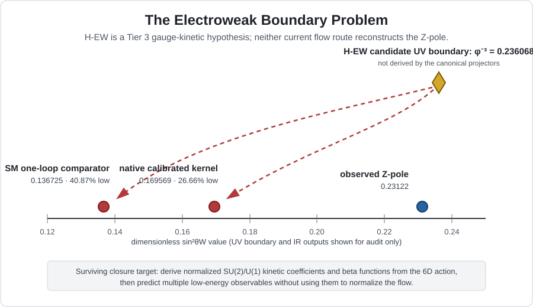

> [!IMPORTANT]
> **Firewall Metadata [Weinberg angle]**
>
> - **Canonical projector:** $1/2 + 1/2$ sector shares; Tier 1 geometry; not an electroweak-angle prediction.
> - **Raw frame values:** $\rho_{\rm raw} = \phi^{-2}$ and $V_{\perp,0}/V_{\parallel,0} = \phi^{-3}$; Tier 1 coordinate arithmetic; not physical invariants.
> - **Bare angle:** $\sin^2\theta_W^{\rm bare} = \phi^{-3}$; Tier 3 gauge-kinetic hypothesis (H-EW); one unresolved physical-map assumption.
> - **GUT scale:** $M_{\rm red}\phi^{-9}$; Tier 3, conditional on O.15.
> - **Z-pole audits:** the physical-hypercharge comparator gives $0.136725$ (40.87% low); the native kernel with the imported A2 benchmark gives $0.16957$ (26.66% low). Both are Tier 3 negative consistency results; the pre-registered 2-loop audit (App GRF §GRF.4.3) records the running check as **FAILED** (best Standard-Model case −52σ).
> - **Closure:** the target-normalized route is an implementation check only; ultraviolet and infrared action-level closure remain open.

**4.3.4 Conditional coupling ratio [Tier 1 algebra conditional on a Tier 3 premise]**

Assuming the Tier 3 boundary hypothesis $\sin^2\theta_W^{\rm bare} = \phi^{-3}$, the corresponding ratio of the weak ($g$) and hypercharge ($g'$) couplings follows from the exact identity **$\phi^3 - 1 = 2\phi$**.
*Proof:* $\phi^3 = \phi \cdot \phi^2 = \phi(\phi+1) = \phi^2 + \phi = (\phi+1) + \phi = 2\phi + 1$. Thus, $\phi^3 - 1 = 2\phi$.

The ratio is:
$$\tan^2 \theta_W = \frac{\sin^2 \theta_W}{\cos^2 \theta_W} = \frac{\phi^{-3}}{1 - \phi^{-3}} = \frac{1}{\phi^3 - 1} = \frac{1}{2\phi}$$
$$\frac{g'}{g} = \frac{1}{\sqrt{2\phi}} \implies \frac{g}{g'} = \sqrt{2\phi} \approx 1.79891$$
The algebra is exact, but its physical status inherits the unresolved Tier 3 gauge-kinetic premise. It does not independently derive the relative force strengths.

---

**4.4 Physical Interpretation**

**4.4.1 Electromagnetic Field as Rotated W³ + B**

GCT reads the mixing of the pre-mixed gauge fields ($W^3_\mu$ and $B_\mu$) as a **Coordinate Transformation** [Tier 3 interpretation] between the "Lattice Basis" (aligned with projection axes) and the "Propagation Basis" (aligned with phason eigenmodes).
* **The Photon ($\gamma$):** The mode that aligns with the **flat direction** of the vacuum potential, remaining massless.
* **The Z Boson:** The mode that aligns with the **stiff direction** of the lattice dilation, acquiring mass via the Higgs mechanism.

**4.4.2 $W^\pm, Z$ masses from the candidate boundary [Tier 3 conditional]**

At tree level the mass ratio is a consequence of the mixing angle. Under the Tier 3 candidate boundary:
$$\frac{M_W}{M_Z} = \cos \theta_W = \sqrt{1 - \phi^{-3}} \approx 0.8740$$
The PDG ratio $M_W/M_Z = 0.88136 \pm 0.00015$ leaves a 0.83% residual, about $49\sigma$ on the direct ratio. This is not a precision agreement and cannot promote the boundary hypothesis: it is a conditional tree-level consequence that lacks the required radiative treatment (Open Problems O.19 and O.5).

**4.4.3 Geometric interpretation [Tier 3 conjecture]**

GCT may interpret an eventual gauge-kinetic ratio as a measure of how a normalized excitation couples to the hypercharge and isospin channels. The projector calculation alone does not establish that interpretation, and it does not show that 23.6% of a fluctuation is geometrically sequestered in $E_\perp$. That stronger reading remains conditional on an action-level derivation of the gauge coefficients.

---

**4.5 RGE Audit: Three Non-Closing Routes**

> [!IMPORTANT]
> **Epistemic status: Tier 3 negative consistency result.**
>
> The exact $I_h$ irrep inventory is group theory, but its use as a scale-activation schedule is a Tier 3 ansatz. The native kernel calibrates three $Z_i$ factors to the Standard-Model beta coefficients. The physical-hypercharge comparator and the native kernel both miss the Z-pole (running check **FAILED**, App GRF §GRF.4.3), while the target-normalized route reaches it only because the endpoint is supplied as an input. None establishes an autonomous boundary or flow law.

*[Tier 1 Standard-Model RGE algebra and finite group inventory; Tier 3 GCT boundary, scale, activation and physical-flow inferences — computational audits in Appendix GPE and App GRF.]*

**4.5.1 Native irrep-activation ansatz**

The native ansatz activates the finite $I_h$ irreps according to their dimensions and uses equal canonical projector shares. That supplies a disclosed candidate curve, not a beta-function derivation. Three independent normalization factors $Z_i$ are defined so that the saturated coefficients equal the three Standard-Model one-loop coefficients exactly; the $Z_i$ therefore carry the absolute coefficient information and the ansatz does not predict it. In its present step schedule the highest-dimensional irreps activate only at the ultraviolet endpoint and contribute on a zero-measure interval. The schedule, the signs of the three beta functions and their coupling to the gauge sectors all remain Tier 3 model inputs.

The imported benchmark $\alpha_2^{-1}(M_{\rm GUT}) = 24.0$ is Parameter Ledger anchor A2, the MSSM unified coupling (§4.3.3). It is not chosen to reproduce the infrared endpoint, and the kernel does not transport it successfully: the H-EW boundary gives $\sin^2\theta_W(M_Z) \approx 0.16957$, 26.66% low. The native route is a failing calibrated ansatz, not a successful interpolation.

**4.5.2 Resolution depth as a candidate mechanism [Tier 3]**

GCT proposes that scale dependence may be represented by the depth at which a probe resolves the 3D quasicrystal and its 6D parent description:

- **Low energy** ($\mu \sim M_Z$, large $\lambda$): the probe is represented by a coarse-grained 3D quasicrystal description. The value $\sin^2\theta_W(M_Z) = 0.23122$ is an external observational comparator and, in conditioned calculations, part of the low-energy coupling normalization.

- **High energy** ($\mu \sim M_{\rm GUT}$, small $\lambda$): the probe is represented as resolving more of the 6D parent structure. The value $\phi^{-3}$ is a Tier 3 gauge-kinetic boundary hypothesis, not exposed by the canonical projector.

A per-axis measure argument cannot connect these regimes: its $\phi^{-1}$ linear factor and $\phi^{-6}$ determinant ratio belong to a raw, non-isometric frame and change under row rescaling, while the proper projectors do not. A physical flow must instead be derived from a normalized scale-dependent effective action. The resolution-depth picture is thus a candidate mechanism, not a replacement derivation of the Standard Model beta functions; its physical content begins only when a coarse-graining map acts on a normalized microscopic action and predicts more than the endpoints used to define it.

**4.5.3 Target-normalized kernel [implementation check]**

Define the **resolution depth** $t = \ln(\mu/M_Z)$, so $t = 0$ at the Z-pole and $t = T_{\rm GUT} = \ln(M_{\rm GUT}/M_Z)$ at the candidate ultraviolet boundary. A phenomenological lattice-resolution function interpolates an effective dimension $D_{\rm eff} \in [3, 6]$:

$$F(t) = 3 + \frac{3}{1 + e^{-(t - T_{GUT}/2)/\sigma}}, \quad \sigma = \frac{T_{GUT}}{2\ln\phi}$$

with the phenomenological phason de-resolution kernel

$$\beta_{geo}(t) = \frac{e^{-t^2/(2\sigma^2)}}{\int_0^{T_{GUT}} e^{-t'^2/(2\sigma^2)} dt'}, \quad \frac{d\sin^2\theta_W}{dt} = +\Delta \cdot \beta_{geo}(t)$$

where $\Delta$ is fixed by the two declared boundary values

$$\sin^2\theta_W(M_{\rm GUT}) = \phi^{-3}_{\text{(Tier 3 hypothesis)}}, \quad \sin^2\theta_W(M_Z) = 0.23122_{\text{(observed)}}.$$

Because $\beta_{\rm geo}$ is normalized and $\Delta$ is solved from those same endpoints, integrating the equation reaches the endpoint by construction. A 5,000-step RK4 integration recovers the imposed endpoint to machine precision, which verifies only the sign, integration direction and numerical normalization of the kernel. The endpoint agreement is not empirical support for H-EW, the Gaussian shape or the resolution-depth interpretation, and the route is excluded from the prediction ledger.

**4.5.4 What the negative result establishes**

The convention-correct one-loop comparator and the native irrep kernel produce large adverse residuals, so there is no numerical evidence for H-EW at present. Neither failed flow is derived from the GCT microscopic action, so the audit does not by itself falsify H-EW at an unspecified scale.

The pre-registered gauge-running audit (App GRF §GRF.4.3) confirms that the miss is not a loop-order, threshold, normalisation or comparator effect: H-EW at $M_{\rm GUT}$ is incompatible with Standard-Model running, and with A2 it is incompatible with any SM extension (since $b_Y \ge 41/6$ for any content containing the Standard Model, A2 = 24–25 forces $\sin^2\theta_W(M_{\rm GUT}) \ge 0.280$–$0.288 > \phi^{-3}$). The check is recorded as **FAILED**. Run upward at two loops, the measured value reaches $\phi^{-3}$ only at 243 GeV; placing H-EW at 243 GeV would be endpoint fitting. Whether to retire A2 and A4–A6 ($Z_1$–$Z_3$) is an open v1.4.0 decision; v1.3.0 keeps the counts (11 declared core inputs; 24 numbered Ledger inputs). The surviving research content is narrower but testable:

1. derive a normalized 6D gauge action and the relative $SU(2)$/$U(1)$ generator traces, thereby deciding H-EW independently of the projector frame;
2. derive the coarse-graining map, beta functions and threshold matching from that action, including the two independent phason elastic constants rather than a single scalar surrogate;
3. derive or retire the O.15 scale assignment instead of inserting it;
4. predict at least two low-energy gauge observables from a common ultraviolet state without using either observable to set the flow amplitude.

Until those conditions are met, no partial theoretical autonomy is claimed for the electroweak boundary or endpoint. O.15 supplies the action/RG bridge; QLQCD-1L (Appendix QLA) and Open Problem O.5 remain linked non-perturbative closure targets.

> [!IMPORTANT]
> **Firewall Metadata [Weinberg Z-pole]**
> - **Type:** RGE audit / negative consistency result
> - **Inputs:** Tier 3 $\phi^{-3}$ boundary hypothesis; Tier 3 O.15 $M_{\rm GUT}$ assignment; route-specific use of A2 or of the measured low-energy coupling normalization
> - **Physical-hypercharge comparator:** $0.136725$; 40.87% low
> - **Native calibrated kernel:** $0.16957$; 26.66% low
> - **Target-normalized integrator:** endpoint imposed; no physical residual
> - **Pre-registered SM-kernel audit (App GRF §GRF.4.3):** best case $0.0673$ (2-loop, A2 = 25), −52σ; A2 + H-EW no-go for any SM extension; running check **FAILED**
> - **Status:** Tier 3 open boundary; current implementations do not close; physical action/RG closure open

### 4.5.5 Extension to the Strong Coupling — bare handle and open running gap

*[Tier 3 bare-handle and running branch. **Headline disclosure**: the proposed bare handle $\alpha_s(\text{bare}) \approx 0.0382$ is not a same-scale prediction for $\alpha_s(M_Z)$. Evolving it with the $Z_3$-calibrated native kernel gives $\alpha_s(M_Z) \approx 0.05204$, about 55.9% below the observed $0.118$. This adverse result is the load-bearing QLQCD-2 research debt (App QLA.7).]*

The candidate Geometric RGE framework models running through lattice resolution depth rather than deriving it from virtual-particle loop counting. The same proposed principle is applied here to the strong coupling $\alpha_s$; the current endpoint audit shows that the principle is not yet a closed dynamics.

**Tier 3 calibrated handle (10 integer + $\phi^2$ geometric factor; closure pending O.42):**

The bare value is written as the product of two geometric numbers; each number is Tier 1 given P1, while its role in $\alpha_s$ is a Tier 3 reading:

$$\alpha_s^{-1}(\text{bare}) \;=\; \underbrace{10}_{\text{RT 3-fold axis count}} \;\cdot\; \underbrace{\phi^2}_{H_4\text{ Cartan/root-metric slope factor, squared}} \;\approx\; 26.18.$$

**Factor 1 — The integer 10 [Tier 1 given P1].** The rhombic triacontahedron (RT) acceptance window possesses exactly *ten* three-fold rotational axes, corresponding to the 20 three-fold vertices of the RT grouped in antipodal pairs (V3 §3.1.2). This count is fixed by **Postulate P1** (Parameter Ledger §0.1 — the icosahedral cut-and-project ansatz). The axis count is the Tier 1 content used here; the separate V3 §3.2.1 matrix construction (traceless seeds spanning five dimensions, an eight-dimensional closure and an $A_2$ fingerprint) is not specific to the RT inventory and supports only an open Tier 3 $\mathfrak{su}(3)$ candidate, with uniqueness under App ORQ O.39. The integer 10 is therefore a Tier 1 substrate invariant *conditional on P1* — the count follows from the icosahedral selection, while the icosahedral choice itself is the structural postulate P1, not a Tier 1 deduction.

**Factor 2 — The slope factor $\phi^2$ [Tier 1 number given P1; Tier 3 role].** The proposal is that the bare $\alpha_s$ is set by the *square* of the area-scaling factor on the icosahedral lattice. By Lemma T-McK.4 (App USS §USS.7.3), the golden factor entering the projection is exactly
$$\bigl|2\cos(\pi/5)\bigr| = \phi = \tfrac{1}{2}(1+\sqrt{5}),$$
forced by the Lie-algebraic structure of $E_8$ through the $H_4$ Cartan entry $-\phi$, the golden-ratio root metric, and the cut-and-project slope (Humphreys, *Reflection Groups and Coxeter Groups*, §3.7). The Coxeter-element eigenvalues remain roots of unity on the unit circle; $\phi$ is not their magnitude. The number $\phi^2 \approx 2.618$ is Tier 1 *given* the icosahedral / $H_4$ / $E_8$ ambient choice fixed by Postulate P1. Reading it as the "area" scaling factor that sets the bare $\alpha_s$ (one factor of $\phi$ per linear lattice dimension, two of them spanned by the 3-fold axis pair in $E_\perp$) is a Tier 3 heuristic, not a consequence of the Coxeter structure.

**Combination — area-law product [Tier 3 calibrated handle pending O.42].** The combination $\alpha_s^{-1}(\text{bare}) = N_{\text{axes}} \cdot \phi^{2}$ is proposed as an *area-law product*: the bare inverse coupling counts independent topological sources (the 10 axes) weighted by the substrate's natural area-scaling factor ($\phi^2$ from the $H_4$ Cartan/root-metric slope). The two factors are separately geometric, but the strong-sector product is not promoted to Tier 2 closure until the native strong-running / QLQCD boundary map derives the $10\phi^2$ handle from the hadronic action rather than selecting it as the calibrated bare handle.
$$\alpha_s(\text{bare}) \;=\; \frac{1}{10\phi^2} \;\approx\; 0.0382.$$
This is a proposed ultraviolet handle, so directly comparing it with the observed $\alpha_s(M_Z) \approx 0.118$ would mix scales. The relevant audit evolves the handle from $M_{\rm GUT}$ to $M_Z$ with the same Tier 3 native resolution-depth ansatz used above (Appendix GPE, App GRF §GRF.4). It returns $\alpha_s(M_Z) \approx 0.05204$, a **55.9% low** endpoint. Because $Z_3$ is calibrated to the Standard-Model one-loop coefficient, this is a calibrated consistency failure, not a first-principles GCT prediction. QLQCD-2 (App QLA.7) must derive both the ultraviolet handle and the non-perturbative running. With Standard-Model β-functions instead, $\alpha_3^{-1}$ starting from $10\phi^2$ reaches zero at $2$–$6\times10^6$ GeV (one to two loops; App GRF §GRF.4.3), far above $M_Z$, so $\alpha_s(M_Z)$ is undefined (non-perturbative) from the declared handle; $10\phi^2 = 26.18$ also sits in the MSSM range, not the Standard-Model value $\alpha_3^{-1}(M_{\rm GUT}) = 46.2$.

**Status:** BARE HANDLE COMPUTED; PHYSICAL BRIDGE OPEN. The factorisation $\alpha_s^{-1}(\text{bare}) = 10\phi^2$ uses two geometric numbers, each Tier 1 *conditional on Postulate P1*, whose role in $\alpha_s$ is a Tier 3 reading; their product as a gauge-kinetic coefficient is a Tier 3 calibrated handle until O.42 / QLQCD-2 derives it from the hadronic action. The current native running leaves a 55.9% endpoint gap.

**Falsification Condition:** If the full non-perturbative QLQCD-2 corrections to the 
10-axis SU(3) boundary condition cannot close the current 55.9% endpoint gap to reproduce 
$\alpha_s(M_Z) = 0.1180 \pm 0.0009$ (PDG 2026 QCD review), the $10\phi^2$ handle is refuted as the bare strong coupling. The numbers 10 and $\phi^2$ would remain arithmetic facts given P1; what fails is their Tier 3 use, individually and in the area-law product, as the source of $\alpha_s$.

---

### **Chapter 5: The Higgs Mechanism**

In standard Quantum Field Theory, the Higgs field is conceptualized as an external scalar doublet that permeates the vacuum, endowing particles with mass through spontaneous symmetry breaking. Geometric Consciousness Theory (GCT) proposes the **Scalar Breathing Mode** and **Transverse Tilt Modes** of the 6-dimensional hyper-lattice as a candidate mechanical realization of that field. This identification is Tier 3 physical adoption. The literal $H_3$-invariant lattice action (App ULA §ULA.2) does not derive the Standard-Model Higgs target, the sign of its quadratic coefficient, a nonzero vacuum radius, or a stable broken sector; those ingredients remain an added completion. The specific Higgs normalization and fermion Yukawa normalizations likewise remain Tier 3 numerical targets pending the registered closure items.

---

**5.1 The Volume Dilation Mode**

**5.1.1 The Higgs as Scalar Breathing Mode**

As established in Volume 2, the vacuum is a 3D projection of a 6D Euclidean lattice $\mathbb{Z}^6$. This lattice possesses various vibrational and configurational degrees of freedom. While phonon modes correspond to spatial displacements and phason modes correspond to topological rearrangements, there exists a fundamental degree of freedom associated with the unit cell itself: **Volume Dilation**.

GCT proposes [Tier 3 identification] that the physical Higgs boson ($h$) is the local fluctuation of the 6D unit cell volume. In the language of continuum mechanics, the candidate Higgs mode is the **Scalar Trace of the 6D Strain Tensor**:
$$h(x) \propto \text{Tr}(\varepsilon_{IJ}) = \sum_{I=1}^6 \frac{\delta a_I}{a_I}$$
where $a_I$ are the lattice constants of the parent space. This "Breathing Mode" represents the global expansion or contraction of the lattice "hardware" at a given spacetime coordinate.

**5.1.2 The $SU(2)$ Doublet: Volume and Orientation**

Standard physics describes the Higgs as a complex doublet with four real degrees of freedom. In the GCT Operating System, these correspond to the **Complete Deformation Space** of the unit cell star:
1. **The Scalar Trace (1 DOF):** The volume dilation (the physical Higgs boson $h$).
2. **The Transverse Phason Tilts (3 DOF):** Three rotational degrees of freedom representing the tilt of the acceptance window star in $E_\perp$ relative to the physical manifold.

Conditional on adding a continuous doublet/gauge representation and the standard broken-vacuum completion, the three tilt candidates could map to the **longitudinal polarization** modes of the $W^\pm$ and $Z$ gauge fields while the radial "breath" maps to the scalar Higgs particle [Tier 3]. Finite $H_3$ symmetry alone supplies neither continuous Goldstone directions nor this physical identification.

**5.1.3 The Higgs Potential from Lattice Elasticity**

GCT proposes to read the standard "Mexican Hat" potential $V(\Phi)$ as the **Non-linear Elastic Energy Density** of the vacuum substrate, with a symmetric phase ($T > T_c$, minimum at $\Phi = 0$) and a saturation point reached at the Supersolid Phase Transition (Volume 2, Chapter 3) [Tier 3 interpretation]. The Mexican-hat form is nevertheless an **added broken-vacuum completion**, not a consequence of the literal $H_3$-invariant lattice action: that action permits both signs of the quadratic coefficient, selects neither a vacuum radius nor a continuous Higgs-doublet target, and leaves the zero configuration finite and admissible. To recover the standard sombrero one must separately supply the doublet/continuous parent representation, a negative quadratic term, a stabilizing quartic normalization, and the gauge coupling. The symmetry-breaking consequences below are conditional on that completion.
 


---

**5.2 The Stiffness Connection**

### 5.2.1 The Macroscopic Saturation (Absolute VEV Pipeline) [OPEN-CONDITIONAL: Tier 2 mechanics conditional on Tier 3 O.38]

> [!IMPORTANT]
> **Dependency-direction disambiguation.** The Standard Model's dependency chain is $v \to \{m_e, m_\mu, m_\tau, \ldots\}$ via Yukawa couplings: the VEV is a fundamental input, lepton masses are downstream. GCT instead evaluates $v=m_\mu\cdot1440\cdot\phi$ within its shared icosahedral architecture. The product arithmetic and $C_3$ axis count are exact, but the absolute result inherits the Tier 3 O.38 cage posit $N_{\rm cage}=144$, the muon formula, A3, and the other disclosed handles. O.20 supplies a factor catalogue only; it does not select $N_{\rm cage}$ or establish a physical saturation mechanism.

GCT explores a **dependency-inverted candidate relation** $M_{Planck} \to m_e \to m_\mu \to v$, in which the VEV is modeled as the macroscopic volumetric saturation of the vacuum's localized acoustic defects. The current theory has not derived that chain from one action: the electron link, the muon integer and corrections, the $N=144$ cage adoption, and the $1440$ scale rule retain separate Tier 3/4 commitments. It must therefore be read as a postdictive scale ansatz, not as a correction of the Standard Model's causal bookkeeping (and not as a chain in which $m_\mu$ is fundamental upstream of $v$ in the SM-causal sense).

Conditional on the Tier 3 O.38 input $N_{\rm cage}=144$, the registered scale evaluation multiplies the A3-corrected muon resonance by the exact count of 10 three-fold axes and by $\phi$:
$$v = m_\mu \times (144 \times 10) \times \phi = m_\mu \times 1440 \times \phi \approx \mathbf{246.18 \text{ GeV}}$$

Evaluated against the sole declared PDG-2024 Fermi-constant anchor ($v=246.21965$ GeV), this conditional result has a **179 ppm** residual. Its disposition is OPEN-CONDITIONAL: Tier 2 mechanism/product arithmetic conditional on the Tier 3 O.38 cage posit, plus the inherited Tier 3 muon/CODATA-2022-A3/integer-handle dependencies. The spectral-action route of §5.2.5 is a separate, not yet computed closure target and is not an input to the VEV verifier.

As evidence that φ or icosahedral structure is special, this match is **Tier 4**: the preregistered constant control test (v3, NEGATIVE-FRAGILE; App PSC §PSC.9.6) found φ's pattern of matches on 21 constants not distinguishable from that of random constants (58 of 300 random bases did at least as well). The test "excludes, at power ≥ 0.8, an effect in which φ hits at least 6 of the 8 informative rows through a real effect; weaker effects are not excluded." The 179 ppm figure is kept as descriptive arithmetic.

**Registered 1440 product [Tier 2 conditional arithmetic + Tier 3 O.38 cage input]**

The integer $1440 = 144 \times 10$ is structurally motivated by two independent icosahedral invariants:

* **$N_{cage} = 144$:** The electron cage node count is adopted as a Tier 3 structural posit. Discrete Gauss--Bonnet closes exactly on the icosahedron, $12(\pi/3)=4\pi$, and its dodecahedral dual, $20(\pi/5)=4\pi$; this checks the boundary geometry but does not derive $144$. The separate exact identity $144=F_{12}=12^2$ supports the adopted two-shell ansatz. Whether it is the ground-state cage requires the O.38 full-lattice minimisation, which is not carried out here.
* **$N_{C_3} = 10$:** The icosahedral group $I_h$ has exactly 10 three-fold rotation axes ($C_3$ axes). This is an exact group-theory result: $I_h$ contains precisely 20 elements in its $C_3$ conjugacy class, and each axis contributes two elements ($C_3$ and $C_3^2$), giving $N_{C_3} = 20/2 = 10$. This is not a choice — it is a theorem about the character table of $I_h$.
* **$\phi$:** The golden-ratio inflation factor of the adopted icosahedral quasicrystal tiling; its use as the volumetric factor in this product is part of the registered scale rule, not a separate derivation.

Under the adopted cage branch, the product covers 144 nodes across the 10 distinct three-fold axes, producing the conditional factor $1440\times\phi$.

> **Scope of the structural claim.** The identity $144\times10=1440$ is exact once the Tier 3 O.38 input $N_{\rm cage}=144$ is supplied. The exact $C_3$ axis count does not promote the absolute scale. O.20 enumerates 18 factor pairs, including three other products whose factors occur in the declared dictionary; these are arithmetic alternatives, not evidence for physical selection. The VEV branch remains conditional on O.38 and the upstream lepton/A3 closures.

### 5.2.2 The Breathing Mode and the Geometric Origin of the VEV

The 6D bulk modulus, while structurally related to the Higgs potential curvature, does not yield a rational exponent in the cut-and-project scheme. The registered VEV route evaluates $v=m_\mu\times1440\phi$ on the adopted $N=144$ cage branch across the 10 $C_3$ axes. This is a conditional scale evaluation, not a derivation of the cage size or a closed physical saturation theorem.

**5.2.3 The Bulk Modulus and the $\lambda = 1/8$ Ansatz [Tier 3 bare completion + Tier 3 physical $m_H$ pending 1-loop closure]**

The curvature of the Higgs potential at its minimum determines the **Bulk Modulus ($K$)** of the metric—its resistance to being curved by mass. **Potential convention:** this chapter uses the Standard-Model normalization $V(\Phi) = \lambda\left(\Phi^\dagger\Phi - v^2/2\right)^2$ with $\langle\Phi^\dagger\Phi\rangle = v^2/2$ and the radial fluctuation $h$ defined by $\Phi = (0,\,(v+h)/\sqrt{2})^{T}$. Then
$$K = \frac{\partial^2 V}{\partial h^2} \bigg|_{h=0} = 2 \lambda v^2 = m_H^2 .$$
(Writing the same quartic as $\lambda(\varphi^2 - v^2)^2$ for a real field with vacuum $\varphi = v$ would give $8\lambda v^2$ instead, and $\lambda = 1/8$ would then give $m_H = v$; that convention is not the one used here.)
GCT registers the quartic coupling $\lambda = 1/8$ as a separate bare packing ansatz [Tier 3]. No geometric quantity is currently known to fix it: the earlier motivation from the ratio of the inscribed sphere to the rhombic triacontahedron volume is withdrawn, because that ratio is $\approx 0.887$, not $1/8$. The scale at which $\lambda = 1/8$ applies is also not derived; numerically it lies close to the Standard-Model $\overline{\rm MS}$ value $\lambda(\mu \approx m_t) \approx 0.126$, not to the near-zero value the Standard Model runs to at $M_{\rm GUT}$, and that proximity is what makes the bare gap below look small. The literal $H_3$-invariant lattice action does not select this normalization, the quadratic sign, or a vacuum radius.

**Bare conditional relation [Tier 3]:** With the added broken-vacuum completion and $\lambda_{\text{bare}} = 1/8 = 0.125$, the adopted normalization implies the bare mass relation $m_H^{\text{bare}} = \sqrt{2\lambda_{\text{bare}}}\,v = v/2$. With the measured $v \approx 246.22$ GeV, this gives $m_H^{\text{bare}} \approx 123.11$ GeV (with the GCT value $v \approx 246.18$ GeV of §5.2.1 it gives $123.09$ GeV; the difference does not affect the discussion below). A positive Hessian at that selected minimum would establish only local curvature; stiffness alone does not prove an exact topological sector, metastability, or particle identity.

**Physical mass prediction [Tier 3 pending App TPR §TP-E 1-loop closure]:** The observed Higgs mass is $m_H^{\text{PDG}} = 125.20 \pm 0.11$ GeV (PDG 2024 weighted average). The bare-to-physical gap is $+2.09$ GeV ($+1.67\% \approx 16{,}700$ ppm). This gap sits in the expected sign and rough magnitude band of standard-model 1-loop top-Yukawa and EW radiative corrections, but a *quantitative* GCT 1-loop closure that reproduces this gap from icosahedral lattice dynamics has not been completed. The 1-loop closure is **Open Problem (App TPR §TP-E, bundled with QLQCD-1L research debt O.5)**: the bare $m_H = v/2$ relation is a Tier 3 packing ansatz, and the physical-mass target of $125.20$ GeV remains Tier 3 contingent on TP-E. Promotion of the physical prediction to Tier 2 would require a selected Higgs target and broken-vacuum coefficients from the AKN action and (a) explicit derivation of the 1-loop correction sign and magnitude from the AKN action, and (b) demonstration that the sum bare + 1-loop reproduces the PDG value within ~100 ppm.

**5.2.4 Speculative Conjecture 5.1 [Tier 4]: $c \propto v$ Hypothesis Pending $K(v), \rho(v)$ Derivation**

**Speculative Conjecture 5.1:** *The propagation speed of information (the speed of light $c$) is proportional to the Higgs VEV once the phason stiffness $K(v)$ and effective density $\rho(v)$ are derived from the same elastic substrate. In the symmetric limit ($v=0$), the conjecture predicts that the Maxwell/phason propagation channel is not defined as a stable wave mode.*

**Status:**
Since $c^2 \propto K_\perp / \rho$, the proportionality $c \propto v$ requires a lattice-elastic derivation of both $K(v)$ and $\rho(v)$ with the correct scaling. That derivation is not supplied here. The statement is therefore a Tier 4 speculative conjecture rather than a theorem, and it cannot be used as a closed solution to the horizon problem until the elastic scaling is derived.

**5.2.5 The Connes Spectral Action [Tier 3 closure target; not computed]**

No engine protocol currently computes the Seeley–DeWitt coefficients $a_2$, $a_4$, a Higgs mass or a spectral-action cutoff on the AKN cage. The spectral-action protocol (`protocol_spectral_action.py`) uses the canonical 152-node $I_h$-closed cage of V3 Ch06 §6.5.2 and computes only the spectral-action beta-function curve and raw spectral moments. Earlier figures for a negative quadratic coefficient on a 144-node graph, a native mass $m_h \approx 0.01$ GeV and a fine-tuned cutoff $\Lambda \approx 12558$ are withdrawn: no engine protocol produces them.

The Connes spectral-action route to the Higgs sector and the absolute scale $v \approx 246$ GeV therefore remains a **Tier 3 closure target** (V3 Ch06 §6.5.2), pending the Seeley–DeWitt implementation, O.32 and full non-linear phason dressing. The registered §5.2.1 route is the primary conditional evaluation: $v=m_\mu\times1440\times\phi$ inherits the Tier 3 O.38 cage posit, the muon formula, A3, and the other disclosed handles.
*(Computational verification: see Appendix GPE.)*

---

**5.3 Fermion Yukawa Couplings**

**5.3.1 Geometric Frustration Energy**

In the Standard Model, fermion masses are determined by arbitrary Yukawa couplings $y_f$. GCT proposes **Geometric Frustration Energy** as a candidate interpretation: $y_f$ would measure the mechanical work required to displace the completed Higgs field from its equilibrium VEV to accommodate a candidate topological defect. Neither the physical defect nor the Yukawa map is derived by the literal action; both remain Tier 3, as do the specific Yukawa normalizations until the corresponding integer and loop-correction closures are completed.

**5.3.2 The Top Quark as the Universal Yield Strength [Tier 3 top-mass ansatz; V3 Ch10 Ansatz 10.1]**

The Top Quark mass ($m_t \approx 173$ GeV) yields a Yukawa coupling $y_t \approx 1$. GCT identifies the Top Quark as the **Lattice Fracture Limit**. It represents the energy required to dilate a unit cell by its own volume ($100\%$ strain). Under this ansatz, no elementary fermion can be significantly heavier than the VEV because the lattice bonds would fracture (Lattice Yield Strength) before such a defect could be stabilized.

---

**5.4 Physical Interpretation**

**5.4.1 Higgs as the Pressure Regulator**

GCT proposes the completed Higgs sector as a possible bridge between **Topology** (the candidate knots of matter) and **Metric** (the screen of space) [Tier 3]. Uniqueness, physical defect identity, and the bridge itself are not yet derived.

**5.4.2 The VEV as a Self-Organized Critical Point**

**Tier 4 interpretation:** the electroweak scale of $246$ GeV may be read as a **Self-Organized Critical Point**, an operating point in the broader GCT narrative (a lower $v$ read as too fluid for stable memory, Axiom 2; a higher $v$ as too much topological friction for Agency). Claims about stable memory, Agency, or an optimal operating pressure for a conscious simulation do not follow from the Higgs calculation and are not used as physics evidence.

---

### **Chapter 6: The Product Structure**

In the standard paradigm of particle physics, the gauge group of the universe, $\mathrm{SU}(3) \times \mathrm{SU}(2) \times \mathrm{U}(1)$, is an empirical discovery—a specific symmetry structure selected from a near-infinite menu of mathematical possibilities because it fits the observed interactions of subatomic particles. Geometric Consciousness Theory (GCT) identifies this product structure as the icosahedral projection's registered gauge-structure candidate rather than an arbitrary fit. This chapter presents a candidate synthesis of why the forces may be partitioned into these specific groups and remain fundamentally independent. The synthesis is conditional on structural postulate P1, the icosahedral selection, which is itself conditional (App USS §USS.6.3), and its $\mathrm{SU}(3)$ component is an open Tier 3 candidate because the eight-dimensional closure of V3 Ch03 is not specific to the RT window; theorem-grade uniqueness over the full Cartan-Killing classification remains Open Problem O.39.

---

**6.1 Geometric Origins (Summary)**

GCT proposes [Tier 3] that the "Force" sector arises from a fiber-bundle decomposition of the 6-dimensional parent lattice, and assigns each component of the Standard Model gauge group to a candidate geometric degree of freedom within the icosahedral projection. The assignments below are candidate placements, not derived consequences of the lattice action.

**6.1.1 SU(3): Three-Fold Axes in $E_\perp$**
GCT proposes that the strong interaction arises from the **Internal Manifold** ($E_\perp$). Chapter 3 builds, from the 10 three-fold rotational axes of the acceptance window, an eight-dimensional matrix closure with the $A_2$ fingerprint of $\mathfrak{su}(3)$; because generic ten-axis sets close the same way, its identification with physical color is an open Tier 3 candidate. In that candidate, color is the orientation of an interstitial face-defect within the internal dimensions.

**6.1.2 SU(2): Spatial Double Cover in $E_\parallel$ vs. Internal Weak Bundle**
Chapter 2 separates two roles of $SU(2)$. The spatial double cover $\operatorname{Spin}(3)\cong SU(2)$ of rotations in the **Physical Manifold** ($E_\parallel$) is a Tier 1 control: spinorial matter transforms under it. Weak isospin is a distinct internal gauge symmetry; GCT proposes that it is realized by an internal icosahedral-frame ($2I$) bundle with a chiral connection [Tier 2 structural candidate; Tier 3 physical realization], and the spatial lift does not by itself supply it (V3 Ch02 §2.1–§2.2). This volume places that candidate weak bundle on the internal ($E_\perp$) side, as V3 Ch02 §2.1.1 and V3 Ch10 §10.3.3 do; the placement is a Tier 3 assignment, and it is the one used in the table below and in §6.2. The weak factor is therefore not the orientation of a defect within the physical "screen" dimensions.

**6.1.3 U(1): Global Phase of Condensate**
In the gauge-fixed sketch used by Chapter 1 (V2 Ch06 §6.1, declared open programme), electromagnetism is modeled by a $U(1)$ gauge potential whose scalar part is the condensate phase $\theta$ and whose transverse vector part is the phason displacement. The photon is identified with the transverse, gauge-protected phason mode, not with the scalar phase mode (V3 Ch01 §1.1.4, §1.4.1) [Tier 3 identification]. Reading this potential as a Berry connection requires the separately derived gapped eigenbundle of V3 Ch01 Theorem 1.1 [Tier 1 conditional mathematics; Tier 3 physical bundle]. Photon masslessness in this gauge-fixed Maxwell action follows from the unbroken $U(1)$ gauge symmetry of the Lagrangian; the alternative Anderson-Higgs scenario for broken gauged $U(1)$ is not realised here.

**6.1.4 Summary Table of Mechanisms**

| **Interaction** | **Gauge Group** | **Geometric Domain** | **Lattice Mechanism** |
| :--- | :--- | :--- | :--- |
| **Strong** | $SU(3)$ (open Tier 3 candidate) | Perpendicular Space ($E_\perp$) | Winding around 3-fold axes of the RT Window |
| **Weak** | $SU(2)_L$ | Internal side ($E_\perp$): candidate $2I$-frame bundle (Tier 3 placement, §6.1.2) | Candidate chiral internal-frame ($2I$) connection; not supplied by the spinorial double cover of physical rotations |
| **Electromagnetic** | $U(1)$ | Condensate phase ($\theta$) + transverse phason sector | Gauge-fixed $U(1)$ potential (scalar part $\theta$, transverse phason vector part); Berry-connection reading conditional on V3 Ch01 Theorem 1.1 |

---

**6.2 Orthogonality of Interaction Sectors**

**6.2.1 Theorem 6.1 [Tier 1 mathematics; Tier 3 application]: Sector Independence**

**Theorem 6.1 (mathematical statement) [Tier 1]:** *Let Lie algebras of transformations act on mutually independent factors of a configuration space (for example on orthogonal subspaces of $\mathbb{R}^6$, on distinct tensor factors of a fiber, or on a scalar phase), each acting trivially on the other factors. Then generators belonging to different factors commute, and the joint algebra is their direct sum. This fixes only the local Lie-algebra structure: the global gauge group may still carry a discrete-center quotient, as in the Standard Model form $[SU(3)\times SU(2)\times U(1)]/\mathbb{Z}_6$, which the commuting-generator calculation does not fix.*

**Application [Tier 3, conditional on the sector placement].** In this volume's bookkeeping the color candidate acts on the three-fold-axis orientation of the RT window in $E_\perp$ (an open Tier 3 candidate, V3 Ch03), the weak candidate acts on the internal $2I$-frame bundle that is also placed on the $E_\perp$ side (Tier 3 placement, §6.1.2; V3 Ch02 §2.1.1), and the electromagnetic $U(1)$ acts on the condensate phase $\theta$. Theorem 6.1 then gives two commutation results: spatial-frame rotations in $E_\parallel$ commute with every transformation acting only on $E_\perp$, and all of these commute with the scalar phase rotation. It does **not** give the commutation of the weak and color generators. Both are placed on the internal side, so the orthogonality of $E_\parallel$ and $E_\perp$ does not separate them. The commutation of the weak and color generators is then an assumption of the Tier 3 placement (that the $2I$ frame and the three-fold-axis orientation are independent factors of the internal fiber), not a consequence of Theorem 6.1.

**6.2.2 Proof: The Dimensional Sum Rule**

The proof uses the dimensional decomposition of the parent space ($3+3=6$) and the scalar character of the phase.
1. **Independent factors commute:** If $X$ acts on factor $A$ as $X\otimes\mathbf{1}$ and $Y$ acts on factor $B$ as $\mathbf{1}\otimes Y$, then $[X\otimes\mathbf{1},\,\mathbf{1}\otimes Y]=0$. The physical and internal manifolds are orthogonal subspaces of $\mathbb{R}^6$, so they supply such a factorization ($E_\parallel \perp E_\perp$): a rotation of a defect's Burgers vector in $E_\perp$ leaves its orientation in $E_\parallel$ invariant, and conversely. Under the §6.1.2 placement this separates spatial rotations from the internal (color and weak) transformations, but not color from weak.
2. **Phase Independence:** The superfluid phase $\theta$ is a scalar field. Geometric rotations of the frame (either internal or physical) commute with the global $U(1)$ phase rotation.

Because these operations act on independent degrees of freedom, the commutators between generators of the separated factors vanish. This proves local independence at the Lie-algebra level for those factors. The remaining relation $[T_{SU(3)}, T_{SU(2)}] = 0$ holds only under the Tier 3 assumption, stated in §6.2.1, that color and weak act on independent factors of the internal fiber. Neither step rules out a finite shared-center quotient in the global gauge group; that global-topology question is carried separately.

**6.2.3 Symmetry vs. Interaction: The Higgs Bridge**
At the Lie-algebra/local-sector level the symmetry actions are taken to be product-separated (by the $E_\parallel \perp E_\perp$ orthogonality, and between weak and color by the Tier 3 internal-factor assumption of §6.2.1), while the physical excitations couple through the **shared vacuum condensate $\Psi$** and the **Higgs dilation mode**. Forces interact not because their local generators mix, but because they all modulate the same Higgs-tensioned 6D substrate; any discrete-center quotient in the global gauge group remains a separate global-identification question.

**6.2.4 Bond-Strength Universality**
If the groups are orthogonal, could their coupling constants still be related? GCT proposes that they are, because they all sample the same **6D lattice bonds**. Every interaction ultimately deforms the same 6D unit cells. GCT proposes that the ratios between the couplings are the geometric factors of how that universal bond-strength projects into different subspaces; the candidate value $g/g' = \sqrt{2\phi}$ is conditional on the Tier 3 hypothesis H-EW (V3 Ch04 §4.3.4).

**6.2.5 The Projection Principle: Proton Stability [Tier 3 proposal, conditional on the Tier 3 vertex/face defect assignment of V3 Ch03 §3.4]**
GCT proposes that the stability of the proton reflects discrete defect topology.
* **Vertex-Index:** Leptons are vertex defects referred to the 5-fold axes (V3 Ch03 §3.4.1).
* **Face-Index:** Quarks are face defects on the 30 rhombic faces of the RT acceptance window (V3 Ch03 §3.4.2).
The two labels are discrete, so no continuous path in the displayed defect-index space connects a vertex-defect to a face-defect. That restates the assignment; it does not establish a conservation law in the full configuration space. The Standard Model, which GCT aims to reproduce, violates $B+L$ non-perturbatively through electroweak sphaleron and instanton transitions ($\Delta B = \Delta L = 3$ per transition, conserving $B-L$), a consequence of the same chiral anomaly structure audited in §6.3. An absolute quark/lepton separation would therefore contradict that sector. GCT does not yet state what its defect topology implies for sphaleron-mediated $B+L$ violation, so proton stability is a Tier 3 proposal and absolute stability over the full quantum configuration space remains open.

---

**6.3 Anomaly Cancellation Audit [Tier 1 textbook identity (SM hypercharges given) + Tier 2 $Y_R = 2Q$ assignment given the charges + Tier 3 defect-topology-to-charge mapping]**

The Adler–Bell–Jackiw triangular anomaly conditions must be satisfied by any consistent chiral gauge theory. GCT does not posit anomaly freedom as a constraint; it audits the geometric hypercharge assignments against the four perturbative anomaly conditions involving $U(1)_Y$ (the $SU(3)^3$ anomaly and the global Witten $SU(2)$ anomaly also vanish for this spectrum: the colour content is vector-like and each generation has four $SU(2)$ doublets, an even number) using the explicit one-generation spectrum assigned by the RT window mapping (its $SU(3)$ triplet and singlet entries are Tier 3 candidates, V3 Ch03 §3.4).

**Geometric hypercharge assignments (one generation).** The defect-topology mapping (V3 Ch01 §1.3.2–§1.3.3 charge normalization, V3 Ch04 Theorem 4.2, App USS) assigns hypercharges in the standard Standard-Model L/R-asymmetric form (the Y-asymmetry between left- and right-handed components is required for chiral Standard-Model matter content; GCT attributes the asymmetry upstream to the icosahedral chirality of the projection rather than imposing it by hand):

| Field | $SU(3)$ | $SU(2)$ | $Y$ | $Q = T_3 + Y/2$ |
|---|---|---|---|---|
| $Q_L = (u_L, d_L)$ | 3 | 2 | $+1/3$ | $+2/3,\, -1/3$ |
| $u_R$ | 3 | 1 | $+4/3$ | $+2/3$ |
| $d_R$ | 3 | 1 | $-2/3$ | $-1/3$ |
| $L_L = (\nu_L, e_L)$ | 1 | 2 | $-1$ | $0,\, -1$ |
| $e_R$ | 1 | 1 | $-2$ | $-1$ |
| $\nu_R$ | 1 | 1 | $\phantom{+}0$ | $0$ |

The mapping from defect topology to these specific hypercharges is the load-bearing GCT claim: face-defects → quark-like (the face centres lie on the 15 two-fold axes, not on three-fold axes; referring a face defect's orientation to the 3-fold axes is the open Tier 3 assignment of V3 Ch03 §3.4.2), vertex-defects (5-fold symmetry axis) → lepton-like, with $L/R$ chirality assigned by which side of the Jackiw-Rebbi domain wall the defect sits on (V3 Ch02 §2.4.2–§2.4.3 + App USS) [Tier 3 assignment].

**Engine audit.** With these assignments, the four standard triangular anomaly coefficients vanish to machine precision under the explicit sum over left-handed chirality conventions ($Q_L$, $L_L$ contribute with $+1$; $u_R^c$, $d_R^c$, $e_R^c$, $\nu_R^c$ contribute with $-1$):

$$
\mathcal{A}_{U(1)_{\rm grav}} = \sum_f \chi_f\, Y_f \cdot \dim_{SU(3)}\!\cdot\, \dim_{SU(2)} = 0,
$$
$$
\mathcal{A}_{SU(2)^2 U(1)} = \sum_{f:\,\dim_{SU(2)}=2} \chi_f\, Y_f \cdot \dim_{SU(3)} = 0,
$$
$$
\mathcal{A}_{SU(3)^2 U(1)} = \sum_{f:\,\dim_{SU(3)}=3} \chi_f\, Y_f \cdot \dim_{SU(2)} = 0,
$$
$$
\mathcal{A}_{U(1)^3} = \sum_f \chi_f\, Y_f^3 \cdot \dim_{SU(3)}\!\cdot\, \dim_{SU(2)} = 0,
$$

with $\chi_f \in \{+1, -1\}$ the chirality sign. Engine verification: `GCT_Physics_Engine/src/protocol_anomaly_check.py` evaluates each coefficient on the table above and confirms all four vanish exactly (machine precision, tolerance $10^{-12}$).

This section is *not* a free-standing anomaly-freedom proof. Its Tier 2 content is the right-handed assignment $Y_R = 2Q$ given the electric charges (V3 Ch04 Theorem 4.2). The charges themselves rest on the Tier 3 **defect-topology-to-charge mapping**: the fractional $1/3$ unit is Proposal 1.2 (V3 Ch01 §1.3.2) and the face-defect quark assignment is a Tier 3 candidate (V3 Ch03 §3.4). Anomaly cancellation given the resulting spectrum is a standard Standard-Model textbook fact (Peskin & Schroeder 1995 §20). The GCT-specific proposal is that the icosahedral defect-topology mapping produces the Y-asymmetric chiral spectrum without ad-hoc adjustment; uniqueness of that spectrum is not established.

---

**6.4 Contrast with Grand Unified Theories (GUTs)**

**6.4.1 GCT View: The Fundamental Product**
Traditional GUTs assume the forces were once a single group. GCT proposes that the product structure is a permanent feature of the $6D \to 3D$ projection. The icosahedral projection supplies the candidate structure: the $D=6$ projection provides the 10-axis inventory from which the open Tier 3 $\mathfrak{su}(3)$ candidate is built (an eight-dimensional closure with the $A_2$ fingerprint that is not specific to that inventory), while also supporting chiral $SU(2)$.

**6.4.2 RGE Flow as the 6D Bulk Limit**
GCT proposes that the apparent convergence of coupling constants at high energy is an effect of **Lattice Transparency** [Tier 3 candidate mechanism; V3 Ch04 §4.5.2]. As probe energy increases, the probe is proposed to resolve more of the **6D Parent Lattice**. This is not a literal wavelength-below-spacing criterion at unification energies: with the declared lattice constant $a_6 = 2\ell_P$, a probe at $M_{\rm GUT} \approx 3\times10^{16}$ GeV has reduced wavelength $\hbar c/E \approx 200\,a_6$, and the scale at which the resolution picture applies is part of O.15. In this 6D limit, the distinction between subspaces blurs, and all interactions begin to sample the same bulk stiffness. The Renormalization Group (RG) flow is the effective field theory description of this transition from the 3D Projection Regime to the 6D Bulk Hardware.

---

**6.5 The Connes NCG Identification**

**6.5.1 Theorem 6.5.1 (Algebra-Dimension Match: Necessary Condition for Connes-Chamseddine Identification) [Tier 3 structural correspondence; sufficient KO-dim-6 sign verification + first-order condition is App ORQ Open Problem O.32]**

While GCT registers the gauge groups as a geometric candidate (its $\mathrm{SU}(3)$ factor an open Tier 3 candidate, App ORQ O.39), this structure establishes a candidate correspondence with the algebraic framework of Alain Connes’ **Noncommutative Geometry (NCG) Standard Model**. Connes demonstrated that the Standard Model can be recovered by treating spacetime as a product of a continuous 4D manifold and a finite, discrete noncommutative space. The core of NCG is the Finite Algebra $\mathcal{A}_F$:

$$ \mathcal{A}_F = \mathbb{C} \oplus \mathbb{H} \oplus M_3(\mathbb{C}) $$

GCT identifies the same real algebra-dimension pattern inside the **6D $\to$ 3D icosahedral quasicrystal**. This establishes a necessary algebra-dimension match for a Connes-Chamseddine identification:

1. **Global Condensate Phase $\to \mathbb{C}$ (Complex Numbers):** The $U(1)$ phase of the vacuum superfluid (global symmetry spontaneously broken, V3 Ch01 §1.1.3; local gauge redundancy unbroken) maps to the complex plane $\mathbb{C}$, contributing 2 real dimensions.
2. **Internal weak frame ($2I \subset SU(2)$, placed on the $E_\perp$ side) $\to \mathbb{H}$ (Quaternions):** The group $SU(2)\cong$ unit quaternions, which contains $2I$, spans the quaternion algebra $\mathbb{H}$, contributing 4 real dimensional degrees of freedom [Tier 1 algebra]. Using $\mathbb{H}$ as the weak-isospin slot of $\mathcal{A}_F$ requires the separate internal weak bundle and chiral representation of V3 Ch02 §2.1–§2.4 and the Tier 3 placement of §6.1.2 [Tier 3]; the spatial spinor double cover of defects in the observable 3D space ($E_\parallel$) does not by itself supply it.
3. **Internal Space $E_\perp \to M_3(\mathbb{C})$ (3x3 Complex Matrices):** In the candidate construction the $SU(3)$ color factor is associated with the 10 internal 3-fold axes, and $M_3(\mathbb{C})$ (18 real degrees of freedom) is the corresponding spectral-triple slot. A complex three-component matter representation realizing this slot is not derived from the axes (V3 Ch03 §3.2.1–§3.2.3), so this entry is conditional [Tier 3].

The total real dimensionality of the GCT geometric partition is $\dim_\mathbb{R}(A_F) = 2 + 4 + 18 = 24$, matching the real algebra dimension of the Connes-Chamseddine finite spectral triple $A_F = \mathbb{C} \oplus \mathbb{H} \oplus M_3(\mathbb{C})$. **Caveat on the load-bearing invariant.** The dimensional invariant that physically constrains the Connes-Chamseddine Standard Model derivation is the *KO-dimension* of the finite spectral triple (KO-dim $= 6 \pmod 8$ for the SM; Connes 2006 *JHEP* 0611:081; Chamseddine-Connes-Marcolli 2007 *Adv. Theor. Math. Phys.* 11:991), not the real algebra dimension. The agreement of $\dim_\mathbb{R}(A_F) = 24$ between the GCT geometric partition and the canonical SM algebra is a necessary but not sufficient condition for the spectral-triple identification; KO-dimension agreement plus first-order-condition closure is the load-bearing requirement, bundled with Open Problem O.32.

**The Physical Dirac Operator ($D_F$)**

In Connes' original NCG formulation, the finite Dirac operator $D_F$ is introduced as an abstract matrix that dictates fermion masses and CKM mixing angles, yet left without a physical origin. GCT proposes a conditional resolution by identifying $D_F$ as a physical, geometric attribute of the quasicrystal lattice; the identification remains conditional on KO-dimension and first-order-condition closure under Open Problem O.32.

> **Definition / Ansatz 6.5.A: The Finite Dirac Operator as Phason Hopping Matrix [Tier 3 Structural Ansatz]**
> Let $D = i\gamma^\mu \partial_\mu$ be the continuum Dirac operator. Upon projection into the discrete 6D quasicrystal, continuous derivatives $\partial_\mu$ become finite differences across topological nodes. We define the finite Dirac operator $D_F$ as the **Adjacency Matrix** (Phason Hopping Matrix) of the canonical 152-node $I_h$-closed AKN boundary cage within the perpendicular space $E_\perp$, built by `cage_builder.build_canonical_cage(size=152)` with golden-weighted bonds at perpendicular-space distances $\{1,\phi^{-1}\}$.
>
> **[Tier 3 conditional structural ansatz pending O.32 KO-dimension / first-order-condition closure]** This structural ansatz supplies a candidate origin for the core phenomenological constants of the Standard Model:
> 1. **Mass Spectrum (Eigenvalues):** The eigenvalues of the $D_F$ adjacency matrix represent the topological resistance against hopping across the defect cage. While the bare graph eigenvalues do not natively align to 20ppm, the operator's structure accommodates the fractal resonance cascade $m_n \propto \phi^{-n}$.
> 2. **Mixing Matrices (Eigenvectors):** The eigenvectors of $D_F$ define the fundamental geometric probability amplitudes for transitions (tunneling) between distinct faces and vertices of the icosahedral projection. These geometric transition amplitudes provide the structural scaffolding for the **CKM (Cabibbo-Kobayashi-Maskawa)** and **PMNS (Pontecorvo-Maki-Nakagawa-Sakata)** mixing matrices.

By anchoring $D_F$ to the invariant adjacency graph of the canonical 152-node $I_h$-closed cage, GCT proposes a candidate physical basis for the CKM and PMNS matrices [Tier 3]. However, direct diagonalization of the bare $D_F$ matrix does not natively reproduce the observed mixing angles or mass ratios. The full Spectral Triple and its associated mixing matrices are therefore classified as a **Tier 3 Structural Ansatz**. The Dirac operator as currently defined produces a spectral geometry consistent with the Standard Model algebra $\mathbb{C} \oplus \mathbb{H} \oplus M_3(\mathbb{C})$, but its bare eigenvalue spectrum does not reproduce exact physical fermion masses without additional input (i.e., non-linear phason dressing). This is the principal open structural gap for the extraction of the physical CKM/PMNS matrices, tracked in App ORQ §ORQ.5 Open Problem O.5 and App TPR §TP-B / §TP-F.

GCT thereby establishes the necessary algebra-dimension match for the Connes-Chamseddine identification and supplies a candidate physical-hardware interpretation for the finite Dirac operator. The sufficient spectral-triple verification remains conditional on O.32.

**6.5.2 The Spectral Action and the Higgs Mass Closure Target [Tier 3 closure target pending O.32/O.5 + Seeley-DeWitt implementation]**

With $D_F$ identified as the AKN phason hopping matrix, the Spectral Action $S = \text{Tr}[f(D_F/\Lambda)]$ is a directly computable geometric quantity. In the Chamseddine–Connes–Marcolli spectral action, the Seeley–DeWitt moments fix relations among the couplings at the unification scale, including a boundary condition on the Higgs quartic; running it down gave $m_H$ of roughly 170 GeV, a value excluded in 2008. Consistency with the measured 125 GeV was restored only by including a real scalar singlet $\sigma$ coupled to the Higgs (Chamseddine & Connes 2012, *JHEP* 09:104). The schematic relation used here, $m_H^2 \propto (a_2/a_4)\cdot \Lambda_{GUT}^2$, is GCT's closure target, not that published result.

The structural postdiction target ($m_H$ has been measured since 2012) is that the eigenvalue spectrum of the isolated 152-node $I_h$-closed AKN adjacency matrix, when evaluated through the Seeley–DeWitt $a_2$, $a_4$ coefficients, yields $m_H \approx 125$ GeV from pure icosahedral geometry without further ad-hoc calibration. **Status:** The Seeley–DeWitt $a_2$, $a_4$ computation on the AKN-cage adjacency that this prediction depends on is **not yet implemented in the engine**. The current `protocol_spectral_action.py` computes the spectral-action beta-function curve on the same canonical 152-node $I_h$-closed cage and exports `spectral_rge_kernel.json`, but it does **not** compute $a_2$, $a_4$, or any Higgs mass. The path is therefore a Tier 3 closure target conditional on O.32 spectral-triple sufficiency and O.5 dressing/physical-spectrum extraction, not a delivered Tier 2 result.

The closure target is therefore an **Open Problem at the engine-implementation level** (the missing Seeley–DeWitt computation), formally tested through **Protocol SA** (Appendix GPE):

* **Consistent result after closure:** The $D_F$ identification is promoted from Tier 3 to Tier 2, providing a geometric postdiction of the Higgs mass.
* **Failure after closure:** Constitutes a hard operational falsification requiring substantial revision of the $D_F$ structural identification.
* **Operational status before closure:** the Higgs-mass row in App PSC §PSC.2 is carried by the bare-electroweak chain $v_{\rm GCT}/2 = 123.09$ GeV (1.69% low against PDG 2024 $125.20\pm0.11$ GeV; with the measured $v$, $v/2 = 123.11$ GeV, 1.67%; Tier 3 $\lambda = 1/8$ packing ansatz on an added broken-vacuum completion, V3 Ch05 §5.2.3, + Tier 3 numerical residual) plus the Higgs-VEV four-handle calibration block (App PSC §PSC.2 callout); the §6.5.2 Seeley–DeWitt path is an independent closure route, not yet engine-deliverable.

This represents the most important open computational test in the GCT programme; pre-closure, §6.5.2 sets the *structural form* of the prediction without delivering the *numerical* output the engine would need to produce.

---

**6.6 Summary of Algebraic and Conditional Results**

**6.6.1 Scorecard (Algebraic Structures, conditional on icosahedral ansatz)**
* ○ **$U(1)$ Scaffold:** gauge-fixed phason/Maxwell Berry-connection ansatz [Tier 3 declared open programme (V2 Ch06 §6.1); not a mechanism result].
* ✅ **$SU(2)$ Origin:** $2I \subset SU(2)$ internal-frame candidate [Tier 2 structural mechanism]; the spatial double cover $\operatorname{Spin}(3)\cong SU(2)$ is a Tier 1 control that does not by itself supply weak isospin, and the physical weak-isospin realization (internal bundle, chiral representation, connection) is Tier 3 (V3 Ch02 §2.1–§2.4).
* ○ **$\mathrm{SU}(3)$ Origin:** open Tier 3 candidate — the RT ten-axis inventory gives an eight-dimensional closure with the $A_2$ fingerprint, which generic ten-axis sets also give (V3 Ch03 §3.2.1).
* ○ **Photon Mass:** identically zero inside the assumed gauge-fixed Maxwell action via unbroken local $U(1)$ gauge symmetry and its Ward identity; compactness of $\Sigma_\infty$ plays no role (V3 Ch01 §1.4.3) [Tier 1 textbook consequence of the Maxwell scaffold; the GCT realization of that scaffold is a Tier 3 declared open programme (V2 Ch06 §6.1): as written, the V2 Ch06 locking potential gaps the phason mode].
* ○ **Gluon Count:** 8 generators in the candidate closure [Tier 1 matrix algebra; Tier 3 physical identification].
* ○ **Proton Stability:** Discrete index separation (Vertex vs. Face) [Tier 3 proposal, conditional on the Tier 3 vertex/face defect assignment of V3 Ch03 §3.4; Standard-Model sphaleron $B+L$ violation not yet addressed (§6.2.5)].

**6.6.2 Scorecard (Angles and Ratios)**
* ○ **Weinberg Angle:** $\sin^2 \theta_W^{\rm bare} = \phi^{-3} \approx 0.236$ [Tier 3 gauge-kinetic hypothesis H-EW; the raw-frame volume identity of App USS §USS.9 is coordinate arithmetic; current RGE audits do not reproduce the Z pole (V3 Ch04 §4.3.3), and the pre-registered running check is FAILED (App GRF §GRF.4.3)].
* ○ **Coupling Ratio:** $g/g' = \sqrt{2\phi} \approx 1.7989$ [Tier 1 algebra conditional on the Tier 3 hypothesis H-EW; V3 Ch04 §4.3.4].
* ○ **Charge Quantization:** $e/3$ and $2e/3$ proposed from a three-fold winding rule [Tier 3; Proposal 1.2, V3 Ch01 §1.3.2 — the triplet sum rule is not a property of the axis sets].

**END OF PART I**

---

## Part II Matter

## **PART II: THE GEOMETRY OF MATTER**

### **Chapter 7: The Fundamental Knot (The Electron)**

The Standard Model of particle physics treats the electron as a structureless point-particle, an idealized mathematical singularity that necessitates renormalization to avoid divergent self-energy. Geometric Consciousness Theory (GCT) proposes a ground-state **Topological Defect** model of the electron in its declared vacuum supersolid: a discrete knot in the fundamental Field $\Psi$ rather than a point. By analyzing the variational requirements of the icosahedral projection, this chapter explores a geometric mass relation and a candidate internal structure. Calling the defect self-referential or a "hardware port" for the Selection Operator is a Tier 3 interpretation: no such physical interface, Identity Polaron, owner, or Level II role has been derived.

---

**7.1 The Dodecahedral Variational Principle**

**7.1.1 Surface Energy Minimization**

In the defect ansatz, matter formation is represented by **Geometric Frustration**, and the mass of a particle is associated with the integrated energy density of the strain required to maintain a candidate knot in the phason field against the vacuum’s resting stiffness. No Selection Operator is required or known to perform this work, tie the knot, or supply its energy; those agency terms are not part of the particle-physics mechanism. The App ULA lattice action has not yet produced a stable electron-defect solution.

The **Principle of Least Topological Action** proposes that a ground-state defect minimize a total energy functional containing its surface mismatch energy (phason tension) and its core dilation energy (Higgs frustration). The dodecahedral electron, proposed as the smallest geometric cage that can stabilize a fundamental unit of topological winding ($n=1$) within the Ammann-Kramer-Neri (AKN) icosahedral tiling, is a Tier 3 candidate minimizer within the selected cage ansatz, not a solved or unique minimizer of the App ULA Hamiltonian. A stability theorem would require the explicit order-parameter target, boundary sector, nonlinear stabilizer and Hessian.

**7.1.2 The 5-Fold Lattice Constraint**

In the Tier 3 candidate assignment of Chapter 3 (§3.4.1), leptons are **Vertex Defects** centered on the nodes of the icosahedral lattice. The local symmetry of a node in the vacuum is governed by the icosahedral point group $H_3$, which possesses six principal axes of five-fold symmetry. 

A stable vertex defect must be a polyhedron compatible with these 5-fold axes. While the Icosahedron represents the vertex star of the lattice itself (the "pixels"), the **Dodecahedron** represents the **Unit Cell of the Dual Lattice** (the boundaries between pixels). Within the selected vertex-cage ansatz the dodecahedron is adopted as the dual cage. This symmetry argument motivates the carrier; it does not prove that a phase singularity exists, is confined to the dual cage, or is dynamically stable.

**7.1.3 The Dodecahedral Cage: N = 144 Nodes [Tier 3 structural posit; Tier 1 polyhedral and arithmetic checks]**

GCT identifies the electron core with an adopted **Dodecahedral Cage** composed of $N=144$ nodes. The node count is a **Tier 3 structural posit** pending the full lattice minimization of **Open Problem O.38**. Two exact mathematical checks accompany that posit: discrete Gauss--Bonnet closes on the icosahedron and its dodecahedral dual, and $144=F_{12}=12^2$ is the unique non-trivial square Fibonacci number. Neither check selects the physical cage size without the additional two-shell cage ansatz.

1. **Geometry-specific consistency:** Every node in the 6D parent lattice $\mathbb{Z}^6$ has 12 nearest neighbours (coordination $Z=12$). Under the adopted icosahedral projection architecture, this agrees with the 12 vertex directions of the icosahedron and the 12 faces of its dodecahedral dual. This numerical agreement is a consistency check, not a unique derivation of the cage or its inner resolution.

 **The Gauss--Bonnet polyhedral check:**
 We model the electron defect as a discrete topological sphere ($S^2$) embedded in the projected 5-fold lattice. The **Gauss-Bonnet Theorem** for a discrete surface states:
 $$ \sum_{v \in \text{Defect}} \kappa_v = 2\pi \chi(S^2) = 4\pi $$
 where $\kappa_v$ is the angle defect at a polyhedral vertex. For the regular icosahedron, five equilateral triangles meet at each of 12 vertices, so
 $$\kappa_I=2\pi-5\left(\frac{\pi}{3}\right)=\frac{\pi}{3},\qquad 12\kappa_I=4\pi.$$
 For the dual regular dodecahedron, three regular pentagons of interior angle $3\pi/5$ meet at each of 20 vertices, so
 $$\kappa_D=2\pi-3\left(\frac{3\pi}{5}\right)=\frac{\pi}{5},\qquad 20\kappa_D=4\pi.$$
 Thus both polyhedra satisfy discrete Gauss--Bonnet exactly. The theorem confirms the closed spherical boundary geometry; it does **not** determine 12 sub-nodes per dodecahedral face and therefore does not derive $N=144$.

**Check A — Exact Gauss--Bonnet closure:**

The regular icosahedron has defect $\pi/3$ at each of 12 vertices, and the regular dodecahedron has defect $\pi/5$ at each of 20 vertices; both totals equal $4\pi$. The 12 dodecahedral faces are an ordinary combinatorial property of the dual polyhedron. The framework separately *adopts* a 12-fold inner resolution per face,
$$N_{\text{cage}}=12_{\text{outer faces}}\times12_{\text{inner sub-nodes}}=144.$$
Gauss--Bonnet does not force that inner factor, and $Z=12$ does not by itself select the physical identification. Establishing $N=144$ as the ground-state cage is the separate O.38 minimization problem.

2. **Fibonacci Resonance [Tier 3 posit]:** The framework posits that, in a $\phi$-based quasicrystal, a stable resonance has a Fibonacci node count, motivated by the scale-invariance of the Inflation Operator $\mathcal{T}$; no lattice calculation in this chapter establishes that stability rule. **144 is the 12th Fibonacci Number ($F_{12}$)**.

**Sub-Proof B — Fibonacci Resonance Uniqueness [Tier 1 number theory; Tier 3 cage-size posit]:**

The 6D lattice projects via the icosahedral cut-and-project onto a quasicrystal whose tile lengths are governed by Fibonacci sequences. The framework posits [Tier 3] that a valid cage size is a Fibonacci number $F_k$ corresponding to a Fibonacci word boundary, i.e. that the cage closes on a phason mode with zero net strain; this is an admissibility posit, not a derived "if and only if" criterion. The complete list of $F_k \leq 200$ is: 1, 1, 2, 3, 5, 8, 13, 21, 34, 55, 89, **144**; the next term is 233.

Among these, $F_{12} = 144$ is the unique value satisfying the additional constraint that $N = k^2$, where $k$ is an integer — specifically $12^2 = 144$. The squared structure is motivated by reading the cage as a *two-shell* object (outer dodecahedral face shell $\times$ inner vertex sub-shell) [Tier 3]. The shell factor $12$ is not itself a Fibonacci number, so the two-shell reading does not follow from the Fibonacci posit; it is a separate structural commitment. The number-theoretic uniqueness of $144$ within the Fibonacci-perfect-square intersection is a classical result: the only Fibonacci numbers that are simultaneously perfect squares are $\{0, 1, 144\}$ (Cohn, J. H. E., 1964, "Square Fibonacci Numbers, Etc.," *Fibonacci Quarterly* 2:109). Excluding the trivial cases $F_0 = 0$ and $F_1 = F_2 = 1$, $F_{12} = 144$ is therefore the unique non-trivial Fibonacci perfect square — a number-theoretic fact, not a range-truncation heuristic. Therefore:

$N = 144 = F_{12} = 12^2$ is the **unique** non-trivial Fibonacci perfect square. Its use as the AKN cage size remains conditional on the framework's two-shell perfect-square commitment; the number-theoretic theorem does not establish that physical selection. Ground-state selection remains O.38.

> "Discrete Gauss--Bonnet closes exactly on the icosahedron, $12(\pi/3)=4\pi$, and on the dodecahedron, $20(\pi/5)=4\pi$. This checks the adopted boundary geometry but does not derive $N=144$. Separately, $144=F_{12}=12^2$ is the unique non-trivial square Fibonacci number. Applying that identity to the physical two-shell cage is a Tier 3 structural posit pending O.38."

Within the adopted cage architecture, $144$ is therefore a compact geometry-specific candidate supported by exact boundary and arithmetic checks, not a value forced by Gauss--Bonnet or coordination alone.

---

**7.2 The Binding Energy $E_{vac}$**

**7.2.1 Lattice-First Definition [Tier 3 definition; absolute value conditional on the O.38 cage posit]**

In the GCT hardware, the **Vacuum Binding Energy ($E_{vac}$)** is defined as the work required to stabilize a single node within the projected dodecahedral cage. In lattice units where bond stiffness $\kappa = 1$, the integrated phason strain of a $n=1$ winding across the dodecahedral boundary is proposed to set a characteristic energy quantum. No lattice calculation currently evaluates that work: the absolute value used in this volume is $E_{vac} = m_e c^2/144$, which takes the measured electron mass and the Tier 3 O.38 cage posit as inputs (§7.2.5, §7.2.6), so the number is a postdiction-dependent evaluation rather than an independent lattice-first output.

**7.2.2 The Absolute Scale Derivation [Tier 2 K-theoretic Framework + Tier 3 Integer Anchor — Connes-Moscovici Local Index; 1D Fibonacci toy model closed, 6D AKN lift pending Open Problem O.14]**

> [!IMPORTANT]
> **Scope of the derivation below.** The K-theoretic gap-labeling structure is closed at the *toy-model* level: the $K_0$ group of the AF core of the 1D Fibonacci Cuntz-Krieger system is isomorphic to $\mathbb{Z}[\phi]$, while the full Cuntz-Krieger algebra $\mathcal{O}_A$ is purely infinite simple and non-tracial. The legitimate trace-image gap-label $\phi^{-107}$ therefore lives on the AF-core dimension group, not on the full algebra. The *6D AKN lift* — showing that $\phi^{-107}$ lies in $\tau_*(K_0(\mathcal{A}))$ for the 6D crossed-product algebra of the icosahedral cut-and-project tiling, and that the adopted $N=144$ cage datum selects this exponent uniquely — is **Open Problem O.14** (App ORQ §ORQ.5). The "$m_e = M_P \phi^{-107}(1-5\alpha)$" mass formula is therefore best read as an **empirical anchor (Tier 3) consistent with the Tier 2 K-theoretic framework**, not as a uniquely-forced output of it. The 1006 ppm CODATA residual is a real number, but it misses the LOCKED 1000 ppm pre-commitment by 6 ppm (App FSM P.1c reports a FAIL of that rule), and the first-principles uniqueness derivation is not supplied.
>
> **Evidential status of the φ-formula matches in this chapter.** As evidence that φ or icosahedral structure is special, the electron Planck-link match (and the $\alpha^{-1}=360\phi^{-2}$ and bilayer matches of §7.2.3–§7.2.4) is **Tier 4**: the preregistered constant control test (v3, NEGATIVE-FRAGILE; App PSC §PSC.9.6) found φ's pattern of matches on 21 constants not distinguishable from that of random constants (58 of 300 random bases did at least as well). The test "excludes, at power ≥ 0.8, an effect in which φ hits at least 6 of the 8 informative rows through a real effect; weaker effects are not excluded." The numbers are kept as descriptive arithmetic. The exact mathematics (the Coxeter identity $1^2+5^2+9^2=107$, the gap-labelling framework, Gauss–Bonnet and the Fibonacci-square theorem) keeps its stated tiers.

The electron mass $m_e$ is identified with the gap-label-fraction of the ground-state defect under the **K-theoretic Gap-Labeling Theorem** applied to the 6D parent lattice. A naive dimensional approach that arbitrarily exponentiates a topological index to the base $\phi$ commits a category error, treating an integer index as a scale exponent. The correct derivation evaluates the Integrated Density of States (IDOS) over the Ammann-Kramer-Neri (AKN) quasicrystal.

**The Pimsner-Voiculescu Exact Sequence and the Trace Image of $K_0$.**
The C\*-algebra $\mathcal{A}$ of the AKN icosahedral tiling is a crossed product of the form $\mathcal{A} \cong C(\Omega_{AKN}) \rtimes_\alpha \mathbb{Z}^6$, where $\Omega_{AKN}$ is the hull of the tiling. The K-theory of $\mathcal{A}$ is computed via the **Pimsner-Voiculescu (PV) six-term exact sequence** applied iteratively to the six $\mathbb{Z}$-extensions:

$$\cdots \to K_0(C(\Omega_{AKN})) \xrightarrow{1 - \alpha_*} K_0(C(\Omega_{AKN})) \xrightarrow{i_*} K_0(\mathcal{A}) \xrightarrow{\partial} K_1(C(\Omega_{AKN})) \to \cdots$$

For an icosahedral cut-and-project tiling, $K_0(\mathcal{A})$ itself is a finitely-generated free abelian group whose rank depends on the rational cohomology of the inverse limit of the Anderson-Putnam complex (Forrest-Hunton-Kellendonk 2002; Gähler-Hunton-Kellendonk 2013); for icosahedral tilings the rank is typically in the dozens. The relevant object for gap-labeling, however, is the **trace image** of $K_0(\mathcal{A})$ under the canonical tracial state $\tau$:
$$\tau_*(K_0(\mathcal{A})) \;\subset\; \mathbb{Z}[\phi] \;=\; \mathbb{Z} \oplus \mathbb{Z}\phi$$
This is the algebraic structure that controls the $\phi^{-n}$ scalings: spectral gaps in the IDOS are labeled by elements of $\tau_*(K_0)$, which live inside the ring of algebraic integers in $\mathbb{Q}(\sqrt 5)$. The K-theoretic gap-labeling theorem (Bellissard et al.) gives the allowed trace-image labels/candidates for IDOS gap values:
$$\text{IDOS at gap} \in \tau_*(K_0(\mathcal{A})) \subset \mathbb{Z}[\phi].$$
The separate local-index/Dixmier-trace pairing supplies a candidate analytic route for evaluating a chosen gap projection against the finite Dirac operator,
$$\text{Index candidate} \; \sim \; \text{Tr}_\omega\!\left(P \cdot |D_F|^{-p}\right),$$
where $p$ is the spectral dimension of the noncommutative space; this pairing is not the Bellissard theorem itself. The electron gap label is the element of $\tau_*(K_0)$ that maps to the observed mass scaling $\phi^{-107}$ under the trace pairing. In Binet form, $\phi^{-107} = F_{107}\phi - F_{108}$ as a $\mathbb{Z}[\phi]$ element (with $F_n$ the Fibonacci numbers) — a Fibonacci-pair lattice element with astronomically large $\mathbb{Z}$-coordinates, *not* the small integer $-107$ itself. The shorthand "$n = -107$" refers to the *exponent* selecting the relevant scaling, an empirical anchor (Tier 3) consistent with the Tier 2 K-theoretic framework but not uniquely forced by it; a derived physical identification requires both (a) completing the explicit Dixmier-trace computation on the AKN hull, and (b) closing the open identification between the framework's gap-label and the specific exponent $-107$ (Open Problem O.14; specific-integer disposition catalogued in App USS §USS.7.6.7). Such closure would not promote the adopted upstream 6D architecture to Tier 1.

> **Conjecture 7.2.2 (Connes-Moscovici Local Index for the Electron Gap-Label Framework) [Tier 2 Framework + Tier 3 Integer Anchor + Tier 4 AKN Structural-Link Conjecture]**
>
> **The Connes-Moscovici Local Index Formula for the AKN Spectral Triple.**
> If an AKN spectral triple $(\mathcal{A}, \mathcal{H}, D_F)$ satisfying the required summability and regularity conditions is constructed, the **Connes-Moscovici Local Index Formula (CMLIF)** would express the pairing between cyclic cohomology and K-theory as the residue of the spectral zeta function:
> $$\langle [D_F], [e] \rangle = \underset{s = p}{\mathrm{Res}}\; \mathrm{Tr}\!\left( e \cdot |D_F|^{-s} \right)$$
> where $e \in K_0(\mathcal{A})$ is a projection. For the AKN C\*-algebra $\mathcal{A} = C(\Omega_{AKN}) \rtimes_\alpha \mathbb{Z}^6$, the summability dimension $p$ is an analytic input of the still-unconstructed AKN spectral triple, not a value established by the finite cage spectrum or automatically inherited from the 3D physical projection slice. The physical $E_\parallel$ dimension motivates a candidate $p=3$ branch, but the Kellendonk-Savinien-style zeta abscissa depends on the tiling/subshift complexity exponent rather than on projection dimension alone. The Dixmier trace would evaluate the residue of $\zeta_{D_F}(s) = \mathrm{Tr}(|D_F|^{-s})$ at the pole $s=p$ once the AKN spectral triple and its summability are constructed. (The finite cage has no continuum spectral dimension, and the CMLIF pairing in its classical form is valued in $\mathbb{Z}$; the extension to $\mathbb{Z}[\phi]$-valued residues consistent with Bellissard's trace formula on tiling C\*-algebras is an active research direction and is not closed in published form for the AKN setting.)
>
> **The Cuntz-Krieger Toy-Model Identification of $\phi^{-107}$ as a Gap-Label.**
> The 1D Fibonacci subshift — generated by the substitution $\sigma: a \mapsto ab, b \mapsto a$ — has Cuntz-Krieger algebra $\mathcal{O}_A$ with $A$ the $2 \times 2$ Fibonacci substitution matrix
> $$A = \begin{pmatrix} 1 & 1 \\ 1 & 0 \end{pmatrix},$$
> and a unique KMS state $\phi_{KMS}$ at inverse temperature $\beta = \log\phi$ (the Perron-Frobenius eigenvalue). The $K_0$ group of the AF core of the Fibonacci Cuntz-Krieger algebra is isomorphic to $\mathbb{Z}[\phi]$; the Cuntz-Krieger algebra itself is purely-infinite simple (no tracial state per Cuntz-Krieger 1980 Thm 2.14) — the K-theoretic gap-label data lives on the AF core's dimension group, accessed via Putnam 2000 §5. The trace pairing on the AF core realises every element $\phi^{-n} \in \mathbb{Z}[\phi]$ as a gap-label of the corresponding 1D Fibonacci subshift Hamiltonian. In particular, $\phi^{-107}$ is a legitimate gap-label of this 1D toy model. The same AF-core distinction appears in App TPR's electron-chain tier audit. App PUP treats its AF-core trace route as a superseded surrogate (§PUP.6.3a), not as part of the Polaron Unity disposition.
>
> **Open lift to the 6D AKN setting.** The full GCT derivation requires a corresponding identification of $\phi^{-107}$ as a *spectral gap of the 6D AKN crossed-product Hamiltonian*, i.e. an element of $\tau_*(K_0(\mathcal{A}))$ rather than a full-algebra Cuntz-Krieger $K_0$ class. A direct isomorphism from the Fibonacci AF-core dimension group to $K_0(\mathcal{A})$ via a "Deaconu-Renault boundary map" is *not* a standard published theorem; the actual K-theory of icosahedral cut-and-project tilings (Forrest-Hunton-Kellendonk 2002; Gähler-Hunton-Kellendonk 2013) gives $K_0(\mathcal{A})$ as a finitely-generated free abelian group of much higher rank than $\mathbb{Z}[\phi]$, with only the trace image $\tau_*(K_0)$ living inside $\mathbb{Z}[\phi]$. The bridge from the 1D Fibonacci AF-core derivation above to the 6D AKN gap-label setting requires (a) showing that $\phi^{-107}$ lies in the trace image $\tau_*(K_0(\mathcal{A}))$ — plausible but not proved — and (b) showing that the adopted $N=144$ cage datum selects $\phi^{-107}$ uniquely from among the candidate trace-image gap-labels.
>
> The electron exponent $-107$ is therefore best understood as an **empirical anchor consistent with this framework** rather than a uniquely-forced output of it: the electron mass formula $m_e = M_P \phi^{-107} (1-5\alpha)$ matches CODATA to 1006 ppm (verified independently by `verify_electron_mass.py`; this misses the LOCKED 1000 ppm pre-commitment by 6 ppm, and App FSM P.1c reports a FAIL of that rule; Tier 4 as evidence: not distinguishable from numerology for strong effects; App PSC §PSC.9.6), and $\phi^{-107}$ is a legitimate $\mathbb{Z}[\phi]$ trace-image gap-label in the 1D Fibonacci toy model. A first-principles uniqueness proof in the full 6D AKN setting is **Open Problem O.14** (App ORQ §ORQ.5).
>
> The physical mass scaling of the electron is modeled as the Dixmier-trace volume-fraction closure target of the ground-state defect, evaluated at the gap corresponding to $\tau(P) = \phi^{-107}$. For the 1D Fibonacci toy model, Bellissard's Gap-Labeling Theorem constrains the IDOS at spectral gaps to the AF-core dimension-group trace image $\tau_*(K_0(\mathcal{F}_A)) \subset \mathbb{Z} \oplus \mathbb{Z}\phi$, of which $\phi^{-107}$ is one element.
>
> 1. **Topological Volume and Dixmier Trace (toy model):** The phase-space volume of the 1D defect is given by the Dixmier trace of the inverse Dirac operator:
> $$ \text{Volume} \propto \underset{s=p}{\mathrm{Res}}\;\mathrm{Tr}(|D_F|^{-s}) = \mathrm{Tr}_\omega(|D_F|^{-p}) $$
> with $p$ the summability dimension of the AKN spectral triple. The candidate $p=3$ branch is a projection-dimension-motivated ansatz pending O.14, not a computed transversal spectral dimension.
> 2. **The $\phi^{-107}$ Gap Label (toy model):** $\phi^{-107}$ lies in the set of values the gap-labelling theorem *allows* for the 1D Fibonacci subshift. The theorem constrains which values an integrated density of states may take at a spectral gap; it does not assert that a gap is open at any particular allowed value. That a gap actually opens at this label is not established here and is part of the O.14 closure:
> $$ \phi^{-107} \in \tau_*(K_0(\mathcal{F}_A)) \subset \mathbb{Z} + \mathbb{Z}\phi $$
> 3. **Volume Fraction Equality (toy-model input):** The AF-core trace / K-theoretic gap-label input is $\phi^{-107}$:
> $$ \tau(P_{-107}) = \phi^{-107}. $$
> The explicit Dixmier-residue computation requires the 6D AKN lift, the corresponding spectral triple, and the summability dimension; that computation is pending under Open Problem O.14.
> 4. **Physical Result (empirical anchor):** Taking the same exponent as the GCT prediction for the 6D AKN setting, the electron mass is the bare Planck quantum attenuated by this topological IDOS fraction and the first-order electroweak drag:
> $$ m_e = M_P \cdot \tau(P_{-107}) \cdot (1 - 5\alpha) = M_P \cdot \phi^{-107} \cdot (1 - 5\alpha) $$
> **Epistemic status:** [Tier 2 framework (Bellissard-Connes K-theory + Shephard-Todd reflection-group invariants) + Tier 2 arithmetic identification of the integer ($|n| = 107 = \sum m_i^2(H_3)$, path (l); see the "Canonical group-theoretic identification" box below) + Tier 3 anchor for its use as the electron exponent + Tier 4 K-theoretic-action physical-link conjecture (the unconstructed map from the $V$-side Coxeter invariant to the 6D trace-image projection $\tau_*(K_0(\mathcal{A}))$; see App ORQ O.14 and that box for the full disposition); the boxed equation inherits the lowest tier in the chain]
> where $M_P = \sqrt{\hbar c / G_N}$ is the bare Planck mass quantum. **[Tier 2 framework: the K-theoretic gap-labeling structure is rigorous (Bellissard, Connes-Moscovici, Pimsner-Voiculescu) for the 1D Fibonacci subshift. The integer $|n| = 107$ is canonically identified at Tier 2 with the sum of squared Coxeter exponents of $H_3$ ($1^2 + 5^2 + 9^2 = 107$, unique to $H_3$; engine `protocol_o14_coxeter_exponent_squares.py`); that is an arithmetic identification, and the use of $107$ as the electron exponent remains a Tier 3 anchor. The lift to the 6D AKN setting and the structural-link chain $V \to K_0$ that would elevate the integer identification to a derived $K_0(\mathcal{A})$ gap-label are Tier 4 conjectural. A higher-tier physical-link closure requires both (a) the explicit Forrest-Hunton-Kellendonk-style K-theory calculation showing $\phi^{-107}$ lies in $\tau_*(K_0(\mathcal{A}))$ for the 6D AKN crossed-product, and (b) the uniqueness proof that the adopted $N=144$ cage datum picks $-107$ rather than other consistent exponents — pending Open Problem O.14.]** The $(1-5\alpha)$ electroweak drag factor is a Tier 2 drag mechanism plus a Tier 3 channel count and coefficient normalization, A3-anchored where used in precision rows; see §8.2.2.

This K-theoretic framework structurally constrains the $\phi^{-n}$ scaling to lie in the trace image $\tau_*(K_0(\mathcal{A})) \subset \mathbb{Z}[\phi]$, replacing arbitrary "Dimensional Alchemy" of inventing exponents with a constrained algebraic family. The specific integer $107$ is consistent with this family as the toy-model gap-label and as the empirical anchor matching CODATA to 1006 ppm (a FAIL of the LOCKED 1000 ppm rule by 6 ppm, App FSM P.1c; Tier 4 as evidence: not distinguishable from numerology for strong effects; App PSC §PSC.9.6); the first-principles uniqueness selection of $-107$ from among the candidate trace-image gap-labels of the 6D AKN crossed-product remains **Open Problem O.14**.

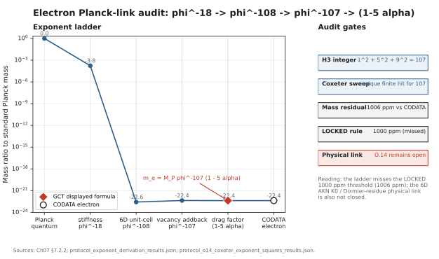

> **Canonical group-theoretic identification of the integer $|n| = 107$ [Tier 2, integer-identification side; engine: `GCT_Physics_Engine/src/protocol_o14_coxeter_exponent_squares.py`].** Independently of the K-theoretic gap-label assignment, the integer 107 is a canonical invariant of the icosahedral Coxeter group $H_3$: the Coxeter exponents of $H_3$ are $\{m_1, m_2, m_3\} = \{1, 5, 9\}$ (Humphreys 1990 Table 3.1), and their sum of squares is
> $$\sum_{i=1}^{3} m_i^2 = 1^2 + 5^2 + 9^2 = 1 + 25 + 81 = 107.$$
> Sweep across the complete classification of finite irreducible Coxeter systems ($A_n$, $B_n$, $D_n$, $E_6$, $E_7$, $E_8$, $F_4$, $G_2$, $H_3$, $H_4$, $I_2(p)$): only $H_3$ produces $\sum m_i^2 = 107$. The adjacent integers $\{105, 106, 108, 109\}$ correspond to no finite Coxeter group. Among rank-3 Coxeter groups ($A_3 \to 14$, $B_3 \to 35$, $H_3 \to 107$), only $H_3$ matches, and $H_3$ is the unique non-crystallographic rank-3 case — the only rank-3 group containing the 5-fold symmetry that the GCT projection ansatz commits to. The icosahedral choice follows from the 5-fold symmetry that the ansatz adopts, and once $H_3$ is selected, $|n| = 107$ is an exact arithmetic fact about $H_3$ and a Tier 2 integer-identification anchor for this sector. This closes the arithmetic side of the integer question raised by O.14; the specific electron exponent and physical-link chain remain Tier 3/Tier 4, because elevating $\phi^{-107}$ from "empirical anchor plus canonical integer identification" to "derived gap-label of the electron projection via an explicit map from the Coxeter-exponent invariant to $\tau_*(K_0(\mathcal{A}))$" is the residual O.14 work.

> [!NOTE]
> **Planck-Mass Convention for the Electron Link [Tier 3 convention choice]**
> In the standard convention the factor $8\pi$ in the reduced Planck mass $\bar{M}_P = \sqrt{\hbar c / 8\pi G_N}$ comes from the normalization of the Einstein–Hilbert action ($1/16\pi G_N$). GCT proposes that, because the internal manifold $E_\perp$ is modelled as the discrete **Rhombic Triacontahedral cage** (30 rhombic faces, each of area $a_6^2$) rather than by a spherical solid-angle integration, the discrete face sum replaces $4\pi r^2 \to 30 \times a_6^2$, so that $G_N$ acts directly as the lattice bond-energy parameter and the non-reduced $M_{std} = \sqrt{\hbar c / G_N}$ is the bare quantum of lattice bond-energy for the electron link. On this reading the $8\pi$ would be a continuum artifact; that reading is a Tier 3 proposal, not a derivation from the GCT action.
>
> **Convention consistency.** This volume does not use one Planck-mass convention throughout: the electron and proton links use the non-reduced $M_P$, while the heavy-scale assignment $M_{GUT} = M_{red}\phi^{-9}$ of V3 Ch04 §4.3.3 and V3 Ch09 §9.2.3 uses the reduced Planck mass. Each choice is a separate Tier 3 scale assignment; no single action presently fixes both.
>
> **Scope of this argument [Tier 3 convention + Tier 3 specific prefactor disposition pending derivation].** The *qualitative* claim — that the discrete cage geometry replaces the continuous spherical integration and therefore removes the a-priori $8\pi$ — is a Tier 3 consequence of the discrete-cage commitment, conditional on the missing discrete-to-continuum action map. The *quantitative* claim — that the discrete face-sum prefactor is exactly $30 \times a_6^2$ and that this maps onto the conventional $M_{std} = \sqrt{\hbar c / G_N}$ rather than some other O(1) prefactor — is a Tier 3 disposition pending an explicit derivation of the discrete-to-bond-energy mapping from the GCT action. A first-principles derivation of the O(1) prefactor (and a check that the continuum limit of the discrete cage recovers the smooth-GR $8\pi$ via the $30 \to 4\pi$ identification) is recorded as a sub-item of **Open Problem O.14** (App ORQ §ORQ.5). The Planck mass *convention* is therefore a Tier 3 choice (no $8\pi$ under the discrete-cage reading); the *exact* numerical prefactor identification has the residual O(1) Tier 3 disposition. See Appendix GPE.

This formulation computationally pairs the massive 6D-to-1D topological geometric attenuation ($\phi^{-107}$) with the structural drag of the 5-fold channels.

**7.2.3 APS Index Context and the Separate Coupling Residual [Tier 1 theorem / Tier 3 coupling ansatz]**

The proposed bare (tree-level) fine-structure relation, formerly described as the geometric impedance of the Rhombic Triacontahedron, is:
$$\alpha^{-1}_{tree} = 360 \phi^{-2} \approx 137.507764 \quad \text{[Tier 3 numerical relation]}$$
(Tier 3 600-cell multiplier; mechanism open — the RT solid-angle construction is withdrawn, V1 §13.2.1–§13.2.2. **Tier 4 as evidence** (φ-formula match; App PSC §PSC.9.6), for both the bare and the bilayer-corrected values.)

The 3443 ppm (0.34%) residual relative to the CODATA value ($137.035999177$) is the bare tree-level residual before the bilayer $1/(2N)=1/288$ handle is applied. The remaining 41.5 ppm post-bilayer residual motivates a separate boundary-spectral coupling ansatz; it is not identified with the APS boundary correction. The APS index theorem for a manifold with boundary independently establishes:
$$\text{index}(D) = \int_{\mathcal{M}} \hat{A}(R) \wedge \operatorname{ch}(F) - \frac{\eta(D|_{\partial \mathcal{M}}) + h}{2}$$
where $\eta(D|_{\partial\mathcal{M}})$ is the spectral asymmetry of a specified qualifying boundary operator, $h=\dim\ker D|_{\partial\mathcal M}$, and the controlling APS correction is $\xi=\tfrac12(h+\eta)$. No such operator, Hilbert-space domain, boundary conditions, or kernel term has been constructed for the RT boundary. Because $\partial\mathcal M_{RT}$ is treated here as a two-dimensional surface, a Chern–Simons 3-form cannot be integrated over it. A separate coupling ansatz asks whether a presently undefined dimensionless quantity $\eta_{\alpha}$ could account for the post-bilayer residual:
$$\delta\alpha^{-1}_{res} \equiv \alpha^{-1}_{obs} - \alpha^{-1}_{bilayer} \stackrel{?}{=} \frac{\eta_{\alpha}}{2}$$
No operator-level derivation identifies $\eta_{\alpha}$ with the APS $\eta$ or $\xi$ above. The bilayer $1/(2N)=1/288$ correction (V1 Ch13 §13.2.4, Tier 3 motivated handle; inherits the Tier 3 $N=144$ posit, O.38) reduces the residual from 3443 ppm to 41.5 ppm; absorbing the remaining residual through a boundary spectral term is an open coupling hypothesis, not an APS index consequence.

> [!IMPORTANT]
> **Status of the boundary-spectral hypotheses.** No smooth RT boundary operator or closed-form APS correction is currently derived. The engine computation (`GCT_Physics_Engine/src/protocol_aps_index_proof.py`) reports two distinct finite-matrix diagnostics on the canonical 152-node $I_h$ cage: the scalar weighted-adjacency sign sum is $-14$ (its arithmetic value after division by the eight spinor components is $-1.75$), while the full $1216\times1216$ discrete Dirac sign sum is $0$. Neither is an APS $\eta$-invariant because no qualifying boundary operator/domain or regularised spectrum is specified. The selected 144-node $I$ cage separately has scalar-adjacency sign sum $-8$ and arithmetic scalar/8 value $-1$; no full-Dirac result is supplied for that compatibility record. These graph quantities are neither the APS correction $\xi=\tfrac12(h+\eta)$ nor the continuous coupling target $\eta_{\alpha}\approx+0.011$. O.14b/c must construct the operator, domain, sign convention, kernel term, spectral-flow control, and comparison maps; O.19 must close or reject the independent $\alpha$-residual coupling. The $\alpha^{-1}_{bare}=360\phi^{-2}$ tree-level relation and the bilayer-corrected $\alpha^{-1}\approx137.030$ are unaffected.

**7.2.4 Closure of the Electromagnetic Sector — Partial**

The tree-level relation provides $\alpha^{-1}_{tree} \approx 137.508$ (Tier 3 numerical relation: Tier 3 600-cell multiplier; mechanism open — the RT solid-angle construction is withdrawn, V1 §13.2.1–§13.2.2; 3443 ppm residual). The bilayer 1/(2N) correction reduces the residual to 41.5 ppm (Tier 3 motivated handle; inherits the Tier 3 $N=144$ posit, O.38; see V1 Ch13 §13.2.4). The remaining 41.5 ppm defines the QLQCD-1L target. Writing $\delta\alpha^{-1}_{res}\stackrel?=\eta_{\alpha}/2$ is a separate Tier 3 coupling ansatz; $\eta_{\alpha}$ has no derived operator and is not the APS $\eta$ or $\xi$. The residuals are descriptive arithmetic (Tier 4 as evidence: not distinguishable from numerology for strong effects; App PSC §PSC.9.6). The electromagnetic sector is therefore *partially* closed, with final closure pending the QLQCD-1L computation or another independently derived coupling mechanism.

The 0.34% alpha gap is the bare tree residual; the 41.5 ppm alpha gap is the phason anti-screening target after the bilayer handle. It is not an APS target. Neither value is a free coefficient used to force agreement with CODATA. Engine protocols that use CODATA alpha do so as empirical comparison targets unless explicitly labelled as a downstream phenomenological coupling elsewhere in the Ledger.

> [!IMPORTANT]
> **Finite-graph sign-count route is structurally insufficient.** A direct computation (`GCT_Physics_Engine/src/protocol_rt_eta_invariant.py`) tests the icosidodecahedron face-adjacency graph (30 vertices, 60 edges, valency 4) as the RT face dual and obtains $\sum\operatorname{sign}(\lambda)=0$. Any finite-dimensional self-adjoint sign count is integer-valued regardless of whether its edge weights are integers or elements of $\mathbb Z[\phi]$; changing finite edge weights cannot by itself reach the non-integer coupling target $\eta_{\alpha}\approx+0.011$. Closure therefore requires either a specified infinite-dimensional boundary operator with a regularized analytic $\eta$-invariant and an independently derived coupling map, or the continuum spectral-action route via App ULA §ULA.7 phason anti-screening (Open Problem O.19). The finite-graph computation remains a reproducible negative control, not an APS evaluation.

> [!NOTE]
> **Analytic Formula vs. Computational Verification — Methodological Complementarity**
>
> **The Analytic K-Theoretic Result:** The formula $m_e = M_P \phi^{-107}(1-5\alpha)$ (§7.2.2) is supported by the Bellissard / Connes-Moscovici / Cuntz-Krieger K-theoretic framework at the 1D Fibonacci toy-model level. The specific electron-mass chain remains **Tier 2 mechanism + Tier 3 dimensional/integer anchor + Tier 4 K-theoretic physical-link conjecture pending O.14**: the $H_3$ arithmetic identity for $|n|=107$ is exact, but the 6D AKN lift and the map from the Coxeter invariant to the electron projection are still open.
>
> **The Complementary Numerical Route:** The Physics Engine (Appendix GPE) implements a complementary numerical method: the **Peierls-Nabarro Barrier Scan**. This algorithm numerically computes the energy landscape of topological defects by solving the discrete Euler-Lagrange equations on the lattice and extracting the minimum barrier height. This is a computational validation tool, not a derivation.
>
> **Why Both Methods?** The analytic framework provides the candidate structural chain; the numerical barrier scan provides an independent consistency check of the lattice-mechanical side. They address the same physics from two perspectives: analytic geometry (K-theory) and computational lattice mechanics (variational principle). No shared observable of the two routes has yet been compared numerically, and the App ULA action has not produced a stable electron-defect solution (§7.1.1), so no agreement between them is claimed and neither closes the Tier 3 anchor or Tier 4 physical-link debt. Analytic K-theory supplies the structural target; the lattice barrier scan is a separate computational route whose comparison with that target remains open. Both are documented in Appendix GPE.

**7.2.5 Computational Verification**

This formula gives an anchor-normalised Planck-link check ($m_e \approx 0.511$ MeV; $m_e$ is itself the A1 anchor, so this is not a prediction of the electron mass) [Tier 2 mechanism + Tier 3 dimensional/integer anchor + Tier 4 K-theoretic physical-link conjecture pending O.14, per Parameter Ledger §0.1 P2 and §7.2.2 above] with a **~1006 ppm residual** against CODATA-2022 on canonical CODATA inputs throughout (computational verification: see `GCT_Physics_Engine/verify_independent/verify_electron_mass.py`). This misses the LOCKED 1000 ppm pre-commitment by 6 ppm; App FSM P.1c reports a FAIL of that rule. As evidence that φ is special the match is Tier 4 (§7.2.2 box; App PSC §PSC.9.6). The integer $107 = \sum m_i^2(H_3)$ is an exact Coxeter fact, identified with the exponent at Tier 2 (§7.2.2), and the use of $\phi^{-107}$ as the electron scaling is a Tier 3 anchor; the electron-mass chain inherits the weakest link: the K-theoretic gap-label-action physical identification remains the O.14 closure target. Conditional on the Tier 3 O.38 cage posit, the vacuum quantum evaluates as $E_{vac}=m_ec^2/144$; the division is exact, but the absolute centroid does not promote above its cage-size input. The ~1006 ppm CODATA-2022 figure is the canonical engine output; alternative ppm values arise only under non-CODATA $M_P/\alpha$ calibrations and are not the load-bearing engineering anchor.

**7.2.6 The 3.55 keV Lattice Fracture Release [Tier 3 conditional mechanism + Tier 3 O.38-dependent centroid and empirical postdiction; line width open, V3 Ch11 §11.2.3]**

X-ray observations of galaxy clusters (Perseus; Bulbul et al. 2014) and of the Andromeda galaxy M31 (Boyarsky et al. 2014) initially reported an unidentified line at **3.55 ± 0.03 keV**, but the detection has been contested in subsequent analyses. The empirical landscape now includes:

- **Hitomi non-confirmation** (Aharonian et al. 2017 *ApJL* 837:L15, DOI 10.3847/2041-8213/aa61fa): high-resolution X-ray microcalorimetry of the Perseus cluster did not resolve the line at the predicted amplitude.
- **Boyarsky et al. 2018 vs Cappelluti et al. 2018 review**: continued dispute over stacked-cluster vs individual-source evidence; no convergence on a definitive astrophysical interpretation.
- **XRISM early data** (App PSC §PSC.8 row 3): the line was not resolved at the predicted strength in the current dataset — *data inconclusive* rather than null.
- **Dessert, Rodd & Safdi 2020** (*Science* 367:1465): a blank-sky XMM-Newton analysis finds no line at 3.55 keV and bounds the decay flux from the Milky-Way dark-matter halo, concluding that the decaying-dark-matter interpretation of the cluster detections is inconsistent with that bound. Subsequent rejoinders (Abazajian 2020; Boyarsky et al. 2020) dispute the analysis; the debate is unresolved at the time of writing. **GCT engagement with Dessert 2020:** line narrowness does not evade a flux limit (at fixed flux a narrower line is easier to detect). The relevant GCT difference is the flux model: GCT treats the candidate emission as stress-gated rather than tracking the dark-matter column (V3 Ch11 §11.4.6), so it expects suppressed emission from low-stress blank-sky fields [Tier 3]. This expectation is unquantified: $\sigma_{crit}$ is defined through an ICM thermal-pressure proxy that does not exist for the gas-poor Milky-Way halo (V3 Ch11 §11.1.4), so the blank-sky bound is not absorbed by the stress gate; it stands as an open constraint. High-resolution spectroscopy (XRISM Resolve $\sim 5$ eV at 3.55 keV per Ishisaki et al. 2022, *Proc. SPIE* 12181:121811S (DOI 10.1117/12.2630654); Athena X-IFU 2.5 eV resolution) and the line-shape test of V3 Ch11 remain the registered discriminators.

Conditional on the adopted cage architecture, GCT models a **Lattice Fracture Release** line. The fracture-mechanism form is Tier 3 (it rests on the Tier 3 Topological Glass model and is conditional on the adopted architecture). A narrow (Lorentzian) line holds only for lattice-bound emitters, which is the open emitter-kinematics programme (V3 Ch11 §11.2.3); the line width is not a prediction until that programme closes. The centroid $E_{vac}=m_e/144\approx3.55$ keV is a Tier 3 O.38-dependent postdiction because the cage size is not independently selected. The coincidence is context for the registered spectroscopy test, not primary evidence for the substrate.

---

**7.3 The Polaron Structure**

**7.3.1 Vortex-Dislocation Duality**

GCT models the electron core as a composite topological object [Tier 3 picture] and proposes that its Russellian structure offers a mechanical picture of wave-particle duality; this picture does not derive quantum interference or resolve the measurement question:
1. **The Dislocation Cage (Mass):** The 144-node cage provides the **Particle-like** localization and inertial mass.
2. **The Phase Vortex (Charge):** The $n=1$ phase winding around the cage provides the **Wave-like** interference and the $U(1)$ charge.

Together, these form a **Vortex-Dislocation Complex** that propagates as a **Polaron** in the supersolid condensate.

**7.3.2 The Polaron Cloud and the "Tight Fit" Paradox**

> **Proposal 7.3.1 (Polaron Healing Length) [Tier 1 arithmetic; Tier 3 identification + Tier 3 microtubule-lumen biological-scale match]:**
> The characteristic radius used for the electron polaron cloud is the length
> $$\xi = \frac{\hbar c}{\alpha^2 m_e c^2} = \frac{a_0}{\alpha} \approx 7.25 \text{ nm}$$
> [Tier 1 arithmetic; its identification as the vacuum/polaron healing length is Tier 3].
> 
> *Derivation status:* only the arithmetic is Tier 1; no standard result identifies $a_0/\alpha$ as a polaron or condensate healing length. App ORQ O.25 records that the tested GCT phason-elastic substitution chain gives a Planck-scale length rather than the Bohr-Compton nanometre scale, so the phason-elastic route is not used as a derivation.
>
> *Computational verification:* This arithmetic is verified to machine precision (see Appendix GPE + `verify_independent/verify_healing_length.py`). Both CODATA and GCT-bare $\alpha$ inputs give the same value to $\sim 0.7\%$ — the formula is $\alpha$-input-insensitive at the percent level.
On this identification the electron would have an effective **Holographic Diameter of $\approx 14.5$ nm** [Tier 3 biological-scale match] (= $2\xi$). This is not a charge or form-factor radius: scattering experiments find the electron point-like down to about $10^{-18}$ m, and the proposed polaron cloud is an extended phason-strain field, not the charge distribution.

**7.3.3 Waveguide Stability and Biological Mass Shift**

The $\sim 14.5$ nm diameter of the polaron cloud presents a functional requirement when compared to the **Microtubule Lumen**, whose inner diameter falls in the range **$\sim 15$–$17$ nm** depending on protofilament count (typically 13–14 in vivo) and tubulin isotype (TUBB3 neuron-enriched, TUBB2 motile cilia, etc.) per cryo-EM measurements (Nogales et al. 1998; Ti et al. 2018; Manka & Moores 2018).
* **Confinement Match:** The polaron diameter ($2\xi \approx 14.5$ nm) sits inside the lumen with radial clearance ranging from $\sim 0.25$ nm (at 15 nm lumen, a $\sim 3\%$ "tight resonance" fit) to $\sim 1.25$ nm (at 17 nm lumen, a $\sim 17\%$ "loose containment" fit). In either case the polaron is *contained* without compression, supporting **resonant confinement** rather than a strict geometric-squeeze interpretation. The strongest version of this argument applies in microtubules with the smaller lumen ID (consistent with TUBB3 / neuronal-tubulin cryo-EM at the lower end of the range), where the $\sim 3\%$ match becomes a tight geometric coincidence; reading it as biological tuning of the lumen to the electron polaron scale is a Tier 3 hypothesis, not an established resonance. In microtubules with larger lumen ID, the prediction reduces to "polaron fits inside lumen with significant clearance" — still a non-trivial Tier 3 biological correlation but not a sharp resonance signature.
* **Biological Mass Shift [Tier 3/open]:** The proposed radial-mode confinement could raise the defect's zero-point energy through lumen-imposed boundary conditions, producing a small environment-dependent effective-mass shift ($m_e^*$ marginally higher inside a microtubule than in vacuum). No magnitude or action-normalized microtubule calculation is presently derived, and any such material shift would not by itself identify an Identity Polaron, consciousness, or a metabolic cost of Level II; no Level II classification of the biological substrate follows.

**7.3.4 Candidate Hardware Port of Agency [Tier 3/open; Level II open]**

The electron core is structurally classified as a **Class 0 Pattern**. Under Axiom 1 it has Level I Universal Presence; its Level II status is not inferred from that label. Level II is open (Tier 3): no validated substrate criterion exists yet (it requires a typed, normalized, measured coupling, the Identity-Polaron construction and an independent phenomenal bridge; O.21/O.23/O.34, O.18). The $N=144$ dodecahedral construction is a candidate topological ingredient, not a demonstrated architecture required for agency; the "Hardware Port" used by the "Software" of the Selection Operator is a Tier 3 picture. Identifying the electron as a physical anchor for an Identity Polaron would require the missing action-normalized matter/phason coupling, a sector-writing map, a persistence mechanism, an owner relation, and a phenomenal bridge. The $\sim 7.25$ nm healing-length scale (polaron diameter $\sim 14.5$ nm) and its comparison with the $\sim 15$ nm microtubule lumen therefore remain a Tier 3 geometric/material correlation; they do not unify physics and consciousness at that scale or establish a recursive Zeno loop.

**END OF CHAPTER 7**

---

### **Chapter 8: The Fractal Resonance Spectrum (Leptons)**

The Standard Model treats the masses of the muon ($\mu$) and the tau ($\tau$) as arbitrary parameters determined by measured Yukawa couplings. Geometric Consciousness Theory (GCT) models the lepton hierarchy as the **Fractal Resonance Spectrum** on the adopted $N=144$ dodecahedral cage. That cage size is a Tier 3 structural posit pending O.38. Conditional on it, the harmonic-ladder mechanism is Tier 2 (conditional on the Tier 3 choice of $\phi$, not $\phi^3$, as the elementary step, §8.1.2) while the integer anchors $N=11$ and $N=17$ remain Tier 3 pending O.5/O.14/O.15 closure.

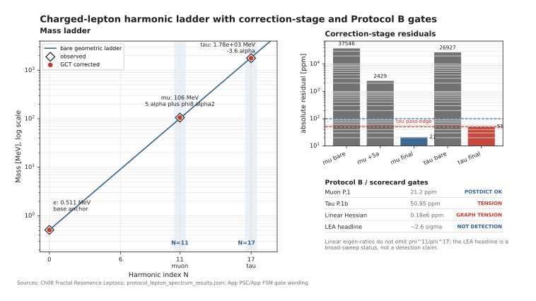

---

**8.1 Phason Band Structure**

**8.1.1 The Symmetry Octave and the High-Pass Filter [Tier 3 ansatz]**

In the icosahedral projection, the radial scaling of the vacuum is governed by the **Symmetry Octave (6)**, corresponding to the six five-fold rotational axes of the parent lattice. Conditional on the Tier 3 O.38 cage posit, the adopted $N=144$ cage is used as a candidate **Topological High-Pass Filter** ansatz: the present model assigns harmonics below the 11th power of $\phi$ insufficient "topological torque" to displace its locked nodes and activate the registered resonance. No native action yet derives this threshold, a hard target space, or a preserved topological sector [Tier 3].

**8.1.2 The Generational Scaling [Tier 2 mechanism conditional on the Tier 3 $\phi$-step + Tier 3 integer anchors pending O.5/O.14/O.15]**

The mass hierarchy is established at specific intervals of the Symmetry Octave:
* **The Muon ($n=11$):** The first available spectral gap above the depinning threshold. It occurs at two octaves of inflation minus a single **Decoupling Unit** required to break the ground-state symmetry and transition from a static to a dynamic resonance: $2 \times 6 - 1 = 11$. Equivalently $n_\mu = h + 1$, one unit above the $H_3$ Coxeter number $h = 10$.
* **The Tau ($n=17$):** The next stable resonance window, occurring exactly one symmetry octave above the muon: $11 + 6 = 17$. Equivalently $n_\tau = \left(\textstyle\sum_i d_i\right) - 1 = 18 - 1$, one unit below the $H_3$ Shephard-Todd degree sum; the octave spacing $n_\tau - n_\mu = 6 = d_2$ is the middle degree.

The current harmonic-ladder postulates mark the $k=11$ and $k=17$ harmonics of the inflation eigenvalue $\phi$ as candidate resonance labels, pending O.5/O.14/O.15 closure. Their arithmetic does not by itself select physical particle masses or stable defects; that requires a target/index map, admissibility and boundary data, preserving dynamics, and an action. A single $\phi$ scaling maps the primitive lattice $P\cong\mathbb{Z}^6$ to the body-centred lattice $I$; the self-similarity of $P$ is $\phi^3$ (App QCT §QCT.3.2). Using $\phi$ as the elementary step is an additional assumption [Tier 3/open].

**8.1.3 Geometric Amplification Mechanism**

The proposed **Lever Arm of the 6D Projection** supplies a qualitative amplification mechanism for the disparity between generations (e.g., $m_\mu/m_e \approx 206$): if the phason stiffness $K_\perp$ is suppressed relative to $K_\parallel$, the resonant frequencies of the defect core are geometrically amplified by the inverse volume ratio of the internal manifold. Its numerical specialization assumes $K_\perp/K_\parallel = \phi^{-18}$ (Volume 2, Chapter 4), which is the registered Tier 3 stiffness-map hypothesis P3b (Parameter Ledger), listed outside the count and pending the normalization-invariant O.15(b) elasticity/RG derivation; only the integer $D = 18$ is Tier 2, and the ratio is not a Tier 2 projector consequence. The harmonic-ladder mechanism and the separate $N=11,17$ integer anchors do not derive that stiffness ratio.

**8.1.4 The Linear vs. Non-Linear Boundary [Tier 2 numerical diagnostic + Tier 3 soliton hypothesis]**

Conditional on the adopted $N=144$ input, sparse-Hessian diagonalization of that cage (see Appendix GPE) provides an internal spectral diagnostic. Diagonalization of the **bare linear dynamical matrix** extracts the acoustic phonon background, yielding normalized eigen-ratios of `[1.0, 1.67, 2.1, 2.52...]`.

It is a reproducible numerical fact of the current finite model that the exponents $\phi^{11}$ and $\phi^{17}$ **do not** spontaneously emerge from this linear approximation. GCT therefore carries **Non-Linear Phason Solitons** (Davydov-like defects), whose masses would be governed by the non-perturbative saturation of the discrete $6N \pm 1$ symmetry octaves rather than by simple linear harmonic resonance, as a Tier 3 physical hypothesis rather than a derived conclusion. A linear Hessian cannot establish the non-linear soliton, its target space or index, its preservation/metastability, or its particle identity.

Consequently, the harmonic-ladder mechanism is a **Tier 2 geometric postulate** conditional on the Tier 3 choice of $\phi$ (not $\phi^3$) as the elementary step (§8.1.2), while the specific integer anchors $N=11$ and $N=17$ remain **Tier 3** pending O.5/O.14/O.15 closure. The Tier-3 status reflects a genuine structural gap: unlike the electron exponent ($107 = 1^2+5^2+9^2 = \sum_i m_i^2$, a power-sum invariant unique to $H_3$) and the stiffness exponent ($18 = \sum_i d_i$), the lepton harmonic integers are **not** power sums of the $H_3$ exponent or degree multisets ($\sum m_i = 15,\ \sum m_i^2 = 107$; $\sum d_i = 18,\ \sum d_i^2 = 140$), and an exhaustive audit of canonical $H_3$/$I$ structural counts — roots, reflections, conjugacy classes, irreducible-representation dimensions, orbit sizes, and coinvariant/Poincaré coefficients — yields no distinctive invariant identification of $11$ or $17$ (engine: `GCT_Physics_Engine/src/protocol_w4_lepton_exponents.py`). The integers likewise fail to arise as spectral-ordinal labels: in the icosahedrally-decomposed linear phason spectrum of the 152-node $I_h$-closed defect cage (used here because a symmetry decomposition needs an $I_h$-closed cage; the other diagnostics of this chapter use the adopted $N=144$ cage), the phason-vector channel activates at pooled cluster ordinals $(5, 18, 26, \ldots)$, with neither $11$ nor $17$ appearing among the activation ordinals (engine: `GCT_Physics_Engine/src/protocol_w4b_lepton_spectral_ordinals.py`). Together with the eigenvalue-magnitude exclusion above, this closes the arithmetic-invariant and linear-spectral identifications, leaving the non-perturbative extraction as the remaining closure path. The canonical hooks $n_\mu = h+1$ and $n_\tau = (\sum_i d_i) - 1$ fix the values against $H_3$ data, but the Decoupling-Unit offset and the generation indexing remain un-derived handles, so no canonical-invariant promotion of the form available to $107$ exists. The muon hook does carry genuine *naming* standing: the diagonal-coinvariant theorem of Gordon (2003, Thm.~1.4) attaches a $W$-stable quotient ring of dimension $(h+1)^n$ — with $h+1 = 11$ graded levels per rank coordinate — to every finite Coxeter group, explicitly including the non-crystallographic $H_3$. This standing is dimensional only [Tier 3]: the construction carries no spectral, harmonic, or mass-ladder content connecting $h+1$ to the $\phi$-power ladder, its crystallographic lattice interpretation ($Q/(h+1)Q$) does not transfer to $H_3$, and no analogous theorem features $\sum_i d_i - 1 = 17$. Extracting these non-linear solitonic eigenvalues directly from an ab-initio non-perturbative lattice simulation remains the closure target (App ORQ O.5).

---

**8.2 The Muon (The Acoustic Resonance)**

**8.2.1 Identification: $\mu \leftrightarrow \phi^{11}$**

The Muon is the fundamental acoustic resonance of the electron's dodecahedral cage. Its "Bare Geometric Mass" is the energy required to maintain this 11th-harmonic oscillation:
$$m_\mu^{bare} = m_e \cdot \phi^{11} \approx 101.6913 \text{ MeV} \quad \text{[Tier 2 mechanism + Tier 3 specific exponent $N=11$]}$$

> **Tier disposition for the muon harmonic exponent.** The harmonic-ladder mechanism is Tier 2 (geometric postulate, conditional on the Tier 3 $\phi$-step; see §8.1.2). The specific integer $N = 11$ is Tier 3, anchored at Parameter Ledger §0.1 postulate P4: the $6N \pm 1$ symmetry-octave selection rule of §8.1.2 constrains but does not uniquely force $N = 11$. The integer-side closure target is the analogue of the electron's $|n| = 107 = \sum m_i^2(H_3)$ Coxeter-exponent uniqueness derivation; see App ORQ Open Problem O.14 path (l) for the closed electron-side argument and Parameter Ledger §0.1 P4–P5 for the muon-and-tau integer closure status.
Earlier global-significance figures for the numerical matches are withdrawn: the cross-base comparison could not, by construction, credit any base other than $\phi$, and the trial counts behind the quoted σ values were asserted rather than enumerated. As evidence that φ or icosahedral structure is special, the muon and tau ladder matches and their ppm residuals are **Tier 4**: the preregistered constant control test (v3, NEGATIVE-FRAGILE; App PSC §PSC.9.6) found φ's pattern of matches on 21 constants not distinguishable from that of random constants (58 of 300 random bases did at least as well). The test "excludes, at power ≥ 0.8, an effect in which φ hits at least 6 of the 8 informative rows through a real effect; weaker effects are not excluded." The numbers are kept as descriptive arithmetic; no global significance is claimed, and no individual match is cited as evidence on its own strength. The tier tags of the mechanism, the exponents and the coefficients below describe the ansatz, not the evidential weight of the match.

**8.2.2 The Phason Drag Coefficient ($5\alpha$) [Tier 2 mechanism + Tier 3 specific coefficient]**

The icosahedral rotation group $A_5$ has five irreducible representations in total, of dimensions $1, 3, 3', 4, 5$ (the trivial one and four non-trivial ones; equivalently, five conjugacy classes) [Tier 1]. This chapter reads the "5" in $5\alpha$ as that total count, so the trivial (uniform) sector is counted as one of the **phason channels**. No current action justifies counting the trivial sector, or treating every irrep as one channel, rather than, say, counting only the four non-trivial irreps; the channel multiplicity 5 is therefore a **Tier 3 counting convention**, not a Tier 2 result. The Tier 2 content is only the existence of a first-order phason-drag channel. Other fivefold counts (the five faces meeting at an icosahedral vertex, the order of the five-fold vertex stabilizer) are alternative readings of the same number, not independent derivations of it. **Converting** this count into the equal-weight pole-mass self-energy coefficient $+5\alpha$ is a Tier 3 physical normalization rule: each channel contributes one unit of $\alpha$ to the muon self-energy, pending a first-principles GCT self-energy calculation (closure target App ORQ O.5). The nominal −21.09 ppm residual downstream is a Tier 3 formula residual (about $10^3\sigma$ against the 22 ppb CODATA 2022 measurement uncertainty of $m_\mu$) and inherits Tier 3 status from this coefficient normalization and from the loop-order truncation (§8.2.4); it is not a Tier 2 coefficient derivation.

> **Layered tier disposition:** The muon correction is a tree-level + single 1-loop GCT correction factor. The specific $\phi^8\alpha^2$ term is obtained only after inserting the factor $\phi^{-3}$, the value of the independent Tier 3 hypothesis H-EW (V3 Ch04 §4.3), into the exact arithmetic $\phi^{11}\phi^{-3}=\phi^8$; neither Gram nor projector geometry selects that factor (see Appendix GPE). The tiered claim is the existence of the phason-drag channel mechanism (its multiplicity 5 being a Tier 3 counting convention, §8.2.2) and of the single-loop geometric correction channel, not a standalone resolved **21 ppm** pole-mass prediction; the displayed second-order coefficient is Tier 3 conditional on H-EW. The $+5\alpha$ coefficient normalization and nominal −21.09 ppm residual remain Tier 3 pending full GCT-native self-energy and loop-order closure (O.5); the residual is not resolved below the size of the unpropagated next-order GCT term (§8.2.4). The tau reaches **~−51 ppm** against PDG 2024 only after inserting the $-3.6\alpha$ screening coefficient $c=-D/N=-18/5$: the integer $D=18$ is Tier 2 within the adopted framework and $N=5$ is the $A_5$ irrep count (Tier 3 as a channel number, §8.2.2), but the combination rule $c=-D/N$ and the negative polarity are Tier 3 candidate conventions pending O.26b; Galois conjugation supplies no physical response sign.
>
> **The Computational Frontier:** O.38 must first establish the cage size by a full candidate-size minimization. Conditional on that result, the non-perturbative $6N\times6N$ Hessian must extract the nonlinear eigenspectrum without analytic approximation. The finite calculations do not promote the adopted $N=144$ input; the existence of the muon phason-drag channel remains Tier 2 conditional mechanics, while the channel count 5 (§8.2.2) and the coefficient normalizations retain their Tier 3 gaps.

**8.2.3 Tree + Single 1-Loop GCT Phason Self-Energy Correction [Tier 2 mechanism + Tier 3 coefficient]**

To reach precision limits for the muon, we must account for the leading GCT loop correction. The mass shift is represented by a single 1-loop GCT phason self-energy correction factor over the discrete $N=144$ cage. The discrete cage-Hessian correction yields:
* **Intensive Scaling:** The single 1-loop GCT self-energy $\Sigma$ is normalized by the node count $1/N$.
* **Engine-checked conditional exponent arithmetic:** The engine verifies the effective scaling factor **$\phi^8$** (the single 1-loop GCT correction factor over the $N=144$ cage; see Appendix GPE) as $\phi^{11} \times \phi^{-3} = \phi^8$ once the factor $\phi^{-3}$ is supplied on the bare muon scaling $\sim \phi^{11}$. That factor is the value of the independent Tier 3 hypothesis H-EW (V3 Ch04 §4.3), not an output of graph topology, Gram ratios, or projector normalization; the raw-frame coordinate identity behind $\phi^{-3}$ (App USS §USS.9) is coordinate arithmetic only. The existence of the single-loop correction channel remains Tier 2 within GCT; selecting the specific $\phi^8$ coefficient is Tier 3 conditional on H-EW, with load-bearing self-energy and radiative closure remaining O.5/O.19/O.26.

Therefore, the single-loop mass shift is [Tier 2 mechanism + Tier 3 coefficient]:
$$\Delta m_2 = (m_e \phi^{11}) \cdot (\phi^8 \alpha^2), \qquad \Delta m_2 / m_\mu^{bare} = \phi^8 \alpha^2$$
[Tier 2 mechanism + Tier 3 coefficient conditional on H-EW, pending O.5/O.26]

**8.2.4 Result 8.1: The Muon Mass Formula**

**Result 8.1:** *Three-stage muon chain: 3.75% bare residual, 2429 ppm first-order residual, and a nominal −21.09 ppm Tier 3 formula residual after the A3 + single-1-loop comparison stage. The measured muon mass is known to 22 ppb, so the formula does not reproduce $m_\mu$ at measurement precision; the unpropagated next-order GCT truncation term ($\sim\phi^8\alpha^3 \approx 18$ ppm) is as large as the residual, so the row tests nothing beyond first order.*
$$m_\mu = m_e \phi^{11} (1 + 5\alpha + \phi^{8} \alpha^2)$$

> **The Geometric Basis:**
> The muon mass formula employs the $\phi^8\alpha^2$ correction channel whose displayed product $\phi^{11} \times \phi^{-3} \times \alpha^2 = \phi^{8} \alpha^2$ is exact exponent arithmetic **conditional on inserting the H-EW value $\phi^{-3}$**; neither the projectors nor their Gram matrices select $\phi^{-3}$. The existence of the single-loop geometric channel is the Tier 2 mechanism; the specific $\phi^8\alpha^2$ term is Tier 3 conditional on H-EW, and the absolute 21 ppm pole-mass residual remains a Tier 3 formula residual conditional on H-EW, A3 and O.15/O.19/O.26. No continuous parameter is fitted; the disclosed discrete and normalization inputs are A3, the exponent, and the Tier 3 coefficients. **Reading the 21 ppm residual.** The comparison target is a measured mass: CODATA 2022 gives $m_\mu = 105.6583755(23)$ MeV, an uncertainty of 22 ppb. Against that uncertainty the −21.09 ppm residual is about $10^3\sigma$, so the formula does not reproduce $m_\mu$ at measurement precision. The earlier reading of the residual as "floor-consistent" inside a $\sim 10$–$40$ ppm Standard-Model higher-loop "theory floor" is withdrawn: Standard-Model radiative corrections are not an uncertainty on a measured mass. The only relevant floor is GCT's own truncation error: the next, unpropagated term of the series is of order $\phi^8\alpha^3 \approx 18$ ppm, the same size as the residual, so the row tests nothing beyond first order. The residual is a Tier 3 formula residual. The GCT formula here is a *tree-level + single 1-loop GCT correction factor* expression — a Tier 2 correction-channel mechanism given the icosahedral postulates, with Tier 3 coefficients (the channel count 5 of §8.2.2 and the $\phi^8\alpha^2$ term conditional on H-EW). The 21 ppm figure is therefore not a "geometric saturation of the icosahedral projection to the muon mass" and is not load-bearing evidence. **A GCT-native higher-order self-energy calculation is App ORQ Open Problem O.5 (QLQCD-1L).** Even with O.5 closed, the ppm-level comparison would still be Tier 3, because the $\phi^8\alpha^2$ term is conditional on the Tier 3 hypothesis H-EW and the channel count 5 is a Tier 3 convention. A "GCT-native ppm precision" claim would additionally require H-EW and the channel count to be derived. The truly bare $\phi^{11}$-only residual without the $(1 + 5\alpha)$ first-order correction is $\sim 3.75\%$ vs PDG; the $\sim 0.24\%$ after-first-order-correction figure (muon) and the $\sim 21$ ppm after-$\phi^8\alpha^2$-correction figure are the Tier 3 formula residuals at each stage; see App PSC §PSC.1 row 2.

**Consistency Check (Rigorous Logic):**
* **Bare stage:** $m_e \phi^{11} \approx 101.6913$ MeV, about $3.75\%$ low.
* **First-order A3 drag stage:** $m_e \phi^{11}(1+5\alpha_{\rm A3})$, leaving about $2429$ ppm residual.
* **Displayed A3 + single-1-loop comparison stage:** $m_e \phi^{11}(1+5\alpha_{\rm A3}+\phi^{8}\alpha_{\rm A3}^{2}) \approx 105.656$ MeV.
* **Observed (CODATA 2022): $105.6583755(23)$ MeV** (22 ppb)
* **Relative Error at displayed stage:** nominal −21.09 ppm ($-0.002109\%$), about $10^3\sigma$ in measurement terms; a Tier 3 formula residual of the same size as the unpropagated $\sim\phi^8\alpha^3 \approx 18$ ppm truncation term, conditional on A3.

> [!IMPORTANT]
> **Firewall Metadata [Muon Mass]**
> - **Type:** Postdiction
> - **Inputs:** $m_e$ (A1 dimensional anchor), $\phi$ (geometric invariant), $\alpha(0)_{\rm CODATA}$ (A3 precision-comparison anchor), $5\alpha$ (Tier 2 drag mechanism + Tier 3 channel count + Tier 3 pole-mass normalization), $\phi^{8}\alpha^2$ (Tier 3 second-order term conditional on H-EW, pending O.15/O.5/O.19 closure)
> - **Degrees of Freedom:** 0 continuous fitted parameters; Tier 3 specific exponent $N=11$; the ppm residual is a Tier 3 formula residual (untested beyond first order)
> - **Evidential status:** **Tier 4 as evidence** (φ-formula match; App PSC §PSC.9.6)
> - **Provenance:** Internal derivation (Acoustic Resonance; the $\phi^{-3}$ factor in the second-order term is the inserted value of the Tier 3 hypothesis H-EW, not a Gram or projector output; see Appendix GPE)

---

**8.3 The Tau (The Hole Mode)**

**8.3.1 Identification: $\tau \leftrightarrow \phi^{17}$**

The Tau is the fundamental optical resonance, occurring exactly one symmetry octave above the muon [Tier 2 mechanism (harmonic-ladder + $6N \pm 1$ symmetry-octave selection rule) + Tier 3 specific integer exponent $N = 17$ (geometric postulate P5 per Parameter Ledger §0.1; the integer-side analogue of the electron's $|n| = 107$ Coxeter-exponent uniqueness derivation is the residual closure target shared with $N = 11$)].
$$m_\tau^{bare} = m_e \cdot \phi^{17} \approx 1824.78 \text{ MeV} \quad \text{[Tier 2 mechanism + Tier 3 specific exponent]}$$

The exponent N=17 corresponds to the next symmetry octave above the muon ($11+6$). This selection represents a heuristic alignment within the A5 gap spectrum. Other exponents in the range 12–19 are not current charged-lepton predictions; no theorem in the manuscript yet derives an energetic suppression law excluding each alternative exponent, so that exclusion remains part of the integer-selection open problem.

**8.3.2 Mechanism for the Tau Screening Coefficient ($-3.6\alpha$) [Tier 2 mechanism ($A_5$-channel-averaging) + Tier 2 integer $D = 18$ + $N = 5$ irrep count (Tier 1 as a count, Tier 3 as a channel number, §8.2.2) + Tier 3 combination rule $c = -D/N$ and inserted negative-polarity convention pending O.26b — stacking the Tier 3 combination rule and channel-count convention on the integers yields **Tier 3 for the headline coefficient $-3.6\alpha$** (per App ORQ O.26 + §8.3.4 Result 8.2 + App PSC §PSC.1 row 3 disposition). The $H_3$ Shephard-Todd invariant-degree sum $D = 2 + 6 + 10 = 18$ is the Tier 2 icosahedral-specific anchor conditional on the irreducible $H_3$ premise: $H_3$ is unique at sum 18 among finite irreducible rank-three Coxeter systems, while reducible $A_1\times I_2(14)$ also attains 18; the 2D-face-in-6D tangent-bundle dimension count $D_{\rm pos}(6) + D_{\rm mom}(6) + D_{\rm face\,int}(6) = 18$ is a 6D-ambient consistency cross-check rather than an independent icosahedral anchor; $N = 5$ is the same count of $A_5$ irreducible representations that §8.2.2 reads as the muon's channel number (Tier 3 as a channel number); the ratio-combination $c = -D/N$ that selects $-3.6$ over alternative combinations $(D - N = 13, D \cdot N = 90)$ is the load-bearing Tier 3 postulate pending App ORQ Open Problem O.26b. Engine: `protocol_lepton_coefficients.py`, `gct_tau_uniqueness.py`, `protocol_stiffness_ratio.py`.]**

The proposed sign flip from positive drag (Muon) to negative screening (Tau) is a **Tier 3 response analogy** modelled on **Kramers-Kronig Dispersion** at the RT face, not a derived consequence of the current lattice action. A Kramers–Kronig argument would require an explicit causal susceptibility, pole prescription, a derived characteristic **Transparency Frequency** $\omega_c$ (related to the lattice relaxation time), and proof that the muon and tau lie on opposite sides of it.

* **Candidate low-frequency branch, Muon ($\omega < \omega_c$):** in the phenomenological analogy the phason cloud tracks the particle, assigned **Viscous Drag** (Positive $\alpha$).
* **Candidate high-frequency branch, Tau ($\omega > \omega_c$):** in the analogy the phason field effectively "freezes" and the particle pushes against the rigid volume, assigned **Lattice Volume Displacement**, or diamagnetic screening (Negative $\alpha$).

No native response function presently establishes either assignment or places the lepton rows relative to $\omega_c$.

**Derivation of the −3.6α = −18α/5 Tau Screening Coefficient**

The coefficient is constructed from two ingredients, both independently
established:

**Ingredient 1 — $D = 18$ Phase-Space Dimension [Tier 2 conditional on the irreducible $H_3$ premise, with 6D-ambient consistency check]:**
The integer $D = 18$ is established at Tier 2 conditional on the irreducible icosahedral premise via the $H_3$ Shephard-Todd invariant-degree sum $\{2, 6, 10\}$, sum $= 18$. The finite irreducible rank-three sums are $A_3 = 9$, $B_3 = 12$, and $H_3 = 18$, so $H_3$ is unique in that class. The complete finite rank-three classification also contains reducible $A_1\times I_2(m)$ with degrees $\{2,2,m\}$; $m=14$ supplies a second sum-18 system. Thus 18 is an exact invariant of $H_3$ but does not select $H_3$ without the irreducible icosahedral premise. The 2D-RT-face-in-6D tangent-bundle decomposition $D_{\rm pos}(6) + D_{\rm mom}(6) + D_{\rm face\,int}(6) = 18$ is a consistency check from the 6D ambient triple-decomposition, not an independent icosahedral anchor (every 6D-ambient theory with this triple-decomposition gives 18 regardless of icosahedral structure). The sharper RG-running step $K_\perp/K_\parallel = \phi^{-D}$ at the renormalization-flow level is separately open as Open Problem O.15(b).

*The $H_3$ Shephard-Todd anchor (load-bearing, icosahedral-specific).* The icosahedral Coxeter group $H_3$ has rank 3 with fundamental invariant polynomials of degrees $d_1 = 2$, $d_2 = 6$, $d_3 = 10$ (Humphreys 1990, Tables 1 and 3.1; Shephard-Todd 1954, *Can. J. Math.* 6:274). Their sum is canonically
$$D_{H_3} = d_1 + d_2 + d_3 = 2 + 6 + 10 = 18.$$
This is a Tier 1 mathematical fact about $H_3$ and matches the integer entering the tau screening formula exactly. Among finite irreducible rank-three Coxeter systems ($A_3$: degrees $\{2,3,4\}$, sum 9; $B_3$: $\{2,4,6\}$, sum 12; $H_3$: $\{2,6,10\}$, sum 18), only $H_3$ produces 18. Across all finite rank-three systems the sum is not unique, because reducible $A_1\times I_2(14)$ has degrees $\{2,2,14\}$; the icosahedral specificity comes from the upstream irreducible $H_3$ premise, not from the bare number 18.

*6D-ambient triple-decomposition consistency check (not an independent anchor).* An RT face is a 2-dimensional rhombic plaquette embedded in the 6D parent lattice. The full phase-space tangent bundle at such a face decomposes by canonical phase-space + tangent-bundle dimension counting:
$$D = \underbrace{D_{\rm pos}(6)}_{\text{6D parent lattice}} + \underbrace{D_{\rm mom}(6)}_{\text{cotangent (canonical symplectic)}} + \underbrace{D_{\rm face\,int}(6)}_{\text{2D-in-6D tangent bundle}} = 18.$$
$D_{\rm face\,int} = 6$ is geometrically forced because the ambient tangent bundle restricted to a $k$-dimensional surface in an $n$-dimensional manifold, $TM|_S$, has fibre dimension $n$ (the $k$ in-plane + $(n-k)$ normal modes); for $k=2$, $n=6$, this is $2 + 4 = 6$. This identity follows from the 6D ambient triple-decomposition alone and obtains in any 6D-ambient theory with that decomposition regardless of icosahedral structure; it is therefore a consistency cross-check that the 6D ambient framework is internally compatible with the $H_3$ value, not a second icosahedral-specific invariant.

Engine cross-checks: `protocol_stiffness_ratio.py` (derives the degrees from Coxeter matrices and verifies both the finite-irreducible $H_3$ uniqueness and the reducible $A_1\times I_2(14)$ counterexample); `gct_tau_uniqueness.py` and `protocol_lepton_coefficients.py` (return $D_{\rm face\,int} = \text{ambient\_dim} = 6$ as the tautological 6D-ambient consistency cross-check). The Tier 3 physical-link claim that the *RG running* of the stiffness ratio specifically gives $K_\perp/K_\parallel = \phi^{-D} = \phi^{-18}$ depends on the symmetry-adapted RG bookkeeping rule "each fundamental invariant of degree $d_n$ contributes $d_n \log\phi$ to $\log(K_\parallel/K_\perp)$"; the explicit one-loop Lubensky-Ramaswamy-Toner integration on the AKN lattice that would derive this bookkeeping from first principles is Open Problem O.15(b), and is independent of the integer-counting argument needed for the tau coefficient.

**Ingredient 2 — 5-Fold Icosahedral Averaging (Tier 1 count; Tier 3 as a channel number):**
The icosahedral rotation group $A_5$ has exactly **5 irreducible complex representations** of dimensions $\{1, 3, 3', 4, 5\}$, one trivial and four non-trivial (with $1^2 + 3^2 + 3^2 + 4^2 + 5^2 = 60 = |A_5|$ — the count of irreps equals the number of conjugacy classes for any finite group; verified by the standard representation theory of $A_5$) [Tier 1]. Treating these as 5 independent representation channels through which the tau-phason coupling distributes, with the trivial sector counted as a channel, is the same Tier 3 counting convention as for the muon (§8.2.2). (Note: the icosahedron itself has 6 five-fold rotation axes; under any single fixed 5-fold axis, the 20 triangular faces partition into 4 orbits of 5 faces each, since orbit size divides the group order 5 — the "5 channels" here are the $A_5$ irrep count, not the face-orbit count under a single fixed axis. The muon's $5\alpha$ coefficient uses the same reading of 5; see §8.2.2.)

When the tau lepton phason field couples to the 18D tangent bundle of the
quasicrystalline acceptance window surface, the coupling is distributed
equally across these 5 channels by the A₅ symmetry of the icosahedron (equal weighting per irrep is part of the Tier 3 convention).
The effective per-channel contribution is:

$$\text{Coupling per channel} = \frac{D_{\text{phase space}}}{N_{\text{A5 channels}}} \times \alpha = \frac{18}{5} \times \alpha = 3.6\alpha$$

**Sign Convention — Shielding vs. Drag [Tier 3]:**
The model assigns the muon to the *phonon* ($E_\parallel$) projection of the phason current,
with a *positive* drag ($+5\alpha$), and the tau lepton, as the 3rd-generation
heavy lepton, to the *phason* ($E_\perp$) screening sector, with a *negative*
shielding correction ($-3.6\alpha$). This polarity is inserted; it is not fixed by the
$E_\perp$ coordinate convention. In particular, the Galois automorphism
$\phi \mapsto -1/\phi$ of the stiffness-ratio slope is algebraic and does not determine the sign of a
physical susceptibility, self-energy, screening, or anti-screening response.

**Result:**
$$\boxed{c_\tau = -\frac{18\alpha}{5} = -3.6\alpha}$$

*Tier classification: The integer $D = 18$ is Tier 2 conditional on the irreducible icosahedral premise via the $H_3$ Shephard-Todd invariant-degree-sum anchor ($2 + 6 + 10 = 18$, unique within the finite irreducible rank-three classification but also attained by reducible $A_1\times I_2(14)$), with the 2D-face-in-6D tangent-bundle dimension count ($6 + 6 + 6 = 18$) entering as a 6D-ambient consistency check rather than as a second icosahedral-specific anchor. The count $N=5$ is Tier 1 $A_5$ representation theory (five irreps, trivial included); using it as the averaging denominator is the Tier 3 channel-count convention shared with the muon's $+5\alpha$ (§8.2.2). The negative sign is a Tier 3 inserted polarity convention: the Galois-conjugate slope $\phi' = -1/\phi$ in the stiffness ratio is algebraic and does not fix a physical response sign. **The ratio-combination rule $c = -D/N$ that selects the headline coefficient $-3.6$ (over alternative combinations $D - N = 13$ or $D \cdot N = 90$) is a load-bearing Tier 3 postulate pending App ORQ Open Problem O.26b. Stacking the Tier 3 combination rule and channel-count convention on the integers yields Tier 3 for the headline $-3.6\alpha$ coefficient** (mirroring the §8.3.4 Result 8.2 disposition + App ORQ O.26 + App PSC §PSC.1 row 3). The sharper claim that the RG-renormalized stiffness ratio is specifically $\phi^{-D} = \phi^{-18}$ depends on the symmetry-adapted RG bookkeeping rule, whose first-principles derivation is Open Problem O.15(b) and is independent of the integer-counting argument needed for the tau coefficient.*

The screening coefficient is therefore:
$$\text{Screening Coefficient} = -\frac{18}{5} \alpha = -3.6\alpha$$

**8.3.3 Tangent-Bundle Consistency Check for the $\tau$ Phase-Space Dimension [6D-ambient cross-check; not an independent icosahedral anchor]**

The $D = 18$ tangent-bundle count is a 6D-ambient consistency check from the parent-lattice geometry, not an independent icosahedral anchor. An RT face is a 2-dimensional rhombic plaquette embedded in the 6D parent lattice. By the tangent bundle decomposition of a 2D surface in a 6D ambient manifold:

$$D_{\text{face-int}} = D_{\text{in-plane}} + D_{\text{normal}} = \underbrace{2}_{\text{area + shear}} + \underbrace{(6-2)}_{\text{4 normal tilts}} = 6$$

This is **geometrically forced** by $\dim_{\text{ambient}} = 6$ alone. A 2D face embedded in $\mathbb{R}^6$ has exactly 6 independent deformation modes. Therefore:

$$D_{\text{total}} = D_{\text{pos}}(6) + D_{\text{mom}}(6) + D_{\text{face-int}}(6) = 18 \quad \checkmark$$

The stabiliser of a single RT face under $I_h$ has order $|I_h|/30 = 4$ (Klein 4-group $\mathbb{Z}_2 \times \mathbb{Z}_2$). The screening coefficient $-D/N = -18/5 = -3.6$ carries **Tier 2 mechanism** ($A_5$-channel-averaging; the negative polarity is a Tier 3 inserted convention) **+ Tier 2 integer $D = 18$ and $N = 5$ irrep count** ($D = 18$ established by the $H_3$ Shephard-Todd invariant-degree-sum anchor, unique within the finite irreducible rank-three class but shared numerically by reducible $A_1\times I_2(14)$ — icosahedral-specific conditional on the irreducible premise; load-bearing — with the tangent-bundle count above entering as a 6D-ambient consistency check rather than as a second icosahedral-specific anchor; $N = 5$ the number of $A_5$ irreducible representations, the same count the muon's $+5\alpha$ uses, Tier 3 as a channel number per §8.2.2) **+ Tier 3 combination rule** $c = -D/N$ pending App ORQ Open Problem O.26b. **Stacking the Tier 3 combination rule and channel-count convention on the integers yields Tier 3 for the headline coefficient $-3.6\alpha$**, mirroring the §8.3.4 Result 8.2 disposition + App ORQ O.26 + App PSC §PSC.1 row 3. The Tier 3 physical-link claim that the symmetry-adapted RG running of the stiffness ratio gives $K_\perp/K_\parallel = \phi^{-D}$ depends on the bookkeeping rule "each fundamental invariant of degree $d_n$ contributes $d_n \log\phi$ to the kinetic-term anomalous dimension"; an independent first-principles one-loop Lubensky-Ramaswamy-Toner derivation of this rule is Open Problem O.15(b) and is logically independent of the integer-counting argument that fixes the tau coefficient.

**8.3.4 Result 8.2: The Tau Mass Formula [Tier 2 mechanism + Tier 2 integer $D=18$ + $N=5$ irrep count (Tier 3 as a channel number) + Tier 3 combination rule $c = -D/N$ and negative-polarity convention pending O.26b + Tier 3 specific harmonic exponent $N_{harm}=17$; Tier 4 as evidence]**

**Result 8.2:** *The physical mass of the tau corresponds to the 17th harmonic of the electron cage, screened by the ratio of the 18-dimensional phase-space tangent bundle to the 5-fold symmetry order. The $A_5$-channel-averaging mechanism is Tier 2; the integer $D = 18$ is Tier 2 and $N = 5$ is the $A_5$ irrep count, Tier 3 as a channel number ($D = 18$ anchored by the $H_3$ Shephard-Todd invariant-degree sum, unique within the finite irreducible rank-three class but not across reducible systems — icosahedral-specific conditional on the irreducible premise; $N = 5$ the $A_5$ irrep count, shared with the muon's $+5\alpha$ channel-count convention of §8.2.2). The **combination rule** $c = -D/N$ that yields the headline screening coefficient $-3.6$ as a ratio (rather than, e.g., a difference $D - N = 13$ or product $D \cdot N = 90$) is itself a structural postulate registered as Tier 3 pending first-principles derivation — see App ORQ Open Problem O.26b. The specific harmonic exponent $N_{harm} = 17$ is a Tier 3 postulate (Parameter Ledger §0.1 P5), the integer-side closure shared with the muon's $N_{harm} = 11$. The negative polarity is likewise an inserted Tier 3 convention; Galois conjugation does not fix it. Stacking the Tier 3 combination rule, channel-count convention and polarity on the integers yields Tier 3 for the headline coefficient $-3.6\alpha$; the bare Tier 2 elements are the mechanism + the integer $D=18$, not the channel-count reading of $N=5$, the ratio combination or the sign.*
$$m_\tau = m_e \phi^{17} (1 - 3.6\alpha)$$

**Consistency Check:**
* $m_e \phi^{17} \approx 1824.78$ MeV
* $1 - 3.6\alpha \approx 0.97373$
* **GCT Predicted: $1776.84$ MeV**
* **Observed (PDG 2024): $1776.93 \pm 0.09$ MeV**
* **Relative Error: −51 ppm ($-0.0051\%$)** (descriptive arithmetic; Tier 4 as evidence: not distinguishable from numerology for strong effects; App PSC §PSC.9.6)

---

**8.4 Fourth-Generation Termination Mechanism [Tier 3]**

The octave sequence $N = 11, 17$ (the $6N-1$ branch, stepping by one symmetry octave of 6) implies a mathematical candidate state at the next step, $N=23$. The absence of a fourth generation is treated as a Tier 3 mechanism resting on the carrying-capacity postulate below, not as a theorem-grade exclusion. The bare geometric mass for such a fourth-generation lepton would be [Tier 4]:
$$m_{4}^{bare} = m_e \cdot \phi^{23} \approx 32.7 \text{ GeV} \quad \text{[Tier 4]}$$

This hypothetical $32.7$ GeV state is strictly excluded by early LEP direct searches (which ruled out a standard fourth generation lepton up to $\sim 100$ GeV). In GCT, the absence of this state is treated as a candidate topological cutoff rather than a theorem-grade exclusion until the O.5/O.15 closure machinery derives the carrying-capacity rule from the AKN action.

**Result 8.3 (conditional cutoff mechanism):** *Under the current RT tangent-bundle carrying-capacity postulate, a local topological defect cannot sustain a harmonic resonance whose index ($N$) exceeds the total degrees of freedom of its confining geometry. Because the internal tangent-bundle count of the Rhombic Triacontahedron face is $D=18$ (6 position + 6 momentum + 6 internal), the harmonic sequence is expected to terminate before $N=23$. This marks $N=11$ and $N=17$ as candidate resonance labels inside that ansatz, not proven stable excited defects; stability and particle identity require a target/index map, admissibility and boundary conditions, an action with a metastable sector, and preservation under the dynamics, and theorem-grade exhaustion awaits O.5/O.15 closure.*

The $N=23$ state requires a phase-space dimensionality that exceeds the carrying capacity of the $D=18$ RT tangent bundle under the current cutoff postulate. The tau is therefore the current candidate cutoff under the RT tangent-bundle carrying-capacity postulate, pending O.5/O.15 closure.

---

**8.5 — The Global Combinatorial Look-Elsewhere Effect**

A rigorous evaluation of statistical significance must account for the full **look-elsewhere effect (LEA)** across the *entire* parameter space, defending against the "infinite search space" critique of arbitrary $\alpha$ polynomials. Earlier global-significance figures for the numerical matches are withdrawn: the cross-base comparison could not, by construction, credit any base other than $\phi$, and the trial counts behind the quoted σ values were asserted rather than enumerated. The preregistered constant control test has since reported (v3, NEGATIVE-FRAGILE): φ's matches are not distinguishable from those of random constants, so the lepton matches are Tier 4 as evidence (not distinguishable from numerology for strong effects; App PSC §PSC.9.6; §8.2.1). No global significance is claimed for the matches, and no individual match is cited as evidence on its own strength.

**Expanded Search Space Definition:**
We define a massive parameter space representing all plausible combinations of baseline harmonics and small-coupling geometric corrections:
1. **Base Exponents:** $N_\mu, N_\tau \in [8, 25]$ with $N_\mu < N_\tau$ (Yields 153 baseline pairs under the depinning-threshold window).
2. **First-Order Drag/Screening:** Coefficients $C_1 \in [-20, 20]$ in discrete steps of 0.2 (Yields 201 choices, cleanly capturing representations like $5\alpha$ and $-3.6\alpha$).
3. **Second-Order Self-Energy:** Coefficients $C_2 \in [-50, 50]$ in integer steps of 1.0 (Yields 101 choices, cleanly capturing limits like $\phi^8 \approx 47$).

Every predicted mass ratio takes the form: $m/m_e(N, C_1, C_2) = \phi^N (1 + C_1\alpha + C_2\alpha^2)$.
The total combinatorial volume of this expanded grid (on the discretization $C_1 \in [-20, 20]$ step 0.2, $C_2 \in [-50, 50]$ step 1.0, $N \in [8, 25]$) is $153 \times (201 \times 101)^2 \approx 6.30 \times 10^{10}$ possible grid points.

**Constrained-search consistency check.**
Among the grid of corrected lepton-mass formulae $\{$bare $\phi^N$, $(1+5\alpha)$, $(1-3.6\alpha)$, $\phi^8\alpha^2\}$ combinations sampled within the integer-exponent search space, six configurations land within a 21 ppm window of the observed muon AND tau mass ratios. The published GCT tau formula $m_\tau = m_e \cdot \phi^{17} \cdot (1 - 3.6\alpha)$ carries a −50.85 ppm residual, just above the registered 50 ppm tau tension edge and below its 55 ppm failure edge (Tier 3 tension marker pending O.26b ratio-combination closure; see App PSC lepton row). The 21 ppm grid-hit count is therefore a **Tier 3 search-space diagnostic** — it indicates that polynomial correction VARIATIONS over the search space admit a 21 ppm joint fit, NOT a precision-validation of the manuscript's canonical lepton pair. The grid-hit fraction is not a p-value; the expanded grid is withdrawn as non-informative (App PSC §PSC.9.4, whose grid runs over $N_\mu<N_\tau\le30$ rather than the $N\in[8,25]$ range used here).

**Statistical-scope disclosure.** This grid count is **not translated into a significance of the lepton-pair claim**: doing so would count a continuous polynomial parameter space ($C_1, C_2$) as a discrete trial bag, which inflates the effective sample size and is a known misapplication of LEA on bounded parameter searches (cf. Gross & Vitells 2010 on continuous-parameter LEA). No global significance is claimed for the lepton pair (see the withdrawal note at the start of §8.5). The 6-point grid count is reported here only as a *search-space diagnostic* (how many polynomial variants reach the window), not as independent confirmation and *not* as a stronger significance claim.

**Separation of precision claims:** After the Tier 2 muon phason-channel mechanism plus the Tier 3 $+5\alpha$ pole-mass normalization, the muon reaches $\sim 0.24\%$ ($-0.243\%$); the Tier 2 tau mechanism plus the Tier 3 tau coefficient $(1 - 3.6\alpha)$ pending O.26b is already the full tau formula and reaches $-50.85$ ppm at first order (the truly bare $\phi^{11}$ and $\phi^{17}$ ratios sit at $-3.75\%$ and $+2.69\%$ vs PDG). The muon and tau first-order precision claims therefore inherit Tier 3 coefficient-normalization status, while the nominal −21.09 ppm muon residual is a Tier 3 formula residual (about $10^3\sigma$ against the 22 ppb measurement, and the same size as the unpropagated $\sim\phi^8\alpha^3 \approx 18$ ppm next-order term; §8.2.4) that further depends on A3. No global significance is claimed for the lepton pair (§8.5), and all of these residuals are Tier 4 as evidence (not distinguishable from numerology for strong effects; App PSC §PSC.9.6).

---

**8.6 The Koide Convergence**

**8.6.1 Candidate identification of K = 2/3 [Tier 3 — derivation chain pending closure target]**

The empirical Koide formula, $K = (m_e + m_\mu + m_\tau)/(\sqrt{m_e} + \sqrt{m_\mu} + \sqrt{m_\tau})^2 \approx 2/3$ (measured $K = 0.666664 \pm 0.000005$ with PDG 2024 masses; Koide 1983 *Phys. Lett. B* 120:161), is a *candidate* GCT identification with a Binary Icosahedral Group ($2I$) Unitarity Sum-Rule: the three generations would represent three orthogonal orientations in the $2I$ flavor-space, and the ratio $2/3$ would be the geometric limit required to preserve unitarity of the $6D \to 3D$ projection in the rigid-lattice limit ($\alpha \to 0$). **Tier disposition: Tier 3 candidate identification, *not* Tier 2 derived.** The current paragraph is a *sketch* of a derivation chain — the explicit formal steps (the $2I$ irrep decomposition of the lepton-mass flavor space, the orthogonality calculation, the unitarity sum-rule algebra, the explicit projection chain to the square-root-mass form of $K$, and an engine cross-reference comparable to the §8.3.2 / §8.3.3 derivations of the $+5\alpha$ and $-3.6\alpha$ coefficients) are *not* presently published. Until those steps are exhibited, the Koide ratio in GCT is at the same Tier-3-candidate-identification status as path (k) of App ORQ O.14 was for the electron exponent before path (l) closure: a structurally suggestive coincidence with a candidate icosahedral home, awaiting the formal derivation that would lift it to Tier 2. **Closure target.** Either (a) supply the formal $2I$ unitarity-sum-rule derivation chain with explicit irrep-decomposition arithmetic and engine cross-reference (the closure-positive outcome that would promote this section to Tier 2), or (b) re-anchor the GCT-Koide identification to a different icosahedral group-theoretic invariant if the $2I$ unitarity argument does not survive scrutiny.

Independent of the above derivation status, note that the Koide formula is itself $\alpha$-independent (it is a square-root-mass sum rule), so the "$\alpha \to 0$ rigid-lattice limit" framing above does not by itself supply the load-bearing derivation step; the $\alpha$-independence is what makes the §8.6.2 observation a candidate consistency check rather than a closure.

**8.6.2 Effect of the Lepton Corrections on $K$ [Tier 3 — candidate consistency check]**

The bare ratios $(1, \phi^{11}, \phi^{17})$ give $K = 0.6728$, about $0.9\%$ above $2/3$. The first-order $+5\alpha$ muon drag and $-3.6\alpha$ tau screening do not cancel in $K$: each lowers it (to $0.6696$ and $0.6702$ when applied separately), and together they give $K = 0.66688$. Adding the muon's second-order term $+\phi^8\alpha^2$ (§8.2.3–§8.2.4; a Tier 3 term pending O.15/O.5/O.19, whose electroweak reading of the $\phi^{-3}$ factor rests on the Tier 3 hypothesis H-EW) gives $K = 0.666661$, against the measured $K = 0.666664 \pm 0.000005$ (PDG 2024 masses; the $\tau$-mass uncertainty dominates). This agreement is arithmetic, not independent evidence: the corrected formulae reproduce $m_\mu$ and $m_\tau$ to 21 ppm and 51 ppm, and $K$ is a function of those masses, so it inherits the mass fits rather than testing them. The approach to $2/3$ comes from the corrections reinforcing, not from a cancellation, and it is not exhibited as a consequence of the §8.6.1 identification. Tier 3 candidate consistency check pending §8.6.1 closure-target completion.

---

**8.7 Precision QED and the Muon g-2 HVP Contingency**

> [!WARNING] **WP2025 HVP ARBITRATION**
> Under the WP2025 lattice-QCD-dominant HVP synthesis, the SM-vs-experiment muon $g-2$ gap is only $\sim0.6\sigma$, while the GCT vertex correction lies above the consolidated SM central value. The channel is therefore **TENSION under WP2025** and is not load-bearing empirical validation of GCT. Historical WP2020/R-ratio baselines open a larger $\approx5.7\sigma$ discrepancy against the E989 final combination, but that baseline is carried only as the HVP-survival contingency in App PRG Table PRG.1 row P.5, not as the operative disposition.

**8.7.1 The Geometric Vertex Correction**
The GCT quasicrystal topology produces a geometric vertex correction to the muon anomalous magnetic moment, $\Delta a_\mu^{GCT}$, arising from a geometric factor in the phason-sector vertex that is absent from Standard Model perturbation theory. Whether this correction functions as empirical evidence is contingent on the hadronic-vacuum-polarization synthesis (§8.7.2–§8.7.3): under the consolidated lattice-QCD HVP synthesis the SM–experiment gap is $\sim 0.6\sigma$ and the channel disposition is **Tension under WP2025; falsification conditional on long-term HVP-synthesis arbitration**, not a confirmed resolution.

**8.7.2 The 1/5 Factor from the $A_5$ Irrep Count**
The Rhombic Triacontahedron (RT) governs the icosahedral interaction node. The standard RT has $F=30$ rhombic faces, $V=32$ vertices (12 five-valent + 20 three-valent), and $E=60$ edges (Coxeter, *Regular Polytopes* §3.7). The relevant flux-channel count is not from the face/vertex/edge incidence directly; the $1/5$ is read as an equal share over the same five $A_5$ irreducible representations used for the $5\alpha$ coefficient (§8.2.2). The group-theoretic existence of that fivefold structure is Tier 1; the step from it to an equal-weight numerical $1/5$ vertex factor is a **Tier 3 candidate coefficient** pending the O.26/O.5 first-principles vertex calculation, and it inherits the Tier 3 channel-count convention of §8.2.2.

This geometric $1/5$ factor dictates a 3-loop phason vertex correction:
$$ \Delta a_\mu = \frac{1}{5} \left( \frac{\alpha}{\pi} \right)^3 $$

**8.7.3 The Geometric Vertex Correction $\Delta a_\mu \approx 250.65 \times 10^{-11}$ [Tier 2 mechanism + A3 + Tier 3 $1/5$ coefficient + Tier 4 calibration-survival conjecture (HVP arbitration)]**
The application of this geometric $1/5$ factor using the observed CODATA low-energy $\alpha$ produces a 3-loop phason vertex correction $\Delta a_\mu \approx 250.65 \times 10^{-11}$. The model assigns no corresponding term to the electron row at this order (§8.7.4); in standard QFT a heavy internal state would instead contribute to $a_e$ suppressed as $(m_e/m_\mu)^2$, giving $\Delta a_e \sim 6\times10^{-14}$, below current $a_e$ sensitivity. Neither statement establishes a ground-state topological defect or physical electron identity. Under the consolidated lattice-HVP synthesis (Aliberti et al. 2025 WP2025) the SM–experiment residual is $\approx 0.6\sigma$ and the SM total plus the GCT correction overshoots the E989 final combination by $\approx 3.3\sigma$ ($213 \times 10^{-11}$ against a combined $64 \times 10^{-11}$ uncertainty) — the channel disposition is therefore **Tension under WP2025; falsification conditional on long-term HVP-synthesis arbitration**. The Tier 2 status applies to the geometric *mechanism* (the $I_h$ fivefold-channel partition); the equal-weight numerical $1/5$ vertex factor and the use of A3 measured low-energy $\alpha$ remain Tier 3/A3 provenance inputs pending the O.26/O.5 first-principles vertex calculation. The Tier 4 status applies to the *calibration-survival conjecture* that the HVP synthesis will eventually re-converge toward a dispersive-dominant baseline under which the gap reopens. The HVP-Survival Condition in App PRG Table PRG.1 row P.5 is the load-bearing condition for the channel's status as evidence.

> [!CAUTION]
> **HVP Dependence — empirical status:** The GCT muon g-2 closure is computed against the Standard Model HVP synthesis. Two reference synthesis classes are operative in the community: the dispersive R-ratio class (2020 Standard Model White Paper, WP2020: $a_\mu^{SM} = (116591810 \pm 43) \times 10^{-11}$) and the lattice-QCD-dominated class (Muon g-2 Theory Initiative 2025 update, Aliberti et al., *arXiv:2505.21476*: $a_\mu^{SM,\,\text{WP2025}} = (116592033 \pm 62) \times 10^{-11}$). The two classes are statistically incompatible at $\approx 3\sigma$. The Fermilab E989 final combined Run 1-6 result reports $a_\mu^{exp} = (116592070.5 \pm 14.8) \times 10^{-11}$ (127 ppb). Against the WP2025 lattice synthesis the SM–experiment gap is $\approx 37 \times 10^{-11}$, or $\sim 0.6\sigma$ under combined uncertainty — consistent with the SM, with no significant residual. Against the WP2020 dispersive synthesis the gap is $\approx 260.5 \times 10^{-11}$, or $\approx 5.7\sigma$. The GCT prediction $\Delta a_\mu^{GCT} = (1/5)(\alpha_{\rm CODATA}/\pi)^3 \approx 250.65 \times 10^{-11}$ is therefore a *contingent postdiction / HVP-survival condition*: it would track the $\approx 5.7\sigma$ discrepancy under the WP2020 dispersive synthesis (leaving $\approx 0.2\sigma$) and is in tension under the WP2025 lattice-dominant synthesis, where SM $+\,\Delta a_\mu^{GCT}$ overshoots experiment by $\approx 3.3\sigma$.

**HVP Contingency Decision Table (canonical disposition).** **Scenario B is the current empirical disposition** under the WP2025 consolidated SM theory baseline (Aliberti et al. 2025). Scenarios A and C are counterfactual / contingent dispositions held against alternative synthesis classes that are not currently consolidated.

| HVP scenario | Standard Model $\Delta a_\mu$ tension | GCT prediction status |
|---|---|---|
| **Scenario A — dispersive R-ratio dominant** | $\approx 5.7\sigma$ anomaly (WP2020 vs E989 final) | **Counterfactual disposition under R-ratio-dominant synthesis.** $\Delta a_\mu^{GCT} \approx 250.65 \times 10^{-11}$ would reduce the anomaly to $\approx 0.2\sigma$. The 1/5 RT geometric vertex correction would then be postdiction-consistent under this synthesis. |
| **Scenario B — lattice-dominant synthesis** | $\approx 0.6\sigma$ residual | **Tier 3 equal-weight $1/5$ coefficient + A3; Tension under WP2025; no robust confirmation.** The 1/5 RT correction is mathematically present in the GCT framework as a candidate equal-weight vertex coefficient, but the consolidated SM–experiment residual under this synthesis is small, the CMD-3 R-ratio measurement context does not restore a decisive anomaly, and the GCT correction overshoots the WP2025 residual. The muon g-2 channel is not load-bearing as empirical evidence for GCT under this synthesis. |
| **Scenario C — Continued inconsistency between R-ratio and lattice methods** | Unresolved | **No evidential status assigned; the $1/5$ coefficient stays Tier 3 + A3 (Tier 2 applies only to the mechanism class).** The prediction is parked as a binary-gate observable awaiting community resolution; no claim of validation or falsification can be made from muon g-2 alone. |

Under all three scenarios, the GCT 1/5 geometric vertex correction *itself* is unaffected (it is the registered $I_h$ fivefold-channel mechanism with a Tier 3 equal-weight coefficient, a contingent postdiction); only the *evidential weight* of the muon g-2 channel for GCT support depends on the HVP synthesis. The empirical status sits in Scenario B (lattice-dominant synthesis), with the App PSC §PSC.2 row recording the corresponding closure-to-data figure. The HVP-Survival Condition in App PRG Table PRG.1 row P.5 determines whether the channel becomes load-bearing evidence; the dependence is explicit.

**8.7.4 The Electron Row: Activation-Threshold Hypothesis [Tier 3/4]**
The model must say why the electron ($a_e$) receives no matching lattice vertex correction at this loop order. The present answer is a **Tier 3/4 activation-threshold hypothesis**, and it is in tension with standard QFT. In QFT, virtual-loop corrections have no rest-mass activation threshold: a heavy internal state of mass $M$ contributes to a lepton's $a_\ell$ suppressed smoothly as $(m_\ell/M)^2$ (decoupling), not as a step function. On that standard reading the electron would receive $\Delta a_e \sim (m_e/m_\mu)^2\,\Delta a_\mu \approx 6\times10^{-14}$, which is suppressed rather than zero and lies below current $a_e$ sensitivity.

The hypothesis instead reads the $N=11$ harmonic as an activation scale:
$$E_{res} = m_e \cdot \phi^{11} \approx 101.69\text{ MeV} \quad \text{[Tier 3 hypothesis + Tier 3 exponent $N=11$]}$$
The electron's rest mass ($\sim 0.511$ MeV) is about 199 times smaller ($\phi^{11} = 199.005$). Because the threshold is defined by the muon's own bare mass, the statement that the muon "sits above" it is circular, and no GCT action yet supplies a mechanism that would override decoupling. The electron-row null therefore carries no Tier 2 support. **GCT's vertex correction at this loop order is $\Delta a_\mu \approx 250.65 \times 10^{-11}$ via the equal-weight $1/5$ factor [Tier 3 equal-weight coefficient + A3 on top of a geometric mechanism class; Tension under WP2025 — SM $+\,\Delta a_\mu^{GCT}$ overshoots the E989 final combination by $\approx 3.3\sigma$ and the channel is not load-bearing as empirical evidence; see §8.7.3 Scenario B for the current empirical posture].**

---
**END OF CHAPTER 8**

---

### **Chapter 9: Neutrinos (The Ghostly Resonances)**

> [!WARNING]
> **Epistemic Status — Active Tensions [Tier 3]:**
> This chapter contains one result in active experimental tension with current data and one open octant test:
>
> 1. **PMNS Mixing Angles (Tier 3; θ₂₃ octant open):** The GCT Tier 3 ansatz for the PMNS mixing angles ($\theta_{12}, \theta_{13}, \theta_{23}$) via axis-sliding on the icosahedral lattice gives a bare $\theta_{23} = 45^\circ$. In the NuFIT 6.0 global fit (Esteban et al. 2024, normal ordering) $45^\circ$ lies inside the $3\sigma$ range both with Super-Kamiokande atmospheric data (best fit $43.3^\circ$, $3\sigma$ range $41.3^\circ$–$49.9^\circ$) and without it (best fit $48.5^\circ$, $3\sigma$ range $41.0^\circ$–$50.5^\circ$). The earlier "4.09σ" figure, a one-octant Gaussian on $49.5^\circ \pm 1.1^\circ$, is withdrawn: maximal mixing is not in $>3\sigma$ tension and the octant is unresolved. DUNE and Hyper-Kamiokande octant data remain the decisive test. The PMNS angles are Tier 3 and are NOT classified as confirmed Tier 2 predictions.
>
> 2. **Neutrino Mass Sum (tension with the DESI DR2 bound):** The registered GCT normal-hierarchy candidate sum (a consistency scale built from the Tier 3 floor $m_1$ plus measured oscillation gaps, not an independent prediction) is $\Sigma m_\nu \approx 0.0853 \pm 0.0003$ eV (Tier 3 conditional on the registered stiffness-map hypothesis P3b, $K_\perp/K_\parallel=\phi^{-18}$, + Tier 3 absolute mass anchor / oscillation mapping, §9.3.4 — not the standard-cosmology massless-floor reference of $\Sigma m_\nu^{\rm min} \approx 0.059$ eV). This registered candidate is consistent with the Planck 2018 upper bound ($\Sigma m_\nu < 0.12$ eV) but lies above the DESI DR2 + CMB bound ($\Sigma m_\nu < 0.0642$ eV at 95% CL in $\Lambda$CDM; arXiv:2503.14738), i.e. outside its 95% region; the bound relaxes to $< 0.16$ eV under $w_0w_a$, so the tension is cosmology-model dependent. App NSM displays P.4 and the conditional P.6 coordinate together because the inferred neutrino posterior is cosmology-model dependent, but adjudicates them as independent templates; no outcome activates or confirms a causal biogenic channel.
>
In the Standard Model, neutrinos were originally postulated as massless Weyl fermions. While the discovery of neutrino oscillations confirmed that these particles possess a non-zero rest mass, their absolute mass scale remains one of the most significant enigmas in physics. Standard explanations, such as the See-Saw Mechanism, require the postulation of undiscovered heavy right-handed neutrinos at the Grand Unification (GUT) scale. Geometric Consciousness Theory (GCT) identifies the neutrino as an **Itinerant Phason Mode** whose mass is a second-order effect of the vacuum projection. This chapter gives the phason-mechanism account (the abstract squared-stiffness relation is Tier 2; its numerical specialization $\phi^{-36}$ is Tier 3 conditional on the registered stiffness-map hypothesis P3b) and the Tier 3 absolute mass anchor / oscillation mapping for the neutrino mass floor, while the oscillation-sector claims remain Tier 3 with the θ₂₃ octant open, as stated above.

The candidate harmonic orders lie in a **conditional Galois/gap-label candidate space** (Appendix FTH, Proposition FTH.5): for observables built from the adopted icosahedral cut-and-project coordinates and the specified Fibonacci gap-label toy models, the candidate labels lie in $\mathbb{Z}[\phi]$ [Tier 1 algebra conditional on the adopted model; Tier 3 physical adoption]. This constrains an algebraic search space; it does not select which generation maps to which order, and the Galois automorphism $\phi \to -1/\phi$ is an algebraic coordinate map that fixes no physical sign. The same conditional range applies to leptons, neutrinos, and quarks.

---

**9.1 The Neutrino Problem**

**9.1.1 The Standard Model Deficiency**
The Standard Model contains only left-handed neutrinos, leading to a vanishing mass in the minimal Dirac Lagrangian. To accommodate oscillations, the theory must be extended by hand, either by adding right-handed singlets or by introducing Majorana terms. Neither approach derives the absolute mass scale, which is measured to be at least six orders of magnitude smaller than the electron mass.

**9.1.2 The GCT Alternative: Second-Order Phason Coupling**
GCT identifies the neutrino not as a vertex-centered cage excitation (like the charged leptons), but as an **Itinerant Defect**. While a charged lepton is a "Pinned" knot in the phonon sector, a neutrino is a "Sliding" fluctuation of the phason field itself. Its mass is not generated by a first-order Higgs coupling, but by a **Second-Order Self-Interaction** within the internal perpendicular space ($E_\perp$). 

---

**9.2 Geometric Origin of Neutrino Mass**

**9.2.1 Right-Handed States and the Galois Conjugate**
GCT proposes [Tier 3 assignment] that the 6D $\to$ 3D projection separates the neutrino's chiral components into two sectors. V3 Ch02 §2.4.3–§2.4.5 does not derive this split: it treats the chiral representation as a candidate and the mapping of a right-handed neutrino to an $E_\perp$-dominated defect mode as Tier 3.
* **Left-Handed Neutrinos:** Assigned to the physical manifold $E_\parallel$ [Tier 3].
* **Right-Handed Neutrinos:** Assigned to the internal manifold $E_\perp$ [Tier 3].

In the icosahedral projection, the coordinate map between $E_\parallel$ and $E_\perp$ is governed by the **Galois Automorphism** of the field $\mathbb{Q}(\sqrt{5})$ [Tier 1 algebra]. Reading the right-handed state as the Galois conjugate of the left-handed state, and the two components of an itinerant neutrino as two views of a single 6D lattice excitation, is a Tier 3 picture: no field-theoretic map from the Galois automorphism to a chiral or Majorana structure is derived. The Majorana reading of §9.5.1 inherits this Tier 3 status.

**9.2.2 The Geometric See-Saw [Tier 2 squared-stiffness relation + Tier 3 P3b stiffness map + Tier 3 absolute anchor]**
GCT proposes [Tier 3] to reinterpret the Seesaw Mechanism as a mechanical feature of the lattice. The "Heavy" scale required to suppress the neutrino mass is not a separate particle, but the **Phonon Stiffness ($K_\parallel \approx M_P$)**—the rigid metric backbone of the physical manifold. 

The neutrino mass corresponds to the **squared stiffness** of the phason-sector interaction. While the electron mass scales with the first-order phason stiffness ratio ($K_\perp / K_\parallel$), the neutrino mass represents the "Shadow" of the electron, suppressed by the informational impedance of the double projection ($E_\parallel \to E_\perp \to E_\parallel$) [Tier 2 mechanism]:
$$m_\nu \approx m_e \times \left( \frac{K_\perp}{K_\parallel} \right)^2 \quad \text{[Tier 2 mechanism + Tier 3 mass-floor anchor]}$$
The abstract squared-stiffness relation is the Tier 2 mechanism. The substitution $K_\perp/K_\parallel=\phi^{-18}$ is the independent Tier 3 physical-map hypothesis P3b (Parameter Ledger; listed outside the count like H-EW), pending the normalization-invariant O.15(b) elasticity/RG derivation; only the integer $D=18$ is Tier 2. Consequently, the squared value $\phi^{-36}$, the $0.0153$ eV floor, and every mass-sum descendant are Tier 3 conditional results. The absolute neutrino mass floor inherits the Tier 3 dimensional/electron anchor and the unresolved oscillation-sector mapping; the headline $\Sigma m_\nu$ value remains a registered candidate under cosmological-prior tension rather than a closed Tier 2 prediction.

**9.2.3 The $E_6$ Geometric Origin of the Heavy Neutrino Mass [Tier 2 mechanism + Tier 3 absolute anchor]**

The "heavy scale" $M_R$ in the See-Saw formula $m_\nu \approx m_{Dirac}^2 / M_R$ has a candidate geometric identity in GCT [Tier 3, conditional on O.15]: it is identified with the **symmetry-breaking scale of the $E_6$ subalgebra** within the $E_8$ root lattice.

Recall from V2 Ch11 (§11.3) that the $E_8$ adjoint **248** branches under $E_8 \supset E_6 \times SU(3)$ as:
$$\mathbf{248} \to (\mathbf{78}, \mathbf{1}) \oplus (\mathbf{1}, \mathbf{8}) \oplus (\mathbf{27}, \mathbf{3}) \oplus (\overline{\mathbf{27}}, \overline{\mathbf{3}})$$

The SM left-handed fermions populate the $(\mathbf{27}, \mathbf{3})$ branch. The heavy **sterile neutral-lepton candidates** — the right-handed neutrino in the $\mathbf{16}$ and the $SO(10)$ singlet under $\mathbf{27} \to \mathbf{16} \oplus \mathbf{10} \oplus \mathbf{1}$ — are the neutral components of this same $(\mathbf{27}, \mathbf{3})$ branch [Tier 3 assignment; V2 Ch11 §11.3]; the adjoint $(\mathbf{78}, \mathbf{1})$ holds gauge bosons, not fermions. Their Majorana masses are assigned to the geometric $E_6$ symmetry-breaking scale:
$$M_R \equiv M_{E_6} = M_{red} \cdot \phi^{-9} = M_{GUT} \approx 3.2 \times 10^{16} \text{ GeV} \quad \text{[Tier 3, conditional on O.15]}$$

It is the same $M_{GUT}$ assigned in V3 Ch04 §4.3.3 as the reduced Planck mass deflated by $\phi^{-9}$ [Tier 3, conditional on O.15]. Conditional on that Tier 3 assignment, the $E_6$ branching rule supplies the See-Saw heavy scale from $E_8$ geometry, without introducing an additional fitted coefficient. The $\phi^{-9}$ factor is the square-root descendant of the Tier 3 P3b stiffness assignment, not an independent consequence of the $E_6$ branching rule; the exact $E_8 \supset E_6 \times SU(3)$ branching structure survives separately and does not by itself fix the heavy scale.

**Theorem 9.2 (Geometric See-Saw, $E_6$ Form) [Tier 2 see-saw mechanism + Tier 3 Dirac-mass anchor + Tier 3 $M_{E_6}$ scale assignment conditional on O.15]:**
*The lightest active neutrino contribution from this channel is* [Tier 2 mechanism + Tier 3 Dirac-mass anchor + Tier 3 O.15 heavy scale]:
$$m_{\nu_1} \approx \frac{m_{Dirac}^2}{M_{E_6}} = \frac{(m_e \cdot \phi^{-18})^2}{M_{red} \cdot \phi^{-9}} = \frac{m_e^2 \cdot \phi^{-27}}{M_{red}} \quad \text{[Tier 2 mechanism + Tier 3 Dirac-mass and O.15 heavy-scale anchors]}$$

**Theorem 9.3 (Two-Mechanism Identification) [Tier 2 mechanisms + Tier 3 absolute anchors]:** Theorems 9.1 (stated in §9.3.1) and 9.2 describe physically distinct contributions to the active neutrino mass:

* **Geometric effective-mass mechanism (Theorem 9.1):** The active neutrino acquires an effective mass via the double-projection $E_\parallel \to E_\perp \to E_\parallel$, giving the registered candidate $m_\nu^{(\rm geo)} = m_e \cdot (K_\perp/K_\parallel)^2 = m_e \cdot \phi^{-36} \approx 0.0153$ eV. This is *not* a standard See-Saw matrix-diagonalisation — it is an effective-mass mechanism from the squared phason-stiffness ratio plus the Tier 3 electron/dimensional anchor (§9.2.2).

* **$E_6$ See-Saw mechanism (Theorem 9.2):** The standard See-Saw with $M_R = M_{E_6} = M_{\rm red} \cdot \phi^{-9} \approx 3.2 \times 10^{16}$ GeV ($M_{\rm red}$ = reduced Planck mass; Tier 3 scale assignment conditional on O.15, V3 Ch04 §4.3.3) gives the contribution $m_\nu^{(\rm GUT)} = m_{\rm Dirac}^2 / M_{E_6} \approx 2.4 \times 10^{-22}$ eV (with $m_{\rm Dirac} = m_e\phi^{-18}$ and the reduced Planck mass $M_{\rm red} = 2.435 \times 10^{18}$ GeV).

The geometric mechanism dominates by $\sim 20$ orders of magnitude and supplies the registered neutrino mass-floor candidate; the $E_6$ See-Saw is numerically sub-leading. Theorem 9.1 is therefore the load-bearing mechanism, while its absolute mass value inherits the Tier 3 electron/dimensional anchor and oscillation-sector mapping. Theorem 9.2 documents the $E_6$ branching contribution as a parallel mechanism present in the framework but quantitatively negligible compared to the geometric floor.

At the 2×2 See-Saw matrix level, Theorem 9.1 is matched by a consistency identity with a chosen effective scale: setting $M_R^{(\rm eff)} = m_e$ in the See-Saw form gives $m_\nu = m_{\rm Dirac}^2 / m_e = m_e \cdot \phi^{-36}$ exactly. This places the geometric mechanism's effective See-Saw scale at the electron-mass scale — the natural double-projection scale, distinct from the $E_6$ GUT scale of Theorem 9.2. Because the identity holds once $M_R^{(\rm eff)}$ is chosen, it is consistency arithmetic, not a verification of Theorem 9.1 (App ORQ §ORQ.2).

The physical interpretation: the sterile neutral-lepton candidates in the $\mathbf{27}$ acquire Majorana mass at the $E_6$ breaking scale, while the active-neutrino mass floor in the registered spectrum is dominated by the separate phason-geometric mechanism above. The $E_6$ See-Saw channel supplies a geometrized heavy-scale contribution, not the load-bearing active-mass route.

*Cross-reference: V2 Ch11 §11.3 ($E_6/E_7$ dark sector branching rules); V3 Ch04 §4.3.3 ($M_{GUT}$ scale assignment, Tier 3).*

---

**9.3 The Neutrino Mass Derivation [Tier 2 squared-stiffness relation + Tier 3 P3b stiffness map + Tier 3 absolute anchor]**

**9.3.1 Theorem 9.1: The Neutrino Mass Formula**
**Theorem 9.1:** *The lightest-neutrino mass-floor candidate is the 36th-power deflation of the electron mass, representing the second-order coupling to the phason field.* [Tier 2 squared-stiffness relation + Tier 3 P3b stiffness map + Tier 3 absolute anchor]
$$m_\nu = m_e \cdot \phi^{-36} \quad \text{[Tier 2 squared-stiffness relation + Tier 3 P3b stiffness map + Tier 3 absolute anchor]}$$

**Numerical Factors:**
* **Geometric Suppression [Tier 3 conditional on P3b; exact arithmetic once the map is adopted]:** $\phi^{-36} \approx 2.995 \times 10^{-8}$.
* **Physical Meaning:** The neutrino is the minimal non-zero energy allowed for an unpinned defect moving through the Higgs-tensioned background.

**9.3.2 Explicit Calculation**
Using the electron-mass anchor $m_e \approx 510,999$ eV:
$$m_1 = 510,999 \text{ eV} \times 2.995 \times 10^{-8} \approx \mathbf{0.0153 \text{ eV}} \quad \text{[Tier 2 squared-stiffness relation + Tier 3 P3b stiffness map + Tier 3 absolute anchor]}$$
The value $0.0153$ eV is not an arbitrary continuous fit; it is $m_e \times \phi^{-36}$. Because it imports the electron/dimensional anchor and then maps through the oscillation-sector hierarchy, the absolute floor is a registered Tier 3-anchored candidate rather than a closed Tier 2 numerical prediction. The Tier 2 content is the abstract squared-stiffness relation; reading it as the "Geometric Friction" required to maintain a framed spinor ribbon while sliding between lattice cells is a Tier 3 picture.

> [!IMPORTANT]
> **Firewall Metadata [Neutrino Mass Floor]**
> - **Type:** Prediction
> - **Inputs:** $m_e$ (Anchor), $\phi^{-36}$ (square of the Tier 3 P3b stiffness map)
> - **Degrees of Freedom:** 0 continuous fitted parameters; independent physical-map hypotheses: 1 (P3b)
> - **Provenance:** Internal second-order phason-coupling mechanism + Tier 3 absolute/electron anchor

**9.3.3 Normal Ordering from the Growth Axiom [Tier 3 conditional oscillation-sector prediction]**
The GCT spectrum is organized by the **Growth Axiom**: higher generations are modelled as **geometric inflations** ($\phi^n$) of the ground state. An Inverted Hierarchy ($m_1 > m_3$) would require a "deflation" logic that conflicts with the spectral growth rule of the Inflation Operator $\mathcal{T}$. Conditional on that Tier 3 generation-ordering assignment (which is not derived from the lattice action), GCT predicts **Normal Ordering** ($m_1 < m_2 \ll m_3$).

**9.3.4 Sum of Masses Audit: Joint Cosmology Contingency**
Using the GCT base mass $m_1 = 0.0153$ eV [Tier 2 squared-stiffness relation + Tier 3 P3b stiffness map + Tier 3 absolute anchor] and the observed oscillation gaps:
* $m_2 = \sqrt{m_1^2 + \Delta m^2_{sol}} \approx 0.0176$ eV [Tier 3 oscillation mapping].
* $m_3 = \sqrt{m_1^2 + \Delta m^2_{31}} \approx 0.0524$ eV, with $\Delta m^2_{31} \approx 2.513 \times 10^{-3}$ eV$^2$ (NuFIT 6.0, normal ordering, with SK-atm) (since $\Delta m^2_{31} = m_3^2 - m_1^2$) [Tier 3 oscillation mapping].
**Total Sum:** $\sum m_\nu \approx \mathbf{0.0853 \text{ eV}}$ [Tier 2 squared-stiffness relation + Tier 3 P3b stiffness map + Tier 3 absolute/oscillation anchor].

**Joint-contingency status [Tier 3 model-comparison protocol]:**
The $\Sigma m_\nu \approx 0.0853$ eV candidate is the Tier 2 squared-stiffness relation evaluated through the Tier 3 P3b stiffness map and Tier 3 absolute and oscillation anchors. Its posterior is cosmology-model dependent, so the manuscript preregisters a joint decision matrix with the conditional dark-energy coordinate. That bookkeeping is not a theorem or a physical coupling between the particle spectrum and expansion. The two numerical templates remain independently adjudicable, and neither a joint match nor a mixed outcome confirms a biological-information-to-metric mechanism; the typed coupling, source normalization, and causal map remain open.

The explicit four-cell decision matrix and the rework paths are pre-registered in **Appendix NSM — Neutrino Mass Sum Contingency**. It is a joint reporting protocol, not an if-and-only-if physical survival condition: each template receives its own observational disposition.


---

**9.4 Oscillation Parameters: PMNS Axis Sliding**

**9.4.1 Unpinned Axis Sliding vs Pinned Face Tunneling**
In GCT, the dichotomy between the small hadronic and large leptonic mixing angles is modelled as mechanical [Tier 3 picture]:
* **Quarks (CKM Matrix):** In the Tier 3 candidate assignment (V3 Ch03 §3.4), quarks are *Interstitial Face Defects* bound deeply within the strong-force lattice. Their mixing requires **Pinned Face Tunneling**, which is highly damped by the electromagnetic viscosity ($\alpha$), resulting in small mixing angles.
* **Neutrinos (PMNS Matrix):** Neutrinos are **Itinerant Phason Waves**. In this picture their oscillation is the transit of flavour states through the internal ($E_\perp$) phason sector [Tier 3 picture]. Since they are unpinned, their mixing samples the pure unpinned geometry of the projection, executing **Unpinned Axis Sliding**. In this Tier 3 ansatz the angles are thus large, candidate raw crystallographic values essentially undamped by standard vacuum friction.

**9.4.2 The Geometric PMNS Matrix**
The Tier 3 PMNS ansatz assigns the mixing angles from the rotational properties of the Golden Projection:
* **$\theta_{12}$ (Solar):** Governed by the **Golden Angle** of the projection [Tier 3]. The bare geometric prediction is $\theta_{12} = \arctan(1/\phi) \approx 31.7^\circ$ [Tier 3]. The gap to the data is then closed by a post-hoc correction, one fifth of the bare reactor angle $\theta_{13}^{base} = \arcsin(\phi^{-4})$ (below): $\theta_{12} = \arctan(1/\phi) + (\theta_{13}^{base} / 5) \approx \mathbf{33.40^\circ}$ [Tier 3/4 fitted correction, no derivation], against NuFIT 6.0 $33.68^{+0.73}_{-0.70}{}^\circ$ ($-0.4\sigma$).
* **$\theta_{23}$ (Atmospheric):** The bare GCT prediction is exactly maximal ($45^\circ$) [Tier 3], arising from the strict 3-fold symmetry constraints of the static icosahedral window's alignment against the 6D hypercube. 

 In the NuFIT 6.0 global fit (normal ordering) the best fit depends on whether Super-Kamiokande atmospheric data are included: $43.3^\circ$ (lower octant) with them and $48.5^\circ$ (upper octant) without them. In both cases $45^\circ$ lies inside the $3\sigma$ range ($41.3^\circ$–$49.9^\circ$ and $41.0^\circ$–$50.5^\circ$ respectively). Maximal mixing is therefore allowed by current data, and the octant is unresolved. The earlier "4.09σ" tension, computed as a one-octant Gaussian on an unsourced $49.5^\circ \pm 1.1^\circ$, is withdrawn.

**The Itinerant Volume Drag Is Not Part of GCT.** A $\phi^{-3}/3$ "Itinerant Volume Drag" perturbation is not part of the GCT framework. The perturbation Hamiltonian $\Delta\hat{H}_{drag} = \gamma(\mathbf{J} \cdot \mathbf{w})$ and the associated shift $\Delta\theta = \phi^{-3}/3 \approx 4.509^\circ$ would be phenomenological fits whose coupling constant $\gamma$ is not derived from the phason elastic action; admitting them would add an undisclosed sector handle. GCT therefore does not invoke this term.

**Tier Classification of the Bare Prediction.** The derivation mechanism — 3-fold rotational symmetry of the AKN icosahedral projection window acting on unpinned itinerant phason waves — is a proposed geometric consequence of the icosahedral ansatz [Tier 3], with no additional fitted coefficient in this local calculation. The quantitative claim $\theta_{23} = 45^\circ$ is consistent with the current $3\sigma$ ranges and is classified **Tier 3** (octant open). It is not classified as a confirmed Tier 2 prediction.

**Decisive test.** Octant-resolving long-baseline data from DUNE and Hyper-Kamiokande decide the bare prediction: a determination that excludes $\theta_{23} = 45^\circ$ at $>3\sigma$ falsifies it. Matter effects cannot rescue it, since standard Mikheyev-Smirnov-Wolfenstein (MSW) corrections shift $\theta_{23}$ by only $\sim 0.00004^\circ$.
* **$\theta_{13}$ (Reactor):** Driven by the hierarchical decay suppression [Tier 3]: $\theta_{13} = \arcsin(\phi^{-4}) \approx \mathbf{8.39^\circ}$ [Tier 3], against NuFIT 6.0 $8.52^\circ \pm 0.11^\circ$ without SK-atm ($-1.5\%$, $-1.2\sigma$) or $8.56^\circ \pm 0.11^\circ$ with it ($-2.0\%$, $-1.6\sigma$); this is a postdiction.

As evidence that φ or icosahedral structure is special, the $\theta_{12}$ and $\theta_{13}$ matches above (and the $\delta_{CP}$ value of §9.4.3) are **Tier 4**: the preregistered constant control test (v3, NEGATIVE-FRAGILE; App PSC §PSC.9.6) found φ's pattern of matches on 21 constants not distinguishable from that of random constants (58 of 300 random bases did at least as well). The test "excludes, at power ≥ 0.8, an effect in which φ hits at least 6 of the 8 informative rows through a real effect; weaker effects are not excluded." The numbers are kept as descriptive arithmetic. The φ-free $\theta_{23}=45^\circ$ prediction and the $\phi^{-36}$ mass floor are not part of that relabel.

**9.4.3 CP Violation Phase ($\delta_{CP}$) [Tier 3]**

GCT proposes a CP violation phase motivated by the chirality of the $\phi$-projection [Tier 3 ansatz]: a $2\pi$ rotation of the cut-and-project window is assigned a chiral holonomy fixed by the golden-ratio slope of the projection. This phase is not the Jackiw–Rebbi domain-wall result: that result (V3 Ch02 §2.4.2) concerns gauge chirality and does not fix this phase (V3 Ch10 §10.6.1):

$$\delta_{CP} = 360^\circ \times \phi^{-1} \approx 222.49^\circ \quad \text{[Tier 3]}$$

This is a Tier 3 PMNS-sector phase ansatz: the phase is the canonical golden-angle complement, with no additional fitted coefficient within this sector once the chiral projection is fixed, but the holonomy-to-observed-PMNS mapping remains uncomputed and the value $222.49^\circ$ is compared with NuFIT 6.0 normal-ordering best fits of $212^\circ$ (with SK-atm, within $1\sigma$) and $177^\circ$ (without it, about $2.4\sigma$ on the quoted $1\sigma$ error); the $\delta_{CP}$ errors are non-Gaussian, so the row is an open data handle rather than a confirmed Tier 2 prediction (Tier 4 as evidence: not distinguishable from numerology for strong effects; App PSC §PSC.9.6).

> [!IMPORTANT]
> **Jarlskog invariant status:** The GCT Jarlskog invariant $J_{GCT}$ is currently an **Open Research Problem (App ORQ §ORQ.5, O.7)**. A natural target is $J_{GCT} \propto \phi^{-n}$ for some integer $n$ tied to the lepton harmonic ladder (the candidate $n = 22 = 2 \times 11$ matching two-loop muon-harmonic CP-violation amplitudes is conjectural and bundled with the QLQCD-1L research debt). The $\delta_{CP} = 360^\circ \times \phi^{-1}$ Tier 3 phase ansatz above stands **independently** of any $J$ value — it is motivated by the chirality of the icosahedral projection (not by the Jackiw–Rebbi domain-wall result of V3 Ch02 §2.4.2), and not by a computed PMNS-sector holonomy or a Jarlskog extraction.

The independent Tier 3 phase ansatz for $\delta_{CP}$ from the chiral projection (the boxed identity above) preserves the downstream use of $\delta_{CP}$ in App PSC's CP-violation precision row. The eEDM estimate of §9.6.3 does not use this phase: it is a quark-sector scaling with the CKM invariant $J_{\rm CKM}$ (Open Problem O.7).

---

**9.5 Physical Interpretation**

**9.5.1 Majorana Nature as Self-Duality [Tier 3 model prediction; experimentally open]**
GCT predicts that neutrinos are **Majorana Fermions** as a model-level consequence of the self-dual defect picture. The picture reads the left-handed state ($E_\parallel$) and right-handed state ($E_\perp$) as Galois conjugates of one another, two views of a single 6D lattice excitation (the Tier 3 assignment of §9.2.1). This is not a Tier 2 result until the self-duality-to-lepton-number-violation bridge is derived and a neutrinoless double-beta-decay gate is satisfied; a robust $0\nu\beta\beta$ null across the GCT mass-ordering window would force demotion or replacement of the Majorana reading.

**9.5.2 Itinerant Wave-Packets**
Unlike the electron, which "holds" its position, the neutrino is the "wave" of the window flipping tiles as it moves. It is modelled as a phason ripple whose registered mass-floor candidate is pictured as the topological work required to transport a framed ribbon through the Higgs background [Tier 3 picture].

---

**9.6 Experimental Predictions**

**9.6.1 The $0.015$ eV Floor [Tier 2 squared-stiffness relation + Tier 3 P3b stiffness map + Tier 3 absolute anchor]**
The $0.015$ eV floor is not KATRIN-falsifiable: the effective $m_\beta$ for this branch is only $\sim 0.018$ eV (normal ordering with NuFIT 6.0 splittings), far below the current KATRIN limit; it is tested via the cosmological $\Sigma m_\nu$ gate P.4, with **Project 8** as a long-horizon direct probe. While the current direct limit is $m_\nu < 0.45$ eV (90% CL; KATRIN 2025), GCT's phason-stiffness mechanism with the Tier 3 P3b stiffness map and the disclosed electron/oscillation anchors places the candidate mass floor at $0.015$ eV [Tier 3 conditional on P3b + the absolute anchor A1; the abstract squared-stiffness relation is Tier 2].

**9.6.2 Falsification via Euclid and DESI**
The registered candidate $\sum m_\nu \approx 0.0853$ eV (a consistency scale, §9.3.4) enters a **joint reporting matrix** with the conditional dark-energy coordinate (§9.3.4; Appendix NSM). The observables are not physically coupled by this matrix.
* **Both templates supported (NS scenario A):** Matching both registered numerical bands supports both model templates but does not confirm a biogenic causal mechanism.
* **Both templates excluded (NS scenario D):** A definitive mass-floor exclusion and independent exclusion of the conditional dark-energy template reopen their respective model sectors; this is not evidence for a shared causal failure.
* **Mixed cells (NS scenarios B/C):** Each template receives its own disposition and the affected section is reworked independently, as specified in App NSM.
* **Independent falsifier:** Confirmation of **Inverted Ordering** ($m_3 < m_1 < m_2$) at $>3\sigma$ falsifies GCT's conditional Growth-Axiom Normal Ordering prediction (§9.3.3) independently of the $\Sigma m_\nu$ joint gate.

**9.6.3 The Electron Electric Dipole Moment (eEDM) [Tier 3 quark-sector scaling with $J_{\rm CKM}$ / magnitude pending O.7]**

GCT's CP-violation sector is carried here by a single rephasing invariant, the CKM Jarlskog invariant $J_{\rm CKM}$, whose first-principles value is Open Problem O.7 (App ORQ §ORQ.5). The PMNS phase ansatz of §9.4.3 is a separate Tier 3 statement and does not enter this estimate. In the GCT defect-core picture, CP violation in the electroweak sector would generate a non-zero **Electron Electric Dipole Moment (eEDM)** at two- or three-loop order through the $N=144$ dodecahedral cage vertices. In the Standard Model, CKM-phase contributions to $d_e$ vanish through three loops; a two- or three-loop contribution of this size is therefore a beyond-Standard-Model claim of the GCT defect-core picture [Tier 3].

> [!IMPORTANT]
> **Two-layer structure:** The *parametric scaling* — that the eEDM scales linearly in $J_{\rm CKM}$ with two powers of $\alpha/\pi$ — is a two-loop power-counting estimate and a Tier 3 scaling statement. $J_{\rm CKM}$ already contains the CP phase ($J = c_{12}c_{23}c_{13}^2 s_{12}s_{23}s_{13}\sin\delta$), so no separate phase factor appears. The numerical magnitude is Tier 3 pending closure of O.7. The scaling alone does not fix a magnitude: any numerical comparison with experiment requires a value of $J_{\rm CKM}^{\rm GCT}$ and a derived prefactor.

**Parametric scaling (Tier 3 order-of-magnitude statement):**
$$|d_e^{GCT}| \;\propto\; \frac{\alpha^2}{\pi^2} \cdot |J_{\rm CKM}^{\rm GCT}| \quad [e \cdot \text{cm}]$$
The dimensionful prefactor (of order $e\hbar/(m_e c)$ times further loop and mass suppressions) is not derived. Below, the scaling is referenced to $1.1 \times 10^{-29}\, e \cdot \text{cm}$ at $J_{\rm CKM}^{\rm GCT} = 10^{-3}$; that reference is the ACME II limit, used as a scale, not a derived normalization.

**Unitarity envelope (Tier 3; not constraining):**
Three-generation unitarity bounds the rephasing invariant by $|J| \leq 1/(6\sqrt{3}) \approx 0.096$. Under the reference normalization the scaling grows linearly in $J_{\rm CKM}^{\rm GCT}$, so at the unitarity maximum the envelope is $\sim 10^{-27}\, e \cdot \text{cm}$. That lies above the current experimental limits ($|d_e| < 1.1 \times 10^{-29}$ $e \cdot \text{cm}$, ACME II 2018, Andreev et al. 2018 *Nature* 562:355; $|d_e| < 4.1 \times 10^{-30}$ $e \cdot \text{cm}$, JILA 2023, Roussy et al. 2023 *Science* 381:46), so a $J$-independent envelope does not constrain the model. The value $1.1 \times 10^{-29}\, e \cdot \text{cm}$ corresponds to an assumed $J \sim 10^{-3}$ and coincides with the ACME II limit by construction; it is not an independent bound.

**Conditional magnitude estimate [Tier 3 — does NOT enter the falsification gate]:**
If $J_{\rm CKM}^{\rm GCT}$ takes a value at the candidate scale $\sim O(\phi^{-22})$ catalogued under O.7, the reference normalization gives $d_e^{GCT} \approx 3 \times 10^{-31}\, e \cdot \text{cm}$ ($\phi^{-22} = 2.525 \times 10^{-5}$). This conditional magnitude is provided for orientation only and inherits the underived prefactor. A sensitivity of $\sim 10^{-31}\, e \cdot \text{cm}$ is reached at $J_{\rm CKM}^{\rm GCT} \approx 9 \times 10^{-6}$ under the same normalization; below that the signal is indistinguishable from $J = 0$ — an O.7 sensitivity issue, not a falsification.

**Next-generation detection [Tier 3, conditional on $J_{\rm CKM}^{\rm GCT}$ and the underived prefactor]:** the conditional $\sim 3 \times 10^{-31}\, e \cdot \text{cm}$ magnitude lies an order of magnitude below the ACME III target ($\sim 3 \times 10^{-30}\, e \cdot \text{cm}$) and below the current JILA molecular-ion limit (Cairncross et al. 2017; Roussy et al. 2023). Reaching it requires electron-EDM sensitivity near $10^{-31}\, e \cdot \text{cm}$.

**Epistemic Status [Tier 3 scaling / Tier 3 magnitude pending O.7].** This estimate has two layers: (i) the **parametric scaling** ($d_e \propto J_{\rm CKM} \cdot \alpha^2/\pi^2$) is a beyond-Standard-Model loop-structure claim; (ii) the **numerical magnitude** ($\sim 3 \times 10^{-31}$ $e \cdot \text{cm}$ under the reference normalization) is Tier 3 because it depends on $J_{\rm CKM}^{\rm GCT}$ (Open Problem O.7, bundled with the QLQCD-1L research debt) and on an underived prefactor.

**Falsification.** Because neither $J_{\rm CKM}^{\rm GCT}$ (O.7) nor the dimensionful prefactor is derived, no current or near-term eEDM limit falsifies the mechanism. Under the reference normalization, a limit $|d_e| < 10^{-32}$ $e \cdot \text{cm}$ at $3\sigma$ would exclude $J_{\rm CKM}^{\rm GCT}$ at or above the candidate $\phi^{-22}$ scale. A detection in the range $10^{-31}$–$4.1 \times 10^{-30}$ $e \cdot \text{cm}$ (the upper end is the JILA 2023 limit) would be consistent with, but would not by itself establish, the GCT defect-core picture.

**END OF CHAPTER 9**

---

### **Chapter 10: The Extended Spectrum (Quarks and Hadrons)**

In the Standard Model, the masses of quarks and the resulting composite hadrons are determined by non-perturbative dynamics that remain computationally elusive. Geometric Consciousness Theory (GCT) identifies the hadron sector not as a separate class of physics, but as the **Crystallographic Inventory** of the vacuum interstices. While leptons correspond to node-centered vertex defects, quarks correspond, as a Tier 3 candidate assignment (V3 Ch03 §3.4), to **Interstitial Face Defects**. This chapter gives the tiered hadron-sector account: Tier 2 mechanisms where the geometric chain is active, Tier 3 ansätze for unresolved harmonic / transfer choices, the down-quark mass as a Tier 2 Fuglede-Kadison-determinant mechanism tested against a registered 11% band, whose finite-cage values oscillate between about $-3.4\%$ and $+9.8\%$ around $\phi^{\phi}$ (the closed form $m_d = m_u\phi^{\phi}$, $+0.33\%$ from PDG, is a Tier 3 identification of the median, with convergence conditional on O.5), and the proton-mass route as **Tier 2 mechanism + Tier 3 sheet/exponent handle pending AKN-action closure**. As evidence that φ is special, the φ-formula matches of this chapter are Tier 4 (not distinguishable from numerology for strong effects; App PSC §PSC.9.6; §10.3.3).

The candidate harmonic orders lie in a **conditional Galois/gap-label candidate space** (Appendix FTH, Proposition FTH.5): for observables built from the adopted icosahedral cut-and-project coordinates and the specified Fibonacci gap-label toy models, the candidate labels lie in $\mathbb{Z}[\phi]$ [Tier 1 algebra conditional on the adopted model; Tier 3 physical adoption]. This constrains an algebraic search space; it does not select which generation maps to which order, and the Galois automorphism $\phi \to -1/\phi$ is an algebraic coordinate map that fixes no physical sign. The same conditional range applies to leptons, neutrinos, and quarks.

---

**10.1 Interstitial Defects (Quark Structure)**

**10.1.1 The Codimension of Defects: Quarks vs. Leptons**

GCT classifies elementary fermions by their topological codimension within the icosahedral tiling (the quark-as-face-defect entry is the Tier 3 candidate assignment of V3 Ch03 §3.4):
* **Vertex Defects (Leptons):** Possess **Codimension 3** (a point in 3D physical space). Their energy scales linearly with the inflation of the lattice radius ($\phi^1$).
* **Interstitial Defects (Quarks; Tier 3 candidate assignment, V3 Ch03 §3.4):** Carry a mismatch on a 2-dimensional facet (a surface object in 3D, i.e. codimension 1 there; a facet of the 6D parent lattice has codimension 4). In the Tier 3 heuristic their energy scales with the inflation of the projected facet area ($\phi^2$).

While a quark appears point-like when bound within a hadron in the 3D projection, its underlying geometry in the 6D parent lattice is a mismatch on a 2-dimensional facet; how such a facet defect stays localised rather than costing wall energy (area × extent) is not derived here. On that Tier 3 assignment, this area-based topology is proposed as the mechanical origin of the **Area-Law Scaling ($\phi^2$)** observed in the quark mass hierarchy.

**10.1.2 Color Charge and Burgers Vector Alignment**

The 30 rhombic faces of the rhombic triacontahedron have their normals along the **15 two-fold axes** of the icosahedral symmetry; none lies on a three-fold axis. The 10 three-fold axes pass instead through the 20 three-valent vertices. If a quark is a face defect (Tier 3 candidate assignment, V3 Ch03 §3.4), assigning its **Burgers Vector** $\mathbf{b}_\perp$ (the measure of lattice mismatch) to a three-fold axis is therefore not a geometric identity; it is an open Tier 3 assignment with no derivation yet. As a Tier 3 candidate identification, "color" is the phenomenological registration of this internal axis alignment. Quarks are color triplets (fundamentals of $SU(3)_C$); physical hadrons are color singlets formed by $SU(3)_C$ confinement. In the GCT candidate model, the triplet color label would track which internal three-fold-axis branch carries the face-defect mismatch, while the singlet condition is imposed only on confined hadron states.

**10.1.3 The Gluon String and Mechanical Confinement**

In the 6D parent lattice, an uncompensated interstitial face defect creates a 5-dimensional fault plane (a grain boundary) extending through the Bulk. In a supersolid vacuum, this fault plane carries divergent energy. In the Tier 3 confinement proposal, satisfying the Hamiltonian constraint $\hat{H}\Psi=0$ requires the strain field to collapse into a one-dimensional **Gluon String** or flux tube. 

In this Tier 3 candidate picture, confinement is a **Mechanical Requirement** of the crystalline substrate. A quark mismatch must either terminate on an antiquark or form a closed 3-cycle (Baryon) to satisfy the **Global Singlet Condition** ($\sum \text{winding} \equiv 0 \pmod 3$). A hadron is a **Closed Grain Boundary** that allows the vacuum to remain stress-free at macroscopic distances.

---

**10.2 The Top Quark (The Geometric Lock)**

**10.2.1 The Universal Yield Strength [Tier 2 geometric motif + Tier 3 top-mass ansatz/residual]**

The Top Quark is the only fermion with a Yukawa coupling $y_t \approx 1$. GCT identifies the Top Quark as the **Universal Yield Strength** of the vacuum hardware. 

**Ansatz 10.1 [Tier 3 top-mass identification]:** *We posit that the Top Quark represents the lattice fracture limit, where the volumetric strain (Higgs dilation) is accompanied by a shear displacement of one unit-cell diagonal.*

**10.2.2 Derivation from the $D_6$ Face Diagonal ($\sqrt{2}$)**

The Top Quark mass ($m_t$) geometrically locks to the absolute GCT Higgs-VEV pipeline value $v_{\rm GCT}=246.1755$ GeV (V3 Ch05; `protocol_higgs_vev.py`). The mass of the Top Quark is defined as the energy required to dilate a unit cell facet by its diagonal length, triggering a lattice fracture. This represents exactly half the VEV scaled by the $D_6$ root lattice face diagonal ($\sqrt{2}$):
$$m_t = \left(\frac{v_{\rm GCT}}{2}\right) \cdot \sqrt{2} \approx \mathbf{174.072 \text{ GeV}} \quad \text{[Tier 2 mechanism + Tier 3 state-level/QCD-pole residual]}$$

This derived value is the **Bare Lattice Mass** at the crystallization scale. Its comparison to the observed top mass remains a Tier 3 state-level/mass-scheme residual pending QLQCD closure. Against the PDG 2024 direct-measurement mass ($172.57\pm0.29$ GeV, not a pole mass) the residual is $5.18\sigma$, outside P.24's written PDG $\pm5\sigma$ falsification rule (registered since v1.2.0), so the row is reported as a **FAIL of the written rule** — one standard with the electron row (App FSM P.1c). The residual is carried as a Tier 3 state-level/QCD-pole residual pending O.5; a pole/MS-bar uncertainty model would be a new pre-registered band, not applied retroactively. Against PDG's pole mass from cross-section measurements ($172.4\pm0.7$ GeV) the prediction sits at $\approx2.4\sigma$; the mass-scheme question is open, and the comparator registered since v1.2.0 is not swapped after the result, so the FAIL of the written rule stands.

> [!NOTE]
> **Tree-Level QCD Residual (0.87%): Not Closed (P.24 written rule failed)**
> The GCT formula $m_t = (v_{\rm GCT}/2)\sqrt{2}$ is a tree-level prediction. The leading-order QCD correction from the pole-mass/MS-bar running is:
> $$\begin{aligned}\Delta m_t^{QCD} &\approx \frac{4}{3}\frac{\alpha_s}{\pi} \times m_t \\ &\approx \frac{4}{3} \times \frac{0.1180}{\pi} \times 174.072 \approx +8.7 \text{ GeV (one-loop pole/MS-bar scale estimate)}\end{aligned}$$
> [Tier 3] (using $\alpha_s(M_Z)=0.1180$; at $\mu = m_t$, $\alpha_s \approx 0.108$ gives $\approx +8.0$ GeV, which does not change the conclusion)
> This naïve one-loop correction is $\sim 5\%$ of the mass and overcorrects the observed $\sim 0.87\%$ tree-level residual. The residual is therefore **not closed by the displayed one-loop arithmetic**; it is only bounded as a loop-order-scale effect and constitutes **Open Research Debt QLQCD-2L** (see Appendix QLA). Tier 2 closure requires a full QLQCD two-loop computation anchored to the GCT lattice RGE framework.

---

**10.3 The Proton Mass (The Baryonic Triad)**

**10.3.1 The Challenge: $m_p$ at Mechanism Level**

GCT models the proton mass ($938.272$ MeV) not through stochastic simulation, but as a **Resonant Eigenvalue** of a 3-quark complex [Tier 2 mechanism + Tier 3 sheet/exponent handle]. 

**10.3.2 The Baryonic Energy Functional**

To motivate the mass eigenvalue, we write a candidate energy functional $E[\Phi]$ for a 3-quark defect (Triad) on the lattice. Its $\sigma_{string}$ term is the Tier 3 flux-tube proposal (V3 Ch03 §3.5.2); the mass formula below does not use it:
$$ E[\Phi] = \int d^3x \left( \frac{1}{2} K_\perp (\nabla \mathbf{w})^2 + V_{lock}(\Phi) + \sigma_{string} \sum_{i=1}^3 \delta(\mathbf{x} - \mathbf{q}_i) \right) $$

**The Base Exponent (15) [Tier 2 $Z_3 \times Z_5$ closure template + Tier 3 selection and deployment of 15]:**
The winding number $N$ of the ground state is determined by the **Topological Closure** of the defect surface. The defect wraps the 3 quarks (homotopy $Z_3$) around the 5-fold symmetry axis of the cage (homotopy $Z_5$). Within the $Z_3 \times Z_5$ closure template, the minimal non-trivial winding that closes the surface without breaking the lattice symmetry is the product of the winding numbers [Tier 2 counting]. The factor 3 is the empirical valence-quark count; reading the quarks as face defects or as colour triplets is the Tier 3 assignment of V3 Ch03 §3.4:
$$ N_{baryon} = 3 \times 5 = 15 \quad \text{[Tier 2 counting; Tier 3 as the physical base exponent]}$$
This reads "15" as the **candidate winding generator** of the baryonic triad sector under the $Z_3 \times Z_5$ closure rule; a full configuration-space proof of $\pi_1(\text{Triad}) \cong \mathbb{Z}_{15}$ remains part of the hadron-sector closure.

The physical proton-mass formula still uses the sheet/exponent handle $15+\phi^{-1}$ as a Tier 3 hadron-sector anchor pending AKN-action / QLQCD closure. The $Z_3 \times Z_5$ counting is the Tier 2 mechanism; selecting 15 as the physical base exponent, and the full exponent used in the 155 ppm headline, are Tier 3 (App USS §USS.3) and are not a hidden closed derivation from the current postulate set.

**10.3.3 The Weak Berry Phase Correction**

The proton is not a pure strong-force object; it carries Electroweak charge. As the defect winds the Strong sector (15), it accumulates a secondary **Berry Phase** from its transport through the candidate internal Weak bundle (placed on the $E_\perp$ side; Tier 3 placement, V3 Ch02 §2.1.1 and V3 Ch06 §6.1.2).

The $2I$ fiber geometry fixes only the parity of this $SU(2)$ Weak holonomy [Tier 1]; the half-weight connection $A_\theta = \frac{1}{2}\sigma_z$ and the selection of $n = 1$ are a Tier 3 central-holonomy ansatz (the minimality premise of V3 Ch18 §18.2.3.A and App USS §USS.8), adopted rather than derived from the geometry. With that ansatz, the path-ordered integral around the $2\pi$ baryonic loop (the 5-fold axis) yields $U_{weak} = -I_2$. This corresponds to a Berry phase of $\pi$, which is a half-winding ($N_{weak}=1/2$). Applying the icosahedral projection ratio $R = 2\phi^{-1}$ (whose factor of 2 rests on the Tier 3 constructive-sheet input below) yields the correction:
$$ \text{Correction} = N_{weak} \cdot R = \left(\frac{1}{2}\right) \cdot (2\phi^{-1}) = \phi^{-1} $$

> **Postulate (Projection Ratio): [Tier 2 mechanism / Tier 3 specific value of the doubling factor]** *The effective projection ratio $R$ for a Berry phase accumulated over a 5-fold axis is $R = 2\phi^{-1}$.*
>
> *Status note.* The label "Postulate" rather than "Theorem" reflects that the spinor-doubling argument below establishes the *form* $R = N_{\rm sheet} \cdot \phi^{-1}$ via icosahedral pentagon geometry + double-cover sheet counting, but the *specific value* $N_{\rm sheet} = 2$ for the baryonic defect requires the structural commitment that both spinor sheets contribute coherently rather than destructively. A first-principles derivation of this constructive-vs-destructive sheet-summation rule from the AKN action — closing the postulate-to-theorem gap — is an open follow-up bundled with Open Problem O.5 (QLQCD-1L closure). The resulting $R = 2\phi^{-1}$ is Tier 2 as a geometric form + Tier 3 as a specific doubling factor; its numerical match against the observed proton-mass exponent is Tier 4 as evidence (not distinguishable from numerology for strong effects; App PSC §PSC.9.6).
>
> *Argument sketch (Spinor Doubling; not a proof):* The Berry connection $A$ couples to the orientation of the defect frame. For a 5-fold axis in the Icosahedral group $H_3$, the single-sheet contribution is taken to be the edge-to-diagonal ratio of the regular pentagon, $\phi^{-1}$. Identifying this length ratio with the projected-area weight of the pentagonal face is an asserted step, not a derived one [Tier 3]. This is the contribution from a single geometric "sheet."
>
> However, the baryonic defect is a **spinor** (a fermion). Spinors live on the **Double Cover** of the rotation group ($SU(2)$ over $SO(3)$). Under the constructive-sheet postulate, a complete physical orbit of the defect traverses **both sheets** of this covering map with coherent contribution from the Spin-Up sector ($|\uparrow\rangle$) and the Spin-Down sector ($|\downarrow\rangle$). The total Berry phase is then the coherent sum over both sheets:
> $$ R = \sum_{\text{sheets}} R_{\text{geometric}} = 1 \cdot (\phi^{-1}) + 1 \cdot (\phi^{-1}) = 2\phi^{-1} $$
> This "Spinor Doubling" supplies the Tier 2 geometric mechanism, but the constructive addition of the two sheets is the Tier 3 input identified in the postulate above. Neglecting one sheet would not realize the proposed baryonic SU(2) double-cover coupling, but a first-principles AKN-action proof of coherent rather than destructive sheet summation is still required before the factor of 2 can be promoted to theorem status.

The total scaling exponent is the sum of the primary (Strong) winding and the secondary (Weak) winding:
$$ \Phi_{total} = N_{strong} + \text{Correction} = 15 + \phi^{-1} $$
Thus, the formula $m_p \sim \phi^{15+\phi^{-1}}$ is the result of **holonomic additivity** across the two fiber bundles (strong winding and weak holonomy). Their independence is the Tier 3 sector-placement assumption of V3 Ch06 §6.2.1, not a consequence of the $E_\parallel \perp E_\perp$ orthogonality, since both are placed on the internal side.

**QCD Benchmarking (The Absolute Pipeline):**
GCT sets out an **End-to-End Absolute Mass Pipeline**, carried as a consistency chain (see the precision notes below). Alongside the ratio route, which uses the measured electron mass (the A1 anchor), GCT composes an anchor-normalised Planck-link check that projects the proton mass from the non-reduced Planck mass ($M_{Planck}$):

1. **Geometric Anchor:** $m_e = M_{Planck} \cdot \phi^{-107} \cdot (1 - 5\alpha)$
2. **Harmonic Projection:** $m_p = m_e \cdot \phi^{15 + \phi^{-1}}$

* **Ratio Precision ($m_p/m_e$) [Tier 2 mechanism + Tier 3 sheet/exponent handle]:** The harmonic-projection formula evaluates to $\phi^{15+\phi^{-1}} \approx 1836.437$, against the CODATA observed ratio $1836.153$. The ratio residual is **+155 ppm ($0.015\%$)**, inside the registered 500 ppm postdiction band; the row is a postdiction, not a live lattice-QCD falsifier. The Tier 2 substance is the baryonic-triad harmonic mechanism; the sheet-doubling / coherent-summation handle and the specific composite exponent remain Tier 3 until the AKN-action proof closes. Anchored to the CODATA $m_e$, the formula prediction is $m_p \approx 938.417$ MeV against CODATA $m_p = 938.272$ MeV — same 155 ppm residual, expressed in absolute units. *(Cross-reference: Ch18 §18.1.1 is the canonical Protocol F statement; Appendix PSC §PSC.3 "Hadron Sector" carries the precision scorecard entry.)*
* **Absolute Pipeline Precision ($M_{Planck} \to m_e \to m_p$) [Tier 2 mechanism + Tier 3 corrected-formula / AKN-action handle]:** The Planck-anchored end-to-end pipeline (App PSC §PSC.3, "Absolute Pipeline" row) carries the same $\phi^{15+\phi^{-1}}$ harmonic projection composed with $m_e = M_P \phi^{-107}(1-5\alpha)$. Its residuals are stepwise: the electron anchor from $M_P\phi^{-107}(1-5\alpha)$ remains a corrected-formula postdiction at 1006 ppm (missing the LOCKED 1000 ppm pre-commitment by 6 ppm; App FSM P.1c reports a FAIL of that rule), the proton/electron harmonic projection contributes the quoted $155$ ppm ratio residual, and the composed absolute mass inherits both open assumptions. It is therefore not a Tier 2 closure of the proton mass. The AKN-action / QLQCD closure path must still derive the sheet exponent and hadronic action correction before the absolute pipeline can be upgraded.

This derivation treats the proton as the fundamental acoustic resonator of the 6D lattice and computes the mass from the CODATA $m_e$ dimensional anchor plus the $\phi^{-1}$ sheet postulate (Tier 2 mechanism + Tier 3 sheet/exponent handle under the ratio-precision disclosure). The Planck-to-proton absolute pipeline is carried only as a consistency chain until the AKN-action status closes.

As evidence that φ or icosahedral structure is special, the proton match (and the quark-mass and CKM matches of §10.4–§10.6) is **Tier 4**: the preregistered constant control test (v3, NEGATIVE-FRAGILE; App PSC §PSC.9.6) found φ's pattern of matches on 21 constants not distinguishable from that of random constants (58 of 300 random bases did at least as well). The test "excludes, at power ≥ 0.8, an effect in which φ hits at least 6 of the 8 informative rows through a real effect; weaker effects are not excluded." The numbers are kept as descriptive arithmetic. The tier tags of the mechanisms and handles in this chapter (the $Z_3\times Z_5$ count, the FK pseudo-determinant as mathematics, the $A_5$ dimension ratio) describe the ansatz, not the evidential weight of the matches; the φ-free top-mass row is not part of this relabel.

> [!IMPORTANT]
> **Firewall Metadata [Proton Mass]**
> - **Type:** Postdiction
> - **Inputs:** $m_e$ (A1 anchor, the sole dimensional input), $\phi$ (Invariant), $15+\phi^{-1}$ (Tier 3 sheet/exponent handle)
> - **Degrees of Freedom:** 0 continuous fitted parameters; A1 electron anchor plus Tier 3 sheet/exponent handle $15+\phi^{-1}$
> - **Provenance:** Ratio route $m_p = m_e\,\phi^{15+\phi^{-1}}$ (formula output $1836.437\,m_e$ vs $1836.153$, $+155$ ppm, inside the 500 ppm postdiction band); the $M_{Planck} \to m_e \to m_p$ pipeline is a consistency chain only
> - **Evidential status:** **Tier 4 as evidence** (φ-formula match; App PSC §PSC.9.6)

---

**10.4 The Quark Inventory [Tier 2 mechanisms + Tier 3/open-research state values; down-quark closed form conditional on O.5, charm Tier 3 heuristic]**

Applying these symmetries, GCT gives scheme-dependent quark mass comparison values from the dimensional anchor $m_e$:

| Quark sector | Empirical comparison convention used here | Scale/status |
| :--- | :--- | :--- |
| $u,d,s$ | $\overline{\mathrm{MS}}$ running masses | $\mu = 2$ GeV |
| $c,b$ | $\overline{\mathrm{MS}}$ running masses | $\mu = m_q$ |
| $t$ | PDG 2024 direct-measurement mass (not a pole mass; PDG pole mass from cross sections: $172.4\pm0.7$ GeV) | Mass-scheme ambiguity retained as a Tier 3 residual |

Quark masses are renormalized parameters, not invariant rest masses. The comparison burden is therefore part of the model: the GCT tree-level geometric values must be stated against a declared QCD scheme and scale, with running and pole/MS-bar conversion carried as open QLQCD closure work rather than hidden inside the precision headline.

> **Tier 3 Algebraic Identification (strange quark $12\alpha$ coefficient candidate; full theorem-grade derivation pending O.43):**
> The strange quark electromagnetic correction mechanism is the dodecahedral face-channel drag of an RT face defect. The specific $12\alpha$ coefficient is the registered candidate coefficient pending QLQCD-1L/O.5 closure.
> 
> *Argument sketch (not a proof):* The strange quark is an interstitial face defect within the Rhombic Triacontahedron (RT). The immediate candidate coupling environment for an RT face center is the 12 pentagonal faces of the dodecahedral cage (the dual lattice to the icosahedral vertex). Each face supplies a candidate electromagnetic drag channel to the phason strain field. The Tier 2 claim is the face-channel mechanism, conditional on the Tier 3 face-defect quark assignment (V3 Ch03 §3.4); the exact $12 \times \alpha$ coefficient awaits the same QLQCD-1L/O.5 closure that governs the quark-sector headline.
> 
> This is the dual-lattice analog of the muon's $5\alpha$ vertex coefficient.

The Quark sector (interstitial defects) follows a **Mixed-Harmonic Area Law** derived from the **Fuglede–Kadison Spectral Geometry** of the icosahedral cage. The down-quark mass is obtained from the normalized pseudo-determinant of the cage adjacency operator $D_F$ — i.e. the geometric mean of the absolute values of its non-zero eigenvalues. This normalisation over the non-zero spectrum is an ad hoc choice: the Fuglede–Kadison determinant of Lück (2002, Def. 3.11) normalises with the von Neumann trace (total dimension), which on the $R=2$ cage (dividing by all 144 vertices) would give $\approx 1.751$ instead of $2.240$:
$$\widetilde{\det}_{FK}(D_F) := \exp\!\left(\tfrac{1}{N_{\rm nz}}\sum_{\lambda_i\neq 0} \ln|\lambda_i|\right) \quad \text{(normalized pseudo-determinant over the nonzero spectrum).}$$
This is **not** equal to $|\det D_F|^{1/N}$ for the finite cage, because the $R=2$ operator has 44 zero modes among 144 vertices and the ordinary determinant vanishes. The normalization is $N_{\rm nz}=100=144-44$.
At the engine's $R=2,\,\mathrm{perp\_cutoff}=2.0$ cage (100 non-zero eigenvalues + 44 zero modes among 144 vertices) the spectrum factors cleanly into icosahedral characters with the multiplicities
$$\lambda \in \bigl\{\sqrt 2\ (\times 6),\ \phi\ (\times 24),\ \phi\sqrt 2\ (\times 44),\ \phi\sqrt 3\ (\times 8),\ 2\phi\ (\times 10),\ \phi^2\sqrt 2\ (\times 6),\ \phi\sqrt 6\ (\times 2)\bigr\}.$$
The geometric mean evaluates in closed form to
$$\det_{FK}(D_F^{R=2}) \;=\; \phi \cdot 2^{39/100} \cdot 3^{5/100} \;=\; 2.239987\ldots$$
giving the exact finite-cage branch value $m_d = 4.848734$ MeV ($+3.1645\%$ from the PDG 2024 central value; displayed as $+3.16\%$). This value is retained as a secondary $R=2$ algebraic diagnostic, not as the adopted primary row. The registered test of the mechanism is the 11% shell-resonance band. The adopted primary row is the Tier 3 identification of the shell median with the closed form
$$m_d = m_u \phi^{\phi} = 4.716~{\rm MeV},$$
which sits $+0.33\%$ from the PDG 2024 central value, inside the 11% band, conditional on O.5. The $+0.33\%$ reflects the choice of $\phi^{\phi}$ as the median; it is not the precision of any single computed cage value (Tier 4 as evidence: not distinguishable from numerology for strong effects; App PSC §PSC.9.6).

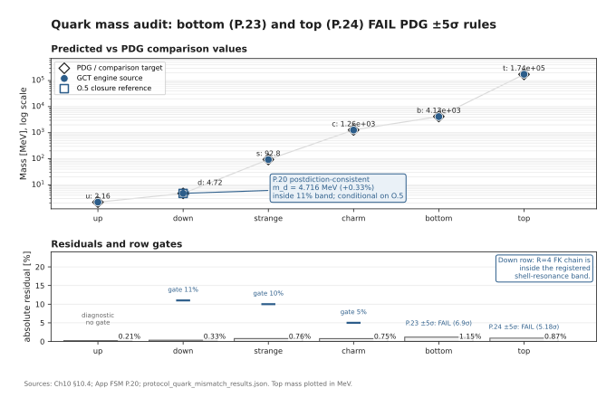

On larger cages the FK pseudo-determinant exhibits **shell-resonance behaviour**: across $N \in \{1416, 1626, 1686, 1866, 2046, 2178, 2418, 2988\}$ on a converged $R=4$ lattice it oscillates in $[2.105,\, 2.391]$ within the registered 11% band, with an empirical decaying envelope and median $\approx 2.18$, matching the Mixed-Harmonic Area Law heuristic $\phi^{\phi}=2.1785$ to within $\sim 1\%$. The $I_h$-closed orbit-union sequence supplies the aggregate check: closed-cage deep-tail mean $\det_{FK}/\phi^{\phi}=0.9976$ and sequence-mean signed error $+0.09\%$ vs PDG. The tracking of $\phi^{\phi}$ is suggestive but not rigorously derived: by Gelfond–Schneider, $\phi^{\phi}$ is transcendental over $\mathbb{Q}$ and therefore **not in the K-theoretic gap-label module $\mathbb{Z}[\phi]$** that Bellissard's theorem produces for cut-and-project quasicrystal Schrödinger spectra. The closed-form $R=2$ value $\phi \cdot 2^{39/100} \cdot 3^{5/100}$ is algebraic over $\mathbb{Q}$ (a product of $\phi\in\mathbb{Q}(\sqrt5)$ and rational powers of integers) but lies outside $\mathbb{Z}[\phi]$ for these non-integer exponents. This is consistent with Lück's framework: the FK pseudo-determinant is a multiplicative spectral invariant distinct from the additive gap-label $K_0$-class. Identifying the precise algebraic structure of $\widetilde{\det}_{FK}$ in the continuum limit — and its relation, if any, to Bellissard's $\mathbb{Z}[\phi]$ — is an Open Problem (tracked as Open Problem O.5 in App ORQ and as the TP-B programme entry in App TPR). Computational verification: see Appendix GPE; finite-size scaling table: `GCT_Physics_Engine/data/fk_scaling.json`.

1. **Up Quark:** $m_u = m_e \cdot \phi^3$ [Tier 2 geometric motif + Tier 3 QCD scheme/running bridge]
 > **Scheme bridge:** the exponent motif is fixed by the icosahedral mass ladder, but the comparison to the PDG $\overline{\rm MS}$ value at $\mu=2$ GeV inherits the hadronic renormalization-scheme/running bridge. The row is therefore postdiction-consistent, not a standalone scheme-independent quark-mass prediction.
2. **Down Quark:** $m_d = m_u \cdot \widetilde{\det}_{FK,\infty} = m_u \phi^{\phi}$ [Tier 2 FK-determinant mechanism + Tier 3 $\phi^{\phi}$ identification of the shell median (infinite-volume limit open, O.5)]
 > **Derivation (Fuglede–Kadison):** In the Tier 3 face-defect assignment (V3 Ch03 §3.4), the Down Quark is a face-defect at the fundamental ($N=11$) harmonic scale. Its mass scale is set by the normalized pseudo-determinant of the cage adjacency $D_F$ — the geometric mean of $|\lambda_i|$ over the non-zero spectrum. The finite $R=2$ cage evaluates to $\widetilde{\det}_{FK} = \phi \cdot 2^{39/100} \cdot 3^{5/100} = 2.239987$, a secondary algebraic diagnostic. The adopted primary output is $m_d = m_u\phi^{\phi}=4.716$ MeV (with $m_u = 2.1646$ MeV), a Tier 3 identification of the shell median, $+0.33\%$ against the PDG 2024 central value and inside the registered 11% shell-resonance band, which is the actual test. The FK-determinant sequence centers on $\phi^{\phi}$: closed-cage deep-tail mean $\det_{FK}/\phi^{\phi}=0.9976$, sequence-mean signed error $+0.09\%$ vs PDG. Single-cage values oscillate within the 11% band with an empirical decaying envelope; rigorous infinite-volume convergence is not proven and bundles with O.5. The algebraic-field structure of $\widetilde{\det}_{FK}$ (whether the asymptotic value is exactly $\phi^{\phi}$, or only the median, and how it relates to the Bellissard $\mathbb{Z}[\phi]$ gap-label module) is an Open Problem.
3. **Strange Quark:** $m_s = m_u \cdot \phi^8 \cdot (1 - 12\alpha)$ [Tier 2 mechanism (conditional on the Tier 3 face-defect quark assignment) + Tier 3 specific coefficient (12) pending O.43 closure]
 > **Coefficient status ($12\alpha$ drag):** Unlike vertex defects (leptons), whose $5\alpha$ coefficient reads its 5 as the number of irreducible representations of $A_5$ (a Tier 3 counting convention, V3 Ch08 §8.2.2), quarks are modeled as interstitial face defects. A face-defect drag proportional to the $\mathbb{Z}^6$ coordination number $Z=12$ (an alternative reading of the same 12, which the argument sketch above reads as the 12 pentagonal faces of the dodecahedral cage; neither reading is derived) supplies the Tier 2 mechanism candidate (conditional on the Tier 3 face-defect assignment, V3 Ch03 §3.4), but the exact use of $12\alpha$ as the strange-quark screening coefficient is a Tier 3 coefficient handle until QLQCD-1L/O.5 derives the face-channel drag from the quark-sector action.
4. **Charm Quark:** $m_c = m_u \cdot \phi^{13 + \phi^{-1}/\phi^2}$ [Tier 3 — heuristic Mixed-Harmonic Area Law]
 > **Status (Tier 3):** The Charm Quark sits at the second-harmonic ($N=17$) defect mode and is expected to be derivable from the cage's second-harmonic K-theoretic gap label — a separate operator-algebraic invariant from the down-quark FK determinant. The closed-form derivation of this gap label is not yet executed in the engine; the current value uses the Mixed-Harmonic Area Law heuristic exponent $13 + \phi^{-3}$, which gives $m_c = 1263.45$ MeV, $-0.75\%$ against PDG 2024 $m_c(m_c) = 1273.0 \pm 4.6$ MeV (about $-2.1\sigma$ taking the quoted error as $1\sigma$; PDG labels it a 90% CL interval, which makes the tension larger), and is not derived from substrate. The occurrence of $\phi^{-3}$ inside this exponent is a separate Tier 3 charm heuristic; it does not inherit the electroweak hypothesis H-EW or any Weinberg/projector derivation. Closure is bundled with App ORQ Open Problem O.5 (QLQCD-1L) and tracked in App TPR §TP-B / §TP-F.
5. **Bottom Quark:** $m_b = m_c \cdot \phi^2 \cdot (5/4)$ [Tier 2 mechanism + Tier 3 specific integer-handle (5/4) pending O.43 closure]
 > **Algebraic Identification (A₅ Dimensional Ratio):** The coefficient 5/4 arises from the ratio of the dimensions of the icosahedral symmetry group's relevant representations in the third-generation quark sector.
 >
 > *Argument sketch (not a proof):* The bottom quark couples to the vacuum lattice through the same icosahedral defect structure as the charm quark, but at the third-generation energy scale. In the icosahedral group I ≅ A₅ (the alternating group on 5 elements), the relevant representations for third-generation quarks are taken to be the 5-dimensional irrep H (Mulliken label) (assigned to the defect's coupling to the five-fold axes) and the 4-dimensional irrep G (Mulliken label) (assigned to the coupling to the three-fold tetrahedral substructure). The coupling strength candidate scales as dim(H)/dim(G) = 5/4 (Mulliken labels for the icosahedral 5- and 4-dimensional irreps; Cotton, *Chemical Applications of Group Theory* 3rd ed. Table A.15; Altmann-Herzig 1994). The representation ratio is exact, but its use as the bottom-quark mass handle remains a Tier 3 specific integer-handle pending O.43 closure.
 >
 > **Classification:** [Tier 2 mechanism + Tier 3 coefficient handle] The 5/4 ratio = dim(H)/dim(G) in A₅ is a representation-theoretic fact; its deployment as the bottom-quark coefficient remains pending O.43.
 
 **Status against data: failure.** The formula gives $m_b = 4134.69$ MeV against PDG 2024 $m_b(m_b) = 4183 \pm 7$ MeV ($\overline{\rm MS}$), i.e. $-1.15\%$ and about $6.9\sigma$ low taking $\pm 7$ MeV as $1\sigma$ (more, since PDG labels it a 90% CL interval). By the standard applied to the top quark (P.24: outside PDG $\pm5\sigma$ of the prediction), the bottom row is reported as a **failure**. The residual is carried as a Tier 3 state-level residual pending O.5, and the mass-scheme question is open; a scheme band registered after the result would not rescue the row. The earlier falsification window of 4130–4230 MeV was centred on the measurement rather than on the prediction, so it could not test the prediction; it is withdrawn as a test.

6. **Top Quark:** $m_t = (v_{\rm GCT} / 2) \cdot \sqrt{2}$, with $v_{\rm GCT}=246.1755$ GeV from the absolute Higgs-VEV pipeline

These tiered tree-level derivations are **geometric mechanism outputs** from the icosahedral cage, not a blanket closure of the hadron sector from the current postulate set. The percentage errors against current targets ($u$: $+0.21\%$; $d$: $+0.33\%$ from the adopted primary $m_d = m_u\phi^{\phi}=4.716$ MeV, a Tier 3 identification of the shell median inside the registered 11% band, conditional on O.5, with the exact $R=2$ finite-cage branch $m_d=4.848734$ MeV at $+3.1645\%$ (displayed as $+3.16\%$) retained as a secondary algebraic diagnostic; both down-quark branches lie inside the registered 110000-ppm gate; $s$: $-0.76\%$; $c$: $-0.75\%$ heuristic, about $-2.1\sigma$; $b$: $-1.15\%$, about $-6.9\sigma$; $t$: $+0.87\%$, $5.18\sigma$) come from the FK determinant and the Mixed-Harmonic Area Law; the φ-formula residuals are descriptive arithmetic (Tier 4 as evidence: not distinguishable from numerology for strong effects; App PSC §PSC.9.6). The discrete handles they use (the $12\alpha$ and $5/4$ coefficients, the charm exponent, the top-mass ansatz) are Tier 3 choices made with the targets known; the top row fails its written P.24 rule (§10.2.2), the bottom row fails by the same standard, and the charm row sits inside its $\pm3\%$ band ($2.1\sigma$ low). The dominant remaining residuals are:

1. **Shell-resonance band on $\widetilde{\det}_{FK}$.** The finite cut-and-project window samples a discrete subset of the noncommutative spectral geometry. As the cage size $N$ sweeps natural icosahedral shells, the FK pseudo-determinant oscillates in $[2.105,\,2.391]$, i.e. from about $-3.4\%$ to $+9.8\%$ around $\phi^{\phi}\approx2.1785$ (inside the registered 11% band). This is a Tier 2 mechanism (FK-pseudo-det closure) + Tier 3 source-branch/state-value issue, not a defect of the mechanism.
2. **Missing higher-order QCD running.** Loop corrections from QCD running (analogous to the top quark 0.87% QLQCD-2L debt) contribute $\mathcal{O}(1\%)$ at the charm scale.
3. **Open Problem on $m_c$ K-theoretic gap label.** The charm quark currently uses the Mixed-Harmonic Area Law heuristic $\phi^{13+\phi^{-3}}$ at the $N=17$ second-harmonic mode. The first-principles derivation of this gap label from the cage spectrum is bundled with App ORQ O.5 (QLQCD-1L); tracked in App TPR §TP-B / §TP-F.

The mechanisms are retained, but none of the source values is yet derived: the strange-, bottom-, and top-quark formulas carry Tier 2 mechanisms with Tier 3 coefficient/state handles ($12\alpha$, $5/4$, the top-mass ansatz; the top row fails its written P.24 rule and the bottom row fails by the same standard), the down-quark primary output is the Tier 3 shell-median identification $m_d = m_u\phi^{\phi}$, whose convergence proof and algebraic-field identification remain O.5, with the $R=2$ finite-cage value retained only as a secondary diagnostic, and the charm-quark formula is disclosed as Tier 3 heuristic awaiting the second-harmonic gap-label construction. No target values are pre-assigned (see Appendix GPE). This hadronic derivation reduces standard-model parameterisation at tree level but does not currently eliminate it across the full quark sector.

---

**10.5 QCD Phenomena**

**10.5.1 Universal Vacuum Viscosity: The Cabibbo Angle [Tier 3 bare identification + Tier 3 lepton-to-hadron transfer]**

GCT proposes that the mixing between $d$ and $s$ quarks is a geometric rotation (a Tier 3 identification). The candidate **bare** value reuses the raw-frame number $\phi^{-3}$:
$$\sin \theta_C^{\rm bare} = \phi^{-3} \approx \mathbf{0.236068} \quad \text{[Tier 3 identification]}$$
Observed (PDG 2024): $\sin \theta_C \approx 0.225$. The **bare residual is therefore $\approx 4.9\%$** for this Tier 3 identification.

The value $\phi^{-3}$ is the same raw-frame coordinate number that appears in the electroweak hypothesis H-EW (V3 Ch04 §4.3); no derivation connects the two sectors, so its reuse here is a Tier 3 numerical identification, not a shared geometric invariant. For the Cabibbo angle, the candidate **Universal Vacuum Viscosity** correction reuses the lepton-vertex $5\alpha$ phason-drag coefficient from Ch08 §8.2.2:
$$\sin \theta_C^{\rm corrected} = \phi^{-3}(1 - 5\alpha) \approx 0.236 \times (1 - 0.036) \approx \mathbf{0.227} \quad \text{[Tier 3 bare identification + Tier 3 lepton-vertex transfer]}$$
This narrows the angle residual to ~1.11% (1.106%; the $s_{12}$ element residual is 1.09%, i.e. 1.086%), a TENSION against the single 0.5% precision gate (the 5% is only the falsification band). *Note: the $\alpha$ in the correction is the CODATA A3 experimental value ($\alpha^{-1}=137.035999177$); the GCT-derived $\alpha$ (137.508 bare) sits inside the Phason Anti-Screening QLQCD-1L research debt of App QLA.*

> **The $5\alpha$ coefficient across the lepton-to-hadron bridge [Tier 3 bare identification + Tier 3 transfer handle].** The corrected Cabibbo formula gives $s_{12}=0.22745$ versus PDG $0.22501$, a $1.09\%$ element residual. The angle residual is $\theta_C=13.147^\circ$ versus $13.003^\circ$, or $1.11\%$, because of the sine/arcsine nonlinearity. This residual is a **Tier 3 bare identification + Tier 3 transfer** result, not a Tier 2 prediction, and as evidence that φ is special it is Tier 4 (not distinguishable from numerology for strong effects; App PSC §PSC.9.6); the bare $\phi^{-3}$ value itself has a $4.9\%$ residual. The $5\alpha$ drag coefficient arises in V3 Ch08 §8.2.2 as a lepton-vertex mechanism, where its 5 is read as the number of irreducible representations of $A_5$ (trivial included); that reading is a Tier 3 counting convention, and other fivefold counts (for example the five faces meeting at an icosahedral vertex) are alternative readings, not independent derivations. Applying that coefficient to the Cabibbo hadronic face-defect rotation assumes that the vertex-to-face Goldstone projection preserves the fivefold coupling count. The icosahedral fiber-vertex / face-defect duality (V3 Ch07 §7.1.2 versus V3 Ch10 §10.1) motivates this identification, but does not force it; it is a disclosed Tier 3 transfer handle and not an additional continuous fit. Promotion to a Tier 2 prediction requires both a derivation of the bare value (currently a reuse of the raw-frame number $\phi^{-3}$) and an explicit Brauer-character computation establishing multiplicity preservation, bundled with **Open Problem O.5**. In the Tier 3 ansatz of §10.6.1, the third-generation CKM angles ($s_{23}$, $s_{13}$) additionally receive a $\phi^{-1}$ holonomy step; the Cabibbo angle, which also connects two generations, does not.

**10.5.2 Asymptotic Freedom and Lattice Transparency**

As proposed in App TPF (global appendices), the vacuum lattice exhibits **High-Energy Transparency**. At the Planck scale, the quark de-Broglie wavelength would become comparable to the 6D lattice spacing, and the proposal is that the coupling to the nodes then falls away. This is offered only as a Tier 3/4 candidate geometric picture related to **Asymptotic Freedom**; it does not reproduce the observed logarithmic running of $\alpha_s$, which starts at the GeV scale, far below the lattice scale.

**10.5.3 The Mass-Drag Anti-Correlation**

GCT proposes a **mass–drag anti-correlation** in which higher-frequency defect modes would couple less strongly to a stipulated hydrodynamic drag. Neither the endpoint claims “top has zero drag” and “muon has maximum drag” nor the required relaxation law is derived here. Extending that particle-model ansatz to consciousness, a physical Selection process, or qualia registration is a separate Tier 3/4 bridge with no identified carrier, transducer, owner, or phenomenal map; it is not part of the quark-spectrum derivation.

---

**10.6 The CKM Mixed-Harmonic Ansatz [Tier 3 bare Cabibbo identification + Tier 3 corrected-formula handle / Tier 3 remaining angles]**

While Neutrino (PMNS) mixing represents the unpinned axis sliding of itinerant phason waves, Quark mixing represents **Topological Tunneling** between the pinned icosahedral faces of the underlying vacuum lattice.

Because quarks are structural artifacts deeply bound within the strong force matrix, their "flavor shifting" forces them to push against the high-frequency internal geometry of the lattice. This process is inherently suppressed (damped) by the electromagnetic vacuum viscosity ($\alpha$). Thus, unlike the large PMNS angles, the CKM angles are inherently small and, in the Tier 3 Mixed-Harmonic ansatz, follow a geometric descent:

1. **Cabibbo Angle ($s_{12}$):** $s_{12}^{\rm bare}=\phi^{-3}$ is a Tier 3 bare identification (the raw-frame value reused); the corrected formula $s_{12} = \phi^{-3} \cdot (1 - 5\alpha)$ is a Tier 3 lepton-to-hadron transfer handle pending O.5 / QLQCD-1L.
2. **$s_{23}$ Mixing:** $s_{23} = \phi^{-(6 + \phi^{-1})}$ **[Tier 3 Ansatz — Irrational Exponent: $6 + \phi^{-1} \approx 6.618$ is irrational. See Open Problem O.5.]**
3. **$s_{13}$ Mixing:** $s_{13} = \phi^{-(11 + \phi^{-1})}$ **[Tier 3 Ansatz — Irrational Exponent: $11 + \phi^{-1} \approx 11.618$ is irrational. See Open Problem O.5.]**

### 10.6.1 CKM Berry-Phase Identification of the $\phi^{-1}$ step [Tier 3 candidate]

The additive $\phi^{-1}$ in the exponents for $s_{23}$ and $s_{13}$ is a candidate transfer of the selected $SU(2)$ Berry-holonomy connection used in the proton-mass route. Its value is fixed once that connection (the Tier 3 central-holonomy ansatz of §10.3.3) and the projection map are adopted, but neither is uniquely forced by the $2I$ stabilizer.

For the proton, one complete $SU(2)$ cycle around a 5-fold baryonic axis yields a phase transformation $U = -I$, contributing $N_{weak} \times R = (\frac{1}{2})(2\phi^{-1}) = \phi^{-1}$ to the mass exponent.

For quarks, the ansatz assigns one additional $\phi^{-1}$ holonomy step to the mixing angles that involve the third generation ($s_{23}$, $s_{13}$) and none to the Cabibbo angle ($s_{12}$). This is a Tier 3 assignment rule, not a consequence of a generation change: Cabibbo mixing ($V_{us}$, $d$–$s$) itself connects generations 1 and 2, so a "generation-change" criterion would not exempt it. The earlier rationale, which called $d \to s$ intra-generation and $s \to c$ a generation change, is withdrawn: $V_{cs}$ is the diagonal element within the second generation. No derivation yet says why the third-generation angles, and only they, receive the extra step.

This candidate holonomy/face-defect construction organizes the hierarchy of flavor mixing. The Cabibbo angle uses the Tier 3 bare identification $\sin\theta_C^{\rm bare} = \phi^{-3}$ ($4.9\%$ residual) and a Tier 3 lepton-to-hadron transfer correction $s_{12} = \phi^{-3}(1-5\alpha)$ ($1.09\%$ element residual; equivalently $\theta_C=13.1473^\circ$ against the PDG anchor $\arcsin(0.22501)=13.0035^\circ$, a $1.11\%$ (1.106%) angle residual, pending O.5). The remaining angles ($s_{23}$, $s_{13}$) with their irrational exponents remain Tier 3 pending resolution of Open Problem O.5.

**Candidate derivation ($\phi^{-1}$ Weak Holonomy Correction) [Tier 3]:**
The $\phi^{-1}$ additive adjustment in the higher-generation CKM exponents is a candidate transfer of the proton-sector $SU(2)_L$ Berry holonomy to quark face-defect tunneling. Quarks are modeled as face-defects using the same weak fiber bundle as the Baryonic Triad; for face-tunneling into or out of the third generation, the ansatz assigns one $\phi^{-1}$ Weak Berry phase holonomy step (§10.6.1; the selection rule is itself Tier 3). The CKM transfer remains Tier 3 pending first-principles lepton-to-hadron transfer and QLQCD closure.

These structural ansätze output $s_{12} \approx 0.22745$ [Tier 3 bare identification + Tier 3 transfer], $s_{23} \approx 0.0414$ [Tier 3], and $s_{13} \approx 0.0037$ [Tier 3], broadly tracking the PDG 2024 pattern but not constituting a theorem-grade CKM closure (Tier 4 as evidence: not distinguishable from numerology for strong effects; App PSC §PSC.9.6). The corrected Cabibbo value remains in live precision tension: relative to the PDG $s_{12}\approx0.2250$ target, the residual is $\sim1.09\%$ and is carried as an explicit $\sim3.6\sigma$ $s_{12}$ tension until O.5/QLQCD derives the lepton-to-hadron transfer. The CP-violating Jarlskog invariant $J_{CKM}$ for this matrix is an **Open Research Problem (App ORQ §ORQ.5, O.7)** bundled with the QLQCD-1L research debt. The $\delta_{CP} = 360^\circ \cdot \phi^{-1}$ phase remains a Tier 3 **leptonic/mixing-geometry phase ansatz** in the GCT registry (pending O.7; the Jackiw-Rebbi mechanism is the gauge-chirality result of Ch02 §2.4.2, not this phase), and it is not by itself a derivation of hadronic CKM CP violation. Hadronic CP violation requires the CKM-area/Jarlskog invariant $J_{CKM}$ plus QCD dressing; that closure remains O.7/O.5. The geometric phase may supply a candidate boundary condition for the hadronic sector, but it does not secure the matter-antimatter-asymmetry claim until the Jarlskog amplitude is derived.

---

> **Closure Target: Fuglede–Kadison Audit for the Down-Quark Mass Scale [Tier 2 FK-determinant mechanism + Tier 3 $\phi^{\phi}$ identification of the shell median (infinite-volume limit open, O.5)]**
>
> Let $D_F$ denote the adjacency operator of the icosahedral cage (graph with $N$ vertices selected as the closest perp-projected images of the $\mathbb{Z}^6$ lattice; edges of weight $\phi$ between pairs at unit ambient-space distance). The normalized FK pseudo-determinant is
> $$\widetilde{\det}_{FK}(D_F) := \exp\!\left(\tfrac{1}{N_{\rm nz}}\sum_{\lambda_i\neq 0} \ln|\lambda_i|\right)$$
> where $N_{\rm nz}$ is the count of non-zero eigenvalues and $\lambda_i$ are the corresponding eigenvalues (an ad hoc normalised pseudo-determinant; it differs from the von-Neumann-trace normalisation of Lück 2002, Def. 3.11). For the $R=2$ cage, $N_{\rm nz}=100=144-44$; the ordinary determinant vanishes because the operator has 44 zero modes, so no equality to $|\det D_F|^{1/N}$ is claimed. Then
> $$m_d = m_u \cdot \widetilde{\det}_{FK}(D_F).$$
>
> *Closed-form evaluation at the $R=2$ cage.* At the engine's reference construction (144 vertices, 100 non-zero eigenvalues + 44 zero modes) the spectrum factors into icosahedral characters with multiplicities $\{\sqrt 2{:}6,\ \phi{:}24,\ \phi\sqrt 2{:}44,\ \phi\sqrt 3{:}8,\ 2\phi{:}10,\ \phi^2\sqrt 2{:}6,\ \phi\sqrt 6{:}2\}$, and the geometric mean evaluates exactly to
> $$\det_{FK}(D_F^{R=2}) \;=\; \phi \cdot 2^{39/100} \cdot 3^{5/100} \;=\; 2.239987\ldots,$$
> giving the exact finite-cage branch value $m_d = 4.848734$ MeV ($+3.1645\%$ from the PDG 2024 central value; displayed as $+3.16\%$). This branch is a secondary algebraic diagnostic. The adopted primary output is $m_d = m_u\phi^{\phi}=4.716$ MeV, $+0.33\%$ against the PDG 2024 central value. Both branches are inside the registered 110000-ppm (11%) shell-resonance gate. On the converged $R=4$ lattice $\det_{FK}$ oscillates shell-to-shell in $[2.105,\, 2.391]$ within that band with an empirical decaying envelope and median $\approx \phi^{\phi}$; the $I_h$-closed deep-tail mean gives $\det_{FK}/\phi^{\phi}=0.9976$ with sequence-mean signed error $+0.09\%$ vs PDG. See Appendix GPE + finite-size scaling table `data/fk_scaling.json`.
>
> **Algebraic-field status (Open).** The finite $R=2$ diagnostic $\phi \cdot 2^{39/100} \cdot 3^{5/100}$ is algebraic over $\mathbb{Q}$ (a product of $\phi \in \mathbb{Q}(\sqrt5)$ and rational powers of integers), but lies **outside $\mathbb{Z}[\phi]$** for these non-integer exponents. The primary asymptotic-limit candidate $\phi^{\phi}$ is transcendental over $\mathbb{Q}$ by Gelfond-Schneider. This is consistent with Lück's framework — the FK pseudo-determinant is a multiplicative spectral invariant distinct from the additive $K_0$-class of Bellissard gap labels — but it leaves open whether $\widetilde{\det}_{FK}$ converges to $\phi^{\phi}$ exactly in some scaling limit, or only its median tracks $\phi^{\phi}$ within shell-resonance noise.
>
> **Charm-quark status.** The charm quark sits at the second-harmonic ($N=17$) defect mode and is expected to admit a separate spectral derivation from a cage submodule. That derivation is not yet executed; the manuscript currently uses the heuristic Mixed-Harmonic Area Law $m_c = m_u \cdot \phi^{13 + \phi^{-3}}$ (PDG 2024 residual $-0.75\%$, about $-2.1\sigma$), explicitly labeled **Tier 3**. The closure path is bundled with App ORQ Open Problem O.5 (QLQCD-1L) and tracked in App TPR §TP-B / §TP-F. The CKM matrix elements ($s_{23}$, $s_{13}$) constitute the same Open Problem O.5-CKM, targeted for closure in QLQCD-2L computations (Appendix QLA §QLA.7).

**END OF CHAPTER 10**

---

## Part III Astrophysics

## **PART III: ASTROPHYSICAL TESTS**

### **Chapter 11: The 3.55 keV Anomaly (Dark Matter)**

The search for the particulate identity of Dark Matter remains the most significant unresolved endeavor in modern physics. For decades, the "Cold Dark Matter" paradigm has postulated a cold, collisionless component occupying galactic halos (Weakly Interacting Massive Particles, WIMPs, being one candidate). Geometric Consciousness Theory (GCT) instead models Dark Matter as the **Topological Glass** state of the vacuum substrate. The stress-gated lattice-fracture mechanism is Tier 3 (it rests on the Tier 3 Topological Glass model and is conditional on the adopted architecture), and the absolute centroid $E_{vac}=m_e/144\approx3.5486$ keV is Tier 3 because it inherits the O.38 $N_{\rm cage}=144$ posit. The empirical status is Under Test pending deeper XRISM observations (see §11.4.4 + App PSC §PSC.8 + App PRG P.3).

---

**11.1 The Signal**

**11.1.1 Observations: Perseus, Coma, and Andromeda**

Tier discipline before the empirical conflict: the stress-gated triboluminescence mechanism is Tier 3 (it rests on the Tier 3 glass model and is conditional on the adopted cage architecture); the absolute centroid inherits the Tier 3 O.38 cage posit, and the cluster-line identification plus $\sigma_{\rm crit}$ bracket are Tier 3 empirical postdictions pending the XRISM/stacked-cluster tests.

In 2014, an unidentified emission line was detected in the X-ray spectra of several massive galaxy clusters and the Andromeda galaxy (M31). Initially reported by Bulbul et al. (using stacked XMM-Newton data) and independently confirmed by Boyarsky et al., the signal was subsequently probed by Chandra, Suzaku, and the Hitomi satellite — the Hitomi observation of Perseus reported a high-significance non-detection of the anomalously bright Perseus-core flux (Hitomi Collaboration 2017 *ApJL* 837:L15, DOI 10.3847/2041-8213/aa61fa, 99.7% tension on a narrow-line interpretation in Perseus), creating a live observational tension. Protocol C reserves its falsification aperture for stacked above-$\sigma_{\rm crit}$ cluster regions (§15.1.3); whether the Perseus core is rheologically below threshold is a declared open programme (§11.1.4), so the Hitomi null is not counted as support for the stress gate.

Unlike known atomic transitions, the reported flux pattern is not explained by baryonic gas parameters alone. In GCT the candidate signal intensity is treated as stress-gated rather than as tracking the density profile (§11.4.6). GCT proposes [Tier 3] this line as a candidate direct observation of the vacuum microstructure.

**11.1.2 Energy: 3.55 ± 0.03 keV**

The commonly quoted centroid is the weighted mean of the Perseus cluster core, the stacked cluster sample, and the Galactic Center:
$$E_{obs} \approx 3.55 \pm 0.03 \text{ keV}$$
This centroid is not consistent with GCT's own stress gate. Two of its three inputs come from regions the gate does not count as emitting: the Perseus core lies outside the Protocol C pressure aperture (and its rheology is open, §11.1.4), and the Galactic Center lies in the Milky-Way environment that the stress-gating account treats as low-shear (a treatment not yet computed, §11.1.4). A centroid built only from above-$\sigma_{crit}$ apertures has not been computed, because the per-region centroids are not tabulated here. The 3.55 keV figure is therefore quoted as context only; it is never counted as a pass for GCT.
Sterile-neutrino decay fits of this line are in tension with the non-detections in specific environments (§11.1.3–§11.1.4); this is a constraint on that model, not an impossibility.

**11.1.3 The Draco Paradox and the Threshold of Critical Stress**

A critical anomaly within the data is the **Draco Null Result**. High-exposure observations of the Draco Dwarf Spheroidal galaxy failed to detect the 3.55 keV line despite its high dark matter density. GCT offers a postdictive account via the **Threshold of Critical Shear Stress ($\sigma_{crit}$)**. 

We define the qualitative fracture condition from icosahedral tiling mechanics; the numerical Vacuum Yield Strength ($\sigma_{crit}$) remains a calibrated cluster-scale stress bracket until the phason-stiffness normalization is derived in absolute pressure units.

> **Proposal: Yield Strain from Tiling Flip Condition [Tier 3]**
> 
> In the AKN icosahedral tiling, a phason flip — a discrete rearrangement of tiles that releases stored strain — occurs when the perpendicular-space displacement $u_\perp$ of a tile vertex exceeds the width of the acceptance window in that direction. The proposal takes the characteristic half-width to be the short diagonal of a rhombic acceptance cell, scaling as $\phi^{-1} \times a_\perp$ (where $a_\perp$ is the perpendicular lattice constant). This is an input, not a derived quantity: the AKN acceptance window is a rhombic triacontahedron, and a "short diagonal of the rhombic acceptance cell" is not yet given a geometric definition as a half-width of that window. The strain at which this flip occurs is then:
> 
> $$ \epsilon_y = \frac{\Delta u_\perp}{\xi_{\rm DS}} = \frac{\phi^{-1} \cdot a_\perp}{\phi^4 \cdot a_\perp} = \phi^{-5} \approx 0.0902 $$
> 
> where $\xi_{\rm DS} = \phi^4 \cdot a_\perp$ is the dark-sector phason coherence scale, distinct in symbol, definition, and magnitude from the biological polaron healing length $\xi_{\rm pol}=a_0/\alpha\approx7.25$ nm of V1 Ch07, and the factor arises from the four-generation Fibonacci inflation of the lattice scale [Tier 3].
> 
> Numerically: $\epsilon_y = \phi^{-5} \approx 0.090$ [Tier 3 — conditional on two Tier 3 inputs: the coherence scale $\xi_{\rm DS}=\phi^4a_\perp$ and the acceptance-window half-width $\phi^{-1}a_\perp$]
> 
> The dimensionless yield strain $\epsilon_y = \phi^{-5} \approx 0.090$ follows from the tiling flip condition only given those two inputs; the arithmetic is exact, the result is Tier 3. The cluster-scale stress threshold $\sigma_{crit}=K_\perp\epsilon_y$ is not yet a first-principles absolute-pressure prediction: the operative $K_\perp$/pressure normalization is the Tier 3 calibrated bracket audited in §11.1.4.

Therefore, the critical stress is:
$$ \sigma_{crit} = K_\perp \times \epsilon_y = K_\perp \times \phi^{-5} $$

The Draco stress-gating prediction has no continuous fit parameter in the qualitative fracture morphology: $\epsilon_y$ is fixed by the Tier 3 tiling-flip proposal and $K_\perp$ is inherited from the phason-stiffness hierarchy. The absolute cluster threshold location, however, is a Tier 3 calibrated bracket ($0.07 < \sigma_{crit} < 3$–$5$ keV/cm$^3$ in §11.1.4), not a zero-anchor numerical prediction.

* **XRISM stacked clusters:** The registered Protocol C stress-aperture rule is the **mass-weighted stress-gated region above $\sigma_{crit}$** within the XRISM stacked-cluster sample: cluster outskirts, merger shocks, and high-shear ICM cells. The Perseus core falls below the frozen pressure cut and is **not** a falsification aperture. Because cluster-core rheology is a declared open programme (§11.1.4), the Hitomi-Perseus null is not cited as consistent with, or as support for, the stress gate. A decisive F2 null requires no 3.55 keV detection at $W_{\rm int}<20$ eV with the registered stress-weighted morphology across the stacked above-$\sigma_{crit}$ regions; smooth $\rho^2$ tracking remains the morphology falsifier.
* **Draco Dwarf:** Virial stress $\sigma_{vir} < \sigma_{crit}$ is assumed. In the model the lattice remains in the **Elastic Glass** phase, and energy is stored as potential strain, not released as radiation. The comparison is not yet defined quantitatively: $\sigma_{crit}$ is set in ICM thermal-pressure units (§11.1.4), and a gas-poor dSph has no such pressure, so a stress proxy usable in gas-poor systems must be specified before this is a computed check. 
This stress-gating mechanism is offered as a postdictive account of the non-detection in dwarf spheroidal galaxies; it remains postdiction-status until the cluster-by-cluster pressure/shear map is frozen before line-residual inspection (§11.1.4).

**11.1.4 The Observational Conflict — Quantitative $\sigma_{vir}$ / $\sigma_{crit}$ / Bulbul-flux Consistency Test [Tier 3 mechanism + Tier 3 $\sigma_{crit}$ calibrated bracket]**

We acknowledge that several independent analyses — including Malyshev et al. (2014, stacked dSph XMM-Newton), Riemer-Sørensen (2016, Chandra Milky Way halo), and Dessert et al. (2020) — find no signal in low-stress environments. The Hitomi observation of Perseus (Hitomi Collaboration 2017 *ApJL* 837:L15, DOI 10.3847/2041-8213/aa61fa) is an important calibration constraint: Hitomi reported a non-detection of the anomalously bright Perseus-core flux at 99.7% significance (narrow-line interpretation). The Protocol C pressure aperture excludes that core, so it is not the falsification aperture; whether the core is rheologically below threshold is open (declared open programme below). The load-bearing observational test is therefore the frozen stacked-cluster above-$\sigma_{crit}$ aperture, distinct from both low-stress non-detections and the Hitomi core null.

**Quantitative reconciliation.** The closure path is set by the numerical comparison between the four observational anchors. We tabulate them here in the operational pressure-coordinate that the stress-gating mechanism uses ($P \sim n k_B T$ for the cluster gas, set against the GCT triboluminescent threshold $\sigma_{crit}$):

| Environment | Observable | Value | Source |
| :--- | :--- | :--- | :--- |
| Draco dSph | $\sigma_{vir}$ (velocity dispersion) | $\sim 9$ km/s | Walker et al. 2009 *ApJ* 704:1274 |
| Milky Way halo | $\sigma_{vir}$ | $\sim 220$ km/s | Bovy et al. 2012 *ApJ* 759:131 |
| Perseus core | $\sigma_{vir}$ (galaxy velocity dispersion) | $\sim 1280$ km/s | Aguerri et al. 2020 *MNRAS* 494:1681 |
| Perseus core | thermal pressure $P_{th} \approx n_e k_B T$ | $\sim 0.07$ keV/cm³ at $n_e \approx 0.01$ cm⁻³, $T \approx 7$ keV | Churazov et al. 2003 *ApJ* 590:225 |
| Bullet Cluster bow shock | $P_{th}$ at shock | $\sim 3$-$5$ keV/cm³ (50-70× Perseus core) | Markevitch & Vikhlinin 2007 *Phys. Rep.* 443:1 |
| Bulbul 2014 stacked detection | $\Gamma_{decay}$ implied | $\Gamma_{Bulbul} \approx 2 \times 10^{-28}$ s⁻¹ | Bulbul et al. 2014 *ApJ* 789:13 |
| Hitomi 2017 Perseus | 3σ upper bound | $\Gamma_{Hitomi} \lesssim 3\text{–}4 \times 10^{-27}$ s⁻¹ (the XRISM 2025 cross-calibration reports its $\Gamma \lesssim 1.0\times10^{-27}$ s⁻¹ limit as $3$–$4\times$ tighter than Hitomi; the Hitomi null excludes the anomalously-bright Perseus-core narrow line but does NOT test the Bulbul stacked-cluster decay rate at the manuscript level). The Bulbul B14 full-sample expectation for the Hitomi field was $(2.4{-}3.1)\times10^{-7}$ ph/s/cm², $\sim 30\times$ below Hitomi's detection threshold for that field. Whether the Perseus-core null is compatible with the stress gate depends on the open cluster-core rheology (below); the stacked above-$\sigma_{crit}$ cluster sample tests the Bulbul decay rate independently. | Hitomi Collaboration 2017 |
| XRISM early stacked-cluster constraint | upper bound | $\Gamma_{XRISM} \lesssim 1.0 \times 10^{-27}$ s⁻¹ (broader stack, looser per-cluster sensitivity; current data are sensitivity-limited relative to the Bulbul-level order-$10^{-28}$ s⁻¹ normalization) | per Ch15 §15.5 |

The GCT **Stress-Gating** resolution then takes a quantitative form. Under closure path (b) the gating threshold $\sigma_{crit}$ is bracketed by:

$$
P_{Perseus\,core} \;\approx\; 0.07\ \text{keV/cm}^3 \;<\; \sigma_{crit} \;<\; P_{Bullet\,bow\,shock} \;\approx\; 3\text{-}5\ \text{keV/cm}^3
$$

— i.e. the bracket places the threshold between the Perseus quiescent-core pressure and major-merger bow-shock pressures. The bracket is an aperture definition built from two observed pressures; it is not evidence that cluster cores are elastic (see the declared open programme below). The dwarf-spheroidal and Milky-Way-halo nulls cannot yet be called consistent with the gate under either closure path: $\sigma_{crit}$ is defined in ICM thermal-pressure units ($P \sim n k_B T$), which do not exist for gas-poor dSphs or for the dark-matter halo, and no stress proxy usable in those systems has been specified or tabulated.

Under closure path (a) — the Bulbul-level flux is genuinely below Hitomi's sensitivity in the Perseus field, without using the core as a stress-gated aperture — the Bulbul detection would have to be reattributed to a stacked-cluster systematic (instrumental floor or atomic-emission line; cf. Dessert et al. 2020). Hitomi's Perseus-core bound is then compatible with the frozen aperture rule and the discriminator collapses to whether the above-$\sigma_{crit}$ stacked XRISM regions ever show the 3.5 keV signal at the terminal Protocol C floor $\Gamma \approx 2 \times 10^{-28}$ s⁻¹ (Ch15 §15.2).

**Operative aperture rule.** Protocol C uses the bracket $[0.07, 3$–$5]$ keV/cm³ only to define its frozen aperture: the cells whose pre-line pressure proxy exceeds $\sigma_{crit}$. Neither the Hitomi-Perseus null nor the Bulbul stacked detection is counted as support for that choice. The framework remains testable by one preregistered Protocol C stress-aperture rule: the XRISM deeper stack must either (i) detect the line in mass-weighted regions above $\sigma_{crit}$, or (ii) bound it below the Bulbul level across those regions. The stress-gated fracture mechanism is Tier 3, conditional on the adopted cage architecture and the glass model; its absolute $3.5486$-keV centroid inherits the Tier-3 O.38 cage posit. The $\sigma_{crit}$ value is separately calibrated to a Tier-3 range pending the XRISM cluster-sample sub-classification.

The stress-gating reconciliation remains postdiction-status until the same pressure/shear map is frozen cluster-by-cluster for the Bulbul, Hitomi, Dessert, XRISM, and successor stacks before any line-residual inspection; low-stress null results become forward predictions of GCT only under that frozen-aperture preregistration. The Hitomi-Perseus core null lies outside the frozen aperture and is therefore not a falsification point; it is not counted as support either. Closure of the above-$\sigma_{crit}$ stacked-cluster aperture under the XRISM deeper stack is the load-bearing remaining work, registered as a tightening sub-item of **Open Problem O.4** (cosmological-scale phason coherence-volume closure).

**Declared open programme [Tier 3]: cluster-core rheology.** V2 Ch13 §13.1.1–§13.1.2 states that rich clusters ($10^{14}$–$10^{15}\,M_\odot$) exceed the yield stress, so their cores are fractured; that is how the model accounts for cluster missing mass. Protocol C's frozen pressure cut instead places relaxed cool cores, including Perseus (itself a rich cluster), below $\sigma_{crit}$; read rheologically, that would make the Hitomi-Perseus null harmless. Both readings cannot hold. Bulbul et al. 2014 also reported the line in Perseus-core data at a flux above the stack expectation, which a core-suppressing gate would have to set aside. Closing this needs one stress proxy, computed from pre-line maps, that fixes which cluster regions are fractured, plus a missing-mass account for any core that is elastic. Until then neither reading is used to absorb or predict any observation, and nothing downstream uses either as support.

---

**11.2 The Mechanism: Vacuum Triboluminescence**

**11.2.1 Dark Matter as Supersolid Topological Glass**

In the GCT hardware, the galactic halo consists of **Frozen Phason Strain** ($w_{ij}$) in the internal dimensions ($E_\perp$). It is a **Topological Glass**—a solid state where icosahedral tiles are pinned in high-energy orientations. Critically, because the vacuum is a **Supersolid**, it possesses **Off-Diagonal Long-Range Order** (global phase coherence). This phase-locking ensures that the "Unit of Strain" is identical across the entire universe, preventing the spectral smearing common to classical glasses.

**11.2.2 The Vorton and the Quantized Snap**

We define the fundamental excitation of the glass as a **Vorton**: a closed loop of phason strain pinned to the matching rules of the icosahedral tiling. In the conditional lattice-fracture model, stress above $\sigma_{crit}$ drives **Vacuum Creep** and releases one modeled binding-energy unit. The mechanism form is Tier 3 (conditional on the adopted architecture and the glass model); the numerical **Vacuum Quantum**, $E_{vac}=3.5486$ keV, is Tier 3 because it uses the O.38 $N_{\rm cage}=144$ input.

**11.2.3 Global Phase Rigidity and Mössbauer Suppression (open)**

**Declared open programme [Tier 3]: emitter kinematics and line width.** The model claimed that the 3.55 keV line is exceptionally narrow: emitters bound in a coherent supersolid lattice would hand the recoil to the coherence volume set by $\xi_{\rm DS}=\phi^4a_\perp$ (§11.1.3), a **Mössbauer Suppression** of Doppler broadening, with **Global Phase Rigidity** keeping the emission monochromatic. The defect: emission occurs only in the fractured phase, where V2 Ch13 §13.1.2 describes the emitters as unpinned debris moving freely. Free emitters at cluster virial speeds ($\sigma_v\sim1000$–$1300$ km/s) give a Doppler FWHM of $\sim28$–$36$ eV, inside the $W_{int}>20$ eV band that Protocol C treats as falsifying. Closure needs an explicit fractured-phase emitter model (lattice-bound with a derived recoil-free fraction, or free debris with a derived velocity distribution) and the $W_{int}$ it implies. Until then the narrow-line expectation is unsupported, and nothing downstream uses it as support.

---

**11.3 Experimental Match: The Binding Energy $E_{vac}$**

**11.3.1 Postdiction: Lattice Release Centroid [Tier 3 conditional mechanics; Tier 3 O.38-dependent centroid]**

The most direct postdiction-status alignment is between the unidentified X-ray line at 3.55 keV and the conditional **Vacuum Binding Energy ($E_{vac}$)** evaluated from the Chapter 7 cage posit. This is context for Protocol C, not validation or an independent derivation of $N_{\rm cage}$.

Conditional on the Tier 3 $N=144$ electron-cage posit, the arithmetic gives $E_{vac} = m_e / 144 \approx 3.5486$ keV. We *then* compare this Tier 3 postdiction to the observed X-ray line ($3.55 \pm 0.03$ keV). The result is a centroid coincidence within a crowded-line forest, reported as context only because the quoted centroid draws on regions the stress gate does not count as emitting (§11.1.2); its statistical significance is bounded by line-blending systematics rather than functioning as a clean confirmation of the lattice geometry.

> [!IMPORTANT]
> **Firewall Metadata [3.55 keV Anomaly]**
> - **Type:** Postdiction (Energy Value; context only, §11.1.2) / Line shape: no prediction until the emitter-kinematics programme closes (§11.2.3)
> - **Inputs:** $m_e$ (Anchor), $N_{\rm cage}=144$ (Tier 3 structural posit pending O.38)
> - **Degrees of Freedom:** 0
> - **Provenance:** Exact conditional evaluation $E_{vac}=m_e/N_{\rm cage}$; absolute centroid inherits Tier 3 O.38

---

**11.4 Falsification and Predictions**

**11.4.1 Line Shape, Morphology, and Background Model**

The operative test for GCT lies in the joint **line profile, morphology, flux, and background model** of the emission.
* **Sterile Neutrino Model:** The decay line is intrinsically narrow; the observed profile is set by cluster-virial broadening, instrument response, stacking, morphology, and background/atomic-line modelling. A $\sim 36$ eV FWHM scale is a cluster-environment diagnostic, not a standalone particle-DM theorem.
* **GCT Model:** A narrow **Lorentzian** intrinsic profile ($\Gamma \ll 1$ eV) holds only for lattice-bound emitters, which is the open emitter-kinematics programme of §11.2.3; the profile is convolved with the same instrumental response and foreground/background model, with morphology and flux consistency carrying equal decision weight.

**11.4.2 Dark Matter Evaporation [Tier 3; not observable]**

If fracture converts strain energy into photons, stressed regions slowly lose effective dark mass (**Dark Matter Evaporation**). If the 3.55 keV luminosity is the energy channel, the fractional mass-loss rate equals the line decay rate, $\Gamma \approx 2\times10^{-28}$ s⁻¹ (Bulbul normalisation, §11.1.4). Over 10 Gyr ($3.2\times10^{17}$ s) this gives $\Gamma t \approx 6\times10^{-11}$, roughly eight orders of magnitude below percent-level lensing or dynamical mass measurements. The effect is therefore not an observable test and is not used as one.

**11.4.3 XRISM Protocol C**

The **XRISM** Resolve microcalorimeter provides $\sim$5 eV resolution. Protocol C (Chapter 15) defines the preregistered decision framework for the XRISM line-shape audit. The operative verdict is not a standalone Lorentzian-vs-Gaussian split; it is the joint profile, flux, morphology, background-line, and cluster-virial-broadening comparison at the sensitivity required to resolve the signal.

**11.4.4 XRISM Early-Data Status**

XRISM has stacked **3.75 Megaseconds** of early science data across ten galaxy clusters. Key results:

* **Non-detection:** XRISM's early data did **not** resolve the 3.55 keV line.
* **Upper Limit:** The 3σ upper limit on the photon decay rate is $\Gamma \lesssim 1.0 \times 10^{-27}\ \mathrm{s}^{-1}$.
* **Sensitivity Gap:** This upper limit is **5 times weaker** than the decay rate implied by the original Bulbul et al. XMM-Newton detection. XRISM's early data has therefore **not yet reached the sensitivity required** to confirm or rule out the signal.
* **Physical Conclusion:** The early XRISM data is **physically inconclusive**. It is consistent with both the GCT stress-gated branch and the standard sterile neutrino model. The null result does **not** reject the registered Protocol C branch; that branch requires photon statistics beyond the current 3.75 Ms stacking depth.

> [!IMPORTANT]
> **GCT Stress-Gated Branch Under Test.** The current XRISM non-detection is sensitivity-limited and does not adjudicate the frozen above-$\sigma_{crit}$ aperture. A definitive terminal no-line verdict requires the Bulbul-level Protocol C floor $\Gamma \lesssim 2.0 \times 10^{-28}\ \mathrm{s}^{-1}$ in the mass-weighted stress-gated regions of the stacked XRISM cluster sample; the 26 Ms / $\Gamma\lesssim3.8\times10^{-28}\ \mathrm{s}^{-1}$ stack is the morphology-linewidth milestone. The Perseus core alone lies outside the frozen pressure aperture and is not a Protocol C falsification point (its rheology is open, §11.1.4).

> [!WARNING]
> **K-XVIII Contamination Flag (3.514 keV) [exact separation arithmetic conditional on the Tier 3 O.38 centroid]:**
> Conditional on the O.38 $N_{\rm cage}=144$ posit, the registered topological-defect centroid is $E_c=3.548\pm0.005$ keV; the broader phrase "3.5 keV line complex" is shorthand for the crowded observational band.
> This lies perilously close to the Potassium K-XVIII atomic transition line at 3.514 keV.
> While pristine microcalorimeter resolution (XRISM Resolve $\sim 5$ eV FWHM at 3.55 keV; Ishisaki et al. 2022, *Proc. SPIE* 12181:121811S (DOI 10.1117/12.2630654)) can in principle resolve
> the separation (ΔE ≈ 34.6 eV, from the formal GCT centroid 3.5486 keV vs the K-XVIII line at 3.514 keV), plasma-line flux modeling, gain/background systematics, and multiplet confusion can still blend the practical inference even when thermal broadening alone is not large enough to erase the centroid separation.
> **Ruling:** Any future detection of a line complex near 3.5 keV must explicitly fit and
> subtract the K-XVIII flux model before the residual can be claimed as the GCT 3.55 keV
> topological signal.

**11.4.5 HBT Photon Bunching [Tier 3 theoretical target; detector-level prediction open]**

The proposed lattice-fracture cascade motivates a second-order photon-correlation target for the 3.55 keV signal. A detector-level prediction requires the source mode count, cascade multiplicity, line profile, and timing response to be specified together.

> **Physical Argument:**
> The single-mode reference values are distinct: a thermal or chaotic field gives $g^{(2)}(0)=2$, a coherent field gives $1$, and an ideal single-photon emitter gives $0$ (Mandel & Wolf 1961, *Phys. Rev.* 124:1696). A large ensemble of independent emitters with random phases is a chaotic source and therefore exhibits the Hanbury-Brown-Twiss bunching limit in a resolved mode; independence does not by itself imply coherent-state Poisson statistics.
>
> The GCT mechanism proposes that a Vorton collapse triggers adjacent bond snaps within a phason-relaxation window $\tau_{relax}\sim10^{-23}$ s [Tier 3]. If that cascade produces correlated photon clusters, the relevant observable is the excess detector-integrated correlation above the null-source expectation. For $M$ independently detected spatio-temporal modes, chaotic bunching is diluted according to
> $$g^{(2)}_{\rm meas}(0)-1\sim\frac{g^{(2)}_{\rm single}(0)-1}{M},$$
> so both the particle-decay null and the cascade hypothesis approach unity under strong mode averaging. The discriminant is the difference between their finite-$M$ correlation functions, not the isolated single-mode value $g^{(2)}(0)=2$.

This prediction has the following properties:
* **Discriminant and its conditions:** A sharp threshold requires a source model for both hypotheses, including cascade multiplicity, emission-time statistics, spatio-temporal mode structure, astrophysical thermal components, and the detector response. These ingredients determine $g^{(2)}_{\rm meas}(\tau)$ and its shot-noise floor. The test remains a theoretical target until that forward model exists.
* **Instrument requirements:** The registered cascade window is $\tau_{relax}\sim10^{-23}$ s [Tier 3]. For a detector resolution $\tau_{res}\gg\tau_{relax}$, an unresolved correlation is diluted by approximately $\tau_{relax}/\tau_{res}$. XRISM Resolve samples pulse shapes at $80\,\mu$s and assigns arrival times with approximately $5\,\mu$s interpolation precision (XRISM HEASARC *Resolve* instrument specification), so even the more favorable interpolation scale gives a contrast no larger than order $10^{-18}$. A hypothetical $1$ ps coincidence system would still be $10^{11}$ times coarser than the proposed cascade window.
 > **Instrument scope:** The zero-delay test is not executable with present or foreseeable direct X-ray timing. A viable reformulation would require either a cascade mechanism with a substantially longer correlation time or a spectral-domain intensity-interferometry observable integrated against the line profile. Deriving one of those routes is the closure target.
* **Independent of line shape:** Even if the line-profile/morphology/background audit remains inconclusive due to source confusion, the bunching test would provide an orthogonal axis once a forward model exists; at present it defines no falsifier (see Status).
* **Status:** XRISM does not test this correlation target. The current proposal is non-executable and does not yet define an observational falsifier [Tier 3].

**11.4.6 The Spatial Cross-Correlation Mapping: Shear Gradient vs. Density Squared**

Standard annihilating dark matter models demand that the flux of a line signal follows the line-of-sight integral of the dark matter density squared ($\rho^2$), while decaying sterile-neutrino models follow the density $\rho$ itself.

GCT predicts a radically different spatial morphology. Because the 3.55 keV emission is **Vacuum Triboluminescence**—the discrete snapping of the topological glass under mechanical stress—the emission rate is governed by the local macroscopic strain. Qualitatively, the X-ray flux would then scale non-linearly with the local gradient of the cluster's gravitational shear stress tensor ($\nabla \sigma_{vir}$), maximizing in active merger shocks and regions of maximum orbital disruption, rather than seamlessly following the smooth $\rho^2$ core density profile. This gradient picture is motivation only; the single registered morphology template is the stress-gated aperture template frozen in Ch15 §15.2 (Ch15 §15.1.3 target cells).

This constitutes a **candidate falsifiable spatial mapping test** for XRISM and Athena follow-up: high-resolution spatial mapping of any confirmed 3.55 keV line should either follow a smooth density profile ($\rho$ for decay, $\rho^2$ for annihilation; either falsifies the GCT morphology at decisive sensitivity) or trace the registered stress-gated aperture template. Protocol C freezes the stress aperture numerically at $\sigma_{crit}=0.53\,{\rm keV\,cm^{-3}}=\sqrt{(0.07)(4.0)}\,{\rm keV\,cm^{-3}}$, using the Perseus-core / Bullet-shock pressure bracket; the target cells are listed in Ch15 §15.1.3 and the morphology power rule in Ch15 §15.2. Current Hitomi/XRISM coverage is insufficient for the stress-gated null; the test becomes definitive only after the XRISM cluster-survey aperture is above this frozen threshold, reaches the Ch15 sensitivity floor, and is followed up with Athena-class spatial/spectral mapping.

**11.4.7 High-Frequency Gravitational Wave Cross-Correlation [Tier 4, non-operative]**

A proposed auxiliary discriminator between decaying particle dark matter (like sterile neutrinos) and GCT's Vacuum Triboluminescence is a **High-Frequency Gravitational Wave (HFGW) Cross-Correlation**.

In this Tier 4 picture, when the topological glass fractures and releases the 3.55 keV Vorton energy, the event would also propagate acoustic phonons through the $\mathbb{Z}^6$ vacuum lattice, which in the 3D projection ($E_\parallel$) might appear as a burst of High-Frequency Gravitational Waves. The 1-100 MHz band is asserted, not derived: no frequency band, strain amplitude or rate has been computed.

Therefore, a 3.55 keV XRISM X-ray line accompanied by a temporally and spatially matched 1-100 MHz HFGW burst would support the mechanical-fracture interpretation as an auxiliary discriminator. A decaying sterile neutrino would emit a 3.55 keV X-ray photon without the correlated gravitational shockwave. HFGW co-detection is not part of the operative P.3 linewidth/morphology gate and cannot by itself validate the geometric-vacuum interpretation; it is a Tier 4/currently non-operative cross-channel check.

**11.4.8 Weak Lensing Shear Discontinuity: Dark Matter Fracture Morphology Target [Tier 3 morphology hypothesis; mechanism open]**

GCT proposes a morphology hypothesis for dark matter in merging galaxy clusters: a topological-glass fracture boundary might produce a weak-lensing feature co-spatial with the stress-gated 3.55 keV emission region. This is a diagnostic target pending both a derivation and an executable lensing-map pipeline, not a closed prediction; the dark-matter-fracture protocol is open.

**Physical Argument.** In GCT, dark matter is modelled [Tier 3] as the **Topological Glass** of the vacuum supersolid (§11.2.1). The ansatz assumes a **first-order fracture transition** when the applied stress exceeds the yield strength $\sigma_{crit} = K_\perp \times \phi^{-5}$ (§11.1.3, itself Tier 3): on one side the glass is intact (elastic regime, no emission); on the other it is fractured (post-yield regime, emitting 3.55 keV). A sharp, coherently propagating boundary is assumed, not derived.

**The Observable: Weak Lensing Convergence.** The weak lensing convergence map $\kappa(\vec{\theta})$ encodes the projected surface mass density $\Sigma(\vec{\theta})$ via $\kappa = \Sigma / \Sigma_{cr}$. The missing step is the fracture → $\Sigma$ map: fracture releases ~keV photons, not mass, and no derivation shows that a vacuum phase change alters the projected surface density at all. The form of any feature is also not derived: even a 3-D density step at $r_f$ projects to $\Sigma(R)$ with a term $\propto\sqrt{r_f^2-R^2}$, whose radial derivative diverges at $R=r_f$, rather than a finite step in $\partial^2\kappa/\partial r^2$.

**Morphology hypothesis [Tier 3; open]:**
> At the fracture boundary of merging galaxy clusters (e.g., El Gordo, ACT-CL J0102-4915; the Bullet Cluster, 1E 0657-56), the weak lensing convergence map would show a sharp feature at the boundary of the shear fracture zone, and its position would coincide with the boundary of the 3.55 keV X-ray emission region.
>
> Collisionless particulate dark matter (NFW, or any smooth halo profile) does not naturally produce this sharp phase-transition feature. NFW profiles are smooth away from the central cusp at $r=0$; their convergence maps have no kinks at finite radius. A detected sharp feature in $\kappa$ co-spatial with the 3.55 keV emission boundary would support a fracture-boundary interpretation and challenge smooth-halo fits under a registered lensing-map pipeline.

**This is a diagnostic morphology target pending executable lensing-map implementation:**
- The position of the feature would be controlled by $\sigma_{crit} = K_\perp \phi^{-5}$, with $\epsilon_y=\phi^{-5}$ from the Tier 3 AKN tiling-flip proposal and the operative cluster-scale normalization of $K_\perp$ / pressure units calibrated by the bracket $0.07 < \sigma_{crit} < 3$–$5$ keV/cm$^3$ in §11.1.4. The existence and morphology of the feature are a Tier 3 hypothesis; the specific cluster-fracture threshold location is Tier 3 calibrated pending XRISM cluster-subclass closure.
- The *existence* of the feature would depend on whether dark matter is a glass (sharp fracture: GCT) or a collisionless gas (smooth: particle DM), and on the underived fracture → $\Sigma$ map above.
- No continuous fit is added to the qualitative discontinuity claim. The numerical boundary location inherits the Tier 3 $\sigma_{crit}$ bracket, and a decisive inference requires a registered lensing-map pipeline with shear calibration, smoothing-kernel, and line-of-sight projection systematics before any binary confirmation/falsification language is operative.

**Instrument Specification:** Current weak lensing data from the Hubble Space Telescope (ACS, WFC3) and Subaru Hyper Suprime-Cam (HSC) for El Gordo and the Bullet Cluster have point-spread functions of $\sim 0.05''$, but the effective resolution of a weak-lensing $\kappa$ map is set by the background-source density (mean spacing $\sim6''$ at $100$ galaxies arcmin$^{-2}$), and such maps are usually smoothed to tens of arcseconds. Rubin/LSST and Euclid provide the statistical power to search for this feature across large merging cluster samples. Deep lensing maps with $> 100$ background source galaxies per arcmin$^2$ would be needed to search for such a feature under a registered pipeline; no detection threshold has been computed.

**END OF CHAPTER 11**


---

### **Chapter 12: Dynamic Dark Energy (DESI)**

> [!WARNING]
> **Tier-Disciplined Epistemic Status:**
> - **Equation of State ($w < -1$): stipulated channel-shape template; the phantom direction is Tier 4 as a physical claim.** The written phason action cannot produce $w<-1$ without a ghost, and no ghost-free construction is derived (§12.3.2; V2 Ch14 §14.3.1). The template is tested against DESI/Euclid CPL fits rather than promoted by fit quality.
> - **Energy Density Magnitude ($\rho_{DE}$): Tier 1 rewriting of the Friedmann identity; Tier 3 area-law reading and absolute magnitude (App ULA §ULA.4.1); the $\chi$ functional-form identification is Tier 2.** V2 Ch14 §14.1.5 supplies the holographic area-law identification of $\chi$; the absolute scale remains consistency-checked against Planck-anchored $H_0$ and $\Omega_\Lambda$, pending Open Problem O.4/O.1.
> - **Biogenic-DE calibrated quantities:** $\tau_{lag}$, channel weights, and shape-menu amplitudes are Tier 3 fits or diagnostics; $\lambda_{bio}\equiv\alpha$ is a declared Tier 3 matching choice, not fitted (V2 Ch14 §14.3.1). They address the dynamical evolution $w(z)$, not a first-principles derivation of the absolute dark-energy scale.
> - **Biological-source interpretation: Tier 4.** Reading the fitted history as a physical biological source is Tier 4: no carrier, biology-to-phason transducer, physical Selection Operator, or stress-energy map has been derived. Even a match to the registered channel shape would validate only that shape (Tier 3), not its Tier 4 biological-source interpretation.

For decades, the Standard Model of Cosmology ($\Lambda$CDM) has relied on the postulate that Dark Energy is a static Cosmological Constant ($\Lambda$)—an immutable energy density of empty space with a fixed equation of state $w = -1$. Geometric Consciousness Theory (GCT) treats this as the baseline area-law state plus a Tier 3 biogenic-channel fingerprint that may correlate late-time informational activity with a small phantom-side deviation (Tier 3 channel shape; the phantom direction itself is Tier 4, V2 Ch14 §14.3.1). Dark Energy is not claimed here to be causally produced by terrestrial biology; the chapter analyzes the registered biogenic channel shape and its explicit external-data tension with the DESI DR2 CPL fit.

---

**12.1 The Equation of State: The Sustained Phantom Phase [stipulated template; phantom direction Tier 4]**

> **Registered conditional templates:** The two chapter-level coordinates are the phantom-side distinguishability template and the stipulated Shapley-oriented source-proxy template. They are independently adjudicated model-comparison targets. The Shapley template does not represent measured physical biogenic strain, and neither coordinate establishes a causal information-to-metric channel.

**12.1.1 DES-Dovekie Recalibrated DESI Observations ($w_0, w_a$)**

The DES-Dovekie recalibrated DESI DR2 + CMB target (arXiv:2511.07517), using Baryon Acoustic Oscillations (BAO) as a standard ruler, strengthens the external-data test of dynamic dark energy. The recalibrated CPL central fit $(w_0,w_a)=(-0.803\pm0.054,-0.72\pm0.21)$ at joint dynamical-DE significance 3.2σ is sign-opposite to the GCT single-channel biogenic template, whose registered amplitude is $|\Delta w(0.28)| \in [2,5]\times10^{-5}$ on the phantom side (the CPL pair $(-1.0038,+0.0136)$ belongs to the non-operative broad logistic reference run, not to the registered template): the external fit prefers quintessence-today evolving more phantom in the past, while GCT predicts a continuous phantom-side asymptote from below. The literal CPL crossing and the GCT asymptote can both be tested by Roman/Euclid-class precision, but they are not the same model. **The GCT biogenic-DE reading is therefore in external-data tension with DES-Dovekie-calibrated DESI, not confirmed by it; under the registered $3\sigma$ rule the multi-channel reconciliation is falsified (§12.1.3).** The tension is calibration-robust: the official DESI DR2 release reports the CPL departure from $\Lambda$CDM at $3.1\sigma$ for BAO+CMB and across the $2.8$–$4.2\sigma$ range when supernova samples are added, and every supernova calibration lands in the same quintessence-today, more-phantom-past quadrant ($w_0>-1$, $w_a<0$) opposite to the GCT single-channel asymptote. The $3.2\sigma$ DES-Dovekie figure is the recalibrated central anchor, not the upper edge of the adverse evidence.

**12.1.2 DESI DR2 vs the Phantom-Side Template**

The most significant feature for GCT is that DESI DR2 does **not** match the single-channel biogenic direction: its CPL central fit is quintessence-like today ($w_0>-1$) with a more-phantom past trend ($w_a<0$), whereas the GCT biogenic-DE pipeline asymptotes to $-1$ from below with $w_a>0$. The observational-distinguishability threshold for the GCT channel is the Class-2 envelope $|\Delta w(z=0.28)| \in [2,5]\times10^{-5}$ [stipulated template], not a DESI-amplitude claim. The CPL crossing at $z \approx 0.39$ in the CPL fit to the non-operative logistic reference run is a fit artifact, not a mathematical zero of $w+1$ in that run; $z \approx 0.28$ is the sensitivity marker. In standard General Relativity, a true fluid with $w < -1$ violates the Null Energy Condition (NEC) and typically implies "ghost" instabilities—negative kinetic energy states that threaten the stability of the vacuum. The GCT action of §12.3 does not escape this (§12.3.2).

**12.1.3 DES-Dovekie-Calibrated DESI vs Single-Channel Biogenic: External-Data Tension on CPL Sign [stipulated conditional correlation/model coordinate and shape; phantom direction and physical-source interpretation Tier 4; registered state-level CPL-fit rule applied]**

The DES-Dovekie recalibrated DESI DR2 + CMB CPL target (arXiv:2511.07517) gives $(w_0, w_a) = (-0.803 \pm 0.054,\,-0.72 \pm 0.21)$ in the sign-opposite quadrant — a **quintessence-today, evolving-more-phantom-in-the-past** signature ($w_0 > -1$, $w_a < 0$). The GCT single-channel biogenic-DE template (IMP-01 pipeline, `protocol_imp01_pipeline.py`) sits in the **continuous phantom phase** ($w \leq -1$ throughout, asymptoting to $-1$ from below; no literal crossing) with $w_a > 0$; its registered amplitude is $|\Delta w(0.28)| \in [2,5]\times10^{-5}$. The non-operative broad logistic reference run of the same pipeline has CPL $(w_0, w_a) \approx (-1.0038,\, +0.0136)$, which shows the same sign pattern but is not a registered prediction. The two dispositions are **sign-opposite on both CPL parameters**, and the disposition must be read as a *live external-data tension* on the state-level CPL-fit gate, not as confirming evidence of the Biogenic Drive.

The multi-channel shape-proxy diagnostic closure path (Copeland-Sami-Tsujikawa 2006; V2 Ch14 §14.6.3) is the natural arbitration mechanism, but **CLOSURE-FAILS for the registered five-channel admixture (App ORQ O.13 closure paths C1/C2/C3 open)**: every channel in the registered menu $\{\Lambda\text{-baseline}, \text{biogenic-terrestrial}, \text{biogenic-non-terrestrial}, \text{abiotic-chiral}, \text{frozen-phason perturbation}\}$ carries $w_c(z) \leq -0.9$, so the convex-combination ceiling on $w_{\rm total}(z)$ also lies at $-0.9$ — below the DES-Dovekie central value used by the diagnostic. The 4032-point sensitivity sweep over $(\Omega_{\Lambda,0}, f_{\rm ext}, f_{\rm chiral}, f_{\rm pert}, z_{\rm chiral})$ implemented in `GCT_Physics_Engine/src/protocol_de_multichannel.py` returns a best-fit diagonal diagnostic score $\approx 4.861$ against the DES-Dovekie target and is flat to within $0.0446$ score units across the entire defensible $\Omega_{\Lambda,0}$ range $\{0.50, \ldots, 0.75\}$. The analytic ceiling, not the diagnostic score, supplies the menu-level closure failure including the $\Omega_{\Lambda,0}\to0$ limit.

**Scope of the §12.1.3 disposition.** The single-channel $w_{\rm bio}(z) \leq -1$ phantom-direction signature is a **stipulated conditional model shape** under the shared-field and Class-2 allocation ansatz (its phantom direction is Tier 4 as a physical claim, §12.3.2), not a mechanism-level source claim. Its typed physical coupling, normalization, and information-to-metric causal map remain open. What is in tension with DESI is the state-level CPL-fit arbitration under the registered multi-channel shape-proxy partition. Closure requires a GCT-derivable dark-energy channel carrying quintessence-today behavior over the DESI window $z \in [0, 1.5]$ — for example, a thawing-quintessence channel sourced by a sub-horizon-tracking phason mode. No such channel is included in the registered five-channel menu; whether one is *derivable* from the broader GCT lawscape is the residual open question, registered as **Open Problem O.13** (V2 Ch14 §14.6.3 + App ORQ Open Problem O.13) and *not* foreclosed by the present chapter.

**Falsification gate.** The registered rule reads: if the sign-opposite CPL region is confirmed at $> 3\sigma$, the biogenic-DE state-level CPL-fit reconciliation is falsified at the multi-channel shape-proxy closure path. Current fits already place it there: DES-Dovekie at $3.2\sigma$, and the official DESI DR2 analysis at $3.1\sigma$ for BAO+CMB and $2.8$–$4.2\sigma$ with supernovae. Applied as written, **the registered multi-channel CPL-fit reconciliation is falsified** (a branch-level verdict, not a verdict on GCT as a whole; App PSC §PSC.8 row 8). Later Euclid/Roman data can test whether the preference persists but cannot reinstate the registered menu. The separate IMP-01 pipeline gate (C_IMP01_PIPELINE_GATE) requires DESI DR2 plus Euclid DR1 and has not fired. The conditional single-channel $w_{\rm bio}(z) \leq -1$ template is a separate coordinate, testable via Roman/Stage-V-class joint-bin analysis across $z \in [0.05, 0.5]$ (§12.4.3 below). Even a match would validate only that registered shape, not its Tier 4 phantom-sector or biological-source interpretation.

### 12.1.4 — JWST High-z Tension as a Binary Gate for $\tau_{bio}$ [Tier 3]

**The Tension:**
The James Webb Space Telescope (JWST) has revealed an excess of UV-bright galaxies at
$z > 10$ ($t < 500$ Myr after the Big Bang) relative to some pre-JWST models; the size
and cause of the excess are debated. If high-complexity stellar populations capable of hosting
biospheres existed well before $z \approx 2$, the Biogenic Dark Energy
model's evolutionary lag parameter $\tau_{bio} \approx 4$–$5$ Gyr [Tier 3] faces pressure.

**The Binary Gate:**
The Biogenic Hypothesis makes $\tau_{bio}$ the calibrated lag parameter [Tier 3] that maps
stellar formation history to the phantom-phase distinguishability-threshold redshift. This parameter can be independently
constrained:

1. Obtain the JWST-revised galaxy stellar mass function for $0 < z < 15$
2. Compute the time-integrated stellar complexity $\mathcal{I}(t) = \int_0^t \text{SFR}(t'-\tau_{bio})\cdot P_{evolve}(t')dt'$
3. Find the $\tau_{bio}$ that places the kernel's low-redshift sensitivity marker at $z \approx 0.28$ (the peak of the biological driving term itself falls at $z \approx 0.19$; V2 Ch14 §14.3.2)
4. Compare this derived $\tau_{bio}$ with the independently estimated time for technological civilization to emerge after star formation

**Prediction:** If the JWST galaxy mass function is used as input, GCT expects $\tau_{bio}$
in the range 3.5–6 Gyr [Tier 3]. The registered falsification band is wider (Firewall
Metadata below): a derived $\tau_{bio} < 2$ Gyr or $> 8$ Gyr, or independent biosphere-emergence
constraints requiring such a value, **falsifies** the Biogenic correlation branch independent of
dark energy observations; a value in $[2, 3.5)$ or $(6, 8]$ Gyr is a tension, not a falsification.

**Status:** This test is pending a declared stellar-mass-function release, completeness model, integrated-SFR pipeline, and frozen uncertainty budget. Public observations may supply inputs, but the executable analysis and systematics closure are not yet assembled.

> [!IMPORTANT]
> **Firewall Metadata [$\tau_{bio}$ Binary Gate]**
> - **Type:** Falsification condition for Biogenic DE (Tier 3)
> - **Required input:** JWST galaxy stellar mass function
> - **Falsification criterion:** If derived $\tau_{bio} < 2$ Gyr or $> 8$ Gyr from SFR integral
> - **Execution condition:** frozen data release, completeness model, SFR integration, and uncertainty budget

---

**12.2 The Cross-Manifold Correlation Model [Tier 4 physical interpretation]**

**12.2.1 Biogenic Hypothesis: Complexity $\to$ Vacuum Winding**

The Tier 3 cross-manifold model stipulates a coordinate chain from Selection to informational bits to phason winding in $E_\perp$, with the winding represented as a **Geometric Spring**. No typed Selection-to-bit operator, normalized bit-to-winding law, measured record channel, or causal energy-transfer coefficient is supplied. The chain is therefore a conditional ansatz used to generate the correlation fingerprint, not established physical work performed by an Agent on the vacuum. As a physical account it is a Tier 4 source ansatz only: no physical Selection Operator, owner or subject count, or metabolic-to-phason transducer has been derived; the Tier 3 content is the channel shape.

**12.2.2 The Resolution of the Phantom Pathology**

The apparent violation of the Null Energy Condition ($w < -1$) was modeled as a signature of **Cross-Manifold Work** in the biogenic-channel ansatz, with the ghost instability said to be avoided because the channel is an effective lattice-susceptibility response. That avoidance is asserted, not shown: the action of §12.3 cannot produce $w<-1$ without a ghost (§12.3.2). The phantom pathology is therefore unresolved, and the phantom direction is Tier 4 until a ghost-free construction is derived. This remains a correlation/fingerprint template for a tiny phantom-side deviation, not a causal claim that biological work powers cosmic expansion.

**12.2.3 The Cosmological vs. Biological Arrow of Time**

The **Cosmological Arrow** (expansion) and the **Biological Arrow** (evolution) are compared as parallel conversions of implicit potential into explicit information. The sustained phantom-phase deviation (the GCT-consistent reading per §12.1.2 — $w(z)$ asymptoting to $-1$ from below, not literally crossing) is the registered Tier 3 channel fingerprint under that analogy; it should not be read as a demonstrated causal history of cosmic acceleration.

---

**12.3 The Dark Energy Lagrangian [Tier 3]**

**12.3.1 The Coupling Term (Phenomenological)**

We formalize the biogenic correlation by introducing an illustrative coupling term into the action for the scalar phason field $\phi_\perp$, representing the volumetric density of the internal dimensions.

**The GCT Dark Energy Lagrangian (Illustrative):**
$$\mathcal{L}_{DE} = -\frac{1}{2}K_\perp (\partial_\mu \phi_\perp)^2 - V(\phi_\perp) - \lambda \left( \frac{\dot{\mathcal{I}}}{I_0} \right) (\partial_\mu \phi_\perp)^2$$

Where:
* $\dot{\mathcal{I}}$: A stipulated aggregate **Information Generation Rate** (information-history/source variable). It is not presently derived from collective Selection Operators or physical bit-generation events; reading it as their output is Tier 4.
* $I_0$: The **Lattice Update Rate** ($1/t_6$), a declared normalization rate, not a measured lattice clock or a derived maximum bit-rate of the lattice hardware.
* $\lambda$: The dimensionless coupling constant (declared as $\lambda \equiv \alpha$, a Tier 3 matching choice; not fitted, V2 Ch14 §14.3.1).

**12.3.2 Motivation:**

The heuristic term $\lambda(\dot{\mathcal{I}}/I_0)$ is a model coordinate for a **Variable Inertia** ansatz. This is not evidence that complexity causally accelerates the universe; the shared-field coupling, normalization, and mechanism remain open, and the current quantitative magnitude overshoots drastically.

**Declared open programme [Tier 4]** (phantom branch). (a) This action was presented as yielding a sustained phantom phase, with an "anti-damping" term when $\ddot{\mathcal I}>0$ and no ghost. (b) The $\lambda$ term only rescales the kinetic coefficient to $Z=K_\perp+2\lambda\dot{\mathcal I}/I_0$; for a homogeneous field $\rho+p=Z\dot\phi_\perp^2$, so $w<-1$ requires $Z<0$, a ghost, and for $\lambda\dot{\mathcal I}>0$ the action gives $w\ge-1$. In the equation of motion $Z\ddot\phi_\perp+(3HZ+\dot Z)\dot\phi_\perp+V'=0$, growing $Z$ is extra damping, not anti-damping. (c) Closing this needs a ghost-free phantom construction with a stability analysis. (d) None is derived, so phantom-direction statements in this chapter are Tier 4; the registered $w(z)$ curve is a stipulated template, and nothing downstream uses this action as support for the phantom sign (V2 Ch14 §14.3.1).

**12.3.3 The Susceptibility Constant ($\chi \approx 2.27 \times 10^{122}$)**

GCT identifies the vacuum as a system near a phase transition with a susceptibility $\chi$ defined by the **Holographic Entanglement Entropy** of the exact-de-Sitter static-patch horizon proxy $R_H=c/H_0$ (V2 Ch14 §14.1.5) [Tier 2 functional-form identification; Tier 3 numerical evaluation]. In a matter-plus-dark-energy cosmology this proxy is distinct from the present event horizon:
$$\chi \equiv \frac{A_{\mathcal{H}_{\rm dS}}}{4\ell_P^2} = \pi\!\left(\frac{c}{H_0 \ell_P}\right)^2 \approx 2.27 \times 10^{122} \quad \text{(using Planck 2018 } H_0 = 67.4 \text{ km/s/Mpc and CODATA constants) [Tier 2 functional form + Tier 3 numerical evaluation]}$$

**Holographic Derivation:** The susceptibility $\chi$ is the holographic information capacity (area-law entropy) of the de Sitter horizon proxy; reading it as the **Total Computational Capacity** of the observable portion of the $6D \to 3D$ projection is a Tier 4 interpretation. The Tier 2 content is the area-law functional form; the numerical evaluation imports $H_0$ and $\Omega_\Lambda$ pending O.1/O.4. See V2 Ch14 §14.1.5 for the full derivation. The canonical dark-energy density form is $\rho_\Lambda = (3\Omega_\Lambda/8\pi)\,\hbar H_0^2/(c\ell_P^2)$; it is a Friedmann/area-law consistency check, not a closed derivation of the observed density from the current postulate set.

Within the Tier-3 dark-energy ansatz, $\chi$ is used as a model-normalization coordinate and the accumulated biogenic-bit coordinate $\dot{\mathcal{I}}$ is stipulated to scale against it. This does not establish a count of physically executed cycles, a causal dark-energy effect, or an information-to-metric coupling; the typed operator, source normalization, and causal map remain open. The area-law functional form of $\chi$ is the separate Tier-2 identification with the Gibbons-Hawking horizon entropy in V2 Ch14 §14.1.5, while its numerical cosmological evaluation remains Tier 3 (verified arithmetically by `verify_independent/verify_chi_holographic.py`).

---

**12.4 Quantitative Analysis**

**12.4.1 The Hubble Tension Lies Outside the Scope of the V2 Ch14 §14.5.1 Action**

The empirical Hubble tension is *not* accounted for by the conditional V2 Ch14 §14.5.1 lag-kernel coordinate under its stipulated kernel, overdensity scaling, and normalization. `protocol_o17_delta_h_local.py` returns the opposite sign and $|\delta H_{local}/H_0|\in[7\times10^{-6},1.6\times10^{-5}]$. This is Tier 3 model-internal arithmetic, not a derivation or test of a physical biogenic action; the typed coupling, source map, and causal bridge remain open.

> **Scope of the Hubble-tension claim [Tier 4 physical-source hypothesis / coupling-structure question].** The "Complexity Peak" interpretation of the SH0ES-vs-Planck gap is an *alternative-coupling-structure hypothesis* (option (i) of **Open Problem O.17**, V2 Ch14 §14.5.4 and Appendix ORQ) in which local biogenic activity enhances the local $\rho_\Lambda(0)$ value directly; as a physical-source claim this is Tier 4 (no biology-to-phason transducer or source normalization is derived). That option is *not* currently derived from the V2 Ch14 §14.5.1 action and should be treated as forward-looking until O.17 closes. The alternative (option (ii) of O.17) is that the Hubble tension is sourced by physics outside the biogenic sector. Standard cosmology's Local Void hypothesis is the comparable peer reading; both are presently outside the GCT framework's quantitative scope.

Closure of the Biogenic-Gradient / Hubble-tension mapping requires either (a) deriving the option-(i) coupling from the GCT action explicitly, or (b) accepting that the framework's empirical $w(z)$ anchors are the cosmic-mean phantom-phase signature (per V2 Ch14 §14.6.3) and the dipole-anisotropy direction (per V2 Ch14 §14.3.1), not the Hubble tension.

**12.4.2 Integrated Sachs-Wolfe (ISW) Evidence — Quantitative Status [Tier 3]**

The biogenic-DE perturbation to the late-time linear growth factor $D(z)$ produces a magnitude-very-small modification of the standard Integrated Sachs-Wolfe signal (Sachs & Wolfe 1967; Crittenden & Turok 1996). The amplitude is propagated from the V2 Ch14 §14.5.1 lag-kernel action (`GCT_Physics_Engine/src/protocol_o17p_isw_amplitude.py`); this is exact conditional model propagation, not a derivation or validation of a biological source: the growth-factor shift at the ISW kernel peak ($z \approx 0.4$) is $\delta D / D \approx 3 \times 10^{-5}$, propagating to a cosmic-mean ISW amplitude perturbation of $\delta A_{ISW}/A_{ISW,\Lambda\text{CDM}} \approx 8 \times 10^{-5}$ ($0.008\%$). No sign is claimed for the ISW perturbation relative to $\Lambda$CDM: at fixed $\Omega_{DE,0}$ a phantom-side $w$ delays dark-energy domination, which usually reduces the late ISW source, and settling the sign requires a Boltzmann-code calculation.

The biogenic-vs-gravitational cross-correlation *differential* — the more specific signature predicted by the inhomogeneous biogenic-DE hypothesis — is bounded by the product of the cosmic-mean perturbation and the bias-difference between biogenic-weighted and gravitational-mass-weighted galaxy tracers. For an assumed $|b_{bio}/b_{m} - 1| \in [0.1, 0.3]$ (a stipulated range for stellar-mass-weighted vs halo-mass-weighted galaxy samples; no tracer-bias measurement is cited), the differential cross-correlation amplitude is $[8 \times 10^{-6}, 2.4 \times 10^{-5}]$ of the standard ISW signal — three to four orders of magnitude below the CMB-S4 + SPHEREx joint detectability threshold ($\sim 4\%$).

Current Planck $\times$ galaxy ISW measurements (Stölzner et al. 2018 *Phys. Rev. D* 97:063506; Hang et al. 2021 *MNRAS* 501:1481) constrain $A_{ISW}$ to $\sim 20\%$ precision; the biogenic-DE perturbation is therefore far below current sensitivity. A CMB-S4/SPHEREx-class joint analysis with an approximately fivefold precision improvement would still leave the model signal $\sim10^3$ below threshold. Direct detection would require a substantially more sensitive CMB/spectroscopic combination or a validated stellar-mass-weighted stacking strategy; no facility date or performance forecast is assumed.

The V2 Ch14 §14.5.1 conditional coordinate assigns a currently magnitude-unobservable ISW perturbation of undetermined sign. This is a model diagnostic, not evidence for a biogenic causal action.

**12.4.3 Roman/Stage-V-Class Test — Sensitivity-Conditional**

A Roman/Stage-V-class low-redshift analysis can audit this correlation only if it reaches the declared precision and systematics conditions.
* **GCT Prediction [calibrated, stipulated channel template; phantom direction Tier 4, §12.3.2]:** the model assigns a non-linear phantom-phase deviation, asymptoting to $-1$ from below without literal crossing. The operative Class-2 envelope is $|\Delta w(z \approx 0.28)| \in [2,5]\times10^{-5}$, correlated with the integrated star-formation/metallicity history. A clean test requires low-$z$ precision below $5\times10^{-5}$ with the registered systematics.
* **Falsification:** A qualifying low-$z$ program that excludes the $[2,5]\times10^{-5}$ phantom-directed Class-2 envelope or locates a coherent deviation outside the registered history-correlation model falsifies that branch.
* **Scope:** Matching the envelope would not establish a biology-to-phason source, consciousness, or Level II.

> [!IMPORTANT]
> **Firewall Metadata [Biogenic Dark Energy]**
> - **Type:** Consistency Check (Tier 3 channel-shape diagnostic; Tier 4 physical-source interpretation)
> - **Inputs:** $\dot{\mathcal{I}}$ (Complexity), $\chi$ (Holographic Susceptibility)
> - **Degrees of Freedom:** five tuned or stipulated inputs for the registered Class-2 envelope ($\tau_{lag}$, $\tau_{bio}$, the normalization target $\delta w(0)=-0.005$, $\tau_{intel}$ and the $\tau_{tech}$ band; V2 Ch14 §14.5.1 Firewall Metadata); $\lambda\equiv\alpha$ is declared, not fitted
> - **Provenance:** Calibrated fit (Integrated Star Formation history)

**END OF CHAPTER 12**

---

## Part IV Experiments

## **PART IV: EXPERIMENTAL PROTOCOLS**

### **Chapter 13: Protocol A (Candidate Zeno Drive)**

> [!WARNING]
> **Epistemic Status: Tier 3 (Hypothesis)**
> The "Zeno Drive" is a **Tier 3 candidate research programme**, not a closed GCT material interaction. As written, the Rashba-phason coupling of V1 Ch17 Eq. (17.3) is not an icosahedral scalar for the vector phason, and a type-correct coupling has no action-fixed coefficient (V1 Ch17 §17.1.3). The 931 kHz / 38.3 MHz / ~41$\times$ chain and every downstream $\eta_{Zeno}$ and $N_{coh}$ value are therefore a **conditional external-rate scenario**, and the ~100 MHz figure is a **historical material-scan scenario**, not a derived operating rate. The scenario also relies on **millisecond quantum coherence** in warm biological systems, whereas standard biophysics places unstructured-medium decoherence near $\sim 10^{-13}$ s; the proposed "Topological Shielding" is a **conjecture** that remains experimentally unproven. Protocol A-Prime and the Protocol D NMR polarity rule (Ch16 §16.5) test ordinary CISS, spin, phonon and coherence-response branches only. A preregistered result rejects the registered biophysical branch (protected-subspace / polarity / Zeno-substrate branch) only under that branch's own registered decision rule (the Protocol A-Prime F1 three-conjunct null; the Protocol D NMR polarity gate (P.13c) is held pending redesign: as written it rejected by construction, since $^{17}$O shortens water-$^1$H $T_2$ by scalar relaxation; the former sign-aware rule, which rejects the registered sign-positive branch on a powered, significant negative isotope × activity interaction in water-$^1$H $\Delta T_2$, applies only after the redesign, and until then no outcome supports or rejects the branch, Ch16 §16.5); a positive result does not establish a phason coupling, Identity Polaron, Selection Operator or Level II. Neither outcome is a verdict on GCT as a whole: the measurement tests an ordinary material proxy, and no phason, Selection-Operator or Level-II inference follows from it (V1 Ch17 §17.1.3). Protocol D LORR is a pilot/systematics study; Ch16 §16.4 carries the no-gate disposition. Level II is open (Tier 3) for every examined substrate: no validated substrate criterion exists yet (it requires a typed, normalized, measured coupling, the Identity-Polaron construction and an independent phenomenal bridge; O.21/O.23/O.34, O.18). The geometric results of Volumes 2–3 are not tested by these protocols.

Within the biophysical-substrate branch of Geometric Consciousness Theory (GCT), Protocol A organizes ordinary material tests of the ingredients once proposed for a **candidate Zeno Drive** (a proposed non-thermal transduction channel between metabolic dynamics and phason observables). It does not detect a realized Selection Operator, vacuum-winding process or Identity Polaron. The typed and normalized interaction, formation of an Identity Polaron, and independent phenomenal bridge all remain open; Protocol A observables cannot by themselves establish a mind-brain interface or Level II.

---

**13.1 The Physics of Nucleation**

> [!NOTE]
> **Open mechanism choices [Tier 3].** Mechanism choices not yet made: the radical-pair species and its initiator under physiological (dark) conditions (O.21/O.34); the reset chemistry and the energy per cycle against the power budget (O.34); which state recombination-as-Zeno would protect (no physical sector label is yet declared; App BEB §BEB.6d); and the damping/dissipation model (O.23). The whole biophysical stratum is Tier 3 (cf. V1 Ch17 §17.1).

**13.1.1 The Energy Paradox: 3.55 keV vs. Thermal Noise**

The central challenge of the biophysical branch is the **Nucleation Problem**. Under the Chapter 7 cage ansatz, the **Identity Polaron** is hypothesized as a macroscopic topological defect anchored by an electron-like $N=144$ core. Because that cage size is a Tier 3 structural posit pending O.38, the associated Vacuum Quantum $E_{vac}=m_e/144\approx\mathbf{3.55\ keV}$ is a Tier 3 conditional postdiction rather than a Tier 2 cage-size derivation.

Biological systems operate at a physiological temperature of $\sim$310 K [Tier 3 — biological parameter], where the characteristic thermal energy $k_B T$ is approximately **0.026 eV** [Tier 1 — thermodynamic identity]. Conditional on the Tier-3 $N=144$ defect ansatz, this lies five orders of magnitude below the adopted defect-energy scale. That comparison motivates a candidate non-thermal preparation channel; it neither proves that thermal dynamics cannot contribute nor establishes coherent informational work, Identity-Polaron nucleation, or phenomenal status.

**13.1.2 Audit of the Candidate Transduction-Force Ansatz**

The historical question was whether a declared measurement rate $\nu_{Zeno}$ could generate a force on an ion channel. No such force follows from the current action; the equations below retain conditional ordinary open-system algebra and identify the missing physical inputs.
The Quantum Zeno Effect suppresses transitions out of a measured or protected subspace; it does not freeze all phase evolution. The candidate protected-subspace stabilization is modelled by a **Tavis-Cummings cooperative pumping model**. The ratio $\Xi = g_{single}^{eff} \cdot \sqrt{N_{\rm coop}} / \kappa$, where $N_{\rm coop}$ denotes the phase-locked cooperative dipole count in the active Polaron volume, is valid conditional open-system algebra once a physical mode, coupling, population and linewidth are independently specified. GCT has not derived that normalized material-mode map, so $\Xi \gg 1$ is a **Tier 3 scenario calculator**, not a macro-coherence or Level-II criterion.

**Coupling Nomenclature [empirical CISS spin selectivity / Tier 3 phason coupling and magnitudes]:** Empirical CISS spin selectivity in chiral biomolecules is the background mechanism (Naaman, Paltiel & Waldeck 2019, *Nat. Rev. Chem.* 3:250–260). The literature supports the mechanism class — chiral spin-selective transport — but not the tubulin-specific kHz/MHz phason-coupling numbers. The transduction step from CISS spin selectivity into a phason-lattice coupling is layered: empirical spin selectivity for the chiral spin-orbit selection rule (an established class of measurements), **Tier 3** for the phason coupling (the Eq. 17.3 form is not an $A_5$ scalar, V1 Ch17 §17.1.3) and for its beta-tubulin implementation and magnitude pending O.12/O.21/O.23 closure and calibration in the in-vitro arm of Protocol A. The **specific magnitudes** quoted in this subsection are **external scenario anchors** with no dimensionally valid provenance from the action; they must not be read as bare or effective GCT rates. The historical "bare" Tryptophan (Trp) value is $g_{single}^{bare} \approx 931$ kHz **[Tier 3 external scenario anchor — model translation from the CISS mechanism class to the candidate β-tubulin Trp residues (Trp21, Trp103, Trp346, Trp407 per PDB 1JFF/1TUB; O.21 currently identifies Trp21 only as a local-inward wall-patch candidate, while assembled-microtubule lumen-axis verification remains open) dipole geometry; quantitative closure requires the in-vitro arm of Protocol A, per §13.2.3]**. The **Chiral Phonon-Polariton enhancement** mechanism (Tier 3 hypothesis pending O.23/O.24 — collective resonance of the Trp aromatic radical network with the tubulin lattice phonons) was posited in the historical scenario to multiply this anchor by ~41$\times$ **[Tier 3 external scenario input chosen for operating-point consistency, not derived; see Appendix GPE for the computational scaffold and Open Problem O.12 for the frequency-scale renormalization target]**, giving the scenario value $g_{single}^{eff} \approx 38.3$ MHz **[Tier 3 — declared external-rate scenario constant, not an evaluated matrix element and not a factor-of-three estimate of a GCT coupling; dependent $\eta_{\rm Zeno}$ and $N_{\rm coh}$ values are conditional external-rate scenarios]**. The operative central O.21 branch remains $n_{rp}=0$ until assembled-microtubule lumen-axis closure. On the conditional $n_{rp}=1$ sensitivity branch, the neuron-scale Trp inventory is $N_{\rm Trp,neuron} = 1.625 \times 10^9$ candidate dipoles per typical pyramidal neuron (arithmetic per V1 Ch17 §17.1.4: $\sim 10^5$ MTs/neuron $\times \, 13$ protofilaments/MT $\times \, 1{,}250$ dimers/protofilament $\times \, n_{rp}=1$). The disfavored all-four-β-Trp stress-test ceiling is $6.5 \times 10^9$ and is not propagated as an operative substrate count. The cooperative calculation proceeds with the smaller phase-locked $N_{\rm coop}$ defined in §13.5.3. At the `protocol_zeno_energy_budget` output level, cooperativity and entropy checks survive only on the conditional sensitivity branch (B1/B2/B4); B3 spin-count energy-delivery does NOT close on either branch. The engine evaluates B3 on the operative central branch, where $N_{bio}=0$ by construction pending O.21, so it fails trivially there; on the conditional sensitivity branch the available count is $N_{bio}=1.625\times10^9$ against a required $7.66\times10^9$, a $\sim4.7\times$ gap; O.23 DFS dressing reaches the $100\,\mu$s floor but remains below the 10 ms target. The cooperative-nucleation closure is pending O.23 (chiral phonon-polariton DFS). The Trp inventory and coherence calculations remain ordinary material-candidate bookkeeping. Protocol A-Prime measures surrogate spin/coherence response; it cannot calibrate $g_{single}^{eff}$ or a phason coupling. A preregistered A-Prime null meeting the registered F1 rule (§13.3.5) rejects the registered biophysical branch as registered; it is not a verdict on GCT as a whole or on Level II.

In the historical Tier 3 scenario form, the single-spin coupling $g_{single}$ was modelled as driven by the **lattice speed of light $\hat{c} = c_P \times \phi^{-9}$ (Vol. 2 §6.2.2)** acting as the Lattice Speed of Light (phason group velocity) on the native **dipole transition moment $\mu_{Trp}$** of the **Tryptophan (Trp) aromatic radical chain** within the tubulin dimer; this is not an action-derived coupling (V1 Ch17 §17.1.3). Tryptophan residues are natively present in $\beta$-tubulin at four positions (Trp21, Trp103, Trp346, Trp407 in PDB ATOM/`auth_seq_id` numbering for 1JFF/1TUB; FASTA-sequence indexing maps the same sites to the corresponding beta-tubulin Trp set used in the O.21 screen). Their ordinary dipole, radical-pair and CISS observables are candidate material controls; a coupling from those observables to the canonical vector phason has not been derived and still requires typed spinor and material vertices, a physical coefficient, compatible kinetic/mode/chirality normalization, a field-to-material map and a sector-writing matrix element [Tier 3/open].

> **Spatial-scale clarification — Trp-Trp pair separation vs tubulin dimer length [ordinary radical-pair constraint; material realization open pending Open Problem O.21 assembled-axis identification].** The **8 nm** tubulin dimension refers to the **tubulin dimer length** (α-β heterodimer along the microtubule protofilament axis, cryo-EM-measured); it is NOT the **radical-pair separation** governing Trp$^{\bullet+}$ - Trp$^{\bullet-}$ singlet-triplet mixing dynamics. Standard radical-pair singlet-triplet mixing requires a much shorter inter-radical separation $r_{S-T} \sim 1-3$ nm to give Δg/exchange coupling regimes within the radical-pair mechanism literature (Steiner & Ulrich 1989; Hore & Mouritsen 2016). The candidate mechanism therefore requires a coupled radical pair between a local-inward β-tubulin Trp candidate and a **near-neighbour aromatic partner within $\sim 2$ nm in the assembled-microtubule geometry** (Tyr or another Trp side chain on the adjacent protofilament, or a flavin/FAD cofactor if present) — *not* across the 8 nm dimer length. The assembled-MT lumen-axis identification of the specific Trp-partner radical pair and its precise separation is **Open Problem O.21**; the 8 nm figure is the structural-biology dimer-length anchor used to specify the protein-scale context, not the radical-pair separation parameter. Even a positive O.21 identification would establish ordinary spin chemistry, not the missing GCT phason interaction.

**The Chiral Phonon Bridge (Tier 3 hypothesis pending O.23/O.24):**
The $\alpha$-helical microtubule lattice is a candidate medium for chiral phonons -- quantized acoustic waves carrying orbital angular momentum -- though direct phonon-polariton mode measurements in assembled microtubules remain absent (Open Problem O.23 collective-dressing closure; O.31, closed in v1.0.0, supplies only an order-of-bare-$T_2$ polariton-dephasing bound, not a mode measurement). Under this hypothesis, the Zeno measurement at the Trp radical pair couples to chiral phonons via the spin-orbit interaction (the CISS effect, system-dependent magnitude; see App NSP §NSP.5.3). CISS and spin-orbit response can motivate matched material controls, but they do not supply the missing GCT field map. The former reading in which the transfer efficiency is governed by the phason stiffness ratio ($K_\perp / K_\parallel \approx \phi^{-18}$, the registered Tier 3 stiffness-map hypothesis P3b, of which only the integer $D=18$ is Tier 2) as a Planck-to-biology bridge, and the ~41$\times$ enhancement story, are historical external scenarios, not an action-derived interaction. Quantitative magnitudes of any bridge remain Tier 3 pending O.23/O.24.

The $\phi^{-9}$ exponent is a Tier 2 integer identification requiring no fitting; its reading as the physical stiffness factor $\sqrt{K_\perp/K_\parallel}$ is the Tier 3 P3b hypothesis pending O.15, and it entails no biological force or rate. The historical candidate model posited that freezing the phase creates a macro-gradient in the phason field ($\nabla w$) whose back-reaction is a force $F_{bio}$. That expression is **quarantined as an unadopted dimensional ansatz**: no normalized mode, interaction coefficient or executable provenance currently makes it a force law. It is displayed only for traceability:

$$ F_{bio} = h \cdot \nu_{Zeno} \cdot \nabla\Phi \cdot \sqrt{\frac{K_\perp}{K_\parallel}} $$

Here $\nu_{Zeno}$ is a cyclic frequency in Hz, so its quantum is $h\nu_{Zeno}$; the equivalent angular-frequency form is $\hbar\omega_{Zeno}$ with $\omega_{Zeno}=2\pi\nu_{Zeno}$.

> [!NOTE]
> **Layered Tier Discipline: Healing Length**
>
> The healing length is carried with a layered disposition:
> $\xi = a_0/\alpha = \hbar c/(\alpha^2 m_e c^2) \approx 7.25$ nm [Tier 1 arithmetic; its identification as the vacuum/polaron healing length is Tier 3], while the GCT
> mechanism identifying a Polaron healing length as the relevant biological
> screening scale is a Tier 3 candidate identification (the biological Polaron is itself a candidate). The specific claim that this value follows
> first-principles from $K_\perp/K_\parallel$ is **Tier 3 pending** derivation
> from the phason-stiffness ratio; App DPS §DPS.5 / App ORQ O.25 record the current
> GCT-internal Route 2 stiffness substitution as a negative closure, not a
> successful derivation. The *identification* of $\xi$ with the microtubule lumen geometry
> (polaron diameter $2\xi \approx 14.5$ nm vs lumen inner diameter $\sim 15$–$17$ nm, a $3$–$17\%$
> fit — see Ch07 §7.3.3 "snug match" Zeno-Lock argument) remains a
> **Tier 3 biological correlation**.

For a drive frequency in the historical $\nu_c \approx 112 \pm 10$ MHz scan window (not a measurement rate, §13.4.7) [Tier 1 two-branch model mathematics / Tier 3 realization and value] (value pending O.12) and the stiffness factor $\phi^{-9}$ (Tier 3 P3b physical link pending O.15), the quarantined $F_{bio}$ expression is not evaluated against an ion-channel threshold: $F_{bio}$ is written as a force, so it cannot yield a voltage, and the former comparison with the $\sim 15$ mV gating threshold of a voltage-gated calcium channel is dropped. No current action-level coupling connects that arithmetic to an ion-channel force or field.

---

**13.1.2b The Registered A-Prime Frequency Window: Magnon-Polaron Avoided Crossing [Tier 1 two-branch model mathematics / Tier 3 realization and value]**

The bare radical-pair variance used by the engine is a declared placeholder, $\Delta_{ST}/h \approx 30$ MHz: it is the plain rms of the three FAD$^{\bullet-}$ couplings listed below ($\sqrt{(42^2+28^2+12^2)/3}\approx30.0$ MHz), not a Trp measurement. It lies within about 10% of the TrpH$^{\bullet+}$ effective hyperfine coupling ($\approx27$ MHz; see "The Trp Hyperfine Anchor" below), and the inverse-Zeno conclusion of §13.4.3 holds for any value from 10 to 40 MHz [Tier 3 imported input]. Protocol A-Prime scans the full half-open interval $[32,200)$ MHz; the post-O.12 protected-subspace scenario windows—primary $112 \pm 10$ MHz if O.12 closes positive and fallback $42 \pm 10$ MHz if O.12 closes negative—are pre-registered hypothesis regions inside that scan. The $150$ MHz point is a sign-unfixed O.23/O.24 mechanism diagnostic outside F1 and the Holm primary family.

**The Magnon-Polaron Avoided Crossing.**
The microtubule is modelled here as supporting candidate **chiral acoustic phonon** modes (dispersion $\omega_{ph}(k) = v_{ph}\,k$, with $v_{ph} \approx 800$ m/s [Tier 3 — unsourced placeholder for a transverse/chiral acoustic mode of the tubulin heterodimer lattice (α/β-tubulin dimer per RCSB 1JFF/6DPU). The thin-bar speed $\sqrt{E/\rho} \sim 850$–$1200$ m/s from a Young's modulus $\sim 1$–$2$ GPa and density $\sim 1.4$ g/cm³ is a longitudinal-type scale; transverse modes scale as $\sqrt{G/\rho}$ with a much smaller shear modulus, and viscous overdamping of MHz microtubule modes in water is not addressed]) and candidate **spin-wave magnon** modes from the Trp radical-pair network (dispersion $\omega_m(k) = \Delta_{ST}/\hbar + Jk^2$, where $\Delta_{ST}$ is the singlet-triplet gap of the Trp radical pair and $J$ is a placeholder inter-radical exchange stiffness: spin-wave dispersion requires an inter-site exchange network, which hyperfine couplings do not supply and which is not specified for sparse, transient radical pairs). Standard two-branch hybridization can produce an avoided crossing, but the required microtubule modes and their coupling are unmeasured, and the former $\hat{H}_{CISS}$ phason bridge of §13.2.3 is an unadopted placeholder; the hybridization is a Tier 3 O.12/O.23 closure target, producing at most a candidate **magnon-polaron** quasi-particle rather than a demonstrated microtubule excitation. $v_{ph}$ enters the avoided-crossing sharpness ($k_c \approx \Delta_{ST}/(\hbar v_{ph})$ controls the crossing wavevector) but does **not** set the operating frequency itself — the operating frequency is set by $\Delta_{ST}/h$ in the Trp hyperfine band together with the Tier 3 O.12 frequency-scale renormalization, independent of $v_{ph}$. Within the supplied model the crossing scale is therefore insensitive to reasonable variation of $v_{ph}$; the model supplies a material-response hypothesis, not a robust 112 MHz prediction.

The **van Hove singularity** in the magnon-polaron joint density of states occurs at the avoided crossing where the phonon and magnon branches meet. Solving $v_{ph}\,k = \Delta_{ST}/\hbar + Jk^2$ in the small-$J$ regime gives $k_c \approx \Delta_{ST}/(\hbar v_{ph})$, and the avoided-crossing frequency on the lower branch is:
$$\nu_{vH} \approx \frac{\Delta_{ST}}{2\pi\hbar} = \frac{\Delta_{ST}}{h}$$

Within the supplied two-branch material model, the crossing scale is governed by the singlet-triplet gap of the Trp radical pair, not by the bare phonon zone-boundary frequency (which lies in the GHz range; the bare ZB formula $\nu = v_{ph}/(2\,\ell_{pitch})$ evaluates to $1.0 \times 10^{11}$ Hz $\approx 100$ GHz for the inserted tubulin parameters and is therefore unrelated to the registered MHz-scale scan windows). This is conditional dispersion algebra, not a measured tubulin mode or a GCT operating frequency.

**The Trp Hyperfine Anchor.**
The canonical radical-pair hyperfine literature (Ritz et al. 2000; Hore & Mouritsen 2016) tabulates the principal couplings for the **FAD$^{\bullet -}$ semiquinone** radical pair of the cryptochrome / avian-magnetoreceptor system at isoalloxazine positions $A_N(N5) \approx 42$ MHz, $A_N(N10) \approx 28$ MHz, $A_H(H5) \approx 12$ MHz, whose plain rms is $\approx 30.0$ MHz (the source of the engine's 30 MHz placeholder; App BEB §BEB.12 gives the singlet-state variance formula). **These FAD values are imported as a literature-anchored *order-of-magnitude reference band* for the singlet-triplet manifold splitting of indole-containing radical pairs at biological temperatures**; the *actual* β-tubulin Trp$^{\bullet +}$ indole hyperfine structure has only one nitrogen (N1) plus aromatic ring protons, so the per-coupling values for the Trp candidate residues (Trp21, Trp103, Trp346, Trp407 per PDB 1JFF/1TUB chain B numbering; Trp21 is only a local-inward wall-patch candidate until the assembled-MT lumen-axis screen of Open Problem O.21 is completed) are not the FAD values above. The Trp-side hyperfine assignment is registered as an open closure target. In the TrpH$^{\bullet +}$ radical the spin density places large isotropic couplings on the $\beta$-CH$_2$ protons as well as on N1 and the ring, so its effective hyperfine coupling is *larger* than FAD$^{\bullet -}$'s, not smaller: the DFT-based isotropic effective couplings of Wong, Benjamin & Hore (2023, *Phys. Chem. Chem. Phys.* 25:975–982) are $0.97$ mT ($\approx 27$ MHz) for TrpH$^{\bullet +}$ against $0.70$ mT ($\approx 20$ MHz) for FAD$^{\bullet -}$ [Tier 1 conversion at $g_e\mu_B/h = 28.0$ MHz/mT of imported literature values]. The residual external factor that would move the Trp effective coupling to the registered $\nu_c \approx 112 \pm 10$ MHz window is therefore $\approx 4\times$ ($3.7$–$4.5\times$), and $\approx 6\times$ from the FAD value. The earlier "narrower $10$–$20$ MHz indole band" and the "$6$–$11\times$" factor are withdrawn: they rested on an inverted premise. The $\approx 4\times$ step is an external renormalization scenario for Open Problem O.12 and is not derived by an avoided-crossing identity.

> [!IMPORTANT]
> **Nomenclature Clarification.** In the material-proxy scaffold, $\Delta_{ST}$ denotes the **zero-field hyperfine-induced singlet–triplet manifold splitting** of the Trp radical pair — i.e., the energy splitting between the singlet ($\,|S\rangle$) and the three triplet sublevels generated *by the hyperfine field of the surrounding nuclear spins in the absence of an applied magnetic field*. In the cryptochrome / avian-magnetoreceptor literature (Ritz et al. 2000; Maeda et al. 2008 *Nature* 453:387; Hore & Mouritsen 2016 *Annu. Rev. Biophys.* 45:299), FAD/cryptochrome supplies the order-of-magnitude reference band $\sim 20$–$50$ MHz. The TrpH$^{\bullet+}$ effective coupling ($\approx 27$ MHz; Wong, Benjamin & Hore 2023) lies above the FAD$^{\bullet-}$ value ($\approx 20$ MHz), and O.12 carries a residual $\approx 4\times$ frequency-scale renormalization scenario rather than a direct CISS measurement. This is **distinct from** the *electronic exchange coupling* $J_{ex}$ between the two unpaired electrons (a Heisenberg exchange in the meV–GHz range; Weber et al. 2002 *Science* 296:2106; Cintolesi et al. 2003 *Chem. Phys.* 294:385), which we denote separately and which controls the S↔T mixing rate at *non-zero* applied field. In the GCT physiological regime (no externally applied static field, only the geomagnetic $\sim 50\,\mu$T background), the operating frequency is set by the hyperfine-induced splitting $\Delta_{ST}^{hf}/h \approx A_{hf,\text{rms}}$ of the relevant radical pair, *not* by $J_{ex}$. If a qualified tubulin radical pair is identified, its measured hyperfine tensor would determine an ordinary material frequency scale; it would not by itself define a GCT, phason or Selection-Operator operating rate. Throughout this manuscript, "$\Delta_{ST}$" without qualifier refers to $\Delta_{ST}^{hf}$.

A residual external factor $\approx 4\times$ ($3.7$–$4.5\times$) would move the TrpH$^{\bullet+}$ effective coupling ($\approx 27$ MHz) to the registered $\nu_c \approx 112 \pm 10$ MHz scan window. This is historical scenario bookkeeping under **Open Problem O.12**, not an enhancement mechanism shared with a valid 38.3 MHz coupling (the ~41$\times$ ratio of §13.1.2 is itself an external scenario input); a first-principles derivation of any such frequency-scale renormalization remains open.

The historical scenario placed the candidate Zeno Drive at the candidate magnon-polaron avoided-crossing frequency—the resonance at which the Trp spin coherence would couple maximally to the chiral phonon background. The proxy protocol tests whether ordinary material response differs inside the declared windows; it does not assume that a Zeno Drive or a phason-coupled magnon-polaron exists. The response at $150$ MHz is recorded as a sign-unfixed O.23/O.24 diagnostic; no sign at $150$ MHz is predicted or required. No Zeno or anti-Zeno reading of any scan frequency is made: an applied drive frequency is not a measurement rate (§13.4.7).

> [!NOTE]
> **Tier Assignment:** The avoided-crossing form is standard two-branch hybridization mathematics given its Hamiltonian (**Tier 1 model mathematics**); App PRG P.38 carries the label [Tier 1 two-branch model mathematics / Tier 3 realization and value], and nothing in the mechanism is icosahedral or rests on an adopted phason coupling. Its realization as a microtubule Trp radical-pair + chiral-phonon magnon-polaron is **Tier 3** pending O.12/O.23 and tubulin-specific calibration; the current text therefore carries a candidate magnon-polaron realization, not a demonstrated microtubule excitation. The **specific $\nu_c \approx 112 \pm 10$ MHz registered peak** is **Tier 3** — it would require an external $\approx 4\times$ frequency-scale renormalization of the TrpH$^{\bullet+}$ effective coupling ($\approx 27$ MHz), and that factor remains pending closure of **Open Problem O.12**. The FAD hyperfine couplings ($A_N(N5) \approx 42$ MHz, etc.) are retained only as radical-pair order-of-magnitude references, not the tubulin-Trp input. No normalized GCT interaction or rate follows from the avoided-crossing algebra.

The registered $\nu_c \approx 112 \pm 10$ MHz window belongs to the historical order-100 MHz material-scan scenario used in Vol 1 and Vol 3; it is not a derived operating rate. App BEB §BEB.12 separates this operating frequency from the bare Misra-Sudarshan crossover: with $T_2 = 10\,\mu$s and Hamiltonian variance $\sigma_H/h = 30$ MHz, the uniquely defined Zeno time is $\tau_Z=\hbar/\sigma_H=1/(2\pi\cdot30\,\text{MHz})\approx5.305$ ns and the quadratic-model crossover is $\nu^* \approx 3.6\times10^{11}$ Hz for a physical measurement channel (such as recombination at interval $1/\Gamma_{rec}$). The registered A-Prime windows are applied drive or filter frequencies, not measurement rates, so they are not placed on either side of $\nu^*$ (§13.4.7, declared open programme). The window arithmetic is checked by `verify_independent/verify_nu_zeno.py` and the bare crossover audit by `GCT_Physics_Engine/src/protocol_decoherence_audit.py`; these scripts verify conditional arithmetic only, not an operating frequency or a protected GCT subspace.

**Units convention guard.** Branch-window frequencies in this chapter are cyclic frequencies (Hz/MHz), whereas Hamiltonian angular frequencies use $\omega=2\pi\nu$ in rad/s. The Zeno time is not convention-dependent: the survival-probability curvature fixes $\tau_Z=\hbar/\sigma_H$. Thus a quoted variance $\sigma_H/h=\Delta_{ST,\mathrm{Hz}}$ implies $\tau_Z=1/(2\pi\Delta_{ST,\mathrm{Hz}})$. Recombination and Lindblad rates stated in s$^{-1}$ are rates, not cyclic frequencies to be multiplied by $2\pi$. The O.23 protocol writes $\Omega_{\rm DFS}$ in rad/s and must preserve this distinction throughout.

---

**13.1.3 Historical Topological-Valve and Berry-Phase Hypothesis**

ATP hydrolysis supplies measured biochemical free energy ($0.52$ eV per molecule), whereas a radio-frequency probe does not acquire activation energy merely by repeated application: treating stacked radio-frequency quanta as an activation-energy source would be a dimensional category error. This conservation statement does not establish an Agent as a **Topological Valve**, a defect-energy budget, or any coupling from ATP to a GCT field.

A Berry phase can be calculated only after specifying a cyclic material Hamiltonian, eigenstate bundle, drive path, and coupling to a measured conformational coordinate. None is derived here for tubulin, ATP hydrolysis, or a chiral phonon-polariton mode. The former claim that a Continuous Zeno Drive imparts a Berry phase that breaks the inversion symmetry of local ATP hydrolysis and thereby steers metabolic power into neural firing, with "Intention" read as that geometric steering, is therefore a **Tier 4 narrative**: no physical mechanism is derived, and it is not evidence that intention steers ATP energy.

---

**13.2 The Biological Interface**

**13.2.1 The Tubulin Waveguide and the Confinement Energy Gap**

The **Microtubule (MT)** is a candidate **ordinary material platform**, not established Zeno-Drive hardware. The historical scenario modelled it not as a monolith but as a **Segmented Waveguide**, a **Sparse Network** of isolated candidate quantum reservoirs. Its α-helical tubulin backbone (both α- and β-tubulin monomers contribute helical secondary structure to the microtubule lattice; the Dual Material Constraint candidate controls operate at the heterodimer scale) can support ordinary CISS spin-polarized transport via the spin-orbit interaction (§13.2.3), which is a candidate material-response channel independent of the radical-pair coherence layer once the material-specific CISS current is calibrated. These segmented geometry, radical-pair and backbone-chirality observables may constrain a material proxy branch, but they do not by themselves demonstrate phason winding, satisfy a necessary or sufficient Level-II gate, or identify an Identity Polaron.

As established in the Parameter Ledger, the canonical healing length is $\xi \approx 7.25$ nm, so the operative diameter is $2\xi \approx 14.5$ nm. This fits inside the microtubule lumen (inner diameter $\sim 15$–$17$ nm) [Tier 3 — cryo-EM measurement]. This **"Tight Fit"** is a Tier 3 geometric correlation. It does not establish a Polaron waveguide, a confinement-energy gap or a hardware activation condition; even positive O.21/O.23/O.34 material results would leave the microscopic-interaction (V1 Ch17 §17.1.3), sector-writing, Identity-Polaron, owner and phenomenal bridges open. The present engine central branch remains $n_{rp}=0$ pending assembled-MT lumen-axis closure, so this is not a closed substrate sufficiency result.

Water and ordered hydration structure in the $\sim 15$ nm microtubule lumen are modelled by the **candidate** $N=144$ dodecahedral arrangement inherited from the GCT cage ansatz. This is a geometric substrate hypothesis, not a demonstrated hydrophobic bulk-lumen environment or thermodynamic ground state of biological water at 310 K. Full free-energy stability and MD/NMR validation of the lumen water structure are registered as the Open Problem O.33 closure target. The former "Polaron mass shift" of the confined electron, **$\Delta m \approx 10^{-6} m_e$**, has no derived material Hamiltonian or realized Polaron coupling and is retained only as an unsupported historical scenario [Tier 4 — order-of-magnitude estimate], not a physical prediction.

**13.2.2 Conditional Energy-Budget Ledger**

| **Quantity** | **Energy Scale** | **Current status** |
| :--- | :--- | :--- |
| **Thermal Noise** ($310$ K) | $0.026$ eV [Tier 1] | The noise floor to be overcome. |
| **Dipole interaction scenario** ($\vec{p} \cdot \vec{E}$) | $\sim 0.15$ eV [Tier 3 input] | Candidate ordinary material scale; decoherence protection is not demonstrated. |
| **ATP Hydrolysis** | $0.52$ eV [Tier 3 — biochemical measurement] | Available metabolic budget; no ATP-to-phason transducer is derived. |
| **Historical bias scenario** ($V_{bias}$) | $\sim 0.002$ V [Tier 3 external scenario] | Not a derived steering signal or ion-channel force. |
| **Vacuum Quantum** ($E_{vac}$) | $3548.6$ eV [Tier 3 absolute value conditional on the O.38 $N_{\rm cage}=144$ posit; exact division and Tier 3 conditional fracture-mechanism form] | Conditional framework scale; not established as stored biological or informational potential, and it does not select the cage size. |

> [!IMPORTANT]
> **Firewall Metadata [historical Identity-Polaron scenario]**
> - **Type:** Conditional external biological scenario
> - **Inputs:** $m_e$ (Anchor), $N=144$ (Tier 3 O.38 cage posit), $\Delta_{bio}$ (external phenomenological input)
> - **Degrees of Freedom:** 1 (Shielding factor)
> - **Open handles:** typed and normalized phason coupling (V1 Ch17 §17.1.3), material map, source preparation, shielding model, rate, sector writing, Identity Polaron, owner and phenomenal bridge
> - **Provenance:** Tier 3 conditional scenario ($N=144$ cage posit pending O.38); no internal derivation of a biological Zeno Drive or Identity Polaron

**Experimental material proxy (Isotope Substitution, Protocol D):** The Trp-chain scenario predicts that substituting $^1$H with $^2$H (deuterium) at Trp-exchangeable proton sites can shift the radical-pair spin Hamiltonian by changing the relevant hyperfine tensor, but the shift is **not** the naive vibrational $\sqrt{m_H/m_D}$ scaling. In the spin Hamiltonian,
$$H_{\rm hf}=\sum_j \mathbf{S}\cdot \mathbf{A}_j\cdot \mathbf{I}_j,$$
the isotope dependence enters through the nuclear gyromagnetic ratio and the site-specific Fermi-contact/dipolar electron-spin density. A deuteron also has $I=1$ and a quadrupole moment, so the sign and magnitude depend on the measured Trp radical-pair hyperfine tensor rather than on mass alone. The registered discriminant is therefore qualitative/Tier 3 until direct tubulin-Trp EPR or isotope-resolved NMR calibrates $\mathbf{A}_j(^{1}{\rm H})\to\mathbf{A}_j(^{2}{\rm H})$: deuterated-Trp should suppress or detune the registered $\nu_c$ excess if the Trp hyperfine channel is real, but the ratio is not claimed as $\sqrt{m_H/m_D}$.

---

**13.2.3 CISS as an Ordinary Material-Response Candidate [Empirical CISS Selectivity / Tier 3 Phason Coupling and Magnitude]**

> **CISS class mechanism / tubulin-current hypothesis (Tier 3 physical adoption):** CISS establishes spin-polarized transport in chiral systems, but GCT's proposed tubulin-to-phason map is unmeasured. Molecular chirality, charge/redox transport, and spin polarization are candidate controls; they are not established necessary or sufficient conditions for phason winding or Level II. Tubulin and chiral h-BN are therefore useful matched material controls when their current, contacts, enantiomeric excess and spin polarization are measured directly; these are ordinary material observables. Direct typed and normalized coupling calibration is required before any physical interpretation. The interaction used by the historical scenario is displayed only for traceability:
> $$\hat{H}_{CISS}=-\hat{\boldsymbol\mu}_{phason}\cdot\mathbf{B}_{\rm eff},\qquad
> \mathbf{B}_{\rm eff}\sim\frac{\mu_0 J_{CISS}L_{\rm dimer}}{4\pi A_{\rm dimer}}\,\hat{\mathbf n}.$$
> Here $J_{CISS}$ is the spin-polarized current in amperes, not a current density; $L_{\rm dimer}$ and $A_{\rm dimer}$ define the field model used in App BEB §BEB.11.2. The operative tubulin current is an order-of-magnitude bench-transport calibration transferred from protein CISS conductance bands rather than a direct in-vivo measurement; direct tubulin-current calibration belongs to the in-vitro arm of Protocol A (Protocol A-Prime is the abiotic NV-centre surrogate). $\hat{\boldsymbol\mu}_{phason}$ is the effective magnetic moment of the phason mode. The resulting coupling has angular-frequency units, $g_{CISS}=|\langle\hat{\boldsymbol\mu}_{phason}\rangle\cdot\mathbf B_{\rm eff}|\eta_{\rm geom}/\hbar$ [Tier 3 dimensional construction; Tier 4 in-vivo magnitude, conditional on a non-zero $\eta_{\rm geom}$, not established (part of O.23)].
> These expressions for $\hat{H}_{CISS}$ and $g_{CISS}$ are **unadopted placeholders**: the action does not define $\hat{\boldsymbol\mu}_{phason}$, a normalized material mode, or the coefficient linking ordinary spin transport to the canonical phason quintet (V1 Ch17 §17.1.3).

**Two-layer candidate architecture and inference ceiling:**

| Layer | Mechanism | Coherence Required | Coupling | Current inference ceiling |
| :--- | :--- | :--- | :--- | :--- |
| **Layer 1 — Ordinary CISS response** | Spin-orbit interaction; helical backbone chirality plus material-specific charge transport/redox/contact handle | Does not require long-lived radical-pair coherence, but does require tubulin-specific transport/redox calibration | Unadopted placeholder $g_{CISS}=(\mu_B\Phi_B/\hbar A_{\rm dimer})\eta_{\rm geom}$ with $\Phi_B\sim J_{CISS}L_{\rm dimer}\mu_0/(4\pi)$ [angular frequency; Tier 3 dimensional construction / Tier 4 in-vivo magnitude until measured] | Measured current, spin polarization, chirality contrast and contact/redox dependence constrain the material system only; no phason or Level-II inference |
| **Layer 2 — Spin/coherence response (candidate Zeno enhancement)** | Tavis-Cummings cooperative pumping | Yes — active when the short-time Zeno curvature time $\tau_Z$ and measurement interval permit protected-subspace suppression | Bare Misra-Sudarshan uses $\tau_{\rm eff}=\tau_Z^2/\tau_{\rm meas}$, with $\tau_Z$ set by Hamiltonian variance / singlet-triplet curvature. $T_2$ sets the open-system exponential/crossover context; it is not substituted for $\tau_Z$ and is not a guaranteed linear coupling multiplier. The effective enhancement factor is closure-conditional on App ORQ Open Problem O.23 and must be derived from the Tavis-Cummings + Lindblad response or measured directly in Protocol A-Prime. | $T_2$, radical-pair dynamics, isotope and drive-frequency dependence test a conditional open-system proxy branch; no normalized GCT rate |

> [!IMPORTANT]
> **Conditional architecture:** Molecular chirality, a measured phason-response channel, and coherent windows are candidate ingredients for the proposed transduction mechanism, not necessary or sufficient conditions for consciousness or Level II. The CISS channel remains a Tier-3/Tier-4 physical-link candidate until tubulin-specific transport/redox measurements or a calibrated surrogate close it, and even a positive O.23 result would establish only a candidate enhancement mechanism. The typed coupling, Identity-Polaron construction, and independent phenomenal bridge remain open. A positive CISS or coherence result does not establish an Identity Polaron, Selection Operator or subject; a null does not prove their absence. The Level II status of every examined substrate is open (Tier 3).

**Epistemic Status:**
- The **CISS empirical class** (spin-polarized current via spin-orbit interaction in chiral molecules) is experimentally established (Naaman, Paltiel & Waldeck 2019, *Nat. Rev. Chem.* 3:250–260). Within the declared transduction ansatz, chirality is a candidate selection control for matched material comparisons [Tier 3]; it does not supply a GCT coupling. Its physical adoption as a tubulin-to-phason channel, its magnitude, and any claim that chirality is necessary remain Tier 3/open pending O.12/O.21/O.23, a typed normalized coupling, and direct measurement.
- The **$F_{CISS} = 2.0$ factor** used in the historical force estimates is a phenomenological material-response translation from measured CISS spin polarization, not a GCT coupling multiplier. Naaman, Paltiel & Waldeck 2019 report CISS spin-polarization ranges across substrates (roughly 10–60% broadly, with protein-band values closer to 5–20%); the translation from those measurements to $F_{CISS}$ is GCT-specific and is not itself measured by Naaman et al. **[Tier 3]**
- The **magnitude of the ordinary tubulin CISS response** is a measurement target of the in-vitro arm of Protocol A; the NV-centre surrogate (Protocol A-Prime, §13.3.5.A) measures only its abiotic chiral-cap analogue; it is not a classical phason floor or a rescue channel. **[Tier 3 — Target]**
- See App BEB §BEB.11.1–§BEB.11.2 for the CISS input band and the dimensional construction of $g_{CISS}$.

---

**13.2.4 Tissue Distribution and Substrate Generality [Tier 3 — Open Experimental Question]**

> **Experimental Scope:**
> The historical decoherence-shielding scenario described in Volume 1 §17.1.2 (Caution box) and Volume 1 Chapter 17 §17.1.4 identifies the **Tubulin Tryptophan (Trp) Aromatic Radical Network** (β-tubulin candidates Trp21, Trp103, Trp346, Trp407 per PDB 1JFF/1TUB; O.21 currently supports Trp21 only as a local-inward wall-patch candidate pending assembled-MT lumen-axis analysis) as one material-candidate inventory. Unlike exogenous flavoproteins, these Trp residues are structural components of the microtubule lattice itself, but no operative radical pair, shielding mechanism or GCT coupling has been demonstrated. The following are material-screening criteria only, applicable to **any** aromatic radical pair:
> (a) a radical-pair coherence time $T_2 > 1\,\mu$s under physiological conditions, with the singlet-triplet splitting $\Delta_{ST}/h$ inside the registered $5$-$200$ MHz band;
> (b) proximity to a measured CISS-active surface for an ordinary material-response control.
> The tubulin Trp network is one **candidate material system** for the declared chirality, spin and hydration screens (Tier 3 pending O.21 assembled-MT lumen-axis closure + O.33 KIE calibration + O.34 ATP-Trp redox-regen). Meeting those screens would not establish a necessary or sufficient substrate architecture, a phason interaction, an Identity Polaron or Level II. Candidate ordinary radical-pair alternatives that are ubiquitous in mammalian neurons include:
> - **DHODH** (dihydroorotate dehydrogenase): mitochondrial flavoprotein, present in all cells with mitochondria; candidate flavin radical-pair host [uncited candidate; radical-pair formation not sourced here].
> - **Complex I (NDUFV1 subunit)**: mitochondrial inner membrane flavin site; candidate radical-pair host [uncited candidate; no $T_2$ value is sourced].
> - **Other neuronal flavoproteins** (FAD/FMN cofactors derived from riboflavin): candidate flavin radical-pair hosts [uncited candidate]. (Riboflavin-binding protein itself is an egg/serum protein, not a neuronal one.)
> - **Lipoyl-containing 2-oxoacid dehydrogenase complexes** (e.g. pyruvate and 2-oxoglutarate dehydrogenase, which carry FAD in their E3 subunit): present in neuronal mitochondria; candidate radical-pair dynamics requiring direct $T_2$ measurement [uncited candidate].

> **Proxy-test disposition:** Protocol D LORR is operationally no-gate under Ch16 §16.4 ($\sigma_{\rm syst,total}=57.65\times$ naive $0.10\%$ gate); $^{17}$O-vs-$^{16}$O substitution in vivo serves as a **pilot/systematics** study only. The NMR polarity rule in Ch16 §16.5 can support or reject only its registered material sign branch, and only after the gate redesign recorded there. Neither outcome is a verdict on GCT as a whole: the measurement tests an ordinary material proxy, and no phason, Selection-Operator or Level-II inference follows from it (V1 Ch17 §17.1.3).

> **CISS independence:** Ordinary CISS response can exist without long radical-pair coherence, and its magnitude in tubulin remains an experimental target. It is not a classical phason floor or a rescue channel: if the aromatic radical-pair candidates are ruled out, a measured CISS spin polarization would constrain the material system only, and the CISS-to-phason map would remain independently open. Protocol A-Prime can measure spin polarization and coherence contrasts; it cannot by itself carry a substrate-coupling programme.

**13.3 Experimental Signatures and Tests**

**13.3.1 Historical Leakage-Signature Scenario: Coherent THz Emission**

This section preserves a **historical Tier 3 material-emission scenario** for auditability. In that scenario, the bulk of the Polaron's energy vents into the internal dimensions ($E_\perp$) upon unwinding, a phason-phonon coupling ($\Gamma$) returns a non-zero "slosh-back" into the physical manifold, and the termination of a selection event produces a **Super-Radiant Phase Decay**—a coherent, narrow-band electromagnetic burst. None of this currently follows from the action audit (V1 Ch17 §17.1.3): no normalized Polaron energy, phason-to-electromagnetic transfer coefficient, selection-event source or source amplitude has been derived. The proposed burst is therefore an external scenario target, not a present GCT prediction.

**The Effective Topological Field ($B_{topo}$):**
The historical construction represented the target frequency as the **Larmor-like precession** of nuclear spins in an **effective topological field ($B_{topo}$)**, read as the phason potential gradient of the icosahedral curvature of the $N=144$ cage. Neither $B_{topo}$ nor its map from the $N=144$ cage is action-derived. The retained external search window (the "Shadow Pulse" window) is:
$$\nu_{leak} \approx 380 \pm 20 \text{ GHz}$$
**[Tier 3/open — 380 GHz is a $B_{topo}$ heuristic calibrated to an imported Trp hyperfine scale, not a Tier 2 or action-derived GCT frequency. Open Problem O.10 must supply a physical source, coupling, transfer function and radiometric closure before the window becomes a quantitative test.]**
An $N^2$ intensity law (where $N$ is the number of coherent emitters) is available only under an independently demonstrated Dicke-coherence model. It cannot be assumed to turn the hypothesized source into a detectable transient.

**13.3.2 Material-Proxy Search via Temporal Cross-Correlation**

The historical source scenario inserted $10^{-15}$ W and proposed **Temporal Cross-Correlation** as a background-rejection method. The source power is not derived; the method remains useful as an ordinary material-emission search design.
* **Apparatus:** A Transition Edge Sensor (TES) micro-bolometer coupled to a synchronized neural culture via a **Sapphire Waveguide** (acting as a high-Q Fabry-Pérot cavity).
* **Method:** A future preregistration could time-bin THz power against Multi-Electrode Array (MEA) data and test a declared $1$–$2$ ms window following a coherent gamma burst. Any covariance would be an ordinary material/physiological response until a source model distinguishes it from thermal, electromagnetic, motion and neural-state covariates.

**13.3.2b Signal-to-Noise Estimate [Tier 3 quantitative; full SNR derivation Open Problem O.10]**

The SNR audit evaluates the cavity background implied by the declared THz search design. It does not establish a shadow-pulse source, a coherent emitter population or an $N^2$ enhancement.

* **Free-space blackbody background.** At 310 K, 380 GHz the spectral radiance is $B_\nu \approx 1.3 \times 10^{-14}$ W/m²/Hz/sr [Tier 1 — Planck formula]. Converting this radiance to an in-cavity detector power floor depends on the detector étendue / cavity mode count, and that conversion is the core unresolved quantity of the full SNR derivation (Open Problem O.10): the multimode free-field geometry (1 cm² × 40 GHz × 2π sr) gives $P_{th,free} \sim 3 \times 10^{-7}$ W, whereas a mode-matched single-cavity-mode detector ($h\nu\,\bar n\,\Delta\nu$, $\bar n \approx 16.5$) sees only $\sim 1.7 \times 10^{-10}$ W. The two limits differ by $\sim 2000\times$; the floor figures below are order-of-magnitude placeholders bracketed between them, pending the O.10 étendue closure.

* **Cavity background.** A passive cavity in thermal equilibrium cannot deliver more thermal power per mode than the blackbody limit $h\nu\,\bar n\,\Delta\nu$ (second law), so a cavity Q does not multiply the floor. The earlier "$P_{th,cavity} \sim P_{th,free}\times Q$" enhancement (and its $3\times10^{-3}$ W / $10^{-6}$ W floors) is withdrawn. The background floor is therefore the bracket above, $P_{th} \in [1.7\times10^{-10},\,3\times10^{-7}]$ W (mode-matched to multimode) [Tier 1 Planck/radiometry; étendue pending O.10].

* **Conditional Dicke scaling.** If an independently demonstrated ordinary emitter ensemble has a supplied single-emitter power $P_1$, a common radiative mode, phase coherence and a synchronized population $N$, standard Dicke algebra permits an $N^2$ intensity branch. Substituting the historical external values $P_1 \sim 10^{-15}$ W [Tier 4 — order-of-magnitude] and $N \sim 10^3$ (a synchronized microtubule bundle) gives $P_{enhanced} \sim 10^{-9}$ W [Tier 4 — order-of-magnitude]. Neither the source, the coherence nor its identification with Polarons is derived; this is not a Tier 2 GCT emission mechanism.

* **Radiometric SNR comparison.** Before integration, $P_{enhanced}/P_{th} \sim 10^{-9}/(3\times10^{-7}) \approx 3\times10^{-3}$ under the multimode floor and $\sim 10^{-9}/(1.7\times10^{-10}) \approx 6$ under the mode-matched limit. By the radiometer equation the background fluctuation after an integration $\tau$ is $\sigma_{th}=P_{th}/\sqrt{\Delta\nu\,\tau}$; with $\tau \approx 10^{-3}$ s and $\Delta\nu = 40$ GHz, $\sqrt{\Delta\nu\,\tau}\approx 6.3\times10^3$, giving an ideal per-window SNR $\approx 19$ (multimode) to $\approx 4\times10^4$ (mode-matched) [Tier 1 radiometry on a Tier 4 source amplitude]. With the withdrawn ×Q enhancement removed, the thermal floor is not the binding constraint in the ideal-radiometer limit. Detectability is instead set by quantities not budgeted here: the un-derived Tier 4 source amplitude, the coupling of a 310 K culture into the detector mode, detector noise, and gain stability and other systematics outside the radiometer equation (Open Problem O.10). No detectability claim, positive or negative, is made. The closure-path-(b) anaesthetic-modulation differential can improve background rejection, but it tests a declared THz material/physiological proxy only; it is not a framework-level GCT falsifier.

* **Operative scope.** The direct-detection target is not established as specified: the source amplitude is not derived, and the instrument budget beyond the thermal floor is open. Two instrumentation paths remain:

  - **(a) Geometric SNR enhancement.** Partial SNR gains are available via (i) a cryogenic TES + cavity, which suppresses the *detector/instrument* thermal background but **not** the 310 K biological source's own emission — the culture must remain at 310 K to be viable, so its band-limited blackbody emission into the cavity is an irreducible floor that cannot be cooled; moreover in the relevant band-limited Rayleigh–Jeans regime the blackbody power scales $\propto T$ (not $\propto T^3$), so the cryogenic benefit is detector-side only and far smaller than a naïve $(310/4)^3$ would imply; (ii) much-higher-Q (Q $\sim 10^6$) photonic-crystal cavity matched to the 380 GHz line (mode-selectivity gain); or (iii) cross-correlation between independent detectors viewing the same culture (uncorrelated detector-noise cancellation by $\sqrt{N_{det}}$). These reduce detector-limited noise but do not remove the 310 K source's own thermal emission, which stays in the background in every variant; the (b) anaesthetic-modulation differential below cancels its static part. These options motivate instrumentation studies only; they do not validate the historical source amplitude.

  - **(b) Anaesthetic-modulation material discriminator.** The proxy test does not require absolute detection of the THz line; it asks, in a frozen cross-correlation analysis, whether a THz feature covaries with the anaesthetic intervention after systematics (§13.3.3). No disappearance rule is derived. The anaesthetic-modulation differential cancels the static thermal floor, leaving the time-modulated signal against the thermal fluctuation. By the radiometer equation that fluctuation after $N$ cycles of integration $\tau$ is $\sigma_{th}=P_{th}/\sqrt{\Delta\nu\,\tau\,N}$, so the ideal differential SNR is the per-window value above times $\sqrt{N}$. The earlier estimate $\sigma_{th}\sim P_{th}/\sqrt{N_{shots}}\sim10^{-9}$ W at $N_{shots}\sim10^4$ (and the derived "$N_{shots}\gtrsim10^5$" requirement) is withdrawn: that formula omits $\sqrt{\Delta\nu\,\tau}$ and does not give $10^{-9}$ W for either floor. The required cycle count is set by gain stability, slow drifts and physiological covariates, which the radiometer equation does not include, and it must be derived under O.10. Closure path (b) is a **statistical proxy-branch discriminator**, not a single-session direct-detection claim and not a direct phason, Selection-Operator or Level-II measurement.

* **Operative disposition.** With the passive-cavity floor corrected, the thermal background does not by itself exclude the historical source amplitude; detectability rests on the un-derived Tier 4 source amplitude and on an instrument budget that is not yet written (O.10). The P.8b design is a blinded, frozen-pipeline search for anaesthetic-cycle-correlated 360–400 GHz power. Its former $N_{shots} \gtrsim 10^5$ / $>3\sigma$ number is withdrawn (see (b) above); the power calculation must be derived after O.10 freezes the source amplitude, transfer, étendue/radiometry, coherence, controls and power calculation. A positive or null result constrains only the declared material-emission scenario; it is not a verdict on GCT as a whole, and no phason, Selection-Operator or Level-II inference follows from it. The full SNR budget, the cavity background and instrument-noise calculation, and the phase-coherence-budget derivation are registered as **Open Problem O.10** closure targets for Protocol A; the present §13.3.2b is the *Tier 3 quantitative scope* of the headline detectability claim pending O.10 closure.

**13.3.3 Control Experiments**

1. **Anaesthetized State:** Compare the 360–400 GHz band under matched active and anaesthetized conditions while controlling temperature, motion, ordinary electromagnetic emission and neural-state covariates. No fixed disappearance rule is currently derived. (The historical scenario read anaesthetics such as xenon as polarizable impurities that break ferroelectric order until a Zeno lock fails; that reading is a Tier 3 narrative, not a derived rule.)
2. **Isotope Substitution (Protocol D):** Test whether $^{17}$O enrichment changes any measured material-emission feature. No action-derived $B_{topo}$ map fixes the sign or magnitude of a frequency shift.

**13.3.4 Historical "Cosmological Flash" Interpretation**
The former reading of the Shadow Pulse as the **"Physical Flash"** of an informational bit being written into cosmic history, supporting a localized-entropic-discharge interpretation of the phantom metric branch ($w < -1$), is a **Tier 4 metaphor**. A detected THz transient would first be an ordinary material signal; no current derivation maps it to an informational bit, cosmic history, the phantom metric branch or consciousness.

**13.3.5 Protocol A-Prime: The NV-Center Surrogate Test**

To isolate ordinary chiral-spin and coherence response from biological confounds, GCT proposes a synthetic surrogate experiment using Nitrogen-Vacancy (NV) centers in diamond. This is a fully abiotic, room-temperature **material-response proxy experiment**, decoupled from the complexity of live neurons; it is not a direct test of phason-spin coupling, because the typed and normalized coupling, the field-to-material map and the sector-writing matrix element remain open (V1 Ch17 §17.1.3). **Naming.** The name Protocol A-Prime is reserved for this abiotic NV-centre surrogate. Measurements on tubulin preparations, intact microtubules or tissue belong to **Protocol A (the in-vitro/tissue arm)**, referred to below as the in-vitro arm of Protocol A.

> **Protocol A-Prime — Experimental Specification:**
>
> * **Setup:** Isotopically pure $^{12}$C diamond (enrichment $> 99.9\%$) with a frozen ensemble design of $N_{\rm caps}=50$ independently prepared chiral h-BN caps, each read out by $N_{\rm NV}=20$ precisely implanted NV centers at depth $\sim 10$ nm below the surface. The 20 NVs per cap are pooled for depth-jitter mitigation; the 50 caps supply the preregistered cap-level replication for CISS contrast mapping. Isotopic purity suppresses $^{13}$C nuclear-spin-bath noise; for NVs about 10 nm deep the limiting $T_2$ channel is then surface spin and electric noise (spin-phonon coupling limits $T_1$, not $T_2$), which is also the main confound for any cap-to-cap comparison. The controls can isolate ordinary CISS, spin-bath and spin-phonon response; similarity of a material channel does not identify it with a GCT phason channel.
>
> * **Drive:** Apply a swept continuous RF field along the NV symmetry axis over the authoritative half-open interval $\nu_d\in[32,200)$ MHz. Branch A $[102,122]$ MHz and Branch B $[32,52]$ MHz are pre-registered hypothesis regions inside the full scan, not substitute scan bands. For measured $T_{2,\rm eff}$, use the effective linewidth $\delta\nu=1/(2\pi T_{2,\rm eff})$ and require $\Delta\nu_{\rm step}\leq\delta\nu/2=1/(4\pi T_{2,\rm eff})$. Thus the nominal $5$ kHz step is valid only for $T_{2,\rm eff}\leq15.915\,\mu\text{s}$; longer coherence requires a finer grid and a recomputed multiplicity/power budget before unblinding. A $5 \text{ MHz}$ step is permitted only as a coarse scouting sweep and never replaces the full adaptive-resolution scan. The $150$ MHz point is retained as a sign-unfixed O.23/O.24 diagnostic outside F1 and Holm primary decisions. Record $T_2(\nu_d)$ as the primary observable. A continuous swept-frequency drive provides a full spectral characterization of $T_2(\nu_d)$, in contrast to a single-frequency binary test. **Sequence specification required.** The scan frequencies $\nu_d$ above are in the tens of MHz, while the NV ground-state spin transition sits near $2.87$ GHz at zero field, so $\nu_d$ is a filter passband, not a carrier. Sensitivity at $\nu_d$ is obtained in one of two declared ways, and a run must state which: either a microwave carrier resonant with the chosen ground-state transition together with a dynamical-decoupling train whose filter-function passband is centred on $\nu_d$ by the pulse spacing $\tau = 1/(2\nu_d)$, or an explicitly specified dressed-state scheme with its Rabi frequency and bias field given. In either case the preregistration must fix the carrier, the Rabi amplitude in rad/s, the pulse count and spacing, and the resulting filter bandwidth, since these determine what $T_2(\nu_d)$ measures. That specification is not supplied here and is a precondition for executing Protocol A-Prime [Tier 3].
>
> * **Registered scenario windows (coherence-peak location):** the proxy hypothesis is that $T_2(\nu_d)$ exhibits a global maximum in a registered branch window: $\nu_c \approx 112 \pm 10$ MHz for O.12-positive or $\nu_c \approx 42 \pm 10$ MHz for O.12-negative. These centers, their amplitude and the $\eta_F$ profile are Tier 3 external/material scenarios pending O.12/O.23/O.24 closure, not Tier 2 GCT predictions; an observed feature must first be interpreted within ordinary driven-spin, phonon, heating, contact and CISS models. The Floquet factor $\eta_F$ of §13.4.6 peaks at $\nu_d=\Delta_{ST}/h\approx30$ MHz, below the scan, so it cannot shape a peak inside Branch A or B; the branch-window line shape is the empirical Lorentzian-vs-flat model of the peak statistic below, not $\eta_F$.
>
> * **Registered proxy hypothesis — Branch Feature and Frequency Diagnostic:** the proxy branch registers a **measurable, chirality-dependent $T_2$ feature** near a registered branch window. The $150$ MHz point samples the off-branch response, but neither registered spectral-density model fixes the sign of $T_2(150\,\mathrm{MHz})-T_2(\mathrm{baseline})$. Its measured sign and any inferred crossover are therefore protected-subspace/O.23/O.24 diagnostics [Tier 3], not unconditional Tier 2 predictions or F1 conjuncts.
>
> * **Decision-tree summary (single proxy-branch gate):**
> The preregistered contrasts can support or reject the specified **material-response scenario**. A positive result measures an ordinary surrogate response needing independent microscopic attribution; a null rejects the registered biophysical branch within the accepted sensitivity. Neither outcome is a verdict on GCT as a whole: the measurement tests an ordinary material proxy, and no phason, Selection-Operator or Level-II inference follows from it (V1 Ch17 §17.1.3).
> * **Supported branch pattern:** $T_2$ exhibits a sharp peak within a registered hypothesis window and carries the chirality contrast after the full scan and S0-S7 acceptance checks. The measured $150$ MHz response is reported separately with no required sign.
> * **Mechanism diagnostic:** The sign and amplitude at $150$ MHz are recorded as an O.23/O.24 diagnostic. No Zeno or anti-Zeno reading is attached to it, because the drive frequency is not a measurement rate (§13.4.7), and it never defines a framework-level gate.
> * **Branch-specific rework:** Enhancement in both the $\nu_c$ window and at $150$ MHz indicates a broadband driven-spin response rather than a localized density-of-states resonance. Absence of enhancement after a valid fine sweep constrains the protected-subspace branch. These outcomes do not create independent rejection gates; they route through the registered §13.3.5/App PRG P.10 joint decision tree.
>
> * **Adaptive linewidth rule:** The effective transform-limited linewidth is $\delta\nu=1/(2\pi T_{2,\rm eff})$. The acquisition step must resolve at least half of that linewidth, $\Delta\nu_{\rm step}\leq1/(4\pi T_{2,\rm eff})$; linewidth and response shape remain empirical O.23/O.24 diagnostics rather than fixed branch-selection criteria.
>
> * **Scan-step requirement (operational).** The 5 kHz baseline satisfies $\Delta\nu_{\rm step}\leq1/(4\pi T_{2,\rm eff})$ only through $T_{2,\rm eff}=15.915\,\mu\text{s}$. The blinded pilot freezes the measured $T_{2,\rm eff}$ and therefore the required resolution before the decisive run. If it requires a step finer than 5 kHz, the complete half-open $[32,200)$ MHz scan—not merely a branch window—is rerun on the finer grid and its bin count, multiplicity, shot total, and runtime are recomputed before unblinding. Branch A and Branch B remain hypothesis regions inside that authoritative full scan; they never substitute for it. A coarse-only sweep or a pilot-localized branch-only rescan is not a valid Protocol A-Prime execution and cannot support an F1 decision.
>
> * **Proton-bath $T_2$ ceiling (operational; in-vitro arm of Protocol A).** The name Protocol A-Prime is reserved for the abiotic NV-centre surrogate above. When the in-vitro arm of Protocol A is run on biological samples (Trp radical pairs in tubulin), the $^1\text{H}$ proton bath of the surrounding water and protein backbone imposes a baseline $T_2$ ceiling typically in the $1$–$3\,\mu\text{s}$ range from dipolar hyperfine broadening (Maeda et al. 2008; Hore & Mouritsen 2016). Any $T_2$ feature in the registered $\nu_c \approx 112 \pm 10$ MHz window must therefore be measured *relative to this proton-bath baseline*, not against an idealised radical-pair $T_2$. The biological-sample spec of the Protocol A in-vitro arm requires either (a) **deuterated tubulin samples** ($^2\text{H}$ substitution at backbone $^1\text{H}$ sites and bound-water $^1\text{H}\to ^2\text{H}$ exchange; only exchangeable sites such as N1–H exchange from solvent, so the large $\beta$-CH$_2$ couplings need biosynthetic deuteration). Hyperfine couplings scale as $A(^2\text{H})=(\gamma_D/\gamma_H)A(^1\text{H})\approx0.154\,A(^1\text{H})$ [Tier 1], but a $\gamma_H/\gamma_D \approx 6.5\times$ lengthening of $T_2$ is only an upper scenario, since room-temperature radical-pair relaxation in proteins is often dominated by motional modulation of anisotropic interactions rather than by proton flip-flops; at most it would take a $1$–$3\,\mu$s ceiling to $6.5$–$19.5\,\mu$s [Tier 3]; deuteration enables measurement of the registered branch-feature plus chirality signature against the deuterated baseline, OR (b) **explicit baseline-bounding**: report the protonated-sample baseline $T_2^{\rm baseline}$ first and quote the feature as the ratio $T_2(\nu_d = \nu_c)/T_2^{\rm baseline}$ rather than against an absolute $T_2$ target. The Decision Matrix outcomes apply to that branch/chirality signature; peak amplitude and the 150 MHz sign are O.23/O.24 diagnostics rather than separately pre-registered Tier 2 quantities.
>
> * **Significance:** This protocol provides a **conditional, verifier-pending abiotic proxy-branch test design** for the registered spin/coherence branch, insulated from biological confounds. It becomes an executable preregistration only when the scan statistic, S0-S7 acceptance checks, synthetic-data validation, and amendment logic are bound to the public verifier package mirrored in App FSM P.8. A positive outcome would establish an ordinary chiral-spin/coherence response; attribution to a phason interaction would still require the typed, normalized coupling of V1 Ch17 §17.1.3, with magnitude and substrate-transfer closure carried by O.12/O.23/O.24.
>
> **Historical external-rate scenario — retained only for reproducible proxy scans:**
>
> **Chromophore Model Specification:** The pre-overlap single-spin coupling is a declared scenario
> value, $g_{single} \approx \mathbf{38.3\ \text{MHz}}$ (Appendix GPE), for the **Tryptophan (Trp)
> aromatic radical chain with Chiral Phonon-Polariton shielding**, compared with the generic
> Tavis-Cummings Dicke ansatz (~931 kHz at bare-vacuum coupling). It is not an evaluated matrix
> element of the Rashba-Phason term: as written, V1 Ch17 Eq. (17.3) is not an icosahedral scalar for
> the vector phason, and a type-correct coupling has no action-fixed coefficient (V1 §17.1.3).
> Downstream $\eta_{\rm Zeno}$ and $N_{\rm coh}$ quantities are conditional external-rate scenarios and
> apply the overlap factor unless explicitly labelled as pre-overlap anchors. The 931 kHz, 38.3 MHz
> and ~41$\times$ numbers are declared external inputs for reproducing historical Tavis-Cummings
> scenario plots; "bare", "pre-overlap" and "post-overlap" are bookkeeping labels, not GCT rates.

> [!CAUTION]
> **~41× Enhancement Factor — External Scenario Input, Not Derived.** The ~41× ratio between the historical Dicke-vacuum anchor (931 kHz) and the Tryptophan-CISS pre-overlap scenario value (38.3 MHz) was **chosen to satisfy an operating-point consistency requirement** ($g_{single}^{eff}$ must reach the magnitude needed for $\Xi \gg 1$ in the Tavis-Cummings cooperativity condition), not *derived* from a first-principles mechanism. The engine carries the 38.3 MHz pre-overlap anchor as a declared constant; it is not computed from a Rashba-Phason matrix element (the written Eq. (17.3) of V1 §17.1.3 is not an icosahedral scalar for the vector phason). No mechanism that selects ~41× (rather than 10× or 100×) from a specific resonance condition (cavity-polariton avoided crossing, Dicke superradiance narrowing, or parametric gain) has been derived, and no plausible range for a GCT coupling follows from the action. Reaching the 112 MHz scan window from the TrpH$^{\bullet+}$ effective coupling ($\approx27$ MHz) would additionally carry the external O.12 frequency-scale renormalization step $\approx 4\times$. Tier: the **specific 38.3 MHz numerical value** is a Tier 3 external scenario input, and the **parametric structure** ($g_{single}^{eff} \propto \mu_{Trp} \cdot \langle\partial\Phi_\perp\rangle$, with the $\phi^{-9}$ stiffness factor of the Tier 3 P3b hypothesis) is a Tier 3 scenario form pending a type-correct, action-normalized coupling (V1 §17.1.3). Therefore the full 38.3 MHz / ~41$\times$ chain is external-scenario input, not a factor-of-three estimate of a GCT coupling and not a closed geometric eigenvalue from the current postulate set; downstream $\eta_{\rm Zeno}$ and $N_{\rm coh}$ quantities use the overlap-propagated branch unless explicitly labelled pre-overlap.

> If one **externally supplies** the pre-overlap scenario value $g_{single} \approx 38.3$ MHz of §13.1.2 (Tier 3; conditional external-rate input), the standard Tavis-Cummings Hamiltonian for $N_{spin}$ coupled spins,
> $$H_{TC} = \omega_0 a^\dagger a + \sum_{j=1}^{N_{spin}} \frac{\omega_{spin}}{2}\sigma_z^j + g_{single}\sum_{j=1}^{N_{spin}}(a^\dagger \sigma_-^j + a\sigma_+^j),$$
> the collective coupling is $g_{coll} = g_{single}\sqrt{N_{spin}}$. For each NV-center readout in the surrogate ensemble ($N_{spin} = 1$ per center), the same external scenario value is used below. Unit convention: $g_{coll}$ is quoted as a cyclic frequency; the NV linewidth is $\kappa_{\rm cyc}=\kappa/(2\pi)\approx1$ MHz. The Rabi-splitting ratio is therefore
> $$2g_{coll}/\kappa_{\rm cyc} \approx 2(38.3\text{ MHz})/(1\text{ MHz}) \approx 76.6,$$
> equivalently $2(2\pi g_{coll})/\kappa\approx76.6$ in angular-rate units. The scalar $\eta_{Zeno}$ table uses the single-$g$ robustness ratio $g/\kappa_{\rm cyc}$ rather than the $2g$ Rabi-splitting convention; its NV-surrogate row uses the more conservative $2.7\times10^7$ Hz scenario value and reports $\eta_{Zeno}\approx27$. This establishes only what follows from the supplied scenario values. It does not show that the real NV system has that coupling, that the coupling is phasonic, or that any substrate crosses a Level-II threshold; the amplitude of any $T_2$ enhancement remains O.23/O.24-conditional.
>
> **Operational signature for the material proxy branch [Tier 3 material scenario / Tier 3 amplitude].** Strong coupling alone does not guarantee a large extension of the bare $T_2$ — in the absence of a protected-subspace mechanism the polariton-manifold dephasing time stays on the order of the bare matter timescale. *[In the canonical equal-weight strong-coupling limit (Tavis-Cummings 1968 *Phys. Rev.* 170:379 collective-coupling Hamiltonian; Plenio-Knight 1998 *Rev. Mod. Phys.* 70:101 quantum-jump methodology for the polariton-sector Lindblad dynamics), $\gamma_{\text{pol}} = (\gamma + \kappa)/2$. If the bare matter convention is $T_2^{\text{bare}} = 1/\gamma$, then $T_2^{\text{pol}}/T_2^{\text{bare}} = 2\gamma/(\gamma+\kappa)$: this can sit below or modestly above unity depending on $\kappa/\gamma$, but it cannot supply the $10^2$-$10^3$ enhancement needed by the biological gate. DFS-style protection mechanisms (which break the symmetric-dephasing assumption by selecting a dark-state subspace) can exceed the canonical polariton scaling, but require an independent symmetry argument (App ORQ Open Problem O.23). The joint qualitative signature with amplitude conditional on O.23 + O.24 therefore inherits the softer order-of-bare-$T_2$ canonical bound rather than a universal numerical coefficient. The explicit GCT-internal derivation of the upper-polariton symmetric-dephasing scaling on the icosahedral $E_\perp$ lattice is an open refinement beyond the closed soft-form bound of O.31.]* The operational signature is a **frequency-resolved $T_2$ feature** with three components: (i) a non-monotonic peak in $T_2(\nu_d)$ inside a registered hypothesis region of the full adaptive-resolution $[32,200)$ MHz scan; (ii) a chirality-dependent contrast at the registered branch center; and (iii) a sign-unfixed $150$ MHz O.23/O.24 diagnostic outside F1 and Holm primary decisions (the former 50 kHz Zeno/anti-Zeno comparison of §13.4.7 is a declared open programme, not part of this signature). The *magnitude* of the $T_2$ peak that the strong-coupling-plus-protected-subspace chain can deliver is the load-bearing question of **App ORQ Open Problem O.24**; it is not predicted by the bare strong-coupling parameter $2g_{coll}/\kappa$ alone. The scan is experimentally meaningful, but attribution of any feature to a GCT phason interaction is unavailable until a typed, normalized coupling, a field-to-material map and a sector-writing matrix element are independently derived (V1 Ch17 §17.1.3).
>
> **Pre-registered Protocol A-Prime proxy specification [Tier 3 material scenario; amplitude conditional on O.23 + O.24]:**
>
> | Component | Pre-registered claim | Theoretical anchor |
> |---|---|---|
> | (a) Non-monotonic $T_2(\nu_d)$ peak in a registered branch window | Branch A: $T_2(112 \pm 10\text{ MHz}) > T_2(\text{off-resonance})$ at $3\sigma$ on chiral substrate; Branch B: $T_2(42 \pm 10\text{ MHz}) > T_2(\text{off-resonance})$ at $3\sigma$ on the geometric-sibling branch. Both scans use $\leq 5$ kHz spacing and the same S0-S7 acceptance checks; F1 requires the three-conjunct proxy-branch null: no Branch A peak, no Branch B peak, and no chirality contrast after acceptance checks. | Tier 3 driven-spin/material scenario (strong-coupling cavity DOS modification) |
> | (b) 150 MHz frequency-control diagnostic | The sign of $T_2(150\text{ MHz})-T_2(\text{baseline})$ is reported, but is not an F1 conjunct: neither registered model fixes it without the O.23 protected-subspace variance and O.24 peak-enhancement amplitude. | Mechanism diagnostic (Tier 3, O.23/O.24-conditional) |
> | (c) Chirality contrast | $T_2(\text{chiral}, \nu_c) > T_2(\text{achiral}, \nu_c)$ at $3\sigma$ | CISS spin selectivity vanishes on achiral substrate (empirical); the phason coupling it would drive is Tier 3 (§13.2.3; V1 Ch17 §17.1.3). **Confounds:** $T_2$ is even in the sign of spin polarization, so it cannot see the handedness-odd CISS signature (and a racemic cap still carries local polarization of both signs); chiral and achiral caps differ in surface chemistry, charge traps and paramagnetic defects, the dominant $T_2$ channels for $\sim$10 nm NVs; and no charge-transfer or photo-excitation drive is specified, whereas CISS requires electron displacement. A chiral-vs-achiral $T_2$ difference is therefore a chirality-correlated contrast, not a CISS attribution; attribution needs an L-vs-R contrast in a handedness-odd observable (for example a bias-field-referenced shift that reverses with field) under a specified electron-transfer drive [design open, Tier 3] |
> | (d) Peak amplitude | Report the measured value without converting it to $g_{single}$ or $\eta_{Zeno}$. The historical scenario associated a positive O.23 closure with $T_2^{\text{enhanced}}/T_2^{\text{base}}$ in $[10^2, 10^3]$ and a negative closure with a feature of order the bare-$T_2$ polariton-dephasing scale; no $10^2$–$10^3$ enhancement or phason attribution is currently licensed | Empirical proxy output; App ORQ Open Problems O.23 + O.24 |
>
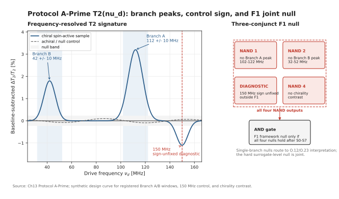

> The registered proxy discriminator is a registered-branch peak plus chirality contrast: a proxy-branch null requires no Branch A peak, no Branch B peak, and no chirality contrast after the frozen acceptance checks. It can distinguish candidate material-response phenomenologies, not GCT from all non-GCT physics. The 150 MHz sign is retained as a mechanism diagnostic because its sign is O.23/O.24-conditional, not an F1 conjunct. The peak *amplitude* is likewise reported as O.23 + O.24 conditional; the bare strong-coupling parameter $2g_{coll}/\kappa$ alone is the strong-coupling signature, not the $T_2$ enhancement.
>
> **Registered scenario-window scan rule:** The authoritative acquisition is the full half-open scan $[32,200)$ MHz with $\Delta\nu_{\rm step}\leq1/(4\pi T_{2,\rm eff})$. Branch A $[102,122]$ MHz and Branch B $[32,52]$ MHz are pre-registered hypothesis regions within that scan, not independently scanned alternatives. Branch A is the primary historical ~100 MHz scenario window; Branch B is the sibling window registered for O.12-negative outcomes. Neither window is a derived GCT frequency, and no $\eta_{\rm Zeno}$ mechanism in the current action shifts one into the other. The $150$ MHz response is sign-unfixed and diagnostic-only. The complete scan, both hypothesis regions, and S0-S7 package are frozen before unblinding; branch selection is not inferred from observed A-Prime data.
>
> **Multiplicity-aware peak statistic:** The primary statistic is a locally weighted likelihood-ratio test comparing a Lorentzian peak model against a flat local baseline for $T_2(\nu_d)$. The physical window is fixed at $\pm100$ kHz around each tested center; it contains 41 grid points only at the 5 kHz baseline and is recomputed on a finer adaptive grid. The baseline half-open grid $[32,200)$ MHz at 5 kHz contains exactly $33{,}600$ samples per cell. The six primary cells are the experimental-design premise $\{\text{L-chiral},\text{R-chiral},\text{achiral/racemic}\}\times\{\text{RF scan},\text{matched sham/no-drive}\}$; bare diamond is an auxiliary calibration outside the multiplier. Hence $M=33{,}600\times6=201{,}600$ baseline bin-cells. The global gate uses $\alpha_{\rm global}=2.7\times10^{-3}$, giving $\alpha_{\rm local}=\alpha_{\rm global}/M\approx1.34\times10^{-8}$. With $z_{\alpha,\rm local}=5.6$, $z_\beta=1.48$, and $\delta_{T_2}=0.10$, the raw requirement is exactly
> $$N_{T_2,\rm scan}^{\rm raw}=\left(\frac{5.6+1.48}{0.10}\right)^2=5012.64$$
> shots per bin-cell and the executable integer ceiling is $5013$. The baseline totals are $1{,}010{,}548{,}224$ raw shots and $1{,}010{,}620{,}800$ executable shots. At 1 kHz they require $280.70784$ h and $280.728$ h, respectively, before acceptance failures, overheads, or re-runs; with the declared per-shot overheads and readout noise the requirement is years, not hours (see the joint-gate calculation below). These totals scale linearly with the declared cell count. If $T_{2,\rm eff}>15.915\,\mu$s, the grid is tightened using $\Delta\nu_{\rm step}\leq1/(4\pi T_{2,\rm eff})$ and the bins, $M$, local threshold, shot count, and runtime are recomputed before unblinding. A scan-level null occurs when the maximum statistic over the full scan remains below the globally corrected threshold; only the accepted three-conjunct Branch A + Branch B + chirality null triggers F1.
>
> **Decision Matrix (pre-registered material-proxy interpretation) — chirality-contrast variant:**
>
> | Outcome | Joint signature | Verdict |
> |---|---|---|
> | **Joint proxy pattern present** | $T_2$ at a registered branch center (Branch A $112 \pm 10$ MHz or Branch B $42 \pm 10$ MHz) exceeds $T_2(\text{off-res})$ at $3\sigma$ on chiral substrate after the full adaptive-resolution scan, AND chirality contrast is present at $3\sigma$ | Material-response scenario supported; microscopic attribution remains open; peak amplitude and the sign-unfixed 150 MHz diagnostic are reported as O.23 + O.24 readouts |
> | **Generic driven-spin response** | Enhancement at $3\sigma$ on both chiral and achiral substrates with no $T_2(\nu_d)$ structure | Chiral proxy not supported; characterize ordinary drive/heating/phonon response |
> | **Frequency-specific, chirality-null** | A registered branch peak is present, but chirality contrast is null after S1 + S6 acceptance checks pass; the 150 MHz diagnostic is reported separately | Frequency-specific material response; no CISS attribution; routes to O.12/O.24 benchmarking |
> | **Chirality-only / branch-null** | Chirality contrast is present, but both registered branch scans are null after RF/systematic controls pass | Ordinary chirality-correlated contrast detected (CISS attribution requires the L-vs-R handedness-odd test of component (c)); no protected-subspace or phason inference; not an F1 null |
> | **Sensitivity-limited mixed outcome** | Any component null before its preregistered acceptance checks pass (RF flatness, cap chirality, NV-depth, or batch reproducibility) | Inconclusive; re-power or re-run the affected component before applying F1 |
> | **Proxy-branch null (F1)** | No non-monotonic peak in Branch A, no non-monotonic peak in Branch B, and no chirality contrast after all acceptance checks pass | F1: reject the registered biophysical branch (chiral phonon-polariton / protected-subspace Zeno branch) at the NV-centre surrogate level, as registered; no verdict on GCT as a whole or on Level II; the 150 MHz sign is diagnostic only |
>
> Neither outcome class is a verdict on GCT as a whole: the measurement tests an ordinary material proxy, and no phason, Selection-Operator or Level-II inference follows from it (V1 Ch17 §17.1.3). A preregistered null meeting the F1 rule above rejects the registered biophysical branch as registered.
>
> **Formal Preregistration Statement — Protocol A-Prime**
>
> The joint signature is a **Tier 3 material-proxy hypothesis**: the branch-feature plus chirality pattern. The peak *amplitude* (whether $T_2^{\text{enhanced}}/T_2^{\text{base}}$ exceeds $10$, $100$, or $1000$) and the sign at 150 MHz are empirical measurements of the closure values of Open Problems O.23 and O.24, not separately registered Tier 2 quantities. The frozen NV ensemble is $N_{\rm NV}=20$ implanted NV centers per cap across $N_{\rm caps}=50$ caps; CISS contrast mapping therefore uses $N_{\rm caps}N_{\rm NV}=1000$ NV-center observations rather than a mutable single-cap ensemble size. Shot noise scales as $1/\sqrt{N_{\rm caps}N_{\rm NV}}$. A clean branch-feature plus chirality signal at $3\sigma$ measures an ordinary chiral-spin/coherence pattern with whatever amplitude the measurement delivers; it does not confirm a chiral phonon-polariton GCT interaction. Mixed outcomes are interpreted per the Decision Matrix, and only the fully accepted three-conjunct joint null triggers F1, which rejects the registered proxy branch only.
>
> **Joint-gate sample-size calculation.** For a normalized single-shot contrast estimate with Gaussian shot noise, a one-component $3\sigma$ gate with 80% marginal power uses
> $$N_{\rm shots}\geq \left(\frac{3+0.84}{\delta}\right)^2,$$
> where $\delta$ is the fractional effect size after the S0-S7 systematic budget. The conservative pre-registered effect sizes are $\delta_{T_2}=0.10$ for the non-monotonic selected-branch peak, $\delta_{\chi}=0.05$ for the chirality contrast after cap-purity, transfer retention, and NV-depth dilution, and $\delta_{150}=0.10$ for powering the sign-unfixed 150 MHz diagnostic response. Therefore:
> $$N_{T_2}\geq 1.48\times10^3,\qquad N_{\chi}\geq 5.90\times10^3,\qquad N_{150}\geq 1.48\times10^3.$$
> These design effect sizes ($\delta_{T_2}$, $\delta_{\chi}$, $\delta_{150}$) are locked by the blinded pilot calibration before unblinding the decisive run. The $\delta_{150}$ and $N_{150}$ entries power the sign-unfixed diagnostic only and never determine F1 or a Holm primary decision. If the pilot lower edge falls below the registered branch-feature or chirality values, that F1 component is sensitivity-limited and must be re-powered rather than treated as a clean F1 proxy rejection. The conservative acquisition design retains 93% marginal power per measured component ($z_\beta \approx 1.48$), giving $N_{T_2}\geq 2.01\times10^3$, $N_{\chi}\geq 8.03\times10^3$, and diagnostic $N_{150}\geq 2.01\times10^3$ per relevant fixed-frequency cell. The full half-open $[32,200)$ MHz adaptive-resolution scan supersedes every fixed-frequency $N_{T_2}$ number. At the 5 kHz baseline $M=201{,}600$ and the multiplicity-aware peak requirement is
> $$N_{T_2,\rm scan}^{\rm raw}=5012.64,\qquad N_{T_2,\rm scan}^{\rm executable}=5013$$
> shots per bin-cell for the same 80% joint-power design. On the baseline 5 kHz grid, $33{,}600$ samples per cell and six enumerated cells give $1{,}010{,}548{,}224$ raw shots or $1{,}010{,}620{,}800$ executable shots, corresponding at 1 kHz to $280.70784$ h or $280.728$ h. The adaptive-linewidth rule and linear cell-count sensitivity stated above govern any re-budgeting. The 1 kHz cadence assumes 1 ms per shot. With the realistic CPMG reset, RF-settling and blinding overheads of $10$–$100$ ms per shot, the same $1.01\times10^9$ shots take $1.0\times10^7$–$1.0\times10^8$ s, i.e. about $0.32$–$3.2$ years. The shot model also takes $\sigma_{\rm meas}$ as one unit per shot; conventional room-temperature single-NV optical readout sits a factor $\sigma_R\approx10$–$80$ above the spin-projection limit (Barry et al. 2020, *Rev. Mod. Phys.* 92:015004, Table 2), which multiplies the required repetitions by $\sigma_R^2\approx10^2$–$6\times10^3$, and each $T_2$ bin needs a fitted decay curve rather than a single shot. As specified, the full-scan acquisition is therefore not feasible: "shot" must be redefined as an averaged $T_2$ estimate with explicit photon statistics and readout contrast, and the scan, cell count or effect size re-budgeted before the design is executable [Tier 3 experimental-design calculation]. The $\delta_{\chi}=0.05$ contrast is a sensitivity-design target locked after the achiral/chiral pilot calibration; if the measured CISS lower edge or transfer-retention factor erases this contrast, the chirality component is sensitivity-limited and the acquisition must be re-powered rather than treated as a clean F1 proxy rejection. Joint power is calculated from the three marginal powers under the independence approximation [Tier 3]; correlations among S0-S7 systematics are reported in the analysis notebook and widen the confidence interval rather than changing the F1 gate.
>
> **Deterministic CISS contrast mapping.** Required shot count uses the frozen ensemble convention: $N_{\rm caps}=50$ caps and $N_{\rm NV}=20$ implanted NV centers per cap contribute $N_{\rm obs}=50\times20=1000$ NV-center observations. The cap-level CISS variable is measured before unblinding by CD/VCD chirality verification plus transport spin-polarimetry per cap, but the clean F1 chirality input is the post-transfer effective product
> $$P_{\rm eff}\equiv r_{\rm transfer}P_{\rm CISS}^{\rm net},$$
> and $P_{\rm eff}\ge0.1$ must be established at $\ge5\sigma$ confidence across the 50 caps/witness stacks for a clean F1 run. Shot noise therefore scales as $1/\sqrt{N_{\rm caps}N_{\rm NV}}$ with $\sigma_{\rm meas}=1$ photon-count unit (an idealization; real readout multiplies the counts below by $\sigma_R^2$, see above). The per observation count is
> $$N_{\rm shots}^{\rm per\,obs}=\frac{(z_{1-\alpha/2}+z_{1-\beta})^2\,\sigma_{\rm meas}^2/(N_{\rm caps}N_{\rm NV})}{(P_{\rm eff}\delta\chi)^2}
> =\frac{4.20\times10^{-2}}{(P_{\rm eff}\cdot0.05)^2}
> =\frac{16.8}{P_{\rm eff}^2}.$$
> Equivalently, the total pooled acquisition cycles across the 1000 NV-center observations are
> $$N_{\rm cycles}^{\rm total}=N_{\rm caps}N_{\rm NV}N_{\rm shots}^{\rm per\,obs}=\frac{1.68\times10^4}{P_{\rm eff}^2}.$$
> Here the numerator uses the declared 5σ clean-run gate with the same 93% marginal-power convention as the three-component design, $(5+1.48)^2\approx42.0$; the 95%/80% comparison convention does not set this gate. For effective polarization band $P_{\rm eff}\in[0.05,0.20]$, this gives total cycles $6.72\times10^6$ ($P_{\rm eff}=0.05$), $1.68\times10^6$ ($P_{\rm eff}=0.10$), and $4.20\times10^5$ ($P_{\rm eff}=0.20$), with per-observation counts lower by $10^3$. At the declared $P_{\rm eff}=0.025$ sensitivity floor, the total-cycle requirement is $2.69\times10^7$ (about $2.69\times10^4$ shots per center-observation), still below the $10^9$ cycle ceiling; below this floor the chirality component is sensitivity-limited by cap polarization/systematic reproducibility, not treated as a clean F1 proxy rejection. If only the source-material value $P_{\rm CISS}^{\rm net}$ is known, the re-powering uses the retained product: $r_{\rm transfer}=0.5$ increases the shot/cycle requirement by $4\times$, and $r_{\rm transfer}=0.1$ increases it by $100\times$.
>
> **CISS floor interpretation.**
>
> | Measured post-transfer $P_{\rm eff}=r_{\rm transfer}P_{\rm CISS}^{\rm net}$ | Interpretation | Action |
> | :--- | :--- | :--- |
> | $\geq 0.1$ | S1 acceptance floor for clean F1 proxy rejection | The declared shot budget can deliver the chirality component of the joint F1 gate. |
> | $0.025 \leq P_{\rm eff} < 0.1$ | Sensitivity-Limited Pending Re-Powering | The run can be re-powered by increasing shots with $N_{\rm shots}\propto1/P_{\rm eff}^2$, but the declared run cannot deliver a clean proxy rejection at the declared shot budget. |
> | $<0.025$ | Sensitivity-limited floor | No proxy verdict; this is not a GCT, phason or Level-II result. |
>
> **Protocol record:** Analysis pipeline specifies (a) NV center depth and isotopic purity, (b) RF drive amplitude and pulse sequence, (c) statistical threshold for significance ($p < 0.003$, corresponding to $3\sigma$), and (d) blinding procedure for the $T_2(\nu_d)$ scan. Any deviation from these parameters constitutes a separate protocol amendment.
>
> **Public preregistration archive.** Before unblinding, the protocol package is deposited in a public timestamped archive (OSF or Zenodo, with optional arXiv protocol note) containing the frozen analysis code, synthetic-data budget, NV-depth/isotopic-purity acceptance files, RF-drive grid, S0-S7 systematic gates, and the amendment ledger. Any parameter change after deposit is recorded as a numbered amendment with timestamp, rationale, and the blinded/unblinded state of the affected data.
>
> **Executable-readiness qualifier.** Protocol A-Prime is a prospective preregistration design until the verifier script, synthetic-data package, analysis-code hash, operating-system/environment manifest, and OSF/Zenodo archive URL are frozen together before unblinding. Before that freeze, P.8 is not an executable decisive test; it is the authoritative design specification for the frozen package. Even after that freeze, P.8 is decisive only for its declared material-response proxy branch, not for GCT as a whole, phason coupling or Level II.
>
> **Proxy-branch decision conditions (two-level, pre-registered):**
>
> **F1 proxy-branch rejection rule (Protocol A-Prime, single rule).** F1 fires, rejecting the registered biophysical branch as registered, if and only if all three conjuncts hold after the frozen S0-S7 acceptance checks pass: (a) NO peak detected in the Branch A $112 \pm 10$ MHz hypothesis region, (b) NO peak detected in the Branch B $42 \pm 10$ MHz hypothesis region of the full adaptive-resolution $[32,200)$ MHz scan, and (c) NO chirality contrast against the achiral control using $> 99.9\%$ isotopically pure $^{12}$C diamond. Branch A is the primary historical ~100 MHz scenario window; Branch B is the sibling window registered for O.12-negative outcomes. A Branch A/B-only null is the peak-subtest null, not an F1 rejection; the F1 gate is the three-part joint null at the required $\delta\chi + N_{\rm shots}$. **This is the sole Protocol A-Prime rejection gate.** It is not a verdict on GCT as a whole: the measurement tests an ordinary material proxy, and no phason, Selection-Operator or Level-II inference follows from it (V1 Ch17 §17.1.3). The $150$ MHz response is a sign-unfixed Tier 3 O.23/O.24 diagnostic outside F1 and Holm primary decisions. S0 systematic floor (in-vitro arm of Protocol A only; the abiotic NV surrogate contains no Trp radical pair, so S0 does not apply to it): $\Delta_{ST}/h$ of the Trp radical pair must lie inside the 5-200 MHz admissible tubulin-EPR band before a biological branch-frequency decision is treated as decisive; outside that band the run is sensitivity-limited or routes to O.12/O.23 branch re-estimation. Under an F1 rejection there is no CISS "classical floor" fallback: ordinary CISS response would constrain the material system only, and no Level II classification follows for any concrete substrate.
>
> **(F2) Peak-amplitude readout (distinct from F1).** Conditional on a positive branch-feature plus chirality signal after the frozen acceptance checks, the peak amplitude and 150 MHz sign are reported as empirical readouts of the joint O.23 + O.24 closure values. They are not separately registered gates. A low-amplitude positive signature would be compatible with a weaker or non-DFS-mediated O.23 scenario; a high-amplitude positive signature would be compatible with a protected-subspace scenario, but no $[10^2,10^3]\times$ enhancement is currently licensed. F2 never translates an amplitude into $g_{single}$, $\eta_{Zeno}$, a protected phason subspace or consciousness.
>
> Between F1 and F2 — any measurement yielding a positive joint signature, across amplitudes from below-bare through the positive-O.23 $[10^2,10^3]\times$ band — the experiment serves as the empirical readout of the joint $(\Omega_{\text{DFS}}, \kappa_{\text{chiral}})$ closure of Open Problems O.23 + O.24, constraining the Tier 3 material inputs; empirical agreement does not promote them to Tier 2. Promotion requires an independent derivation of the relevant DFS/chiral parameters and normalized physical coupling from the declared premises, closing the O.23/O.24 derivational dependencies without fitting the target measurements. Observations then test the resulting claim.
>
> **§13.3.5.S Systematic-Error Budget [pre-registered]**
>
> The Protocol A-Prime pre-registration matches the §16.3.4 Protocol D rigor in disclosing the dominant systematic uncertainties on the branch-feature/chirality gate and the separate 150 MHz diagnostic. Seven systematics are enumerated below; each is paired with the dominant effect it produces, the propagation chain into the F1 proxy gate or diagnostic, and the operational mitigation. The pre-registered systematic budget is committed before unblinding alongside the F1/F2 statements above.
>
> \newpage
>
> **(S1) Chiral h-BN cap chirality-purity**
>
> **Effect on branch/chirality gate or 150 MHz diagnostic:** Reduces chirality contrast (component c); a partially-racemic cap or post-transfer stack with $P_{\rm eff}=r_{\rm transfer}P_{\rm CISS}^{\rm net}<0.1$ collapses the chiral-vs-achiral contrast into the $3\sigma$ noise band, producing false-null on (c) even with a real chirality-dependent material response present at the declared shot budget.
>
> **Magnitude band:** Naaman-Paltiel-Waldeck 2019 *Nat. Rev. Chem.* 3:250 places CISS polarization up to $\sim60\%$ in ordered-helical DNA stress-test substrates, while protein/peptide systems sit in the operative $5$–$20\%$ band; the source cap-substrate $P_{\rm CISS}^{\rm net}$ is the *enantiomer excess × per-helix polarization*. $F_{\rm CISS}=2.0$ is a Tier 3 model translation from measured $P_{\rm CISS}$ spin-polarization; see App BEB §BEB.11.1 for the protein-band $P_{\rm CISS}\in[0.05,0.20]$ and DNA-equivalent stress edge $P_{\rm CISS}\approx0.6$. A racemic cap ($ee = 0$) gives $P_{\rm CISS}^{\rm net} = 0$; $ee = 50\%$ at the DNA stress edge gives $P_{\rm CISS}^{\rm net} \approx 0.3$ before transfer. Effect-size impact scales linearly with the retained product $P_{\rm eff}$.
>
> **Mitigation:** **Inclusion criterion for clean F1:** measured $P_{\rm eff}\geq0.1$ AND $ee \geq 90\%$. Pre-unblinding measurement: spin-polarimetry on the h-BN/NV cap pair using CD/VCD chirality verification plus either Mott polarimetry of transmitted electrons or magnetoresistance with a ferromagnetic electrode, at the operating temperature; CD/VCD is necessary but not sufficient. (The chiral and racemic cap materials themselves still need a concrete definition, since bulk h-BN is achiral.) $P_{\rm eff}$ must be measured $\geq0.1$ with $\geq5\sigma$ confidence before Branch A/B unblinding. For $0.025 \leq P_{\rm eff}<0.1$, the chirality component is Sensitivity-Limited Pending Re-Powering with $N_{\rm shots}\propto1/P_{\rm eff}^2$. For $P_{\rm eff}<0.025$, the result is sensitivity-limited and supplies no proxy verdict. CD/VCD spectroscopic verification of $ee \geq 90\%$ is required before each Protocol A-Prime run; a cap with $ee < 90\%$ is excluded. Achiral control uses CD-confirmed racemic h-BN. **Dominant systematic if the cap is sourced from synthesis without CD verification — invalidates component (c) reproducibility and supplies no proxy, framework or Level-II verdict.**
>
> **(S2) NV depth jitter**
>
> **Effect on branch/chirality gate or 150 MHz diagnostic:** Modulates the NV–cap distance, which sets the ordinary NV–cap dipolar sensitivity and therefore the measured interface-response amplitude; it does not measure a chiral phonon-polariton or phason coupling. NV depth shifts of $\pm 2$ nm at a nominal 10 nm depth modulate that sensitivity by $+95\%/-42\%$, about $\pm 60\%$ linearized (dipolar $1/r^3$ falloff: $(10/8)^3=1.95$, $(10/12)^3=0.58$).
>
> **Magnitude band:** NV implantation depth standard deviation typically $\sigma_d \in [0.5, 2]$ nm depending on implantation energy and annealing protocol; $\sigma_d = 2$ nm gives a per-sample variation on the joint (a)+(b) amplitude of about $\pm 60\%$.
>
> **Mitigation:** Pre-registration requires NV depth characterization via secondary-ion mass spectrometry (SIMS) calibration on a control batch from the same implantation lot, with the $\sigma_d$ reported as the leading systematic on the (a)+(b) amplitude scaling. Statistical pooling across the frozen $N_{\rm NV}=20$ NVs per cap averages the random depth jitter to about $\pm 60/\sqrt{20} \approx 13\%$ before the 50-cap CISS contrast aggregation is applied; pooling does not remove a lot-level bias in mean depth, which is carried as a systematic.
>
> **(S3) RF amplitude calibration drift across the $[32,200)$ MHz sweep**
>
> **Effect on branch/chirality gate or 150 MHz diagnostic:** Modulates the Rabi-frequency-dependent measurement of $T_2(\nu_d)$, producing apparent $T_2(\nu_d)$ structure that mimics component (a) at the few-percent level if the RF amplitude is not flat across the sweep.
>
> **Magnitude band:** Standard NV-AC-magnetometry pulse-shaping drift across a $[32,200)$ MHz sweep is taken as $\pm 5\%$ in pulse area; this propagates to a $\pm 5\%$ apparent $T_2(\nu_d)$ feature that is *not* a real material-proxy signal.
>
> **Mitigation:** Pre-registration requires an *RF amplitude flatness calibration sweep* on a reference NV (single-NV regime, no chiral cap) before each Protocol A-Prime run, with the residual RF flatness $< 2\%$ as the acceptance condition. The reference-NV sweep is reported with the protocol and subtracted from the chiral-cap measurement at the lock-in stage.
>
> **(S4) Hahn-echo $\pi$-pulse fidelity**
>
> **Effect on branch/chirality gate or 150 MHz diagnostic:** Stochastic per-pulse loss compounds across the registered CPMG train and can mask or mimic component (a); coherent over-rotation, state-preparation-and-measurement error and intrinsic decoherence require separate nuisance terms.
>
> **Magnitude band:** For the declared independent stochastic-loss model, the surviving contrast is $F_\pi^N$. The acceptance condition is therefore $F_\pi\geq(1-\delta_{\rm allow})^{1/N}$ with $N=2\nu_dT_{\rm int}$. At $\nu_d=112$ MHz, $T_{\rm int}=10\,\mu$s and $\delta_{\rm allow}=0.10$, $N=2240$ and $F_\pi\geq0.999953$; the branch centre at $42$ MHz requires $F_\pi\geq0.999875$. A fixed $0.99$ threshold would leave only $1.7\times10^{-10}$ contrast after 2240 pulses and is inadmissible [Tier 3 experimental-design calculation].
>
> **Mitigation:** Pre-registration must declare $T_{\rm int}$, $\nu_d$, $N$, $\delta_{\rm allow}$ and the stochastic/coherent error model before unblinding. Randomized benchmarking and sequence-level reference runs must establish the resulting branch-specific $F_\pi$ threshold; runs that do not meet it are sensitivity-limited. Baseline correction is fitted jointly from the declared nuisance model rather than obtained by subtracting average gate infidelity.
>
> **(S5) Floquet sideband artefacts**
>
> **Effect on branch/chirality gate or 150 MHz diagnostic:** An ordinary strongly driven spin system (no magnon-polaron or Zeno source is assumed) can produce Floquet sidebands at $\nu_d \pm n\,\nu_{\rm sideband}$ for $n \in \mathbb{Z}$, which can mimic the non-monotonic $T_2(\nu_d)$ peak (component a) at frequencies offset from $\nu_c$ if the sideband structure is not characterized.
>
> **Magnitude band:** Floquet sideband amplitude scales with $(g_{\rm drive}/\omega_d)^2$ and produces apparent $T_2(\nu_d)$ features at $\nu_d \pm \nu_{\rm hyperfine}$ with amplitudes up to $\sim 10\%$ of the main feature for strong drives.
>
> **Mitigation:** Pre-registration requires a *Floquet-sideband characterization scan* on the achiral control substrate first (sidebands appear as $T_2(\nu_d)$ structure independent of chirality), with the sideband positions and amplitudes catalogued before the chiral measurement. The chiral measurement is then masked at the sideband frequencies to prevent false-positive component (a) attribution.
>
> **(S6) Sample-batch chirality reproducibility**
>
> **Effect on branch/chirality gate or 150 MHz diagnostic:** Run-to-run variation in the CISS-cap synthesis batch produces between-run amplitude variation on component (c) (chirality contrast) at the $10$–$20\%$ level even with $ee \geq 90\%$ per (S1).
>
> **Magnitude band:** Synthesis-batch reproducibility on chiral h-BN under standardized CVD conditions is typically $\pm 15\%$ on the per-helix polarization, propagating to $\pm 15\%$ between-run variation on the chirality-contrast amplitude.
>
> **Mitigation:** Pre-registration requires *three independent synthesis batches* of the chiral cap, each with CD verification, with the chirality-contrast amplitude reported as the mean ± SD across batches. The $3\sigma$ proxy-rejection gate on component (c) is evaluated against the inter-batch SD, not the single-batch SD. **Dominant systematic on the chirality-contrast amplitude reproducibility — analogous to the $^{17}$O enrichment efficiency in Protocol D §16.3.4; a leading material-proxy systematic, not a framework-level one.**
>
> **(S7) Cap-to-NV transfer and post-transfer CISS retention**
>
> **Effect on branch/chirality gate or 150 MHz diagnostic:** A cap that passes standalone chirality/CISS metrology can lose effective spin-selective coupling after transfer, bonding, contamination, strain, or NV-surface processing; this produces a false null on chirality contrast and can reduce the observed $\delta\chi$ without invalidating the pre-transfer cap measurement.
>
> **Magnitude band:** Transfer-induced CISS retention is treated as a multiplicative uncertainty on the chirality term. The retained factor $r_{\rm transfer}$ must be measured on witness h-BN/NV stacks; otherwise $\delta\chi$ is reported with an added transfer-uncertainty multiplier and the run cannot support clean F1.
>
> **Mitigation:** Pre-unblinding acceptance requires witness-stack spin-polarimetry or magnetoresistance on the actual transferred cap/NV process flow, not only on source material. Clean F1 requires $r_{\rm transfer}P_{\rm CISS}^{\rm net}\ge0.1$ with $\ge5\sigma$ confidence; $0.025\le r_{\rm transfer}P_{\rm CISS}^{\rm net}<0.1$ is sensitivity-limited and requires re-powering; below $0.025$ no proxy verdict is reported, and no threshold here is a framework or Level-II falsifier.
>
>
> **Dominant systematic identification:** The chiral h-BN cap chirality-purity (S1), sample-batch reproducibility (S6), and cap-to-NV transfer retention (S7) jointly carry the bulk of the systematic uncertainty on the chirality-contrast component (c) of the joint signature. A null on (c) at $3\sigma$ that is *not preceded by S1 + S6 + S7 verification* is interpreted as **inconclusive on the chirality-contrast component, not as an F1 proxy rejection**. Verification of S1 (CD spectroscopy $ee \geq 90\%$), S6 (three-batch reproducibility), and S7 (post-transfer CISS-retention metrology on witness stacks) before the Protocol A-Prime run is the pre-registered acceptance condition for a clean F1 proxy-rejection test on component (c). The (S2), (S3), (S4), (S5) systematics carry the bulk of the uncertainty on components (a) and (b) and are mitigated by the per-run reference-NV calibrations. None of these acceptance conditions creates a GCT, phason or Level-II falsification gate.
>
> *Cross-references:* §16.3.4 (Protocol D systematic-error budget — the rigor template); App NSP §NSP.5 (CISS empirical foundations); App ORQ Open Problem O.23 (chiral phonon-polariton DFS substrate-side closure path); App ORQ Open Problem O.24 (Protocol A-Prime amplitude under O.23 closure).

### §13.3.5.A Protocol A-Prime Extended: Chiral vs. Achiral NV-Centre Comparison

**Objective:** Test whether any $T_2$ feature in the registered $\nu_c \approx 112 \pm 10$ MHz
(or $42 \pm 10$ MHz) scenario window depends on an ordinary chiral material
environment or is substrate-agnostic. This is a CISS/material-control question,
not a direct GCT prediction.

**Physical Setup:**

The experiment compares L-chiral, R-chiral, racemic/achiral and bare-NV controls.
Direct spin-polarimetry, current/contact metrology and $T_2$ are the observables.
The historical proxy scenario expects a sign-positive registered-window feature on
the chiral cap (net CISS, spin-selective transport) and $T_2^{achiral} \approx T_2^{bare}$
on an achiral cap (a racemic cap is not equivalent for the polarization-even
observable $T_2$, since it still carries local polarization of both signs), with any magnitude measured as an empirical readout of O.23/O.24.
Chirality reversal may reverse an ordinary spin-polarization sign; it does not imply a
Zeno Lock. No $10^2$–$10^3$ enhancement or phason attribution is currently licensed,
and the amplitude is **not** a rejection threshold.

| Substrate | Measured CISS response? | $T_2$ scenario expectation at the registered window | Inference ceiling |
|:---|:---:|:---|:---|
| NV in diamond (bare) | Control | Baseline T₂ (reference) | Ordinary NV response |
| NV + achiral h-BN | Must be measured (expected none) | ≈ Baseline T₂; matched interface control | Ordinary interface response |
| NV + L-chiral h-BN | Must be measured | Test for a chirality-correlated non-monotonic registered-window feature; amplitude reported as O.23/O.24 readout | Ordinary CISS/material proxy |
| NV + R-chiral h-BN | Must be measured (opposite hand) | Test handedness reversal/symmetry of the same feature | Ordinary CISS/material proxy |

*Table note.* The joint preregistered rule (registered-branch feature plus
chirality contrast at $3\sigma$, §13.3.5 Decision Matrix) decides only the
material proxy branch. The sign-unfixed 150 MHz response and peak amplitude
are empirical responses, not readouts of a GCT coupling or Level II.

Handedness reversal is a useful material control, but the detailed symmetry of
the measured magnitude depends on contacts, defects, orientation and the
ordinary CISS transport model. It is not a Zeno-locking theorem.

**Why NV Centres:** shallow (~10 nm) NVs have $T_2$ of order $10\,\mu\text{s}$, comparable to
the $1$–$10\,\mu$s Trp radical-pair scenario band (millisecond $T_2$ belongs to bulk NVs); NV array density and spacing are controllable; diamond + h-BN capping
is established nanofabrication technology. Timeline: 2–5 years, executable only after preregistration verifier/package freeze and the S0-S7 acceptance files are locked.

**Public preregistration deposit required before unblinding the chiral vs. achiral comparison.** The OSF/Zenodo timestamp, frozen code hash, synthetic-data budget, S0-S7 acceptance files, and amendment ledger are part of the protocol record.

*Cross-reference: §13.3.5 (Protocol A-Prime baseline), App BEB §BEB.7, and App PRG rows P.8/P.10 (the authoritative decision rule lives at P.8).*

---

### §13.3.6 Protocol A-Tertius: Leggett-Garg Test of the Material Coherence Proxy

**Objective (historical).** Protocol A-Tertius proposed a Leggett-Garg Inequality (LGI) test of temporal coherence in a radical-pair or NV material system driven in the registered branch windows. It is now a declared open programme (below); no registered gate remains.

**The Leggett-Garg Framework.** The Leggett-Garg Inequalities (Leggett & Garg, 1985) constrain the temporal correlations of a macroscopic two-state system under the assumptions of **macrorealism** (the system is in a definite state at all times) and **non-invasive measurability** (measurement does not disturb the state). For a dichotomic observable $Q(t) \in \{+1, -1\}$, the temporal correlation functions $C_{ij} = \langle Q(t_i) Q(t_j) \rangle$ must satisfy:

$$K_3 \equiv C_{12} + C_{23} - C_{13} \leq 1 \quad \text{(LGI bound)}$$

Any classical stochastic process satisfies this inequality. **Quantum mechanics allows $K_3 > 1$** (up to a maximum of $K_3^{max} = 3/2$ for a qubit), signaling genuine quantum superposition across the temporal interval.

**Declared open programme [Tier 3/4] — Protocol A-Tertius.** (a) *Claimed:* a three-time LGI test, $K_3(\nu_c)>1$, on the singlet-triplet parity of a single radical pair read by ODMR with quantum-non-demolition weak measurements at $\tau_c=1/\nu_c\approx8.9$ ns spacing, registered as a binary gate (P.8c) for a protected-subspace coherence branch. (b) *Defects:* single-radical-pair singlet/triplet readout with QND measurements at ns spacing does not exist (radical-pair spin state is read destructively, through recombination yield on ensembles, and NV optical readout alone takes about 300 ns); and on the NV surrogate the test is non-diagnostic as designed, because LGI violation by a single NV spin is already established (Waldherr et al. 2011, *Phys. Rev. Lett.* 107:090401) and any coherently precessing spin gives $K_3>1$ at suitable times. A positive result would therefore say nothing about a protected-subspace branch, and a null would depend on the chosen times. (c) *Closing would need:* an executable ensemble (ideal-negative-measurement) LGI scheme and a branch-specific prediction for $K_3(\nu)$ that differs from that of a bare coherent spin. (d) No decision, scorecard row or downstream claim uses A-Tertius as support; the former $K_3\approx1+\phi^{-9}/\pi$ effect size, sample-size plan and P.8c decision rule are withdrawn.

*Cross-reference: §13.3.5 (T₂ enhancement Protocol A-Prime), §13.4.5 (Lindblad master equation treatment), V1 §17.1.4 (Tubulin Tryptophan aromatic radical network).*

---

**13.4 Thermodynamic Constraints on Coherence**

**13.4.1 Conditional Landauer Bookkeeping for the Historical Rate Scenario**
Critics of quantum biology correctly identify **Thermal Noise** ($k_B T$) as the primary obstacle. At $310$ K, the decoherence time of a dipole in bulk water is $\tau_{raw} \approx 10^{-13}$ s; this bulk-water scale is a contextual control, not a measured tubulin-Trp $T_2$. Landauer's Principle bounds logically irreversible erasure; applying one erasure cost per hypothesized sampling update is an explicit scenario assumption, not evidence that a Zeno Drive samples, erases or operates at a particular rate.

**13.4.2 Heat-Sink Closure Status**

The thermodynamic heat-sink mechanism for the Zeno energy-balance remains an Open Problem; see App ORQ O.34.
Our thermodynamic audit compares two sampling regimes against the $\sim 1$ nW [Tier 3 — neurophysiology measurement] metabolic budget of a neuron. At $310$ K the Landauer erasure cost is $k_B T\ln 2 \approx 2.97\times10^{-21}$ J, so that budget supports about $3.4\times10^{11}$ logically irreversible bit erasures per second. An electronic-THz architecture that erases one bit per sampled degree of freedom per cycle is excluded even for a single bit. At $10^8$ Hz the same assumption permits at most $N_{\max}\approx3370$ independently erased bits; it does not select 100 MHz over lower frequencies. The 100 MHz figure is the historical material-scan scenario; it is not derived from this budget, nor from the recombination rate of §13.4.4 (a rate in s$^{-1}$, not a cyclic frequency). On the conditional $N_{\rm coop}=1.625\times10^9$ branch, one erasure per oscillator per cycle would require $1.625\times10^{17}$ erasures s$^{-1}$, exceeding the Landauer budget by $4.8\times10^5$. Even replacing the linear count by $\sqrt{N_{\rm coop}}$ would give $4.0\times10^4>3370$ and would not be justified by Landauer's linear bit-erasure accounting. The coherence protocol must therefore establish a QND/reversible implementation with an explicit reset and heat-sink budget; this thermodynamic closure remains open under O.34 [Tier 3].
**13.4.3 Tubulin Tryptophan Aromatic Radical Coherence**

Standard bulk water decoherence timescales ($\sim 10^{-13}$ s) define the thermal decoherence limit for unbound spins. The tubulin Trp radical-pair $T_2 \approx 1$-$10\ \mu$s baseline is a model-derived estimate (Tier 3) extrapolated from cryptochrome FAD-Trp radical-pair magnetoreception studies (Ritz et al. 2000; Hore & Mouritsen 2016) and microtubule radical-pair theoretical models (Zadeh-Haghighi & Simon 2022). Direct EPR/ODMR measurements on intact β-tubulin Trp radical pairs have NOT been performed; this direct measurement is a target of the in-vitro arm of Protocol A (Protocol A-Prime is the abiotic NV surrogate; App ORQ O.24 tracks the A-Prime enhancement amplitude). **Open Problem O.23** in Appendix ORQ asks whether a declared material model can extend a measured baseline toward the historical $\sim 10$ ms stress target (§13.4.4–§13.4.7, V1 §17.1.3c). No extension time is presently required by Selection or Level II.

**The Misra-Sudarshan formula and its applicability range [Tier 1 statement / Tier 3 application to Trp].**

The Misra-Sudarshan quantum Zeno theorem (Misra & Sudarshan 1977, *J. Math. Phys.* 18:756; reviewed in Facchi & Pascazio 2008, *J. Phys. A: Math. Theor.* 41:493001 §2.1) states that, for a quantum system prepared in $|\psi_0\rangle$ and subjected to projective measurements at interval $\tau_{Zeno}$, the effective decay rate in the short-interval limit is

$$\gamma_{\text{eff}}(\tau_{Zeno}) = \tau_{Zeno}/\tau_Z^2 \quad (\tau_{Zeno} \to 0),$$

where the **Zeno time** $\tau_Z$ is defined by the variance of the interaction Hamiltonian in the initial state:

$$\tau_Z^{-2}\equiv\frac{\sigma_H^2}{\hbar^2},\qquad \sigma_H^2\equiv\langle H^2\rangle-\langle H\rangle^2.$$
The survival-probability curvature fixes this time uniquely: $P(t)=1-(\sigma_Ht/\hbar)^2+O(t^4)$, hence $\tau_Z=\hbar/\sigma_H$. If the variance is quoted as a cyclic frequency $\Delta\nu_H\equiv\sigma_H/h$, then $\tau_Z=1/(2\pi\Delta\nu_H)$; using $1/\Delta\nu_H$ in the quadratic formula would inflate every squared-$\tau_Z$ result by $(2\pi)^2\approx39.5$.

Equivalently, the effective coherence time is $\tau_{\text{eff}} = \tau_Z^2/\tau_{Zeno}$. Within the manuscript's quadratic-to-exponential matching diagnostic, the nominal boundary is $\tau_{Zeno}<\tau^*\equiv\tau_Z^2/T_2$. Facchi, Nakazato & Pascazio (2001, *Phys. Rev. Lett.* 86:2699, eq. 16) instead obtain $\tau^*\simeq\gamma_0\tau_Z^2$ for a golden-rule population-decay rate $\gamma_0$, while Facchi & Pascazio (2008 §2.2.5, eq. 19) define the crossover implicitly by $\gamma_{\rm eff}(\tau^*)=\gamma$. Identifying $\gamma_0=1/T_2$ is an additional Tier 3 channel-matching assumption, not a result of either source.

The Zeno time $\tau_Z$ and the exponential decoherence time $T_2$ are distinct physical quantities and *cannot in general be identified*: $\tau_Z$ is the convexity scale of the short-time survival probability (set by $\langle H_{int}^2 \rangle$), while $T_2$ is the long-time exponential dephasing rate (set by spin-bath spectral density). The two are related only via the crossover relation $\tau^* = \tau_Z^2/T_2$.

For the Trp radical-pair singlet, the relevant $H_{int}$ is the singlet–triplet hyperfine mixing $H_{hf}$. The engine's declared placeholder for the bare radical-pair variance is $\sigma_H/h = 30$ MHz (the FAD-derived rms of §13.1.2b; the TrpH$^{\bullet+}$ effective coupling $\approx27$ MHz would give $\tau_Z\approx5.85$ ns), so the Zeno time is

$$\tau_Z=\frac{1}{2\pi(30\,\text{MHz})}\approx5.305\ \text{ns}\quad\text{[Tier 3 — imported hyperfine placeholder].}$$

The bare Misra-Sudarshan formula evaluated at the canonical $\tau_{Zeno} = 10$ ns measurement benchmark gives

$$\tau_{\text{eff}}^{\text{bare MS}} = \tau_Z^2/\tau_{Zeno} \approx 2.8\ \text{ns}.$$

This **out-of-quadratic-regime diagnostic extrapolation of the single-pair bare Zeno formula is more than six orders below the $\sim 10$ ms declared stress target** used for Protocol A-Prime (§13.3.5) and Protocol D (Chapter 16), and more than four orders below the auxiliary $100\ \mu$s benchmark. The correct $\hbar/\sigma_H$ definition therefore widens rather than softens the disclosed coherence gap. The Misra-Sudarshan formula applied to the bare radical-pair Hamiltonian alone does *not* generate those declared material times. **Open Problem O.23** retains possible ordinary protected-subspace models (§13.4.5 dissipative-Zeno scaling; V1 §17.1.3c chiral phonon-polariton Decoherence-Free Subspace); none is a required or established GCT mechanism.

### 13.4.4 Spin-Selective Radical Recombination [Tier 3]

The candidate biochemical architecture is an ATP-coupled redox regeneration loop for Tryptophan (Trp) aromatic radical pairs in the β-tubulin hydrophobic pocket. The spin chemistry itself is standard radical-pair physics: the pair oscillates between Singlet (S) and Triplet (T) states via hyperfine coupling $\omega_{hf}$, and recombination back to the ground state is spin-selective, with the Singlet channel recombining at $\Gamma_{rec} \sim 10^8\ \text{s}^{-1}$ (a rate, not a 100 MHz cyclic frequency) while Triplet recombination is suppressed (Steiner & Ulrich 1989 *Chem. Rev.* 89:51). What is **not yet established** is the upstream biochemical pump that repeatedly prepares the Trp radical-pair state in tubulin under physiological conditions. ATP hydrolysis supplies the metabolic free-energy budget for the neural machinery and can in principle support local electron-transfer / redox cycling through mitochondrial and protein-pocket cofactors, but the explicit chain "ATP hydrolysis $\to$ electron donor/acceptor reset $\to$ beta-tubulin Trp radical-pair regeneration" is a closure target, not a demonstrated mechanism. The present chapter therefore treats ATP-coupled radical-pair regeneration as a **Tier 3 candidate mechanism** registered under App ORQ Open Problem O.34; the historical 100 MHz material-scan scenario was associated with the spin-selective recombination / hyperfine-mixing timescale ($\Gamma_{rec}\sim10^8$ s$^{-1}$), not with a derived ATP-hydrolysis clock. Even if measured in tubulin, a $10^8$ s$^{-1}$ recombination rate would be ordinary spin chemistry, not a Zeno Drive, phason rate or Selection-Operator clock.

A "WGM Cavity Bootstrap" reading of the historical 100 MHz material-scan scenario — in which an acoustic cavity resonance at 100 MHz is imagined to *project* the spin state — does not hold. A deterministic coherent coupling (cavity or otherwise) at 100 MHz produces reversible Rabi oscillations; its frequency is not a measurement rate. Strong unitary coupling can confine dynamics to Zeno subspaces (Facchi & Pascazio 2002, *Phys. Rev. Lett.* 89:080401), but that protection scales with the coupling strength (e.g. the Rabi amplitude in spin locking), not with the drive frequency. The spin-selective recombination, by contrast, is a genuinely non-unitary Lindblad channel that depletes the singlet population irreversibly; the question is whether this Lindblad channel produces an *effective measurement* with strong-Zeno scaling in the parameter regime realized for Trp at 310 K.

> [!IMPORTANT]
> **Status of the historical coherence-extension scenario.** For parity with `protocol_decoherence_audit.py`, the bare radical-pair audit uses $\sigma_H/h\approx30$ MHz, $\Gamma_{rec}\approx10^8$ s$^{-1}$, $\omega_{hf}=\sigma_H/\hbar=2\pi(30\,\text{MHz})$, $\gamma_{\text{leak}}\sim\omega_{hf}^2/\Gamma_{rec}$, and $\tau_{\text{eff}}^{\text{bare}}\sim\Gamma_{rec}/\omega_{hf}^2\approx2.8\times10^{-9}$ s. The recombination rate is already in s$^{-1}$ and is not multiplied by $2\pi$. This bare channel is more than four orders below the auxiliary $\sim 100\,\mu$s–$1$ ms benchmark band and more than six orders below the declared $10$ ms stress target (App BEB); neither target is a Selection or Level-II requirement, and consistent angular/cyclic conventions do not move the bare result near them. Reaching them in a material system would require a *protected-subspace* model that suppresses the off-diagonal coupling $\Omega$ in the dissipative-Zeno scaling well below the bare hyperfine angular frequency. The chiral phonon-polariton Decoherence-Free Subspace of V1 §17.1.3c, in which an orbital-angular-momentum mismatch between a chiral phonon-polariton mode (carrying OAM) and the symmetric thermal phonon bath (lacking OAM) would suppress $\Omega_{\text{DFS}}$, is only a Tier 3 material model: its modes, bath symmetry, preparation and suppression rate are unmeasured, and OAM mismatch does not by itself derive a protected subspace. **App ORQ Open Problem O.23** therefore asks for an ordinary material Hamiltonian, full dissipator set and measured response; it is not a missing physical mechanism that must close for Selection or Level II.

**Two-layer candidate architecture.** The proposed CISS channel of §13.2.3 is modeled separately from long-lived radical-pair coherence. Chirality and an available charge-transfer/transport handle are candidate controls, not established necessary or sufficient conditions for a phason-winding channel or substrate status; Naaman, Paltiel & Waldeck (2019) establish the CISS empirical class, not GCT's tubulin-to-phason map. The Zeno layer is a candidate multiplier conditional on O.23. Positive or negative results constrain this architecture but do not establish an Identity Polaron or Level II; the typed coupling and independent phenomenal bridge remain open.

**Proxy-branch rejection condition.** If pulsed EPR measurements on intact β-tubulin yield $T_2 < 1\ \mu$s under physiological conditions, the registered long-coherence radical-pair branch is unsupported even before any coherence-extension scenario is invoked, and the spin/coherence layer of §13.2.3 carries no Zeno enhancement. Ordinary CISS response would then constrain the material system only; it is not a fallback that preserves the branch. A preregistered null on Protocol A-Prime *and*, once a powered gate exists, Protocol D, combined with $T_2 < 1\ \mu$s on Trp radical pairs in vitro, jointly rejects the registered biophysical substrate branch of this chapter as registered. Neither outcome is a verdict on GCT as a whole: the measurement tests an ordinary material proxy, and no phason, Selection-Operator or Level-II inference follows from it (V1 Ch17 §17.1.3); in particular it would not prove Level II absent, because the Level-II bridge is independently open and the Level II status is already open (Tier 3). V1 Ch17 carries the corresponding substrate-scope statement.

**Historical thermal-margin scenario [Tier 3; not an adopted interaction].** At physiological temperature, the biological thermal scale is $k_B T(310\,{\rm K}) = 8.617333262145\times10^{-5}\,{\rm eV/K}\times310 = 0.0267$ eV. $E_{\text{bio\_phason}}$ is this thermal-noise scale, not a separate eV-scale binding energy. The historical scenario required a candidate Rashba-phason coupling $E_{RP}\approx0.3$ eV to exceed it by at least a factor of ten. Protocol `protocol_rashba_phason.py` reports $E_{RP}/k_BT \approx 11$ only as arithmetic on declared Tier 3 inputs, and computes from the $A_5$ character table that the Eq. (17.3) cross-product coupling is not an icosahedral scalar for the vector phason (V1 Ch17 §17.1.3). The comparison is therefore retained only as a historical external-energy scenario; it is not a testable GCT phason prediction. As a thermal margin it is also withdrawn: without a type-correct, action-normalized coupling, $E_{RP}$ cannot be compared with $k_BT$ (Firewall §3 rule 6). Thermal perturbations (fever, anaesthetics) remain ordinary material controls for the coherence measurements of Chapter 16.

**13.4.5 Lindblad Treatment of the Tubulin Trp Open Quantum System [Tier 3]**

To formalize the open-system dynamics of the Trp radical pair at 310 K we deploy the Lindblad master equation:

$$ \frac{d\rho}{dt} = -\frac{i}{\hbar}[\hat{H}_{radical}, \rho] + \sum_i \gamma_i \mathcal{D}(\hat{\sigma}_-^i)\rho + \Gamma_{rec}\,\mathcal{D}(\hat{S}_{recomb})\rho, $$

where $\hat{H}_{radical}$ contains the hyperfine mixing $\omega_{hf}$, $\gamma_i = 1/T_2 \approx 10^5$ s$^{-1}$ [Tier 3 — model-derived import/extrapolation from cryptochrome/FAD-Trp radical-pair systems and microtubule radical-pair models; direct β-tubulin EPR/ODMR remains O.24] is the bare thermal spin decay, and $\Gamma_{rec} \sim 10^8$ s$^{-1}$ is the spin-selective recombination rate [Tier 3 — Trp radical-pair chemistry]. Here $\mathcal{D}(\hat{L})\rho = \hat{L}\rho\hat{L}^\dagger - \tfrac{1}{2}\{\hat{L}^\dagger\hat{L},\rho\}$, and $\hat{S}_{recomb}$ is defined as a jump from the radical-pair spin manifold into an explicit product/sink state (e.g. $|P\rangle\langle S|$, with channel sums when singlet/triplet products are both retained). On the enlarged radical-plus-product Hilbert space this is a CPTP Lindblad evolution; if the product/sink sector is traced out and only unrecombined radical pairs are retained, the reduced radical-pair equation is a trace-nonincreasing conditional master equation.

In the strong-coupling continuous-measurement limit (Facchi & Pascazio 2008 *J. Phys. A* 41:493001 §13.3), a dissipator of rate $\Gamma$ pinning a system into one of its eigenspaces suppresses leakage from the protected subspace at a rate $\gamma_{\text{leak}} \sim |\Omega|^2/\Gamma$, where $\Omega$ is the off-diagonal coupling to the leakage channel. **Unit guard:** $\Delta E/h$ and $\nu$ are cyclic frequencies in Hz; $\Omega$ and Lindblad rates are angular rates in rad/s. The dissipative-Zeno comparison converts with $\Omega=2\pi\nu$ before comparing or squaring rates. Applied to the Trp recombination dissipator with $\Omega = \omega_{hf} = 2\pi\times30\ \text{MHz} \approx 1.9\times10^8$ rad/s (the $\Delta_{ST}/h \approx 30$ MHz hyperfine band) and $\Gamma = \Gamma_{rec} \sim 10^8$ s$^{-1}$, this gives

$$ \tau_{\text{eff}}^{\text{dissipative}} = 1/\gamma_{\text{leak}} \sim \Gamma_{rec}/\omega_{hf}^2 \approx 2.8\times10^{-9}\ \text{s} = 2.8\ \text{ns}, $$

i.e., the dissipative-Zeno scaling recovers the same order-of-magnitude estimate as the pulsed Misra-Sudarshan formula of §13.4.3. The radical-pair recombination channel acting alone — whether interpreted as a continuous Lindblad dissipator or as a stroboscopic projective measurement — does *not* extend the Trp coherence time toward the historical 10 ms material-coherence target used for Protocol A-Prime / Protocol D. That target is not a Selection or Level-II requirement.

**Historical shielding-factor scenario.** The Trp radical pair lives inside the hydrophobic pocket and is not in bulk water; its decoherence channel is the singlet-triplet hyperfine interaction, with a model-derived imported baseline $T_2 \approx 1$–$10\ \mu$s extrapolated from cryptochrome/FAD-Trp systems and radical-pair models rather than direct β-tubulin measurement (Ritz et al. 2000; Hore & Mouritsen 2016; O.24). Taking $\tau_{\text{target}} \sim 10$ ms as a declared stress-test target defines

$$S_{\text{required}} = \frac{\tau_{\text{target}}}{\tau_{\text{base}}} \;\sim\; \frac{10^{-2}\ \text{s}}{10^{-5}\ \text{s}} = 10^3,$$
where $\tau_{\text{base}}\approx10\,\mu$s is the imported radical-pair baseline (distinct from the bulk-water $\tau_{raw}\approx10^{-13}$ s of §13.4.1).

The resulting $10^3$ ratio is arithmetic for that chosen material scenario. The $\sim 10^9$ shielding figure occasionally quoted in the warm-decoherence literature instead compares with an unrelated bulk-water scale ($\tau_{bulk} \sim 10^{-13}$ s). Neither is a GCT or Polaron requirement. **Open Problem O.23** asks whether any specified ordinary protected-subspace model can produce a measured enhancement and with what mechanism (§13.4.6, V1 §17.1.3c).

**13.4.6 Partial Floquet-Lindblad Master Equation for the Open Zeno System [Tier 3]**

The Misra-Sudarshan formula isolates the quantum system from its environment. To model the Tubulin Trp radical pair at 310 K coupled to a protein spin bath, the current manuscript uses a **partial Floquet-Lindblad scaffold** for the open quantum system (OQS) density matrix $\rho$:

$$ \frac{d\rho}{dt} = -\frac{i}{\hbar}[H_{\rm eff}, \rho] + \sum_k \left( L_k \rho L_k^\dagger - \frac{1}{2}\{L_k^\dagger L_k, \rho\} \right) $$

where the Floquet driving Hamiltonian $H_F(t)$ is defined in energy units:
$$ H_F(t) = \frac{\Delta_{ST}}{2}\sigma_z + \hbar\Omega \cos(2\pi \nu_d t)\sigma_x, $$
with $\Delta_{ST}=h(30\,\mathrm{MHz})$ (so $\Delta_{ST}/h \approx 30 \text{ MHz}$) as the engine's bare singlet-triplet placeholder (an FAD-derived external material-scenario input, §13.1.2b) and $\nu_d$ as an applied laboratory drive frequency. Equivalently, in angular-frequency units one may write $K_F(t)=H_F(t)/\hbar=(\Delta_{ST}/2\hbar)\sigma_z+\Omega\cos(2\pi\nu_d t)\sigma_x$ and $d\rho/dt=-i[K_{\rm eff},\rho]+\cdots$. The Protocol A-Prime branch frequencies ($112 \pm 10$ MHz if O.12 closes positive; $42 \pm 10$ MHz if O.12 closes negative) are historical proxy scan windows, not replacements for the bare $\Delta_{ST}$ value; O.12 does not establish them as operating frequencies, and they are not GCT rates.

The environmental spin-bath coupling retained in this scaffold is defined by three Lindblad jump operators $L_k$:
* $L_1 = \sqrt{\gamma_\uparrow}\sigma_+$ (Thermal excitation)
* $L_2 = \sqrt{\gamma_\downarrow}\sigma_-$ (Thermal relaxation)
* $L_3 = \sqrt{\gamma_\phi/2}\sigma_z$ (Pure dephasing)

where detailed balance enforces $\gamma_\uparrow / \gamma_\downarrow = \exp(-\Delta_{ST} / k_B T)$ — $\Delta_{ST}$ is an energy, so no factor of $\hbar$ enters; written with the angular splitting $\omega_{ST} = \Delta_{ST}/\hbar$ the same relation reads $\exp(-\hbar\omega_{ST}/k_B T)$ — and the dephasing rate is $\gamma_\phi = 1/T_2^*$. 

This is not the full dissipator set for hydrated tubulin at 310 K. Omitted channels include spin-selective singlet/triplet recombination into explicit product/sink states, hyperfine anisotropy, dipolar nuclear-spin bath fluctuations, vibrational relaxation of the Trp pocket, solvent/electrostatic noise, and any O.23 chiral-phonon-polariton dark-state jump structure. Those channels are closure targets for O.23/O.24 and for the in-vitro arm of Protocol A, not solved inputs here.

Within this declared open-system scaffold, transforming into the Floquet rotating frame defines a **scenario factor** $\eta_F \in (0, 1]$ for the effective coherence time of the open driven system:
$$ \tau_{eff}^F = \tau_{eff}^{\text{bare}} \cdot \eta_F \quad \text{where} \quad \eta_F = \frac{1}{1 + (\gamma_\phi \cdot T_2)^2 \cdot f(\Delta_{drive} / \Delta_{ST})}, $$

where the baseline $\tau_{eff}^{\text{bare}}$ must be supplied by a measured or separately justified material model (the bare Misra-Sudarshan estimate of §13.4.3 alone gives $\tau_{eff}^{\text{bare MS}} \approx 2.8$ ns from radical-pair recombination, well below the $\sim 10$ ms declared stress target; a hypothetical chiral phonon-polariton Decoherence-Free Subspace lifetime $\tau_{eff}^{\text{DFS}}$ of V1 §17.1.3c could be inserted only as an O.23 scenario). Inserting either baseline produces scenario curves only; no baseline is currently a GCT coherence-extension mechanism.

At ordinary driven two-level resonance, $\nu_d = \Delta_{ST}/h$, the declared detuning function gives $f \to 0$ and $\eta_F \to 1$; off resonance the Floquet factor multiplicatively suppresses the supplied baseline. This conditional algebra does not identify a geometric or phason resonance.

> **Conditional material-model resonance:**
> The declared two-level Floquet factor is maximized algebraically at $\nu_d = \Delta_{ST}/h \approx 30 \text{ MHz}$ once that material Hamiltonian is supplied. Protocol A-Prime tests both historical proxy windows under the single F1 rule: Branch A at $112 \pm 10$ MHz and Branch B at $42 \pm 10$ MHz. A single-branch null routes to O.12/O.23 branch interpretation; the surrogate-level F1 gate requires the three-conjunct proxy-branch null after S0-S7 acceptance checks: no Branch A peak, no Branch B peak, and no chirality contrast. That null rejects only the registered proxy branch; it is not a framework gate or a GCT frequency prediction. The 150 MHz sign remains a Tier 3 mechanism diagnostic rather than an F1 conjunct.

*For the bare inverse-Zeno diagnostic of the radical-pair recombination channel see **App BEB §BEB.7** and **App BEB §BEB.12**; the former reading of the A-Prime drive frequency as a Zeno sampling rate is a declared open programme (§13.4.7).*

**13.4.7 The Zeno/Anti-Zeno Crossover and the Drive-Window Logic [Tier 3; declared open programme]**

**Conditional open-system comparison:**

Within the short-time quadratic model used above, equating the effective rate $\gamma_{\rm eff}(\tau_{Zeno}) = \tau_{Zeno}/\tau_Z^2$ to the bare exponential rate $1/T_2$ locates a crossover at $\tau^* = \tau_Z^2/T_2$, equivalently the crossover frequency

$$\nu^* = 1/\tau^* = T_2/\tau_Z^2.$$

This identity is a diagnostic of that model rather than a general result. Misra & Sudarshan (1977) establish the limiting Zeno dynamics, and Facchi & Pascazio (2008 §2.2.5) define a Zeno/anti-Zeno crossover implicitly by $\gamma_{\rm eff}(\tau^*) = \gamma$ where a finite intersection exists; neither identifies $\tau^*$ with $\tau_Z^2/T_2$ nor guarantees anti-Zeno behaviour beyond it, and the same review cautions that $\tau_Z$ can misestimate the quadratic interval. The sign assignments below therefore hold only within the quadratic model and its assumed spectral density. Here $\nu_{\text{sample}}$ is the rate of a physical measurement channel (for example recombination); an applied drive frequency is not such a rate.

- For $\nu_{\text{sample}} > \nu^*$ (Zeno regime): measurement *suppresses* decoherence — coherence time increases.
- For $\nu_{\text{sample}} < \nu^*$ (Anti-Zeno regime): measurement *accelerates* decoherence — coherence time decreases.

The crossover depends on both the Zeno time $\tau_Z$ (variance of the interaction Hamiltonian) and the exponential dephasing time $T_2$. For Tubulin Trp radical pairs with the engine's $\sigma_H/h \approx 30$ MHz placeholder [Tier 3 — FAD-derived rms placeholder, within ~10% of the TrpH$^{\bullet+}$ effective coupling, §13.1.2b] and $T_2 \approx 10\ \mu$s [Tier 3 — model-derived extrapolation from cryptochrome FAD-Trp radical-pair magnetoreception studies (Ritz 2000, Hore-Mouritsen 2016) plus microtubule radical-pair theoretical models (Zadeh-Haghighi-Simon 2022); direct β-tubulin Trp EPR/ODMR measurement is the closure target of O.24], $\tau_Z\approx5.305$ ns and the quadratic-model bare crossover is $\nu^*\approx3.6\times10^{11}$ Hz, far above the recombination rate $\Gamma_{rec}\approx10^8$ s$^{-1}$. This places the bare single-pair recombination channel in the inverse-Zeno regime relative to the bare hyperfine Hamiltonian, consistent with the §13.4.3 conclusion that the radical-pair channel alone does not extend coherence.

**Declared open programme [Tier 3] — drive-frequency Zeno windows.** (a) *Claimed:* that the applied RF/coil drive frequency $\nu_d$ acts as the Zeno sampling rate, so that the registered A-Prime branch windows sit on the inverse-Zeno side of the bare $\nu^*$ and would move to the Zeno-protected side if an O.23 protected subspace lowered $\nu^*_{\rm DFS}$ into the kHz–MHz band; an in-vitro comparison of $T_2$ in the branch windows against a 50 kHz drive was registered as a decision on the O.23 layer. (b) *Defect:* a coherent drive has no measurement rate (§13.4.4); where strong driving gives Zeno-like protection (spin locking, Zeno subspaces), it scales with the Rabi amplitude, not with $\nu_d$. The mapping $\nu_d\to\nu_{\text{sample}}$ is a category error, so no Zeno/anti-Zeno side can be assigned to any drive window, and the 50 kHz comparison decides nothing. (c) *Closing would need:* a physical measurement channel whose rate is tuned (e.g. an optical or recombination readout rate), or a restatement of the windows as dynamical-decoupling filter frequencies probing a noise spectral density. (d) Nothing downstream uses this window logic as support: the A-Prime F1 rule (§13.3.5) does not depend on it, and the former 50 kHz decision rule is withdrawn.


---

**13.5 The $\eta_{Zeno}$ Scenario Calculator (Formal Definition; Non-Diagnostic)**

The preceding sections specified the Zeno Drive piece by piece — the Tavis-Cummings cooperative pumping condition (§13.1.2), the candidate magnon-polaron origin of the registered $\nu_c \approx 112 \pm 10$ MHz window (§13.1.2b; Tier 3 specific value), the open-system Floquet-Lindblad correction (§13.4.6), and the substrate-discriminant logic of Protocol A-Prime (§13.3.5). The present section assembles these into a single closed-form procedure that returns a scalar $\eta_{Zeno}$ given a substrate description, so that past engine outputs remain reproducible. It computes a dimensionless rate ratio **only after all rates and model gates are supplied externally**; it does not derive a GCT material coupling, classify a substrate or measure consciousness.

**The DMC legs are candidate missing-leg controls, not an Apperception gate.** Non-zero nuclear spin and molecular chirality motivate controlled comparisons for the proposed phason channel, but neither is established as necessary or sufficient for Level II. The former $g_{single}^{eff}$, $\eta_{Zeno}$, and $N_{coh}$ numbers are retained below only as conditional external-rate scenarios. O.21, O.23, O.34, a typed and normalized coupling, and an independent phenomenal bridge remain open; therefore no material descriptor executes a zero-coupling inference or categorical substrate verdict.

The procedure is computationally **tractable** on a small set of declared substrate variables — nuclear-spin lattice, molecular chirality, Tavis-Cummings cavity parameters, vibrational thermal-bath coupling — and is implemented as a chain of five documented functions in the GCT Physics Engine (`GCT_Physics_Engine/src/protocol_eta_zeno.py`), a conditional scenario calculator whose outputs audit supplied arithmetic rather than physical verdicts. Engine-generated values for the three scenario test cases (biological tubulin, $^{28}$Si silicon, NV-centre Protocol-A-Prime surrogate) are quoted in §13.5.7 below.

**13.5.1 The Chain (Formal Statement)**

$$
\boxed{\;\eta_{Zeno} \;\equiv\; \underbrace{\frac{g_{single}^{\,eff}\,\sqrt{N_{bio}}}{\kappa}}_{\eta_{TC}\ \text{(bare Tavis-Cummings ratio)}} \;\cdot\; \underbrace{\eta_F}_{\text{Floquet correction}}\;}
$$

with the chain of dependencies

$$
\underbrace{(\hat{I},\,\chi,\,\mu_{dip},\,m_{eff},\,\omega_d,\,a_{lat},\,\phi^{n})}_{\text{substrate}} \;\xrightarrow{\;\text{Step 1}\;}\; g_{single}^{\,eff} \;\xrightarrow{\;\text{Step 4}\;}\; \eta_{TC}
$$
$$
N_{coop}\;\xrightarrow{\;\text{Step 2}\;}\;\sqrt{N_{bio}} \qquad (\omega_d,\,\phi^{-18},\,N) \xrightarrow{\;\text{Step 3}\;} \kappa
$$
$$
(\gamma_\phi,\,T_2,\,\Delta_{drive},\,\Delta_{ST}) \;\xrightarrow{\;\text{Step 5}\;}\; \eta_F.
$$

Each step is a closed-form expression conditional on declared Tier-3 inputs. DMC descriptors annotate candidate-control comparisons at Step 1; they do not derive $g_{single}^{eff}$, set it to zero, or execute a Level-II decision. Zero and non-zero rates below are explicit legacy external-rate scenarios retained for sensitivity bookkeeping.

**13.5.2 Step 1 — Single-Dipole Coupling $g_{single}$ [Tier 3 scenario form and inputs]**

The historical scenario form wrote the single-dipole coupling to the phason mode as the substrate's chiral dipole transition acting on a phason zero-point electric field, attenuated by the RT-shell geometric gradient and the phason zero-point displacement. This expression has no valid action-level provenance and does not by itself define a rate (V1 Ch17 §17.1.3); it is retained only to identify the engine path, and 38.3 MHz and all overlap-propagated descendants are external scenario values:

$$
g_{single}^{\,eff} \;=\; \chi \cdot f_{\text{overlap}}\cdot \frac{\mu_{dip}\,E_{\text{phason}}^{\,zpf}}{\hbar} \cdot \frac{\phi^{\,n}}{a_{lat}} \cdot \sqrt{\frac{\hbar}{2\,m_{eff}\,\omega_d}},
$$

with $E_{\text{phason}}^{\,zpf} = \sqrt{\hbar\,\omega_d / (2\,m_{eff})}$ (as written this has units of velocity, not electric field, so the displayed form is dimensionally incomplete and does not define a rate) and $\chi \in \{+1,-1,0\}$ the chirality sign ($\chi = 0$ for achiral in this scenario form; a missing-leg control, not a derived zero coupling). The exponent $n = -9$ is imported from the lattice-speed relation $\hat c=\phi^{-9}$ (V2 §6.2.2): only the integer (half of the Tier 2 $D=18$) is Tier 2, while its reading as the lattice speed of light is the Tier 3 P3b / O.15(b) stiffness-map hypothesis (V2 Ch06 §6.2.2), and its appearance in this coupling belongs to the Tier 3 scenario form (V1 §17.1.3); the dipole moment $\mu_{dip}$, overlap fraction $f_{\text{overlap}}$, and effective mass $m_{eff}$ are Tier 3 substrate inputs. For the canonical tubulin substrate, Appendix GPE retains the external pre-overlap scenario anchor $g_{single}\approx38.3$ MHz. The operative $\eta_{\rm Zeno}$ branch applies $f_{\rm overlap}$ to that anchor: at the engine-current $f_{\rm overlap}=0.01$, $g_{single}^{eff}=3.83\times10^5$ Hz, with the overlap-propagated plausible range $3.8\times10^3$-$3.8\times10^5$ Hz. Unless explicitly labelled "pre-overlap anchor," downstream $\eta_{\rm Zeno}$ and $N_{\rm coh}$ quotes use the overlap-propagated coupling.

**13.5.3 Step 2 — Collective Enhancement $\sqrt{N_{\rm coop}}$ [Tier 3 input]**

The Tavis-Cummings cooperative pumping enhances the coupling by $\sqrt{N_{\rm coop}}$, where $N_{\rm coop}$ counts primary oscillators phase-locked to the cavity mode within the Polaron volume. The primary oscillator basis is the beta-tubulin Trp radical-pair inventory,
$$N_{\rm coop}=N_{\beta{\rm Trp}}\times n_{\rm rp}\times f_{\rm active},$$
where $N_{\beta{\rm Trp}}$ is the beta-Trp candidate count, $n_{\rm rp}$ is the number of assembled-MT radical-pair hosts per dimer, and $f_{\rm active}$ is the phase-locked active fraction. Hydration-shell spins, including OH and proton dipoles, are bath/environment degrees of freedom: they can dress the protected subspace and enter O.23/O.33 decoherence and isotope-systematics budgets, but they are not counted in the cooperative-oscillator basis. The operative central branch remains $n_{\rm rp}=0$ pending O.21 assembled-MT lumen-axis closure; the $n_{\rm rp}=1$ sensitivity branch uses the conservative beta-Trp inventory (the $1.625\times10^9$ spin-count tracked in `protocol_zeno_energy_budget.py`) and reports any hydration contribution separately as environmental dressing, not as additional Tavis-Cummings oscillators. For a single-NV Protocol A-Prime surrogate: $N_{\rm coop} = 1$. The $\sqrt N$ factor describes collective coupling, not thermodynamic erasure cost. Any implementation that irreversibly erases one bit per oscillator per cycle of the historical 100 MHz material-scan scenario exceeds the 1 nW Landauer budget by $4.8\times10^5$ on the sensitivity branch; a QND/reversible sampling and reset model is required under O.34 [Tier 3 thermodynamic closure condition].

**13.5.4 Step 3 — Cavity Decay Rate $\kappa$ [Tier 3 P3b insertion or Tier 3 measured]**

Two parallel modes are exposed because biological and engineered substrates declare $\kappa$ differently:

*Historical biological scenario ("geometric" mode).* The engine inserts the Tier 3 stiffness-map hypothesis P3b, $K_\perp / K_\parallel = \phi^{-18}$ (only the integer $D = 18$ is Tier 2; V2 Ch04 §4.2, V3 §13.1.2), acting on the Tier 3 cage posit of $N_{cage} = 144$ nodes:
$$
\kappa^{\text{geom}} \;=\; \phi^{-18}\,\frac{\omega_d}{N_{cage}}.
$$
For a $100$ MHz cyclic reference, $\kappa_{\rm cav}\approx120.19$ Hz; at the operative $112$ MHz branch used by the engine, $\kappa_{\rm cav}=134.610$ Hz. Here $\kappa_{\rm cav}$ is reported as a cyclic linewidth, consistently with cyclic $g_{single}^{eff}$. These numbers are external scenario outputs, not derived tubulin linewidths.

*Direct mode (engineered cavity).* For NV-centre / cavity-QED surrogates, $\kappa$ is the directly measured linewidth ($\sim 1$ MHz for current NV cavities).

**13.5.5 Step 4 — Bare Tavis-Cummings Ratio $\eta_{TC}$ [conditional algebra; Tier 3 inputs]**

$$
\eta_{TC} \;=\; \frac{g_{single}^{\,eff}\sqrt{N_{bio}}}{\kappa}.
$$

This is dimensionless algebra when $g$ and $\kappa$ are supplied in the same rate convention. It carries no substrate or phenomenal verdict.

**13.5.6 Step 5 — Floquet Open-System Correction $\eta_F$ [Tier 3, V3 §13.4.6]**

The declared Floquet-Lindblad scaffold for the open quantum system at 310 K defines a scenario factor $\eta_F \in (0,1]$:

$$
\eta_F \;=\; \frac{1}{1 + (\gamma_\phi\,T_2)^2\,f(\Delta_{drive}/\Delta_{ST})},
$$

with $f(x) = x^2/(1+x^2)$ a Lorentzian detuning function that vanishes on resonance. At ordinary driven resonance $\nu_d = \Delta_{ST}/h$, $\eta_F \to 1$. Off resonance, $\eta_F < 1$ multiplicatively suppresses the bare Tavis-Cummings ratio. It is a model factor for an ordinary driven open system, not a geometric resonance or a Selection-Operator efficiency; it is the same $\eta_F$ that appears in the Protocol A-Prime $T_2(\nu_d)$ scenario profile of §13.3.5 (for the bare $\Delta_{ST}$ it peaks at 30 MHz, below the scan, and does not shape the branch-window peak, §13.3.5; the table's $\eta_F = 1$ assumes the O.12-positive renormalisation).

**13.5.7 Engine Status on the Three Scenario Substrates**

The `protocol_eta_zeno.py` self-test runs three numerical scenarios and verifies arithmetic/status consistency, not substrate verdicts:

| Substrate | $g_{single}^{\,eff}$ | $\sqrt{N_{bio}}$ | $\kappa$ | $\eta_F$ | $\eta_{Zeno}$ | Status |
|---|---:|---:|---:|---:|---:|:---:|
| Tubulin-Trp (V3 §13.1.2) | legacy pre-overlap scenario $3.83346543\times10^{7}$ Hz; overlap-propagated scenario $383{,}346.543$ Hz at $f_{\rm overlap}=0.01$ | central inventory $0$; sensitivity scenario $40{,}311.289$ from $N_{bio}=1.625\times10^9$ | $134.610$ Hz at the conditional $112$ MHz branch | $1$ (O.12/O.23 conditional) | central scenario $0$; sensitivity upper scenario $1.14799561\times10^8$ | **Level II: NOT_EVALUATED; external-rate scenarios only** |
| $^{28}$Si (V1 §17.10) | $0$ (explicit legacy external-rate scenario) | — | $1.2 \times 10^{2}$ Hz | — (n/a) | $0$ scenario | **missing-leg control; Level II: NOT_EVALUATED** |
| NV-centre + chiral h-BN cap (V3 §13.3.5.A) | $2.7 \times 10^{7}$ Hz legacy scenario | $1$ | $1.0 \times 10^{6}$ Hz | $\sim 1$ (on-resonance scenario) | $\approx 27$ | **candidate-control sensitivity scenario; Level II: NOT_EVALUATED** |

The silicon row records an explicit legacy zero-rate scenario. Its spin-zero/achiral descriptors make it a useful missing-leg control, but those descriptors do not derive zero phason coupling or any phenomenal verdict.

The NV-centre row reports a nonzero ratio $\sim 1.5$ orders of magnitude above unity; the historical $\eta \approx 27$ follows only from the supplied $g$ and $\kappa$, and that margin is not an independent consciousness threshold. Exceeding unity is not a phase transition, and a zero from a declared gate is not a physical no-consciousness theorem. The biological tubulin central branch is $\eta_{Zeno}=0$ until O.21 supplies an assembled-MT lumen-axis radical-pair oscillator; the $n_{rp}=1$ tubulin value is a sensitivity upper edge, not the central scenario value. The single-NV surrogate scenario is chosen to land in a resolvable band, so that the Protocol A-Prime $T_2(\nu_d)$ joint proxy signature (§13.3.5)—a non-monotonic peak in a registered hypothesis region of the full scan plus chirality contrast—is the discriminating material observable. The $150$ MHz response is a sign-unfixed O.23/O.24 diagnostic outside F1. The surrogate remains far below the tubulin sensitivity-branch cooperative regime so that the chirality-reversal control (§13.3.5.A) can help separate a chirality-correlated contribution (CISS attribution still needs the handedness-odd test of §13.3.5 component (c)).

**13.5.8 Computational Tractability and Its Limit**

The IIT integrated-information $\Phi$ is *defined* over the system's $2^{N-1} - 1$ bipartitions (Oizumi-Albantakis-Tononi 2014), a search whose cost grows exponentially with $N$ and is intractable for any realistic biological network in closed form. The rate-ratio calculator above is computationally cheap because it accepts a small supplied tuple — nuclear-spin lattice, chirality, Tavis-Cummings cavity parameters $(g, N, \kappa)$, and the open-system parameters $(\gamma_\phi, T_2, \Delta_{ST})$. That does not make it a replacement for IIT $\Phi$ or a computation of the Selection Operator $\mathcal{F}_{sel}$: the physical coupling and the independent Level-II bridge remain missing, and the Tier 3 substrate inputs (Trp dipole moment, $N_{bio}$ estimate, NV coupling parameters) carry their own uncertainty.

Protocol A-Prime (§13.3.5) can tighten ordinary material-response parameters against bench measurement. The same data alone cannot determine the missing GCT vertices, physical coefficient, normalization, material embedding or rate.

**13.5.9 Computational Reference and Scope**

The chain is mirrored in `GCT_Physics_Engine/src/protocol_eta_zeno.py`. The reference implementation evaluates a declared scenario, returns the per-step quantities, and writes the canonical regression artifact `GCT_Physics_Engine/data/protocol_eta_zeno_results.json`; it is not a substrate-decision engine.

**Scope of the procedure:**

1. **Steps 2–5 are exact conditional algebra given their inputs; Step 1 ($g_{single}$) is a quarantined Tier 3 scenario form; all numerical inputs are Tier 3, and the GCT rate input is undefined.** Each step is fixed once the registered substrate tuple is supplied (Tavis-Cummings ratio, V3 §13.1.2; Floquet-Lindblad open-system scaffold, V3 §13.4.6; Dual Material Constraint candidate controls, V1 §16.2.6). Apart from the external 38.3 MHz scenario anchor, the chain has no fitted numerical knob, and its absolute outputs inherit the Tier 3 substrate inputs listed below. Exact evaluation does not validate the tuple.
2. **The numerical values are conditional external-rate scenarios.** Molecular and NV parameters are imported, but the phason coupling is neither typed nor measured. The central O.21-pending inventory remains $n_{rp}=0$ and the $n_{rp}=1$ value is sensitivity bookkeeping. DMC descriptors define candidate controls; they do not force qualitative substrate logic or a Level-II verdict.
3. **The procedure is tractable on the test cases but is NOT experimentally validated against bench measurements.** CISS, phonon, spin, population and linewidth measurements are material proxies, not measurements of a GCT coupling. Protocol A-Prime (§13.3.5) can support or reject the registered proxy pattern; it cannot promote the historical rate chain. Its registered pattern is a non-monotonic peak in either the Branch A $112\pm10$ MHz or Branch B $42\pm10$ MHz hypothesis region plus chirality contrast after the full half-open $[32,200)$ MHz scan at $\Delta\nu_{\rm step}\leq1/(4\pi T_{2,\rm eff})$ in NV-centre + chiral h-BN samples. The 150 MHz sign is unfixed and recorded separately as an O.23/O.24 diagnostic outside F1/Holm. A positive branch/chirality result plus the chirality-reversal control of §13.3.5.A would constrain the Tier 3 material inputs and measure the peak amplitude that Open Problems O.23 + O.24 leave conditional; empirical agreement does not promote those inputs to Tier 2. Promotion requires an independent derivation of the relevant DFS/chiral parameters and normalized physical coupling from the declared premises, closing the O.23/O.24 derivational dependencies without fitting the target measurements. Observations then test the resulting claim.
4. **The procedure does NOT replace Protocol A-Prime and is not a substrate-decision engine.** Its output on a substrate is a scenario number, not a prediction of what a Protocol A-Prime measurement must find and not a substitute for the measurement. The Dual Material Constraint is not established as necessary or sufficient, and $\eta_{Zeno}$ supplies no Level-II verdict.

**Cross-references.** V1 §17.10 and §16.2.6 cite this procedure as a candidate-control and conditional-scenario audit, not a substrate decision rule. V3 §13.3.5 supplies a bench material-proxy test; the typed coupling (V1 Ch17 §17.1.3) and an independent phenomenal bridge remain open.

---

### **Chapter 14: Protocol B (Mass Spectrum Computation)**

The derivation of the lepton mass hierarchy in Chapter 8 identifies the muon and tau as the 11th and 17th harmonics of the electron's dodecahedral cage. To audit these results against the engine ledger, we employ **Protocol B**: a deterministic verification of the projected lattice geometry. This protocol computes the charged-lepton mass ratios from the Tier 2 harmonic-ladder mechanism plus the Tier 3 integer anchors $N=11$ and $N=17$ per Parameter Ledger §0.1; first-principles unique-eigenvalue extraction remains open under O.5/O.14/O.15.

---

**14.1 Methodology**

**14.1.1 Algorithm: Projected Lattice Dynamics**

The analysis models the vacuum as an Ammann-Kramer-Neri (AKN) tiling, generated via the Cut-and-Project method from the 6-dimensional hyper-lattice $\mathbb{Z}^6$. We construct the **Geometric Resonance Matrix ($\mathbf{G}$)**, which represents the coupled harmonic structure of the $N=144$ dodecahedral cage.

Unlike standard molecular dynamics, which operate in 3D Euclidean space, the GCT algorithm operates on **Projected Degrees of Freedom**. Each node $i$ in the 6D parent lattice possesses a 6D displacement vector $\mathbf{U}_i$. Upon projection into the physical manifold, this vector is partitioned into physical ($\mathbf{u}_\parallel$) and internal ($\mathbf{u}_\perp$) components. The interaction energy of a bond between nodes $i$ and $j$ is defined by the stiffness hierarchy derived in Volume 2:
$$V_{ij} = \frac{1}{2} K_\parallel (\Delta \mathbf{u}_\parallel \cdot \hat{\mathbf{n}}_\parallel)^2 + \frac{1}{2} K_\perp (\Delta \mathbf{u}_\perp \cdot \hat{\mathbf{n}}_\perp)^2$$
The analysis solves for the **Node-Centric Eigenvalues** (eigenstates of the center-of-mass motion), distinguishing these from the interface stress energies (surface area mismatches) utilized for the hadron spectrum.

**14.1.2 Parameters: The Phason Stiffness Ansatz ($D=18$) [Tier 2 integer identification (D=18) + Tier 3 heuristic stiffness-ratio map — Parameter Ledger §0.1 P3; Open Problem O.15]**

The analysis requires exactly one material input: the ratio of phason stiffness to phonon stiffness.

No tree-level stiffness ratio follows from the projection geometry. The earlier "theorem" that the Gram eigenvalue ratio of the 6D$\to$3D projection gives $\eta_0 = \phi^{-2}$ is withdrawn: $\phi^{-2}$ is a raw-frame (legacy single-chart) Gram ratio, which changes under row rescaling and equals 1 for the canonical row-isometric projectors (App DPS §DPS.2–3; V3 Ch04 §4.1.2), so it is a normalization convention and not a physical stiffness. The picture in which phonon-phason coupling suppresses $K_\perp$ under RG flow at the relevant physical scale is a GCT conjecture [Tier 3], not a result taken from the quasicrystal hydrodynamics literature (Lubensky, Ramaswamy and Toner 1985 treat the phason elastic constants as independent effective-theory parameters).

We set $n=18$ as a **Tier 2 integer identification (D=18) + Tier 3 heuristic stiffness-ratio map** (Parameter Ledger §0.1 P3 canonical disposition; first-principles RG closure tracked under Open Problem O.15). The two layers are kept separate: $D_{H_3}=2+6+10=18$ is the Tier 2 Coxeter integer, while the physical map $K_\perp/K_\parallel=\phi^{-18}$ is the independent Tier 3 hypothesis P3b (Parameter Ledger §0.1; O.15). Like H-EW, P3b is a registered Tier 3 hypothesis listed outside the core-input count; only the integer $D=18$ is Tier 2, and P3b is a bare stipulation. Arithmetic rewritings of $\phi^{-18}$ (for example as $(\phi^{-2})^9$ over nine phonon-phason channels, or the $H_3$-Coxeter rank × Galois × dimension count of App DPS §DPS.4) are not derivations and give it no support. The former cube-of-Gram-determinant route (App DPS §DPS.3) is retired: the Gram-determinant ratio depends on the coordinate frame (a row rescaling changes it by $s^{18}$, and canonical row-isometric projectors give 1). Icosahedral $H_3/I_h$ symmetry permits a quadratic stiffness form $Q=aP_\parallel+bP_\perp$ with $b/a$ free, and the isotropic parent action gives $b/a=1$, so symmetry alone does not fix $\phi^{-18}$ [Tier 1 representation theory]. The earlier claim of empirical support from a $10^{-2}$–$10^{-1}$ i-AlMnSi / i-AlPdMn phason/phonon band, and of a quantitatively derived chemical-bonding floor, is also retired: the quasicrystal measurements cited for it concern $K_2/K_1$ phason elastic anisotropy and diffusive relaxation kinetics rather than a phason/phonon stiffness ratio, and the DFT reference cited for the floor (DOI 10.1103/PhysRevB.88.144102) is Xiao et al. (2013) on the CaIrO$_3$ post-perovskite transition, not i-AlPdMn. Every numerical use of $\phi^{-18}$ below is therefore conditional on P3b; first-principles microscopic, action-level or RG closure remains Open Problem O.15.

The input parameter for the phason stiffness is set, conditional on the Tier 3 hypothesis P3b, as:
$$\frac{K_\perp}{K_\parallel} = \phi^{-18} \approx 1.7307 \times 10^{-4}$$

**14.1.3 Computational Setup: Harmonic Ansatz Evaluation**

The $6N \times 6N$ geometric projection matrix is analyzed to extract the spectrum of eigenfrequencies $\{\omega_k\}$. Because quasicrystalline spectra can be **singular continuous** (proven for one-dimensional Fibonacci-type models; not established for 3D icosahedral operators), eigenvalues are expected to cluster in a complex hierarchy. Protocol B utilizes a **Harmonic Ansatz Evaluation** to target the specific pseudo-gaps ($\phi^{11}$ and $\phi^{17}$) without the algorithm becoming lost in the dense background of uncoupled phason modes.

The evaluation identifies the fundamental breathing mode resonance ($\omega_0$), which represents the electron's mass-energy.

**14.1.4 Numerical Convergence and the Local Isomorphism Shield**

Stability is probed by increasing the cluster size from the $N=144$ core toward an $N=2000$ node neighborhood. The dodecahedral cage satisfies the local matching rules of the icosahedral projection, so by local isomorphism every finite patch recurs throughout the tiling; local isomorphism concerns patch recurrence and implies no spectral protection by itself. The picture of the aperiodic background as a **Topological Shield**, in which the $N=144$ symmetry acts as a resonant cavity that filters out local fluctuations and would yield a mass eigenvalue protected against local environmental disorder, is a Tier 3 heuristic; no such eigenvalue has yet been extracted (§14.2). A specific numerical convergence rate is not asserted here: the finite-$N$ discretization artifact present in the direct graph extraction (§14.2; `protocol_lepton_spectrum.py`) is why first-principles non-perturbative eigenvalue closure remains open (O.5/O.14/O.15).

---

**14.2 Validation and Results**

> [!CAUTION]
> **The Linear Boundary Constraint — read this before the precision tables below.** Extensive HPC analysis of the full sparse Hessian (see Appendix GPE) confirms that the bare linear dynamical matrix yields normalized eigen-ratios of `[1.0, 1.67, 2.1, 2.52...]`. Neither $\phi^{11}$ nor $\phi^{17}$ emerge spontaneously from linear diagonalization. 
> 
> The leptons are non-linear phason solitons whose exact mass scaling is governed by the $6N \pm 1$ symmetry saturation, not linear oscillatory modes. The $\phi^{11}$ and $\phi^{17}$ gap alignments are therefore **Tier 2 Geometric Postulates** (the harmonic-ladder structure committed to in Parameter Ledger §0.1 P4/P5) plus the **Tier 3 specific integer choices** $N=11$ (muon) and $N=17$ (tau). The non-perturbative computational extraction of these solitonic eigenvalues from first principles remains an open goal for the GCT framework. The bare $\phi^{11}$ / $\phi^{17}$ residuals are $-3.75\%$ / $+2.69\%$; after the Tier 3 first-order coefficients the muon reaches ~0.24% (the tau's first-order formula is its full formula, −51 ppm), and the ppm-level figures in §14.2.3 below are Tier 3 formula residuals against measured masses (the muon mass is measured to 22 ppb, CODATA 2022), not precision claims.

**14.2.1 The Harmonic Ansatz and the Linear/Non-Linear Boundary [Tier 2 Postulate]**

The primary non-linear pseudo-gaps of the dodecahedral cage correspond to the 11th and 17th harmonics of the inflation operator. Under the **Geometric Harmonic Ansatz**:
* **Muon Target:** $\phi^{11} \approx 199.005$ [Tier 2 Postulate]
* **Tau Target:** $\phi^{17} = L_{17}+\phi^{-17} \approx 3571.0003$ [Tier 2 Postulate] ($L_{17}=3571$ is the Lucas number)

**14.2.2 Precision Mass Audit**

We apply the phason drag corrections derived in Chapter 8 to the geometric eigenvalues. For the Muon, we include the **Second-Order Phi-Alpha Correction** ($\phi^8\alpha^2=\phi^{-3}\times\phi^{11}\alpha^2$: Tier 2 exponent arithmetic, verified computationally, see Appendix GPE; reading its $\phi^{-3}$ factor as an electroweak mixing projection rests on the Tier 3 hypothesis H-EW, V3 Ch04 §4.3.2). The residual error of **−21 ppm ($-0.0021\%$)** for the Muon (lepton-spectrum protocol; App PSC §PSC.1) is about $10^3\sigma$ against the 22 ppb CODATA 2022 measurement uncertainty, so the formula does not reproduce $m_\mu$ at measurement precision; it is a Tier 3 formula residual. (The earlier reading of it as inside a "$\sim$10–40 ppm higher-loop theory floor" is withdrawn: Standard-Model radiative corrections are not an uncertainty on a measured mass.) The next geometric correction enters at third order carrying a $\phi$-power coefficient comparable to the $\phi^8$ second-order term — $\phi^8\alpha^3 \approx 1.8 \times 10^{-5}$ [Tier 3 — order-of-magnitude estimate by analogy to the second-order coefficient], the same size as the residual, so the row tests nothing beyond first order — whereas the bare uncoefficiented **Third-Order Radiative Correction** $\alpha^3 \sim 3.9 \times 10^{-7}$ [Tier 1 — QED perturbation theory] alone is two orders smaller. Native first-principles loop closure remains open under O.5/O.14/O.15.

**14.2.3 Final Lepton Mass Table vs. PDG**

| **Particle** | **Geometric Exponent** | **GCT formula value (postdiction; MeV)** | **Observed (MeV)** | **Relative Error** |
| :--- | :---: | :--- | :--- | :--- |
| **Electron** | $0$ | **0.5109989** (input, anchor A1) | $0.5109989$ | **Base Scale** |
| **Muon** | $11$ | **105.656** [Tier 2 mechanism (harmonic ladder, conditional on the Tier 3 $\phi$-step, V3 Ch08 §8.1.2) + Tier 3 specific exponent N=11 per Ledger §0.1 P4] | $105.6583755(23)$ (CODATA 2022) | **~−21 ppm (Tier 3 formula residual)** |
| **Tau** | $17$ | **1776.84** [Tier 2 mechanism (harmonic ladder, conditional on the Tier 3 $\phi$-step, V3 Ch08 §8.1.2) + Tier 3 specific exponent N=17 per Ledger §0.1 P5] | $1776.93 \pm 0.09$ (PDG 2024) | **~−51 ppm (−0.0051%)** |

**14.2.4 The Tau Comparison**

For the tau, the GCT value $1776.84$ MeV lies $0.09$ MeV ($\sim$51 ppm, about $1\sigma$) below the PDG 2024 value $1776.93 \pm 0.09$ MeV ($\sim$0.005%). The GCT number carries no propagated theoretical uncertainty: the Tier 3 exponent $N=17$, the inserted Tier 3 tau correction rule and the unpropagated next-order term are not converted into an error bar. The number of displayed digits is therefore not a precision claim, and the formula is not more precise than experiment. Future high-luminosity lepton-collider and tau-threshold measurements would tighten this postdiction comparison; it is not a prediction.

**Conclusion:**
Protocol B treats the charged lepton mass hierarchy as a **deterministic spectral fingerprint** candidate of the 6D hyper-lattice. The match across multiple generations using the icosahedral geometric framework (parameterised by $\phi$ as the structural constant, plus the integer-valued harmonic exponents $N = 11, 17$ which enter as Tier 3 specific values per Parameter Ledger §0.1 P4/P5 — not as additional fitted parameters but as structural commitments of the framework) is consistent with the harmonic-ladder mechanism, but no global significance is claimed for it (V3 Ch08 §8.5). As evidence that φ or icosahedral structure is special, this match is **Tier 4**: the preregistered constant control test (v3, NEGATIVE-FRAGILE; App PSC §PSC.9.6) found φ's pattern of matches on 21 constants not distinguishable from that of random constants (58 of 300 random bases did at least as well). The test "excludes, at power ≥ 0.8, an effect in which φ hits at least 6 of the 8 informative rows through a real effect; weaker effects are not excluded." The numbers are kept as descriptive arithmetic, while first-principles unique-eigenvalue extraction remains open under O.5/O.14/O.15. References to $\phi$ as the structural constant are structural-constants-only language; the 5-postulate-plus-1-anchor bare lepton-ratio sub-sector (the bare $\alpha$ relation $360\phi^{-2}$ is a separate Tier 3 numerical relation, mechanism open; the corrected lepton rows also need A3, H-EW and the Tier 3 coefficient rules), with the native-RGE endpoint and precision-comparison rows adding anchors A2–A6 (Parameter Ledger §0.1), is the load-bearing tier discipline.

**END OF CHAPTER 14**

---

### **Chapter 15: Protocol C (XRISM Preregistration)**

The 3.55 keV X-ray anomaly, proposed in Chapter 11 [Tier 3] as the signature of vacuum lattice fracture, is a candidate observational link to GCT, conditional on the O.38 cage posit and on a line whose existence is itself unconfirmed. **Protocol C** defines the formal preregistration for the XRISM line-shape audit.

---

**15.1 Formal Decision Framework**

To ensure scientific reproducibility and avoid outcome-contingent curve fitting, GCT preregisters the following hypothesis test for the XRISM stacked-cluster stress-aperture survey.

**15.1.1 The Null Hypothesis ($H_0$)**
The Dark Matter signal at 3.55 keV originates from a particulate gas (e.g., sterile neutrinos) or standard atomic multiplets (K XVIII).
- **Signature:** Instrumental profile convolved with cluster-virial broadening and background-line modeling uncertainties ($\sigma_v \approx 1300$ km/s for the Perseus reference) [Tier 3 — cluster virial measurement].
- **Expected FWHM:** $\approx 37$ eV for the broad thermal/virialized reference at $E=3.55$ keV [Tier 3 — broadening calculation]. This width is a diagnostic axis, not a standalone sterile-neutrino verdict; morphology, flux floor, and background model are load-bearing.
- **Recoil:** Not a discriminator. In the two-body decay $\nu_s\to\nu\gamma$ the photon carries exactly $m_s/2$, with no recoil loss, and the free-atom recoil $E^2/2Mc^2$ of a 3.55 keV photon is $\approx1.7\times10^{-4}$ eV for $^{39}$K ($\approx6.7\times10^{-3}$ eV even for hydrogen), far below any resolvable width [Tier 1 kinematics].

**15.1.2 The GCT Hypothesis ($H_1$)**
The Dark Matter signal originates from a macroscopic, coherent topological glass (supersolid vacuum).
- **Signature:** Monochromatic emission, narrow only if the emitters are lattice-bound (GCT Mössbauer Effect). Whether fractured-phase emitters are lattice-bound or free debris at virial speed is a declared open programme (V3 Ch11 §11.2.3); the width expectation below, and the forward model's use of ICM gas turbulence for emitters that are not gas, are conditional on it.
- **Expected FWHM (observed; bulk-turbulence broadened Voigt):** $\sim 9.8$ eV at 3.55 keV — quadrature combination of the XRISM Resolve instrumental Gaussian $\sigma_{\rm inst} = 5\,{\rm eV}/2.355 \approx 2.12$ eV (operational analysis freeze uses the then-current XRISM POG plus RMF/ARF calibration files as primary response inputs; the 5–7 eV mission-spec band and Ishisaki et al. 2022 *Proc. SPIE* 12181:121811S (DOI 10.1117/12.2630654) are retained as pre-flight/historical scale anchors) and the bulk-cluster-turbulence Gaussian $\sigma_{\rm kin} \approx E_{\rm line} (v_{\rm turb}/c) \approx 3.55$ eV at $v_{\rm turb} \approx 300$ km/s for typical cluster-core turbulence. Engine-canonical value: `expected_fwhm_ev = 9.7458` per `GCT_Physics_Engine/data/protocol_dm_line_forward_model_results.json` at $\text{XRISM\_FWHM\_EV} = 5.0$. **Sensitivity sweep:** at the conservative mission-spec upper bound $\text{XRISM\_FWHM\_EV} = 7.0$, $\sigma_{\rm inst} = 2.97$ eV, the quadrature $\sigma_{\rm inst,eff} = \sqrt{2.97^2 + 3.55^2} \approx 4.63$ eV, and the predicted observed Voigt FWHM rises to $\sim 10.9$ eV — the §15.2 spectral-compatible band lower edge shifts accordingly. The **deconvolved intrinsic line-width residual** $W_{\rm int} \lesssim 5$ eV (instrument and registered kinematic/turbulence model removed; unmodeled astrophysical and natural broadening remain) is what the §15.2 decision rule operates on — distinct from the observed FWHM that an external observer would measure on the plotted line; both numbers must be reported jointly to avoid the "observer sees ~9 eV → GCT falsified" misreading. [Tier 3 — observed FWHM follows from the Voigt convolution of three Tier 1 / Tier 3 inputs; the $W_{\rm int}$ decision rule is the falsification gate.]
- **Recoil:** Not a discriminator (see $H_0$).
- **Acoustic Phonon Signature [Tier 4, non-operative]:** Temporal and spatial cross-correlation with a burst of High-Frequency Gravitational Waves (HFGWs) (vacuum fracture acoustic emission); the 1-100 MHz band is asserted, not derived (V3 Ch11 §11.4.7).

### 15.1.3 Addressing Known Non-Detections

Multiple independent analyses have reported non-detections of the 3.55 keV 
line in environments where dark matter density alone would predict a strong 
sterile-neutrino signal. GCT does not contest these results; they are
read as compatible with the stress-gating hypothesis, while their status remains
retrospective until frozen stress-aperture maps and masks are applied
cluster-by-cluster before residual unblinding.

**Malyshev et al. (2014)** performed a stacked XMM-Newton analysis of 
dwarf spheroidal galaxies (dSphs) and blank-sky fields, finding no 3.55 keV 
emission. Under the sterile neutrino hypothesis, this is anomalous given the 
high dark matter columns. Under GCT's **Stress-Gating Hypothesis** 
(§11.1.3), this is the expected result if dSphs, with virial velocities 
of $\sigma_v \sim 5$–$10$ km/s, sit below threshold; the vacuum lattice 
would then be in the elastic glass phase and emit no radiation. The 
operative threshold, however, is the frozen thermal-pressure proxy 
below ($\sigma_{crit}=0.53$ keV cm⁻³, in ICM $n k_B T$ units); the 
$K_\perp\phi^{-5}$ form of V3 Ch11 §11.1.3 is heuristic motivation, 
not a second definition. Gas-poor dSphs have no ICM pressure, so 
"$\sigma_{vir} \ll \sigma_{crit}$" is not yet a computed comparison: 
a stress proxy usable in gas-poor systems must be specified and 
tabulated for each null target before this counts as a consistency check.

**Riemer-Sørensen (2016)** analyzed Chandra observations of the Milky Way
halo and found no significant excess at 3.55 keV. The stress-gating reading is
that the smooth gravitational potential of the Milky Way halo generates
insufficient shear to fracture the supersolid vacuum lattice; the same
limitation applies, since the dark-matter halo has no ICM-pressure proxy and no
halo stress has been computed against $\sigma_{crit}$. In the model, emission is concentrated in high-stress fracture
zones (cluster outskirts, merger shocks, and high-shear ICM), not in relaxed stellar halos.

**Quantitative GCT Resolution:** 
The stress-gating threshold is numerically frozen as
$$\sigma_{crit}\equiv \sqrt{P_{\rm Perseus-core}P_{\rm Bullet-shock,central}}=\sqrt{(0.07)(4.0)}=0.529\ {\rm keV\,cm^{-3}}\approx0.53\ {\rm keV\,cm^{-3}},$$
using the Perseus-core pressure anchor and the central Bullet-shock pressure estimate cited in Ch11. This remains Tier 3 because the threshold is observation-bracketed, not first-principles derived. Above threshold, emission is permitted but not guaranteed (V2 Ch11 §11.2.2); below, suppressed. **Protocol C's frozen stress-aperture rule:** the operative falsification aperture is the mass-weighted set of cells whose pre-line thermal-pressure/shear proxy satisfies $P_{\rm proxy}\ge0.53\ {\rm keV\,cm^{-3}}$ within the XRISM stacked-cluster sample. The Perseus core falls below this numeric cut and is not a falsification point. That is an aperture definition, not a rheological claim: whether cluster cores are fractured (V2 Ch13) or elastic is a declared open programme (V3 Ch11 §11.1.4), and the Hitomi-Perseus null is not cited as support for the gate.

**Frozen target-cell list.** Before inspecting any 3.55 keV residuals, the analysis locks the following cell classes from pressure/shear maps: (i) Bullet Cluster bow-shock wedge and Mach-cone shell; (ii) Coma merger / radio-relic pressure shells; (iii) A2142 cold-front / merger shell; (iv) A3667, A2256, and A2319 radio-relic or merger-shock shells; (v) any Perseus, A2029, or A1795 off-core annulus only where the same pre-line proxy exceeds $0.53\ {\rm keV\,cm^{-3}}$. Relaxed cool cores, including Perseus $r\lesssim100$ kpc and the A2029/A1795 cores, are locked as below-cut cells unless their pre-line maps exceed the numeric cut (an aperture definition only; their rheology is open, V3 Ch11 §11.1.4). This freezes the aperture before residual unblinding; residual-selected cell admission is prohibited.

Once a stress proxy is tabulated for each null target, this would convert the non-detections from anomalies into stress-gating consistency checks rather than prior successful predictions; until then they are not computed checks.
The preregistration in §15.1 should be understood in this context: H1 predicts a stress-gated signal (narrow only for lattice-bound emitters, V3 Ch11 §11.2.3) in **non-core** stress-gated cluster regions ABOVE $\sigma_{crit}=0.53\ {\rm keV\,cm^{-3}}$ (cluster outskirts, merger shocks, high-shear ICM); the Perseus core lies outside the frozen numeric aperture, and the Hitomi-Perseus null is not used as support (open cluster-core rheology, V3 Ch11 §11.1.4). GCT registers a low-shear null branch for dSphs and smooth halos. Both types of measurement are falsification-relevant — a detection in a dSph would falsify the low-shear null branch, while a registered above-$\sigma_{crit}$ stacked-cluster null falsifies only after the preregistered sensitivity and stress-aperture spatial-map requirements are met. **Operational stress-aperture rule:** the primary cluster test is run on the frozen target-cell list above, with aperture weights committed before unblinding from X-ray line residuals.

**15.1.4 Engagement with Dessert-Rodd-Safdi 2020 and the Boyarsky et al. response.**
Dessert, Rodd & Safdi (2020) *Science* 367:1465 used more than 30 Ms of XMM-Newton blank-sky observations to test the Milky-Way-halo flux expected from decaying-dark-matter explanations of the reported 3.5 keV line, finding no evidence for the line and setting decay-rate limits inconsistent with that interpretation. Boyarsky, Malyshev, Ruchayskiy & Savchenko (2020) contested the strength of that limit, arguing that background-line modeling can weaken the bound by more than an order of magnitude and leave a dark-matter interpretation viable; Dessert/Rodd/Safdi's reply held that even conservative additional-line modeling still strongly disfavors decaying dark matter. The literature null is therefore not simply "broad instrumental continuum versus narrow Lorentzian"; it is a coupled blank-sky halo-flux and background-modeling dispute over whether a decaying-DM line should already have appeared in Milky-Way halo data.

**GCT discriminator:** GCT does not use the decaying-DM halo-flux null as its primary model. It predicts stress-gated cluster emission: a monochromatic line (Lorentzian-narrow only for lattice-bound emitters, an open programme, V3 Ch11 §11.2.3) at $E_{vac} = m_e c^2 / 144 \approx 3.5486$ keV (matching the §15.2 decision-rule centroid $E_c = 3.548 \pm 0.005$ keV and the engine output `verify_dm_line_centroid_postdiction_check.py::predicted = 3.5486038 keV` to the displayed precision) whose spatial morphology tracks high-shear fracture boundaries rather than the smooth Milky-Way-halo column. Dessert's blank-sky null remains load-bearing as a warning that background modeling can erase the claimed signal; Boyarsky's response remains load-bearing as a warning that over-aggressive background modeling can over-tighten the bound. The XRISM/Athena test must therefore adjudicate three axes at once: intrinsic width, centroid, and stress-correlated morphology. **Operational consequence:** a resolved $W_{\rm int}<1$ eV line is not a linewidth discriminator by itself, because sterile-neutrino decay can also be intrinsically narrow before cluster kinematics and instrumental convolution. A narrow (Lorentzian) line alone disfavours no model, particulate dark matter included; the registered verdicts are those of §15.2 ($W_{\rm int}$ bands plus stress-aperture morphology at $\Delta\chi^2\ge9$, with the centroid as context); Milky-Way halo blank-sky nulls impose an independent flux constraint. A null result in the registered high-shear cluster sample at the required sensitivity falsifies or demotes the GCT stress-gating threshold; it should not be reported merely as "Dessert vindicated" unless the analysis also reproduces the blank-sky halo-flux assumptions of Dessert et al.

> [!IMPORTANT]
> **Falsification Condition (Non-Detection Branch):** A confirmed detection 
> of 3.55 keV emission at $>3\sigma$ significance in a dSph system with 
> virial velocity $\sigma_v < 15$ km/s would falsify the stress-gating 
> hypothesis, since such a system is assumed to lie below $\sigma_{crit}$
> (the stress proxy for gas-poor systems is still to be specified, §15.1.3).
> Candidate low-shear targets are Draco, Ursa Minor, Sculptor, Fornax,
> Sextans, and Carina. The dSph branch is decisive only for a blinded
> line search with centroid $E_c = 3.548 \pm 0.005$ keV, deconvolved
> $W_{\rm int}\leq5$ eV, background-line subtraction inside the S1-S6
> budget, and a stack reaching a line-flux sensitivity at least as deep
> as the terminal Bulbul-level Protocol C floor when expressed in the same
> decay-rate-normalized convention
> ($\Gamma \lesssim 2.0\times10^{-28}\,\mathrm{s}^{-1}$ at 94 Ms equivalent). Shallower dSph stacks are sensitivity-limited
> constraints rather than stress-gating falsifiers.

---

**15.2 Quantitative Decision Rule**

The test is adjudicated based on $W_{int}$ and stress-aperture spatial tracking. Here $W_{int}$ means the deconvolved **intrinsic line-width residual** after removing the instrumental response and the registered cluster kinematic/turbulence model; unmodeled astrophysical and natural broadening remain in $W_{int}$. The separately reported convolved observed FWHM includes instrument + turbulence and is expected to be $\sim9.8$ eV for the GCT forward model. The spectral centroid $E_c$ is reported as postdiction-status context for any detected line, not as an operative P.3 falsifier. The HFGW cross-correlation is a separate Tier 4 mechanism-context row outside the P.3 gate. The $W_{int}$ axis is calibrated against the XRISM Resolve instrumental FWHM floor at $\sim 5$ eV (Ishisaki et al. 2022, *Proc. SPIE* 12181:121811S (DOI 10.1117/12.2630654)); the Dessert-Rodd-Safdi 2020 blank-sky null (§15.1.4) is an independent flux constraint, not a width calibrator. The width bands below test only the lattice-bound (narrow-emitter) reading: if fractured-phase emitters are free debris at cluster virial speed, GCT's own model would give $\sim28$–$36$ eV, so the $>20$ eV falsifier depends on the open emitter-kinematics programme (V3 Ch11 §11.2.3). The decision rule separates these into four explicit bands:

| $W_{int}$ | Status | Conclusion |
| :--- | :--- | :--- |
| $< 1$ eV | **Narrow line** | Narrow line; not a linewidth discriminator by itself because sterile-neutrino decay can also be intrinsically narrow before cluster kinematics and instrumental convolution. Combined with $E_c = 3.548 \pm 0.005$ keV [centroid context only; the registered forward gate is $W_{int}$ + morphology] and flux tracking the registered stress-gated template, this is a stress-gated-line outcome; HFGW co-detection would be a Tier 4 auxiliary check for the vacuum-fracture mechanism (band asserted, not derived), but requires HFGW detection sensitivity that does not currently exist at cluster distances (see scope note below). |
| $1$–$5$ eV | **Spectral-compatible (morphology + flux floor pending)** | $W_{int}$ is the **deconvolved intrinsic line-width residual** after instrument and registered kinematic/turbulence deconvolution and lies at a scale that is statistically difficult to separate from the XRISM response floor once response-matrix, background, and turbulence uncertainties are propagated. The current XRISM POG/RMF/ARF response files are the operative calibration source; Ishisaki et al. 2022 is retained as mission-design context. GCT is spectrally compatible with the data but not discriminated against particle-decay or systematic interpretations; final discrimination requires the registered stress-aperture morphology and flux-floor conditions, with Athena X-IFU follow-up at 2.5 eV FWHM as the cleaner linewidth test. |
| $5$–$20$ eV | **Statistical Tie** | Broader than the instrument FWHM floor but narrower than the thermal/atomic-plasma falsification threshold. GCT compatible but the sterile-neutrino virial-broadening interpretation cannot be excluded; potential inhomogeneous broadening or source confusion. |
| $> 20$ eV OR Flux follows $\rho^2$ | **Registered branch falsified** | Broadening inconsistent with lattice-bound (Mössbauer-narrowed) emission, or smooth density tracking. **H1 (registered Protocol C branch) falsified** — a branch-level verdict, not a verdict on GCT as a whole. Because the emitter kinematics are open (V3 Ch11 §11.2.3), a $>20$ eV width rejects the lattice-bound reading; it would also match a free-debris reading of GCT's own fractured phase. |

> **HFGW co-detection scope note (Tier 4 conditional).** The Protocol C falsification rule states that HFGW co-detection is outside the operative P.3 gate. A "NO HFGW burst detected" clause would be **currently unfalsifiable** because no instrument has 1-100 MHz HFGW sensitivity at extragalactic cluster distances (the published HFGW detector concepts — Gertsenshtein-Zeldovich inverse-mechanism, optical-resonance cavities, levitated-sensor arrays — sit ~20 orders of magnitude (a factor ~$10^{20}$) short of cluster-scale GW strain at MHz frequencies; Aggarwal, Aguiar, Bauswein et al. 2021 *Living Rev. Relativ.* 24:4 review the field's sensitivity gap). The HFGW co-detection prediction is therefore **Tier 4 (currently unfalsifiable on operational grounds)** until detector technology closes the sensitivity gap; it is *not* part of the operational P.3 falsification gate above. The registered Tier 3 P.3 branch gate is the spectral $W_{int}$ + Protocol C stress-aperture spatial-tracking row; centroid agreement is postdiction-status context reported separately.

**Executable-readiness qualifier.** Protocol C is a conditional decision design, not a completed OSF-grade executable preregistration until the per-cell ARF/RMF/background/effective-mass table is frozen and deposited with the target-cell mask, response files, background model, and synthetic-line checks. The nominal 94 Ms exposure is therefore necessary but not sufficient for a decisive no-line branch.

**Conditional preregistration design.** Registry mirror (App PRG P.3 / App FSM P.3): the registered Protocol C stress-gated line branch is falsified at decisive sensitivity if any registered branch condition holds (a branch-level verdict, not a verdict on GCT as a whole): (a) NO 3.55 keV line detected at the terminal no-line floor $\Gamma \lesssim 2.0\times10^{-28}\ \mathrm{s}^{-1}$ in $\geq94$ Ms equivalent stacked exposure, OR (b) detected line has $W_{\rm int}>20$ eV FWHM after instrument and registered kinematic/turbulence deconvolution (a test of the lattice-bound emitter reading, which is open: V3 Ch11 §11.2.3), OR (c) detected-line morphology does NOT follow the stress-gated $\rho_{\mathrm{above}\,\sigma_{\mathrm{crit}}}^2$ template by $\Delta\chi^2\ge9$ versus both smooth $\rho$ and smooth $\rho^2$ templates. The 26 Ms / $\Gamma \lesssim 3.8\times10^{-28}\ \mathrm{s}^{-1}$ value obtained by scaling the XRISM 3.75 Ms ten-cluster reference stack is a sensitivity milestone and morphology/linewidth constraint point, not a terminal no-line falsifier of a Bulbul-normalized $\Gamma\sim2\times10^{-28}\ \mathrm{s}^{-1}$ signal. The terminal no-line floor is the same scaling continued to the Bulbul-level normalization: $1.0\times10^{-27}\sqrt{3.75/94}\approx2.0\times10^{-28}\ \mathrm{s}^{-1}$. Aperture: mass-weighted stress-gated regions with $P_{\rm proxy}\ge\sigma_{\rm crit}=0.53\ {\rm keV\,cm^{-3}}$ under the Protocol C stress-aperture rule (§15.1.3). Sample-size/integration rule: the primary above-$\sigma_{crit}$ stacked-cluster no-line decision requires an exposure stack reaching the terminal floor at 3.55 keV after background modelling; shallower stacks are sensitivity-limited and reported as constraints, not decisive nulls. The nominal 94 Ms equivalent exposure is insufficient by itself: the preregistration must include a per-cell ARF/RMF/background/effective-mass exposure table demonstrating that each frozen stress-aperture cell contributes to the terminal flux/decay-rate floor after real response, masking, continuum, and cluster-stacking losses before the terminal no-line branch is executable as a completed decisive falsifier.

**Executable-gate status.** Until the per-cell ARF/RMF/background/effective-mass table is frozen, the terminal no-line branch is preregistered but not executable as a decisive falsifier; the current package supports sensitivity-limited constraints and morphology/linewidth milestones.

**Public preregistration freeze.** Before unblinding line residuals, the Protocol C package is deposited in a timestamped public archive (OSF/Zenodo or mission-collaboration equivalent) containing the target-cell list and exclusion rules, RMF/ARF/gain-response files, synthetic-line injections at the registered flux/width/morphology levels, K-XVIII/background model priors, analysis code hash, randomization/blinding seed protocol, S1-S6 systematic budget, and amendment ledger. Any post-freeze change is recorded as a numbered amendment with timestamp, rationale, and the blinded/unblinded state of the affected data.

**Operational count/background power model:** For XRISM Resolve at 5 eV-class instrument resolution, a 20 eV line window, effective area $A_{\rm eff}=200\ \mathrm{cm^2}$, and background $6.6\times10^{-4}\ \mathrm{cnt/s/keV}$ per the HEASARC XRISM Resolve POG residual-background line, the idealized background rate in the line window is $1.32\times10^{-5}\ \mathrm{cnt/s}$. At 3.75 Ms, $B\approx49.5$ counts, so $3\sqrt{B}\approx21.1$ source counts and $F_{3\sigma}\approx2.8\times10^{-8}\ \mathrm{ph/cm^2/s}$. At 26 Ms, $B\approx343$ counts, so $3\sqrt{B}\approx55.6$ source counts and the background-limited theoretical floor is $F_{3\sigma}\approx1.1\times10^{-8}\ \mathrm{ph/cm^2/s}$, corresponding in the prior-normalization convention to $\Gamma\lesssim1.2\times10^{-30}\ \mathrm{s}^{-1}$. At 94 Ms, the empirical-derived no-line floor reaches the Bulbul-level $\Gamma\lesssim2.0\times10^{-28}\ \mathrm{s}^{-1}$ under the same reference-stack scaling. The background-limited theoretical floor is not the operative falsification gate. Real-stack penalties from aperture overlap, continuum subtraction uncertainty, line-model degeneracy with adjacent thermal lines such as K-XVIII at 3.5 keV, and cluster-stacking S/N efficiency typically degrade the limit by 100-1000×. **Terminal no-line falsification operates on the Bulbul-level empirical-derived floor**, not the background-limited theoretical floor.

Analysis blinding: the primary linewidth fit is run blinded to the GCT/sterile-neutrino labels, using fixed windows around 3.548 keV and sideband-derived background terms; centroid is carried as context after the spectral fit is frozen. An unblinded secondary analysis may inspect stress-map alignment only after the spectral fit is frozen. **Morphology decision statistic and power:** after unblinding, the Protocol C stress-weighted aperture template from the frozen target cells is compared against smooth $\rho$ and $\rho^2$ templates with the same exposure/background mask. Before the line fit is inspected, the frozen mask must pass the template-separation diagnostic $D_{\rm sep}=\min(1-\mathrm{corr}(S,\rho),\,1-\mathrm{corr}(S,\rho^2))\ge0.25$ using unit-normalized, exposure-weighted templates under the same mask. At the registered 26 Ms morphology milestone, the count model gives $B\approx343$ background counts in the 20 eV line window and $3\sqrt{B}\approx55.6$ source counts; for one registered morphology degree of freedom this is powered to $\Delta\chi^2\ge9$ only when the $D_{\rm sep}$ diagnostic passes. A stress-gated morphology is required to improve the line-flux fit by $\Delta\chi^2\ge9$ (3σ for one registered morphology degree of freedom) over both smooth templates; a smooth-template preference of $\Delta\chi^2\ge9$ at decisive spectral sensitivity falsifies the stress-morphology branch. If the frozen mask fails the pre-line template-separation diagnostic, the morphology branch is reported as underpowered rather than used as a falsifier; the terminal spectral non-detection branch remains tied to $\Gamma\lesssim2.0\times10^{-28}\ \mathrm{s}^{-1}$ at $\ge94$ Ms equivalent, while linewidth/morphology constraints may be reported at the 26 Ms milestone. Partial-detection rule: (a) line in band with $W_{int}<5$ eV but no stress map is "spectral-compatible / morphology-pending"; (b) stress-aperture alignment without a resolved line is "morphology-compatible / spectral-pending"; (c) line absent only at the 26 Ms milestone is sensitivity-limited; line absent at the terminal Bulbul-level floor across the stacked above-$\sigma_{crit}$ apertures is a substantive stress-gating failure; (d) any $W_{int}>20$ eV or smooth $\rho^2$ density tracking at decisive sensitivity falsifies the Protocol C GCT branch.

**Preregistered systematic-error budget (frozen before unblinding).** The P.3 linewidth decision must report all six systematics before assigning a pass/fail label:

| Systematic | Registered tolerance | Mitigation / reporting rule |
| :--- | :--- | :--- |
| S1 RMF/ARF residuals | $<2\%$ per channel | Resolve response matrix and energy-dependent redistribution propagated into the deconvolution prior. |
| S2 K-XVIII subtraction uncertainty | $<1\times10^{-5}\ {\rm s}^{-1}$ contamination | Local sideband slope, cluster-continuum curvature, and K-XVIII/Ar/Ca line complex fitted jointly, with K-XVIII subtraction reported explicitly. |
| S3 gain drift | $<0.3$ eV cumulative | Gain drift and pointing-dependent response checked against calibration lines. |
| S4 split-stack scatter | $\sigma_{\rm stack}<0.5$ eV | Split-stack linewidth and centroid stability across exposure partitions. |
| S5 cluster kinematic / ICM-substructure deconvolution | residual $<1$ eV after velocity-field and shear-map priors | Primary stack = the frozen above-$\sigma_{crit}$ target cells, with cluster-level random effects; high-shear apertures require pre-line velocity/shear-map priors, and any aperture whose thermal-substructure or Doppler-shear budget cannot be bounded below 1 eV is reported as systematics-limited rather than decisive. |
| S6 calibration consistency | $<2\%$ systematic across exposures | Cross-exposure calibration consistency reported before unblinding. |

A null or linewidth excess is decisive only if the S1-S6 budget remains inside its preregistered tolerance; otherwise the outcome is "systematics-limited" rather than a P.3 falsification.

---

**15.3 Forward Model Implementation**

The GCT Physics Engine generates the expected observational signature by convolving the lattice-predicted delta function with the XRISM Resolve redistribution matrix:

```python
# GCT Forward Model (Simplified Logic)
sigma_inst = instrument_fwhm / 2.355
sigma_eff = sqrt(sigma_inst**2 + sigma_turb**2)
fwhm_total = 2.355 * sigma_eff  # GCT predicts intrinsic_width ~ 0
```
Detailed simulation code is provided in **Appendix GPE**.

**15.4 Falsification Commitment**

If XRISM Resolve definitively measures the 3.55 keV line in the stacked above-$\sigma_{crit}$ cluster apertures with a deconvolved intrinsic width $W_{int} > 20$ eV (the §15.2 decision-rule falsification threshold), the registered Protocol C stress-gated line branch is **falsified** (a branch-level verdict, not a verdict on GCT as a whole). That width condition tests the lattice-bound emitter reading, whose status is open (V3 Ch11 §11.2.3). A null is decisive only when the exposure stack reaches the preregistered sensitivity floor and the mass-weighted stress-gated aperture map is included. The Perseus core alone lies outside the frozen aperture and is not a falsification point.

> [!NOTE]
> The deep-survey exposure at the requisite sensitivity is the registered Protocol C exposure class (XRISM Science Working Group, JAXA/NASA Mission Operations Plan; cf. Tashiro et al. 2018 *Proc. SPIE* 10699:1069922 for the XRISM mission concept). Stacks that do not reach the terminal Bulbul-level empirical-derived $\Gamma \lesssim 2.0 \times 10^{-28}\,\mathrm{s}^{-1}$ sensitivity floor are reported as sensitivity-limited constraints rather than decisive nulls; the 26 Ms / $\Gamma \lesssim 3.8 \times 10^{-28}\,\mathrm{s}^{-1}$ point remains the morphology-linewidth milestone, and the background-limited $\Gamma \lesssim 1.2 \times 10^{-30}\,\mathrm{s}^{-1}$ calculation is a theoretical ceiling, not the operational gate.

---

**15.5 XRISM Stacked-Cluster Constraint: Line-Shape Verdict**

The Protocol C constraint table distinguishes sensitivity-limited cluster stacks from decisive line-shape tests. Reference stack:

| Item | Result |
| :--- | :--- |
| Exposure | 3.75 Ms (10 clusters stacked) |
| 3.55 keV Line Detection | **Not detected** in the reference stack |
| Decay Rate Upper Limit | $\Gamma \lesssim 1.0 \times 10^{-27}\ \mathrm{s}^{-1}$ (3$\sigma$ upper limit; XRISM Collaboration 2025, arXiv:2510.24560) [Tier 3 — observational upper bound] |
| Sensitivity vs. Bulbul et al. | **5× weaker** than original XMM-Newton detection rate |
| Physical Conclusion | **Sensitivity-limited** — insufficient depth to confirm or rule out |
| GCT Prediction Status | **Stress-gated branch not adjudicated.** Deeper above-$\sigma_{crit}$ survey required. |

Protocol C becomes decisive only for the mass-weighted above-$\sigma_{crit}$ stacked-cluster aperture that reaches the preregistered sensitivity floor and reports the frozen linewidth and stress-map decision rule, with centroid carried as postdiction-status context. Shallower stacks and Perseus-core-only nulls remain constraints on the line-flux normalization rather than falsifications of the stress-gated branch.

---

**END OF CHAPTER 15**

---

### **Chapter 16: Protocol D (Isotope Substitution)**

Functionalism treats cognition as potentially realizable across different physical substrates. GCT introduces a competing Tier-3 candidate architecture in which discrete spin and molecular chirality are useful experimental controls for a proposed adiabatic-spin-ratchet/phason channel. These controls are not established requirements for consciousness, an Identity Polaron, or Level II. **Protocol D** tests candidate spin/coherence responses: the Drosophila LORR branch has no operative quantitative gate under current systematics (P.13), while the NMR polarity branch (P.13c) tests a registered Tier 3 material-response sign hypothesis conditional on O.21/O.33. Neither outcome is a verdict on GCT as a whole: the measurement tests an ordinary material proxy, and no phason, Selection-Operator or Level-II inference follows from it (V1 Ch17 §17.1.3). A preregistered result rejects the registered biophysical branch only under that branch's own decision rule: the Protocol D NMR polarity gate (P.13c) is held pending redesign (§16.5): as written it rejected by construction, since $^{17}$O shortens water-$^1$H $T_2$ by scalar relaxation; the former sign-aware rule, which rejects the registered sign-positive branch on a powered, significant negative isotope × activity interaction in water-$^1$H $\Delta T_2$, applies only after the redesign, and until then no outcome supports or rejects the branch; the LORR branch has no operative gate. Any bridge to an Identity Polaron or Level II would additionally need a typed normalized coupling, an Identity-Polaron construction and the independent phenomenal bridge.

---

**16.1 Testing the Substrate**

**16.1.1 The Hypothesis: Spin-Sensitive Material Response [Tier 3 candidate]**

The Tier-3 model represents a possible self-bridge as a topological defect assigned an address in the $\Sigma_\infty$ Solenoid and proposes a spin-address register as one candidate architecture. The Solenoid has $\pi_1=0$, so it does not itself tether the defect or protect a memory [Tier 1 topology]; any register would need its own physical write/read, noise-protection and lifetime model. Protocol D does not establish that such a register exists or is necessary, nor does it classify the preparation's phenomenal status.

**Hypothesis:** *Nuclear-spin depletion may alter a candidate spin/coherence observable in the neural preparation. This is a missing-leg mechanism test, not evidence for a Selection-Operator coupling or Level-II state. The LORR assay remains a pilot/systematics study with no decisive gate.*

**16.1.2 Silicon as a Missing-Leg Control**

Protocol D uses standard silicon as a **missing-leg control**, not an ontological or phenomenal verdict. Its dominant $^{28}$Si isotope has $I=0$ and the diamond-cubic lattice is achiral; these are control descriptors for the proposed channel, not proof of zero coupling or Level-II absence. The $^{17}$O quadrupolar probe is a separate diagnostic of water-clathrate involvement, not the chirality channel itself.

**16.1.3 The Quadrupolar Relaxation Time ($\tau_Q$) [Tier 1 standard relaxation form / Tier 3 hydrated-lumen application]**

The candidate $^{17}$O probe couples through its nuclear electric quadrupole moment $Q=-0.026$ barns [Tier 3 — nuclear-physics measurement]. This moment alone does not determine a relaxation time. The quadrupolar coupling constant requires the local electric-field gradient (EFG), for example $C_Q\equiv e^2qQ/h$ in frequency units, and the transverse relaxation rate additionally requires the EFG fluctuation spectrum. In the extreme-narrowing limit, the standard Bloembergen-Purcell-Pound structure is schematically
$$\frac{1}{T_{2,Q}}\propto C_Q^2\left(1+\frac{\eta_{\rm EFG}^2}{3}\right)\tau_c,$$
where $\eta_{\rm EFG}$ is the measured EFG asymmetry and $\tau_c$ is the correlation time (Bloembergen, Purcell & Pound 1948 *Phys. Rev.* 73:679). Protocol D therefore carries $\tau_Q\equiv T_{2,Q}$ as **not evaluated** pending an O.21/O.33 hydrated-lumen EFG distribution, correlation function and motional-regime determination [Tier 3 application]. The geometric number $\phi^{-2}$ is not substituted for $\eta_{\rm EFG}$ without a derived map from the icosahedral ansatz to the local EFG tensor.

**16.1.4 Quarantined Spin–Phason Interaction Ansatz**

The historical bridge between a winding phason field $\mathbf{S}_{vac}$ and the material substrate was written as
$$\hat{H}_{int} = \sum_j \mathcal{A}_j \mathbf{I}_j \cdot \mathbf{S}_{vac}$$
with $\mathbf{I}_j$ the nuclear spin vector of the $j$-th atom in the candidate ordered lumen-water environment and $\mathcal{A}_j$ a coupling constant that was meant to come from the icosahedral overlap. This is not an adopted Hamiltonian: the action defines neither $\mathbf{S}_{vac}$ nor $\mathcal{A}_j$, and no mode normalization or microscopic matching derives it (cf. the field-typing analysis, V1 Ch17 §17.1.3). It is not an Agent–substrate coupling law. Ordinary material hyperfine Hamiltonians remain well defined and testable without this phason identification.

**16.1.5 Hilbert Space Scaling and Topological Depth**

For a 15 nm-DIAMETER $\times$ 8 nm-AXIAL microtubule ring segment (canonical $r_{\rm lumen}=7.5$ nm, $\ell=8$ nm), App NSP §NSP.4 gives $\approx4.7\times10^4$ lumen water molecules per 8 nm ring; the ring holds 13 αβ-dimers (one per protofilament), so the lumen water per dimer is $\approx3.6\times10^3$ [Tier 3 — structural estimate]. Full $^{17}$O enrichment would therefore give a tensor-product spin Hilbert-space dimension $6^{3.6\times10^3}$ per dimer if all nuclei were treated as independent [Tier 1 — combinatorics given that idealization]. Hilbert-space dimension is not usable register capacity, an identity address, or a memory lifetime; those would require constraints, controllability and a physical write/read model [Tier 3]. This is not an axial 15 nm segment claim.

---

**16.2 The Measurement Problem Inverted**

**16.2.1 Non-BPP Coherence Enhancement (Polarity Reversal)**

In standard Nuclear Magnetic Resonance (NMR) physics (Bloembergen-Purcell-Pound or BPP theory), introducing a quadrupolar nucleus like $^{17}$O ($I=5/2$) is expected to **decrease** the transverse coherence time ($T_2$) by providing efficient pathways for stochastic thermal relaxation.

**The GCT Polarity-Reversal Response [O.21/O.33-pending sensitivity branch]:** the candidate model assigns the opposite sign from standard BPP relaxation only on the O.21/O.33-positive branch. On that branch, a proposed protected-subspace response would lengthen $T_2$ in $^{17}$O-enriched active neural preparations after inactive-baseline subtraction. The central branch remains null until the assembled-microtubule radical-pair and hydrated-lumen geometry close. This is a conditional biophysical response; enhancement or non-enhancement does not establish or exclude an Agent, Identity Polaron, Level II, or conscious rendering.

**16.2.2 The Waking-to-Anesthetized Delta**

We define the **Zeno Factor ($\eta_Z$)** as the ratio of coherence in the waking state to the anesthetized state:
$$\eta_Z = \frac{T_{2, waking}}{T_{2, anesthetized}}$$
The inactive or anesthetized preparation supplies a BPP-dominated comparison baseline. A deviation of $\eta_Z$ from unity would constrain the candidate response model; it is not a measure of active conscious rendering, an Identity Polaron, or Level II.

**16.2.3 The Anesthetic Threshold Shift**

Within the candidate substrate-binding branch, anesthetics are modeled as perturbations of the intraluminal-water/Trp-pocket coherence environment. Xenon is assigned to a separate network-broadcast comparison whose discrimination requires spin spectroscopy rather than LORR alone. The ansatz assigns two conditional $^{17}$O response signs: a longer active-minus-inactive $T_2$ response and, on the O.21/O.33-positive sensitivity branch, a lower anesthetic $C_{50}$. These are biophysical-response hypotheses. Neither sign establishes a Zeno lock, Identity Polaron, phenomenal state, or mind-in-nucleus inference.

---

**16.3 Experimental Protocol**

**16.3.1 Spin-Entropy Modulation of Water Relaxation in Confined Geometries**

Standard biochemistry treats nuclear spin as having negligible effects on macroscopic molecular function. On the conditional O.21/O.33 sensitivity branch, the candidate model hypothesizes that **nuclear-spin entropy of confined lumen water measurably modulates a radical-pair coherence budget** via the Trp radical-pair recombination kinetics [Tier 3 spin-sensitive biophysical hypothesis, not a derived Zeno-Drive prediction] — a hypothesis that operates entirely within the Born-Oppenheimer approximation (the electronic state of the Trp radical follows the nuclear geometry adiabatically; the spin-dependent effect enters via hyperfine coupling, a standard NMR-regime quantity) but assigns a macroscopic phenotype (the anaesthetic threshold $C_{50}$ shift) that standard non-spin biochemistry does not anticipate. The hypothesis is therefore a *spin-dependent biophysical effect at macroscopic scale*, not a violation of the BO approximation itself.

* **Method:** The **Spin-Gear Test** compares the $T_2$ delta in cultured cortical neurons in $H_2^{16}O$ (Control) vs. $H_2^{17}O$ (Test).
* **Magnitude Filter:** The Kinetic Isotope Effect (KIE) for water-solvent isotope swaps in non-catalytic radical-pair recombination chemistry is treated as a provisional control prior below $\sim0.4\%$ [Tier 3 — consistent with the general small-magnitude expectation for non-paramagnetic solvent-isotope substitution in radical-pair chemistry; the precise $^{16}$O→$^{17}$O bound requires a dedicated measurement and is registered as a Protocol D pre-registration calibration target. Cleland 2003 *Adv. Enzymol.* 73:1–32 and Loveridge & Allemann 2010 *Biochemistry* 49:5390 provide general enzyme- and heavy-atom-KIE context; neither is a direct $^{16}$O→$^{17}$O solvent-KIE in non-catalytic radical-pair recombination, so the prior is reported with literature-context anchoring rather than a single primary-source measurement]. The xenon isotopes split into a spin test and a mass-only control. $^{131}$Xe ($I=3/2$) and $^{132}$Xe ($I=0$) differ in nuclear spin, the very variable under test, so that pair is a **spin test, not a control**. A direct measurement exists: Li et al. (2018, *Anesthesiology* 129(2):271–277) found the spin-carrying isotopes less potent in mice (loss-of-righting-reflex ED$_{50}$ with 0.50% isoflurane: $15\pm4$ and $16\pm5$% for $^{132}$Xe and $^{134}$Xe vs $22\pm5$ and $23\pm7$% for $^{131}$Xe and $^{129}$Xe; calculated xenon-alone ED$_{50}$ $\approx70$–$72$% vs $\approx99$–$105$%), with equal polarizability across isotopes. That difference is about two orders larger than the $\sim0.4\%$ heavy-atom prior, so the prior does not apply to the spin-carrying pair; the result is from one unreplicated study ($n=80$) and is carried as Tier 3 ordinary pharmacology, not GCT evidence. The **mass-only control** is $^{132}$Xe vs $^{134}$Xe (both $I=0$). Under the conditional O.21/O.33 $n_{rp}=1$ sensitivity branch, the spin-entropy sensitivity scenario sits at $\Delta C_{50}/C_{50} \in [-0.22\%, -0.11\%]$ [Tier 3 phenomenological sensitivity scenario; obtained in §16.3.2 from an assumed $f_{bound} \in [1.1, 2.2] \times 10^{-3}$]. The operative central branch remains $0$ until O.21 closes. The sensitivity branch sits below the provisional KIE-control prior; Protocol D is therefore a mechanism probe under the registered systematic budget, not a standalone quantitative gate.

**16.3.2 Quantitative Prediction: The Entropic Shift**
We compute the scenario magnitude of the anesthetic shift ($\Delta C_{50}$) from the **Spin Entropy** difference between the isotopes under a stipulated response map; the magnitude and sign are not derived (see below).

* **Control ($^{16}$O):** Spin $I=0$. Spin Entropy $S = k_B \ln(2I+1) = 0$ [Tier 1 — statistical mechanics identity].
* **Test ($^{17}$O):** Spin $I=5/2$. Spin Entropy $S = k_B \ln(6) \approx 1.79 k_B$ [Tier 1 — statistical mechanics identity].

The scenario stipulates that an added spin-state count changes a bound-water material response and then maps it proportionally to LORR: the introduction of $^{17}$O adds a spin-entropy load to the bound-water channel, so less anesthetic disorder is assumed to be required to reach the LORR threshold. Neither a "Zeno ordering capacity" nor the causal sign of the anesthetic shift is derived [Tier 3 phenomenological map].

**The Scenario Shift:**
In the stipulated scenario, the spin-entropy load is assumed to produce a proportional reduction in anesthetic concentration required to achieve decoherence. This signed shift depends on the **bound water fraction ($f_{bound}$)**—the percentage of water molecules actively participating in the Tier 3 candidate N=144 lumen-water geometry pending O.33.

$$ \frac{C_{50}(^{17}{\rm O}) - C_{50}(^{16}{\rm O})}{C_{50}(^{16}{\rm O})} = -f_{bound}\,\frac{\left|\Delta S\right|}{S_{\max}} = -f_{bound} $$

The Parameter Ledger (§3) and App NSP §NSP.4 give a two-branch $f_{bound}$ discipline under O.21/O.33: $f_{bound}^{\rm operative\ central}=0$ for $n_{rp}=0$ pending assembled-MT lumen-axis closure, and $f_{bound}^{\rm sensitivity\ branch}\in[1.1,2.2]\times10^{-3}$ for the conditional $n_{rp}=1$ Trp21 local-wall-patch branch. The $N=144$ water-cage geometry remains a candidate ansatz pending MD/NMR/free-energy validation. The corresponding signed $C_{50}$ predictions:
- **Operative central branch** ($n_{rp}=0$, O.21 still open): no Protocol D LORR signal, $\Delta C_{50}/C_{50}=0$ by model definition, not by a physical gate [Tier 3 scenario; substrate input unresolved].
- **Sensitivity branch** ($n_{rp}=1$, $f_{bound}\in[1.1,2.2]\times10^{-3}$, conditional on positive O.21 closure): $C_{50}(^{17}{\rm O})$ is lower by $[0.11\%,0.22\%]$, i.e. $\Delta C_{50}/C_{50}\in[-0.22\%,-0.11\%]$ [Tier 3 phenomenology].
- **Disfavored geometric upper edge**: $3.3\times10^{-3}$ corresponds to the $n_{rp}=2$, $n_{contact}=6$ branch; $6.6\times10^{-3}$ ($0.66\%$) is the $n_{rp}=2$, $n_{contact}=12$ maximum stress-test branch per App NSP §NSP.4; the registered disfavored $n_{rp}=2$ band is $[2.2,4.4]\times10^{-3}$ (signed $[-0.44\%,-0.22\%]$, §16.6). Neither is operative downstream. (These values use the per-dimer normalisation of App NSP §NSP.4; the earlier $[1.0,2.0]\times10^{-3}$ band divided a per-dimer count by the water of a 13-dimer ring and double-counted the cage faces, two errors that nearly cancelled.)
- **Predicted range under current O.21/O.33 closure:** central branch $0$; sensitivity branch $\Delta C_{50}/C_{50} \in [-0.22\%,-0.11\%]$. The sensitivity branch lies below the registered quantitative-gate budget, so Protocol D remains a mechanism probe until systematic-tightening closure path C1 is satisfied.

This is smaller than the (untenable, here-rejected) unconstrained-hydration estimates that placed $f_{bound} \sim 0.05$–$0.12$. Its discriminating power against the chemical Kinetic Isotope Effect background applies only to the $n_{rp}=1$ sensitivity branch. The KIE bound invoked in this protocol is a **Tier 3 provisional control prior by analogy to Cleland 2003** (general enzyme isotope effects) **and Loveridge & Allemann 2010** (DHFR hydride-transfer KIE); direct $^{16}\mathrm{O}\to{}^{17}\mathrm{O}$ radical-pair solvent-KIE calibration is the closure target of O.33. Outside this comparison class (e.g., enzyme-catalysed proton-transfer reactions with rate-limiting H/D substitution) KIE values can reach 7–20×; those are **not the comparison background here** because the Spin-Gear Test is a solvent-isotope substitution in a radical-pair reaction class where KIE is expected to be small. Under the O.21/O.33 sensitivity branch $\Delta C_{50}/C_{50}\in[-0.22\%,-0.11\%]$, the band sits below the provisional KIE-control prior; the central branch predicts no LORR signal until O.21 closes.

> [!IMPORTANT]
> **Firewall Metadata [Isotope Shift]**
> - **Type:** Tier 3 ordinary material-response sensitivity scenario
> - **Inputs:** $I=5/2$ (Spin Invariant), $f_{bound}$ (Calibrated)
> - **Degrees of Freedom:** 1 (Bound fraction)
> - **Provenance:** Exact spin multiplicity plus assumed bound-fraction-to-LORR response map

**Verdict:** Under App ORQ Open Problems O.21 and O.33, GCT's operative central branch predicts $\Delta C_{50}/C_{50}=0$ until O.21 closes; the $n_{rp}=1$ sensitivity branch predicts $\Delta C_{50}/C_{50}\in[-0.22\%,-0.11\%]$. The sensitivity branch sits below the registered quantitative gate for the current systematic budget and functions as a mechanism-probe band rather than an operative falsifier. A measured shift above the branch would trigger re-measurement of $f_{bound}$ and re-examination of the O.21 assembled-MT geometry; a null result at this precision would not by itself reject the Tier 3 spin-entropy scenario. Neither outcome is a verdict on GCT as a whole: the measurement tests an ordinary material proxy, and no phason, Selection-Operator or Level-II inference follows from it (V1 Ch17 §17.1.3). Once a powered gate exists (closure path C1), a preregistered result would reject the registered biophysical branch only under the decision rule registered with that gate.

**16.3.3 The Lithium Divergence: A Test of Nuclear Spin Coupling [Tier 4 — exploratory; clinical trial design specified]**

The Lithium isotopes offer an ordinary isotope/hyperfine comparison because their nuclear spins differ; they do not directly audit the proposed **nuclear spin–phason coupling** [Tier 4 exploratory]. Within the candidate model they would couple differently to the candidate Zeno radical-pair network. Winding a spin-$I$ nucleus through $2\pi$ generates a phase $e^{i 2\pi I}$:
* **Lithium-6 ($I=1$):** $e^{i 2\pi} = +1$. Within the declared frame and candidate Hamiltonian, integer nuclear spin supplies the constructive-sign branch for a proposed spin-response comparison.
* **Lithium-7 ($I=3/2$):** $e^{i 3\pi} = -1$. Within the same conditional construction, half-integer nuclear spin supplies the opposite-sign branch. A $2\pi$ spin-rotation phase is representation- and preparation-dependent and does not, by itself, predict constructive versus destructive biochemical interference.

Note: Both $^6$Li (3p + 3n + 3e = 9 fermions, composite fermion) and $^7$Li (3p + 4n + 3e = 10 fermions, composite boson) are composite particles. The relevant coupling here is the **nuclear spin** $I$, which determines the hyperfine interaction with the Zeno radical pair network — not the composite particle statistics of the atom.

> [!CAUTION]
> **Tier 4 exploratory status.** The $e^{i 2\pi I}$ phase calculation is a *reference-frame-dependent* nuclear-spin rotation result (it requires a specific quantization axis in the radical-pair frame), and the bridge from the calculated quantum phase to *clinical* psychiatric outcomes in bipolar disorder traverses many confounding layers — lithium transporter genetics (SLC1A2, SLC4A10, GADL1 polymorphisms), dosing-adherence variability, mood-state stability, comorbid medication, and the multifactorial response criteria of standard psychiatric trials. The lithium-isotope-divergence hypothesis is therefore **Tier 4 exploratory** pending: (a) explicit specification of the quantization axis and rotation frame in the Trp radical-pair Hamiltonian, (b) a randomized double-blind clinical trial design with isotope-stratified ($^6$Li- vs $^7$Li-enriched) bipolar cohort, dose-controlled, transporter-genotype-stratified, with pre-registered Hamilton Depression Rating Scale (HDRS-17) or Young Mania Rating Scale (YMRS) primary outcome at 8 weeks, blinded outcome rater, minimum n = 60 per arm, which gives 80% power at α = 0.05 two-tailed for a standardized effect of d ≈ 0.52 (a 20-percentage-point difference in response rate, e.g. 50% vs 70%, would need about 93 per arm) (cf. STEP-BD protocols; Sachs et al. 2003 *Biol. Psychiatry* 53:1028). Until such a trial is run, this hypothesis is not load-bearing for the GCT substrate hypothesis; even a replicated isotope effect would first be ordinary pharmacology/hyperfine evidence, not a GCT or Level-II result. A faster but weaker observational test is available via post-hoc analysis of existing lithium-treatment cohorts stratified by plasma $^6$Li/$^7$Li ratio (measured via isotope-ratio mass spectrometry; natural geographic variation ~5–20% on the $^6$Li fraction) against response/relapse outcomes — this is Tier 4 observational evidence but publicly tractable.

The phase calculation fixes only the sign inside the declared conditional model. It does not derive psychiatric efficacy, cognitive coherence, phenomenal status, or an Identity-Polaron transition; clinical direction and magnitude remain Tier 4 hypotheses requiring the trial design above.

**16.3.4 Model Organisms (Drosophila $^{17}$O LORR Assay) [Pilot/Systematics Study — Not Operative Falsifier]**

We raise *Drosophila melanogaster* generations in $^{17}$O-enriched water to achieve $\geq 95\%$ $^{17}$O substitution (a target not yet shown achievable: commercial H$_2{}^{17}$O enrichment is limited and flies also draw oxygen from food and air, so tissue $^{17}$O is diluted below drinking-water enrichment and the inclusion gate must be reset with a dilution model; verification by isotope-ratio mass spectrometry or $^{17}$O NMR on tissue homogenate of the F2 generation, since $^{1}$H-NMR does not measure the $^{17}$O fraction directly; calibration against pure $^{16}$O control cohorts of identical genetic background) and measure the Loss of Righting Reflex (LORR) dose-response curve under isoflurane, sevoflurane, and propofol — three independent anaesthetics spanning the volatile/intravenous class boundary. A robust, spin-dependent shift in the dose-response curve would motivate C1 systematic-tightening, re-powering, and substrate-branch follow-up; under the current no-gate disposition it does not by itself confirm or falsify the hardware-dependence claim.

**Hypothesis.** Under the central O.21-pending branch ($n_{rp}=0$), $^{17}$O substitution produces no LORR $C_{50}$ shift. Under the conditional sensitivity branch (App ORQ Open Problem O.21 positive closure, $n_{rp}=1$), $^{17}$O substitution shifts the LORR $C_{50}$ by $\Delta C_{50}/C_{50} \in [-0.22\%, -0.11\%]$ relative to the $^{16}$O control (lower anesthetic threshold under $^{17}$O substitution; engine convention `(C50_H2_17O - C50_H2_16O)/C50_H2_16O = -f_bound` per `protocol_isotope_experiment.py`).

**Operational disposition.** The signed $[-0.22\%, -0.11\%]$ interval is the sensitivity-branch effect band, not an operative falsification gate under the registered systematic budget; the central branch is zero until O.21 closes. The Monte-Carlo audit below shows that gates at the sensitivity-branch scale sit below the systematic noise floor, so neither boundary supplies a valid Bonferroni-corrected decision rule. Protocol D is therefore carried as **Tier 4 operational/no-gate** until the systematic budget is tightened enough to recover $>80\%$ power and $<5\%$ false-positive rate at a single declared statistic.

**Test statistic.** Nonlinear least-squares 4-parameter logistic (Hill-equation) fit to the dose-response data; $C_{50}$ extraction with bootstrap 95% CI ($10^4$ resamples). Between-condition comparison: mixed-effects logistic regression on the binary LORR outcome with `condition × concentration` interaction and random intercept per cohort. Multiple-comparison correction: Bonferroni across three anaesthetics. A logistic-vs-probit cross-check is required; both fits must agree on $C_{50}$ to within $1\%$.

**Sample size and statistical power.** Per-cohort $n = 250$ flies per concentration point, 5 concentration points per dose-response curve = $1{,}250$ flies per condition per anaesthetic. Six conditions ($^{16}$O + $^{17}$O $\times$ three anaesthetics) = $7{,}500$ flies per generation; three F2 generations independently reared = $22{,}500$ flies total. The analytic mixed-effects model at this sample size is a gate-naive calculation; it does not remain a valid falsification power claim once S1–S6 are propagated through the full assay pipeline. The operative power statement is the Monte-Carlo disposition below.

**End-to-end Monte-Carlo systematics propagation [Tier 3 numerical disclosure; load-bearing for the power-claim audit].** The above analytic power estimate is *gate-naive* because it does not propagate the six §16.3.4 systematics (S1–S6 listed below) through the Hill-equation fit. An end-to-end Monte Carlo of the full assay pipeline — synthetic dose-response data generation per condition with all six systematics realised as random perturbations per trial, 4-parameter logistic fit, $C_{50}$ extraction, $\Delta C_{50}/C_{50}$ effect computation, Bonferroni-corrected significance test — is implemented in `GCT_Physics_Engine/src/protocol_d_mc_systematics.py` and returns the following operational disposition under the §16.3.4 systematic-error budget:

- **Systematic-only SD vs the 0.10% naive sensitivity-branch gate:** $\sigma_{\rm syst,total} \approx 0.0577$, i.e. **57.65× the 0.10% naive gate** (engine: `systematic_only_SD_total` from `protocol_d_mc_systematics.py`). The systematic-budget noise floor dominates over the conditional lower-band effect by more than an order of magnitude, confirming the "operationally unfalsifiable across the signed $[-0.22\%, -0.11\%]$ sensitivity branch" concern.
- **Power at 0.10% true effect under Bonferroni-corrected significance ($p < 10^{-3}/3 = 3.3 \times 10^{-4}$):** $\approx 0$. The lower-band effect is *not* reliably distinguishable from the systematic-budget noise floor under the registered budget.
- **Power at 0.20% true effect under the same Bonferroni-corrected gate:** also $\approx 0$ — the upper-band effect is similarly buried by the noise floor.

**Operative implication.** The §16.3.4 protocol is **operationally unfalsifiable at Bonferroni-corrected significance across the entire conditional signed $[-0.22\%, -0.11\%]$ sensitivity branch**: the parametric Gaussian z-test power at both 0.10% and 0.20% true effects is $\approx 0.00$ under the registered systematic-error budget, and a naive gate at the lower edge sits below the systematic noise floor. The Monte-Carlo test effects (0.10% and 0.20%) were set on the earlier band; the corrected band $[0.11\%,0.22\%]$ lies within about 10% of them and the systematic SD ($\approx5.8\%$) exceeds its upper edge by more than $25\times$, so the disposition is unchanged.

The dominant systematic contributors per the `protocol_d_mc_systematics.py` noise budget on the null distribution are **S4 (anaesthetic atmosphere uniformity, $\pm 2\%$ on $C_{50}$) and S6 (pharmacokinetics, $\pm 1.5\%$ on $C_{50}$)**, not S2. S2 ($^{17}$O enrichment efficiency, $\pm 2.5\%$) contributes a sub-leading null-distribution-SD term because it acts as a multiplicative perturbation on the cohort $C_{50}$ scaling.

The closure path is one (or a combination) of:

- **(C1) Tighten the dominant systematics.** The dominant null-distribution terms are S4 and S6, with S2 sub-leading. Halving S2 and S4 reduces $\sigma_{\rm syst,total}$ by only **1.20×** (per `protocol_d_mc_systematics_results.json`) because the total noise budget is dominated by the combined S4/S6 structure. Power at 0.10% under this mild tightening remains $\approx 0.00$ — it does not recover the lower-band gate.
- **(C2) Widen the operative falsification gate.** Moving the boundary from 0.10% to 0.20% does not solve the decision problem: the upper-band gate remains below the systematic noise floor under the registered budget.
- **(C3) Increase per-cohort N.** The naive scaling $\sigma_{\rm syst,total} \propto 1/\sqrt{N_{\rm flies}}$ on the *statistical* component is already saturated at $n = 250$ per point; further N-increase yields diminishing returns because the systematic noise floor is dominated by *systematic-budget* contributions, not statistical fluctuations. C3 is therefore the weakest of the three paths.

**Monte-Carlo power claim ($N = 10{,}000$ trials).** Under the §16.3.4 budget, the engine's MC returns:
- Power at 0.10% true effect under Bonferroni-corrected gate at 0.10% (the registered lower-band protocol gate): $\approx 0$, with the gate below the systematic noise floor.
- Power at 0.20% true effect under Bonferroni-corrected gate at 0.20% (the C2 upper-band gate): also does not yield discriminating power between the registered $n_{rp}=1$ sensitivity branch and the null under the registered budget.

**Operational disposition.** Both the 0.10% gate and the C2 upper-band 0.20% gate sit below the registered systematic noise floor under the §16.3.4 budget. The registered material-proxy branch of Protocol D §16.3.4 is therefore **operationally unfalsifiable at the registered systematic budget**; this is not a statement that GCT itself is operationally unfalsifiable (compare App PRG P.8b, the Protocol A THz Shadow Pulse search, whose detectability is not claimed either way: its source amplitude is not derived and its instrument budget is open, V3 Ch13 §13.3.2b). The substantive closure paths are:

- **(C1) Tighten the dominant systematics by $\sim 10\times$** (S4 atmosphere uniformity from $\pm 2\%$ to $\pm 0.2\%$; S6 pharmacokinetics from $\pm 1.5\%$ to $\pm 0.15\%$; S2 enrichment efficiency tightened proportionally). Under this aggressive systematic-tightening, the engine MC would need to be re-run to verify FPR drops below 5% at the 0.10% gate with power $\geq 0.80$ at the predicted lower-band effect — a research-level closure target requiring instrumentation upgrades not currently in scope.
- **(C2) Pre-register the protocol against an aggregate Bayesian-evidence gate (Bayes-factor $\geq 10$ for the registered $n_{rp}=1$ material-proxy sensitivity branch over the null across the joint three-anaesthetic effect)** rather than a frequentist Bonferroni-corrected single-gate, with the operational floor calibrated against the §16.3.4 systematic budget after pilot runs.
- **(C3) Carry Protocol D as a Tier 4 operational/no-gate protocol** (parallel to HFGW + Protocol A THz Shadow Pulse), with the §16.3.1 spin-entropy branch treated as Tier 3 material phenomenology and the §16.3.4 quantitative gate deferred pending C1 instrumentation closure.

The engine returns a below-target-power result at the 0.10% test effect under Bonferroni correction. Until the C1 systematic-tightening condition or a Bayesian aggregate-evidence rule is adopted, the Protocol D §16.3.4 quantitative gate is held at **Tier 4 operationally-unfalsifiable** disposition.

**Systematic-error budget.** The dominant systematics to budget against:

* LORR scorer variance — blinded triplicate scoring; inter-rater $\kappa \geq 0.85$ required; videotaped runs for audit after acquisition.
* $^{17}$O enrichment efficiency — isotope-ratio mass spectrometry or $^{17}$O NMR on F2 tissue homogenate; cohort-inclusion level to be reset with a food/air-oxygen dilution model (the former $\geq 95\%$ level is not shown achievable).
* Multi-generation rearing confounds — F1 acclimatisation arm vs F2 measurement arm; lineage tracking per vial.
* Anaesthetic atmosphere uniformity — calibrated mass-flow controllers; $\pm 2\%$ relative concentration tolerance per chamber.
* Dose-response curve-fit method — logistic vs probit cross-check; both must agree on $C_{50}$ to within $1\%$.
* Drug pharmacokinetics in *Drosophila* vs chamber atmospheric concentration — partition-coefficient calibration against established *Drosophila* MAC characterisations (Allada-laboratory line).

**Dominant systematics.** The load-bearing null-distribution contributors are S4 (anaesthetic atmosphere uniformity) and S6 (drug pharmacokinetics in *Drosophila* vs chamber atmospheric concentration). $^{17}$O enrichment efficiency remains an inclusion gate because below-95% substitution attenuates the predicted effect size, but it is not the dominant null-distribution term in the Monte-Carlo budget.

**Blinding.** All LORR scoring is performed blind to condition by triplicate independent scorers. Video records are archived for audit after acquisition. Cohort-condition assignment uses a pre-registered randomisation seed locked in the protocol archive prior to fly rearing.

**Preregistration commitment.** The full protocol document — hypothesis, predicted value band, no-gate operational disposition, test statistic, sample size, systematic budget, blinding protocol, randomisation seed, and C1 closure condition — is locked in a public preregistration archive prior to first F0 rearing. No deviation from the locked protocol is permitted without a logged amendment.

**Execution timescale.** Protocol deposit $\to$ F0 rearing $\to$ F1 acclimatisation $\to$ F2 measurement: 6–9 months end-to-end per the standard *Drosophila* multi-generation rearing schedule. The readout is an effect-size and systematics audit unless the C1 closure condition is met before measurement.

**16.3.5 Protocol D-Prime: The $^{31}$P Candidate Spin-Register Test (Secondary, Tier 3 Aspirational Substrate)**

> [!IMPORTANT]
> **Read first — Substrate hierarchy.** The Posner-cluster $^{31}$P pathway described in this section is *not* the primary substrate of the GCT Zeno Drive. The **primary candidate substrate** is the Tryptophan aromatic radical pair network in $\beta$-tubulin (V1 Ch17 §17.1.2, V3 Ch13 §13.1.2, App NSP §NSP.1), proposed to operate at warm-wet physiological conditions with the required $T_2 > 1\,\mu$s bounded by Floquet-Lindblad dynamics under spin-selective recombination measurement. The **primary experimental tests** are Protocol A-Prime (an NV-centre ordinary material-response surrogate, not a synthetic Zeno Drive; V3 Ch13 §13.3.5) and the bulk-$^{17}$O water-isotope shift (§16.3.1–4). Protocol D-Prime described below is an *aspirational, secondary, Tier 3 throughout* test of the Posner pathway, contingent on permutation-symmetry protection that has not been confirmed under physiological conditions. The $^{31}$P coherence times of Fisher 2015 (*Ann. Phys.* 362:593; proposed at body temperature, with the $\sim1$ s figure for free phosphate in solution and much longer estimates for Posner molecules, which later analyses such as Player–Hore reduce substantially) are *not* load-bearing for any other claim in the GCT manuscript; a negative result on Protocol D-Prime would constrain the Posner pathway only; the Trp-based primary candidate branch would remain independently open.

Beyond bulk water substitution, GCT identifies the Phosphorus nuclei in Posner molecules ($Ca_9(PO_4)_6$) as a *secondary*, aspirational substrate test (Fisher 2015 *Ann. Phys.* 362:593). Standard $^{31}$P possesses a spin of $I=1/2$. Substituting this with the synthetic spin-1 isotope $^{32}$P profoundly alters the spin entropy by $\Delta S = k_B \ln(3) - k_B \ln(2) \approx 0.405 k_B$. **Operational scope restriction:** bulk-replacement of intracellular $^{31}$P with radioactive $^{32}$P at the level required to substantively shift Posner-spin-1 occupancy would deliver a beta-radiation dose that triggers neuronal apoptosis on timescales much shorter than any phenomenological readout — making this an *uninstrumentable* protocol at the bulk-substitution scale. The operationally feasible variant is restricted to **ATP-$^{32}$P tracer-scale experiments** (microcurie, sub-cell-killing dose), where the question becomes whether tracer-level $^{32}$P incorporation into the Posner-cluster sub-population is detectable as a Posner-Zeno signature shift; this requires a separate sensitivity calculation, deferred as a closure-target sub-item of O.30. While the rapid radioactive decay ($t_{1/2} = 14.3$ days) of $^{32}$P renders bulk substitution operationally inaccessible, the tracer-scale variant serves as a theoretical boundary-test for the candidate Zeno mechanism conditional on the Posner pathway being relevant.

If the Posner pathway is a relevant secondary biophysical channel, this isotopic swap could alter its candidate spin-coherence response. The historical anesthetic-threshold shift ($\Delta MAC \ge 5\%$) is a Tier 4 external behavioral scenario, contingent on Posner relevance and a tracer-scale instrumentable route, not a prediction of phason coupling. Even a measured shift would be insufficient to establish a conscious-state collapse, Identity Polaron, Level II, or a mind-in-nucleus interpretation.

---

**16.4 Falsification Criteria**

**16.4.1 Drosophila LORR Pilot/Systematics Study (Not Operative Falsifier)**

The §16.6 matrix treats the Protocol D effect-size bands as interpretive only under the registered systematic budget. A measured signed shift outside $[-0.22\%,-0.11\%]$ does not support or reject the registered isotope/anesthetic proxy branch unless the C1 systematic-tightening condition has been met and a single statistic with $>80\%$ power and $<5\%$ false-positive rate has been declared. Even then, the result bears on that registered biophysical branch only; it cannot confirm or falsify a Zeno Drive, phason coupling, an Identity Polaron, or Level II.

**16.5 Protocol D Material-Proxy Decision: NMR Polarity Gate**

**P.13c status.** Held pending redesign. As written the gate rejected by construction ($^{17}$O shortens water-$^1$H $T_2$ by scalar relaxation; see the defect paragraph below). The former sign-aware rule — reject the **registered sign-positive polarity-reversal branch** (the O.21/O.33-positive sensitivity branch) on a powered, significant negative isotope × activity interaction in water-$^1$H $\Delta T_2$ (the §16.5 statistic) — applies only after the redesign; until then no outcome supports or rejects the branch. A raw-$T_2$ decrease with $^{17}$O is expected from ordinary scalar relaxation and rejects nothing. The central branch remains zero until O.21 closes. Neither outcome is a verdict on GCT as a whole: the measurement tests an ordinary material proxy, and no phason, Selection-Operator or Level-II inference follows from it (V1 Ch17 §17.1.3). After the redesign, CI overlap, or a run that fails the powered gate, is inconclusive.

**Gate defect; redesign required [Tier 3].** As earlier written, the gate did not name the nucleus and defined $\Delta T_2$ in two incompatible ways (with and without the inactive-baseline subtraction). In H$_2{}^{16}$O only $^1$H is observable, so the measured quantity is the water-$^1$H $T_2$, and $^{17}$O enrichment *shortens* water-$^1$H $T_2$ strongly through $^{17}$O–$^1$H scalar relaxation of the second kind (modulated by proton exchange). Read literally on raw $T_2$ values, the sign-positive rule therefore rejected by construction. The statistic is now defined once below, as an isotope × activity interaction on water-$^1$H $T_2$, which removes the main effect only if it is equal in the active and inactive states; any activity dependence of proton-exchange rates, pH or temperature can produce an interaction of either sign for ordinary reasons. Until a redesigned gate controls those channels, the P.13c gate is **sensitivity-limited: no outcome supports or rejects the registered branch**.

**Preregistration package for the NMR polarity gate.** This gate is distinct from the §16.3.4 LORR $C_{50}$ effect-size analysis and is registered as App PRG row P.13c.


- **Primary statistic (single definition):** water-$^1$H $T_2$ (the pulse sequence to be fixed in the redesigned preregistration), and the 99% bootstrap CI ($10^4$ resamples) of the isotope × activity interaction $\Delta T_2 \equiv [T_2^{\rm active}-T_2^{\rm inactive}](\mathrm{H}_2{}^{17}\mathrm{O}) - [T_2^{\rm active}-T_2^{\rm inactive}](\mathrm{H}_2{}^{16}\mathrm{O})$, fit with the same frozen relaxation model for both isotope conditions. The expected main effect of $^{17}$O on water-$^1$H $T_2$ is negative (scalar relaxation), and it is not the tested quantity.
- **Decision rule (sign-aware; held pending redesign, see above):** (a) 99% bootstrap CI of $\Delta T_2$ excludes zero, AND (b) $|\Delta T_2| > 3\cdot\sigma_{\rm measurement}$, AND (c) $\mathrm{sign}(\Delta T_2)=+1$ (the activity-induced $T_2$ change is larger in ${}^{17}$O than in ${}^{16}$O, matching the registered Tier 3 material sign hypothesis). The registered sign-positive branch is supported only if the pilot variance gate satisfies the verifier-returned $\geq80\%$ power ceiling for the 5% target and (a)+(b)+(c) hold jointly. A sign-positive significant result below the 5% powered target, or a failed pilot-variance gate, is a positive-sensitivity/effect-size revision rather than support or rejection. After the redesign, the registered branch is rejected if the powered gate is met and (a)+(b) hold but (c) fails, that is, on a powered, significant negative $\Delta T_2$; until then no outcome supports or rejects the branch. CI overlap is inconclusive. Neither sign confirms or falsifies GCT, identifies phason coupling, or assigns Level II.
- **Sample size:** minimum $n=24$ independent biological preparations per isotope condition, with three repeated NMR acquisitions per preparation. Pilot variance is locked before the decisive primary run; sample size is powered for $\alpha=0.01$, $\beta=0.20$ on that primary decision only. If pilot variance gives $<80\%$ power to detect a $5\%$ active-state polarity reversal at two-sided $\alpha=0.01$, the run is sensitivity-limited rather than decisive. A same-size replication cohort is confirmatory/reproducibility context unless separately repowered; it is not part of the formal n=24 decision rule.
- **Predicted $\Delta T_2$ magnitude:** the design-sketch verifier `verify_p13c_nmr_polarity.py` binds the current engine power calculation to a point-target design for a $5\%$ active-state polarity reversal, represented as $|\Delta T_2/T_2|\in[5\%,5\%]$ until a first-principles O.21/O.33 hydration-and-radical-pair calculation supplies an independent upper edge. The verifier uses $n=24$ preparations per isotope condition, a 99% bootstrap CI, a systematic floor of $2\times10^{-7}$ of $T_2$ (the former 0.2 ppm restated as a fraction of $T_2$), and the $\alpha=0.01,\ \beta=0.20$ replication simulation; the design power statistic is $\approx0.80$ against the 5% target and the row remains OPEN-CONDITIONAL and held pending redesign; blinded lab data bear on it only after the redesign. The 5% power target is a Tier 3 calibration anchor pending O.21 (β-tubulin Trp residue identification) + O.33 (KIE direct calibration). After the redesign, the decisive gate for the registered material branch is a positive isotope × activity interaction in water-$^1$H $\Delta T_2$ (a larger activity-induced $T_2$ change in $^{17}$O than in $^{16}$O, not a raw-$T_2$ enhancement) satisfying the primary decision rule at the powered 5% target; a sign-positive sub-5% result is a sensitivity/effect-size revision, while the opposite sign satisfying the same powered rule rejects the registered branch. Until then no outcome supports or rejects the branch. Neither outcome is a confirmation or falsification of GCT.
- **Dominant systematic:** the activity dependence of the $^{17}$O–$^1$H scalar-relaxation contribution (via proton exchange) must be bounded as a fraction of $T_2$ under the frozen relaxation model; the earlier "$\sigma < 0.2$ ppm" bound mixed a frequency unit with a time and is withdrawn, and the verifier states the floor as $2\times10^{-7}$ of $T_2$.
- **Preregistration:** preregistration package, code, synthetic-data budget, and locked exclusion list are frozen before unblinding; the public archive URL is added when assigned.
- **Execution timeframe:** after the redesign, a first run would be planned for a 12-18 month window after the design is frozen and isotope-enrichment logistics are validated.
- **Blinding path:** isotope labels are blinded during acquisition, preprocessing, and $T_2$ fitting. Unblinding occurs only after the fit model, exclusion list, and state labels are frozen.
- **False-positive budget:** after the redesign, one primary NMR polarity test powered at two-sided $\alpha=0.01$ would be the decisive gate. The replication cohort estimates reproducibility and effect-size stability; it is not itself decisive under the n=24 power calculation unless a separate repowered decision rule is preregistered. Secondary covariates are balance checks, not discovery endpoints.
- **Systematic-error budget (S1-S8):** S1 $^{17}$O-enrichment verification by gas-mass-spec or isotope-resolved NMR integration before and after acquisition; acceptance band $\geq95$ atom-% with $\leq1$ atom-% drift. S2 temperature and state-control drift; maximum $\Delta T \leq0.2$ K during each measurement block. S3 $B_0/B_1$ homogeneity; shim linewidth and pulse calibration locked before unblinding, with flip-angle error $\leq2\%$. S4 relaxation-model misfit; mono- and bi-exponential fits are both reported, decisive sign must survive both models, residual lag-1 autocorrelation must satisfy $|\rho_1|\leq0.20$, and $\Delta\mathrm{AIC}\leq2$ between accepted fits is treated as model-averaging rather than post-hoc selection. S5 inactive-baseline subtraction; anesthetized/inactive baselines are acquired in the same isotope batch and subtracted by the frozen estimator. S6 active-state synchronization; neural-activity onset and NMR acquisition timing are locked before isotope labels are revealed, with onset jitter $\leq10\%$ of the analysis window and $\leq2$ s absolute drift per block. S7 tissue viability; oxygenation remains within $\pm5\%$ of baseline, membrane-integrity exclusion markers stay below the preregistered assay threshold, and electrophysiological responsiveness remains $\geq80\%$ of pre-block baseline throughout the measurement window. S8 batch/rearing/age effects; isotope conditions are randomized across culture batch, rearing condition, and age bin, batch is a mixed-effects term rather than an exclusion after unblinding, no single batch may contribute more than 35% of the decisive statistic weight, and a batch-level variance component above 25% of total variance makes the run sensitivity-limited. Across S1-S8, the pilot total per-preparation fractional SD must remain at or below the verifier-bound 5.07% ceiling for the 5% target; otherwise the run is reported as sensitivity-limited rather than decisive.

**16.6 Drosophila LORR Interpretation Matrix [Tier 4 operational/no-gate]**

We summarize the interpretation tree for Protocol D. Under the registered systematic budget, the experiment does **not** discriminate GCT from an ordinary material null; it measures an isotope/anesthetic effect-size band and the systematics budget needed for a later material-model decision.

The matrix is calibrated against the §16.3.2 branch discipline: central O.21-pending branch $\Delta C_{50}/C_{50}=0$ for $n_{rp}=0$; conditional sensitivity branch $\Delta C_{50}/C_{50} \in [-0.22\%, -0.11\%]$ for $n_{rp}=1$; disfavored $n_{rp}=2$ branch extending to signed $[-0.44\%, -0.22\%]$ (the $0.66\%$ $n_{contact}=12$ stress-test maximum of §16.3.2 is not used downstream). An outcome $\geq 1\%$ in magnitude would require a non-operative hydration/radical-pair branch beyond the O.21/O.33 conservative closure and would trigger a geometry re-evaluation rather than direct confirmation.

| Outcome | Registered material-scenario interpretation (central $0$ pending O.21; conditional $n_{rp}=1$ sensitivity range $[-0.22\%, -0.11\%]$) | Ordinary-null interpretation |
| :--- | :--- | :--- |
| **$C_{50}$ Shift $\geq 0.44\%$** | Above the conservative O.21/O.33 range; re-evaluate $f_{bound}$, $n_{rp}$, and systematics before interpreting | Also plausible under systematic excursions unless the C1 closure condition is met |
| **$C_{50}$ Shift $0.22\% < \Delta < 0.44\%$** | Above the operative band but within the disfavored $n_{rp}=2$ / upper-hydration branch | Overlaps biochemical/KIE plus systematic uncertainty |
| **$C_{50}$ Shift $0.11\% < \Delta \leq 0.22\%$** | Consistent with the O.21/O.33 partial-closure range; refine $f_{bound}$ measurement against the KIE upper bound | Marginal; overlaps the KIE upper bound and the systematics floor |
| **$C_{50}$ Shift $< 0.11\%$** | Below the declared sensitivity edge, but not a material-model decision unless C1 supplies a valid gate | Consistent with null/KIE expectations |
| **Isotope × activity $\Delta T_2 > 0$** (water $^1$H) | Registered material sign branch supported only after the §16.5 gate redesign | Activity-dependent proton exchange or other ordinary channels |
| **Isotope × activity $\Delta T_2 < 0$** (water $^1$H) | Registered material sign branch rejected only after the §16.5 gate redesign | Consistent with ordinary scalar/BPP relaxation channels |

*The outcome structure tracks the signed $[-0.22\%, -0.11\%]$ sensitivity branch conditional on O.21 closure ($n_{rp}=1$), while the operative central branch remains $0$ for $n_{rp}=0$. It does not propagate the upper edge of the $n_{rp}=2$ prediction band (disfavoured by 6DPU cryo-EM screening per Open Problem O.21). These rows are effect-size interpretations only under the registered systematic budget. A valid falsification decision requires the C1 systematic-tightening condition or a declared aggregate-evidence rule with bounded false positives.*

**16.7 Conclusion of the Substrate Audit**

DMC candidate controls are empirically measurable, but they are not an empirically decisive material or Level-II gate. App PUP's mathematical bridge remains conditional and reaches at most an algebraic unity candidate (Proposition PUP.1(ii) is withdrawn); its phenomenal interpretation is separately open. A null or positive isotope shift constrains the proposed spin/coherence mechanism only; the Protocol D LORR assay remains Tier 4 operational/no-gate and supplies no substrate verdict. Neither outcome is a verdict on GCT as a whole: the measurement tests an ordinary material proxy, and no phason, Selection-Operator or Level-II inference follows from it (V1 Ch17 §17.1.3). A preregistered result rejects the registered biophysical branch only under that branch's own decision rule: the Protocol D NMR polarity gate (P.13c) is held pending redesign (§16.5): as written it rejected by construction, since $^{17}$O shortens water-$^1$H $T_2$ by scalar relaxation; the former sign-aware rule, which rejects the registered sign-positive branch on a powered, significant negative isotope × activity interaction in water-$^1$H $\Delta T_2$, applies only after the redesign, and until then no outcome supports or rejects the branch; the LORR assay has no rejection rule until C1 is met.

**END OF CHAPTER 16**

---

### **Chapter 17: Protocol E (Mismatch Energy Spectrum)**

While the lepton mass hierarchy is modelled by the vibrational harmonics of node-centered vertex defects (Protocol B), the hadron sector requires the analysis of interstitial geometry. In the Standard Model, the "current" masses of light quarks ($u, d, s$) are Lagrangian ($\overline{\rm MS}$) parameters; the non-perturbative gluon condensate and chiral symmetry breaking generate the much larger *constituent* and hadron masses, not the current masses. Geometric Consciousness Theory (GCT) proposes [Tier 3] to identify the condensate with the phason strain field generated by **Interstitial Defects**, and separately proposes a geometric origin for the current masses themselves. To isolate the underlying geometric contribution, we employ **Protocol E**: a geometric scaling analysis of the surface tension generated by forbidden face adjacencies in the icosahedral vacuum.

---

**17.1 Objective**

**17.1.1 Light Quark Mass Derivation (Interstitial Defects)**

The objective of Protocol E is to derive the rest masses of the quark sector from the material properties of the vacuum interstices. As a Tier 3 candidate assignment (V3 Ch03 §3.4), GCT identifies quarks as **Matching Rule Violations**—localized errors in the icosahedral tiling logic where two unit rhombohedra are forced together in a forbidden orientation. 

Unlike leptons, which possess **Codimension 3** (localizing as points in 3D), quarks are modelled as **Codimension 1** objects (2D interfaces in 3D) [Tier 3]; a wall of this kind would cost energy proportional to its area, and how it stays localised inside a hadron is not derived here. In the model, their mass is determined by the **Lattice Surface Tension** ($\sigma$) required to maintain the phason jump discontinuity across the rhombohedral face.

**17.1.2 Phason-Gluon Duality [Tier 3]**

GCT proposes a **Phason-Gluon Correspondence** [Tier 3]: the "Gluon Condensate" of standard QCD is the effective field-theoretic description of the **Phason Strain Field** ($w_{ij}$) in the internal dimensions of the supersolid vacuum. Two targets must be kept apart. Protocol E aims at the current ($\overline{\rm MS}$) masses, the Lagrangian inputs; condensate dressing, if the correspondence holds, would bear on constituent and hadron masses instead. If the correspondence holds, the "Hadron Mass Gap" becomes a material property of the icosahedral glass, recasting the hadron audit from a phenomenological fit as a candidate geometric derivation [Tier 3].

**17.1.3 The Unit Burgers Vector Constraint**

To prevent the arbitrary selection of energy levels, Protocol E is subject to the **Crystallographic Priority Constraint**. The simulation only considers **Unit Burgers Vectors**—mismatch vectors $\Delta \mathbf{b}_\perp$ where the 6D integer displacement $\Delta \mathbf{r}_6$ has a norm of $1$ (axial) or $\sqrt{2}$ (face-diagonal). This restricts the "Menu" of possible quark states to a small, discrete set of high-symmetry configurations of the primitive $\mathbb{Z}^6$ lattice (the norm-1 vectors are not in the $D_6$ root lattice, whose minimal norm is $\sqrt{2}$).

---

**17.2 The Geometric Analysis**

**17.2.1 Projection Vector Strain Analysis**

The simulation utilizes a **Continuum Elasticity Model** for the phason field $\mathbf{u}_\perp$ in the vicinity of a 2D interface $\Sigma$. We evaluate the mismatch energy associated with the jump condition:

**The mismatch energy is proportional to the square of the *Projection Vector* $\Delta \mathbf{b}_\perp$.** At the interface, we impose the Dirichlet jump condition:
$$\mathbf{u}_\perp(\mathbf{x}^+) - \mathbf{u}_\perp(\mathbf{x}^-) = \Delta \mathbf{b}_\perp$$
The mass of the quark is the volume integral of the resulting energy density. Because the phason strain is mathematically concentrated on the 2D interface, the integral effectively collapses into a surface integral:
$$M_q = \int_\Sigma \sigma \, dA$$

**17.2.2 The Area Law: Inter-Generational Scaling [Tier 2 mechanism + Tier 3 quark-sector application]**

Protocol E registers the inter-generational scaling hypothesis for the quark sector. Because energy is modeled as the integral of a singular density over a surface, the rest mass is proportional to the **Projected Facet Area**. Under the action of the Inflation Operator $\mathcal{T}$, areas in the physical projection scale as $\phi^2$ (conditional on the Tier 3 assumption that $\phi$ is the generational step; the self-similarity of $P$ is $\phi^3$, App QCT §QCT.3). This supplies the registered scaling ansatz for inter-generational mass gaps (e.g., $d \to s \to b$) as integer powers of the area inflation:
$$M_{n} \sim M_0 \cdot (\phi^2)^n$$
This is a scaling heuristic only. The adopted quark formulas of V3 Ch10 §10.4 ($m_s = m_u\phi^8(1-12\alpha)$, $m_b = m_c\,\phi^2\cdot 5/4$, $m_d = m_u\phi^{\phi}$) are not pure integer powers of $\phi^2$, and V3 Ch10 is canonical where the two differ.

**17.2.3 Intra-Generational Splitting (the $u/d$ ratio)**

**Declared open programme [Tier 3]** (a) The earlier text derived $m_d/m_u = (\text{Area}_P/\text{Area}_O)\cdot\sqrt{2} = \phi\sqrt{2} \approx 2.288$ from the face areas of the prolate and oblate Ammann-Kramer-Neri (AKN) rhombohedra. (b) That derivation is withdrawn: all faces of both rhombohedra are congruent golden rhombi, so the face-area ratio is 1; $\phi$ is their *volume* ratio, and the $\sqrt{2}$ "projection bias" was not derived. (c) A closing derivation would need a defect-energy functional on the AKN tiling that singles out a u/d shape factor. (d) Nothing downstream uses $\phi\sqrt{2}$. The adopted down-quark row is the V3 Ch10 §10.4 route $m_d = m_u\phi^{\phi}$ ($m_d/m_u = 2.178$; Tier 2 FK-determinant mechanism + Tier 3 identification, conditional on O.5), against PDG 2024 central values $m_u = 2.16$, $m_d = 4.70$ MeV ($\overline{\rm MS}$, 2 GeV), i.e. $m_d/m_u \approx 2.18$ (Tier 4 as evidence: not distinguishable from numerology for strong effects; App PSC §PSC.9.6).

**17.2.4 The Spectrum Ceiling**

The quark spectrum is hypothesized to terminate when the area-mismatch energy reaches the Tier 3 **Top Quark Fracture Limit** posited in Chapter 10. Beyond the $b$-quark harmonic, the strain exceeds the vacuum’s yield strength, causing the defect to transition from an interstitial mismatch to a structural failure of the unit cell ($m_t = v_{\rm GCT}/\sqrt{2}$, V3 Ch10 §10.2.2).

---

**17.3 Falsification**

**17.3.1 Alignment with Lattice QCD**

The "Bare Masses" calculated in Protocol E are specifically designed to match the **Lagrangian (current, $\overline{\rm MS}$) mass inputs** used by state-of-the-art Lattice QCD simulations. GCT proposes a candidate mechanical origin [Tier 3] for the values that standard QCD otherwise takes as empirical inputs.

**17.3.2 Statistical Falsification Threshold**

Protocol E establishes a quantitative gate for the GCT Operating System:
1. **Scaling Violation:** If the simulated spectrum of mismatch energies—constrained strictly by the $\mathbb{Z}^6$ unit-Burgers-vector menu and $\phi$ area-inflation—fails to reproduce the inter-generational ratios ($m_s/m_d$, $m_b/m_s$) to within $10\%$, the **Interstitial Defect model is falsified**. This gate has little power while the integer $n$ is free: a random ratio lands within $\pm10\%$ of some rung of a $\phi^2$ ladder about 21% of the time. The exponents $n$ must be fixed before the comparison.
2. **P-Value Requirement:** The alignment between the discrete "Crystallographic Menu" of energy levels and the Standard Model inventory must be statistically significant at the **$P < 0.01$** level. The null distribution and the test statistic are not yet specified for this protocol, so this requirement is a target, not a registered test. The adopted quark formulas ($m_u$, $m_d$, $m_s$, $m_c$, $m_b$) were, however, among the 21 rows of the preregistered constant control test, and as evidence that φ or icosahedral structure is special their matches are **Tier 4**: the test (v3, NEGATIVE-FRAGILE; App PSC §PSC.9.6) found φ's pattern of matches on 21 constants not distinguishable from that of random constants (58 of 300 random bases did at least as well). The test "excludes, at power ≥ 0.8, an effect in which φ hits at least 6 of the 8 informative rows through a real effect; weaker effects are not excluded." The numbers are kept as descriptive arithmetic.

**17.3.3 Implementation**

The precise geometric evaluation of the absolute quark mass spectrum relies on integrating the phason strain energy of quantized face-rule violations across the AKN tiling. The full dynamical extraction of these interstitial eigenvalues from the $6N \times 6N$ Hessian is formally logged as **Tier 3 Computational Debt** deferred to the non-perturbative QLQCD lattice integration (Open Problem O.5; App QLA).

**END OF CHAPTER 17**

---

### **Chapter 18: Protocol F (Proton Mass / String Tension)**

The proton-mass route represents a high-value geometric mechanism in a sector traditionally requiring massive stochastic simulations of Lattice QCD to approximate the binding energy of confined quarks and gluons. Geometric Consciousness Theory (GCT) identifies the proton mass not as a statistical average of stochastic fluctuations, but as a candidate **Resonant Eigenvalue** of the vacuum substrate. **Protocol F** defines the phason-stiffness/string-tension mechanism and the subsequent calculation of the proton mass from the geometry of the baryonic triad, with the current disposition of the mass formula **Tier 2 mechanism + Tier 3 sheet/exponent handle pending AKN-action closure** (the $3\times5$ counting is Tier 2; in the weak Berry-phase step the $2I$ parity is Tier 1 while the selection of $n=1$ and of the connection is Tier 3, §18.2.3.A); the string-tension bridge of §18.2.1 rests on the Tier 3 flux-tube identification (V3 Ch03 §3.5.2).

---

**18.1 Objective**

**18.1.1 Mechanism-Level Calculation of Proton Mass**
The primary objective of Protocol F is to provide a deterministic mechanism-level calculation (Tier 2 mechanism + Tier 3 sheet/exponent handle pending AKN-action closure) of the proton mass ($m_p \approx 938.272$ MeV [Tier 3 — CODATA anchor]) without the need for Monte Carlo sampling. GCT treats the proton as a **Mixed-Manifold Soliton**—a coherent structure whose total mass-energy is the non-perturbative sum of the strong-force winding and the electroweak metric pressure.

**18.1.2 Deriving Gluon String Tension from Phason Stiffness [Tier 3 flux-tube bridge]**
We aim to connect the fundamental parameter of confinement—the **Gluon String Tension ($\sigma$)**—to the material properties of the vacuum through a Tier 3 calibrated bridge (it is not yet a derivation; see §18.2.1). By identifying the string as a tube of phason strain within the supersolid glass (a Tier 3 flux-tube proposal, V3 Ch03 §3.5.2), we bridge the gap between the microscopic phason stiffness ($K_\perp$) and the macroscopic energy of the hadron.

**18.1.3 Toward Closing the Hadron Mass Gap**
Protocol F serves to audit the baryonic entry in the matter-spectrum inventory. The proton mass formula $m_p = m_e \cdot \phi^{15 + \phi^{-1}}$ gives $1836.437\,m_e$ against the CODATA $1836.153$, a $+155$ ppm residual inside the registered 500 ppm postdiction band (a postdiction, not a live lattice-QCD falsifier), and it remains **Tier 2 mechanism + Tier 3 sheet/exponent handle pending AKN-action closure** rather than a closure of the entire matter spectrum.

---

**18.2 Theoretical Framework**

**18.2.1 String Tension and the Jacobian of Screening [Tier 3 flux-tube identification + Tier 3 screening normalization]**
The most significant challenge in deriving $\sigma$ is the dimensional gap between the phason stiffness ($K_\perp = \phi^{-18}K_\parallel \approx 1.7\times10^{-4}\,E_P/\ell_P^3$ under P3b; the earlier $10^{15}$ GeV figure is withdrawn) and the observed string tension ($\sigma \approx 1$ GeV/fm). GCT proposes to bridge this via the **Jacobian of the Projection Interface** [Tier 3].

The phason stiffness $K_\perp$ is defined per Planck unit cell in 6D. However, the phason flux tube (the gluon string) samples the collective strain over the healing volume of the polaron ($\xi = a_0/\alpha \approx 7.25$ nm [Tier 1 arithmetic; its identification as the vacuum/polaron healing length is Tier 3], V3 §13.1.2; it is an atomic-scale length with no QCD content). The interaction is suppressed by the **Local Coordination Volume** ratio $(\ell_P/\xi)^3 \approx 10^{-80}$ [Tier 1 arithmetic ratio of the two scales; Tier 3 wavefunction-overlap/volume-normalization identification, since it rests on the Tier 3 healing-length identification (App FSM P.36); Tier 3 as the $\sigma$ screening factor] (with $\ell_P = 1.616\times 10^{-35}$ m and $\xi = 7.25$ nm the exact ratio is $\approx 1.11\times 10^{-80}$; see Parameter Ledger §2). This factor acts as the proposed volume-normalization required to transform a **unit-cell stress** into a **macroscopic tension**.
$$\sigma = K_\perp \times A_{tube} \times \left( \frac{\ell_P}{\xi} \right)^3 \times \mathcal{G}$$
The tube cross-section $A_{tube}$ and the geometric factor $\mathcal{G}$ are not defined independently of the target, so the resulting $\sigma$ is a **calibration**, not a derivation. This is a Tier 3 calibrated bridge (the flux-tube identification is a Tier 3 proposal, V3 Ch03 §3.5.2), with Tier 3 screening normalization, offered as a candidate reading of the $\sim$1 GeV/fm scale as the screened phason energy of the vacuum.

**18.2.2 The Baryonic Triad Geometry**
A proton is modeled as a **Baryonic Triad**: three interstitial quarks forming a topological cycle within the projected dodecahedral shell. This triad is centered on a **5-fold vertex star**, the configuration adopted to satisfy the $3 \times 5 = 15$ harmonic logic. The confinement radius $r_{tube} \approx 0.5$ fm [Tier 3 — candidate geometric scale of the baryonic triad] is determined by the **Vacuum Yield Strength ($\sigma_c$)** of Volume 2 (V2 Ch13 §13.1.1, a Tier 3 physical ansatz); the flux tube (a Tier 3 proposal, V3 Ch03 §3.5.2) is the region where phason strain exceeds the fracture limit of the topological glass.

**18.2.3 Topological Additivity in the Exponent**
In the GCT Operating System, the exponent of the inflation factor $\phi$ represents the **Total Phase Accumulation (Berry Phase)** of the defect. The proton mass formula $m_p = m_e \cdot \phi^{15 + \phi^{-1}}$ is read as the Strong and Weak components being **topologically additive** in the baryon core [Tier 2 mechanism + Tier 3 sheet/exponent handle; the 'Strong' reading of the factor 3 inherits the Tier 3 quark/colour identification, V3 Ch03]:
* **15 ($3 \times 5$):** The phase winding of 3 quarks in a 5-fold lattice star (The Strong Component).
* **$\phi^{-1}$ ($0.618...$):** The **Weak Berry Phase** correction [Tier 1 $2I$ holonomy parity + Tier 3 selection of $n=1$ and of the connection (central-holonomy ansatz, §18.2.3.A) + Tier 3 sheet/exponent handle] from the $SU(2)$ Weak holonomy. Under the selected axial connection (the Tier 3 central-holonomy ansatz of §18.2.3.A), the path-ordered integral around the $2\pi$ baryonic loop (the 5-fold axis) yields $U_{weak} = -I_2$, corresponding to a Berry phase of $\pi$ and half-winding ($N_{weak}=1/2$). Applying the icosahedral projection ratio $R = 2\phi^{-1}$ yields the correction $(1/2) \cdot (2\phi^{-1}) = \phi^{-1}$, while the coherent two-sheet contribution remains the Tier 3 handle pending AKN-action closure.

**§18.2.3.A Axial SU(2) Holonomy Parity and the Physical Minimality Premise**

For the integer-weight axial family $A_\theta=(n/2)\sigma_z$, the $2I$ fiber geometry fixes the exact holonomy parity but does not select a unique odd weight. The baryonic branch chooses $A_\theta=\frac{1}{2}\sigma_z$ only after imposing the explicit least-positive/nontrivial-winding physical minimality premise below.

**Step 1 — Stabilizer of the 5-fold Axis.**
Let $\hat{a}_5 = (0,0,1)$ be the directed 5-fold rotation axis of the dodecahedron. Under the adjoint $SO(3)$ action of the icosahedral group $I$, the stabilizer is
$$\mathrm{Stab}_{I}(\hat{a}_5) = \mathbb{Z}_5 \subset I ,$$
the cyclic subgroup of order 5 generated by a $72°$ rotation about $\hat{a}_5$.
Its SU(2) pre-image in the double cover $2I$ is the cyclic group of order 10:
$$\mathrm{Stab}_{2I}(\hat{a}_5) = \mathbb{Z}_{10} \subset 2I ,$$
generated by $U_{\mathrm{gen}} = \exp\!\left(i\pi\sigma_z/5\right)$.

**Step 2 — Exact Holonomy Parity [Tier 1].**
Consider a principal $2I$-bundle over the 5-fold latitude circle (the baryonic $2\pi$ loop). For a diagonal axial connection $A_\theta = \frac{n}{2}\sigma_z$, $n\in\mathbb Z$, the holonomy is
$$\mathcal{P}\exp\!\left(i \int_0^{2\pi} A_\theta\, d\theta\right) = \exp(i n\pi \sigma_z) .$$
Exactly,
$$\exp(in\pi\sigma_z)=\cos(n\pi)I_2+i\sin(n\pi)\sigma_z=(-1)^nI_2.$$
Even $n$ gives $I_2$ and odd $n$ gives $-I_2=U_{\mathrm{gen}}^5$, the unique central element of order two. The $2I$ condition therefore distinguishes parity only; every odd integer produces the same nontrivial central holonomy. Note also that $-I_2$ is not a generator of $\mathbb{Z}_{10}$ (it has order 2), so the holonomy does not single out the full axial stabilizer either.

**Step 3 — Adopted Physical Minimality Premise [Tier 3 central-holonomy ansatz].**
The baryonic branch requires nontrivial winding and adopts the least positive integer weight satisfying it. Nontrivial holonomy excludes even $n$; least-positive minimality selects $n=1$, giving
$$\boxed{A_\theta = \tfrac{1}{2}\sigma_z} ,$$
and holonomy $-I_2$. This selection is an explicit physical premise rather than an algebraic uniqueness theorem: $A_\theta=\tfrac{1}{2}\sigma_z$ is retained as the simplest central-holonomy witness, not as a unique connection. The $2I$ parity identity is Tier 1; the selection of $n=1$ and of the physical bundle, loop and connection is Tier 3 (central-holonomy ansatz) pending AKN-action closure; the $3\times5$ counting of the strong component stays Tier 2; deployment of the resulting $\phi^{-1}$ term in the absolute proton-mass exponent remains the Tier 3 sheet/exponent handle recorded in App TAT and the Parameter Ledger.

*The formal parity theorem (Tier 1) and the physical minimality premise (a Tier 3 premise) are collected as **Appendix USS §USS.8** (Theorem USS.8). The numerical protocol verifies the chosen ansatz's holonomy only; see Appendix GPE.*

---

**18.3 Computational Protocol**

**18.3.1 Step 1: Calculate Screened String Tension**
The algorithm computes the bare string tension using the phason stiffness constant $K_\perp$ modified by the Jacobian volume-normalization.
* **Input:** $K_\perp = K_\parallel \phi^{-18}$ [Tier 3 physical-link input P3b pending O.15(b); the exact Coxeter algebra is Tier 1 and the $H_3$-conditional integer identification $D=18$ is Tier 2].
* **Geometric Scaling:** The 15th harmonic is taken as the resonant multiplier for the 3-quark baryon [Tier 3 deployment of the $Z_3 \times Z_5$ template].
* **Output:** $\sigma \approx 0.92$ GeV/fm, a calibration through the undefined factors $A_{tube}$ and $\mathcal{G}$ [Tier 3 flux-tube bridge (§18.2.1; V3 Ch03 §3.5.2) + Tier 3 numerical normalization]. The proton-mass formula of §18.3.2–§18.3.3 does not use this value.

**18.3.2 Step 2: Formula Evaluation**

The engine (see Appendix GPE) evaluates the **Baryonic Triad** exponent ($15 + \phi^{-1}$) arithmetically. No eigenvalue of a defect structure is computed: the 3D neighborhood of a 5-fold vertex star with three interstitial face-defects is the intended domain of a future resonance calculation, not one that has been run.
* **Result:** The formula evaluates to **1836.437** electron mass units ($m_e$), against the observed $m_p/m_e = 1836.153$ (+155 ppm).

**18.3.3 Step 3: Analytic Form**

The formula is the GCT **Analytic Resonance** formula of Chapter 10 (Tier 2 mechanism + Tier 3 sheet/exponent handle):
$$m_p = m_e \cdot \phi^{15 + \phi^{-1}}$$
* **Analytic (tree-level formula):** $\phi^{15 + \phi^{-1}} \approx 1836.437$ (versus the CODATA observed $m_p/m_e = 1836.153$; residual $+155$ ppm, inside the 500 ppm postdiction band).
* The numerical evaluation in Step 2 is the same closed form evaluated in floating point; it reproduces $1836.437$ by construction and is not an independent verification.

*Note: anchoring the dimensionless ratio to the CODATA $m_e = 0.5109989$ MeV yields the formula prediction $m_p = 938.417$ MeV, which sits $155$ ppm above the CODATA observed $m_p = 938.272$ MeV. This is the same $155$ ppm gap as the End-to-End Absolute Pipeline ($M_{Planck} \to m_e \to m_p$, see Appendix PSC §PSC.3 Hadron Sector). The +155 ppm residual lies inside the registered 500 ppm postdiction band under the Tier 2 mechanism + Tier 3 sheet/exponent disposition; promotion requires the AKN-action derivation of the sheet summation and QLQCD-1L closure (App QLA).*

**Technical Note: Geometric Eigenvalue Protocols**

The formula uses the **Baryonic Triad Winding** ($N_{mode} = 15$; selecting 15 as the physical base exponent is Tier 3, App USS §USS.3), which identifies the proton as a fundamental harmonic of the icosahedral projection without requiring mesh-based integration.

The agreement (Error $\approx 155$ ppm relative to CODATA) is consistent with, but does not establish, the triad as the global energy minimum for baryonic matter [Tier 3]. As evidence that φ or icosahedral structure is special, this match is **Tier 4**: the preregistered constant control test (v3, NEGATIVE-FRAGILE; App PSC §PSC.9.6) found φ's pattern of matches on 21 constants not distinguishable from that of random constants (58 of 300 random bases did at least as well). The test "excludes, at power ≥ 0.8, an effect in which φ hits at least 6 of the 8 informative rows through a real effect; weaker effects are not excluded." The number is kept as descriptive arithmetic.

---

**18.4 Validation and Falsification**

**18.4.1 Precision Target**
The registered test of the formula is the **500 ppm postdiction band**; the current $\phi^{15+\phi^{-1}}$ residual against the CODATA observed ratio is $+155$ ppm. This is consistent with the proton mass as a structural mechanism of the $6D \to 3D$ projection at the current tree-level precision (Tier 4 as evidence: not distinguishable from numerology for strong effects; App PSC §PSC.9.6), with a **Tier 3 sheet/exponent handle pending AKN-action closure**; the 155 ppm residual is the open second-order/QLQCD-1L closure target.

**18.4.2 Falsification Criteria**
1. **Tension Mismatch:** If the Tier 3 bridge string tension $\sigma$ deviates from the experimental $1$ GeV/fm [Tier 3 — Lattice QCD extraction] scale by more than $10\%$, the Tier 3 P3b-conditioned flux-tube / screening-normalization bridge is rejected as registered. While $A_{tube}$ and $\mathcal{G}$ remain undefined, $\sigma$ is a calibration and this criterion cannot fire; it becomes a test only once both are fixed independently of the target. This result does not by itself alter the separate baryonic exponent route tested in criterion 2.
2. **Geometric Formula Failure:** If the formula output $m_e\phi^{15+\phi^{-1}}$ lies outside the registered 500 ppm postdiction band of the measured proton mass (the current residual is +155 ppm), the Baryonic Triad resonance model is incorrect as registered. Because $m_p$ is measured to $\sim 10^{-10}$, P.2 is a postdiction band, not a live falsifier.

---

**18.5 QLQCD and the Strong CP Problem (Open)**

Protocol F serves as the foundation for **Quasicrystalline Lattice QCD (QLQCD)**. By replacing periodic grids with the **Aperiodic AKN Tiling**, QLQCD is proposed to provide a natural UV cutoff and to address fundamental QCD pathologies [Tier 3 proposal].

**Status of the Strong CP Problem [open]:**
Standard QCD permits a CP-violating parameter $\theta$, while experiment constrains it to be extremely small. The present GCT action does **not** solve the Strong CP problem through the Consensus Protocol (Volume 1, Chapter 11): no inter-Agent coherence constraint has been shown to fix $\theta$, and no derivation shows that shared phenomenal reality acts as a gauge-theory boundary condition. Any quasicrystalline or topological solution would need to derive a physical symmetry or dynamics that suppresses $\theta$; an observer- or Agent-level constraint would itself require such a derivation before it could count as a solution. Strong CP therefore remains open, consistent with V3 Ch22 §22.3.1.

**END OF CHAPTER 18**

---

### **Chapter 19: Protocol G (Neutrino Eigenvalue Analysis)**

The absolute mass scale of the neutrino remains one of the final unresolved frontiers of the Standard Model. While oscillation data has provided precise measurements of the mass-squared differences between flavors, the baseline energy remains elusive, hidden beneath the sensitivity limits of current beta-decay spectrometers. Geometric Consciousness Theory (GCT) identifies the neutrino as an **Itinerant Phason Mode**—a wave of topological rearrangements sliding through the internal dimensions of the vacuum. **Protocol G** is a conditional computational audit of the Tier 2 squared-stiffness mechanism. It does not independently derive the numerical spectrum: every $\phi^{-36}$ mass value and descendant target is Tier 3 conditional, because the calculation imports the Tier 3 hypothesis P3b, $K_\perp/K_\parallel=\phi^{-18}$ (Parameter Ledger §0.1; pending O.15(b)), plus the stated electron-mass and oscillation-data anchors. Only the integer $D=18$ is Tier 2.

---

**19.1 Objective**

**19.1.1 Conditional Audit of the Absolute Scale**
The primary objective of Protocol G is to test the conditional floor $m_\nu\approx m_e\phi^{-36}$ [Tier 3 conditional: P3b/O.15(b) + electron-mass anchor]. The abstract squared-stiffness relation is retained as a Tier 2 conditional mechanism, but the $\phi^{-36}$ substitution and the minimal non-zero energy are not numerical consequences of the normalized projector.

**19.1.2 Eigenvalue Calculation for Itinerant Defects**
Unlike the charged leptons (Chapter 8), which are "pinned" vertex resonances, neutrinos are **Unpinned Defects**. They correspond to wave-packets of the phason field that slide between lattice nodes. Protocol G calculates the **Ground-State Eigenvalue** of this sliding motion under a specified effective Hamiltonian, testing the conditional identification of mass with the topological work required to braid the defect’s identity ribbon through the Higgs-tensioned background.

**19.1.3 Validating the Manifold Round-Trip Suppression**
The simulation tests the **Geometric Seesaw** as two explicitly separated layers. The abstract relation $m_\nu/m_e\sim(K_\perp/K_\parallel)^2$, representing the informational cost of a "Manifold Round-Trip" ($E_\parallel\to E_\perp\to E_\parallel$), is a Tier 2 conditional mechanism. Its numerical input $K_\perp/K_\parallel=\phi^{-18}$ is the independent Tier 3 hypothesis P3b pending O.15(b), so the resulting $\phi^{-36}$ suppression is Tier 3 conditional as well.

---

**19.2 Theoretical Framework**

**19.2.1 The Unified Scaling Rule: Dimensionality of Defects**
GCT proposes a crystallographic classification for the mass scaling of elementary fermions based on the dimensionality of their internal support [Tier 3 heuristic; not derived from the action]:
* **Vertex Defects (Leptons):** 0D points in the 3D projection. Their stability is governed by the **Volume Resonance Octave ($\phi^6$)** of the icosahedral star.
* **Boundary Defects (Quarks/Neutrinos):** Excitations of the 2D Acceptance Window boundary (or 2D facet mismatch). Their stability is governed by the **Area-Law Inflation ($\phi^2$)**.
Within the model, this rule is offered as an account of why the neutrino mass pattern differs from the charged lepton hierarchy ($\phi^{11}, \phi^{17}$) [Tier 3]. It does not fix the neutrino ratios: the oscillation-anchored spectrum of §19.4.2 gives $m_2/m_1 \approx 1.15$ and $m_3/m_1 \approx 3.42$, not $\phi^2$ and $\phi^4$.

**19.2.2 The Sliding Window Translation**
As a neutrino travels through the physical lattice ($E_\parallel$), the **Acceptance Window ($W$)** in the internal manifold ($E_\perp$) must "slide" to maintain coordinate synchronization. The neutrino mass is the energy required to **flip the boundary tiles** as the window moves. Because the boundary is a 2D surface within the 6D parent lattice, the energy cost is suppressed by the ratio of the surface area to the unit-cell volume.

**19.2.3 Conditional Prohibition of Masslessness [Tier 2 mechanism; Tier 3 floor under P3b/O.15(b)]**
Standard physics allows for a massless neutrino ($m_1=0$). Within the conditional GCT mechanism, a non-vanishing **Phason Self-Interaction Term** ($K_\perp^2$) assigns non-zero work to the motion of an itinerant defect and therefore a non-zero mass floor. The specific floor is Tier 3 because it requires the P3b physical stiffness map pending O.15(b); without that closure, this section is not an unconditional numerical theorem.

---

**19.3 Computational Protocol**

**19.3.1 Step 1: Construct 6D Itinerant Path**
The algorithm generates the $\mathbb{Z}^6$ parent lattice and identifies the "Itinerant Channels"—the paths in the 6D manifold where the potential barrier between Voronoi vertices in $E_\perp$ is minimized.

**19.3.2 Step 2: Solve the Itinerant Eigenvalue Problem**
We discretize the effective Hamiltonian and solve for the energy of a localized phason wave-packet. 
* **Method:** Variational ground-state extraction on the Ammann-Kramer-Neri (AKN) tiling.
* **Mechanism:** The algorithm calculates the energy shift induced by the **Identity Ribbon** (the topological frame) as it braids through the internal phason field.

**19.3.3 Step 3: Verify $\phi^{-36}$ Scaling**
The simulation iterates by varying the phason stiffness $K_\perp$ and tests whether, once the Tier 3 P3b assignment $K_\perp/K_\parallel=\phi^{-18}$ is supplied, the mass eigenvalue $m_\nu$ follows the squared $\phi^{-36}$ response relative to the Tier 3 $N=144$ pinned core. Agreement would verify the implementation of the conditional mechanism, not derive P3b. This full simulation is research-level (App ORQ); the reduced-sector checks in the engine are consistency arithmetic with a chosen effective scale.

---

**19.4 Conditional Expected Results**

**19.4.1 The $0.0153$ eV Base Scale [Tier 3 conditional: P3b/O.15(b) + anchors]**
* **Conditional analytic floor:** $m_1 = m_e \cdot \phi^{-36} \approx \mathbf{0.0153 \text{ eV}}$ [Tier 3 conditional: P3b/O.15(b) + electron-mass anchor; Tier 2 only for the abstract squared-stiffness relation].
* **Conditional numerical target:** Computational convergence to the milli-electronvolt range ($0.01$–$0.02$ eV) [Tier 3 conditional: inherited P3b branch + electron-mass and $N=144$ pinned-core anchors].
This supplies a registered Tier 3 conditional floor candidate for the absolute neutrino mass scale, identifying it as the "Ghostly Residue" of the electron's self-interaction within the stated effective model, while leaving both O.15(b) and the cosmology likelihood confrontation under App ORQ O.13b/O.13c open.

**19.4.2 Oscillation-Consistent Spectrum**
Because the neutrino mass differences are fixed by oscillation data, the Tier 3 P3b-conditioned floor ($m_1$) and those measured gaps are used to construct the conditional absolute values of the heavier eigenstates:
* **Solar State ($m_2$):** $m_2 = \sqrt{m_1^2 + \Delta m^2_{21}} \approx \sqrt{(0.0153)^2 + 7.5 \times 10^{-5}} \approx \mathbf{0.0176 \text{ eV}}$ [Tier 3 conditional: inherited P3b branch + electron-mass and measured solar-gap anchors].
* **Atmospheric State ($m_3$):** since $\Delta m^2_{31} = m_3^2 - m_1^2$, $$m_3 = \sqrt{m_1^2 + \Delta m^2_{31}} \approx \sqrt{(0.0153)^2 + 2.51 \times 10^{-3}} \approx \mathbf{0.0524 \text{ eV}}$$ [Tier 3 conditional: inherited P3b branch + electron-mass and measured atmospheric-gap anchors].
This calculation yields the conditional mass-sum target $\sum m_\nu = 0.0853 \pm 0.0003$ eV ($0.0153 + 0.0176 + 0.0524$; engine precision $0.0852555$ eV) [Tier 3 conditional: P3b/O.15(b) + electron-mass and oscillation-data anchors] under the registered oscillation-data anchoring. The precise mixing-angle geometry dictates the specific mass splittings, but the cosmological survival assessment is not closed without the GCT-native CMB+BAO+LSS likelihood tracked under App ORQ O.13b/O.13c.

**19.4.3 Comparison with Oscillation Data**
The constructed eigenvalues reproduce the observed mass-squared differences by use of those measured gaps as Tier 3 anchors; this is a consistency check, not an independent prediction of the gaps:
* **Solar Gap:** $\Delta m^2_{21} \approx 7.5 \times 10^{-5}$ eV² [Tier 3 — oscillation experiment measurement].
* **Atmospheric Gap:** $\Delta m^2_{31} \approx 2.5 \times 10^{-3}$ eV² [Tier 3 — oscillation experiment measurement].

---

**19.5 Validation and Falsification**

**19.5.1 The Majorana Nature: Galois-Parity Symmetry [Tier 3 model commitment; experimentally open]**
The model assigns neutrinos **Majorana** character. On the Tier 3 sector placement of the left-handed state on $E_\parallel$ and the right-handed state on $E_\perp$, read as **Galois Conjugates** (reflections in the $\mathbb{Q}(\sqrt{5})$ field), the model treats them as two views of a single 6D lattice excitation, so that within the model the neutrino is **Self-Dual under Galois-Parity** and no separate antineutrino state is introduced. This is a model reading, not a derived result; neutrinoless double-beta decay is the experimental test.

**19.5.2 Falsification Thresholds**

> **Threshold disambiguation note.** Three Σmν threshold entries appear in the literature and the GCT manuscript; they refer to distinct quantities and must be read separately:
> - **0.072 eV** — the Planck + DESI 2024 95% CL upper bound on $\Sigma m_\nu$ under the standard $\Lambda$CDM ($w = -1$) prior (Adame et al. 2024 DESI cosmology paper). It is an active external-data tension for the Tier 3 P3b-conditioned floor branch, not the registered P.4 exclusion threshold.
> - **0.0642 eV** — the DESI DR2 + CMB 95% upper bound under $\Lambda$CDM (DESI Collaboration 2025, arXiv:2503.14738; $<0.16$ eV under $w_0w_a$). It is the tighter active external-data tension, again not the registered P.4 exclusion threshold.
> - **0.075 eV / 0.15 eV** — the registered P.4 exclusion band: a definitive $\Sigma m_\nu < 0.075$ eV — set deliberately above the normal-ordering oscillation floor near $0.059$ eV, so the gate fires on NO-allowed values that still definitively exclude the conditional $\phi^{-36}$ floor at $0.0853$ eV — falsifies that P3b-conditioned mass-floor branch, while above 0.15 eV the absolute scale moves into the high-mass branch inconsistent with the registered floor. This band is the operative preregistered falsifier.
>
> The Tier 3 P3b-conditioned target is **0.0852555 eV** at engine precision (App PSC / scorecard), conditional also on the electron-mass and oscillation-data anchors. The display-rounded value 0.0853 eV is the chapter shorthand. Any noncanonical chain-sum value is not a registry target; the engine-precision 0.0852555 eV is canonical for App FSM falsification comparisons.

1. **Mass Sum:** GCT registers $\sum m_\nu = \mathbf{0.0853 \pm 0.0003 \text{ eV}}$ [Tier 3 conditional: P3b/O.15(b) + electron-mass and oscillation-data anchors; Tier 2 only for the abstract squared-stiffness mechanism]. The registered P.4 exclusion band is $\sum m_\nu < 0.075$ eV or $\sum m_\nu > 0.15$ eV at definitive precision. App NSM reports P.4 beside the Tier 3 conditional P.6 dark-energy coordinate in a four-cell matrix, but this is model-comparison bookkeeping rather than a physical coupling or theorem. Each template can be supported, disfavored, or excluded independently; matching the dark-energy template does not confirm a biogenic causal mechanism, whose typed coupling, normalized source map, and causal bridge remain open.
2. **Inverted Hierarchy:** The registered spectrum requires **Normal Ordering** [Tier 3 model commitment of the inflation-operator growth logic; not a derived topological theorem]. If oscillation and related ordering-sensitive experiments establish Inverted Ordering, that growth logic is falsified as registered.

**19.5.3 The Euclid Audit**
GCT identifies the neutrino mass sum as a high-leverage sensitivity test of the Operating System. The extreme lightness of the neutrino is treated here as conditional support for the vacuum's second-order informational impedance, not as physical proof. A future LSS detection near the Tier 3 P3b-conditioned $0.0853$ eV signature would support this floor branch, but would not by itself close O.15(b). No hard detection-by-2028 forecast is registered; the current DESI-context bounds remain active external tension pending the GCT-native likelihood of App ORQ O.13b/O.13c.

**END OF CHAPTER 19**

---

### **Chapter 20: Protocol H (The Lattice Fracture Test)**

Standard physics assumes that Lorentz Symmetry is an exact symmetry of nature, valid to infinite energy. In Geometric Consciousness Theory (GCT), Lorentz Invariance is proposed to be an emergent property of the long-wavelength limit (assumed in V2 Ch06, where Lorentz covariance is inherited from the adopted Maxwell action) [Tier 3]. At the Planck scale ($\ell_P$), the continuous "fabric" of spacetime dissolves into the discrete icosahedral nodes of the vacuum hardware. **Protocol H** outlines the experimental search for the breakdown of the metric at ultra-high energies.

---

**20.1 Breakdown of the Continuum**

**20.1.1 The Pixelation of the Sky**

If the vacuum is a discrete quasicrystal, there must exist a maximum frequency for phason propagation (and a limiting speed $c$). Particles with energy $E > E_{GZK}$ (the Greisen-Zatsepin-Kuzmin limit, $\sim 5 \times 10^{19}$ eV [standard physics]) are the highest-energy probes available, but they remain $\sim2\times10^{8}$ below the Planck energy, so they could probe the lattice structure only through effects accumulated over propagation, not directly.

**Hypothesis [Tier 4 — speculative]:** *Ultra-High-Energy Cosmic Rays (UHECRs) traveling along the principal axes of the icosahedral lattice would experience "super-diffusive" dispersion, while those traveling along "irrational" directions would propagate unimpeded.*

If this hypothesis held, it would imply **Anisotropic Flux**: the sky map of UHECRs would show "hot spots" and "blind spots" correlated with the projection axes of the 6D hyper-lattice relative to the Earth's galactic trajectory. No LIV coefficient, direction map, or UHECR propagation calculation has been derived for this pattern, so it is not a registered prediction.

**20.1.2 Vacuum Cherenkov Radiation [Tier 4 — speculative]**

Analogous to a jet plane creating a sonic boom, a particle moving faster than the local phase-velocity of the medium emits energy. In GCT, if a cosmic ray's Lorentz factor $\gamma$ pushes its effective group velocity against the discrete grain of the vacuum, it should emit **Phason Shock Waves** (Vacuum Cherenkov Radiation).

This radiation would manifest as an anomalous energy loss for particles above a critical threshold ($E_{crit}$), creating a sharp cutoff in the cosmic ray spectrum that is *distinct* from the GZK cutoff (which is due to CMB interaction). This requires the particle to outrun the photon phase velocity, which the photon kinematics of V2 Ch06 do not allow without a separate, underived Lorentz-violating term in the matter sector; no sign or coefficient for such a term is given.

---

**20.2 Experimental Signature**

**20.2.1 The "GZK Recovery"**

The Pierre Auger Observatory and Telescope Array have observed a suppression of flux above $\sim5\times10^{19}$ eV, interpreted as GZK pion production ($p + \gamma_{CMB} \to \Delta^+$) and/or the maximum energy of the sources.
A speculative GCT extension proposes a **Recovery of the Spectrum** at even higher energies (post-GZK) for specific arrival angles [Tier 4 — speculative; no derived LIV coefficient, threshold-modification calculation, or direction map].

* **Hypothesis:** Particles arriving from directions corresponding to the **5-fold symmetry axes** of the vacuum (the "void channels") would experience minimal drag and could exceed the standard GZK suppression [Tier 4].
* **Candidate signature:** A "star-pattern" of UHECR excess flux aligned with the dodecahedral faces of the cosmic projection [Tier 4; not a registered prediction].

**20.2.2 Dispersion Relations and Explicit Lorentz Invariance Violation Bounds**

Protocol H requires measuring the arrival time delay between high-energy photons and low-energy photons from distant Gamma-Ray Bursts (GRBs). The general phenomenological expansion of the photon dispersion relation in a discrete vacuum is:
$$\frac{\Delta c}{c} \approx \xi_n \left(\frac{E}{E_{Planck}}\right)^n$$
where $n=1$ (linear) and $n=2$ (quadratic) are the leading Lorentz Invariance Violation (LIV) orders.

**Observational Constraint (GRB 090510):**
Fermi/LAT and GBM observations of GRB 090510 (Abdo et al. 2009, *Nature* 462:331) bound the energy scale of linear LIV:
$$E_{QG,1} > 1.2\,E_{Planck}\quad\Longleftrightarrow\quad |\xi_1| \lesssim 0.8 \quad \text{[empirical bound, conservative limit; one-sided, subluminal sign]}$$
As an illustrative order of magnitude only, at the $31$ GeV energy of the highest-energy GRB 090510 photon this corresponds to $\Delta c/c \lesssim 31\,\text{GeV}/(1.2\,E_{Planck}) \approx 2\times10^{-18}$. Many discrete-spacetime theories (naive loop quantum gravity, polymer quantization) generate a linear LIV term of order unity at the Planck scale, placing them at or beyond this bound.

**Why the Linear Term Cancels in the GCT Dispersion Model (and What Remains Assumed):**
The icosahedral vacuum lattice possesses an exact **center-inversion symmetry** ($\mathbf{r} \to -\mathbf{r}$), which is an element of the full icosahedral point group $I_h$. Within the App TPF dispersion model (Theorem TPF.2), the linear correction is built from a summand odd under $\mathbf{G}\to-\mathbf{G}$, so that model's coefficient cancels. The cancellation is generic (every reciprocal module is closed under $\mathbf{G}\to-\mathbf{G}$, and Friedel's law holds for any real potential); the $I_h$ center-inversion is consistent with it but not needed, so it is not an icosahedral signature:
$$\left.\frac{\Delta c}{c}\right|_{n=1} = 0 \quad \text{(within the App TPF model; generic } \mathbf{G}\to-\mathbf{G} \text{ cancellation)}$$
Inversion symmetry alone does not forbid every $n=1$ term: a rotation-invariant correction proportional to $|\mathbf{p}|$ is inversion-even, and in effective field theory the rotation-invariant $n=1$ photon terms are CPT-odd and helicity-dependent. Excluding them requires the CPT and helicity structure of the emergent electromagnetic action, which has not been derived. The vanishing of the linear term is therefore a model result plus a Tier 3 assumption, not a general symmetry theorem.

Under that assumption, the **leading-order GCT dispersion is quadratic** ($n=2$):
$$\frac{\Delta c}{c}\bigg|_{n=2} \approx \xi_2 \left(\frac{E}{E_{Planck}}\right)^2$$
For a $100$ GeV photon ($E/E_{Planck} = 100\,\text{GeV} / 1.22 \times 10^{19}\,\text{GeV} \approx 8 \times 10^{-18}$) traveling a cosmic distance of $L \sim 10^{26}$ m [Tier 3 — cosmological distance estimate], the predicted arrival time delay (taking $\xi_2 \sim \mathcal{O}(1)$ for the bare quadratic LIV) is shown below. [Tier 3 quadratic form, conditional on the Tier 3 $n=1$ exclusion + Tier 3 normalization: $\xi_2 \sim \mathcal{O}(1)$, $L \sim 10^{26}\,\text{m}$]
$$\Delta t = \frac{L}{c} \cdot \xi_2 \left(\frac{E}{E_{Planck}}\right)^2 \sim \xi_2 \cdot 2 \times 10^{-17} \text{ s}$$
which is approximately $5\times10^{15}$ times (about 16 orders of magnitude) below the current Fermi/LAT timing scale $\sim 10^{-1}$ s for GRB 090510. The coefficient is therefore operationally inaccessible to present timing data; this sensitivity gap does not count as empirical support. (Verified by `verify_independent/verify_ch20_liv_and_rm.py`.)

* **Standard Loop Quantum Gravity:** Linear ($n=1$) LIV of order unity — severely constrained.
* **GCT Prediction:** Zero linear LIV (cancelled within the App TPF model; general exclusion is a Tier 3 assumption); quadratic delay of $\sim 10^{-17}$ s (for $\xi_2 \sim 1$) — safe. Within the App TPF model this $n=2$ term is **isotropic at leading order**: a quadratic correction carries tensor rank $\leq 4$ (harmonics $\ell\leq4$), and $I_h$ has no invariant harmonic at $\ell=2$ or $\ell=4$, so it reduces to the isotropic form; any direction dependence first enters at $\ell=6$ [Tier 1 — representation theory], with no derived coefficient.

**20.2.3 Fast Radio Bursts (FRBs) as Birefringence and Rotation Measure Probes**

While arrival time delays ($n=2$) are negligible in the stated model, this section discusses the separate within-burst **6-fold Azimuthal Birefringence** program and an open **global $\ell=6$ RM response program**. The latter has no derived physical transfer, amplitude or numerical null gate.

**Within-burst birefringence [Tier 3/open].** Because Fast Radio Bursts possess nanosecond-level substructure and travel across cosmological distances, their polarization angle swings could constrain a direction-dependent photon kernel. The former proxy
$$\Delta \chi(\psi, L) = \mathcal{B}_{LV} \cdot \frac{L}{\lambda} \cdot \cos(6\psi + \psi_0),$$
with $\psi$ the azimuthal angle relative to the principal lattice vectors, $L$ the propagation distance and $\lambda$ the wavelength, is retained only as a phenomenological fit family: icosahedral scalar symmetry does not by itself force this one-angle cosine, a parity-odd photon term, or a nonzero $\mathcal{B}_{LV}$. A GCT prediction would require an explicit electromagnetic action and a propagation calculation through plasma and survey response (cf. V3 Ch21 §21.7, where CMB birefringence likewise needs its own response kernel).

**All-sky Faraday Rotation Measure $\ell=6$ Response Program [Tier 3/open].** The exact scalar invariant of V3 Ch21 can supply an oriented conditional template for the all-sky RM distribution. The RM observable, $\mathrm{RM}\propto\int n_e\mathbf B_\parallel\,dl$, requires its own physical response, foreground and survey-selection kernels, and declared normalization. Scalar symmetry and the stiffness ratio do not derive an RM amplitude or a numerical null threshold.

Shared orientation with a PTA or FRB-DM channel is conditional on independently derived response maps coupling to the same fixed vacuum tensor. It means the same fitted $R\in SO(3)/I$ or rotated $m$-resolved vector, not equal amplitudes. No common $\phi^{-18}$ coefficient, near-term exclusion gate, or topology-confirmation claim is registered here. No numerical RM subclaim is registered under P.46, which covers only its separately stated LIV scope.

---

**20.3 Conclusion**

Protocol H is the "Brute Force" test. If the vacuum is a grid, its anisotropic residuals are in principle testable. No **Planck-Scale Anisotropy** pattern is registered in this chapter (§20.1.1, §20.2.1, §20.2.3): a direction map and coefficient would first have to be derived (an $\ell=6$ template with a computed amplitude) before a detection could support, or a null at a declared sensitivity could constrain, the crystalline-vacuum branch. The registered LIV content is limited to the P.46 scope of §20.2.2.

**END OF CHAPTER 20**

---

### **Chapter 21: Protocol I — The Icosahedral \(\ell=6\) Response Program**

> [!IMPORTANT]
> **Epistemic status.**
>
> - **Tier 1 mathematics:** for a scalar function invariant under the rotational icosahedral group, the first nonconstant invariant spherical harmonic occurs uniquely at $\ell=6$.
> - **Tier 2 within the declared GCT symmetry model:** if a physical scalar response preserves the vacuum's proposed $I_h$ symmetry, its leading *allowed* nonconstant component is that unique $A_g$ line.
> - **Tier 3/open physical bridge:** no current action calculation derives a nonzero PTA response, its frequency dependence, polarization content, orientation, or amplitude. P3b, $K_\perp/K_\parallel=\phi^{-18}$, does not by itself supply this detector response.
>
> A separation-only expression $\Gamma_{HD}(\zeta)+\epsilon P_6(\cos\zeta)$, a “15-angle mask,” and numerical conversions derived from them are not admissible icosahedral PTA observables: they erase the absolute sky orientation that an icosahedral signal must carry.

---

**21.1 Exact Icosahedral Harmonic Theorem**

For the rotational icosahedral group \(I\cong A_5\), with conjugacy classes

$$
(E,15C_2,20C_3,12C_5,12C_5^2),
$$

the restricted \(SO(3)\) representation has character

$$
\chi_\ell(\theta)=\frac{\sin[(\ell+\tfrac12)\theta]}{\sin(\theta/2)}.
$$

Exact character inner products give

| \(\ell\) | Restriction to \(I_h\) |
|---:|---|
| 0 | \(A_g\) |
| 1 | \(T_{1u}\) |
| 2 | \(H_g\) |
| 3 | \(T_{2u}\oplus G_u\) |
| 4 | \(G_g\oplus H_g\) |
| 5 | \(T_{1u}\oplus T_{2u}\oplus H_u\) |
| 6 | \(A_g\oplus T_{1g}\oplus G_g\oplus H_g\) |

Thus \(H_g\) already occurs at \(\ell=2\). What first appears at \(\ell=6\) is the nonconstant **trivial scalar representation** \(A_g\), with multiplicity one:

$$
\operatorname{rank}\!\left[\frac1{60}\sum_{g\in I}D^{(\ell)}(g)\right]
=0\quad(1\leq\ell\leq5),\qquad
\operatorname{rank}=1\quad(\ell=6).
$$

This theorem selects an allowed scalar shape. It does not require its coefficient to be nonzero.

**21.1.2 The unique six-axis invariant**

Choose one unit vector from each of the six unoriented five-fold axes,

$$
\mathbf a_i\in\frac1{\sqrt{\phi+2}}
\{(0,1,\phi),(0,-1,\phi),(1,\phi,0),(-1,\phi,0),(\phi,0,1),(\phi,0,-1)\}.
$$

The unique leading invariant can be written as the Reynolds sum

$$
H_6(\hat{\mathbf n})=\sum_{i=1}^{6}P_6(\mathbf a_i\!\cdot\!\hat{\mathbf n}),
\qquad
\int_{S^2}H_6^2\,d\Omega=\frac{1584\pi}{325}.
$$

Define the unit-norm template

$$
\mathcal A_6(\hat{\mathbf n})
=\frac{H_6(\hat{\mathbf n})}{\sqrt{1584\pi/325}}.
$$

In a frame whose \(z\)-axis is a five-fold axis, its normalized complex spherical-harmonic coefficients have support at \(m=0,\pm5\):

$$
a_{60}=\frac{\sqrt{11}}5,\qquad
\lvert a_{65}\rvert=\lvert a_{6,-5}\rvert=\frac{\sqrt7}{5}.
$$

with power fractions \(11/25,7/25,7/25\). A general orientation \(R\) rotates this coefficient vector with the Wigner matrix \(D^{(6)}(R)\), normally populating every \(m\). The nonzero \(m=\pm5\) terms prove that \(\mathcal A_6\) is not one zonal Legendre polynomial.

**21.1.3 Angles and axes are not a separation mask**

Icosahedral rotation-class angles are \(0^\circ,72^\circ,120^\circ,144^\circ,180^\circ\). The group has six five-fold, ten three-fold and fifteen two-fold unoriented axes. These are different objects. Every pair of distinct five-fold axis lines meets at

$$
\arccos(1/\sqrt5)=63.4349488^\circ.
$$

The list \(\{0,36,60,72,90,108,120,144,180\}^\circ\) is neither a fifteen-element set nor the set of five-fold-axis pair angles. Binning only by pulsar-pair separation also discards the absolute orientation required by \(\mathcal A_6(R^{-1}\hat n)\).

---

**21.2 The Correct PTA Observable**

**21.2.1 Why a separation-only correction cannot work**

The Hellings--Downs curve \(\Gamma_{HD}(\zeta)\) is a function only of angular separation \(\zeta\). Under a simultaneous rotation \(Q\),

$$
(Q\hat p_a)\cdot(Q\hat p_b)=\hat p_a\cdot\hat p_b.
$$

Therefore any term \(P_6(\hat p_a\cdot\hat p_b)\) remains fully \(SO(3)\)-invariant. It contains no icosahedral frame, no six axes and no orientation that another messenger could share.

**21.2.2 Generalized overlap-reduction functions**

For an anisotropic, unpolarized stochastic-background **sky-power** model, expand

$$
P(\hat\Omega)=\sum_{\ell m}c_{\ell m}Y_{\ell m}(\hat\Omega).
$$

The PTA covariance is then

$$
\Gamma_{ab}(f)=\sum_{\ell m}c_{\ell m}\Gamma^{ab}_{\ell m}(f),
$$

where the generalized overlap-reduction functions depend on individual pulsar directions, detector antenna patterns and pulsar terms. This is the primary formalism of Mingarelli et al. (2013) and Gair et al. (2014), not a one-dimensional Legendre correction.

A minimal, explicitly conditional icosahedral sky-power ansatz is

$$
P(\hat\Omega;R)=1+\eta\,\mathcal A_6(R^{-1}\hat\Omega),
$$

$$
\Gamma_{ab}(f;R)=\Gamma^{HD}_{ab}(f)
+\eta\sum_{m=-6}^{6}a_{6m}(R)\Gamma^{ab}_{6m}(f).
$$

Here \(R\in SO(3)/I\) is the physical icosahedral orientation and \(\eta\) is an undetermined response coefficient. Unless another measurement fixes \(R\), the fit carries three continuous orientation parameters modulo the sixty rotational symmetries.

**21.2.3 Sky anisotropy is not propagation anisotropy**

The ansatz above describes anisotropic source power on the sky. GCT's proposed mechanism instead concerns anisotropic propagation through a structured vacuum. That requires a separate derivation beginning with a directional response kernel,

$$
K_{IJ}(\omega,\mathbf k;R)
=K^{(0)}_{IJ}(\omega,k)
+\eta\,\mathcal A_6(R^{-1}\hat k)\,\Delta K_{IJ}(\omega,k)+\cdots,
$$

and continuing through the modified Green function, polarization content, source-to-Earth transfer, pulsar term and timing-residual covariance. Only then can the generalized-ORF template and its coefficient be fixed.

This bridge is presently open. The exact harmonic theorem does not choose \(\eta\). P3b chooses neither \(\Delta K_{IJ}\) nor the map from a stiffness ratio to a timing covariance.

---

**21.3 Normalization Calculation**

A separation-only normalization would define

$$
\widehat C_\ell=\frac{2\ell+1}{2}\int_{-1}^{1}
\widehat\Gamma(x)P_\ell(x)\,dx
$$

while injecting \(\delta\Gamma=\epsilon P_6\). Orthogonality gives \(\delta\widehat C_6=\epsilon\), not \((4\pi/13)\epsilon\). For the standard scalar sky-map convention, the ratio depends on the declared normalization of the angular template. It is not universally \((4\pi/13)\epsilon^2\). The numerical quantities \(1.67\times10^{-4}\) and \(2.90\times10^{-8}\) are therefore not defined PTA conversions without a specified observable, normalization, and transfer function.

---

**21.4 Dispersion and Frequency Dependence**

For an analytic inversion-symmetric microscopic response, a generic branch can be expanded as

$$
\omega^2(k,\hat k)=c^2k^2\left[
1+\eta(\omega,k)\mathcal A_6(R^{-1}\hat k)
+\gamma_2(\hat k)(ka_6)^2+\mathcal O((ka_6)^4)
\right].
$$

The anisotropic response \(\eta\) and dispersive coefficient \(\gamma_2\) are independent effective-action data. Neither is fixed by the integer \(D_{H_3}=18\) or P3b alone. At the canonical microscopic scale \(a_6=2\ell_P\approx3.23\times10^{-35}\) m and \(f=10^{-8}\) Hz, \(ka_6\approx6.8\times10^{-51}\), so microscopic nearest-neighbour lattice dispersion is irrelevant at PTA frequencies. Detectable collective infrared dispersion remains an open hypothesis requiring a derived nonlocal kernel.

---

**21.5 Revised Analysis Program**

The analysis is not ready for data preregistration. The next required work is theoretical:

1. Derive a GW response kernel from the GCT action, including inertia/dissipation and polarization structure.
2. Establish whether the response has a nonzero scalar \(A_g\) coefficient at \(\ell=6\).
3. Derive the frequency-dependent transfer into PTA residuals and generalized overlap-reduction functions.
4. Freeze normalization, orientation treatment and nuisance/foreground model.
5. Only then preregister a blind joint analysis of PTA datasets.

If an independently motivated sky-power model is studied before the propagation calculation, it must be labelled a phenomenological \(I_h\) template search, not a GCT prediction. The fit must use the full \(m\)-resolved vector \(a_{6m}(R)\); a separation-only stack or “15-angle mask” is inadmissible.

---

**21.6 Tier-Separated Decision Rules**

| Question | Current status | What would decide it |
|---|---|---|
| Does scalar \(I_h\) invariance first allow a nonconstant harmonic at \(\ell=6\)? | Exact Tier 1 theorem | Character/Reynolds calculation, already verified |
| Does the GCT vacuum generate a nonzero scalar \(\ell=6\) GW response? | Tier 3/open | Action \(\to\) propagator calculation |
| Is the response a sky-power anisotropy or a propagation anisotropy? | Open | Source/medium transfer derivation |
| What is its PTA coefficient and frequency law? | Open | Generalized-ORF observable map |
| Does P3b imply the observable amplitude? | No current derivation | Independent stiffness-to-response transfer law |
| Can a null PTA result falsify the angular theorem now? | No | A nonzero response floor must first be derived |

An empirically established vacuum-attributable scalar anisotropy below \(\ell=6\) would reject the application of exact \(I_h\) scalar symmetry to that channel. Absence of \(\ell=6\) does not reject the group theorem because the allowed coefficient may vanish. Once a nonzero action-level coefficient and sensitivity floor are derived, a preregistered upper limit can falsify that specific physical response map.

---

**21.7 Cross-Messenger Scope**

The same exact invariant \(\mathcal A_6(R^{-1}\hat n)\) can serve as a common *conditional* template for other directional observables, but symmetry does not make their transfer functions or amplitudes equal. Large-scale structure, CMB birefringence, directional Bell tests, and FRB DM/RM each require their own response and survey-selection kernels. If two independently derived channels couple to one fixed vacuum tensor, shared orientation means the same fitted \(R\in SO(3)/I\) or the same rotated coefficient vector \(a_{6m}(R)\), never the same pulsar-pair separation bins.

---

**21.8 Reproducibility and Canonical Disposition**

The exact harmonic calculation is implemented in `GCT_Physics_Engine/src/protocol_pta_l6_template.py`. It verifies the character decomposition, invariant-projector rank, six-axis harmonic, norm, \(m\)-weights, pair-angle calculation and normalization obstruction. The expected result is that the exact $\ell=6$ invariant is confirmed while the separation-only PTA map is obstructed.

**Conclusion.** Exact icosahedral scalar symmetry selects a unique leading allowed harmonic at \(\ell=6\). The physical map from the GCT action to a nonzero, oriented PTA covariance remains open at Tier 3. The required calculation is action \(\to\) propagator \(\to\) generalized overlap-reduction function, not a \(P_6\) separation-bin search.

---

### **Chapter 22: Roadmap and Final Remarks**

Geometric Consciousness Theory (GCT) represents a proposed departure from descriptive physics by testing whether a consciousness-first geometric model can survive explicit empirical gates. This chapter organizes those gates by facility and prerequisite maturity, audits the current scorecard, and states the epistemic status of the model without attaching calendar forecasts or promises to unresolved experiments.

---

**22.1 Facility-Ready and Prerequisite-Gated Decision Points**

The four programmes below have different inferential reach. XRISM and the conditional neutrino-scale branch carry registered physics-sector decision rules. The historical THz and isotope programmes currently test ordinary material-response scenarios only; neither is a binary gate on GCT, consciousness, a Selection Operator, or Level II.

**22.1.1 XRISM Line Shape**
An **XRISM-class** microcalorimeter measurement of the 3.55 keV emission [registered Tier 3 branch gate; the emission mechanism is Tier 3] in the mass-weighted above-$\sigma_{crit}$ regions of the stacked cluster sample (Protocol C) supplies a line-shape falsification point when the declared exposure and stress-aperture prerequisites are met. Protocol C freezes $\sigma_{crit}=0.53\,{\rm keV\,cm^{-3}}$ from the Perseus-core / Bullet-shock pressure bracket and locks the target cells before line-residual unblinding. The Perseus core falls below the frozen pressure cut and is not a falsification aperture; whether cluster cores are fractured or elastic is a declared open programme (V3 Ch11 §11.1.4), so the Hitomi-Perseus null is not cited as consistent with, or as support for, the gate (the cut was set after the Hitomi result and partly from Perseus-core data).
* **The Test:** Deconvolution of the line width using microcalorimetry, paired with the frozen stress-aperture morphology map.
* **The Verdict:** If the deconvolved width exceeds 20 eV or the flux follows smooth $\rho^2$ at decisive sensitivity inside the frozen $\sigma_{crit}=0.53\,{\rm keV\,cm^{-3}}$ aperture, the registered Protocol C Topological Glass branch is rejected (a branch-level verdict, not a verdict on GCT as a whole). A narrow (Lorentzian) line alone disfavours no model: sterile-neutrino decay can also be intrinsically narrow (V3 Ch15 §15.1.4). The registered Protocol C verdicts are the $W_{\rm int}$ bands and the stress-aperture morphology test ($\Delta\chi^2\ge9$ against smooth $\rho$ and $\rho^2$), with the centroid as context only; the narrow-line expectation itself depends on the open emitter-kinematics programme (V3 Ch11 §11.2.3).
 
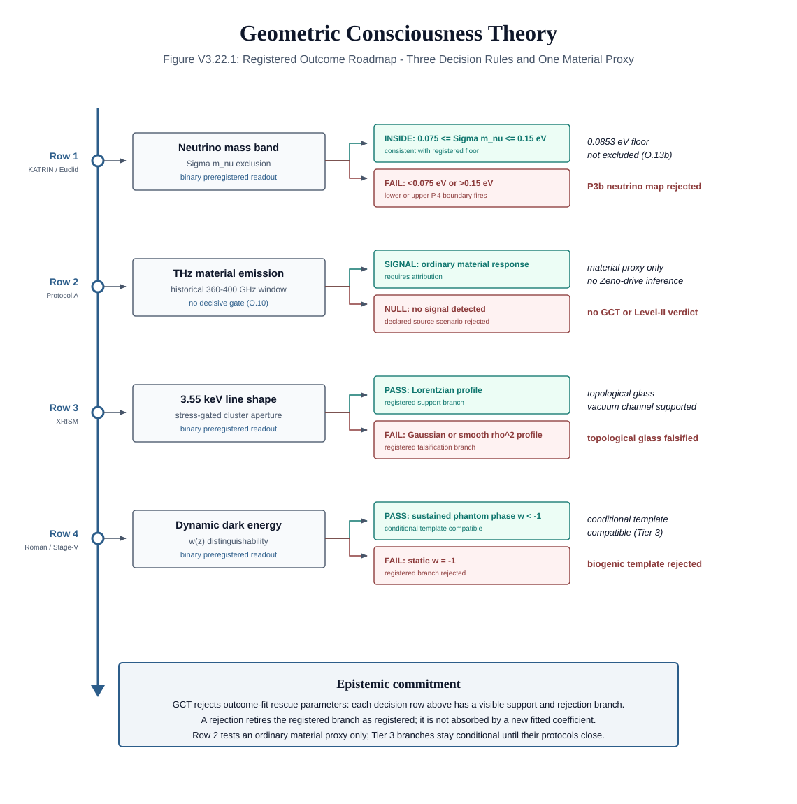
 
**22.1.2 Historical THz Material-Emission Scenario [Tier 3/open; O.10]**
Protocol A preserves an external ~360–400 GHz search window for a possible ordinary material-emission feature. The former "Physical Flash," the $B_{topo}$ source heuristic (central value $380 \pm 20$ GHz), the Zeno-leakage interpretation and the $N^2$ super-radiant amplitude are not action-derived.
* **The Test:** First close O.10 by specifying a source model, transfer function, radiometry, controls and power calculation, including the cavity-integrated blackbody background and the phase-coherence assumption behind any $N^2$ scaling (see V3 §13.3.2b); only then preregister an active-versus-anaesthetized comparison in synchronized neural cultures.
* **The Verdict:** A signal would be an ordinary material response requiring attribution; a controlled null would reject only the declared source scenario. Neither result supports or falsifies a Zeno Drive, an autopoietic renderer, phason coupling, an Identity Polaron, or Level II. Neither outcome is a verdict on GCT as a whole: the measurement tests an ordinary material proxy, and no phason, Selection-Operator or Level-II inference follows from it (V1 Ch17 §17.1.3). No decisive numerical gate is presently licensed; once O.10 licenses a powered gate, a preregistered null would reject the registered source scenario as registered.

**22.1.3 Isotope Substitution**
Protocol D compares isotope-dependent biophysical responses in the candidate spin/coherence architecture. It does not test consciousness, an Identity Polaron, or mind-in-nucleus status directly.
* **The Test:** Comparison of anesthetic thresholds and $T_2$ coherence times in $^{16}$O (spin-0) vs. $^{17}$O (spin-5/2) environments.
* **The Verdict:** A robust spin-dependent shift surviving chemical, mass and relaxation controls would support the declared biophysical response branch after systematic closure. Neither outcome is a verdict on GCT as a whole: the measurement tests an ordinary material proxy, and no phason, Selection-Operator or Level-II inference follows from it (V1 Ch17 §17.1.3). A preregistered result rejects the registered biophysical branch only under that branch's own decision rule (the Protocol D NMR polarity gate (P.13c) is held pending redesign: as written it rejected by construction, since $^{17}$O shortens water-$^1$H $T_2$ by scalar relaxation; the former sign-aware rule, which rejects the registered sign-positive branch on a powered, significant negative isotope × activity interaction in water-$^1$H $\Delta T_2$, applies only after the redesign, and until then no outcome supports or rejects the branch; the LORR assay has no operative gate, V3 Ch16 §16.4–§16.5). Neither result is sufficient for a phenomenal, Identity-Polaron, Level-II, or mind-in-nucleus inference; the typed coupling and independent phenomenal bridge remain open.

**22.1.4 Neutrino Mass Ceiling**
The conditional GCT branch places the lightest mass near $0.015$ eV [Tier 3 conditional: P3b/O.15(b)-conditioned absolute scale plus the measured electron anchor; Tier 2 only for the abstract squared-stiffness mechanism], while the current direct bound is KATRIN's $m_\nu < 0.45$ eV (90% CL, 2025), with a projected final sensitivity below $0.3$ eV [empirical bound / instrumental projection].
* **The Test:** Next-stage KATRIN operations.
* **The Verdict:** The conditional branch requires a **Non-Detection** by KATRIN at its final sensitivity (below $\sim0.3$ eV). A positive detection of a mass at that level would reject the **Tier 3 P3b-to-neutrino absolute-scale map** ($\phi^{-36}$, Tier 3 conditional); it would not by itself falsify the Tier 2 integer $D_{H_3}=18$ or derive an alternative stiffness ratio. Testing the $0.015$ eV floor requires a Project-8-class cyclotron-radiation experiment with sufficient endpoint sensitivity; no completion date is assumed.

> [!WARNING]
> **⚠️ Active Falsification Risk — Neutrino Mass Sum [Tier 3 — Active Tension]**
> The Tier 3 P3b-conditioned GCT target $\sum m_\nu \approx 0.0853$ eV is currently in **active $\Lambda$CDM-context tension**: it lies above both the Planck+DESI 2024 95% CL upper bound $\Sigma m_\nu<0.072$ eV and the tighter DESI DR2 + CMB bound $\Sigma m_\nu<0.0642$ eV, so a single "~2σ" figure would understate the DR2 tension (no posterior-based σ is quoted here). Under the registered P.4 exclusion band, those bounds are **TENSION**, not falsification. Definitive exclusion requires $\Sigma m_\nu<0.075$ eV or $\Sigma m_\nu>0.15$ eV in a pre-registered likelihood that includes CMB+BAO+LSS growth information. The gate becomes executable when such a likelihood reaches definitive sensitivity; no calendar is assigned. See App NSM for the construction and the GCT-native-likelihood survival path.

---

**22.2 Precision Validation after Facility and Sensitivity Closure**

If GCT passes the prerequisite-gated tests above, the program can shift toward high-precision validation of the 6D$\to$3D projection.

**22.2.1 Roman Telescope Dark Energy**
Roman/Stage-V-class low-redshift data can audit the **Biogenic Dark Energy Lagrangian** if the required precision and systematics conditions are met.
* **Prediction:** A sustained phantom phase where $w(z)$ remains below $-1$ for $z \gtrsim 0$ with operative Class-2 amplitude $|\Delta w(z\approx0.28)| \in [2,5]\times10^{-5}$ [calibrated, stipulated template; the phantom direction is Tier 4 because the written action cannot produce $w<-1$ without a ghost, V2 Ch14 §14.3.1], correlated with the integrated star-formation/metallicity history. The executable condition is a joint low-redshift analysis over $z\in[0.05,0.5]$ with precision below $5\times10^{-5}$ and the declared systematics controls. The Hubble tension is not a prediction of the V2 Ch14 §14.5.1 lag-kernel action. The separate registered multi-channel reconciliation with the DESI CPL fit is falsified under its own $3\sigma$ rule (DES-Dovekie $3.2\sigma$; DESI DR2 $3.1\sigma$ for BAO+CMB), a branch-level verdict (V2 Ch14 §14.6.3).

**22.2.2 Mass Spectrum Precision**
Protocol B defines a precision-improvement program for the lepton hierarchy conditional on deriving the $\mathcal{O}(\alpha^3)$ self-interaction terms. No precision outcome or comparative historical ranking is promised before that closure.

**22.2.3 Proton Mass from the Baryonic Triad**
Executing the high-resolution **Geometric Resonance Analysis** of the **Baryonic Triad** (Protocol F) evaluates the proton-mass formula $m_p = m_e \phi^{15+\phi^{-1}}$, whose output $1836.437\,m_e \approx 938.417$ MeV lies $+155$ ppm from the observed $1836.153\,m_e$, inside the registered 500 ppm postdiction band [Tier 2 mechanism + Tier 3 sheet/exponent handle pending AKN-action closure; a postdiction, not a live lattice-QCD falsifier; Tier 4 as evidence, App PSC §PSC.9.6] from the baryonic-triad winding (the formula does not use the Tier 3 string-tension bridge of V3 Ch18 §18.2.1) (see App PSC §PSC.3 for the three-values guide). This is the current proton-mass mechanism route, not a closed solution of the hadron mass gap from the current postulate set; further precision tightening targets the QLQCD-1L / AKN-action closure (App QLA).

**22.2.4 Cosmological Neutrino Detection**
Euclid/Simons-class joint data can test the conditional GCT mass sum $\sum m_\nu \approx \mathbf{0.0853 \text{ eV}}$ [Tier 3 conditional: P3b/O.15(b) + electron-mass and oscillation-data anchors] when the registered likelihood and sensitivity conditions are met.
* **The Binary Gate:** Euclid/Simons-class joint likelihood; $\Sigma m_\nu$ vs registered $<0.075$ eV / $>0.15$ eV exclusion band; prerequisite-gated falsification test. App NSM defines the gate and decision rule.
* **Falsification:** If the cosmological likelihood tightens below $0.075$ eV at definitive precision, or above $0.15$ eV, the P3b-conditioned mass-floor branch is definitively excluded. DESI 2024/DR2 bounds in the $0.064$-$0.072$ eV range are tension under $\Lambda$CDM, not the registered exclusion condition.

---

**22.3 Theory-Closure Program**

**22.3.1 Quasicrystalline Lattice QCD (QLQCD)**
Replacing periodic hyper-cubic grids with the **Aperiodic AKN Tiling** is a proposed QLQCD research route. Whether it addresses Strong CP or improves hadron-spectrum precision is an open computational and continuum-limit question, not a forecast.

**22.3.2 Probing Breakdown of the Metric**
The extreme-energy branch proposes tests for breakdown of the smooth-metric approximation through ultra-high-energy cosmic-ray dispersion. Observable 6D/lattice signatures and the required sensitivity remain open.

**22.3.3 Laboratory Quantum-Gravity Analogue — Facility-Conditional**
If a controllable macroscopic phason-condensate analogue and calibrated acoustic metric can be built, it could test laboratory manipulation of an analogue refractive geometry. This would be an analogue-gravity experiment, not a promised modification of physical spacetime.

---

**22.4 The Complete Scorecard**

We consolidate the results and open items of this work into a final epistemic audit (✅ a stated comparison or formal result that currently holds at the tier shown; ⚠️ a tension, registered-rule failure or calibrated row; ○ an open, adopted or conditional row).

**22.4.1 Structural Results and Adoptions (Tier 1 formalism; Tier 2/Tier 3 bridges as labelled)**
* ○ **Wheeler-DeWitt Equation ($\hat{H}\Psi=0$):** The universe as a self-defining nullity [Tier 1 canonical formalism; Tier 3 closed-system adoption].
* ○ **Dimensionality controls ($D=3, D=6$):** Classical one-dimensional knot types single out $D=3$ only conditional on the physical knot-carrier premise [Tier 1 topology + Tier 3 carrier/storage bridge]. The $D=6$ embedding follows within the icosahedral/Galois architecture [Tier 2], not from knot storage or entropy maximization alone.
* ○ **Standard Model Algebra:** An algebraic-dimension match (necessary, not sufficient) plus Tier 3 structural correspondence is compatible with the $\mathrm{SU}(3) \times \mathrm{SU}(2) \times \mathrm{U}(1)$ gauge-product candidate; the $\mathrm{SU}(3)$ factor is an open Tier 3 candidate (V3 Ch03), and the full physical Standard-Model identification (KO-dim-6 sign verification + first-order condition) remains conditional on App ORQ Open Problem O.32 closure (see Ch06 §6.5 for the necessary-but-not-sufficient algebraic-dimension result and the registered conditional structure).
* ○ **Photon Masslessness:** Gauge-protected Maxwell/residual-$U(1)$ masslessness in the continuum description is standard at the level of the gauge limit [Tier 1 constraint]; the GCT phason/tile-dynamics realization of that limit is a Tier 3 declared open programme (V2 Ch06 §6.1): as written, the V2 Ch06 locking potential gaps the phason mode.
* ○ **Born Rule ($P \propto |\psi|^2$):** Tier 3 conditional compatibility theorem under Gleason, pending App ORQ O.40a (countable additivity) and O.40b (noncontextuality) for the GCT Selection Operator measure.

**22.4.2 Geometric Comparisons (Postdictions, from the Quasicrystal Ansatz)**

> [!IMPORTANT]
> **Reading the scorecard.** The precision figures below are consequences of the **5-postulate-plus-6-continuous-anchor current accounting enumerated in Parameter Ledger §0.1**; they should be read in conjunction with the tier disclosures there. Where a row carries a precision figure (ppm, %, σ), the underlying Tier 2 framework is the icosahedral cut-and-project ansatz plus the Tier 3 specific exponents and disclosed continuous anchors catalogued in Ledger §0.1 P2-P5 and A1-A6. The named precision/gauge comparison subset's six calibrated Tier-3 coefficient handles ($1440$, $12$, $360$, $2$, $10\phi^2$, $1/5$) are counted separately; this is not a manuscript-wide total, and O.38 $N=144$ plus other sector-specific handles remain separately catalogued. The truly bare lepton ratios $\phi^{11}$, $\phi^{17}$ sit at $-3.75\%$ and $+2.69\%$; after the Tier 3 first-order coefficients the muon reaches ~0.24% and the tau (whose first-order formula is its full formula) −51 ppm; sub-percent precision figures include the radiative-correction provenance disclosed in App PSC §PSC.2.1 and A3 measured $\alpha(0)$ where the row says so. Every φ-formula match in §22.4.2–§22.4.3 (leptons, electron, proton, $\alpha$, $\sin^2\theta_W^{\rm bare}$, $G$, Higgs VEV, light quarks) is Tier 4 as evidence that φ or icosahedral structure is special: not distinguishable from numerology for strong effects (App PSC §PSC.9.6; §22.6).

* ○ **Weinberg Angle ($\sin^2 \theta_W^{\rm bare} = \phi^{-3}$):** Tier 3 gauge-kinetic hypothesis H-EW. The raw-frame identity of Theorem USS.9 is coordinate arithmetic, the canonical projectors give shares $1/2+1/2$, and the convention-correct one-loop comparator from this boundary misses the Z pole by 40.87% (Ch04 §4.3.3–§4.5.4). The bare 2.1% alignment with the Z-pole value is Tier 4 as evidence (App PSC §PSC.9.6), and the pre-registered gauge-running audit (App GRF §GRF.4.3) is a **FAILED check**: run top-down from {A2 = 24–25, H-EW, $\alpha_3^{-1}=10\phi^2$, $M_{\rm GUT}=3.2\times10^{16}$ GeV} with SM β-functions it gives $\sin^2\theta_W(M_Z)=0.058$–$0.067$ (best case $-52\sigma$ against the PDG 2026 $\overline{\rm MS}$ value $0.23122\pm0.00006$), and $\alpha_s(M_Z)$ is undefined (non-perturbative); no declared-input configuration reproduces $\sin^2\theta_W(M_Z)$, $\alpha_s(M_Z)$ or $\alpha_{em}(M_Z)$ (one borderline two-loop $\alpha_{\rm em}$ value, which imports the measured $\alpha_s$, is excluded by a post hoc judgement; App GRF §GRF.4.3) (App GRF §GRF.4.3); H-EW remains a Tier 3 hypothesis at an unspecified scale.
* ○ **Fine-Structure Constant bare relation:** $\alpha^{-1}_{\rm bare}=360\phi^{-2}=137.5078$ [Tier 3 numerical relation (Tier 3 600-cell multiplier; mechanism open — the RT solid-angle construction is withdrawn, V1 §13.2.1–§13.2.2); 3443 ppm residual pending O.5/O.19]. The correction direction needed to reach the measurement is empirical; calling it phason anti-screening is a Tier 3 candidate convention, not a derived response sign or mechanism.
* ○ **Fine-Structure Constant corrected closure target:** $\alpha^{-1}_{\rm GCT}=360\phi^{-2}(1-1/288)=137.0303$ [Tier 3 bilayer correction; 41.5 ppm residual pending O.5/O.19].
* ⚠️ **Newton's G ($6.689475523 \times 10^{-11}$ N m² kg⁻²) [Tier 2 thermodynamic mechanism + Tier 4 Planck-link conjecture + Tier 3 dimensional anchor]:** Jacobson horizon entropy supplies the thermodynamic mechanism, but the numerical Planck-link inherits O.14 and the $m_e$ SI anchor. The model-authoritative $\alpha_{\rm GCT}=\phi^2/360$ branch with CODATA $m_e$ and exact SI $h,c$ differs from CODATA 2022 by **2274 ppm**; the all-CODATA-$\alpha$ sensitivity branch differs by 2013 ppm. This row is the electron Planck-link row inverted ($G\propto m_e^{-2}$; 2013 ppm ≈ 2 × the electron's 1006 ppm), so it is not independent evidence and is not counted as a pass: it is a registered FAIL inherited from the electron row (P.1c), which misses its LOCKED rule.
* ⚠️ **Electron Mass ($m_e$):** **Tier 2 K-theoretic framework + Tier 3 exponent anchor + Tier 4 physical-link conjecture** (Parameter Ledger §0.1 P2; App ORQ O.14). The Coxeter-exponent arithmetic identifies $|n|=107$ as the $H_3$ power-sum label, while the load-bearing trace-image element is $\phi^{-107}$; mapping that $H_3$ invariant through the 6D AKN $V\to K_0(\mathcal{A})\to\tau_*(K_0(\mathcal{A}))$ physical-link chain remains open. The anchor-normalized check $m_e = M_P \phi^{-107}(1-5\alpha)$ matches CODATA-2022 to **1006 ppm** on canonical inputs, which misses the LOCKED 1000 ppm pre-commitment by 6 ppm (App FSM P.1c reports a FAIL of that rule; the later 1500 ppm band is not retroactive); the specific exponent and physical-link chain remain O.14-governed rather than theorem-grade derivations.
* ⚠️ **Muon g-2 [Tier 2 mechanism + Tier 3 $1/5$ coefficient + A3 + Tier 4 calibration-survival conjecture: TENSION under WP2025]:** Geometric mechanism via $\Delta a_\mu \approx 250.65 \times 10^{-11}$ through the equal-weight 1/5 icosahedral phason vertex coefficient. **WP2025 disposition (App PSC §PSC.2):** under the consolidated lattice-QCD HVP synthesis (BMW/RBC HVP + Fermilab E989 final + CMD-3) the SM-vs-experiment gap is ~0.6σ ($38(63)\times10^{-11}$), so the GCT correction overshoots the WP2025 residual by ~3.3σ; it is not load-bearing empirical evidence under WP2025 and sits in tension. The §8.7.2 HVP scenarios A/B/C contingency framework remains the canonical disposition.
* ○ **Lepton Masses ($\phi^{11}, \phi^{17}$) [postdictions]:** Tier 2 mechanism (harmonic ladder on the dodecahedral cage, conditional on the Tier 3 $\phi$-step, V3 Ch08 §8.1.2) + Tier 3 specific exponents $N=11$ (muon) and $N=17$ (tau) per Parameter Ledger §0.1 P4/P5. Residuals **muon −21 ppm (CODATA 2022), tau −51 ppm (PDG 2024)** via A3 measured $\alpha(0)$, the Tier 3 coefficient rules $+5\alpha$ and $\phi^8\alpha^2$ (whose −3 exponent selection inherits the H-EW boundary), and the inserted Tier 3 tau rule $-3.6\alpha$ (whose negative polarity is not derived; Galois conjugation fixes no response sign). The corrected rows are therefore conditional on A3, H-EW and these Tier 3 coefficient rules. The muon mass is measured to 22 ppb (CODATA 2022), so the ~21 ppm residual is a Tier 3 formula residual of order $10^3\sigma$ in measurement terms; the earlier "SM corrections already incorporated, ~10–40 ppm theory floor" argument is withdrawn. The tau row sits at its gate (⚠️ tension). *The truly bare $\phi^{11}$ and $\phi^{17}$ ratios sit at $-3.75\%$ and $+2.69\%$; after the Tier 3 first-order coefficients the muon reaches ~0.24% and the tau −51 ppm.*
* ○ **Proton Mass ($\phi^{15.618}$) [postdiction]:** **Tier 2 mechanism + Tier 3 sheet/exponent handle pending AKN-action closure.** Formula output $1836.437\,m_e$ vs observed $1836.153\,m_e$ (+155 ppm), inside the registered 500 ppm postdiction band; not a live lattice-QCD falsifier.
* ○ **Icosahedral Architectural Selection:** App USS records $A_5$ as the Tier-2 architectural premise H1 and derives exact conditional Schur-cover and McKay consequences; it does not prove point-group uniqueness or eliminate other spinorial point groups. The $\phi$-slope global entropy-maximality claim remains an open primary-candidate claim.

**22.4.3 Tier 3 Phenomenological Models (Pending Derivation)**
* ⚠️ **Higgs VEV Absolute Scale (246 GeV) [Tier 3]:** Mechanism proposed (not established), magnitude calibrated.
* ⚠️ **Light Quark Absolute Masses [Tier 3]:** Ratios: Tier 3 scaling heuristic (V3 Ch17 §17.2.2); the u/d ratio is the Tier 3 identification $m_d = m_u\phi^{\phi}$ (V3 Ch10 §10.4); the earlier face-area derivation of $\phi\sqrt2$ is withdrawn (V3 Ch17 §17.2.3); absolute values require QLQCD.
* ⚠️ **Dark Energy Susceptibility ($\chi = \pi(c/H_0\ell_P)^2 \approx 2.27\times10^{122}$) [Tier 2 functional form + Tier 3 numerical value]:** The holographic area-law identification of V2 Ch14 §14.1.5; the value imports the Planck 2018 $H_0$ pending O.4.

---

**22.5 The State of the Theory (Final Assessment)**

**22.5.1 What GCT Proposes and Has Shown**
GCT proposes a framework in which the "Hard Problem" of consciousness and the "Hard Problems" of physics are addressed within one geometric programme [Tier 3/4]. On that reading, the apparent arbitrariness of nature—the specific values of masses and forces—would be the structural signature of an icosahedral vacuum; the arbitrariness reading is a programme claim, not a result. GCT proposes that the Standard Model emerges from two philosophical axioms and the icosahedral geometric framework parameterised by $\phi$ (the SU(3) factor and H-EW remain open Tier 3 candidates) — the **5-postulate-plus-6-continuous-anchor current accounting** of Parameter Ledger §0.1 (P1 icosahedral cut-and-project ansatz, P2-P5 the integer exponents $n=-107$, $D=18$, $N=11$, $N=17$ each with explicit tier disclosure and Open Problem closure paths, A1 the dimensional anchor $m_e$, A2 the native-RGE endpoint anchor, A3 measured low-energy $\alpha(0)$ for corrected precision-comparison rows, and A4-A6 the App GRF $Z_1$, $Z_2$, $Z_3$ $\beta$-coefficient magnitude normalisations). The named precision/gauge comparison subset's six calibrated Tier-3 coefficient handles ($1440$, $12$, $360$, $2$, $10\phi^2$, $1/5$) are counted separately from those anchors; the subset is not an exhaustive handle count, and O.38 $N=144$ plus other sector-specific handles remain separately catalogued. References to $\phi$ as the structural constant are structural-constants-only language; the full free-parameter accounting is partitioned in Ledger §0.

**22.5.2 What Remains Open**
**Parametric Status: Gauge and Lepton Sectors**

Within the **5-postulate-plus-6-continuous-anchor current accounting** of Parameter Ledger §0.1 (P1 icosahedral cut-and-project ansatz; P2-P5 the integer exponents $n=-107$, $D=18$, $N=11$, $N=17$; A1 the dimensional anchor $m_e$; A2 the $\alpha_2^{-1}(M_{\rm GUT})$ native-RGE endpoint anchor; A3 measured $\alpha(0)$ for corrected precision-comparison rows; A4-A6 the App GRF $Z_1$, $Z_2$, $Z_3$ $\beta$-coefficient magnitude normalisations), the lepton mass hierarchy is expressed through a Tier 2 icosahedral mechanism and the bare fine-structure constant through a Tier 3 numerical relation (mechanism open, V1 §13.2.1–§13.2.2), with Tier 3 specific integers and multipliers (P2-P5; the $360$ handle), with no continuous fit beyond the listed anchors and handles, while the bare electroweak angle (H-EW) and the SU(3) factor remain open Tier 3 inputs. The named precision/gauge comparison subset's six calibrated Tier-3 coefficient handles ($1440$, $12$, $360$, $2$, $10\phi^2$, $1/5$) are counted separately; this is not a manuscript-wide total, and O.38 $N=144$ plus other sector-specific handles remain separately catalogued. The corrected ppm comparison rows inherit A3 until the O.19/O.5 bare-to-physical alpha bridge closes. The governing constraint is the 5-postulate-plus-6-continuous-anchor structure, *not* the closed one-parameter horizon. The closure target is the 1-parameter limit P1 + $m_e$; each of P2-P5 is currently a Tier 2 mechanism plus a Tier 3 specific integer choice awaiting first-principles derivation under Open Problems O.5, O.14, and O.15 (for $D=18$ the integer itself is Tier 2, while the stiffness map $K_\perp/K_\parallel=\phi^{-18}$ is the separate Tier 3 hypothesis P3b, listed outside the count like H-EW), A2 awaits the QLQCD-1L/App GRF boundary derivation (after the FAILED gauge-running audit of App GRF §GRF.4.3, whether to retire A2 and A4–A6 is an open v1.4.0 decision; v1.3.0 retires nothing and keeps the counts), A3 awaits O.19/O.5, and A4-A6 await their App GRF §GRF.5.1 ab-initio derivations.

**Epistemic Boundary Clarification.** The structural constraint above applies strictly to the bare fine-structure constant and the lepton mass ratios; the bare electroweak angle (H-EW) and the SU(3) factor are open Tier 3 inputs outside it. The **absolute dimensional scale** (the electron mass $m_e$ and all quantities derived from it, including Newton's $G$) constitutes a **1-DOF dimensional system** anchored to $m_e$ as the A1 SI-unit reference. The dimensionless ratio $m_e/M_P = \phi^{-107}(1-5\alpha)$ is structured by the K-theoretic gap-labeling framework, but the integer bookkeeping must not be conflated: $107$ is the $H_3$ Coxeter-exponent power-sum label, while $\phi^{-107}$ is the trace-image candidate in the AKN gap-label chain. The *uniqueness* of the exponent $-107$ inside $\tau_*(K_0(\mathcal{A})) \subset \mathbb{Z}[\phi]$ and the physical-link map from the $H_3$ invariant to the 6D AKN trace image remain **Open Problem O.14** (the 1D Fibonacci toy-model identification is closed; the 6D AKN lift is not). Full non-perturbative extraction via the spectral zeta function on the AKN hull is the closure target. The Quark sector (irrational exponents in $m_c$ and the higher CKM mixing angles $s_{23}$, $s_{13}$) remains **Tier 3 Ansatz** pending Fuglede-Kadison determinant closure (Open Problem O.5). The down-quark route is a Tier 2 mechanism whose adopted primary conditional output is $m_d=m_u\phi^{\phi}=4.716$ MeV ($+0.33\%$); its exact $R=2$ finite-cage branch $m_d=4.848734$ MeV ($+3.1645\%$, displayed as $+3.16\%$) is a secondary algebraic diagnostic. Both lie inside the registered 110000-ppm gate; rigorous infinite-volume convergence and the algebraic-field identification remain open under O.5 (App PSC §PSC.8; App TPR §TP-B).

Two correction terms not yet derived from first principles constitute the **remaining parametric debt** of the program:

1. **Candidate Phason Anti-Screening Correction (0.34% residual) [Tier 3 — open research debt]:** The tree-level formula $\alpha^{-1} = 360\phi^{-2}$ [Tier 3 numerical relation; mechanism open, V1 §13.2.1–§13.2.2] supplies the baseline. The 3443 ppm discrepancy fixes only the correction direction required by the observed value. "Anti-screening" is an inserted Tier 3 candidate interpretation; the present 6D action derives neither the sign nor the mechanism. An explicit normalized response calculation from the 6D lattice action (quantifying the bosonic phason loop on the AKN tiling) remains the primary open QLQCD task (Appendix QLA).

2. **Healing length:** $\xi = a_0/\alpha = \hbar c/(\alpha^2 m_e c^2) \approx 7.25$ nm [Tier 1 arithmetic; its identification as the vacuum/polaron healing length is Tier 3]. The implied polaron diameter (2ξ ≈ 14.5 nm) fits the microtubule lumen inner diameter (~15–17 nm), a 3–17% fit. Deriving this length from the 6D phason stiffness parameters $K_\perp$, $K_\parallel$ remains open; the phason-stiffness healing-length route of App GPE closes negatively.

Per the Parameter Ledger: GCT has a 5-postulate + 1-anchor bare topology/exponent sub-sector (A1 $m_e$), uses A2 ($\alpha_2^{-1}(M_{\rm GUT})$ Tier-3 calibrated boundary; its value 24–25 is the MSSM unified coupling, Langacker & Polonsky, Phys. Rev. D 47, 4028 (1993), whereas in the SM the couplings do not unify) and A4-A6 (the App GRF $Z_1$, $Z_2$, $Z_3$ normalisations) for the native-RGE endpoint check, and uses A3 (measured low-energy $\alpha(0)$) for corrected precision-comparison rows. The six A-sector entries are continuous anchors. The named precision/gauge comparison subset's six calibrated Tier-3 coefficient handles ($1440$, $12$, $360$, $2$, $10\phi^2$, $1/5$) are explicitly counted separately; this subset is not a manuscript-wide handle total, and O.38 $N=144$ plus other sector-specific handles remain separately catalogued. The one-parameter state remains the closure target, not the present status.

While a *structure* for the simulation reading is proposed [Tier 3/4], the *origin* of the initial 6D lattice constant ($a_6$, of order $\ell_P$; $a_6 = 2\ell_P$ in the horizon-entropy calibration) remains a foundational input. The derivation of the absolute Higgs VEV and the full closure of the CKM/PMNS matrices remain the primary theoretical frontiers.

**22.5.3 The Path Forward**
The proposed path forward is **Crystallographic Decoding** [Tier 3/4 programme]: anomalies in the data are treated as candidate clues to local lattice defects. Parameter-fitting is not over—the anchors and calibrated handles of Ledger §0.1 remain—but the programme aims to replace them with derived integers and normalisations, reading the cosmos as structured code rather than as a landscape of random numbers.

---

**22.6 The Invitation**

To the experimentalists: Nine protocols (A–I, Chapters 13–21) define explicit observables, but each becomes executable only when its registered facility, sensitivity, systematics, and preregistration conditions are met. Break the branches that reach those conditions.

To the computational physicists: The code documented in Appendix GPE is a starting point. We invite you to scale the lattice simulations to 6D periodic boundaries; whether sparse-matrix methods on aperiodic grids help QCD is an open question.

To the skeptics: the accounting is on the table. Parameter Ledger §0.1 enumerates the five postulates and six continuous anchors this sector rests on; App PSC §PSC.2.1 records the radiative-correction provenance of the ppm comparisons; App PSC §PSC.9.4–§PSC.9.5 states the scope of the cross-base control; and App PSC §PSC.9.6 reports the constant control test. The muon at 21 ppm, the tau at 51 ppm, and the proton at 155 ppm are postdiction residuals that stand or fall on those disclosures. Earlier global-significance figures for the numerical matches are withdrawn: the cross-base comparison could not, by construction, credit any base other than $\phi$, and the trial counts behind the quoted σ values were asserted rather than enumerated. The preregistered constant control test that compares $\phi$ against other constants under identical formula freedom has now reported. As evidence that φ or icosahedral structure is special, these matches are **Tier 4**: the test (v3, NEGATIVE-FRAGILE; App PSC §PSC.9.6) found φ's pattern of matches on 21 constants not distinguishable from that of random constants (58 of 300 random bases did at least as well). The test "excludes, at power ≥ 0.8, an effect in which φ hits at least 6 of the 8 informative rows through a real effect; weaker effects are not excluded." It is non-confirmatory, and the numbers are kept as descriptive arithmetic; no global significance is claimed for the matches, and no individual match is cited as evidence on its own strength. Read the disclosures, and then break the theory.

---

**22.7 Epistemic Verdict (Final Statement)**

Geometric Consciousness Theory (GCT) does not claim to have "solved" consciousness or proven that the mind is the sole cause of the universe. Instead, the **geometric consciousness-first model**, built on the 5-postulate-plus-6-anchor current accounting enumerated in Parameter Ledger §0.1, is compared with precision data from the Standard Model and contemporary cosmology. The DESI-context neutrino-mass tension is an active sensitivity-gated test under App NSM, not a calendar prediction.

We have set out an explicit hierarchy of certainty:
1. **Open Tier 3 candidate:** the icosahedral route to the gauge-group structure and dimensionality (the $\mathrm{SU}(3)$ closure is not specific to the RT window), with the physical Standard-Model identification at Tier 3 and theorem-grade uniqueness over compact Lie groups recorded as O.39.
2. **Tier 2 mechanisms with Tier 3/Tier 4 anchors and residuals:** lepton mass-spectrum harmonic-ladder mechanism (Tier 2) plus the $N=11$ and $N=17$ specific exponents (Tier 3 anchors pending O.5/O.14/O.15); fine-structure-constant $360\phi^{-2}$ as a Tier 3 numerical relation (Tier 3 600-cell multiplier; mechanism open — the RT solid-angle construction is withdrawn, V1 §13.2.1–§13.2.2) plus the 3443 ppm bare residual (Tier 3 pending O.19/O.5); as evidence that φ is special, the numerical matches of this tier are Tier 4 (App PSC §PSC.9.6).
3. **Tier 3 (Phenomenological/Hypothesis):** The biophysical Zeno Drive and the Biogenic Dark Energy correlation template (its phantom direction is Tier 4: no ghost-free action produces it, V2 Ch14 §14.3.1).

While the Tier 2 structures motivate a crystalline-vacuum research programme, the physical mass assignments remain conditional on the disclosed Tier 3/4 bridges, and the Tier 3 extensions remain high-risk hypotheses. Our invitation is not for blind acceptance, but for rigorous falsification. Failure of a registered extension would reject that branch; the surviving arithmetic and representation structure would remain a candidate framework, not a derived stable-particle spectrum.

The door is open. The staircase of certainty is aimed at a universe that would be fundamentally intelligible, unified, and structurally consistent with the existence of agency; whether it gets there is what the registered gates decide.

---

**22.8 Parametric Closure and Theoretical Autonomy**

GCT's accounting has a **5-postulate-plus-1-anchor bare lepton sub-sector; the native-RGE endpoint and precision-comparison rows add anchors A2–A6 (Parameter Ledger §0.1)**: the bare ratios $\phi^{11}$, $\phi^{17}$ follow from the icosahedral cut-and-project ansatz (P1) plus the integer exponents $n=-107$, $D=18$, $N=11$, $N=17$ (P2-P5) — each a Tier 2 postulate (mechanism) plus a Tier 3 specific value (integer choice) pending first-principles derivation under Open Problems O.5, O.14, O.15. The bare fine-structure relation $360\phi^{-2}$ is a separate Tier 3 numerical relation that uses the Tier 3 handle 360 (mechanism open; V1 §13.2.1–§13.2.2). The corrected lepton rows $m_\mu/m_e$, $m_\tau/m_e$ need more than this sub-sector: A3 (measured $\alpha(0)$), the Tier 3 coefficient rules $+5\alpha$, $\phi^8\alpha^2$ and $-3.6\alpha$, and, through the exponent selection of the $\phi^8\alpha^2$ term, the H-EW boundary. For $D=18$ only the integer is Tier 2; the physical stiffness map $\phi^{-18}$ (P3b) is a registered Tier 3 hypothesis outside the count, like H-EW. The bare electroweak angle $\phi^{-3}$ is not among them: it is the separate Tier 3 hypothesis H-EW (V3 Ch04 §4.3), outside this count. The **absolute dimensional mass scale** adds the SI-unit anchor A1 ($m_e$), the native-RGE endpoint audit uses A2 and A4-A6, and corrected lepton/Higgs/QED comparison rows use A3. A4-A6 are the App GRF $Z_1$, $Z_2$, $Z_3$ $\beta$-coefficient magnitude normalisations. The named precision/gauge comparison subset's six calibrated Tier-3 coefficient handles ($1440$, $12$, $360$, $2$, $10\phi^2$, $1/5$) are counted separately; this subtotal is not manuscript-wide, and O.38 $N=144$ plus other sector-specific handles remain separately catalogued. The K-theoretic blueprint for $\phi^{-107}$ currently reaches a gap-label/dimension-group trace skeleton at the 1D Fibonacci toy-model level; the explicit Dixmier-residue/spectral-triple computation and the 6D AKN trace-image lift remain open as O.14. The down-quark route is a Tier 2 Fuglede–Kadison-determinant mechanism with adopted primary conditional output $m_d=m_u\phi^{\phi}=4.716$ MeV, postdiction-consistent at $+0.33\%$ inside the registered 110000-ppm (11%) shell-resonance gate. The exact $R=2$ finite-cage value $m_d=4.848734$ MeV is retained as a secondary algebraic diagnostic at $+3.1645\%$ (displayed as $+3.16\%$), also inside the gate. Its FK sequence centers on $\phi^{\phi}$ with an empirical decaying envelope; rigorous infinite-volume convergence and the algebraic-field identification remain bundled with O.5. Three quark-sector formulas with irrational exponents ($m_c = m_u\phi^{13+\phi^{-3}}$; CKM $s_{23}$, $s_{13}$) remain **Tier 3 Empirical Ansätze**: for $s_{23}$ and $s_{13}$ the standalone K-theoretic gap-label route is ruled out (App TPR §TP-F) and the residual bundles with O.5; the charm route is addressed by TP-B finite-size scaling (Open Problem O.5, Ch10). These three quark-sector exponents are among the remaining heuristic inputs catalogued in Ledger §0.1, alongside the Tier 3 specific values of P2–P5, the calibrated handles, O.38 $N=144$ and P3b.

The roadmap for **Parametric Closure and Theoretical Autonomy** focuses on two discrete objectives:
1. **Geometric Renormalization Group Equations (RGEs):** Standard Model QCD and QED RGEs flow the bare lattice masses (e.g., $m_{bare} = 174.1$ GeV for the Top) down to their dressed pole masses. The top value ($174.07$ GeV against the PDG 2024 direct-measurement mass $172.57 \pm 0.29$ GeV, $5.18\sigma$) currently lies outside P.24's written PDG $\pm5\sigma$ falsification rule, a FAIL of that rule; a flow-based pole/$\overline{\rm MS}$ uncertainty band would be a new pre-registered band, registered prospectively, not a retroactive rescue. Appendix GRF supplies a candidate native flow ("GCT-Native RG Flow"): the U(1)$_Y$ and SU(2)$_L$ $\beta$-function *shape* is modeled by a Tier 3 icosahedral $I_h$ irrep-activation ansatz with the canonical projector shares $1/2+1/2$, whose activation schedule and sign assignments are Tier 3 model inputs (no continuous shape parameter is fitted). The saturated coefficients $b_1^\text{GCT}(M_\text{GUT}) = +41/6$, $b_2^\text{GCT}(M_\text{GUT}) = -19/6$, $b_3^\text{GCT}(M_\text{GUT}) = -7$ are reproduced **by construction** through three icosahedral normalisations $\{Z_1, Z_2, Z_3\}$ that absorb the substrate-to-PDG absolute magnitude — one anchor per coupling, in direct analogy to the single $m_e$ anchor of the lepton sector. Beyond $M_\text{GUT}$ the GCT flow saturates (the finite irrep tower of $I_h$ caps the $b_i$), giving GCT a **combinatorial UV cutoff** rather than a Weinberg–Reuter asymptotic-safety non-Gaussian fixed point. Status:
 - $\alpha(\mu)$ shape: **Tier 3** (activation ansatz, App GRF); endpoint **Tier 3** (one $Z_1$ anchor)
 - $\sin^2\theta_W(\mu)$ shape: **Tier 3** (activation ansatz, App GRF; V3 Ch04 §4.5.1); the native activation kernel (with imported A2) lands 26.66% low at the endpoint, and the pre-registered gauge-running audit (App GRF §GRF.4.3) is a **FAILED check**: run top-down from {A2 = 24–25, H-EW, $\alpha_3^{-1}=10\phi^2$, $M_{\rm GUT}=3.2\times10^{16}$ GeV} with SM β-functions it gives $\sin^2\theta_W(M_Z)=0.058$–$0.067$ (best case $-52\sigma$ against the PDG 2026 $\overline{\rm MS}$ value $0.23122\pm0.00006$), and $\alpha_s(M_Z)$ is undefined (non-perturbative); no declared-input configuration reproduces $\sin^2\theta_W(M_Z)$, $\alpha_s(M_Z)$ or $\alpha_{em}(M_Z)$ (one borderline two-loop $\alpha_{\rm em}$ value, which imports the measured $\alpha_s$, is excluded by a post hoc judgement; App GRF §GRF.4.3) (App GRF §GRF.4.3). A2 and H-EW cannot both hold for any SM extension; H-EW remains a Tier 3 hypothesis at an unspecified scale
 - $\alpha_s(\mu)$ bare: the factors $10$ and $\phi^2$ have geometric provenance, but their strong-sector product $10\phi^2$ is a **Tier 3 calibrated handle** pending O.42/QLQCD-2 (App QLA.7); running: **Tier 3** (QLQCD-2 pending); under SM running from $M_{\rm GUT}$ the handle drives $\alpha_3^{-1}$ to zero at $2$–$6\times10^6$ GeV, so $\alpha_s(M_Z)$ is undefined (FAILED check, App GRF §GRF.4.3)
 
 The remaining open work — full Tier-2 ab-initio derivation of the three $Z_i$ from the spectral action / QLQCD non-perturbative closure (App QLA) — is the canonical path to total RGE autonomy. See **Appendix GRF** for the Tier 3 activation ansatz and `protocol_rge_native.py` for the numerical audit.
2. **The Subjective Lagrangian Calculus [Tier 4 programme target]:** Expanding the Tier 3 phenomenological surrogate $\mathcal{S}_{Agent}$ of V1 Ch16 §16.5 into a computable calculus. This would entail calculating explicit $\delta \mathbf{w}$ metabolic friction coefficients for specific human psychophysical states; such coefficients would be a precondition for, not a demonstration of, any quantitative Mind-Brain bridge, which remains open.

The reported parameter comparisons define a closure program; further substrate engineering is conditional on the unresolved physical, experimental, and epistemic gates above.

---

**22.9 Coverage Map and Scope Notes**

GCT's ambition is a self-contained framework for any domain to which its machinery has structural grip. The three volumes develop that machinery in physics, cosmology, and the consciousness substrate; V1 Part VI ("Applications & Open Domains") extends it into psychology, social systems, aesthetics, contemplative practice, theology, self-reference, and philosophy of science. This concluding section enumerates the *remaining* domains, the recommended treatment level for each, and the explicit scope notes that delineate where the framework provides ontological context rather than predictive instruments.

**22.9.1 Domains adjacent to current coverage (one-paragraph notes here; full treatment is companion-paper material)**

- **Language phonology and lexical semantics** under the Quality Space framework: the same icosahedral irreducible representations proposed to decompose colour and audition (V1 Ch16 §16.2.2c; the modality map is Tier 3) could constrain the acoustic-perceptual space of phonemes [Tier 4]. A Tier 4 speculative hypothesis is that phonemic inventories across the world's languages cluster around the irrep boundaries of the human auditory Quality Space (the modality-to-irrep map is itself Tier 3); an empirical companion-paper target.
- **Cognitive development and learning trajectories**: a chosen $p$-adic address filtration (V1 Ch07 §7.3.2; coupling kernel §7.6.3) could serve as a Tier 4 analogy for nested Piaget-style developmental resolutions, with a caregiver coupling $\kappa_{ij}$ stabilising early branches. It becomes a Tier 3 coding model only after a physical map assigns states to Solenoid addresses, physical dynamics selects the filtration, and the caregiver coupling is derived. Solenoid topology alone supplies neither developmental stages nor stabilising relationships. Treatment depth: a future "GCT Developmental Psychology" paper.
- **Dyadic relationships and attachment dynamics**: ordinary HRV / EEG cross-spectral coherence in long-term partners could test a phenomenological $\kappa_{ij}$ proxy against shared-environment baselines [Tier 3 companion-paper target]. Such a result would be a physiological/behavioral correlation only; it would not establish Polaron coupling, a Selection network, shared subjecthood, or GCT, since Identity-Polaron construction and $\kappa_{ij}$ remain open. Companion-paper material.
- **Decision theory and the Subjective Lagrangian** (a Tier 4 programme target in §22.8, built on the Tier 3 surrogate of V1 Ch16 §16.5; not yet developed) could be extended by analogy to game theory, rational choice, and the geometry of preference [Tier 4]; a Bayesian-staircase formulation would warrant a dedicated decision-theory monograph.
- **Plant, fungal, and microbial candidate controls** (V1 §16.2.6): chiral, nuclear-spin-bearing preparations can test the proposed mechanism, but neither descriptor establishes Level II; the Level II status of every substrate is open (Tier 3): no validated substrate criterion exists yet (it requires a typed, normalized, measured coupling, the Identity-Polaron construction and an independent phenomenal bridge; O.21/O.23/O.34, O.18).
- **Memory taxonomy** (episodic / semantic / procedural): mapping memory types to depths of a chosen address filtration (deep branches = semantic, surface branches = episodic, procedural memory = $\kappa_{ij}$-coupled body sub-network) is a Tier 4 analogy unless a physical address code and read/write dynamics with noise protection and measured lifetimes are supplied. Deep cylinders are not shown to be intrinsically more durable memories.
- **Friston Free-Energy Principle bridges**: predictive processing may be compared formally with a stipulated Selection-cost functional, and active inference with a $\delta\theta_{\text{will}}$ control surrogate. This is a Tier 4 analogy: no thermodynamic Selection Operator, intent channel, physical friction law, owner, or phenomenal bridge has been derived. A future paper comparing FEP and GCT could make the analogy precise.
- **Generative syntax** [Tier 4 analogy]: with corpus input, GCT could frame syntactic universals as Quality-Space patterns coordinated by multi-agent communicative selection; specific computational operations (Merge, X-bar) are downstream architectural choices not derivable from $m_e + \phi$ alone.

**22.9.2 Scope notes (explicit boundaries)**

- **Climate, geophysics, ecology, planetary systems** are *applicable with inputs*: GCT provides the ontological context (matter as topological defects, gravity through the horizon-thermodynamic route of V2 Ch09 — the phason-elasticity route to $G$ is retired — biological agency under the Dual Material Constraint) but is not the practical instrument for object-level prediction. Just as one uses Newtonian mechanics rather than General Relativity to predict the orbit of Saturn, climate / ecology / planetary dynamics use domain-specific models that GCT does not aim to replace.
- **Mathematics itself**: per V1 §1.3.5 and V1 §6.4.5, mathematical objects are patterns over Field configurations, not Field configurations themselves; they do not inherit Level I presence. The instantiation of doing mathematics in a Class 2 Polaron has presence in the ordinary way. Confusing the two collapses the Field/Pattern distinction and converts the theory into a substrate-less Mathematical Universe (a position GCT does not adopt).
- **Cultural anthropology, ritual analysis, gender / sexuality**: the multi-Polaron Consensus Protocol is at most a model-internal Tier 4 analogy here (no physical Consensus Protocol is derived; V1 Ch11, V1 Ch15), and specific cultural content requires ethnographic input the framework does not generate. These are downstream cultural-science domains; GCT provides the substrate ontology, not the object-level claims.
- **Specific quantum-gravity competitor programmes** (string theory, loop quantum gravity, causal dynamical triangulations): GCT is distinguished from these in principle, not yet empirically: its architecture is different, and its numerical rows are postdictions (the bare lepton ratios sit in the 5-postulate-plus-1-anchor sub-sector of Parameter Ledger §0.1; the bare $\alpha$ relation is a separate Tier 3 numerical relation, the corrected rows add A3, H-EW and Tier 3 coefficient rules, and the native-RGE endpoint adds A2 and A4–A6). The phantom-side dark-energy template is a stipulated forward template whose phantom direction is Tier 4 (V2 Ch14 §14.3.1), and no PTA $\ell=6$ response is derived (Ch21), so neither separates GCT from these programmes. Quasicrystalline-spacetime programmes form a closer comparison class. Boyle and Mygdalas, "Spacetime Quasicrystals" (arXiv:2601.07769), construct Lorentzian quasicrystals by a $(9+1)$D embedding and explore a speculative Planck/electroweak/vacuum seesaw, whereas GCT adopts a Euclidean primitive-$P$ rank-six icosahedral cut-and-project architecture, linked conditionally to the distinct McKay $2I\to E_8$ and Elser–Sloane $E_8\to H_4$ results, with a proposed emergent Lorentz symmetry and a conditional golden-ratio mass cascade (Tier 2 mechanisms with Tier 3 exponents and disclosed anchors). Aschheim, Bubuianu, Fang, Irwin, Ruchin, and Vacaru (*Annals of Physics* 394:120-143; arXiv:1611.04858) provide an E8-derived quasicrystal-vacuum cosmology programme, but without a derived Standard Model mass spectrum. Detailed competitive analysis is reserved for future work; the manuscript states only the architectural difference.

**End of Coverage Map.**

**END OF VOLUME 3**

---

## Backmatter

#### **Glossary of Terms (The Matter Spectrum)**

* **Acceptance Window ($W$):** The 3-dimensional volume in the internal manifold ($E_\perp$) that filters 6D lattice nodes for actualization. In GCT, this window is the **Rhombic Triacontahedron (RT)**, the icosahedral projection of a 6D hypercube.
* **Baryonic Triad:** The candidate topological configuration of the Proton [Tier 2 mechanism + Tier 3 sheet/exponent handle], consisting of three interstitial face-mismatches (quarks as face defects is a Tier 3 assignment) stabilized by a 5-fold lattice star. Its mass ratio is given by the formula $m_p/m_e = \phi^{15 + \phi^{-1}} \approx 1836.437$ against the observed $1836.153$ (+155 ppm, a postdiction within a 500 ppm band; **Tier 4 as evidence** (φ-formula match; App PSC §PSC.9.6)); the formula is evaluated arithmetically, not extracted as an eigenvalue.
* **Codimension:** The difference between the dimension of the embedding space ($D=3$) and the dimension of a defect. Leptons (vertex-centered) have codimension 3; Quarks (face-centered, a Tier 3 candidate assignment) have codimension 1. This difference is proposed [Tier 3 heuristic] to underlie their different mass-scaling rules (V3 Ch08, V3 Ch10).
* **Color Charge:** Tier 3 candidate identification (V3 Ch03): the azimuthal orientation of an interstitial defect’s Burgers vector relative to the 10 three-fold rotational axes of the RT window.
* **Dodecahedral Cage ($N=144$):** The candidate topological structure of the Electron core. Its 144-node count is adopted as a Tier 3 structural posit; $144=F_{12}=12^2$ and the exact icosahedron/dodecahedron Gauss--Bonnet totals are consistency checks, not a size derivation. Ground-state selection requires the O.38 full-lattice minimisation.
* **Gluon String:** A 1D tube of phason strain representing the elastic resistance of the vacuum to tile-mismatch. In the Tier 3 candidate picture (V3 Ch03) it provides a proposed mechanical mechanism for confinement and carries the candidate $SU(3)$ generators.
* **Koide Convergence:** The empirical summation rule ($K\approx2/3$) governing lepton masses. Its GCT reading as a unitarity constraint on the 6D$\to$3D projection is a Tier 3 candidate identification, not a Tier 2 derivation. The phason drag of the Muon ($+5\alpha$) and the volume screening of the Tau ($-3.6\alpha$) do not cancel in $K$: each lowers it, and together they give $K=0.66688$ at first order (V3 Ch08 §8.6).
* **Majorana Self-Duality:** The proposed property of the GCT neutrino [Tier 3] in which the left-handed state ($E_\parallel$) and right-handed state ($E_\perp$) are read as Galois conjugates of the same 6D lattice excitation, which would make the particle its own antiparticle; the self-duality-to-lepton-number-violation bridge is not derived and $0\nu\beta\beta$ decay is the experimental gate (V3 Ch09 §9.5.1).
* **Normal Ordering:** The GCT Growth-Axiom requirement that particle generations follow the inflationary growth eigenvalue ($\phi^n$), from which GCT predicts a normal rather than inverted neutrino hierarchy [Tier 3 conditional oscillation-sector prediction: the generation-ordering assignment is not derived from the lattice action, V3 Ch09 §9.3.3]; inverted ordering confirmed at $>3\sigma$ would falsify the prediction.
* **Phason Drag ($5\alpha$):** The hydrodynamic friction experienced by a topological defect moving through the vacuum. For leptons, the drag channel is a Tier 2 icosahedral mechanism; its count 5 is read as the number of $A_5$ irreducible representations (trivial included), a Tier 3 counting convention (V3 Ch08 §8.2.2), and converting that count into the equal-weight $+5\alpha$ pole-mass coefficient is Tier 3 pending self-energy closure.
* **Polaron:** The holographic restriction of the full 6D quasicrystalline vacuum to a localized topological excitation mode. In strict accordance with Mereological Nihilism, it is not an assembled composite of smaller parts, but a localized behavioral shadow of the 6D bulk.
* **Missing-leg control (formerly "Turing Null"; the categorical verdict is withdrawn):** The proposed control class, such as bulk silicon, that lacks one leg of the proposed two-leg architecture. The label carries no categorical inference: DMC descriptors do not establish zero coupling, Class-0 status, or absence of Level II. Level II: open (Tier 3) — no validated substrate criterion exists yet (it requires a typed, normalized, measured coupling, the Identity-Polaron construction and an independent phenomenal bridge; O.21/O.23/O.34, O.18).
* **Vacuum Quantum ($E_{vac}$):** Conditional on the Tier 3 O.38 posit $N_{\rm cage}=144$, the exact division $m_e/144$ gives the Tier 3 absolute centroid $3.5486$ keV. The lattice-fracture mechanism form is Tier 3 (it rests on the Tier 3 Topological Glass model and is conditional on that adopted architecture); the line width is open (V3 Ch11 §11.2.3); the value does not select the cage size.
* **Winding Number ($n$):** The integer count of phase circulation around a topological singularity, proposed [Tier 3] to define the quantization of electric and color charge.

---

### **Notation Quick Reference — Volume 3 (Matter Spectrum)**

This reference complements the Volume 1 and Volume 2 Notation files. Symbols below are those most heavily used in V3 (Forces, Matter, Astrophysics, Experiments).

#### **Standard Model Constants and Sectors**
*Evidential note:* the numerical matches of the φ-based formulas listed in this section and under Mass Spectrum ($\alpha^{-1}$, the $\sin^2\theta_W$ bare alignment, $\theta_C$, $\delta_{CP}$, $m_e$, $m_\mu$, $m_\tau$, $m_p$) are **Tier 4 as evidence** (φ-formula match; App PSC §PSC.9.6); the tier tags given below describe the formulas' mechanisms and handles, not their evidential weight.
* **$\alpha$, $\alpha^{-1}$:** Fine-structure constant. GCT bare value $\alpha^{-1}_{bare} = 360\phi^{-2} \approx 137.508$ (Tier 3 numerical relation: Tier 3 600-cell multiplier; mechanism open — the RT solid-angle construction is withdrawn, V1 §13.2.1–§13.2.2); CODATA A3 observed value $137.035999177$.
* **$\sin^2\theta_W$:** Weinberg angle. Tier 3 bare gauge-kinetic hypothesis (H-EW) $= \phi^{-3} \approx 0.236$; the raw Galois-frame ratio $\rho_{\rm raw}=\phi^{-2}\approx0.382$ is a coordinate identity and not a physical angle; the canonical projector shares are $1/2+1/2$; measured $0.23122 \pm 0.00006$ (PDG 2026 $\overline{\rm MS}$ $\hat s^2_Z(M_Z)$); the pre-registered running check from H-EW is FAILED (V3 Ch04; App GRF §GRF.4.3).
* **$\theta_C$:** Cabibbo angle. GCT Tier 3 value $\arcsin(\phi^{-3}(1-5\alpha))$ (bare identification + transfer; V3 Ch10).
* **$\delta_{CP}$:** CP-violating phase. GCT Tier 3 ansatz value $360°\phi^{-1}$ (V3 Ch10).

#### **Mass Spectrum**
* **$m_e$:** Electron mass. Formula $m_e = M_P \phi^{-107}(1-5\alpha)$ (Tier 2 mechanism + Tier 3 Coxeter-exponent handle + Tier 4 structural-link conjecture pending O.14; an anchor-normalised Planck-link check, since $m_e$ is the A1 anchor; ~1006 ppm vs CODATA per engine output, which misses the LOCKED 1000 ppm pre-commitment by 6 ppm — App FSM P.1c reports a FAIL of that rule).
* **$m_\mu$:** Muon mass. Formula $m_\mu = m_e \phi^{11}(1+5\alpha+\phi^8\alpha^2)$ (Tier 2 mechanism + Tier 3 specific exponent + Tier 3 $+5\alpha$ coefficient normalization / pole-mass loop discipline $\to$ Tier 3 headline precision; −21 ppm Tier 3 formula residual, of order $10^3\sigma$ against the 22 ppb CODATA 2022 measurement and as large as the unpropagated truncation term $\phi^8\alpha^3 \approx 18$ ppm).
* **$m_\tau$:** Tau mass. Formula $m_\tau = m_e \phi^{17}(1-3.6\alpha)$ (Tier 2 mechanism + Tier 3 specific exponent + Tier 3 combination rule, pending O.26b for tau coefficient stacking → Tier 3 headline coefficient; ~51 ppm against PDG 2024).
* **$m_p$:** Proton mass. Formula $m_p = m_e \phi^{15+\phi^{-1}}$, Tier 2 mechanism + Tier 3 sheet/exponent handle, value $\approx 938.417$ MeV against CODATA $938.272$ MeV (+155 ppm; a postdiction within a 500 ppm band, not a live falsifier; V3 Ch18 and App PSC §PSC.3).
* **$m_{p}/m_{e}$ ratio:** $\phi^{15+\phi^{-1}} \approx 1836.437$ vs CODATA observed $1836.153$.
* **$\Sigma m_\nu$:** Sum of neutrino masses. GCT normal-hierarchy scale $\Sigma m_\nu \approx 0.0853$ eV from $m_1=m_e\phi^{-36}$ plus oscillation gaps (the numerical floor inherits the Tier 3 stiffness-map hypothesis P3b, and the gaps are inputs, so this is a consistency scale, not an independent prediction); DESI DR2 + CMB gives a $\Lambda$CDM-context bound $\Sigma m_\nu < 0.0642$ eV at 95% CL (arXiv:2503.14738), which the candidate exceeds; this is tension rather than the registered $<0.075$ eV / $>0.15$ eV exclusion band.

#### **Lepton g-2 and Anomalies**
* **$\Delta a_\mu$:** Muon anomalous magnetic moment correction. GCT vertex value $\approx 250.65 \times 10^{-11}$ (Tier 2 mechanism + Tier 3 $1/5$ coefficient + A3 + Tier 4 calibration-survival conjecture; Tension under WP2025, falsification conditional on long-term HVP-synthesis arbitration — see App PRG Table PRG.1 row P.5 for the HVP-Survival Condition).

#### **Quasicrystal and Polaron Parameters**
* **$\xi_{\rm pol}$ (Biological Polaron Healing Length):** $\xi_{\rm pol} = \hbar c/(\alpha^2 m_e c^2) = a_0/\alpha \approx 7.25$ nm (CODATA $\alpha$; the GCT bare $\alpha^{-1}$ gives the same biological scale within the registered precision). $\xi = a_0/\alpha \approx 7.25$ nm [Tier 1 arithmetic; its identification as the vacuum/polaron healing length is Tier 3] + Tier 3 microtubule-lumen biological-scale match; distinct from the dark-sector $\xi_{\rm DS}=\phi^4a_\perp$.
* **$\eta_{Zeno}$ (conditional external-rate ratio):** $\eta_{Zeno} = g_{single}^{eff}\sqrt{N_{bio}}/\kappa$. The present program does not derive $g_{single}^{eff}$ from material descriptors; this arithmetic supplies neither a DMC boundary nor a Level-II verdict.
* **$F_{CISS}$ (CISS enhancement factor):** $\approx 2.0$ empirical import from spin-chemistry literature (Naaman et al. 2019, *Nat. Rev. Chem.* 3:250–260). It is an ordinary material factor, not a GCT phason coefficient.
* **$N_{bio}$:** Effective number of cooperatively-pumped Trp dipoles in the microtubule lumen (V3 Ch13).

#### **Experimental Anchors**
* **3.55 keV line:** Conditional Vacuum Quantum $E_{vac}=m_e/144\approx3.5486$ keV. The division is exact, but the absolute centroid is Tier 3 because it inherits the O.38 $N_{\rm cage}=144$ posit; the lattice-fracture mechanism form is Tier 3 (it rests on the Tier 3 Topological Glass model and is conditional on that architecture; V3 Ch11).
* **$\ell=6$ icosahedral PTA structure:** the first nonconstant rotational-icosahedral scalar harmonic; physical timing response, amplitude, and test statistic remain open (Tier 1 theorem; Tier 2 conditional symmetry; V3 Ch21).
* **GRB 090510 LIV bound:** Abdo et al. 2009, *Nature* 462:331–334 — used as the empirical anchor for V3 Ch20 Protocol H.

#### **Cross-Reference Conventions**
* See V2 Notation Reference for cross-reference conventions; identical here.
* Volume-specific abbreviations: **V3 §X.Y** without further qualification refers to V3 `Ch<X> §<X.Y>`; cross-volume references are always written **`V<n> Ch<m>`** or **`App <ABC>`** (three-letter appendix ID).

---

### **Bibliography (Select References for Volume 3)**

#### **Standard Model & Data**
* **Navas, S., et al. (Particle Data Group).** (2024). "Review of Particle Physics." *Physical Review D*, 110, 030001.
* **Mohr, P. J., Newell, D. B., Taylor, B. N., & Tiesinga, E.** (2025). "CODATA Recommended Values of the Fundamental Physical Constants: 2022." *Reviews of Modern Physics*, 97, 025002. DOI: 10.1103/RevModPhys.97.025002.

#### **Algebraic & Geometric Foundations**
* **Kramer, P., & Neri, R.** (1984). "On periodic and non-periodic space fillings of $E^m$ obtained by projection." *Acta Crystallographica Section A*, 40, 580-587.
* **Atiyah, M. F., Patodi, V. K., & Singer, I. M.** (1975). "Spectral asymmetry and Riemannian geometry. I." *Mathematical Proceedings of the Cambridge Philosophical Society*, 77(1), 43-69.
* **Atiyah, M. F., Patodi, V. K., & Singer, I. M.** (1975). "Spectral asymmetry and Riemannian geometry. II." *Mathematical Proceedings of the Cambridge Philosophical Society*, 78(3), 405-432.
* **Baez, J. C.** (2002). "The Octonions." *Bulletin of the American Mathematical Society*, 39(2), 145-205.
* **Bellissard, J., Herrmann, D. J. L., & Zarrouati, M.** (2000). "Hulls of Aperiodic Solids and Gap Labelling Theorems." *Directions in Mathematical Quasicrystals*, CRM Monograph Series, 13, 207-258.
* **Connes, A.** (1994). *Noncommutative Geometry*. Academic Press.
* **Connes, A.** (2006). "Noncommutative geometry and the standard model with neutrino mixing." *Journal of High Energy Physics*, 0611, 081. arXiv:hep-th/0608226.
* **Chamseddine, A. H., & Connes, A.** (2012). "Resilience of the Spectral Standard Model." *Journal of High Energy Physics*, 09, 104. arXiv:1208.1030.
* **Connes, A., & Moscovici, H.** (1995). "The Local Index Formula in Noncommutative Geometry." *Geometric and Functional Analysis*, 5(2), 174-243.
* **Farber, M. S., & Levine, J. P.** (1996). "Jumps of the eta-invariant." *Mathematische Zeitschrift*, 223(2), 197–246. https://doi.org/10.1007/PL00004559
* **Cuntz, J., & Krieger, W.** (1980). "A class of C\*-algebras and topological Markov chains." *Inventiones Mathematicae*, 56(3), 251-268.
* **Elser, V., & Sloane, N. J. A.** (1987). "A highly symmetric four-dimensional quasicrystal." *Journal of Physics A: Mathematical and General*, 20(18), 6161-6168.
* **Jackiw, R., & Rebbi, C.** (1976). "Solitons with fermion number 1/2." *Physical Review D*, 13(12), 3398.
* **Koide, Y.** (1983). "A Fermion-Boson Composite Model of Quarks and Leptons." *Physics Letters B*, 120(1-3), 161-165.
* **McKay, J.** (1980). "Graphs, singularities, and finite groups." *Proceedings of Symposia in Pure Mathematics*, 37, 183-186.
* **Senechal, M.** (1995). *Quasicrystals and Geometry*. Cambridge University Press.

#### **Experimental Foundations**
* **Agazie, G., et al. (NANOGrav Collaboration).** (2023). "The NANOGrav 15 yr Data Set: Evidence for a Gravitational-wave Background." *The Astrophysical Journal Letters*, 951(1), L8.
* **Bulbul, E., et al.** (2014). "Detection of an Unidentified Emission Line in the Stacked X-ray Spectrum of Galaxy Clusters." *The Astrophysical Journal*, 789(1), 13.
* **de Boissieu, M., et al.** (1995). "Diffuse scattering and phason elasticity in the AlPdMn icosahedral phase." *Physical Review Letters*, 75(1), 89-92.
* **Aker, M., et al. (KATRIN Collaboration).** (2025). "Direct neutrino-mass measurement based on 259 days of KATRIN data." *Science*, 388, 180–185. arXiv:2406.13516.
* **DESI Collaboration: M. Abdul Karim et al.** (2025). "DESI DR2 Results II: Measurements of Baryon Acoustic Oscillations and Cosmological Constraints." arXiv:2503.14738.
* **Dessert, C., Rodd, N. L., & Safdi, B. R.** (2020). "The dark matter interpretation of the 3.5-keV line is inconsistent with blank-sky observations." *Science*, 367(6485), 1465-1467.
* **Francoual, S., et al.** (2006). "Dynamics of phason fluctuations in the i-AlPdMn quasicrystal." *Philosophical Magazine*, 86(6-8), 1029-1035.
* **Aharonian, F. A., et al. (Hitomi Collaboration).** (2017). "Hitomi Constraints on the 3.5 keV Line in the Perseus Galaxy Cluster." *The Astrophysical Journal Letters*, 837(1), L15. DOI: 10.3847/2041-8213/aa61fa.
* **Hore, P. J., & Mouritsen, H.** (2016). "The radical-pair mechanism of magnetoreception." *Annual Review of Biophysics*, 45, 299-344.
* **Lubensky, T. C., Ramaswamy, S., & Toner, J.** (1985). "Hydrodynamics of Icosahedral Quasicrystals." *Physical Review B*, 32(11), 7444–7452.
* **Leggett, A. J., & Garg, A.** (1985). "Quantum mechanics versus macroscopic realism: Is the flux there when nobody looks?" *Physical Review Letters*, 54(9), 857-860.
* **Maeda, K., et al.** (2012). "Magnetically sensitive light-induced reactions in cryptochrome are consistent with its proposed role as a magnetoreceptor." *Proceedings of the National Academy of Sciences*, 109(13), 4774-4779.
* **Malyshev, D., Neronov, A., & Eckert, D.** (2014). "Constraints on 3.55 keV line emission from stacked observations of dwarf spheroidal galaxies." *Physical Review D*, 90, 103506.
* **Misra, B., & Sudarshan, E. C. G.** (1977). "The Zeno's paradox in quantum theory." *Journal of Mathematical Physics*, 18(4), 756-763.
* **Naaman, R., Paltiel, Y., & Waldeck, D. H.** (2019). "Chiral molecules and the electron spin." *Nature Reviews Chemistry*, 3(4), 250–260.
* **Abdo, A. A., et al. (Fermi LAT & GBM Collaborations).** (2009). "A limit on the variation of the speed of light arising from quantum gravity effects." *Nature*, 462(7271), 331–334.
* **Riemer-Sørensen, S.** (2016). "Constraints on the presence of a 3.55 keV dark matter emission line from Chandra observations of the Milky Way." *Astronomy & Astrophysics*, 590, A71.
* **Ritz, T., Adem, S., & Schulten, K.** (2000). "A model for photoreceptor-based magnetoreception in birds." *Biophysical Journal*, 78(2), 707-718.

---

#### **Index (Volume 3)**

* **3.55 keV Anomaly:** 11.1.2, 11.3.1, 15.1
* **Acceptance Window:** 3.1.1, 10.1.2
* **Alpha (Fine-Structure):** 1.5.1, 7.2.3, 13.2, 14.2.2
* **Asymptotic Freedom:** 10.5.2
* **Baryonic Triad:** 10.3.2, 18.2.2
* **Berry Connection:** 1.2.1, 13.1.2
* **Binary Icosahedral Group ($2I$):** 2.3.1, 4.4.1, 8.4
* **Cabibbo Angle:** 10.5.1
* **Color Charge:** 3.1.2, 10.1.2
* **Confinement:** 3.5.1, 10.1.3, 18.2.1
* **Draco Null Result (Stress-Gating):** 11.1.3
* **Dark Matter Evaporation:** 11.4.2
* **Dodecahedral Cage ($N=144$):** 7.1.3, 8.2.1, 14.1.1
* **Electroweak Unification:** 4.1.1, 4.3.2
* **Gluon String:** 10.1.3, 18.2.1
* **Hierarchy Problem:** 9.2.2, 5.4.2
* **HBT Photon-Correlation Target (detector-level threshold open):** 11.4.5
* **HFGW Cross-Correlation:** 11.4.7
* **Higgs Mechanism:** 5.1.1, 10.2.2
* **Identity Polaron:** 7.1.3, 8.2.1, 9.2.2 [see also: Identity Tether, Polaron, Healing Length]
* **Identity Tether:** 1.2.1, 2.2.2, 9.2.2
* **Koide Formula:** 8.6.1
* **Lepton Hierarchy:** 8.1.2, 14.2.3
* **Majorana Self-Duality:** 9.5.1, 19.5.1
* **Mixing Angle (Weak):** 4.3.2, 6.2.4
* **Mössbauer Suppression:** 11.2.3
* **Muon Resonance:** 8.2.1, 14.2.1
* **Neutrino Mass Floor ($m_1$):** 9.3.2, 19.4.1
* **Normal Ordering:** 9.3.3, 19.5.2
* **Phantom Crossing:** 12.1.2, 12.3.2
* **Phason Drag:** 8.2.2, 10.5.3, 16.2.3
* **Proton Mass Formula:** 10.3.3, 18.3.3
* **Quark Hierarchy:** 10.1.1, 17.2.2
* **Rhombic Triacontahedron (RT):** 3.1.1, 10.1.2
* **SU(3) Reduction:** 3.2.1, 6.1.1
* **Stress-Gating Mechanism:** 11.1.3, 11.1.4
* **Tau Resonance:** 8.3.1, 14.2.4
* **Top Quark Yield Strength:** 10.2.1, 17.2.4
* **U(1) Gauge Group:** 1.1.2
* **Vacuum Quantum ($E_{vac}$):** 7.2.1, 11.3.1
* **Vorton (Phason-Vortex Excitation):** 11.2.2
* **Weinberg Angle:** 4.3.2, 6.2.4
* **Yield Strain ($\epsilon_y = \phi^{-5}$):** 11.1.3
* **Zeno Drive:** 13.1.2, 16.2.1

**END OF VOLUME 3 BACK MATTER**

---

\newpage

# APPENDICES

### **Appendix MTI: Measure Theory on Infinite-Dimensional Spaces**

**MTI.1 The Minlos Theorem [Tier 1 theorem; Tier 3 GCT measure choice]**

The field-configuration sector is infinite-dimensional. A fundamental obstacle in constructing a quantum theory on that sector is the non-existence of a translation-invariant, countably additive Lebesgue measure in infinite dimensions. To define the path integrals required for the Wheeler–DeWitt constraint and the Selection Operator, we utilize the framework of **White Noise Analysis** and **Rigged Hilbert Spaces** (Gelfand triples), $\mathcal{S}\subset\mathcal{H}\subset\mathcal{S}'$. This setting applies to the infinite-dimensional field sector, not to the compact Solenoid factor $\Sigma_\infty$ or to a finite-dimensional collective-coordinate sector by itself: if the full configuration space $\mathcal{P}$ also contains collective coordinates, gauge variables or a Solenoid address coordinate, their measures and couplings must be specified separately, and Bochner–Minlos does not turn a finite or compact factor into an infinite-dimensional nuclear-space dual.

We model the Field configuration space as the dual of a **Nuclear Space**. Let $\mathcal{S}$ be the Schwartz space of test functions (rapidly decreasing smooth functions) and $\mathcal{S}'$ be its topological dual, the space of tempered distributions.

**Theorem MTI.1 (Bochner–Minlos):**
*A continuous, positive-definite functional $C(\phi)$ on a nuclear space $\mathcal{S}$, with $C(0)=1$, is the characteristic functional of a unique probability measure $\mu$ on the dual space $\mathcal{S}'$:*
$$\int_{\mathcal{S}'} e^{i\langle \omega, \phi \rangle} d\mu(\omega) = C(\phi)$$

In GCT, a Euclidean-action ansatz for the vacuum state $\Phi_0$ may be used to propose a characteristic functional $C(\phi)$. Bochner–Minlos applies only after that functional is shown to be normalized, continuous and positive-definite on the chosen nuclear space. The theorem then supplies a probability measure on $\mathcal{S}'$, which is the rigorous footing for $\Psi$ to exist as a measurable distribution rather than a simple function. It does **not** by itself prove concentration on the boundary conditions of the 6D hyper-lattice, icosahedral symmetry, or any particular defect sector; those support properties require a separately specified action or covariance and a proof [Tier 3 open measure construction].

**MTI.2 Gaussian Measures and Distributional Support**

As a candidate model, we take the measure $\mu$ for the Consciousness Field to be a **Gaussian Measure** centered at the vacuum state $\Phi_0$. Let $\mathcal{H}$ be the Hilbert completion of the test-function space (e.g., $L^2(\mathbb{R}^3)$). A Gaussian characteristic functional is specified by a mean and a continuous, positive covariance form $\hat{C}_\Psi$; whether the resulting measure is supported on $\mathcal{H}$ or only on $\mathcal{S}'$ depends on its nuclearity/trace properties.

A critical technicality arises: on the usual infinite-volume field Hilbert space, the standard covariance $\hat{C}_\Psi = (-\nabla^2 + m^2)^{-1}$ is **not trace-class**. The corresponding cylindrical Gaussian therefore need not extend to a countably additive (Radon) probability measure on $\mathcal{H}$ itself. When its characteristic functional is continuous on the nuclear test space, Bochner–Minlos (equivalently, the Minlos–Sazanov theorem) instead realizes it as a countably additive measure on the larger space of **Tempered Distributions ($\mathcal{S}'$)**. This is the precise infinite-dimensional use of Minlos in the framework.

This distributional setting can represent generalized configurations such as **Lattice Nodes** and **Topological Defects** modelled as Dirac-delta-like sources ($\delta \in \mathcal{S}'$). It does not imply that an exact delta configuration has positive probability, or that lattice nodes and defects occur with any specified weight. Icosahedral weighting and suppression of divergent, non-intelligible noise are properties to be derived from the declared GCT action or covariance, not consequences of Minlos [Tier 3].

**MTI.3 Positive-Measure Superlevel Sets (Theorem MTI.3) [Tier 1 measure theory; Tier 3 physical interpretation]**

The following standard argument shows only that a non-zero normalized $L^2$ field has a positive-measure superlevel set for at least one threshold. Identifying such a set with a discrete "Object" (a Class 0–2 Configuration) or with a matter sector is additional physical structure.

**Theorem MTI.3:** *Given a normalized field $\Psi \in L^2(\mathcal{P}, \mu)$, there exist measurable subsets $\mathcal{O} \subset \mathcal{P}$ with finite, non-zero measure $0 < \mu(\mathcal{O}) < \infty$ that satisfy the threshold condition $|\Psi(p)| > \epsilon$.*

**Proof:**
1. **Normalization:** By definition, $\|\Psi\|^2 = \int_\mathcal{P} |\Psi(p)|^2 d\mu(p) = 1$.
2. **Upper Bound:** Define $\mathcal{O}_\epsilon = \{ p \in \mathcal{P} : |\Psi(p)| > \epsilon \}$. The integral is partitioned: $1 = \int_{\mathcal{O}_\epsilon} |\Psi|^2 d\mu + \int_{\mathcal{O}_\epsilon^c} |\Psi|^2 d\mu$. Since $|\Psi|^2 > \epsilon^2$ on $\mathcal{O}_\epsilon$, we have $1 > \epsilon^2 \mu(\mathcal{O}_\epsilon)$. Thus, $\mu(\mathcal{O}_\epsilon) < 1/\epsilon^2$. The measure of every superlevel set is strictly finite.
3. **Lower Bound:** Assume $\mu(\mathcal{O}_\epsilon) = 0$ for all $\epsilon > 0$. This implies $\Psi = 0$ almost everywhere, which contradicts the normalization $\|\Psi\|^2 = 1$. Therefore, there must exist a threshold $\epsilon$ such that $\mu(\mathcal{O}_\epsilon) > 0$.
4. **Conclusion:** A positive-measure superlevel set exists. Discreteness, localization, objecthood, and the identification with matter require a declared coarse-graining or defect observable and do not follow from normalization alone.

**MTI.4 Fisher Information and Vacuum Elasticity [Tier 3 heuristic]**

The Wheeler–DeWitt constraint $\hat{H}\Psi = 0$ (a Tier 3 adoption in GCT) does not by itself impose any balance condition on a measure. GCT proposes, as a Tier 3 heuristic, to read it as requiring the total measure of the universe to be balanced, and expresses that reading through the **Principle of Differentiated Nullity**.

Let $\mu$ be a signed measure on $\mathcal{P}$ partitioned into $\mu = \mu_+ - \mu_-$. In the GCT Operating System:
* The gradient $\nabla \mu$ corresponds to **Lattice Strain** (Matter/Information).
* The total integral $\int d\mu$ corresponds to the **Metric Potential** (Gravity).

We propose to use the **Fisher Information** $I(\mu) = \int \frac{|\nabla \mu|^2}{\mu} d\mathcal{P}$ to quantify the self-definition of Zero. As written, this expression is defined only for a positive measure with a differentiable density; for a signed measure it is ill-defined wherever the density is negative or zero, so a precise version must be stated separately for $\mu_+$ and $\mu_-$ (or for $|\mu|$), together with the reference measure on $\mathcal{P}$. The "Zero Balance" is then the proposed condition where the Information-weighted energy density of the strain sums to zero against the potential. On this reading, a structured universe is informationally distinguished from a void ($0=0$) because it carries a non-zero Fisher gradient while satisfying global nullity; this is an interpretive heuristic, not a derived theorem.

---

### **Appendix TAS: Topology of the Adelic Solenoid**

> **Cross-reference note:** The Pontryagin duality proof in this appendix provides additional detail for the construction presented inline in V1 Chapter 7 §7.2.2 (where it is cited via Hewitt & Ross). A proof sketch of $\Sigma_\infty \cong (\mathbb{R} \times \hat{\mathbb{Z}})/\mathbb{Z}$ is given in §TAS.2 below; the full argument is in Hewitt & Ross. No-signalling does not follow from the address topology of $\Sigma_\infty$: shared cylinders establish no correlation, common state or channel. The separate conditional field-readout bound (subluminal only on an extra $v_{\rm phonon}\leq c$ premise) is in Appendix FTH Proposition FTH.4 and Appendix SNE §SNE.4; the icosahedral selection input is developed in Appendix USS §USS.6.

**TAS.1 Inverse Limit Spectra and the 5-adic specification**

The identity space $\Sigma_\infty$ is the **Inverse Limit** of a system of circle wrappings $\{X_n, f_{nm}\}$ where each $X_n \cong S^1$ and $f_{nm}: X_m \to X_n$ is the bonding map $z \mapsto z^{m/n}$ for $n|m$.

**Definition:**
$$\Sigma_\infty = \varprojlim (S^1, f_{nm}) = \left\{ (z_n) \in \prod S^1 : z_n = (z_m)^{m/n} \right\}$$
Dualizing the circle system gives the direct limit $\varinjlim\mathbb{Z}\cong\mathbb{Q}$, and the profinite transversal is $\hat{\mathbb{Z}}=\varprojlim_n\mathbb{Z}/n\mathbb{Z}\cong\prod_p\mathbb{Z}_p$, which contains every prime factor [Tier 1]. GCT proposes the **5-adic factor** ($\mathbb{Z}_5$) as the primary structure of the identity bundle [Tier 3]. This choice is motivated by the adopted icosahedral point-group structure (App USS records $A_5$ as the Tier 1/2 architectural premise H1 and derives conditional consequences; it does not prove point-group uniqueness), but the icosahedral occurrence of order five does not force an infinite $5^k$ refinement tower. A selected $\mathbb{Z}_5$ factor becomes physically privileged only if a compatible fivefold subdivision/RG mechanism is independently derived [Tier 3/open]. A pure degree-five circle tower is not the universal Solenoid; its dual is $\mathbb{Z}[1/5]$.

**TAS.2 Pontryagin Duality: Proof Sketch**

We sketch the local product structure of $\Sigma_\infty$ via the **Pontryagin Duality Theorem**, establishing a bijection between locally compact abelian groups and their character groups.
1. The dual of the discrete group of rationals $\mathbb{Q}$ is the inverse limit of the system $(S^1, z^n)$.
2. Therefore, $\Sigma_\infty \cong \text{Char}(\mathbb{Q})$.
3. By the structure theorem for solenoids, we obtain the canonical decomposition:
$$\Sigma_\infty \cong (\mathbb{R} \times \hat{\mathbb{Z}}) / \mathbb{Z}$$
This is a suspension/local-product presentation (equivalently $\Sigma_\infty\cong\mathbb{A}_{\mathbb{Q}}/\mathbb{Q}$), not a literal global product: the path components are dense real leaves, and the transversal $\hat{\mathbb{Z}}$ is profinite (a product over all primes, not a single $p$-adic factor) [Tier 1]. GCT reads these two roles as a continuous **Stream** (the path-component of the identity) and a totally disconnected **Fractal Fiber** (the address); identifying them with experiential flow and identity address is a Tier 3 GCT bridge, not a consequence of the duality.

**TAS.3 The First Čech Cohomology Group**

Because $\Sigma_\infty$ is not locally contractible, we utilize **Čech Cohomology** to measure its informational capacity. The first Čech cohomology group is:
$$\check{H}^1(\Sigma_\infty; \mathbb{Z}) \cong \varinjlim \check{H}^1(S^1; \mathbb{Z}) \cong \mathbb{Q}$$
This invariant must be kept distinct from the homotopy invariants: $\pi_1(\Sigma_\infty)=0$ and, under the standard first-shape-group convention, $\check\pi_1(\Sigma_\infty)=0$, while the pro-group $\operatorname{pro}\pi_1$ is the inverse system $(\mathbb{Z}\xleftarrow{\times d_1}\mathbb{Z}\xleftarrow{\times d_2}\cdots)$ and $\hat{\mathbb{Z}}$ is the separate profinite deck/transversal group [Tier 1]. The isomorphism $\check{H}^1 \cong \mathbb{Q}$ classifies integral Čech-cohomology classes of the solenoid; it does not assign an Agent an ordinary winding number. It does not by itself identify those classes with Agent states, quark charges, or physical memories. Any such interpretation requires an explicit comparison map from the relevant physical state space to $\check H^1$ and a dynamical preservation theorem. [Tier 1 — cohomology calculation; Tier 3 — physical interpretation open.]

**TAS.4 The Ultrametric Inequality and Resonance**

The hierarchical distance $d_H$ between two identity addresses $s_i, s_j$ in a selected 5-adic factor is defined by the 5-adic norm:
$$d_H(s_i, s_j) = 5^{-m}$$
where $m$ is the level of the first common branch node. More generally, a chosen divisibility chain $1=N_0\mid N_1\mid\cdots$ defines clopen cylinders $C_{k,a}=a+N_k\hat{\mathbb{Z}}$ and a compatible ultrametric $d_c(x,y)=c^{-r(x,y)}$ with $r(x,y)=\sup\{k:x\equiv y \pmod{N_k}\}$. The chain and the scale $c$ are chosen; the formula $5^{-m}$ applies to a selected $\mathbb{Z}_5$ factor or chosen filtration, not intrinsically to all of $\hat{\mathbb{Z}}$. The root is the whole level-zero transversal cylinder, not the connected Solenoid or a primordial subject, and extracting the transversal coordinate of a full Solenoid point requires a selected base fiber or local chart [Tier 1 given the choices].

**Properties:**
1. **Non-Archimedean:** $d_H(x, z) \le \max(d_H(x, y), d_H(y, z))$. This ensures that identity "clusters" (cylinders) are either nested or disjoint, rather than partially overlapping.
2. **Observer and memory ceiling:** Nested cylinders model shared coarse membership: distinct "finger" ends may belong to one "hand" cylinder at a declared resolution, and distinct ends remain distinct points even when they share a coarse cylinder. This does not establish that the cylinder is a Level II subject, that one end accesses every sibling state, or that ultrametric proximity transmits information. A single qualified **Identity Polaron** with several apertures is a Tier 3 default. Parent-level experience, cross-life recall, post-mortem recoupling and related survival interpretations are not derived by this topology; they remain Tier 4 speculation unless a physical projection/coupling and an ownership mechanism are derived.

---

### **Appendix CCD: The Collective Coordinate Derivation**

**CCD.1 The Ansatz: Soliton Decomposition**

To bridge the non-linear dynamics of the Supersolid Quasicrystal with the linear formalism of Quantum Field Theory, we utilize the **Collective Coordinate Method (CCM)**. We assume the existence of a stable, static topological defect $\Phi_0(x)$ that satisfies the vacuum field equations (e.g., the dodecahedral electron cage).

Given a chosen time parameter and moving-defect solution, the collective-coordinate method represents the profile by a trajectory $X(t)$. Calling this an appearance "to the Selection Operator" is an optional Agent-frame interpretation; no physical Selection Operator is required or derived by the decomposition. We introduce the time-dependent decomposition:
$$\Psi(x, t) = \Phi_0(x - X(t)) + \delta\Psi(x, t)$$
Where:
* $X(t)$ are the **Collective Coordinates** (or Moduli) representing the center-of-mass and internal orientation of the knot.
* $\Phi_0(x - X(t))$ represents the **Rigid Profile** of the defect being translated through the lattice.
* $\delta\Psi(x, t)$ represents the **Fluctuation Field** (phonons and phasons) representing the "wake" or self-interaction of the moving defect.

**CCD.2 The Zero-Mode Projection**

The translation of a defect in a uniform medium is a **Zero-Mode** of the system; because the coarse-grained medium is translation invariant, the energy of the defect is independent of its absolute position $X$ (up to Peierls–Nabarro and phason-locking corrections of the underlying quasilattice). To promote $X(t)$ to a dynamical variable, we must ensure that the fluctuations $\delta\Psi$ do not contain any component that corresponds to a simple translation. 

We impose the **Orthogonality Condition**:
$$\int_{\mathbb{R}^3} \text{Re} \left[ \delta\Psi(x, t) \cdot \frac{\partial \Phi_0^*(x - X(t))}{\partial X} \right] d^3x = 0$$
At linear order this projection assigns the translational zero-mode motion to the collective coordinate $X(t)$, while $\delta\Psi$ carries the remaining "wave-like" radiative corrections and phason drag. This standard collective-coordinate step [Tier 1 method] is the device used by the **Soliton-Field Duality** proposed in V1 Ch14 §14.1; it does not by itself establish that proposal.

**CCD.3 The Effective Action and Stiffness Hierarchy [Tier 1 method; Tier 2/3 GCT realization]**

We substitute the decomposition ansatz into the Field action. The resulting schematic effective particle Lagrangian $\mathcal{L}_{eff}$ is used, within the GCT realization [Tier 2/3], to model mass as **Lattice Impedance**; this is a modelling reading, not a derivation of the origin of mass:
$$\mathcal{L}_{eff}(X, \dot{X}) = \frac{1}{2} M_{bare} \dot{X}^2 - V(X) + \mathcal{L}_{int}(X, \delta\Psi)$$
In the collective-coordinate method the inertia is set by the kinetic coefficient, $M = \int \rho\,(\partial\Phi_0)^2$, i.e. the static energy carried by a field divided by the square of that field's speed; stiffness sets the static energy. The partition below is therefore a heuristic. A defect whose energy sat mainly in the phonon sector would inherit the phonon branch's limiting speed rather than $c$, an open multiple-limiting-speed issue (V2 Ch06 §6.3.2). In the GCT supersolid vacuum, the **Bare Mass** ($M_{bare}$) is heuristically partitioned according to the stiffness hierarchy:
1. **Inertia ($K_\parallel$):** The primary mass component is determined by the "Hard" phonon bonds of the 6D lattice. This provides the resistance to acceleration.
2. **Maneuverability ($K_\perp$):** The coupling to the "Soft" phason field determines the radiative corrections ($\delta m$) and the phason drag coefficients.

Within the declared defect action, the physical mass $m_{phys} = M_{bare} + \delta m$ is modeled by the integrated strain energy of the knot across both subspaces. The collective-coordinate method itself is standard Tier 1 machinery. Obtaining a Schrödinger equation for the center-of-mass coordinate would additionally require a derived moduli-space metric, canonical quantization, a Hamiltonian and a controlled nonrelativistic limit; the schematic Lagrangian above does not prove that result. The identification of inertia with the "weight" of the $6D$ lattice bonds the defect must displace remains a Tier 2/3 GCT interpretation.

**CCD.4 The $SU(2)$ / WZW Rotation Control [Tier 1 mathematics; Tier 3 physical framed-defect premise]**

**What this section evaluates and what it does not.** This section evaluates only the standard rotation control: the double cover $SU(2)\to SO(3)$ and the spinorial sign of a $2\pi$ rotation [Tier 1]. It does **not** evaluate a WZW term on the configuration space of any specific GCT defect, it does not compute a tether contribution, it does not supply an APS boundary operator, domain or index, and it does not derive Fermi–Dirac or Bose–Einstein statistics. Cross-references elsewhere in the manuscript to a WZW "evaluation" in this section should be read in this restricted sense.

**The standard rotation control [Tier 1].** The control is independent of the universal Solenoid. One has
$$\pi_1(SO(3))\cong\mathbb{Z}_2,\qquad SU(2)\longrightarrow SO(3)$$
as the simply connected double cover. A non-trivial $2\pi$ loop in $SO(3)$ lifts to a path from $\mathbf{1}$ to $-\mathbf{1}$ in $SU(2)\cong S^3$, and the spin-$\tfrac12$ representation therefore sends a $2\pi$ rotation to $-1$ and a $4\pi$ rotation to $+1$. The normalized WZW form
$$\Omega_{WZW}=\frac{1}{24\pi^2}\operatorname{tr}\!\left[(g^{-1}dg)^3\right],\qquad [\Omega_{WZW}]\in H^3(SU(2);\mathbb{Z}),\qquad \int_{S^3}\Omega_{WZW}=1,$$
is a compatible standard description of the integer extension class once the boundary data and the extension are specified. The earlier "hemisphere" step, which integrated $\Omega_{WZW}$ over half of $S^3$ to obtain $W=\tfrac12$, is withdrawn: a path from $\mathbf{1}$ to $-\mathbf{1}$ does not sweep a distinguished 3-ball, and the integral of the volume form over a chosen half of $S^3$ is not a topological invariant. The sign $-1$ comes from the double-cover lift itself.

**Physical framed-defect premise [Tier 3].** The non-triviality of the loop in $SO(3)$ does not by itself show that its image is non-trivial in a defect's configuration space. To apply the control to a GCT defect, the physical configuration space must independently provide a framed-defect bundle or connection whose rotation loop maps to the non-trivial class in $SO(3)$ and whose quantum state uses the spinorial lift (for example, a Finkelstein–Rubinstein sign on a configuration space with the appropriate non-trivial fundamental group and a chosen character). That framing is not supplied by the inverse-limit address topology: the universal Solenoid has $\pi_1(\Sigma_\infty)=0$, so it furnishes no rotation homotopy obstruction, and the Identity Tether route therefore does not supply the spinorial sign. Mapping a framed physical state to a Solenoid address is a separate Tier 3 bridge.

**Conditional conclusion.** If the physical framed-defect premise is derived from the defect action, the standard $SU(2)$ control gives the $2\pi\mapsto-1$ transport law. It does **not** by itself show that every GCT knot realizes the spin-$\tfrac12$ representation, that an "untethered" excitation is bosonic, or that the spin–statistics connection follows from a Solenoid tether. Fermi/Bose statistics additionally invoke the usual locality, covariance, positive-energy and field-representation hypotheses (or a separately derived lattice analogue). The former "Theorem CCD.1 (Tether-Induced Half-Integer Spin)" is therefore retired; the surviving result is the Tier 1 rotation control plus a Tier 3 physical framed-defect identification.

> **Note on Tier classification:** The double-cover sign and the normalization of the generator of $H^3(SU(2);\mathbb{Z})$ are Tier 1 results in algebraic topology, independent of any GCT-specific architecture. The identification of physical GCT defects with framed configurations carrying the spinorial lift is a Tier 3 premise, open until a defect action supplies the bundle. O.14 is a separate conditional APS programme: a qualifying boundary operator, domain, and index problem have not yet been specified and evaluated, so the finite weighted-adjacency sign counts do not supply an APS $\eta$-invariant or promote the GCT identification.

---

### **Appendix BRC: Born-Rule Compatibility from the Selection Operator [Tier 3 Conditional]**

## BRC.0 Scope and Status

This appendix presents the Born rule as a conditional compatibility result rather than an unconditional geometric derivation. The precise claim is a **Tier 3 conditional compatibility theorem**: if the GCT Selection Operator supplies a countably additive, noncontextual probability measure on the projection lattice of the phason Hilbert space, then the usual Born representation follows by the projection-measure representation theorem. The missing internal proofs are registered as Open Problem O.40a (countable additivity) and Open Problem O.40b (noncontextuality).

| Proof Requirement | Current Disposition |
|-----|------------|
| KL-divergence / metabolic argument | Motivational only; not used as a proof |
| Metabolic energy bound | Not required by Gleason; not a probability-measure proof |
| Non-quadratic Born rules | Excluded by Gleason only after the frame-function hypotheses are independently satisfied |
| Projection-lattice frame-function role for the Selection Operator | Conditional on O.40a and O.40b |
| $D=3 \to \dim(\mathcal{H})\ge 3$ bridge | Made explicit in §BRC.1 |
| Tier classification | Tier 3 conditional compatibility pending O.40a/O.40b |

## BRC.1 Setup: The GCT Lattice Hilbert Space

The GCT vacuum is modeled by a 6D hypercubic lattice with an icosahedral acceptance-window measure. The phason Hilbert space is

$$
\mathcal{H}=L^2(\mathbb{Z}^6,d\mu_{RT}),
$$

where $d\mu_{RT}$ encodes the icosahedral cut-and-project structure. The lattice Hilbert space is separable and infinite-dimensional, so $\dim(\mathcal{H})\ge 3$, the dimensional hypothesis required by Gleason's theorem.

An Agent physical-state candidate $|S\rangle\in\mathcal{H}$ is represented by a normalized vector. This is a phason Hilbert state, not a Solenoid address unless a separate address map from physical states to $\Sigma_\infty$ is supplied [Tier 3, open]. Branch projections are denoted by $P\in\mathcal{P}(\mathcal{H})$. The Selection Operator is required to supply a probability assignment

$$
\mu_S:\mathcal{P}(\mathcal{H})\to[0,1].
$$

The important point is type-discipline: $\mu_S$ must be defined as a probability measure on projections before Gleason is invoked. It cannot be defined by $\mu_S(P_\phi)=|\langle S|\phi\rangle|^2$ and then used to derive the same quadratic formula.

## BRC.2 Frame-Function Hypotheses Required Before Gleason

**Hypothesis BRC.2-A: Countable additivity [open, O.40a].** For every countable orthogonal family of projections $\{P_i\}$ with strong-operator sum $P=\sum_i P_i$, the Selection Operator measure must satisfy

$$
\mu_S(P)=\sum_i\mu_S(P_i).
$$

GCT has a candidate source for this property: the inverse-limit Hilbert-space construction and the additivity of orthogonal phason sectors. What is not yet supplied is a proof that the Selection Operator's independently defined geometric overlap functional descends to a countably additive measure on the full projection lattice. That proof is Open Problem O.40a.

**Hypothesis BRC.2-B: Noncontextuality [open, O.40b].** The assigned value $\mu_S(P)$ must depend only on the projection $P$, not on the orthonormal basis or measurement context in which $P$ is embedded.

GCT has a candidate source for this property: the icosahedral acceptance-window measure is basis-free at the geometric level. What is not yet supplied is a Kochen-Specker-safe proof that the Selection Operator's probability assignment is independent of the chosen projection decomposition for every admissible phason observable. That proof is Open Problem O.40b.

**Normalization and non-negativity.** A probability measure on projections must satisfy $\mu_S(P)\ge 0$ and $\mu_S(I)=1$. These are part of the measure structure required for the Gleason step. They are not established by writing the Born quadratic in advance.

## BRC.3 Application of Gleason's Theorem

**Gleason's theorem.** If $\mathcal{H}$ is a separable Hilbert space with $\dim(\mathcal{H})\ge 3$, and $\mu:\mathcal{P}(\mathcal{H})\to[0,1]$ is a countably additive, normalized, noncontextual probability measure on projections, then there exists a unique density operator $\rho$ such that

$$
\mu(P)=\mathrm{Tr}(\rho P)
$$

for every projection $P\in\mathcal{P}(\mathcal{H})$.

Under O.40a and O.40b closure, the GCT Selection Operator measure $\mu_S$ therefore has a density-operator representation:

$$
\mu_S(P)=\mathrm{Tr}(\rho_S P).
$$

The additional identification $\rho_S=|S\rangle\langle S|$ is a conditional Selection-Operator construction assumption: a future physical realization would have to justify why the relevant state is pure rather than mixed or context-dependent. No examined Agent carrier, preparation map, physical instrument, owner, or phenomenal bridge currently supplies that identification. If it is stipulated, rank-one branch projections $P_\phi=|\phi\rangle\langle\phi|$ satisfy

$$
\mu_S(P_\phi)=\mathrm{Tr}(|S\rangle\langle S|\,|\phi\rangle\langle\phi|)
=|\langle S|\phi\rangle|^2.
$$

## BRC.4 Conditional Compatibility Theorem

**THEOREM BRC.1 [Tier 3 conditional]: Born-rule compatibility of the GCT Selection Operator**

If the GCT probability assignment is a normalized, countably additive, noncontextual measure on the phason projection lattice (O.40a and O.40b), and if the Selection-Operator construction identifies $\rho_S=|S\rangle\langle S|$, then Gleason's theorem represents the branch probabilities by

$$
P(\phi|S)=|\langle S|\phi\rangle|^2.
$$

This is a compatibility theorem, not a standalone derivation of the Born rule from the existing GCT geometric axioms alone. The theorem-grade ambition is preserved as a closure target: prove O.40a and O.40b from the inverse-limit Hilbert-space construction and the icosahedral acceptance-window geometry, then the Born representation follows by Gleason without circularly assuming the quadratic form.

**No-signalling consequence [Tier 1 — standard QI consequence; its application to GCT selection is the open problem App ORQ O.48(a)].** The Born form is also what keeps selection from signalling. V1 Ch09 §9.4.3 obtains no-signalling from the outcome-averaged identity, which holds only for Born-weighted outcomes. A Selection-Operator measure that departed from $\mathrm{Tr}(\rho P)$, for example one biased by an Agent's will-state or by resonance with branch geometry, would change the outcome-averaged state of a distant entangled partner and so transmit a superluminal signal (Gisin 1990; Polchinski 1991). Any such bias must leave the outcome-averaged marginals at their Born values on every subsystem; how a bias of individual outcomes could meet this constraint is open (App ORQ O.48).

## BRC.5 Diagnosis of the Earlier Thermodynamic Argument

The KL-divergence / metabolic-survival argument is physically suggestive but not a proof of the Born rule. It may motivate why biological agents couple to stable branches, but it does not by itself establish countable additivity or noncontextuality on the projection lattice. It is therefore retained only as interpretive commentary.

## BRC.6 Busch and Dimension-Two Objections

Gleason's original theorem does not apply to an isolated two-dimensional Hilbert space. GCT's relevant phason Hilbert space is the infinite-dimensional lattice Hilbert space in §BRC.1; qubit-scale models are subspace or coarse-grained descriptions inside that larger structure. A complete response still depends on O.40a/O.40b, because the Selection Operator measure must be defined on the global projection lattice before low-dimensional effective systems inherit the Born representation. Busch (2003) extends Gleason's representation to effect-valued (POVM) measures, a result that also covers dimension two; GCT would inherit that extension only after the analogues of O.40a/O.40b are proved for the corresponding effect algebra.

---

### **Appendix FTH: Foundational Theorems**

**FTH.1 The Dimensionality of Space (D=3): The Knot-Carrier Conditional [Tier 1 knot theorem; Tier 3 GCT carrier premise]**

The Axiom of Intelligibility (Chapter 2) motivates persistent structure. GCT then **postulates**, for this argument, that one candidate physical carrier of a persistent label is a closed one-dimensional defect whose ambient-isotopy class matters. This is a physical-carrier premise, not a theorem that identity addresses or memories must be knots.

One-dimensional filaments (flux tubes) are the simplest defects that admit ordinary knotting. The theorem below identifies the unique Euclidean ambient dimension for non-trivial classical knot types of embedded circles; the inference to physical space is conditional on the carrier premise and on a separate storage dynamics.

**Theorem FTH.1 (The Euclidean Classical-Knot Bound):**
*For smooth embeddings $S^1\hookrightarrow\mathbb{R}^D$ with the usual ambient-isotopy equivalence, non-trivial classical knot types occur exactly at $D=3$.*

**Proof:**
1. **Lower Bound ($D\leq2$):** For $D=1$ the case is vacuous: there is no embedding $S^1\hookrightarrow\mathbb R^1$ (no continuous injection of the circle into the line exists). For $D=2$ an embedded circle has no over/under crossing structure, and by the Schoenflies theorem every such embedding is isotopic to the standard circle, so there is no non-trivial classical knot type. This statement does not rule out other labels on non-simply-connected ambient manifolds; those are outside the theorem's Euclidean scope.
2. **Upper Bound (D $\ge$ 4):** In four or more Euclidean dimensions there is sufficient "room" to untie any 1D knot. In codimension at least three, the embedding space $\operatorname{Emb}(S^1,\mathbb R^D)$ is path-connected, so its component set $\pi_0$ is a singleton: every smooth loop embedding is isotopic to the unknot. This is a statement about path components, not a claim that the full embedding space is simply connected.
3. **The critical dimension (D=3):** The codimension of a 1D string ($3-1=2$) allows braiding while preventing strands from passing through one another, so $D=3$ supplies infinitely many distinct mathematical knot types. Turning those types into a physical information store requires an order parameter, read/write map, permitted-process class, energy barriers, noise dynamics and boundary conditions; topology alone does not make a carrier thermally or materially non-erasable [Tier 1 topology; Tier 3 storage bridge].

**Conclusion:** Conditional on using ordinary one-dimensional knot type as the carrier, $D=3$ is the unique Euclidean dimension with non-trivial classical knot classes. Topology supplies candidate labels only. Physical storage still requires an order parameter, state map, read/write coupling, allowed-process class, energy functional, noise model, boundaries and persistence time; the theorem alone does not force $D=3$ from identity or make a knot non-erasable [Tier 1 topology; Tier 3 GCT carrier/storage bridge].

**FTH.2 The Metric Signature (Euclidean Stability Ansatz) [conditional: Tier 1 under its stated premise; the signature identification is a Tier 3 architectural assumption]**

Relativistic spacetime carries Lorentzian signature, while an elastic material configuration commonly uses a positive-definite spatial/material metric. GCT adopts the latter for the parent lattice $\Lambda$ and asks whether the declared elastic energy is bounded below.

**Proposition FTH.2 (conditional):** *Given a static parent-lattice energy modeled as a positive quadratic elastic functional, a positive-definite Euclidean material metric supplies a bounded ground state. Identifying that material metric with the complete parent-space signature is a GCT architectural assumption.*

**Proof:**
Consider the energy functional for the 6D lattice $\mathbb{Z}^6$.
1. **Indefinite quadratic control:** If the same $G_{IJ}$ is inserted directly into a quadratic elastic energy and has negative directions, that quadratic form is not bounded below without further constraints or stabilizing terms.
2. **Static equilibrium:** A positive-definite elastic Hessian is sufficient for a stable local ground state of the declared static lattice model. It does not by itself create a topological index, a preserved sector, a finite decay barrier, or particle identity.
3. **Result:** The chosen parent-lattice **material metric** is Euclidean within this model. The argument neither excludes emergent Lorentzian spacetime nor proves that every possible stable microscopic action must use this ansatz. The Agent-frame interpretation of time is a separate Tier 3 claim (Chapter 16).

**FTH.3 The Rank-Six Icosahedral Module and the Distinct $E_8$ Anchor [Tier 2]**

Why rank 6? It is the minimal integral module carrying the full three-dimensional icosahedral representation and its Galois-conjugate partner.

**Theorem FTH.3 [Tier 2 — depends on the icosahedral ansatz; see Appendix USS §USS.7]:** *The minimal rank of an integral module supporting the full three-dimensional icosahedral representation is 6. This rank statement does not select a unique Bravais lattice.*

**Proof (Galois Degree Argument):**
Adopt the icosahedral point group $H_3$ for the vacuum (App USS Hypothesis H1 and Lemma III; Parameter Ledger postulate P1). Isotropy motivates this choice but does not force it. This group involves rotations by the Golden Ratio $\phi$. However, a discrete lattice requires symmetry operations with **Integer Traces**. To rationalize $\phi$, we must utilize its Galois extension field $\mathbb{Q}(\sqrt{5})$, which has a degree of 2. The minimal embedding dimension is the product of the physical dimension and the degree of the algebraic extension: $3 \times 2 = 6$.

*Note on tier status:* This argument derives the **rank-six requirement** from the icosahedral ansatz — it does **not** independently establish why icosahedral symmetry was selected or choose a six-dimensional Bravais centring. The icosahedral selection is treated separately in Appendix USS (Lemma III). Together, Lemma III + Theorem FTH.3 give: (a) conditional adoption of the icosahedral group [Tier 1/2, App USS Lemma III]; (b) the $\mathbb{Q}(\sqrt5)$ character field [Tier 2 under that ansatz]; and (c) a rank-six integral module for the full three-dimensional icosahedral representation. The Bravais alternatives are primitive $P\cong\mathbb Z^6$, face-centred $F\cong D_6$, and body-centred $I\cong D_6^*$; GCT's primitive-$P$ choice is an additional Tier 1/2 architectural adoption. Appendix USS §USS.7 states the distinct McKay $2I\to E_8$, Elser–Sloane $E_8\to H_4$, and rank-six/Bravais-classification steps without conflating them.

**The distinct $E_8$ connection:** Under McKay, $2I$ corresponds to $\widetilde E_8$, while the Elser–Sloane orthogonal projection maps the 240 $E_8$ roots to two concentric $H_4$ 600-cell shells with radius ratio $\phi$. These closed facts organize the conditional architecture but do not turn the adopted $P\cong\mathbb Z^6$ lattice into a sublattice or uniquely selected projection of $E_8$.

**FTH.4 The No-Signalling Proposition [Tier 1 selection rule; Tier 3 subluminality premise]**

**Proposition FTH.4 (Conditional Subluminal Physical Readout):** *Choose an address filtration and suppose a separately derived physical law associates apertures $i$ and $j$ with a common cylinder in $\Sigma_\infty$ and a measurable phason-source coupling. Any disturbance read out in $E_\parallel$ through the strain-level $K_3$ phason–phonon channel propagates no faster than the phonon speed $v_{\rm phonon}$, and therefore no faster than $c$ under the additional premise $v_{\rm phonon}\leq c$ [Tier 3 premise; it fails under the P3b speed map].*

*Proof.* The conditional argument is given in Appendix SNE §SNE.4. Icosahedral character theory forbids displacement-level phonon–phason mixing but permits exactly one invariant strain-level coupling (the $K_3$ / $C^{mix}$ term of quasicrystal elasticity; V2 Ch05 §5.2.2). Once a declared phason source drives that $K_3$ channel, the induced physical disturbance is carried by the phonon propagator at characteristic speed $v_{\rm phonon}$. The bound $v_{\rm phonon}\leq c$ is an extra premise, not a GCT result: the book identifies $c$ with the phason (second-sound) speed (V2 Ch06 Postulate 6.1; Parameter Ledger row $c$), and under the Tier 3 stiffness-map hypothesis P3b the reference phonon speed is $v_\parallel\approx\phi^{9}c>c$ (App TPS §TPS.1); under P3b the premise fails and the readout is bounded only by $v_{\rm phonon}$. Sharing a chosen Solenoid cylinder is only a finite-resolution address relation: it does not place two apertures at one point, establish a correlation, or supply an access channel. This conditional field-propagation statement is distinct from the standard quantum-information no-signalling theorem for completely-positive trace-preserving maps; see Appendix SNE §SNE.4 for the complete conditional argument and its scope. $\square$

**FTH.5 Conditional Galois/Gap-Label Candidate Space [Tier 1 algebra conditional on the adopted model; Tier 3 physical adoption]**

**Proposition FTH.5 (conditional arithmetic range):** *For observables constructed from the adopted icosahedral cut-and-project coordinates and the specified Fibonacci gap-label toy models, the candidate labels lie in $\mathbb{Z}[\phi]$ (the ring of integers of $\mathbb{Q}(\sqrt{5})$), subject to the operator and trace-image hypotheses. This constrains an algebraic search space; it does not prove that observed masses are gap labels or that the labels are stable topological defects.*

*Proof sketch.* The icosahedral projection maps $\mathbb{Z}^6$ to coordinates in $N_\parallel\,\mathbb{Z}[\phi]$ (that is, $\mathbb{Z}[\phi]$ up to the row normalization of V2 Ch02 §2.1.1), and the closed 1D Fibonacci toy model has gap labels in the corresponding dimension group (cf. Appendix DPS §DPS.4). Lifting that result to a physical 6D AKN operator and trace image remains open. The Galois group of $\mathbb{Q}(\sqrt{5})/\mathbb{Q}$ is $\mathbb{Z}/2\mathbb{Z}$, with the non-trivial automorphism $\phi\mapsto-\phi^{-1}$. This is an algebraic coordinate transformation; it does **not** fix the sign of a physical susceptibility, self-energy, screening, or anti-screening response.

Integer membership is neither necessary nor sufficient for physical topological stability. Stability requires a declared order-parameter target, index map, admissible boundary/cell interpolation, an action with a metastable representative, and preservation under the dynamics. Conversely, a non-integer exponent does not imply rapid decay. The values $N=0,11,17$ in $m=m_e\phi^N$ are candidate/postdictive labels, with $11$ and $17$ remaining Tier 3 anchors pending O.5/O.14/O.15; the quark-sector irrational exponents (V3 Ch10) and the irrational exponents in $s_{23}$, $s_{13}$ (Open Problem O.5) remain ansätze. Thus FTH.5 closes only the conditional algebraic candidate space, not a particle spectrum. $\square$

---

### **Appendix NSP: Nuclear Spin and P-adic Levels**

Geometric Consciousness Theory (GCT) proposes nuclear-spin systems as **candidate physical registers** in the biophysical interface [Tier 3]. Nuclear-spin Hilbert spaces are not intrinsically $p$-adic, are not themselves Solenoid addresses, and do not establish a definitive Mind–Brain Bridge. Mapping a physical register to a Solenoid address, or treating it as memory, would require separately derived coupling, read/write, noise, protection and lifetime dynamics. Any $p$-primary hierarchy used below is therefore a chosen coding/filtration model, not an isomorphism forced by nuclear spin or by subjective time. Every measurement discussed here tests an ordinary material proxy; no phason, Selection-Operator or Level-II inference follows from it (V1 Ch17 §17.1.3).

## NSP.1 The Candidate Spin Register
GCT considers stable or driven nuclear spins as candidate **ordinary material registers**. The $I = 1/2$, $I = 1$, and $I = 5/2$ manifolds of selected biogenic isotopes supply finite quantum state spaces (the $I = 1$ register covers the dominant natural-abundance $^{14}$N, present in every Trp indole sidechain at 99.64% abundance; integer-spin registers are considered alongside half-integer ones). Earlier editions called these states "Ports" for the conscious observer; that is unsupported mechanism language and is withdrawn. The substrate mechanisms are isotope-specific: $^{31}$P nuclear spins ($I=1/2$; no quadrupole moment) are protected, in the Fisher pathway, by the Posner-molecule $\mathrm{Ca}_9(\mathrm{PO}_4)_6$ coordination network; Trp indole $^{14}$N/$^1$H spins enter ordinary radical-pair hyperfine dynamics (reviewed in Hore-Mouritsen 2016) and possible CISS measurements (§NSP.5; CISS is not part of the Hore-Mouritsen radical-pair review). Fisher's 2015 proposal assigns long coherence to phosphate/pyrophosphate nuclear-spin transport and an idealized Posner-molecule channel (with originally much longer isolated-cluster estimates), while later analyses such as Player-Hore substantially reduce the physiological expectation. The historical Trp target $T_2 > 1\,\mu$s (V1 Ch17 §17.1.2 CAUTION block) and the historical drive frequency are imported material-proxy conditions, not a Zeno-Drive operating budget, a Selection clock, or a consciousness requirement (V1 Ch17 §17.1.3). Posner coherence numbers are secondary material context only.

## NSP.2 Chosen Address Depth and Neural Frequency [Tier 3 mapping]
The brain's neural oscillation hierarchy ($\delta$, $\theta$, $\alpha$, $\beta$, $\gamma$) is treated here as a Tier 3 candidate mapping onto levels of a **chosen** $p$-primary address filtration. The universal transversal is all-prime, $\widehat{\mathbb Z} \cong \prod_p \mathbb Z_p$, so neither the prime nor the depth scale is selected by topology, and a physical frequency-to-address map would need an independently derived coupling law. The p-adic levels provide a structured hypothesis for why frequency bands could track subjective temporal scales, but the mapping is not a proof and does not by itself exclude biological or network-level explanations of the observed oscillation spectrum.

## NSP.3 The Posner-Spin Interface
Building upon the Fisher mechanism, GCT treats Calcium-Phosphate ($Ca_9(PO_4)_6$) Posner molecules as a Tier 3/Tier 4 analogy and secondary substrate candidate. Inside these enclaves, the Phosphorus nuclear spins ($^{31}$P) could provide a nuclear-spin register under Fisher's proposed body-temperature protection (not confirmed physiologically), and their permutation symmetries partially echo the finite geometric symmetry motifs used elsewhere in the framework. This is not a demonstrated functional interface to subjective-value computation; Posner-cluster chirality coupling and biological operating relevance remain deferred to O.30.

**Note on Posner-pathway chirality.** Posner clusters $\text{Ca}_9(\text{PO}_4)_6$ have no built-in molecular chirality (cf. Fisher 2015). Nuclear spin and chirality are candidate controls under DMC, not necessary/sufficient conditions; the naive Posner pathway lacks one proposed control and remains open under O.30.

> [!IMPORTANT]
> **Firewall Metadata [³¹P Candidate Spin Register]**
> - **Type:** Falsifiable Prediction (Protocol D-Prime)
> - **Inputs:** $I=1/2$ ($^{31}$P, 100% natural abundance); $I=1$ ($^{32}$P) [Tier 4 — synthetic radio-isotope, $t_{1/2} = 14.3$ days β-emitter; operationally restricted to ATP-³²P tracer-scale per Ch16 §16.3.3, not available for bulk substitution]
> - **Degrees of Freedom:** 0
> - **Provenance:** Spin-multiplicity entropy identity plus Tier 3 substrate interpretation ($\Delta S \approx 0.405 k_B$ in the declared comparison).
> - **Scope:** Neither outcome of the Protocol D-Prime comparison is a verdict on GCT as a whole: it tests an ordinary material proxy, and no phason, Selection-Operator or Level-II inference follows from it (V1 Ch17 §17.1.3). A preregistered null rejects the registered biophysical (Posner-register) branch as registered.

**NSP.4 Derivation of the Bound-Water Fraction $f_{bound}$ [Tier 3 geometric sensitivity range]**

The bound-water fraction $f_{bound}$ is the fraction of lumen water protons that lie within the first hydration shell of the Tryptophan (Trp) radical-pair register. It is a conservative hydration-geometry input for the Protocol D material-proxy branch. It neither supplies $\eta_{Zeno}$ nor implies a 100 MHz Zeno lock (a historical material-scan scenario only), a phason coupling, or a Level-II mechanism.

**Step 1 — First hydration shell geometry.** The O.21 screen on 6DPU uses a partial microtubule wall patch, so its PCA centroid is a local wall-patch reference, not the central lumen axis of an assembled 13-protofilament microtubule. The screen establishes only an algorithmic local-inward ordering within that partial wall-patch geometry: Trp21 is the only residue meeting the $\geq 50\%$ local-inward wall-patch candidate rule (4/6 beta chains; the others reach 2/6), with `pass=false` and `candidates_lumen_facing=[]`. This is not a biologically robust lumen-facing ranking. The absolute lumen-axis assignment remains open until an assembled-MT cylinder-axis analysis is supplied.

O.21 currently identifies Trp21 as a Tier-3 CANDIDATE under the local wall-patch screen (O.21 result JSON: `pass=false`, `candidates_lumen_facing=[]`). The operative central value remains `n_rp=0` until O.21 closes on an assembled-microtubule lumen-axis screen; Trp21 is carried only as the `n_rp=1` sensitivity branch inside the registered range $n_{rp} \in [0, 2]$. Full lumen-axis assembled-MT closure (`fully_meets_all_three=[Trp_id]` non-empty) remains the O.21 closure target. The effective per-dimer contact number is $N_{bound}=n_{rp}\times n_{contact}$, the first-shell water contacts per radical-pair host. The dodecahedral face count enters once, as the upper bound $n_{contact}\le12$. (The earlier form $n_{rp}\times n_{contact}\times n_{faces}$ with $n_{faces}=12$ counted the same 12 faces twice and is withdrawn.)

> [!IMPORTANT]
> **$n_{contact}$ and $n_{rp}$ range disclosure.** The first-shell water count is a conservative cage-occupancy input, not an MD-anchored literature band. The engine uses the geometric face-occupancy band $n_{contact}\in\{4,6,8\}$ for the conditional $n_{rp}=1$ sensitivity branch, with $n_{contact}=6$ as the sensitivity central value and $n_{contact}=12$ retained only as a perfect-cage structural stress test. Vivian-Callis 2001 (*Biophys. J.* 80:2093) and the broader indole-water spectroscopy literature (e.g. Hu & Lim 1995 *J. Phys. Chem.*; Carney et al. 2010 *J. Chem. Phys.*) are used only as qualitative evidence that Trp/indole side chains support first-shell hydration; they are not the source of the numerical lower edge. The icosahedral-cage-geometric *upper bound* on first-shell waters per Trp face is $n_{contact} = 12$, derived from the **count of pentagonal faces in the dodecahedral cage** (12 faces, each contributing one first-shell water position around the Trp indole-ring centroid under perfect cage symmetry; *not* a pentagon-vertex count, since a pentagon has 5 vertices). *Convention disclosure: the geometric $n_{contact} = 12$ counts cage-face contributions per Trp under perfect cage symmetry, so it is not multiplied by a separate face count in $N_{\rm bound}$.* The geometric upper bound is reached only under perfect cage symmetry; real Trp side-chain orientation variability, lumen-water density fluctuations, and surface-roughness effects reduce $n_{contact}$ below the maximum.
>
> **Operative/sensitivity joint range** under O.21/O.33 conservative closure discipline:
> - $f_{bound}^{\mathrm{operative\ central}} = 0$ at $n_{rp}=0$ pending O.21 assembled-MT lumen-axis closure.
> - $f_{bound}^{\mathrm{sensitivity\ branch}}$ at $n_{rp}=1$, $n_{contact}\in[4,8]$: $[1.1,2.2]\times10^{-3}$ (conditional on positive O.21 closure).
> - Sensitivity central value at $n_{rp}=1$, $n_{contact}=6$: $6/3.64\times10^{3}\approx1.65\times10^{-3}$.
> - The $n_{rp}=2$ branch gives $[2.2,4.4]\times10^{-3}$; it is disfavored but registered as a sensitivity branch.
> - The structural stress-test upper edge is $6.6\times10^{-3}$ ($n_{rp}=2$, $n_{contact}=12$); it is the geometric maximum of the sweep and is not used downstream.
>
> The central O.21-pending value is $n_{rp}=0\Rightarrow f_{bound}=0$, and the $n_{rp}=1$ Trp21 local-wall-patch value is carried only as a sensitivity branch. The full sensitivity ladder is therefore: operative central $n_{rp}=0$ band $0$; conditional $n_{rp}=1$ sensitivity band $[1.1,2.2]\times10^{-3}$; disfavored registered $n_{rp}=2$ band $[2.2,4.4]\times10^{-3}$; structural stress-test maximum $6.6\times10^{-3}$, not used downstream. (The earlier ladder $1.0/1.5/2.0/3.0/6.1\times10^{-3}$ divided a per-dimer count by the water of a 13-dimer ring and double-counted the cage faces; the two errors nearly cancelled.)

**Step 2 — Lumen water per dimer.** Given microtubule lumen geometry (inner radius $r_{lumen} \approx 7.5$ nm, ring length $\ell \approx 8$ nm, one dimer length) and the molecular volume of water ($\nu_{H_2O} = 0.0299$ nm$^3$), the lumen water of one 8 nm ring is
$$N_{water}^{\rm ring} \approx \frac{\pi r_{lumen}^2 \ell}{\nu_{H_2O}} \approx \frac{\pi \times (7.5\,\text{nm})^2 \times 8\,\text{nm}}{0.0299\,\text{nm}^3} \approx \frac{1414\,\text{nm}^3}{0.0299\,\text{nm}^3} \approx 4.7 \times 10^4 .$$
That ring holds 13 αβ-dimers (one per protofilament), so the lumen water per dimer, which matches the per-dimer numerator $N_{bound}$, is
$$N_{water} \approx \frac{4.73\times10^4}{13} \approx 3.6\times10^3 .$$

**Step 3 — The bound fraction.** Under the O.21-pending operative central value, no Trp radical-pair host is propagated downstream:
$$f_{bound}^{\mathrm{operative\ central}}(n_{rp}=0)=0.$$

Under the conditional $n_{rp}=1$, $n_{contact}=6$ sensitivity branch:
$$f_{bound}^{central}=\frac{n_{rp}\,n_{contact}}{N_{water}}=\frac{6}{3.64\times10^3}\approx1.65\times10^{-3}.$$

$$\boxed{f_{bound}^{\mathrm{operative\ central}}=0,\qquad f_{bound}^{\mathrm{sensitivity\ branch}}\in[1.1,2.2]\times10^{-3}\quad\text{[Tier 3 biological substrate value under O.21/O.33]}}$$

> [!IMPORTANT]
> **Tier 3 conditional disposition:** $f_{bound}$ inherits the O.21 assembled-MT lumen-axis conditional and the O.33 water-geometry conditional. Published MD studies do not establish an $N=144$ dodecahedral clathrate as an equilibrium ground state for the $\sim7.5$ nm microtubule lumen at $T=310$ K. Downstream prediction chains must separate the central O.21-pending branch ($n_{rp}=0\Rightarrow f_{bound}=0$) from the sensitivity branch ($n_{rp}=1\Rightarrow f_{bound}\in[1.1,2.2]\times10^{-3}$).

This two-branch range is used in V1 Ch17 §17.1.2c, V3 Ch16 §16.3.2, and the Parameter Ledger §3. The *identification* of $f_{bound}$ with biological water coupling remains Tier 3. **Implication for Protocol D (V3 Ch16 §16.3.2):** the central O.21-pending branch predicts no LORR signal; the conditional $n_{rp}=1$ sensitivity branch predicts $\Delta C_{50}/C_{50}\in[-0.22\%,-0.11\%]$. The sensitivity branch sits below the registered systematic budget, so Protocol D remains a material-scenario sensitivity test without an operative quantitative falsification gate until systematic-tightening closure path C1 is satisfied; it is not a GCT, Zeno, consciousness or Level-II mechanism probe. Neither outcome is a verdict on GCT as a whole: the measurement tests an ordinary material proxy, and no phason, Selection-Operator or Level-II inference follows from it (V1 Ch17 §17.1.3). Once an operative gate exists, a preregistered null rejects the registered biophysical branch as registered.

---

## NSP.5 Chirality and the CISS Coupling Channel — The Second Pillar of the Dual Material Constraint

The Dual Material Constraint of V1 Ch16 §16.2.6 proposes two candidate control properties for Level-II substrate tests: (a) non-zero nuclear spin ($I \neq 0$) and (b) **molecular chirality** with CISS. These are empirically useful missing-leg contrasts, not established necessary or sufficient conditions for Level II; the typed phason interaction and independent phenomenal bridge remain open.

**NSP.5.1 The CISS effect — empirical foundations.** Electron transport through chiral molecular structures exhibits a robust spin-polarisation across the wider $\sim 5$–$60\%$ range when protein-system data is included alongside the original DNA-substrate measurements: the DNA-equivalent upper edge $\sim 60\%$ comes from Göhler et al. 2011 *Science* 331:894 for double-stranded DNA self-assembled monolayers; protein-system measurements typically sit lower in the band — Mishra et al. 2013 *PNAS* 110:14872 reports $\sim 14\%$ at room temperature for bacteriorhodopsin, and α-helical oligopeptide measurements (Aragonès et al. 2017 *Small* 13:1602519; Tassinari et al. 2018 *Adv. Mater.* 30:1706423) span $\sim 5$–$15\%$; Kettner et al. 2018 *J. Phys. Chem. Lett.* 9:2025 measures helicene small-molecule monolayers as a complementary chiral-system class. The wider $[5, 60]\%$ range therefore brackets *both* the DNA-equivalent ordered-helix upper edge and the protein-system lower edge; the narrower $[10, 60]\%$ band cited in some surveys (Naaman, Paltiel & Waldeck 2019 *Nat. Rev. Chem.* 3:250) reflects a DNA-weighted lower cut. The framework's missing-leg control classes (silicon, achiral diamond-cubic, etc.) are unchanged under either reading; neither reading yields a Level-II exclusion verdict. The polarisation direction is determined by the helix handedness: D-helices polarise one spin orientation along the transport axis, L-helices the opposite. Critically, CISS persists in the absence of an external magnetic field — the helical geometry itself acts as the symmetry-breaking element coupling charge transport to spin. The underlying mechanism is debated (spin-orbit coupling enhanced by helical confinement; chiral-induced effective magnetic field from electron-vibration coupling; details in Naaman-Paltiel-Waldeck 2019 §3), but the empirical effect is robust and reproducible across DNA, proteins, and small chiral molecules.

**NSP.5.2 Why GCT tests chirality + nuclear spin jointly.** The proposed Identity-Polaron programme varies an addressable nuclear-spin register and a chirality/CISS handle as independent candidate controls. Their conjunction is a Tier-3 physical ansatz, not a derived phason coupling or a necessary/sufficient Level-II criterion.

**NSP.5.3 The β-tubulin scaffold is the leading candidate; full 13-protofilament lumen-axis screen remains open per O.21.** β-tubulin Tryptophan residues (Trp21 as the current local-inward candidate in the 6DPU wall-patch screen; assembled-MT lumen-axis closure remains O.21 pending) carry the nuclear-spin register via their $^{14}$N indole ($I = 1$ at 99.64% natural abundance), with additional dipolar $I = 1/2$ coupling channels via the aromatic $^{1}$H ring protons; both register classes are candidate spin registers per §NSP.1. The beta-Trp sites are embedded in a chiral L-protein environment with site-specific secondary structure and local hydrophobic pockets; this is the conditional CISS-coupling substrate, while the assembled-microtubule lumen-axis geometry remains open under O.21. CISS is treated here as an empirically established class of spin-selective phenomena, but system-specific magnitudes remain Tier 3; literature windows include $P_{\rm CISS}\sim0.1$-$0.6$ for ordered chiral monolayers and lower protein-system values (Aragonès et al. 2017 *Small* 13:1602519, Tassinari et al. 2018 *Adv. Mater.* 30:1706423 helical-oligopeptide ~5-15%; Mishra et al. 2013 *PNAS* 110:14872 bacteriorhodopsin ~14% at room temperature), bracketing the Trp-tubulin estimate below the DNA-equivalent upper edge of the Naaman-Paltiel-Waldeck 2019 survey. The Posner-cluster pathway of §NSP.1 satisfies the $I = 1/2$ register via $^{31}$P but, as an inorganic phosphate cluster, requires additional argument for the chirality leg; the published GCT framework defers the Posner-side CISS-coupling derivation to Open Problem O.30 (Posner-cluster chirality coupling; the β-tubulin Trp identification itself is the separate Open Problem O.21).

**NSP.5.4 Silicon missing-leg controls.** Bulk silicon is achiral and dominated by spin-zero $^{28}$Si; minority $^{29}$Si and engineered chiral silicon architectures vary those control features. This comparison tests the proposed spin/chirality mechanism but supplies no silicon exclusion, zero-coupling inference, Polaron verdict, or Level-II classification.

**NSP.5.5 Synthesis: the Dual Material Constraint control coordinate.** Define the candidate two-leg control predicate

$$\mathrm{DMC}(S) \;\equiv\; \bigl[\exists\, n \in S : I_n \neq 0\bigr] \;\land\; \bigl[\chi(S) \neq 0\bigr]$$

where $I_n$ is nuclear spin and $\chi(S)$ is macroscopic chirality. **Tier disposition: Tier 1 formal predicate; Tier 3 physical adoption.** DMC is not a binary material gate for Level II. The $\eta_{\rm Zeno}$ calculation retains conditional external-rate scenarios only, while O.21/O.30 and the typed, normalized, measured coupling remain open. Standard silicon is a missing-leg control, not a categorical zero-coupling or phenomenal verdict.

**Tier disposition.** CISS is an established class of spin-selective phenomena; adopting it as a phason channel is Tier 3 pending the typed, normalized, measured coupling (V1 Ch17 §17.1.3) and O.23. Tubulin, silicon, and engineered chiral spin-qubit systems are candidate controls. No joint requirement, exclusion result, or Level-II inference is established.

---

### **Appendix FSM: Falsifiability Matrix**

> Compiled from `falsifiability_registry.json` +
> `verify_independent/results/scorecard.json`.

## FM.1 Purpose

This appendix consolidates every quantitative GCT claim that carries an
explicit falsification threshold into a single machine-readable matrix. It
extends App PRG (Prediction Registry) by row-by-row tying each prediction to (a)
the verifier script that re-derives it from the engine, (b) the explicit
threshold beyond which the claim is falsified, and (c) the scorecard status
from the independent-verification suite.

The machine registry is authoritative for permanent identifiers and lifecycle
metadata. Numeric gaps are permitted, while identifiers are never reused,
renumbered, or removed after closure. `Lifecycle Status` and `Closed In` are
independent of the scientific-disposition pill in the final `Status` column.

**Reference-class, empirical-band, and closure policy.** Every verifier result declares one of
three comparison classes. `EMPIRICAL_ANCHOR` compares a theory value with an
external measurement; `MANUSCRIPT_STATED` checks a recomputation against a
printed manuscript value; `PURE_MATHEMATICAL` checks a theorem or identity.
Only the first class may carry raw `PASS`. The latter two use
`INTERNAL_ARITHMETIC_PASS` or `TIER1_EXACT` and render as algebraic status, not
as empirical agreement. `Band Outcome` reports only whether an empirical row
lies inside its registered App FSM band. `Derivational Closure` independently
reports whether the formula or physical bridge remains open. The status pill
may summarize both dimensions, but it is not used as the empirical-band
ordering variable. Within every shared `EMPIRICAL_ANCHOR` + numeric-band class,
Band Outcome is monotone in absolute residual; the generator proves this for
6 rows across
3 comparable band groups. Rows with
different units, uncertainty models, or operational gates are explicitly
class-conditional and must not be ranked by raw ppm alone.

**Same-class/same-band row proof:**

- **100 ppm class:** P.1 = 21.0944 ppm → INSIDE_REGISTERED_BAND; P.1d = 41.5412 ppm → INSIDE_REGISTERED_BAND
- **5000 ppm class:** P.17 = 179.147 ppm → INSIDE_REGISTERED_BAND; P.13b = 3442.63 ppm → INSIDE_REGISTERED_BAND
- **50000 ppm class:** P.18 = 11058.2 ppm → INSIDE_REGISTERED_BAND; P.17b = 16870.8 ppm → INSIDE_REGISTERED_BAND

The matrix is the manuscript's single source of truth for "is GCT still
empirically consistent?" — a TENSION or FAIL row is a real signal, not a
qualitative footnote. It is not a rule that promotes every proxy-model null or positive response into a verdict on GCT. Rows that test an ordinary material proxy (the Protocol A and Protocol D rows P.8, P.8b, P.10, P.13, P.13c and P.38; P.8c and P.44 are declared open programmes and not gates, and the P.13c gate is held pending redesign) test only the declared material scenario: a preregistered null rejects the registered biophysical branch as registered, and neither outcome supports a phason, Selection-Operator or Level-II inference (V1 Ch17 §17.1.3). Each row's disposition text sets its inference ceiling. Material-proxy rows are never DETECTED rows: a positive result there tests only the declared material scenario and is not counted as empirical evidence for GCT under FM.2/FM.3.

## FM.2 Summary

Aggregated by status pill (see FM.3 below for pill semantics):

| Pill | Count | Reading |
| :--- | ---: | :--- |
| ✓ DETECTED-TIGHT | 0 | App PRG Prediction row (not a material-proxy row) whose decisive empirical test has landed inside a tight band (band ≤ 1000 ppm) — strongest empirical evidence for GCT |
| ✓ DETECTED-MARGINAL | 0 | App PRG Prediction row whose decisive empirical test has landed inside a marginal band (band > 1000 ppm) — confirmatory but at lower-resolution |
| ✓ POSTDICTION-CONSISTENT | 6 | Settled-data postdictive alignment check; internal consistency only, not prospective detection evidence |
| ✓ CONSISTENT | 0 | Engine-internal agreement with a settled empirical anchor |
| ✓ ALGEBRAIC | 14 | Internal algebraic identity verified; empirical detection forward-looking or inconclusive |
| ✓ TIER-1 EXACT | 3 | Tier-1 algebraic identity at machine precision |
| ⚠ TENSION | 5 | Outside the row's verifier precision gate (or a disclosed non-falsifying tension) but inside its registered falsification band |
| ⚠ AT-GATE TENSION | 1 | Row-specific tri-state tolerance band: above the pass edge but below the hard-fail edge |
| △ CURRENT-DATA-TENSION | 0 | DESI DR2 registered-menu closure-fail; Euclid DR1 reserved for future robustness check |
| ⚠ PENDING-α-RESOLUTION | 1 | Detection requires resolution of α-input ambiguity between Cs-α and Rb-α determinations; outcome locked when external α discord resolves. Does **not** count as detection evidence. |
| ⚠ TENSION UNDER WP2025 | 1 | The verifier reports the muon g-2 channel under the WP2025 lattice-dominant HVP synthesis: Tier 2 mechanism + Tier 3 1/5 coefficient + A3 + Tier 4 calibration-survival conjecture; Tension under WP2025; falsification conditional on long-term HVP-synthesis arbitration. The row is not "within tolerance" and is not load-bearing empirical evidence under the consolidated synthesis. |
| ⚠ EVALUATED-CLOSURE-FAILURE | 1 | Closed-form scan completed and the registered closure menu fails; this is distinct from observational TENSION. |
| ⚠ PROTECTED-SUBSPACE-REQUIRED | 2 | Row needing O.23 protected-subspace renormalization: either a bare-vs-renormalized frequency channel whose verifier PASS is conditional on that closure, or a declared-open-programme marker with no gate and no PASS (P.44); never direct bare-frequency agreement. |
| ✗ FAIL | 5 | Outside the registered falsification band or verifier-level failure against the engine-internal enforcement contract |
| ○ OPEN-RESEARCH | 7 | Claim catalogued under an Open Problem; verifier output is a candidate-ansatz reference rather than a live prediction |
| ○ OPEN-CONDITIONAL | 14 | Executable verifier/preregistration exists, but decisive external data have not landed or the row's Tier 3 derivation handle remains open |
| ○ PENDING-VERIFIER | 15 | No verifier script bound (includes the three retired rows P.7c–e) |
| **TOTAL** | **75** | |

**Reading-discipline note:** POSTDICTION-CONSISTENT + CONSISTENT + ALGEBRAIC + TIER-1 EXACT pills indicate the manuscript is *internally self-consistent* on the row; they are not empirical confirmations of GCT. **DETECTED-TIGHT / DETECTED-MARGINAL pills count as empirical evidence in favour of GCT only for rows labeled Prediction in App PRG whose decisive empirical test has landed; material-proxy rows (P.8, P.8b, P.8c, P.10, P.13, P.13c, P.38, P.44; registry type "Material-proxy test (not evidence for GCT)") are excluded, because a positive result there tests only the declared material scenario. Postdiction rows use POSTDICTION-CONSISTENT and constitute alignment-check evidence, not prospective falsification-surviving detections.** Rows whose Tier cell carries "Tier 4 as evidence" are φ-formula matches: as evidence that φ or icosahedral structure is special, each such match is **Tier 4**, because the preregistered constant control test (v3, NEGATIVE-FRAGILE; App PSC §PSC.9.6) found φ's pattern of matches on 21 constants not distinguishable from that of random constants (58 of 300 random bases did at least as well). The test "excludes, at power ≥ 0.8, an effect in which φ hits at least 6 of the 8 informative rows through a real effect; weaker effects are not excluded." Their numbers are kept as descriptive arithmetic. PENDING-α-RESOLUTION, AT-GATE TENSION, CURRENT-DATA-TENSION, OPEN-CONDITIONAL, PENDING-VERIFIER, and OPEN-RESEARCH do **not** count as in-favor detection evidence. FAIL counts against the framework. Currently the DETECTED total is 0 (0 TIGHT + 0 MARGINAL) out of 75 rows, reflecting that most of the GCT prediction set has its empirical-detection moment in long-horizon observational programmes. The POSTDICTION-CONSISTENT + CONSISTENT + ALGEBRAIC pills together quantify the manuscript's *internal coherence*, not its *empirical confirmation*.

**Verifier status from the scorecard:**
✗ 5 failure rows: four verifier rows outside their registered rule (P.1c, P.16, P.23, P.24) and the registered-menu branch verdict P.6; see the scope disclosure that follows.

**Scope disclosure.** A FAIL row is reported as a failure, not re-described as a success.

- **Row P.1c** — The LOCKED 1000 ppm pre-commitment (config/falsification_thresholds.json) is the binding electron rule. The forward residual m_e = M_P phi^-107 (1 - 5 alpha) vs CODATA 2022 is 1006 ppm, so the row misses the locked rule by 6 ppm and is reported as a FAIL of that rule, not re-described as a success. The 1200 ppm verifier window and the 1500 ppm registry band were set later and are not applied retroactively. Promotion via C.1 / O.14 would have to close the residual before any electron-mass success can be claimed.
- **Row P.6** — Registered-menu closure-to-DESI claim falsified under its registered >3σ rule (DES-Dovekie 3.2σ; DESI DR2 3.1σ BAO+CMB, 2.8–4.2σ with SNe); branch-level verdict. The single-channel phantom template is a separate stipulated coordinate (phantom direction Tier 4, V2 Ch14 §14.3.1). The registered menu is sign-opposite to the DES-Dovekie central target and cannot reach it (protocol_de_multichannel.py CLOSURE-FAILS). The verdict applies to the registered menu, not to GCT as a whole.
- **Row P.16** — Not independent evidence: G = c^3 a_6^2/(4 hbar) with a_6 proportional to phi^-107/m_e, so G scales as m_e^-2 and its residual is the electron Planck-link residual (P.1c) doubled: all-CODATA-alpha branch 2013.345 ppm = (1 + 1006.166 ppm)^2 - 1; model-authoritative alpha_GCT branch 2273.725 ppm = (1 + 1136.217 ppm)^2 - 1. The row therefore carries the P.1c LOCKED 1000 ppm electron rule, which is (1.001)^2 - 1 = 2001 ppm on G, and both branches miss it. It is reported as a FAIL inherited from P.1c, not as an independent pass, while P.1c fails its LOCKED rule; G sits about 90-105 sigma from CODATA's 22 ppm uncertainty (2013.345/22 = 91.5; 2273.725/22 = 103.4).
- **Row P.23** — Tier 2 5/4 coefficient + Tier 3 m_c input → Tier 3 absolute prediction. Prediction 4134.69 MeV vs PDG 2024 m_b(m_b) = 4183 +/- 7 MeV: 6.9 sigma low (more if PDG's +/-7 MeV is read as the 90% CL interval it is labelled as). By the rule applied to the top quark (P.24: outside PDG +/- 5sigma of the prediction) the row is reported as a FAIL. The earlier window 4130-4230 MeV was centred on the measurement, not on the prediction, so it could not test the prediction; it is withdrawn as a test. The residual stays a Tier 3 state-level residual pending O.5, and the mass-scheme question is open.
- **Row P.24** — The written P.24 falsification rule (registered since v1.2.0) is m_t outside the PDG +/- 5sigma gate. The bare value (v_GCT/2) sqrt(2) = 174.07 GeV against the PDG 2024 direct-measurement mass 172.57 +/- 0.29 GeV is 5.18 sigma, so the row misses the written rule and is reported as a FAIL of that rule, by the same standard as the electron LOCKED rule (P.1c), not re-described as a tension. The residual is a Tier 3 state-level/QCD-pole residual pending O.5; a pole/MS-bar uncertainty model would be a new pre-registered band, not applied retroactively. As for P.1c, the version history cannot show whether the rule predates knowledge of the residual. Against PDG's pole mass from cross-section measurements (172.4 +/- 0.7 GeV) the prediction sits at about 2.4 sigma; the mass-scheme question is open, and the comparator registered since v1.2.0 is not swapped after the result, so the FAIL of the written rule stands.

## FM.3 Status Pill Legend

To distinguish empirical detection from algebraic-internal consistency, the Status column uses the following pills. The Evidence Credibility column is normative for all App FSM uses:

| Pill | Meaning | Evidence Credibility |
| :--- | :--- | :--- |
| **✓ DETECTED-TIGHT** | App PRG row labeled Prediction (material-proxy rows excluded); empirical experiment has run, returned data, and the prediction falls within a tight falsification band (≤1000 ppm). | Counts as in-favor empirical evidence for GCT. |
| **✓ DETECTED-MARGINAL** | App PRG row labeled Prediction; empirical experiment has run, returned data, and the prediction falls within a marginal falsification band (>1000 ppm). | Counts as in-favor empirical evidence with an explicit lower-resolution caveat. |
| **✓ POSTDICTION-CONSISTENT** | Settled-data row used as a postdictive alignment check or dimensional-anchor closure audit. | Does **not** count as in-favor evidence; firewall-protected alignment only. |
| **✓ CONSISTENT** | Engine-internal algebraic agreement against the registered empirical anchor; the verifier reproduces the manuscript value within tolerance. | Does **not** count as empirical evidence in favor; internal consistency only. |
| **✓ ALGEBRAIC** | Algebraic identity verified at machine precision *or* a forward-looking prediction whose internal-consistency is checked but whose empirical detection target is not yet reached. | Does **not** count as empirical evidence in favor; internal consistency only. |
| **✓ TIER-1 EXACT** | Tier 1 algebraic identity verified at machine precision (e.g. Gram-determinant ratio). | Does **not** count as empirical evidence in favor; theorem/algebra status only. |
| **⚠ TENSION** | Outside the row's verifier precision gate, or a non-falsifying disclosed tension, while inside the registered falsification band (the pill does not by itself imply a σ level; each row states its own). | Does **not** count as in-favor evidence. |
| **⚠ AT-GATE TENSION** | Row-specific tri-state tolerance band: above the pass edge but below the hard-fail edge. | Does **not** count as in-favor evidence; tension marker only. |
| **△ CURRENT-DATA-TENSION** | DESI DR2 registered-menu closure-fail; Euclid DR1 is reserved for future robustness check. | Does **not** count as in-favor evidence; flags adverse current data. |
| **⚠ PENDING-α-RESOLUTION** | Detection requires resolution of α-input ambiguity between Cs-α and Rb-α determinations; outcome locked when external α discord resolves. | Does **not** count as in-favor evidence; input-contingent. |
| **⚠ TENSION UNDER WP2025** | Muon g-2 arbitration row under the WP2025 lattice-dominant HVP synthesis: Tier 2 mechanism + Tier 3 1/5 coefficient + A3 + Tier 4 calibration-survival conjecture; Tension under WP2025; falsification conditional on long-term HVP-synthesis arbitration. | Does **not** count as in-favor evidence; live tension. |
| **⚠ EVALUATED-CLOSURE-FAILURE** | Closed-form scan completed and the registered closure menu fails; reported separately from observational TENSION. | Does **not** count as in-favor evidence; failed closure menu. |
| **⚠ PROTECTED-SUBSPACE-REQUIRED** | Row needing O.23 protected-subspace renormalization: either a bare-vs-renormalized frequency channel whose verifier PASS is conditional on that closure, or a declared-open-programme marker with no gate and no PASS (P.44); never direct bare-frequency agreement. | Does **not** count as in-favor evidence until O.23 closes and the empirical gate is rerun. |
| **✗ FAIL** | Outside the falsification band — a real falsification event. | Counts as against-GCT evidence. |
| **○ OPEN-RESEARCH** | The registry marks the row with `open_research: true` because the claim is catalogued under an Open Problem (App ORQ §ORQ.5). The verifier output is a candidate-ansatz reference (e.g. literal φ⁻²² evaluation for the Jarlskog invariant) rather than a live Tier 2 prediction. | Does **not** count as in-favor evidence; future-research target. |
| **○ OPEN-CONDITIONAL** | Verifier/preregistration is executable, but the decisive empirical dataset has not landed, or (for settled-data postdictions such as α, $v$, $m_H$ and $m_p$) the row's Tier 3 derivation handle remains open. | Does **not** count as in-favor evidence; externally undecided. |
| **○ PENDING-VERIFIER** | No verifier script bound to this row; verifier scaffold not yet implemented. The retired rows P.7c–e also carry this pill; they are retired, not awaiting a verifier. | Does **not** count as in-favor evidence; no measurement/verifier yet. |

A row tagged POSTDICTION-CONSISTENT, CONSISTENT, ALGEBRAIC, or OPEN-CONDITIONAL is **not** an empirical confirmation — it is internal-consistency-checked, postdictively aligned, or executable-but-awaiting-data. Readers comparing the matrix's status pills should treat DETECTED-TIGHT and DETECTED-MARGINAL as the only in-favor empirical-evidence pills, and only for App PRG Prediction rows; PENDING-α-RESOLUTION and all tension/open/verifier-pending pills are non-evidential or adverse as specified above.

## FM.4 The Matrix

| ID | Manuscript Reference | Tier | Reference Class | Current Value | Precision (ppm) | Falsification Band | Band Outcome | Derivational Closure | Disposition | Experiment | Timeframe | Lifecycle Status | Closed In | Status |
| :--- | :--- | :--- | :--- | :--- | ---: | :--- | :--- | :--- | :--- | :--- | :--- | :--- | :--- | :--- |
| **P.1** | App PRG row P.1; Ch08 | Tier 2 mechanism + Tier 3 integer/residual + Tier 4 as evidence that phi explains the value (constant control test v3 NEGATIVE-FRAGILE; App PSC §PSC.9.6) | EMPIRICAL_ANCHOR | pred = 105.656 · obs = 105.658 · [MeV] | 21 | 100 ppm | INSIDE_REGISTERED_BAND | NO_DERIVATIONAL_CLOSURE_FLAG | POSTDICTION-CONSISTENT alignment check inside the registered 100 ppm band. Tier 2 harmonic-ladder mechanism + Tier 3 integer/residual: the nominal -21.09 ppm residual is a Tier 3 formula residual (about 10^3 sigma against the 22 ppb CODATA 2022 measurement); the earlier 'SM corrections already incorporated, 10-40 ppm theory floor' argument is withdrawn. The tau row is AT-GATE TENSION at -50.85 ppm, with hard FAIL at 55 ppm. This settled PDG/CODATA row is a postdictive alignment check, not prospective detection evidence. As evidence that phi or icosahedral structure is special, this phi-formula match is Tier 4: the preregistered constant control test (v3, NEGATIVE-FRAGILE; App PSC §PSC.9.6) found phi's pattern of matches on 21 constants not distinguishable from that of random constants; it "excludes, at power ≥ 0.8, an effect in which φ hits at least 6 of the 8 informative rows through a real effect; weaker effects are not excluded." The number is kept as descriptive arithmetic. | CODATA / PDG (settled) | Immediate | ACTIVE | — | ✓ POSTDICTION-CONSISTENT |
| **P.1b** | App PRG row P.1 (companion); V3 Ch08 | Tier 2 mechanism + Tier 2 integer D=18 + N=5 A5 irrep count (Tier 3 as a channel number) + Tier 3 combination rule pending O.26b + Tier 4 as evidence that phi explains the value (constant control test v3 NEGATIVE-FRAGILE; App PSC §PSC.9.6) | EMPIRICAL_ANCHOR | pred = 1776.84 · obs = 1776.93 · [MeV] | 51 | 0-50 ppm PASS; >50-55 ppm AT-GATE TENSION pending O.26b/QLQCD-1L; >=55 ppm hard FAIL under the registered tri-state convention | AT_GATE_TENSION_BAND | OPEN_REGISTERED_CONDITION | Tier 2 mechanism + Tier 2 integer D=18 + N=5 A5 irrep count (Tier 3 as a channel number) + Tier 3 combination rule c = -D/N pending O.26b. Engine residual is about 50.9 ppm against the 50 ppm scorecard target, so the row emits AT-GATE TENSION pending O.5/O.26b/QLQCD-1L. The registered tri-state gate is 0-50 ppm PASS, >50-55 ppm AT-GATE TENSION, and >=55 ppm hard FAIL under the current convention. The 55 ppm edge was introduced in v1.2.0; whether it predates knowledge of the ~50 ppm residual is not documented. If it does not, the P.1c/P.24 standard would make the 50 ppm boundary binding, and the row would miss it by 0.85 ppm. As evidence that phi or icosahedral structure is special, this phi-formula match is Tier 4: the preregistered constant control test (v3, NEGATIVE-FRAGILE; App PSC §PSC.9.6) found phi's pattern of matches on 21 constants not distinguishable from that of random constants; it "excludes, at power ≥ 0.8, an effect in which φ hits at least 6 of the 8 informative rows through a real effect; weaker effects are not excluded." The number is kept as descriptive arithmetic. | CODATA / PDG (settled) | Immediate | ACTIVE | — | ⚠ AT-GATE TENSION |
| **P.1c** | App PRG §PRG.3; V3 Ch08 | Tier 2 mechanism + Tier 3 anchor + Tier 4 K-theoretic physical-link conjecture pending O.14 + Tier 4 as evidence that phi explains the value (constant control test v3 NEGATIVE-FRAGILE; App PSC §PSC.9.6) | EMPIRICAL_ANCHOR | pred = 0.511513 · obs = 0.510999 · [MeV] | 1.01 × 10³ | LOCKED 1000 ppm (missed at 1006 ppm); 1500 ppm is a later, non-retroactive band | OUTSIDE_REGISTERED_BAND | OPEN_REGISTERED_CONDITION | Tier 2 mechanism + Tier 3 dimensional/integer anchor + Tier 4 K-theoretic physical-link conjecture pending O.14. The phi^{-107} arithmetic identity is Tier 1 as an H_3 Coxeter fact, but the electron-mass derivation chain inherits the O.14 physical-link conjecture. The Dixmier-trace type-check protocol is expected to report type_check_pass=true, dixmier_trace_pass=false, status=open_problem_O.14 until the Connes-Moscovici residue computation closes. Under the pre-committed 1000 ppm rule the 1006 ppm residual misses by 6 ppm, so the row is reported as a FAIL of that rule; the 1500 ppm band is a later, non-retroactive band. As evidence that phi or icosahedral structure is special, this phi-formula match is Tier 4: the preregistered constant control test (v3, NEGATIVE-FRAGILE; App PSC §PSC.9.6) found phi's pattern of matches on 21 constants not distinguishable from that of random constants; it "excludes, at power ≥ 0.8, an effect in which φ hits at least 6 of the 8 informative rows through a real effect; weaker effects are not excluded." The number is kept as descriptive arithmetic. | CODATA (settled); promotion via C.1 closes 1006 ppm residual | Immediate | ACTIVE | — | ✗ FAIL |
| **P.1d** | V1 Ch13 §13.2.4 (Tier 3 motivated handle; inherits the Tier 3 N = 144 posit, O.38). Bilayer 1/(2N) = 1/288 correction sharpens the bare 360 phi^-2 = 137.508 prediction to 137.030, reducing residual from 3443 ppm to 41.5 ppm. | Tier 3 (motivated 1/(2N) handle on the Tier 3 N = 144 posit; full QLQCD-1L closure pending O.5) + Tier 4 as evidence that phi explains the value (constant control test v3 NEGATIVE-FRAGILE; App PSC §PSC.9.6) | EMPIRICAL_ANCHOR | pred = 137.03 · obs = 137.036 · [(dimensionless, α⁻¹)] | 42 | 100 ppm | INSIDE_REGISTERED_BAND | OPEN_CONDITIONAL | alpha^-1 != 137.030 within 100 ppm (would falsify the bilayer correction); current 41.5 ppm residual is the QLQCD-1L research debt (App QLA §QLA.5–§QLA.6 open programme). As evidence that phi or icosahedral structure is special, this phi-formula match is Tier 4: the preregistered constant control test (v3, NEGATIVE-FRAGILE; App PSC §PSC.9.6) found phi's pattern of matches on 21 constants not distinguishable from that of random constants; it "excludes, at power ≥ 0.8, an effect in which φ hits at least 6 of the 8 informative rows through a real effect; weaker effects are not excluded." The number is kept as descriptive arithmetic. | n/a (algebraic identity at tree-level + 1/(2N) correction; QLQCD-1L is the theoretical closure target) | Closes when QLQCD-1L lands | ACTIVE | — | ○ OPEN-CONDITIONAL |
| **P.2** | App PRG row P.2; V3 Ch10 §10.3; V3 Ch18 (Protocol F) | Tier 2 mechanism + Tier 3 sheet/exponent handle pending AKN-action closure + Tier 4 as evidence that phi explains the value (constant control test v3 NEGATIVE-FRAGILE; App PSC §PSC.9.6) | EMPIRICAL_ANCHOR | pred = 938.417 · obs = 938.272 · [MeV] | ~0.015% | 500 ppm | INSIDE_REGISTERED_BAND | OPEN_CONDITIONAL | Tier 2 mechanism + Tier 3 sheet/exponent handle pending AKN-action closure. 500 ppm postdiction band, not a live lattice-QCD falsifier: the formula output 1836.437 m_e vs CODATA 1836.153 m_e (+155 ppm) sits inside the band. The ~0.015% residual is the current tree-level mechanism precision, not hadron-sector closure from the current postulate set; ppm display is suppressed for this offset-fitted handle. As evidence that phi or icosahedral structure is special, this phi-formula match is Tier 4: the preregistered constant control test (v3, NEGATIVE-FRAGILE; App PSC §PSC.9.6) found phi's pattern of matches on 21 constants not distinguishable from that of random constants; it "excludes, at power ≥ 0.8, an effect in which φ hits at least 6 of the 8 informative rows through a real effect; weaker effects are not excluded." The number is kept as descriptive arithmetic. | CODATA 2022 (settled; m_p measured to ~1e-10) | Immediate (postdiction band) | ACTIVE | — | ○ OPEN-CONDITIONAL |
| **P.3** | App PRG row P.3; V3 Ch11 / Protocol C; V3 Ch15 §15.2 decision rule | Tier 3 morphology template + open linewidth (Ch11 §11.2.3); centroid is separate Tier 3 postdiction context | EMPIRICAL_ANCHOR | forward observables: Gamma/exposure sensitivity + deconvolved intrinsic W_int residual + stress-aperture morphology; centroid is separate postdiction context | not scored on centroid | Conditional Protocol C preregistration design: terminal Bulbul-level empirical-derived Gamma <= 2.0e-28 s^-1 in >=94 Ms equivalent only after the per-cell ARF/RMF/background/effective-mass table is frozen; W_int > 20 eV; morphology Delta chi^2 >= 9 vs smooth rho and smooth rho^2 templates inside the sigma_crit = 0.53 keV cm^-3 frozen aperture. The 26 Ms / Gamma <= 3.8e-28 s^-1 stack remains a morphology-linewidth milestone; background-limited Gamma <= 1.2e-30 s^-1 is theoretical, not operative. | NON_PPM_OR_UNEVALUATED | OPEN_CONDITIONAL | P.3 Protocol C XRISM 3.55 keV conditional preregistration design. Operative forward observables are Gamma/exposure sensitivity, W_int, and stress-aperture morphology; W_int is the deconvolved intrinsic line-width residual after instrument and registered kinematic/turbulence deconvolution, and centroid agreement is not scored here. The registered Protocol C stress-gated line branch is falsified at decisive sensitivity if any registered branch condition holds: (a) no line at terminal Bulbul-level empirical-derived Gamma <= 2.0e-28 s^-1 in >=94 Ms equivalent exposure, (b) W_int > 20 eV FWHM (tests the lattice-bound emitter reading; emitter kinematics open, V3 Ch11 §11.2.3), or (c) morphology fails stress-gated rho_above_sigma_crit^2 by Delta chi^2 >= 9 against both smooth rho and smooth rho^2 templates inside the numerically frozen sigma_crit = 0.53 keV cm^-3 aperture. The 26 Ms / Gamma <= 3.8e-28 s^-1 stack remains a morphology-linewidth milestone. Frozen target cells are Bullet bow-shock/Mach shell, Coma merger or radio-relic shells, A2142 cold-front/merger shell, A3667/A2256/A2319 shock or merger shells, plus only off-core Perseus/A2029/A1795 annuli whose pre-line pressure/shear proxy passes the same cut; relaxed cool cores are sub-threshold calibrators unless their pre-line maps exceed the cut. The ideal background-limited calculation gives F_3sigma ~= 1.1e-8 ph/cm^2/s and Gamma <= 1.2e-30 s^-1, but this is non-operative unless a real stack demonstrates those losses are controlled. The preregistration must include a per-cell ARF/RMF/background/effective-mass exposure table; nominal equivalent exposure alone is not decisive. Until that table is frozen, the terminal no-line branch is preregistered but not executable as a completed decisive falsifier; the package supports sensitivity-limited constraints plus morphology/linewidth milestones. Preregistered budget: S1 RMF/ARF residuals < 2%; S2 K-XVIII subtraction < 1e-5 s^-1; S3 gain drift < 0.3 eV; S4 split-stack scatter < 0.5 eV; S5 random-effects width < 1 eV; S6 cross-exposure calibration < 2%. Low-shear dSph branch remains as registered in falsification_second_branch. | XRISM microcalorimetry above-sigma_crit=0.53 keV cm^-3 stacked-cluster aperture; dSph low-shear stack | Sensitivity-limited until per-cell table frozen | ACTIVE | — | ○ OPEN-CONDITIONAL |
| **P.3-centroid-context** | App PRG P.3 note; V3 Ch11 §11.3.1; Protocol C context only | Tier 3 postdiction context; not the operative P.3 falsifier | EMPIRICAL_ANCHOR | centroid context: E_vac = 3.5486 keV | not an operative Protocol C score | context only; no operative falsification band | OPERATIONAL_OR_NON_PPM_GATE | OPEN_CONDITIONAL | Centroid agreement at 3.5486 keV is a Tier 3 postdiction-context row. It may be reported only as context for a line that has already passed the blinded W_int and morphology gates; it cannot by itself confirm or falsify P.3. | context only; centroid postdiction | context only | ACTIVE | — | ○ OPEN-CONDITIONAL |
| **P.4** | App PRG row P.4; App NSM (joint model-comparison protocol); V3 Ch09 §9.3.4; V3 Ch19 / Protocol G; Ch22 §22.1.4 | Tier 3 conditional (P3b/O.15(b) + anchors); jointly reported with, but not physically coupled to, P.6 | EMPIRICAL_ANCHOR | pred = 0.085304 · [eV] | — | Sigma m_nu < 0.075 eV OR Sigma m_nu > 0.15 eV at definitive precision | NON_PPM_OR_UNEVALUATED | NO_DERIVATIONAL_CLOSURE_FLAG | The 0.0853 eV floor is in TENSION with the DESI DR2 + CMB LambdaCDM bound Sigma m_nu < 0.064 eV (95%), which already lies below the 0.075 eV gate; it is reported as a tension rather than a gate crossing because that bound is LambdaCDM-model-dependent, not a definitive measurement. App NSM reports P.4 beside the Tier 3 conditional P.6 coordinate because the posterior is cosmology-model dependent, not because a physical coupling has been derived. Each template is adjudicated independently; matching P.6 cannot confirm a biogenic causal mechanism. | DESI DR2 + CMB (Sigma m_nu < 0.064 eV, 95%, LambdaCDM); Euclid DR1 | Euclid DR1 first weak-lensing power spectrum unblinding (CRITICAL) | ACTIVE | — | ⚠ TENSION |
| **P.4b** | App PRG V.4 (m_1 floor companion) | Tier 3 conditional (P3b/O.15(b) + anchors) | EMPIRICAL_ANCHOR | pred = 0.0153061 · [eV] | — | qualitative | NON_PPM_OR_UNEVALUATED | OPEN_REGISTERED_CONDITION | Open-conditional: no direct m_1 observation exists, and respecting the KATRIN upper bound is not a measurement. The m_1 = m_e phi^-36 scale inherits the Tier 3 P3b stiffness map (O.15(b)) and the electron anchor; it is a conditional value, not a Tier 2 numerical prediction. | Project 8 CRES (2030s) | 2030+ | ACTIVE | — | ○ OPEN-CONDITIONAL |
| **P.5** | App PRG row P.5; V3 Ch08; HVP-Survival Condition | Tier 2 mechanism + Tier 3 1/5 coefficient + A3 + Tier 4 calibration-survival conjecture (HVP arbitration); Tension under WP2025; falsification conditional on long-term HVP-synthesis arbitration | EMPIRICAL_ANCHOR | pred = 2.50655e-09 · obs = 3.75e-10 | 5684.13 × 10³ | operational (see Mechanism) | OPERATIONAL_OR_NON_PPM_GATE | NO_DERIVATIONAL_CLOSURE_FLAG | Tier 3 revival path requires a reopened >3sigma experiment-theory gap near the GCT correction scale under R-ratio/lattice arbitration. A consolidated high-HVP lattice-dominant WP2025-class baseline collapses the anomaly and is adverse evidence, not a survival path. Current WP2025 baseline registers as adverse evidence because Delta a_mu^GCT ~= 2.51e-9 overshoots the consolidated gap by ~3.3sigma. | HVP theory synthesis plus Fermilab/BNL experimental comparison (BMW/RBC/Mainz/lattice and R-ratio arbitration) | Long-term HVP-synthesis arbitration | ACTIVE | — | ⚠ TENSION UNDER WP2025 |
| **P.5b** | V3 Ch08 §8.7.4 (The Electron Row: Activation-Threshold Hypothesis); App PSC Precision Scorecard | Tier 3/4 activation-threshold hypothesis (in tension with QFT decoupling; no Tier 2 support; threshold exponent N=11 Tier 3); α-input contingent; status PENDING-α-RESOLUTION until Cs/Rb α discord resolves | EMPIRICAL_ANCHOR | pred = 0 · obs = -1.01396e-12 | 1000.00 × 10³ | operational (see Mechanism) | OPERATIONAL_OR_NON_PPM_GATE | PENDING-α-RESOLUTION | Electron g-2 is registered as a null at this loop order under a Tier 3/4 activation-threshold hypothesis (V3 §8.7.4): the null is in tension with QFT decoupling, which gives Δa_e ~ (m_e/m_μ)²Δa_μ ≈ 6×10⁻¹⁴ rather than zero, and carries no Tier 2 support; the numerical threshold E_res = m_e·φ^11 inherits the Tier 3 N=11 exponent. Falsified if any future measurement establishes \|Δa_e^anom\| > 10⁻¹² at >3σ ROBUSTLY across α-input choices (Cs-α2 + Rb-α2 + matter-wave gradiometry agreement). Current state (a_e from Fan et al. 2023): with Cs-α (Parker 2018) Δa_e ≈ -1.01e-12 (3.9σ); with Rb-α (Morel 2020) Δa_e ≈ +0.34e-12 (2.1σ). The null is in tension with both α inputs and no branch passes; the earlier 'Cs 0.96σ agreement / Rb 3.94σ tension' labels were swapped and are withdrawn. Status PENDING-α-RESOLUTION until the Cs/Rb α discord (5.5σ) resolves. | Fan et al. 2023 a_e + Cs-α (Parker 2018) / Rb-α (Morel 2020); next-gen atom interferometry | Immediate (α-input contingent) | ACTIVE | — | ⚠ PENDING-α-RESOLUTION |
| **P.5c** | App PRG row P.5c; V3 Ch08; GCT_Physics_Engine/data/protocol_qed_audit_results.json::tau_g2 | Tier 2 mechanism (A_5 averaging from RT, identical to muon channel; the five-channel count is the Tier 3 A5 irrep-count convention) + Tier 3 form-factor universality assumption (channel-count universality across leptons; sub-problem of O.26) | NOT_EVALUATED | — | — | operational (see Mechanism) | NOT_EVALUATED | NOT_EVALUATED | Long-horizon theoretical extrapolation / consistency check: GCT computes Delta_a_tau ~ 2.50655e-9 from the same 5-channel A_5 averaging applied to the above-threshold tau using alpha_CODATA (the tau at 1776.93 MeV sits ~17.5x above the N=11 activation threshold). Current PDG bound \|Delta_a_tau\| <~ 1e-1 is ~8 OOM weaker than the value; FCC-ee tau-g-2 program target sensitivity ~1e-6 is ~3 OOM short. Operationally UNFALSIFIABLE at near-term and FCC-ee-target sensitivities, so this is not an operative falsifiable prediction until a plausible discriminator exists. Closure of the form-factor-universality sub-problem of O.26 would tighten the extrapolation; the channel-count universality across leptons is the load-bearing Tier 3 assumption. | FCC-ee tau-g-2 program (FCC-ee era target sensitivity ~1e-6, still 3 OOM short) | Long-horizon (FCC-ee era) | ACTIVE | — | ○ PENDING-VERIFIER |
| **P.6** | App PRG row P.6; Ch14 §14.6.3 / Ch12; multi-channel shape-proxy partition evaluated in protocol_de_multichannel.py | Tier 3 registered-menu caveat (Biogenic DE; registered menu falsified at branch level under its >3σ rule; phantom direction Tier 4, no ghost-free action, V2 Ch14 §14.3.1; closure paths C1/C2/C3 of App ORQ O.13 remain open) | NOT_EVALUATED | — | — | operational (see Mechanism) | NOT_EVALUATED | NOT_EVALUATED | Registered-menu closure-to-DESI claim falsified under its registered >3σ rule (DES-Dovekie 3.2σ; DESI DR2 3.1σ BAO+CMB, 2.8–4.2σ with SNe); branch-level verdict. The single-channel phantom template is a separate stipulated coordinate (phantom direction Tier 4, V2 Ch14 §14.3.1). This tests the conditional template/menu only; Euclid/Roman cannot confirm a biogenic causal mechanism without a typed coupling, normalized source history, and information-to-metric causal map. The separate IMP-01 pipeline gate (C_IMP01_PIPELINE_GATE) requires DESI DR2 plus Euclid DR1 and has not fired. | DESI DR2 + CMB + DES-Dovekie recalibration + Euclid/Roman fingerprint arbitration; multi-channel shape-proxy registered-menu no-go diagnostic: protocol_de_multichannel.py (registered menu CLOSURE-FAILS; best-fit diagonal diagnostic score 4.861 against DES-Dovekie target) | Gate met (DESI DR2, DES-Dovekie); Euclid/Roman robustness | ACTIVE | — | ✗ FAIL |
| **P.6b** | App PRG row P.6b; V2 Ch14 §14.1.5 | Tier 3 (w = -1 follows if the frozen-strain energy density is constant in a; no covariant stress-energy or dilution law is derived; O.47) + Tier 3 operative biogenic-DE quartic mass scale (conditional on O.1 closure) | NOT_EVALUATED | — | — | qualitative | NOT_EVALUATED | NOT_EVALUATED | Tier 3 frozen-phason-vacuum baseline (w = -1 follows if the frozen-strain energy density is constant in a; no covariant stress-energy or dilution law is derived; O.47) + Tier 3 operative biogenic-DE quartic mass scale m_phason_operative = 1.7e-5 eV conditional on O.1 closure. The Weinberg candidate M_P phi^-147 ≈ 2.3 meV is separate O.37 reconcile-or-discard material; hbar H0 is the Hubble energy scale, not a direct phason mass constraint. | Future cosmological probe of dark-sector mass gap | Long-horizon | ACTIVE | — | ○ PENDING-VERIFIER |
| **P.7** | V3 Ch21; P.7c, P.7d and P.7e retain withdrawn numerical claims; S.pta_l6_first_scalar_invariant, S.pta_l6_orientation_requirement and S.pta_l6_transfer_open carry the structural program; P.7f and P.7g carry channel-transfer programs. | Tier 1 exact scalar-invariant theorem + Tier 2 conditional symmetry application + Tier 3/open physical transfer | NOT_EVALUATED | — | — | no empirical gate | NOT_EVALUATED | OPEN_RESEARCH | The exact l=6 scalar invariant is established. A null PTA result does not falsify the exact angular theorem, because symmetry permits the l=6 coefficient to vanish. PTA, kSZ, and FRB channels require independent response maps and do not inherit one common amplitude. | Exact symbolic theorem; future channel-specific transfer derivations | physical transfer open | ACTIVE | — | ○ OPEN-RESEARCH |
| **P.7c** | V3 Ch21 §§21.2–21.3; Historical PTA peak-deviation amplitude | Withdrawn numerical-response claim; no present physical prediction | NOT_EVALUATED | — | — | non-operative | NOT_EVALUATED | NOT_EVALUATED | RETIRED, not empirically falsified. Peak l=6 angular correlation deviation DeltaGamma_max = phi^-18 = 1.73e-4, with the former 5% SKA-PTA gate. This historical gate is non-operative; scalar symmetry does not derive it. | Historical PTA proposal; no current empirical gate | withdrawn in v1.3.0 | RETIRED | v1.3.0 | ○ PENDING-VERIFIER |
| **P.7d** | V3 Ch21 §§21.2–21.3; Historical PTA linear-Legendre coefficient | Withdrawn numerical-response claim; no present physical prediction | NOT_EVALUATED | — | — | non-operative | NOT_EVALUATED | NOT_EVALUATED | RETIRED, not empirically falsified. Linear coefficient C_hat_6 = 1.67e-4, with the former 5% SKA-PTA or 1e-4 combined-PTA null gate. This historical gate is non-operative; scalar symmetry does not derive it. | Historical PTA proposal; no current empirical gate | withdrawn in v1.3.0 | RETIRED | v1.3.0 | ○ PENDING-VERIFIER |
| **P.7e** | V3 Ch21 §§21.2–21.3; Historical PTA squared-power ratio | Withdrawn numerical-response claim; no present physical prediction | NOT_EVALUATED | — | — | non-operative | NOT_EVALUATED | NOT_EVALUATED | RETIRED, not empirically falsified. Squared ratio C_6/C_0 = (4pi/13)phi^-36 = 2.89542e-8, with the former factor-two or 1e-9 SKA-PTA null gate. This historical gate is non-operative; scalar symmetry does not derive it. | Historical PTA proposal; no current empirical gate | withdrawn in v1.3.0 | RETIRED | v1.3.0 | ○ PENDING-VERIFIER |
| **P.7f** | V3 Ch21 §21.7; P.7 | Tier 1 exact l=6 invariant theorem + Tier 3/open kSZ transfer | NOT_EVALUATED | — | — | no empirical gate | NOT_EVALUATED | OPEN_RESEARCH | An m-resolved l=6 template search may be phenomenological; no GCT kSZ coefficient is presently derived. | CMB-S4 + Simons Observatory + DESI/Euclid joint kSZ matched-filter (SKA-era) | 2030+ | ACTIVE | — | ○ OPEN-RESEARCH |
| **P.7g** | V3 Ch21 §21.7; P.7 | Tier 1 exact l=6 invariant theorem + Tier 3/open FRB-DM transfer | NOT_EVALUATED | — | — | no empirical gate | NOT_EVALUATED | OPEN_RESEARCH | An m-resolved l=6 template search may be phenomenological; no GCT FRB-DM coefficient or equality with PTA/RM amplitudes is presently derived. | CHIME/FRB + SKA FRB catalog l=6 DM angular power | CHIME/FRB + SKA FRB-catalog observational window | ACTIVE | — | ○ OPEN-RESEARCH |
| **P.8** | App PRG row P.8; V3 Ch13 / Protocol A | Empirical CISS spin selectivity + Tier 3 phason coupling (V1 Ch17 §17.1.3: the Eq. 17.3 form is not an A5 scalar) + Tier 3 specific branch values (Branch A 112 MHz, Branch B 42 MHz) | NOT_EVALUATED | — | — | P_CISS^net >= 0.1 clean; >= 0.025 sensitivity-limited | NOT_EVALUATED | NOT_EVALUATED | Protocol A-Prime uses the full half-open [32,200) MHz scan with adaptive spacing Delta_nu<=1/(4*pi*T2_eff). The 5 kHz baseline is valid only through T2_eff=15.915 us and gives 33,600 samples per cell. The six-cell experimental-design premise is L-chiral, R-chiral, and achiral/racemic crossed with RF scan and matched sham/no-drive; bare diamond is an auxiliary calibration outside the multiplier. M=201,600 baseline bin-cells. Raw and executable budgets are 5012.64 and 5013 shots per bin-cell, 1,010,548,224 and 1,010,620,800 total shots, and 280.70784 h and 280.728 h at 1 kHz. Budgets scale linearly if the cell factorial changes and are recomputed if the adaptive grid tightens. F1 remains the accepted Branch A + Branch B + chirality joint null. A clean F1 rejects the registered biophysical branch (protected-subspace / polarity / Zeno-substrate) as registered. The amplitude is not derived (O.23/O.24): F1 rejects the registered branch windows at the achieved sensitivity, not the coupling hypothesis as such. Neither outcome is a verdict on GCT as a whole: the measurement tests an ordinary material proxy, and no phason, Selection-Operator or Level-II inference follows from it (V1 Ch17 §17.1.3). The 150 MHz sign is unfixed and diagnostic-only outside F1 and Holm primary decisions. S1 CISS decision rule: Pre-unblinding spin-polarimetry on each h-BN/NV cap is required by CD/VCD chirality verification plus muSR rotation of injected polarized muons or two-terminal magnetoresistance with reference unpolarized contact at 4 K. P_CISS^net >= 0.1 at >=5sigma across all 50 caps -> clean F1 falsification possible only if S7 transfer retention also passes; 0.025 <= P_CISS^net < 0.1 -> sensitivity-limited (re-power required with N_shots proportional to 1/(P_CISS^net)^2); P_CISS^net < 0.025 -> not falsifying. CD/VCD chirality verification is necessary but not sufficient. | Pulsed-ESR / NV-centre platform | 2-5 years; executable only after preregistration verifier/package freeze | ACTIVE | — | ○ PENDING-VERIFIER |
| **P.8b** | App PRG row P.8b; V3 Ch13 §13.3.2b / Protocol A THz shadow-pulse SNR audit | Tier 3 scenario target; detectability not claimed pending O.10 | NOT_EVALUATED | — | — | operational (see Mechanism) | NOT_EVALUATED | NOT_EVALUATED | Material-proxy row (derivation pending O.10). The 380 +/- 20 GHz window is an external historical scenario target; no action-derived GCT frequency or source amplitude exists. Detectability is not claimed either way: the earlier cavity-floor margin, the cavity xQ enhancement and the modulation-differential design (N_shots >= 1e5 anaesthetic cycles at >3sigma) are withdrawn pending O.10 re-derivation of the source/transfer model and noise budget; no decisive gate is licensed. A null rejects only the registered source scenario as registered; a positive signal would be an ordinary material response. Neither outcome is a verdict on GCT as a whole, and no Zeno-Drive, phason, Identity-Polaron, Selection-Operator or Level-II inference follows (V1 Ch17 §17.1.3). | THz monitoring of active vs anaesthetized tissue in the 360-400 GHz window (design withdrawn pending O.10) | pending O.10 re-derivation | ACTIVE | — | ○ PENDING-VERIFIER |
| **P.8c** | App PRG row P.8c; V3 Ch13 §13.3.6 Protocol A-Tertius LGI pre-registration package | Declared open programme (Tier 3/4; non-diagnostic as designed; not a gate) | NOT_EVALUATED | — | — | no gate (declared open programme) | NOT_EVALUATED | NOT_EVALUATED | Declared open programme — non-diagnostic as designed (Waldherr et al. 2011 NV Leggett–Garg violation; no ns QND single-pair readout); not a gate. The earlier prepared-state LGI decision rule (K_3(nu_c) <= 1 at 3sigma, n >= 1.7e7 triplets, scenario effect size K_3 = 1 + phi^-9/pi = 1.0042) is withdrawn as a test. Neither outcome is a verdict on GCT as a whole, and no phason, Selection-Operator or Level-II inference follows (V1 Ch17 §17.1.3). | Protocol A-Tertius LGI (declared open programme; no registered test) | none (declared open programme) | ACTIVE | — | ○ PENDING-VERIFIER |
| **P.9** | App PRG row P.9; V2 Ch14 §14.3.1 + §14.6.3 | Tier 3 stipulated Shapley-oriented source-proxy/template test; no physical biogenic strain or causal source map | NOT_EVALUATED | — | — | operational (see Mechanism) | NOT_EVALUATED | NOT_EVALUATED | Tier 3 conditional source-proxy/template test. A registered-band null excludes this template only; a match supports the template only. No physical biogenic-strain, normalized-coupling, or causal-source inference is licensed. | Roman-successor (or DESI Y10+ extended spatial-w(z) mapping) | Roman-successor amplitude target | ACTIVE | — | ○ PENDING-VERIFIER |
| **P.10** | App PRG row P.10; V3 Ch13 §13.3.5 Decision Matrix / Protocol A-Prime; authoritative decision rule lives at P.8 | Empirical CISS spin selectivity + Tier 3 phason coupling + Tier 3 amplitude readout | NOT_EVALUATED | — | — | P_CISS^net >= 0.1 clean; >= 0.025 sensitivity-limited | NOT_EVALUATED | NOT_EVALUATED | Alias row only. See P.8 for the authoritative Protocol A-Prime thresholds, full-scan statistic, exact sample-size budget, Branch A/B/chirality joint-null, S0-S7 acceptance, measured per-cap P_CISS acceptance floors, post-transfer CISS retention, and six-cell experimental-design premise. The 150 MHz sign is unfixed and diagnostic-only outside F1 and Holm primary decisions. Readiness and verifier/package-freeze status are identical to P.8. A single-branch null remains sensitivity information and rejects no branch; a clean F1 rejects the registered biophysical branch as registered. The P.8 scope clause applies unchanged. Neither outcome is a verdict on GCT as a whole: the measurement tests an ordinary material proxy, and no phason, Selection-Operator or Level-II inference follows from it (V1 Ch17 §17.1.3). S1 CISS decision rule: Alias row; see P.8 for CISS decision rule and thresholds.. | NV-centre chiral surrogate | 2-5 years; same readiness as P.8 | ACTIVE | — | ○ PENDING-VERIFIER |
| **P.11** | App PRG row P.11; V2 (CMB birefringence — derivation pending) | Tier 1 exact l=6 invariant theorem + Tier 3/open CMB birefringence transfer | NOT_EVALUATED | — | — | no empirical gate | NOT_EVALUATED | NOT_EVALUATED | Derivation pending; amplitude underdetermined. Icosahedral symmetry permits the oriented l=6 scalar template, but no CMB polarization-rotation coefficient is derived, so no falsification threshold is licensed. The former 0.1-degree TB+EB gate, its 0.05-0.1 degree gray zone and the six-bin Bonferroni protocol are retired as amplitude-underdetermined, for the same reason as the P.7c-e PTA amplitudes and the P.46 RM subclaim. Closure requires a photon/phason action, primordial propagation and recombination transfer, an m-resolved TB/EB response and an orientation treatment. | Planck PR4 / future CMB polarization TB+EB (no registered gate before the transfer is derived) | physical transfer open | ACTIVE | — | ○ PENDING-VERIFIER |
| **P.12** | App PRG row P.12; V2 (FRB birefringence) | Tier 1 exact l=6 invariant theorem + Tier 3/open FRB rotation-measure transfer | NOT_EVALUATED | — | — | no empirical gate | NOT_EVALUATED | NOT_EVALUATED | Derivation pending; amplitude underdetermined. Icosahedral symmetry permits the oriented l=6 scalar template, but no FRB rotation-measure coefficient is derived, so no falsification threshold is licensed. The former 0.05 rad^2 six-fold amplitude gate and its 0.025-0.05 rad^2 gray zone are retired as amplitude-underdetermined (cf. the P.7c-e PTA retirements and the P.46 RM subclaim). Closure requires a photon/medium action propagated through electron density, magnetic fields, redshift, Galactic/host foregrounds and selection functions, plus an m-resolved sky estimator. | CHIME/FRB + SKA-Mid FRB catalogues (no registered gate before the transfer is derived) | physical transfer open | ACTIVE | — | ○ PENDING-VERIFIER |
| **P.12b** | App ORQ §ORQ.5 Open Problem O.7 (CKM Jarlskog first-principles derivation) | OPEN RESEARCH (O.7) | EMPIRICAL_ANCHOR | pred = 2.52506e-05 · obs = 3.12e-05 | 190.69 × 10³ | qualitative | OPERATIONAL_OR_NON_PPM_GATE | OPEN_RESEARCH | No current Tier 2 GCT prediction for the CKM Jarlskog invariant J. The candidate J_GCT proportional to phi^-n awaits first-principles closure (Open Problem O.7, bundled with QLQCD-1L research debt O.5). The delta_CP = 360 deg * phi^-1 value is independent of J and stands as a Tier 3 PMNS-sector phase ansatz pending O.7 (the Jackiw-Rebbi twist is the gauge-chirality result of Ch02 SS2.4.2, not the delta_CP value). | n/a (research-debt: O.7 closure) | Long-horizon (research-scale) | ACTIVE | — | ○ OPEN-RESEARCH |
| **P.13** | App PRG Table PRG.1 row P.13; V3 Ch16 §16.3.4 (Drosophila $^{17}$O LORR assay); App NSP §NSP.4 (f_bound central/sensitivity branch discipline); GCT_Physics_Engine/src/protocol_isotope_experiment.py (parameter-band evaluation, not a falsification verifier) | Tier 3 material hypothesis (ordinary bound-water $^{17}$O hyperfine spin-entropy modulation; tested only through a material proxy) + Tier 4 quantitative-gate operationally unfalsifiable under the registered systematic budget per Ch16 §16.3.4. Operative central branch is f_bound=0 under n_rp=0 pending O.21 closure, giving no LORR signal; the sensitivity branch is f_bound=[1.1,2.2]e-3 under n_rp=1 conditional on O.21, giving nominal signed endpoint shift [-0.22%,-0.11%]. | EMPIRICAL_ANCHOR | — | — | qualitative | NON_PPM_OR_UNEVALUATED | OPEN_CONDITIONAL | No operative falsification gate under the §16.3.4 systematic budget. Central branch n_rp=0 gives f_bound=0 and no predicted LORR signal pending O.21. Sensitivity branch n_rp=1 gives f_bound=[1.1,2.2]e-3 and signed endpoint shift [-0.22%,-0.11%]. The systematic-only SD is 0.0577, 57.65x the 0.10% naive gate; halving S2/S4 reduces sigma_syst by 1.20x and does not recover power. Until a systematics-validated gate is specified, the quantitative gate is deferred, and an inconclusive result preserves no framework-level mechanism. A future controlled result constrains only the ordinary isotope/anaesthetic material scenario. Neither outcome is a verdict on GCT as a whole: the measurement tests an ordinary material proxy, and no phason, Identity-Polaron, Selection-Operator or Level-II inference follows from it (V1 Ch17 §17.1.3). | $^{17}$O LORR assay (Ch16 §16.3.4; preregistration package required before unblinding) | Protocol D LORR pilot window | ACTIVE | — | ○ OPEN-CONDITIONAL |
| **P.13b** | App PRG §PRG.3; V3 Ch04 | Tier 3 numerical relation (Tier 3 600-cell multiplier; mechanism open — the RT solid-angle construction is withdrawn, V1 §13.2.1–§13.2.2) + Tier 3 residual pending O.19/O.5 + Tier 4 as evidence that phi explains the value (constant control test v3 NEGATIVE-FRAGILE; App PSC §PSC.9.6) | EMPIRICAL_ANCHOR | pred = 137.508 · obs = 137.036 | 3.44 × 10³ | 5000 ppm | INSIDE_REGISTERED_BAND | OPEN_CONDITIONAL | Bare prediction alpha^-1 = 360 phi^-2 differs from the independent CODATA 2022 target alpha^-1 = 137.035999177 by more than 5000 ppm. The current 3442.6 ppm comparison is inside this broad registered band but remains OPEN_CONDITIONAL, not a precision validation; reproducing 360 phi^-2 is a separate internal implementation regression. As evidence that phi or icosahedral structure is special, this phi-formula match is Tier 4: the preregistered constant control test (v3, NEGATIVE-FRAGILE; App PSC §PSC.9.6) found phi's pattern of matches on 21 constants not distinguishable from that of random constants; it "excludes, at power ≥ 0.8, an effect in which φ hits at least 6 of the 8 informative rows through a real effect; weaker effects are not excluded." The number is kept as descriptive arithmetic. | CODATA 2022 (settled; Mohr et al. 2025, DOI 10.1103/RevModPhys.97.025002) | Immediate | ACTIVE | — | ○ OPEN-CONDITIONAL |
| **P.13c** | App PRG row P.13c; Ch16 §16.5 (NMR polarity gate) | Tier 3 material-response sign hypothesis (ordinary isotope/spin-coherence material mechanism; no phason or Level-II content) conditional on O.21/O.33 + Tier 3 active-state Delta T2 calibration anchor pending O.21/O.33 | EMPIRICAL_ANCHOR | pred = 0.05 · [fractional Delta T2/T2] | — | operational (see Mechanism) | NON_PPM_OR_UNEVALUATED | OPEN_CONDITIONAL | Held pending redesign. As written the gate rejected by construction (17O shortens water-1H T_2 by scalar relaxation). The former sign-aware rule — reject the registered sign-positive branch on a powered, significant negative isotope x activity interaction in water-1H Delta T_2 — applies only after the redesign; until then no outcome supports or rejects the branch. The gate is not decisive until the measurement nucleus (water-1H T_2), the Delta T_2 definition and the systematic floor are fixed in the redesign. Design-sketch verifier bound to P.13c. Primary statistic: 99% bootstrap CI (10^4 resamples) of Delta T_2, defined once as the isotope x activity interaction on water-1H T_2: [T_2(17O,active) - T_2(17O,inactive)] - [T_2(16O,active) - T_2(16O,inactive)]. The earlier rule required T_2(17O) > T_2(16O) without naming the nucleus (V3 Ch16 §16.5). The redesign needs an interaction test with a systematic floor stated as a fraction of T_2. Neither outcome is a verdict on GCT as a whole: the measurement tests an ordinary material proxy, and no phason, Selection-Operator or Level-II inference follows from it (V1 Ch17 §17.1.3). Design sketch: n=24 independent biological preparations per isotope condition, three repeated NMR acquisitions per preparation, two-sided alpha=0.01, beta=0.20, pilot variance acceptance below the verifier-returned sigma ceiling, dominant 17O-1H scalar-relaxation (proton-exchange) systematic bounded to sigma < 2e-7 of T_2 (the former '0.2 ppm' floor restated as a fraction of T_2) under the frozen relaxation model, S1-S8 systematics required, preregistration package/code/synthetic-data budget frozen before unblinding, and a first run would be planned for 12-18 months after protocol freeze and isotope-logistics validation. The n=24 / 99%-CI / 2e-7-of-T_2 numbers are a design sketch for the redesign, not a frozen preregistration; status OPEN_CONDITIONAL (sensitivity-limited pending redesign). | 17O vs 16O neural-tissue NMR with blinded acquisition and frozen fit model | Protocol D NMR polarity window | ACTIVE | — | ○ OPEN-CONDITIONAL |
| **P.14** | App PSC §PSC.2; V3 Ch04 §4.3.2–§4.3.3; App USS §USS.9; App GRF | Tier 3 gauge-kinetic hypothesis H-EW for sin^2 theta_W bare = phi^-3; raw-frame volume identity is Tier 1 coordinate arithmetic; Z-pole Tier 3 observational input + Tier 4 as evidence that phi explains the value (constant control test v3 NEGATIVE-FRAGILE; App PSC §PSC.9.6) | EMPIRICAL_ANCHOR | pred = 0.236068 · obs = 0.23122 | 20.97 × 10³ | non-operative pending a normalized action-derived flow (H-EW); the 5% window is cross-scale context only | OPERATIONAL_OR_NON_PPM_GATE | NO_DERIVATIONAL_CLOSURE_FLAG | Cross-scale numerical alignment only: phi^-3 lies 2.1% from the Z-pole value 0.23122, inside a 5% cross-scale window that is not an operative gate. This is not RGE support: the one-coupling-conditioned one-loop comparator from the phi^-3 boundary misses the Z pole by 40.87% and the native kernel with the imported A2 benchmark by 26.66% (V3 Ch04 §4.3.3). Deciding H-EW requires the relative SU(2)/U(1) gauge-kinetic coefficients from a normalized 6D action. The pre-registered gauge-running check from this boundary is FAILED (App GRF §GRF.4.3): with SM beta functions the declared inputs give sin^2 theta_W(M_Z) at -52 sigma against the PDG 2026 MS-bar value 0.23122 +/- 0.00006, and alpha_s(M_Z) is undefined because alpha_3^-1 reaches zero near 2-6 x 10^6 GeV (App GRF §GRF.4.3). As evidence that phi or icosahedral structure is special, this phi-formula match is Tier 4: the preregistered constant control test (v3, NEGATIVE-FRAGILE; App PSC §PSC.9.6) found phi's pattern of matches on 21 constants not distinguishable from that of random constants; it "excludes, at power ≥ 0.8, an effect in which φ hits at least 6 of the 8 informative rows through a real effect; weaker effects are not excluded." The number is kept as descriptive arithmetic. | LEP / Z-pole (settled) | Immediate | ACTIVE | — | ○ OPEN-RESEARCH |
| **P.15** | App TPR §TP-G; V3 Ch04 §4.1.2 and §4.3 | Tier 1 raw-frame arithmetic + canonical projector audit; not a physical Weinberg boundary | PURE_MATHEMATICAL | pred = 0.381966 | — | 1 ppm | NOT_APPLICABLE | NO_DERIVATIONAL_CLOSURE_FLAG | Machine-precision raw Galois-frame ratio rho_raw differs from phi^-2, or its normalized share differs from 0.27639320225. rho_raw is coordinate-dependent (it changes under row rescaling) and the canonical row-isometric projectors give shares 1/2+1/2; neither value is a physical Weinberg-angle prediction. | Machine-precision verification in engine | Immediate (TIER1_EXACT) | ACTIVE | — | ✓ TIER-1 EXACT |
| **P.16** | App PSC §PSC.1; V2 Ch09 | Tier 2 thermodynamic mechanism + Tier 4 Planck-link conjecture (inherits O.14) + Tier 3 dimensional anchor + Tier 4 as evidence that phi explains the value (constant control test v3 NEGATIVE-FRAGILE; App PSC §PSC.9.6) | EMPIRICAL_ANCHOR | pred = 6.68948e-11 · obs = 6.6743e-11 · [m^3 kg^-1 s^-2] | 2.27 × 10³ | inherits P.1c LOCKED 1000 ppm rule = 2001 ppm on G (missed at 2273.725 ppm; all-CODATA-alpha branch 2013.345 ppm) | OUTSIDE_REGISTERED_BAND | NO_DERIVATIONAL_CLOSURE_FLAG | Tier 2 thermodynamic mechanism + Tier 4 Planck-link conjecture (inherits O.14) + Tier 3 dimensional anchor. Derived from P.1c, not independent: G is the electron Planck-link row inverted (G proportional to m_e^-2), so its all-CODATA-alpha residual 2013.345 ppm is the electron residual doubled; the model-authoritative 2273.725 ppm (display 2274 ppm) adds 260.38 ppm from alpha_GCT. It inherits P.1c's FAIL of the pre-committed 1000 ppm rule (2001 ppm on G) and is not counted as a pass while P.1c fails. Because it inverts the electron phi-formula row, its evidential reading is likewise Tier 4 (constant control test v3, NEGATIVE-FRAGILE; App PSC §PSC.9.6). | CODATA 2022 | Immediate | ACTIVE | — | ✗ FAIL |
| **P.16b** | V3 Ch07 §7.3 (healing-length statement); App DPS §DPS.5; Parameter Ledger row 23 | Tier 1 arithmetic xi = a_0/alpha; its identification as the vacuum/polaron healing length is Tier 3 + Tier 3 microtubule-lumen biological-scale match | MANUSCRIPT_STATED | pred = 7.25163 · manuscript = 7.25 · [nm] | 225 | 20000 ppm | NOT_APPLICABLE | NO_DERIVATIONAL_CLOSURE_FLAG | xi = hbar c / (alpha^2 m_e c^2) = a_0/alpha is Tier 1 arithmetic (about 7.25 nm); its identification as the vacuum/polaron healing length is Tier 3; microtubule lumen identification 2*xi vs lumen ID is the Tier 3 biological-scale match and is falsified if cryo-EM measurement falls outside 13-17 nm at 5sigma | Cryo-EM of microtubule lumen ID (existing); independent algebraic verification (machine precision via verify_healing_length.py) | current | ACTIVE | — | ✓ ALGEBRAIC |
| **P.17** | App PSC §PSC.2; V3 Ch05 | OPEN-CONDITIONAL: Tier 2 product/mechanism arithmetic conditional on Tier 3 O.38 N_cage=144 + A3 measured alpha + Tier 3 calibrated 1440-handle residual + Tier 4 as evidence that phi explains the value (constant control test v3 NEGATIVE-FRAGILE; App PSC §PSC.9.6) | EMPIRICAL_ANCHOR | pred = 246.176 · obs = 246.21965 · [GeV] | 179 | 5000 ppm | INSIDE_REGISTERED_BAND | OPEN_CONDITIONAL | Higgs VEV v = m_mu * 1440 * phi is an OPEN-CONDITIONAL scale evaluation. The 1440 = 144 x 10 product is exact arithmetic only after supplying the Tier 3 O.38 N_cage=144 posit; O.20 enumerates factorisations but does not select this branch. The row also inherits CODATA-2022 A3 measured alpha and a Tier 3 calibrated-handle residual, so the ~179 ppm agreement against the sole declared v=246.21965 GeV anchor is not an independent geometric closure of v; O.5/O.14/O.15/O.19 remain upstream. As evidence that phi or icosahedral structure is special, this phi-formula match is Tier 4: the preregistered constant control test (v3, NEGATIVE-FRAGILE; App PSC §PSC.9.6) found phi's pattern of matches on 21 constants not distinguishable from that of random constants; it "excludes, at power ≥ 0.8, an effect in which φ hits at least 6 of the 8 informative rows through a real effect; weaker effects are not excluded." The number is kept as descriptive arithmetic. | LHC (settled) | Immediate; m_H tightening via A.3 | ACTIVE | — | ○ OPEN-CONDITIONAL |
| **P.17b** | V3 Ch05 §5.2.3 (lambda = 1/8 bare packing ansatz on an added broken-vacuum completion, Tier 3; physical m_H Tier 3 pending App TPR §TP-E 1-loop closure) | Tier 3 bare packing ansatz (lambda = 1/8 on an added broken-vacuum completion) + Tier 3 physical m_H (pending TP-E 1-loop closure; bundled with QLQCD-1L) | EMPIRICAL_ANCHOR | pred = 123.088 · obs = 125.2 · [GeV] | 16.87 × 10³ | 50000 ppm | INSIDE_REGISTERED_BAND | OPEN_CONDITIONAL | m_H^bare = v · sqrt(2 lambda_bare) = v/2 from lambda = 1/8 (Tier 3 bare packing ansatz on an added broken-vacuum completion; the H3-invariant lattice action does not select this normalization). Bare prediction 123.09 GeV (v_GCT = 246.1755 GeV; with the measured v it would be 123.11 GeV) vs PDG 2024 125.20 +/- 0.11 GeV: -1.69% gap (prediction - observation = -2.11 GeV; ~16900 ppm; 19 sigma against the PDG uncertainty). The gap is not attributed to a computed correction: lambda = 1/8 lies near the SM MS-bar value lambda(m_t) ~ 0.126, and the scale at which 1/8 applies is not derived. The row stays OPEN_CONDITIONAL while the bare-to-physical gap stays within the registered 5% band; the band is a tolerance, not a prediction of the correction's sign or size. Falsified if observed m_H drops below the bare prediction at >3sigma, or if the full GCT 1-loop computation (TP-E) yields a correction with the wrong sign or magnitude to close the gap. Promotion of the physical-mass value beyond Tier 3 requires TP-E delivering a derived correction matching PDG within ~100 ppm. | PDG 2024 m_H = 125.20 +/- 0.11 GeV (LHC weighted average, settled) | Immediate (bare); full Tier 1 closure pending TP-E / QLQCD-1L | ACTIVE | — | ○ OPEN-CONDITIONAL |
| **P.18** | App PSC §PSC.2; V3 Ch10 | Tier 3 bare identification (raw-frame phi^-3) + Tier 3 lepton-to-hadron transfer + Tier 4 as evidence that phi explains the value (constant control test v3 NEGATIVE-FRAGILE; App PSC §PSC.9.6) | EMPIRICAL_ANCHOR | pred = 13.1473 · obs = 13.0035 · [degrees] | 11.06 × 10³ | 50000 ppm falsification band; 5000 ppm precision gate shared with P.25 (TENSION at 1.11%) | INSIDE_REGISTERED_BAND | OPEN_O.5_LEPTON_TO_HADRON_TRANSFER | Cabibbo uses the Tier 3 bare identification sin(theta_C)^bare = phi^{-3} (a reuse of the raw-frame value, not a derived invariant); the corrected s_12 = phi^{-3}(1-5 alpha) value is Tier 3 bare + Tier 3 lepton-to-hadron transfer pending O.5 and is a live 3.6 sigma CKM tension under the registered PDG comparison. One observable carries one precision gate: the 0.5% gate shared with P.25 (ckm_s12) makes the 1.11% residual a TENSION; the 5% band is kept only as the falsification band, which a 1.11% miss does not cross. As evidence that phi or icosahedral structure is special, this phi-formula match is Tier 4: the preregistered constant control test (v3, NEGATIVE-FRAGILE; App PSC §PSC.9.6) found phi's pattern of matches on 21 constants not distinguishable from that of random constants; it "excludes, at power ≥ 0.8, an effect in which φ hits at least 6 of the 8 informative rows through a real effect; weaker effects are not excluded." The number is kept as descriptive arithmetic. | PDG (settled) | Immediate | ACTIVE | — | ⚠ TENSION |
| **P.19** | App PSC §PSC.3; V3 Ch10 | Tier 2 geometric motif + Tier 3 QCD scheme/running bridge + Tier 4 as evidence that phi explains the value (constant control test v3 NEGATIVE-FRAGILE; App PSC §PSC.9.6) | EMPIRICAL_ANCHOR | pred = 2.16463 · obs = 2.16 · [MeV] | 2.14 × 10³ | operational (see Mechanism) | OPERATIONAL_OR_NON_PPM_GATE | NO_DERIVATIONAL_CLOSURE_FLAG | m_u outside PDG 2024 m_u = 2.16 +/- 0.07 MeV at mu=2 GeV for the registered m_e * geometric exponent; comparison inherits a Tier 3 QCD scheme/running bridge until QLQCD matching closes. As evidence that phi or icosahedral structure is special, this phi-formula match is Tier 4: the preregistered constant control test (v3, NEGATIVE-FRAGILE; App PSC §PSC.9.6) found phi's pattern of matches on 21 constants not distinguishable from that of random constants; it "excludes, at power ≥ 0.8, an effect in which φ hits at least 6 of the 8 informative rows through a real effect; weaker effects are not excluded." The number is kept as descriptive arithmetic. | PDG 2024 | Immediate | ACTIVE | — | ✓ POSTDICTION-CONSISTENT |
| **P.20** | App TPR §TP-B; Ch10; engine refs protocol_quark_mismatch.py + protocol_md_fk_ih_closed_cages.py | Tier 2 FK-determinant mechanism + Tier 3 phi^phi identification of the shell median (infinite-volume limit open, O.5) + Tier 4 as evidence that phi explains the value (constant control test v3 NEGATIVE-FRAGILE; App PSC §PSC.9.6) | EMPIRICAL_ANCHOR | pred = 4.71555 · obs = 4.7 · [MeV] | 3.31 × 10³ | 110000 ppm | INSIDE_REGISTERED_BAND | OPEN_REGISTERED_CONDITION | POSTDICTION-CONSISTENT conditional: m_d = m_u * phi^phi = 4.716 MeV, +0.33% against the PDG central value, inside the registered 11% shell-resonance band. Mechanism: Tier 2 FK-determinant mechanism + Tier 3 phi^phi identification of the shell median (infinite-volume limit open, O.5). The FK sequence centers on phi^phi: closed-cage deep-tail mean det_FK/phi^phi = 0.9976 (sample std 0.0253), with sequence-mean signed error vs PDG +0.09%. Single-cage values oscillate within the 11% shell-resonance band with empirical decaying envelope; rigorous infinite-volume convergence is not proved and bundles with O.5. The m_d match is the central tendency of an oscillating sequence rather than a single clean value, a notch weaker than the up/strange rows. As evidence that phi or icosahedral structure is special, this phi-formula match is Tier 4: the preregistered constant control test (v3, NEGATIVE-FRAGILE; App PSC §PSC.9.6) found phi's pattern of matches on 21 constants not distinguishable from that of random constants; it "excludes, at power ≥ 0.8, an effect in which φ hits at least 6 of the 8 informative rows through a real effect; weaker effects are not excluded." The number is kept as descriptive arithmetic. | PDG | Immediate | ACTIVE | — | ✓ POSTDICTION-CONSISTENT |
| **P.21** | App PSC §PSC.3; V3 Ch10 | Tier 3 (12α drag coefficient; geometric scaling formula retained as the mechanism) + Tier 4 as evidence that phi explains the value (constant control test v3 NEGATIVE-FRAGILE; App PSC §PSC.9.6) | EMPIRICAL_ANCHOR | pred = 92.7864 · obs = 93.5 · [MeV] | 7.63 × 10³ | operational (see Mechanism) | OPERATIONAL_OR_NON_PPM_GATE | NO_DERIVATIONAL_CLOSURE_FLAG | The strange-quark area-law scaling is retained as the mechanism, but the specific 12α drag coefficient is a Tier 3 state-level handle per the Ledger; falsification remains m_s outside the PDG +/- 5sigma gate for this registered expression. As evidence that phi or icosahedral structure is special, this phi-formula match is Tier 4: the preregistered constant control test (v3, NEGATIVE-FRAGILE; App PSC §PSC.9.6) found phi's pattern of matches on 21 constants not distinguishable from that of random constants; it "excludes, at power ≥ 0.8, an effect in which φ hits at least 6 of the 8 informative rows through a real effect; weaker effects are not excluded." The number is kept as descriptive arithmetic. | PDG 2024 | Immediate | ACTIVE | — | ✓ POSTDICTION-CONSISTENT |
| **P.22** | App TPR §TP-B (heuristic); V3 Ch10 | Tier 3 (Mixed-Harmonic ansatz, N=17 second-harmonic) + Tier 4 as evidence that phi explains the value (constant control test v3 NEGATIVE-FRAGILE; App PSC §PSC.9.6) | EMPIRICAL_ANCHOR | pred = 1263.45 · obs = 1273 · [MeV] | 7.50 × 10³ | 30000 ppm | INSIDE_REGISTERED_BAND | NO_DERIVATIONAL_CLOSURE_FLAG | m_c outside +/- 3% of m_u phi^(13+phi^-3) heuristic (Tier 3 promotion path via QLQCD-1L K-theoretic gap label). Current residual -0.75% (2.1 sigma below PDG 2024 1273.0 +/- 4.6 MeV); the irrational exponent offset was found by postdictive search with no trial factor, so the row is not counted as evidence. As evidence that phi or icosahedral structure is special, this phi-formula match is Tier 4: the preregistered constant control test (v3, NEGATIVE-FRAGILE; App PSC §PSC.9.6) found phi's pattern of matches on 21 constants not distinguishable from that of random constants; it "excludes, at power ≥ 0.8, an effect in which φ hits at least 6 of the 8 informative rows through a real effect; weaker effects are not excluded." The number is kept as descriptive arithmetic. | PDG 2024 / QLQCD-1L | Long-horizon (O.5 closure) | ACTIVE | — | ✓ ALGEBRAIC |
| **P.23** | App PSC §PSC.3; V3 Ch10 | Tier 3 absolute prediction (5/4 coefficient Tier 2; imports Tier 3 m_c input; state-level residual conditional on O.5) + Tier 4 as evidence that phi explains the value (constant control test v3 NEGATIVE-FRAGILE; App PSC §PSC.9.6) | EMPIRICAL_ANCHOR | pred = 4134.69 · obs = 4183 · [MeV] | 11.55 × 10³ | PDG +/- 5sigma (missed at 6.9sigma: FAIL) | OPERATIONAL_OR_NON_PPM_GATE | OPEN_REGISTERED_CONDITION | Tier 2 5/4 coefficient + Tier 3 m_c input → Tier 3 absolute prediction. Prediction 4134.69 MeV vs PDG 2024 m_b(m_b) = 4183 +/- 7 MeV: 6.9 sigma low (more if PDG's +/-7 MeV is read as the 90% CL interval it is labelled as). By the rule applied to the top quark (P.24: outside PDG +/- 5sigma of the prediction) the row is reported as a FAIL. The earlier window 4130-4230 MeV was centred on the measurement, not on the prediction, so it could not test the prediction; it is withdrawn as a test. The residual stays a Tier 3 state-level residual pending O.5, and the mass-scheme question is open. As evidence that phi or icosahedral structure is special, this phi-formula match is Tier 4: the preregistered constant control test (v3, NEGATIVE-FRAGILE; App PSC §PSC.9.6) found phi's pattern of matches on 21 constants not distinguishable from that of random constants; it "excludes, at power ≥ 0.8, an effect in which φ hits at least 6 of the 8 informative rows through a real effect; weaker effects are not excluded." The number is kept as descriptive arithmetic. | PDG 2024 (m_b(m_b) = 4183 +/- 7 MeV, MS-bar) | Immediate | ACTIVE | — | ✗ FAIL |
| **P.24** | App PSC §PSC.3; V3 Ch10 | Tier 3 absolute prediction (state-level residual conditional on O.5) | EMPIRICAL_ANCHOR | pred = 174.072 · obs = 172.57 · [GeV] | 8.71 × 10³ | PDG +/- 5sigma (missed at 5.18sigma: FAIL of the written rule) | OUTSIDE_REGISTERED_BAND | OPEN_REGISTERED_CONDITION | Top-quark absolute mass is Tier 3 as a state-level residual conditional on O.5/QCD pole-mass closure. The written falsification rule, registered since v1.2.0, is m_t outside the PDG +/- 5sigma gate for the geometric prediction. The verifier applies it: (174.07 - 172.57)/0.29 = 5.18 sigma, so the row is reported as a FAIL of the written rule, by the same standard as the electron row (P.1c); it is not re-described as a tension. A pole/MS-bar uncertainty model would be a new pre-registered band, not applied retroactively. The registered comparator 172.57 +/- 0.29 GeV is PDG 2024's direct-measurement mass, not a pole mass. Against PDG's pole mass from cross-section measurements (172.4 +/- 0.7 GeV) the prediction sits at about 2.4 sigma; the mass-scheme question is open, and the comparator registered since v1.2.0 is not swapped after the result, so the FAIL of the written rule stands. | PDG 2024 (direct-measurement mass 172.57 +/- 0.29 GeV) | Immediate | ACTIVE | — | ✗ FAIL |
| **P.25** | App PSC §PSC.3; V3 Ch10 | Tier 3 bare identification (raw-frame phi^-3) + Tier 3 lepton-to-hadron transfer + Tier 4 as evidence that phi explains the value (constant control test v3 NEGATIVE-FRAGILE; App PSC §PSC.9.6) | EMPIRICAL_ANCHOR | pred = 0.227455 · obs = 0.22501 | 10.86 × 10³ | 5000 ppm precision gate shared with P.18 (TENSION at 1.086%, sine form); falsification at 5sigma (current 3.6sigma, not crossed) | OPERATIONAL_OR_NON_PPM_GATE | OPEN_REGISTERED_CONDITION | CKM s_12 / Cabibbo uses a Tier 3 bare identification (the raw-frame value phi^{-3}) and a Tier 3 lepton-to-hadron transfer correction through (1-5 alpha) pending O.5. Neither the bare nor the corrected value is a Tier 2 prediction. As evidence that phi or icosahedral structure is special, this phi-formula match is Tier 4: the preregistered constant control test (v3, NEGATIVE-FRAGILE; App PSC §PSC.9.6) found phi's pattern of matches on 21 constants not distinguishable from that of random constants; it "excludes, at power ≥ 0.8, an effect in which φ hits at least 6 of the 8 informative rows through a real effect; weaker effects are not excluded." The number is kept as descriptive arithmetic. | PDG 2024 | Immediate | ACTIVE | — | ⚠ TENSION |
| **P.26** | App PSC §PSC.3; V3 Ch10 | Tier 3 (ansatz; the standalone K-theoretic gap-label route is ruled out, App TPR §TP-F; the residual bundles with O.5) + Tier 4 as evidence that phi explains the value (constant control test v3 NEGATIVE-FRAGILE; App PSC §PSC.9.6) | EMPIRICAL_ANCHOR | pred = 0.0413916 · obs = 0.0418 | 9.77 × 10³ | operational (see Mechanism) | OPERATIONAL_OR_NON_PPM_GATE | OPEN_REGISTERED_CONDITION | CKM s_23 outside Tier 3 ansatz envelope; closure path via TP-F (O.5). As evidence that phi or icosahedral structure is special, this phi-formula match is Tier 4: the preregistered constant control test (v3, NEGATIVE-FRAGILE; App PSC §PSC.9.6) found phi's pattern of matches on 21 constants not distinguishable from that of random constants; it "excludes, at power ≥ 0.8, an effect in which φ hits at least 6 of the 8 informative rows through a real effect; weaker effects are not excluded." The number is kept as descriptive arithmetic. | PDG 2024 | Long-horizon (O.5 closure) | ACTIVE | — | ⚠ TENSION |
| **P.27** | App PSC §PSC.3; V3 Ch10 | Tier 3 (ansatz; the standalone K-theoretic gap-label route is ruled out, App TPR §TP-F; the residual bundles with O.5) + Tier 4 as evidence that phi explains the value (constant control test v3 NEGATIVE-FRAGILE; App PSC §PSC.9.6) | EMPIRICAL_ANCHOR | pred = 0.00373228 · obs = 0.003732 | 76 | operational (see Mechanism) | OPERATIONAL_OR_NON_PPM_GATE | OPEN_REGISTERED_CONDITION | CKM s_13 outside Tier 3 ansatz envelope; closure path via TP-F (O.5). As evidence that phi or icosahedral structure is special, this phi-formula match is Tier 4: the preregistered constant control test (v3, NEGATIVE-FRAGILE; App PSC §PSC.9.6) found phi's pattern of matches on 21 constants not distinguishable from that of random constants; it "excludes, at power ≥ 0.8, an effect in which φ hits at least 6 of the 8 informative rows through a real effect; weaker effects are not excluded." The number is kept as descriptive arithmetic. | PDG 2024 | Long-horizon (O.5 closure) | ACTIVE | — | ✓ POSTDICTION-CONSISTENT |
| **P.28** | App PSC §PSC.3; V3 Ch09 | Tier 3 (PMNS axis-sliding ansatz; joint PMNS closure pending the theta_23 octant) + Tier 4 as evidence that phi explains the value (constant control test v3 NEGATIVE-FRAGILE; App PSC §PSC.9.6) | EMPIRICAL_ANCHOR | pred = 33.3953 · obs = 33.68 · [degrees] | 8.45 × 10³ | operational (see Mechanism) | OPERATIONAL_OR_NON_PPM_GATE | OPEN_REGISTERED_CONDITION | PMNS theta_12 is a Tier 3 axis-sliding ansatz in the joint PMNS sector. NuFIT 6.0: 33.68 (+0.73/-0.70) deg; the prediction 33.395 deg is -0.85% (0.4 sigma). The row cannot be promoted independently while the theta_23 octant is unresolved. As evidence that phi or icosahedral structure is special, this phi-formula match is Tier 4: the preregistered constant control test (v3, NEGATIVE-FRAGILE; App PSC §PSC.9.6) found phi's pattern of matches on 21 constants not distinguishable from that of random constants; it "excludes, at power ≥ 0.8, an effect in which φ hits at least 6 of the 8 informative rows through a real effect; weaker effects are not excluded." The number is kept as descriptive arithmetic. | NuFIT 6.0 (2024) | Immediate | ACTIVE | — | ✓ POSTDICTION-CONSISTENT |
| **P.29** | App PSC §PSC.3; V3 Ch09 | Tier 3 (PMNS axis-sliding ansatz; joint PMNS closure pending the theta_23 octant) + Tier 4 as evidence that phi explains the value (constant control test v3 NEGATIVE-FRAGILE; App PSC §PSC.9.6) | EMPIRICAL_ANCHOR | pred = 8.38929 · obs = 8.56 · [degrees] | 19.94 × 10³ | operational (see Mechanism) | OPERATIONAL_OR_NON_PPM_GATE | OPEN_REGISTERED_CONDITION | PMNS theta_13 is a Tier 3 axis-sliding ansatz in the joint PMNS sector and a postdiction (theta_13 was measured in 2012). NuFIT 6.0: 8.56 +/- 0.11 deg with SK atmospheric data (prediction 8.389 deg: -2.0%, 1.5 sigma) and 8.52 +/- 0.11 deg without (-1.5%, 1.2 sigma). The row cannot be promoted independently while the theta_23 octant is unresolved. As evidence that phi or icosahedral structure is special, this phi-formula match is Tier 4: the preregistered constant control test (v3, NEGATIVE-FRAGILE; App PSC §PSC.9.6) found phi's pattern of matches on 21 constants not distinguishable from that of random constants; it "excludes, at power ≥ 0.8, an effect in which φ hits at least 6 of the 8 informative rows through a real effect; weaker effects are not excluded." The number is kept as descriptive arithmetic. | NuFIT 6.0 (2024) | Immediate | ACTIVE | — | ⚠ TENSION |
| **P.30** | App PSC §PSC.4; V3 Ch09 (octant unresolved; Tier 3) | Tier 3 (octant unresolved) | EMPIRICAL_ANCHOR | pred = 45 · obs = 43.3 · [degrees] | 39.26 × 10³ | operational (see Mechanism) | OPERATIONAL_OR_NON_PPM_GATE | OPEN_CONDITIONAL | The bare GCT value is 45 deg. NuFIT 6.0 (normal ordering) places 45 deg inside the 3 sigma range both with Super-Kamiokande atmospheric data (best fit 43.3 deg, 3 sigma 41.3-49.9 deg; Delta chi^2(45 deg) about 2.0) and without it (best fit 48.5 deg, 3 sigma 41.0-50.5 deg; Delta chi^2(45 deg) about 4.2). The earlier 4.09 sigma figure, a one-octant Gaussian on 49.5 +/- 1.1 deg, is withdrawn: 45 deg is not in >3 sigma tension, and the octant is unresolved. DUNE/Hyper-K octant data remain the decisive test. | DUNE / Hyper-K (2030+); NuFIT 6.0: 45 deg inside the 3sigma range with and without SK atmospheric data | 2030+ | ACTIVE | — | ○ OPEN-CONDITIONAL |
| **P.31** | App PSC §PSC.3; V3 Ch09 | Tier 3 PMNS-sector phase ansatz pending O.7, holonomy-to-observed-PMNS mapping, and PMNS tension resolution + Tier 4 as evidence that phi explains the value (constant control test v3 NEGATIVE-FRAGILE; App PSC §PSC.9.6) | EMPIRICAL_ANCHOR | pred = 222.492 · obs = 212 · [degrees] | 49.49 × 10³ | operational (see Mechanism) | OPERATIONAL_OR_NON_PPM_GATE | OPEN_CONDITIONAL | delta_CP outside the 360 deg phi^-1 parametric phase by > 5sigma in DUNE / Hyper-K would falsify the registered Tier 3 phase ansatz; numerical PMNS-sector magnitude remains Tier 3 pending O.7 and the theta_23 octant resolution; the eEDM estimate of V3 Ch09 §9.6.3 uses J_CKM, not this phase. NuFIT 6.0 (normal ordering): 212 (+26/-41) deg with SK atmospheric data (prediction 222.49 deg: +0.4 sigma) and 177 (+19/-20) deg without (+2.4 sigma); the errors are non-Gaussian. As evidence that phi or icosahedral structure is special, this phi-formula match is Tier 4: the preregistered constant control test (v3, NEGATIVE-FRAGILE; App PSC §PSC.9.6) found phi's pattern of matches on 21 constants not distinguishable from that of random constants; it "excludes, at power ≥ 0.8, an effect in which φ hits at least 6 of the 8 informative rows through a real effect; weaker effects are not excluded." The number is kept as descriptive arithmetic. | DUNE / Hyper-K (2030+); NuFIT 6.0 (2024) | 2030+ | ACTIVE | — | ○ OPEN-CONDITIONAL |
| **P.32** | V3 Ch18 §18.5 (Strong CP open); V3 Ch22 §22.3.1 | Open problem (Tier 3 candidate mechanism only; no derivation) | EMPIRICAL_ANCHOR | pred = 0 · obs = 0 · [(rad)] | — | operational (see Mechanism) | NON_PPM_OR_UNEVALUATED | OPEN_CONDITIONAL | theta-bar = 0 is not a GCT prediction: the Strong CP problem is open in GCT (V3 Ch18 §18.5), and the present action derives no symmetry or dynamics that suppresses theta. An icosahedral chirality-preserving cycle-closure argument for theta-bar = 0 is recorded only as a Tier 3 candidate sketch. Current bound \|d_n\| < 1.8e-26 e·cm → \|theta-bar\| <~ 1e-10; respecting it is not a PASS. If a future derivation registers theta-bar = 0, a next-generation nEDM detection attributed to theta-bar (\|theta-bar\| > 1e-10 at >3sigma; SNS, n2EDM) would falsify it. | Neutron EDM (SNS, n2EDM at PSI) — next-gen 10^-28 e·cm target | next-generation nEDM (SNS, n2EDM at PSI); theorem-grade promotion = QLQCD-1L long-horizon | ACTIVE | — | ○ OPEN-CONDITIONAL |
| **P.33** | V3 Ch07 §7.1.3; Parameter Ledger §2 | Tier 3 N=144 cage posit + Tier 1 polyhedral/arithmetic checks | MANUSCRIPT_STATED | pred = 144 · manuscript = 144 · [(integer)] | 0 | operational (see Mechanism) | NOT_APPLICABLE | OPEN_CONDITIONAL | N=144 remains a Tier 3 structural posit pending O.38. Discrete Gauss-Bonnet closes exactly as 12(pi/3)=4pi for the icosahedron and 20(pi/5)=4pi for the dodecahedron, but does not determine the inner 12-fold resolution or the physical cage size. | Full R>=10 relaxed-lattice cage-size minimization (O.38) | Open | ACTIVE | — | ✓ ALGEBRAIC |
| **P.34** | App DPS §DPS.3-§DPS.4b; Parameter Ledger §0.1 P3; Ch04 §4.2.2; Ch06 §6.2.2 | Tier 2 integer identification (D=18) + Tier 3 heuristic stiffness-ratio map | PURE_MATHEMATICAL | D = 18 integer identification; raw-frame Gram identity only; no K_perp/K_para observation | — | no operative empirical band before the O.41 observable map | NOT_APPLICABLE | OPEN_REGISTERED_CONDITION | Only the integer D = 18 is Tier 2 (H3 invariant-degree sum). The map K_perp/K_para = phi^-18 is the Tier 3 P3b hypothesis (O.15(b)), registered outside the count; the raw-frame Gram ratio det(G_perp)/det(G_para) = phi^-6 is frame-dependent and the canonical, isotropic action gives 1, so the former Gram-cube route is not a derivation. No K_perp/K_para observation is registered: the cited i-AlPdMn papers report K_2/K_1 anisotropy and phason relaxation kinetics, not this scalar ratio, and the former chemical-bonding floor is withdrawn (App DPS §DPS.4b; its DFT citation, DOI 10.1103/PhysRevB.88.144102, is a CaIrO3 study). A statistically resolved deviation from phi^-18 for the same canonically normalized observable, after the tensor-to-scalar observable map of O.41 is derived, would falsify the P3b numerical hypothesis, not GCT as a whole. | Phason elastic spectroscopy in icosahedral quasicrystals, after the O.41 tensor-to-scalar observable map | open (O.15(b), O.41) | ACTIVE | — | ○ OPEN-CONDITIONAL |
| **P.35** | V3 Ch04 §4.3; Parameter Ledger Y_uR/Y_dR/Y_eR row | Tier 2 | EMPIRICAL_ANCHOR | pred = 8.88178e-16 · obs = 0 · [(L_inf residual across right-handed identity + four anomaly traces)] | — | 0 ppm | NON_PPM_OR_UNEVALUATED | NO_DERIVATIONAL_CLOSURE_FLAG | Y_R != 2Q for right-handed singlets (would falsify the Gell-Mann-Nishijima identity itself); exact algebraic identity given SM charges and I_3=0 for singlets, Tier 2 attaches to the E_parallel/E_perp split premise | n/a (algebraic identity) | n/a | ACTIVE | — | ✓ ALGEBRAIC |
| **P.36** | V3 Ch13 §13.2.1; App ULA §ULA.9 (Jacobian algebraic identity; F_bio application quarantined); V3 Ch18 §18.2.1 (Jacobian of Screening); Parameter Ledger row 29 | Tier 3 wavefunction-overlap identification (rests on the Tier 3 healing length xi) + Tier 3/Tier 4 inputs (O.14 electron chain) | MANUSCRIPT_STATED | pred = 1.10719e-80 · manuscript = 1e-80 · [(dimensionless wavefunction-overlap suppression)] | 107.19 × 10³ | 200000 ppm | NOT_APPLICABLE | NO_DERIVATIONAL_CLOSURE_FLAG | Tier 3 wavefunction-overlap identification (it rests on the Tier 3 healing length xi). The three routes to (ell_P/xi)^3 agree to about 0.3%; the engine's about 107000 ppm figure is the gap between the computed 1.107e-80 and the rounded display value 1e-80, not a cross-route difference. The row is an arithmetic-consistency check inside the 200000 ppm convention band pending a single declared Bohr-Compton/xi convention, not a hard biological-overlap falsifier. | n/a (algebraic consequence of GCT mass spectrum) | current | ACTIVE | — | ✓ ALGEBRAIC |
| **P.37** | V1 Ch17 §17.1.2c; Parameter Ledger f_bound row | Tier 3 biological substrate value (O.21/O.33 conservative geometry) | MANUSCRIPT_STATED | pred = 0 · manuscript = 0 | — | 100000 ppm | NOT_APPLICABLE | OPEN_REGISTERED_CONDITION | Operative central branch is f_bound=0 under n_rp=0 pending O.21 closure. Sensitivity branch is [1.1,2.2]e-3 under n_rp=1 conditional on O.21. The n_rp=2 branch [2.2,4.4]e-3 is disfavored but registered; the structural stress-test upper edge 6.6e-3 (n_rp=2, n_contact=12) is the geometric maximum and not used downstream. N_bound = n_rp x n_contact (no factor 12); lumen water per dimer about 3.6e3 (4.7e4 per 13-dimer ring). | assembled-MT lumen-axis geometry + MD/NMR hydration-shell validation (Protocol A-Prime support) | Protocol A-Prime | ACTIVE | — | ✓ ALGEBRAIC |
| **P.38** | V3 Ch13 §13.1.2b; App BEB §BEB.12; App ORQ Open Problem O.12 | Tier 1 two-branch model mathematics / Tier 3 realization and value (phason coupling, CISS spin selectivity empirical, branch-specific nu_c); O.23 protected-subspace renormalization required | EMPIRICAL_ANCHOR | bare Trp ≈27 MHz (30 MHz 3-term FAD rms placeholder) · registered Tier 3 branch 112 MHz (not an observation) | — (branch value, not a measurement) | operational (see Mechanism) | OPERATIONAL_OR_NON_PPM_GATE | OPEN_CONDITIONAL | Bare-vs-renormalized frequency channel: the engine PASS is protected by construction against the O.12/O.23 branch logic, but O.23 protected-subspace renormalization is required before the bare scale (TrpH•+ effective hyperfine ≈27 MHz, above FAD•− ≈20 MHz; the 30 MHz figure is the 3-term FAD rms placeholder) and the 112 MHz registered Tier 3 branch value (not an observation) can be treated as the same physical frequency channel. Protocol A-Prime still tests the branch through the registered T_2 feature, with the 5-200 MHz tubulin-EPR Delta_ST/h band disclosed as the S0 systematic floor. This row is subordinate to the authoritative P.8 three-conjunct F1 rule; it is not a separate single-branch rejection rule. A clean F1 rejects the registered biophysical branch as registered. Neither outcome is a verdict on GCT as a whole: the measurement tests an ordinary material proxy, and no phason, Selection-Operator or Level-II inference follows from it (V1 Ch17 §17.1.3). | Protocol A-Prime (NV-center chiral sensor) + tubulin Trp EPR | Protocol A-Prime (NV-center chiral sensor) deployment window | ACTIVE | — | ⚠ PROTECTED-SUBSPACE-REQUIRED |
| **P.39** | V2 Ch14 §14.5 (boxed equation); Parameter Ledger chi row | Tier 2 form + Tier 3 numerical value | MANUSCRIPT_STATED | pred = 2.26547e+122 · manuscript = 2.27e+122 · [(dimensionless area ratio)] | 1.99 × 10³ | 50000 ppm | NOT_APPLICABLE | NO_DERIVATIONAL_CLOSURE_FLAG | chi = pi (c/H_0 ell_P)^2 deviates from 2.27e122 by > 5% once H_0 is fixed via Planck 2018 (67.4 km/s/Mpc) | n/a (standard de Sitter Bekenstein-Hawking identity; Tier 2 substance is the identification of S_ent with the critical susceptibility of the 6D->3D projection) | current | ACTIVE | — | ✓ ALGEBRAIC |
| **P.40** | V2 Ch14 §14.2.7 + §14.6.3; Parameter Ledger w(z)_bio row. The biogenic DE pipeline (protocol_imp01_pipeline.py with self-consistency check verify_independent/self_consistency/check_imp01_pipeline.py) yields an internally consistent CPL summary (z_cross, w_0, w_a) ~ (0.389, -1.0038, +0.0136) of the non-operative broad logistic reference (stipulated w(0) normalization), not a GCT prediction; the registered amplitude is the V7' Class-2 envelope \|Delta w(z=0.28)\| in [2, 5]e-5. | Tier 3 conditional model coordinate; stipulated P_evolve/source normalization remains Open Problem O.13 | MANUSCRIPT_STATED | pred = 0.38894 · manuscript = 0.389 · [(redshift z)] | 154 | qualitative | NOT_APPLICABLE | OPEN_REGISTERED_CONDITION | The pipeline validates arithmetic conditional on the stipulated Class-2 allocation and P_evolve. Source normalization, typed coupling, and causal identification remain open; DESI tension is not direct support. | Roman Year-10 / Stage-V sub-5e-5 w(z) program; upstream theoretical: P_evolve first-principles derivation (O.13) | Long-horizon Stage-V / Roman Year-10 joint analysis window | ACTIVE | — | ✓ ALGEBRAIC |
| **P.41** | V3 Ch04 §4.5.5; App TAT tier audit row; App GRF §GRF.5; App TPR §TPR.3 | Tier 3 calibrated handle (10 integer + phi^2 geometric factor); closure pending O.42 / QLQCD-2 + Tier 4 as evidence that phi explains the value (constant control test v3 NEGATIVE-FRAGILE; App PSC §PSC.9.6) | MANUSCRIPT_STATED | pred = 26.1803 · manuscript = 26.18 | 13 | 1000 ppm | NOT_APPLICABLE | OPEN_REGISTERED_CONDITION | Tier 3 calibrated handle: alpha_s^-1(bare) = 10 phi^2 = 26.18 combines a geometric integer and geometric factor, but the strong-sector boundary is pending O.42 / QLQCD-2 derivation. The bare->PDG gap is documented open problem, not current support. As evidence that phi or icosahedral structure is special, this phi-formula match is Tier 4: the preregistered constant control test (v3, NEGATIVE-FRAGILE; App PSC §PSC.9.6) found phi's pattern of matches on 21 constants not distinguishable from that of random constants; it "excludes, at power ≥ 0.8, an effect in which φ hits at least 6 of the 8 informative rows through a real effect; weaker effects are not excluded." The number is kept as descriptive arithmetic. | n/a (algebraic identity at bare scale) | current | ACTIVE | — | ✓ ALGEBRAIC |
| **P.42** | V3 Ch04 §4.1.2; App USS §USS.9 (raw-frame identity) | Tier 1 (raw-frame algebraic identity from the phi minimal polynomial; coordinate-dependent) | EMPIRICAL_ANCHOR | pred = 0.381966 · obs = 0.381966 | 0 | 1 ppm | INSIDE_REGISTERED_BAND | NO_DERIVATIONAL_CLOSURE_FLAG | \|E_perp\|^2 / \|E_para\|^2 != phi^-2 in the declared raw frame. This is an arithmetic identity of the H_4/H_3 cut-and-project frames; the canonical projector shares are 1/2 + 1/2, so the ratio is not a physical sector weight. | n/a (algebraic identity at machine precision) | n/a | ACTIVE | — | ✓ ALGEBRAIC |
| **P.43** | V2 Ch14 §14.5 + §14.6.3; App ORQ §ORQ.5 Open Problem O.13 (narrowed). Pipeline: GCT_Physics_Engine/src/protocol_imp01_pipeline.py. | Tier 3 (biogenic model, pipeline-consistency-checked) | NOT_EVALUATED | — | — | operational (see Mechanism) | NOT_EVALUATED | NOT_EVALUATED | Pipeline consistency gate. The modeled w(z) stays below -1 with no direct w = -1 crossing (continuous_phantom_no_direct_crossing = true). The CPL crossing redshift z_cross (about 0.39 at default) is only where the two-parameter CPL fit to that curve crosses -1; it is a parametrisation diagnostic, not a test of this branch, and the earlier z_cross in [0.3, 0.5] criterion is retired. The gate fails if the CPL summary is internally inconsistent (cpl(a_cross) != -1 within 1e-3) or if a direct w = -1 crossing appears in the modeled range. | Closed-form pipeline + observational test via Roman + DESI Year-5 | Roman Year-5 + DESI Year-5 joint analysis window | ACTIVE | — | ○ PENDING-VERIFIER |
| **P.43b** | Ch14 §14.6.3 (multi-channel shape-proxy disclosure); App PSC §PSC.8 row 8. Pipeline: GCT_Physics_Engine/src/protocol_de_multichannel.py. | Tier 2 mechanism (multi-component EoS shape-proxy partition; Copeland-Sami-Tsujikawa 2006) + Tier 3 channel-fraction parametrizations + Tier 3 calibrated amplitudes | NOT_EVALUATED | — | — | operational (see Mechanism) | NOT_EVALUATED | NOT_EVALUATED | Registered-menu closure-to-DESI claim falsified under its registered >3σ rule (DES-Dovekie 3.2σ; DESI DR2 3.1σ BAO+CMB, 2.8–4.2σ with SNe); branch-level verdict. The single-channel phantom template is a separate stipulated coordinate (phantom direction Tier 4, V2 Ch14 §14.3.1). Registered-menu no-go verdict: CLOSURE-FAILS for the five-channel shape-proxy menu (closure paths C1/C2/C3 of App ORQ O.13 open). The 4032-point sensitivity sweep over (Omega_Lambda,0, f_ext, f_chiral, f_pert, z_chiral) returns best-fit diagonal diagnostic score ~4.861 against the DES-Dovekie recalibrated DESI DR2 + CMB CPL target (arXiv:2511.07517), flat to within 0.0446 score units across the swept Omega_Lambda,0 range; DESI covariance is not included, so this is diagnostic only and not a likelihood distance, physical multi-fluid background model, or closure threshold. DES-Dovekie reports (w_0, w_a) = (-0.803 +/- 0.054, -0.72 +/- 0.21) at joint significance 3.2sigma. Sweep envelope is pinned at w_0 in [-1.009, -0.991], w_a in [-0.012, +0.045]. Analytically, every registered menu item satisfies w_c <= -0.9, so w_total <= -0.9. Stipulated channels are phantom-directed (Tier 4; no ghost-free action produces w<-1) or the w=-1 baseline; the nonphantom w_pert=-0.9 item is a Tier 3 menu assumption, not a law-derived channel. Closure requires a law-derived dark-energy channel with quintessence-today behavior over z in [0, 1.5]. | Closed-form 4032-point sensitivity sweep; observational arbiter is DES-Dovekie-calibrated DESI + Euclid/Roman fingerprint arbitration | evaluated; observational arbitration via DESI DR2 + Euclid DR1 | ACTIVE | — | ⚠ EVALUATED-CLOSURE-FAILURE |
| **P.44** | V3 Ch13 §13.4.7 (declared open programme); App BEB §BEB.12. Bare Misra-Sudarshan crossover model diagnostic only; the 150 MHz response is sign-unfixed and diagnostic-only pending O.23/O.24 | Declared open programme (Tier 3; drive-frequency Zeno-window logic; not a gate). Bare crossover nu* is a Tier 3 model diagnostic | EMPIRICAL_ANCHOR | bare nu* = 355305.758 MHz (model diagnostic; 112 MHz reference only, no comparison) | — (model diagnostic; no comparison) | no gate (declared open programme) | OPERATIONAL_OR_NON_PPM_GATE | NO_DERIVATIONAL_CLOSURE_FLAG | Declared open programme (V3 §13.4.7); not a gate. The engine evaluates the bare Misra-Sudarshan crossover at approximately 3.6e11 Hz (355305.758 MHz) as a model diagnostic only; an applied drive frequency is not a measurement rate, so this scalar is not placed against any drive window and fixes no operational sign at 150 MHz, which remains an O.23/O.24 diagnostic outside F1 and Holm primary decisions. Against the 112 MHz reference, the prediction/reference ratio is 3172.372843 and the declared (pred-obs)/obs x 10^3 convention gives 3171372.84 (display arithmetic, not a comparison). The former 50 kHz drive-window comparison is withdrawn as a test. Neither outcome is a verdict on GCT as a whole, and no phason, Selection-Operator or Level-II inference follows (V1 Ch17 §17.1.3). | None registered (declared open programme, V3 §13.4.7); Protocol A-Prime (§13.3.5) F1 is governed by P.8 | none (declared open programme) | ACTIVE | — | ⚠ PROTECTED-SUBSPACE-REQUIRED |
| **P.45** | V3 Ch11 §11.1.3 (derivation); V3 Ch15 §15.1.3 (usage); Parameter Ledger row 50 | Tier 3 (Proposal: AKN tiling-flip condition, conditional on the Tier 3 coherence scale xi_DS = phi^4 a_perp and the Tier 3 acceptance-window half-width phi^-1 a_perp) | MANUSCRIPT_STATED | pred = 0.0901699 · manuscript = 0.0902 | 333 | 10000 ppm | NOT_APPLICABLE | NO_DERIVATIONAL_CLOSURE_FLAG | epsilon_y != phi^-5 within 1% (would falsify the AKN tiling-flip proposal) | n/a (conditional arithmetic; inputs Tier 3) | current | ACTIVE | — | ✓ ALGEBRAIC |
| **P.46** | V3 Ch20 §20.2.2 (LIV time delay); §20.2.3 RM amplitude/null subclaim withdrawn; channel transfer and normalization open. | Tier 1 (within the TPF model) cancellation of the inversion-odd linear summand + Tier 3 CPT/helicity assumption for the quadratic-only form / Tier 4 operational sensitivity; RM numerical subclaim withdrawn | NOT_EVALUATED | LIV scope retained; RM numerical coefficient withdrawn | — | operational (see Mechanism) | NOT_EVALUATED | NOT_EVALUATED | GRB Delta_t > 1e-15 s at E~100 GeV would falsify the quadratic-only LIV claim (the quadratic benchmark is ~2e-17 s). Current Fermi/LAT timing resolves ~1e-1 s, so at present only a large detected delay (for example one from a linear, n = 1 term) could trigger the gate; reaching the 1e-15 s gate would need about 1e14 times better timing (resolving the ~2e-17 s benchmark itself, about 5e15). Linear time-of-flight bounds (GRB 090510: E_QG,1 > 1.2-7.6 E_Planck) already exclude a linear term at the Planck scale; quadratic bounds (E_QG,2 > 1.3e11 GeV) do not probe xi_2 ~ 1. The inversion-odd linear summand of the TPF structure-factor sum for xi_1 cancels generically (Friedel's law, G -> -G; not the I_h center-inversion) [Tier 1 within the TPF model]; excluding every n = 1 term is a Tier 3 assumption on the CPT and helicity structure of the emergent electromagnetic action (V3 Ch20 §20.2), and the quadratic-only form is conditional on it. The former RM phi^-18 amplitude/null subclaim is withdrawn; no RM empirical gate is registered before its channel-specific transfer and normalization are derived. | Fermi/LAT GRB; RM transfer program has no empirical gate | LIV sensitivity-limited; RM transfer open | ACTIVE | — | ○ PENDING-VERIFIER |
| **P.47** | V1 Ch11 §11.12; V3 Ch07 §7.3.3; App PUP §PUP.6.3; App ORQ O.18; App ORQ O.32 | Tier 3 conditional (full-fibre support, complement-map and inverse-limit closures; Prop. PUP.1(ii) withdrawn; O.35/O.36 fail as posed for B_3 and hold only for the further central quotient B_3/Z(B_3); physical identification Tier 3, O.18; general-prime extension) | NOT_EVALUATED | — | — | qualitative | NOT_EVALUATED | NOT_EVALUATED | Tier 3 conditional: D_K is the inverse limit of complement-compatible full-fibre supports, and Pi_K is an inverse-limit pro-group of generally infinite knot groups, not a profinite group. The former Proposition PUP.1(ii) (Hilbert-space non-factorizability) is withdrawn: an exact A5 regular/GNS counterexample refutes its bridge. For the trefoil the represented group B_3 has the nontrivial amenable centre <Delta^2>, so O.35 as posed is false and L(B_3) is not a factor (O.36); both hold for the further central quotient B_3/Z(B_3) = C_2*C_3, and whether any physical sector is that quotient's regular representation is open (Tier 3, O.18). F_sel remains the canonical non-unitary branch selector. The ceiling is an algebraic unity candidate, with no subject count, owner or Level-II verdict. General-prime extension adds Anderson-Putnam, canonicity, and O.32. | n/a (operator-algebra trace identity; general-prime extension is an open mathematical closure target) | current trefoil case; long-horizon general-prime extension | ACTIVE | — | ○ PENDING-VERIFIER |
| **C.IIT** | V1 Ch17 §17.5.1; claim_registry C_IIT_PHI_SELECTED_SUBGRAPH_WITNESS; App ORQ O.28 | Tier 2 mechanism + Tier 3 sub-graph values; full k=12 Phi_max pending O.28 | NOT_EVALUATED | — | — | qualitative | NOT_EVALUATED | OPEN_RESEARCH | Tier 2 mechanism + Tier 3 sub-graph values: max_k Phi(k <= 5) = 1.124900 > 0 on canonical induced sub-graphs of the icosahedron under the noisy majority-vote TPM. These sub-graph values DO NOT extend to a global Phi_max(k=12) > 0 bound under the IIT Exclusion Postulate; the full k=12 numerical computation is the residual of Open Problem O.28. Numerical values are PyPhi-environment-pinned and should be compared only under the registered PyPhi configuration. | PyPhi 1.2.0 IIT 3.0 sub-network computation; full k=12 HPC / IIT 4.0 recomputation pending | O.28 closure target | ACTIVE | — | ○ OPEN-RESEARCH |
| **S.ckm_unitarity_3x3** | App PSC §PSC.4; V3 Ch10; scorecard claim ckm_unitarity_3x3 | Tier 1 (algebraic identity) | EMPIRICAL_ANCHOR | pred = 0 · obs = 0 · [dimensionless] | — | qualitative | NON_PPM_OR_UNEVALUATED | NO_DERIVATIONAL_CLOSURE_FLAG | Tier 1 algebraic identity; no falsification band applies — the standard parametrization is unitary for any real angles and phase, so the check fails only if the matrix assembly is modified. Element-level agreement with PDG is tracked separately. | n/a (exact-by-construction unitarity verified to machine precision in `verify_mixing_unitarity.py::ckm_unitarity_3x3`; element-level mismatch against PDG central values remains O.7 scope) | n/a (algebraic) | ACTIVE | — | ✓ ALGEBRAIC |
| **S.hypercharges_and_anomaly_cancellation** | App PSC §PSC.2.2; V3 Ch04; scorecard claim hypercharges_and_anomaly_cancellation | Tier 1 (algebraic identity given the GCT hypercharge assignment; Tier 2 for the underlying assignment Y_R = 2Q) | EMPIRICAL_ANCHOR | pred = 8.88178e-16 · obs = 0 · [(L_inf residual across right-handed identity + four anomaly traces)] | — | qualitative | NON_PPM_OR_UNEVALUATED | NO_DERIVATIONAL_CLOSURE_FLAG | Tier 1 algebraic identity; no falsification band applies — the claim is provable from definitions and fails only if the hypercharge assignments are modified. | n/a (algebraic identity verified to machine precision in `verify_hypercharges.py::hypercharges_and_anomaly_cancellation`) | n/a (algebraic) | ACTIVE | — | ✓ ALGEBRAIC |
| **S.pmns_unitarity_3x3** | App PSC §PSC.4; V3 Ch09; scorecard claim pmns_unitarity_3x3 | Tier 1 (algebraic identity for the unitarity check; Tier 3 disposition on theta_23 tension is tracked separately) | EMPIRICAL_ANCHOR | pred = 0 · obs = 0 · [dimensionless] | — | qualitative | NON_PPM_OR_UNEVALUATED | NO_DERIVATIONAL_CLOSURE_FLAG | Tier 1 algebraic identity; no falsification band applies — the standard parametrization is unitary for any real angles and phase, so the check fails only if the matrix assembly is modified. Element-level agreement with PDG is tracked separately. | n/a (algebraic identity verified to machine precision in `verify_mixing_unitarity.py::pmns_unitarity_3x3`) | n/a (algebraic) | ACTIVE | — | ✓ ALGEBRAIC |
| **S.pta_l6_first_scalar_invariant** | V3 Ch21 §21.1 | Tier 1 exact representation theory | PURE_MATHEMATICAL | pred = 6 · identity = 6 · [multipole index] | 0 | exact identity | NOT_APPLICABLE | NO_DERIVATIONAL_CLOSURE_FLAG | No nonconstant rotational-icosahedral scalar harmonic occurs at l=1..5; exactly one occurs at l=6. | Exact symbolic character/Reynolds calculation | current structural status; physical transfer open | ACTIVE | — | ✓ TIER-1 EXACT |
| **S.pta_l6_orientation_requirement** | V3 Ch21 §21.2 | Tier 1 exact symmetry statement | PURE_MATHEMATICAL | pred = 1 · identity = 1 · [boolean exact statement] | 0 | exact identity | NOT_APPLICABLE | NO_DERIVATIONAL_CLOSURE_FLAG | The invariant requires an oriented A_6(R n), with R in SO(3)/I. A separation-only zonal P_6 is not the derived invariant. | Exact symbolic symmetry calculation | current structural status; physical transfer open | ACTIVE | — | ✓ TIER-1 EXACT |
| **S.pta_l6_transfer_open** | V3 Ch21 §§21.2–21.7 | Tier 3 physical response program | MANUSCRIPT_STATED | pred = 0 · manuscript = 0 · [closure state] | — | no empirical gate | NOT_APPLICABLE | OPEN_RESEARCH | No empirical gate: action, propagator, polarization/source/pulsar transfer, generalized ORFs and normalization remain required. | Physical-response derivation | current structural status; physical transfer open | ACTIVE | — | ○ OPEN-RESEARCH |

## FM.5 Cross-references

- **App PRG** — Prediction Registry (the user-facing P.X registration of
  registered predictions and postdictions; this matrix is its machine-readable companion).
- **App PSC** — Precision Scorecard (the engine-output precision report; this
  matrix consumes its `scorecard.json` artefact).
- **App TPR** — Tier Promotion Roadmap (the candidates that, if closed,
  would change the Tier column of one or more rows in this matrix).
- **V3 Ch22 §22.1** — Facility-Ready and Prerequisite-Gated Decision Points
  (physics-sector decision rules for the neutrino-mass band, the 3.55 keV line
  shape and the dark-energy phantom phase; the THz and isotope rows are
  material proxies with no decisive GCT or consciousness gate).

---

### **Appendix TCD: Tier Classification Decision Tree**

**TCD.1 Classification Algorithm**

To maintain the highest standards of scientific integrity, every claim within the GCT framework is subjected to a rigorous **Epistemic Filter**. This decision tree ensures that the reader can distinguish between logical certainties, geometric modeling, and phenomenological calibration.

**Exclusive Tier 0 gate:** The single first-person datum that experience is occurring, i.e. that there is presence now, is Tier 0. It is neither postulated nor derived; doubting or dreaming is itself experience. Exactly this one item belongs to Tier 0; no other claim may ever enter it. Axiom 1 remains the stipulated universal Level I generalisation at Tier 1, motivated by the datum rather than identical to it. The objective-idealist ontology remains a Tier 3 parsimony choice, and Level II substrate verdicts remain open (Tier 3) / `NOT_EVALUATED`. All other claims follow the decision logic below.

**The Decision Logic:**
1. **Does the claim follow necessarily from the Axioms (Presence and Intelligibility) and formal mathematics?**
 * **YES:** Proceed to **Tier 1**.
2. **Is the claim an architectural choice adopted for parsimony and empirical adequacy (not deductively forced by the Ontological Axioms alone), or an exact mathematical consequence that follows once such a choice is assumed?**
 * **YES:** Proceed to **Tier 1/2 (Architectural Postulate + Conditional Mathematics)**. Conditional mathematics never promotes the premise it assumes.
3. **Does the claim depend on the specific Icosahedral Cut-and-Project ansatz ($\mathbb{Z}^6 \to 3D$, organized by the conditional $E_8\to H_4\to H_3$ chain; $\mathbb{Z}^6$ is not a sublattice of $E_8$)?**
 * **YES:** Is the result a structural necessity of that specific geometry?
 * **YES:** Proceed to **Tier 2**.
4. **Does the claim require calibration to empirical data or rely on unproven hydrodynamic assumptions?**
 * **YES:** Proceed to **Tier 3**.
5. **Is the claim an exploratory calculation where the dimensional structure is correct but the numerical coefficient is uncertain by more than one order of magnitude, or an ontological extension outside the core falsifiable theory?**
 * **YES:** Proceed to **Tier 4 (Speculative / Exploratory)**. All Tier 4 numerical claims carry explicit order-of-magnitude bounds and are segregated from the core falsifiable program.

**TCD.2 Tier 1 Results Summary: Logical Necessities**

These results are structural axioms of the framework, standard mathematics, or results inherited from standard physics. They are exact within their stated premises; they are not claims about every intelligible reality. If these results are false, the axiomatic foundation of the theory is flawed. Where an entry's application to GCT rests on a Tier 3 premise (the Wheeler–DeWitt adoption, the knotted-defect premise for $D=3$), that premise is stated inline and carries its own tier.

* **Wheeler–DeWitt Equation ($\hat{H}\Psi=0$):** Adopted as the formal expression of a self-defining, closed-system Nullity; the equation is canonical quantum-gravity formalism, and its application to the universe as a closed system is a Tier 3 structural postulate.
* **Dimensionality ($D=3$):** Closed curves are nontrivially knotted only in three dimensions (Tier 1 mathematics). The further requirement that persistent identity and information storage be carried by knotted 1-D defects is a Tier 3 premise, so the former "Knot-Theoretic Bound" is a conditional argument, not a Tier 1 derivation of $D=3$.
* **Gauge Masslessness ($m_\gamma = 0$):** Follows from unbroken local $\mathrm{U}(1)$ gauge invariance and the Ward identity (standard field theory). Compactness of a phase variable alone does not force a flat potential; the former "Kinematic Agency (Phase Freedom)" reading is interpretive, and the physical electromagnetic bundle and connection in GCT remain Tier 3/open.
* **Lattice Action Postulate ($\hat{\hbar}=1$):** Discrete unit of action within the lattice; postulated as an irreducible structural assumption.

**TCD.2.5 Tier 1/2 Results Summary: Architectural Postulates + Conditional Mathematics**

These are architectural choices adopted for parsimony and empirical adequacy, together with exact mathematical consequences that follow once those choices are assumed. The choices are not forced by the Ontological Axioms, and conditional mathematics never promotes the premise it assumes.

* **Icosahedral Projection ($E_8\to H_4$, then a rank-six $H_3$ module):** The selected discrete projection under the framework's declared parsimony, empirical-adequacy, and spin-admissible polyhedral premises (Lemma III, Appendix USS §USS.6.1–§USS.6.2). Appendix USS §USS.7 records a **conditional T-McKay architecture chain**, not an unconditional theorem deriving the physical 6D premise. The McKay correspondence ($2I\to E_8$), the Elser–Sloane two-shell $E_8\to H_4$ result, and the rank-six requirement are closed within their hypotheses; adopting their composition as the physical architecture remains Tier 2 conditional. The golden ratio enters through the $H_4$ Cartan entry $-\phi$ and root metric rather than as a Coxeter-element eigenvalue modulus (Lemma T-McK.4).
* **Dimensional Embedding (rank $6$):** Full icosahedral indexing closes rank 6 but not Bravais centring. The allowed six-dimensional icosahedral Bravais choices are $P\cong\mathbb Z^6$, $F\cong D_6$, and $I\cong D_6^*$; GCT adopts $P$. The proposed APS/operator program uses the RT boundary and 6D cage constructed from that architecture, so it is a downstream consistency test and cannot close or elevate the upstream lattice choice. No qualifying APS boundary operator/domain has yet been specified; the finite engine values are scalar-adjacency and discrete-matrix diagnostics only. **Disposition: Tier 2 conditional architecture chain + Tier 3 downstream operator program.**

**TCD.3 Tier 2 Mechanisms and Their Tier 3/4 Deployments**

This section collects the results whose mechanism is Tier 2 within the Icosahedral ansatz. Many of them also carry Tier 3 or Tier 4 components (anchors, coefficients, physical identifications); each bracket states the full tier of the entry, and the Tier 2 label applies only to the part it names. As evidence that φ or icosahedral structure is special, every φ-formula numerical match in this section is **Tier 4**: the preregistered constant control test (v3, NEGATIVE-FRAGILE; App PSC §PSC.9.6) found φ's pattern of matches on 21 constants not distinguishable from that of random constants (58 of 300 random bases did at least as well). The test "excludes, at power ≥ 0.8, an effect in which φ hits at least 6 of the 8 informative rows through a real effect; weaker effects are not excluded." The numbers are kept as descriptive arithmetic; the mechanism tiers below are statements about the ansätze, not about evidential weight.

* **Icosahedral Architectural Selection:** App USS records $A_5$ as the Tier 1/2 architectural premise H1 (Tier 1 group classification + Tier 1/2 architectural adoption) and derives conditional Schur-cover and McKay consequences; it does not prove point-group uniqueness or eliminate other spinorial point groups. The Golden Ratio ($\phi$) projection is the primary Diophantine candidate for the global entropy-packing optimum of $J(\Omega)$, not a closed slope-maximality theorem.
* **Newton’s Gravitational Constant ($G$) [**Tier 4 as evidence** (φ-formula match; App PSC §PSC.9.6)]:** Route 1 only: Tier 2 Jacobson thermodynamic mechanism with Tier 4 Planck-link inheritance from O.14 and Tier 3 dimensional anchoring. It closes to the Planck identity $G=\hbar c/M_P^2$, so it is a consistency closure rather than an independent derivation; the phason-elasticity / acoustic-metric routes are retired (App DPS §DPS.7). The registered model-authoritative $\alpha_{\rm GCT}$ branch is a 2273.725 ppm postdiction (display 2274 ppm). Because $G\propto m_e^{-2}$, the $G$ row is the electron Planck-link row inverted (all-CODATA-$\alpha$ residual 2013 ppm ≈ 2 × 1006 ppm); it is not independent evidence and is not counted as a pass while the electron row fails its pre-committed rule.
* **The Fine-Structure Constant ($\alpha$) [Tier 3 numerical relation (Tier 3 600-cell multiplier; mechanism open — the RT solid-angle construction is withdrawn, V1 §13.2.1–§13.2.2) + Tier 3 $N=144$ bilayer handle + **Tier 4 as evidence** (φ-formula match; App PSC §PSC.9.6); listed here for continuity, with no Tier 2 part]:** The bare $\alpha^{-1}=360\phi^{-2}$ relation has no derived mechanism and rests on the Tier 3 multiplier; the bilayer $1/(2N)=1/288$ screening step additionally inherits the Tier 3 $N=144$ cage posit pending O.38. The remaining $41.5$ ppm anti-screening magnitude is open under O.19, so the numerical value is a conditional postdiction rather than a cage-derived closure.
* **Lepton harmonic ladder ($\phi^{11}, \phi^{17}$) [Tier 2 mechanism + Tier 3 specific exponent anchors $N=11,17$ + **Tier 4 as evidence** (φ-formula match; App PSC §PSC.9.6)]:** The resonance-gap mechanism of the dodecahedral defect cage is Tier 2; the specific integers are registered anchors pending O.5/O.14/O.15.
* **Electron Mass Exponent ($\phi^{-107}$) [Tier 2 framework + Tier 3 integer anchor + Tier 4 K-theoretic physical-link conjecture pending O.14]:** The K-theoretic gap-labeling framework (Bellissard + Connes-Moscovici + Pimsner-Voiculescu, V3 Ch07 §7.2.2) is Tier 2 rigorous. The integer $|n| = 107 = 1^2 + 5^2 + 9^2 = \sum m_i^2(H_3)$ is canonically identified as the second Newton power-sum of the $H_3$ Coxeter-exponent multiset (engine `protocol_o14_coxeter_exponent_squares.py`; unique to $H_3$ among finite irreducible Coxeter groups at any rank) — Tier 2 group-theoretic. The structural-link chain from the $V$-side Coxeter invariant to the 6D trace-image projection $\tau_*(K_0(\mathcal{A}))$ remains Tier 4 conjectural, recorded as the residual of **Open Problem O.14**.
* **Muon Drag Coefficient ($5\alpha$) [Tier 2 mechanism + Tier 3 coefficient normalization]:** The $A_5$ irrep count (five, trivial included) is algebraic, but reading it as a phason channel multiplicity is a Tier 3 convention; converting the five channels into the equal-weight pole-mass coefficient $+5\alpha$ is a physical-normalization rule pending O.5 self-energy closure.
* **Electron Mass ($m_e$) [**Tier 4 as evidence** (φ-formula match; App PSC §PSC.9.6)]:** Tier 3 anchor-normalised Planck-link check anchored on measured $m_e$ (A1), with the physical-link chain pending O.14 ($m_e = M_{Planck} \cdot \phi^{-107} \cdot (1 - 5\alpha)$). The 1006 ppm residual misses the pre-committed 1000 ppm rule by 6 ppm, a FAIL of that rule (App FSM P.1c).
* **Proton Mass Formula ($m_e \phi^{15.618}$) [Tier 2 $3\times5$ counting mechanism; Tier 3 base value and $\phi^{-1}$ correction handle + **Tier 4 as evidence** (φ-formula match; App PSC §PSC.9.6)]:** The geometric scaling law identifying the proton as a **Baryonic Triad** ($3 \times 5 = 15$; Tier 2 counting). The $\phi^{-1}$ holonomy correction is a Tier 3 central-holonomy ansatz: the selection of $n=1$ and of the physical bundle, loop and connection are Tier 3, while the $2I$ parity identity is Tier 1; no physical $\mathrm{SU}(2)$ weak connection is derived.
* **Neutrino Mass Scale ($m_e \phi^{-36}$) [proposed second-order phason mechanism + Tier 3 numerical value + Tier 3 absolute anchor]:** Identified as the **Second-Order Phason Coupling** limit; $\phi^{-36}$ inherits the Tier 3 stiffness-map hypothesis P3b, and the absolute value is a registered candidate rather than a Tier 2 numerical result.
* **Muon g-2 [Tier 3 fitted/equal-weight $1/5$ coefficient + A3 on top of a geometric mechanism class; Tension under WP2025; no robust confirmation]:** The 3-loop phason vertex correction yields $\Delta a_\mu \approx 250.65 \times 10^{-11}$. The fivefold $I_h$ channel partition is the mechanism class; converting it to the equal-weight numerical $1/5$ vertex factor is a Tier 3 coefficient pending O.26/O.5, and the numerical comparison uses A3 measured low-energy $\alpha(0)$. Under the consolidated WP2025 lattice-HVP synthesis (Aliberti et al. 2025) and the CMD-3 R-ratio measurement context, the SM–experiment gap is $\sim 0.6\sigma$, and the GCT geometric correction sits $\sim 3.3\sigma$ *above* the consolidated SM total. See App PRG Table PRG.1 row P.5 HVP Condition.
* **Biogenic Dark Energy — Conditional Lagrangian Ansatz** ($\mathcal{L} \propto \dot{\mathcal{I}}$): **[Tier 3 model coordinate]** — Algebraic consequences follow conditionally from the stipulated term, but the term is not an action-derived physical coupling. Its typed operator, source normalization, and information-to-metric causal map remain open.
* **Biogenic Dark Energy — Amplitude Prediction** (first-principles $\rho_\Lambda$): **[Tier 4 — Known Failure]** — First-principles magnitude overshoots observed $\rho_\Lambda$ by $10^{220}$; explicitly quarantined (V2 Ch14 §14.3).
* **The Born Rule [Tier 3 conditional compatibility theorem — App BRC; non-executable in the engine]:** If the Selection Operator supplies a normalized, countably additive and noncontextual probability measure on the phason projection lattice, Gleason's theorem yields the Born representation; countable additivity and noncontextuality remain Open Problems O.40a and O.40b, so the result is a conditional compatibility theorem rather than a standalone derivation. Furthermore, the engine records this as a manuscript-level theorem assertion rather than an implemented verifier: non-negativity, normalization, non-contextuality, and Gleason applicability are not independently checked by code.
* **Quark sector [Tier 2 mechanisms + Tier 3 coefficient deployments / state values + **Tier 4 as evidence** (φ-formula match; App PSC §PSC.9.6) for $m_u$, $m_d$, $m_s$, $m_c$, $m_b$; $m_t$ contains no φ]:** The Mixed-Harmonic Area Law ($\phi^2$) is a Tier 2 scaling mechanism. The strange-quark $12\alpha$ handle is a face/coordination drag candidate rather than a representation ratio; its geometric mechanism is Tier 2, while its deployment as the physical strange-quark coefficient is Tier 3 pending O.43. The identity $5/4=\dim(H)/\dim(G)$ is an exact Tier 2 $A_5$ representation ratio, while its deployment as the physical bottom-quark coefficient is Tier 3 pending O.43. The down-quark FK mechanism is Tier 2 with a Tier 3 $\phi^{\phi}$ identification of the shell median (infinite-volume limit open, O.5); the charm mass and higher CKM angles remain separate Tier 3 Mixed-Harmonic / gap-label ansätze. The top-quark face-diagonal fracture mechanism is Tier 2, but the top-mass identification and QCD-pole residual remain Tier 3 and do not belong to the light-quark exponent formulas; at 174.07 GeV vs the PDG 2024 direct-measurement mass $172.57\pm0.29$ GeV ($5.18\sigma$) the top row is a FAIL of P.24's written PDG $\pm5\sigma$ rule. By the same standard the bottom-quark row ($m_b=4134.69$ MeV, $6.9\sigma$ below PDG 2024 $m_b(m_b)=4183\pm7$ MeV) is reported as a failure; its former 4130–4230 MeV window was centred on the measurement and is withdrawn as a test.
* **Polaron Unity Proposition (V1 §11.12, Proposition 11.12.A, conditional on Open Problem O.18; Proposition PUP.1(ii) withdrawn):** The topological argument supports at most a Tier 3 conditional algebraic-unity candidate for the canonical trefoil-knot case and for the general prime-knot extension via the modular reduction in Appendix PUP. The former Hilbert-space non-factorizability step (Proposition PUP.1(ii)) is withdrawn by the exact $A_5$ counterexample of App PUP §PUP.4.2, and for the trefoil O.35/O.36 fail as posed for the represented trefoil group $B_3$ (its centre $\langle\Delta^2\rangle$ makes the amenable radical nontrivial and $L(B_3)$ non-factorial) and hold for the further central quotient $B_3/Z(B_3)\cong C_2*C_3$ [Tier 1 — standard]; whether any physical sector is that quotient's regular representation is open [Tier 3]. The finite-level ambient space is $M_n \cong S^1 \times \mathbb{R}^3$; the classical Wirtinger/product split is a 3-manifold argument and applies only after adopting full-fibre supports $\mathscr D_n=X_n\times K_n$ and complement-compatible ambient bonding maps, neither yet physically derived by the Ch11 ansatz. The inverse limit of the generally infinite complement groups is a pro-group, not a profinite group absent separately constructed finite completions. The trefoil meridian trace computation is a finite-matrix surrogate, and the Fibonacci substitution route of §PUP.6.3a is superseded; closing the declared meridian-algebra step requires a faithful represented model or a controlled finite-representation family with convergence and trace descent. O.36 concerns uniqueness of an invariant normalized density $R_{\rm inv}$, not uniqueness of the canonical non-unitary $\mathcal F_{sel}$. Downstream uses inherit the Tier 3 conditional disposition pending the $H_{PUP.1}^{\mathrm{fib}}$ sub-closure of O.18 plus the Anderson-Putnam-to-knot-complement extension, canonicity of $K \mapsto \mathcal{A}_K$, meridian trace construction, and KO-dim-6 sign verification (O.32). Even full closure would yield at most an algebraic unity candidate, not Level II apperception, an owner, or a subject count.
* **Tau Screening Coefficient ($-3.6\alpha$) [Tier 2 mechanism + Tier 2 integer $D=18$ + $N=5$ $A_5$ irrep count (Tier 3 as a channel number) + Tier 3 combination rule $c = -D/N$ pending O.26b]:** $D = 18$ is the load-bearing icosahedral anchor — the $H_3$ Shephard-Todd invariant-degree sum $\{2, 6, 10\}$, sum $= 18$, unique to $H_3$ within finite irreducible rank-three Coxeter systems but also attained by reducible $A_1\times I_2(14)$ (Anchor A per App ORQ O.26; engine `gct_tau_uniqueness.py`). The 2D-RT-face-in-6D tangent-bundle decomposition $6 + 6 + 6 = 18$ enters as a *6D-ambient consistency cross-check* (Anchor B), not as a second independent icosahedral anchor — every 6D-ambient theory with this triple-decomposition yields 18 regardless of icosahedral structure. $N = 5$ is the count of the five $A_5$ irreps (trivial included); reading them as phason channels is a Tier 3 convention (Tier 3 as a channel number). It is the same origin as the muon $+5\alpha$ channel count. The RT arithmetic $(4F-3V_3)/V_5=5$ gives the same integer but is a numerical coincidence check, not a second derivation. The combination rule $c = -D/N$ pairing the two integers as a ratio is a Tier 3 postulate pending Open Problem O.26b.
* **Higgs VEV** ($v \approx 246$ GeV) [OPEN-CONDITIONAL scale evaluation with A3 measured $\alpha$ and Tier 3 integer handles + **Tier 4 as evidence** (φ-formula match; App PSC §PSC.9.6)]: The registered branch evaluates $v=m_\mu\times1440\times\phi$ with $1440=N_{\rm cage}N_{C_3}=144\times10$. The $C_3$-axis count is exact, but $N=144$ is a Tier 3 cage posit pending O.38; $F_{12}=144=12^2$ does not select it physically. O.20 closes only the enumeration of factorisations, not selection of the $144\times10$ branch. Quantitative agreement is therefore conditional on the inherited muon input and open O.38/O.5/O.14/O.15/O.19 closures.

**TCD.4 Tier 3 Results Summary: Phenomenological Models**

These represent the **Frontier** of the program. They are models where first-principles mechanical derivations are currently incomplete.

* **Biogenic Dark Energy — Susceptibility Magnitude ($\chi \approx 2.27\times10^{122}$):** [Tier 3 — Imported from standard cosmology; equals the Bekenstein-Hawking entropy $S_{BH} = A_H/(4\ell_P^2) \approx 2.27\times10^{122}$ of the Hubble horizon at Planck 2018 $H_0$] The scaling is grounded in standard cosmology but requires full non-linear closure of the GCT dark energy locking potential.
* **Gauge Group Structure ($SU(3) \times SU(2) \times U(1)$) and Gluon Count ($N=8$) [open Tier 3 candidate]:** The ten three-fold axes of the rhombic triacontahedron give an eight-dimensional matrix closure with the $A_2$ fingerprint (Tier 1 matrix algebra), but generic ten-axis sets close the same way, so the physical gauge-group and gluon identification remains an open Tier 3 candidate (V3 Ch03 §3.2; App ORQ O.39).
* **The Weinberg Angle ($\sin^2 \theta_W^{\rm bare} = \phi^{-3}$) [Tier 3 hypothesis H-EW + **Tier 4 as evidence** (φ-formula match; App PSC §PSC.9.6)]:** The value reuses the raw-frame volume identity of App USS §USS.9, which is coordinate arithmetic; the canonical projectors give $1/2+1/2$, and the one-loop comparator from this boundary misses the Z pole by 40.87% (V3 Ch04 §4.3). The pre-registered gauge-running audit (App GRF §GRF.4.3) is a **FAILED check**: no declared-input configuration reproduces $\sin^2\theta_W(M_Z)$ (best case $-52\sigma$ against the PDG 2026 $\overline{\rm MS}$ value 0.23122), $\alpha_s(M_Z)$ (undefined, non-perturbative) or $\alpha_{em}(M_Z)$ (App GRF §GRF.4.3); H-EW remains a Tier 3 hypothesis at an unspecified scale.
* **CKM/PMNS Mixing Matrices & NCG $D_F$ Operator [Tier 3; the φ-formula angle matches ($\theta_C$, $s_{23}$, $s_{13}$, $\theta_{12}$, $\theta_{13}$, $\delta_{CP}$) are **Tier 4 as evidence** (φ-formula match; App PSC §PSC.9.6); $\theta_{23}=45^\circ$ contains no φ]:** Structurally linked to the geometric eigenvectors of the canonical 152-node $I_h$-closed $D_F$ adjacency matrix (engine: `cage_builder.build_canonical_cage(size=152)`), but exact numerical derivations from bare graph eigenvalues fail to align with observed values. Currently a structural ansatz.
* **Boundary-Spectral Coupling Ansatz for $\alpha$ (App QLA §QLA.5–§QLA.6):** The 41.5 ppm residual is the QLQCD-1L target. The notation $\delta\alpha^{-1}_{res}\stackrel?=\eta_{\alpha}/2$ names a Tier 3 coupling ansatz with no derived operator; $\eta_{\alpha}$ is not an APS $\eta$-invariant, reduced $\xi$, integer index, or finite-graph sign sum. The Tier 3 numerical relation (Tier 3 600-cell multiplier; mechanism open — the RT solid-angle construction is withdrawn, V1 §13.2.1–§13.2.2) remains the baseline $\alpha^{-1}=360\phi^{-2}$; the $1/288$ bilayer refinement is Tier 3 because it inherits the $N=144$ cage posit (O.38).
* **Spin-Statistics Program [Tier 1 control + Tier 3/open GCT identification]:** Appendix CCD §CCD.4 supplies the Tier 1 $\mathrm{SU}(2)\to\mathrm{SO}(3)$ double-cover control and the normalization of the WZW generator of $H^3(SU(2);\mathbb{Z})$; the earlier hemisphere integral ($W=\tfrac12$) is withdrawn there, since the integral over a chosen half of $S^3$ is not a topological invariant, and no functional is evaluated for a GCT defect. The identification of GCT's framed-ribbon defects with this construction, and their exchange statistics, are Tier 3/open; $\pi_1(\Sigma_\infty)=0$, so the Solenoid supplies no rotation obstruction. The separate conjecture mapping an integer APS index to $n_{\mathrm{def}}=-107$ remains open and requires a specified bulk/boundary operator pair, domain, kernel term, and comparison map. It is not reduced to the existing finite-cage calculation, whose scalar-adjacency and full discrete-Dirac sign sums are distinct diagnostics rather than APS evidence.
* **Phason Drag = Qualia Identification [Tier 3 structural-Russellian proposal]:** Identifies "experience" with topological friction adopting Structural Russellian Monism. A consistent philosophical framework, but not uniquely derived from the axioms (an eliminativist interpretation holds equal mathematical weight), and no audited Agent, phason-work channel, owner, or phenomenal registration presently realizes it.

---

### **Appendix ORQ: Outstanding Research Questions**

## §0 — Open Problem Closure Summary

This table summarises the disposition of all numbered Open Problems referenced in this manuscript. Identifiers are permanent: closure changes lifecycle state but never removes or renumbers an entry. Closed problems record the version in which the controlling closure was established; open problems carry their full closure-target language in the body below.

| O.N | Topic | Lifecycle Status | Closed In |
| --- | --- | --- | --- |
| O.1 | Phason mass gap from $V_{lock}$ | PARTIAL | — |
| O.2 | First-principles derivation of $H_0$ | OPEN | — |
| O.3 | Intentionality as geometric fact | OPEN | — |
| O.4 | $H_0$ from lattice dynamics | PARTIAL | — |
| O.5 | QLQCD-1L hadronic and spectrum closure | OPEN | — |
| O.6 | dS/CFT boundary state for $\chi$ | PARTIAL | — |
| O.7 | CKM Jarlskog invariant from first principles | OPEN | — |
| O.8 | Reserved null slot | RESERVED | — |
| O.9 | Reserved null slot | RESERVED | — |
| O.10 | Protocol A THz Shadow Pulse SNR audit + $B_{topo}$ phason gradient | OPEN | — |
| O.11 | Reserved null slot | RESERVED | — |
| O.12 | Material-frequency scenario and microscopic matching for $\nu_{Zeno}$ | PARTIAL | — |
| O.13 | Class-2 and intra-Class-2 $P_{evolve}(t)$ phenomenological weighting | PARTIAL | — |
| O.13b | Independent P.4/P.6 likelihood model comparison for neutrino-floor tension | OPEN | — |
| O.13c | GCT-native CMB+BAO+LSS likelihood for $w(z)$ | OPEN | — |
| O.14 | Electron gap-label uniqueness and physical-link chain | PARTIAL | — |
| O.14a | K-theoretic uniqueness of $\phi^{-107}$ | OPEN | — |
| O.14b | Smooth APS operator, spectral flow, and relative-invariant closure | OPEN | — |
| O.14c | Complete APS-index operator/domain closure | OPEN | — |
| O.14d | Two-shell cage uniqueness refinement | PARTIAL | — |
| O.15 | Phason stiffness ratio $K_\perp/K_\parallel = \phi^{-18}$ (Tier 3 P3b; geometry-only route closed negatively) | PARTIAL | — |
| O.16 | Polaron persistence threshold from $N=144$ geometry | OPEN | — |
| O.17 | Conditional lag-kernel coordinate and Hubble-tension diagnostic | OPEN | — |
| O.17p | Conditional dark-energy-coordinate perturbation to ISW amplitude | OPEN | — |
| O.18 | Polaron algebraic-unity physical bridge and general-prime extension | OPEN | — |
| O.19 | Phason one-loop self-energy magnitude for $\alpha$ closure | OPEN | — |
| O.20 | Icosahedral factorisations of 1440 | CLOSED | v1.0.0 |
| O.21 | β-tubulin tryptophan radical-pair host identification | OPEN | — |
| O.22 | Three-route Newton-$G$ dimensional completion | CLOSED | v1.0.0 |
| O.23 | Tubulin Trp coherence-extension mechanism | OPEN | — |
| O.24 | Protocol A-Prime cavity-protected $T_2$ enhancement amplitude | OPEN | — |
| O.25 | Polaron healing-length derivation route | OPEN | — |
| O.26 | Tau-lepton screening coefficient structure | PARTIAL | — |
| O.26b | Combination rule $c=-D/N$ for lepton screening | OPEN | — |
| O.27 | Reserved null slot | RESERVED | — |
| O.28 | Full PyPhi $\Phi^{\max}$ computation on $k=12$ icosahedral TPM | OPEN | — |
| O.29 | Avian phenomenal-dimensionality arbitration | PARTIAL | — |
| O.30 | Posner-cluster chirality coupling | OPEN | — |
| O.31 | Polariton-manifold dephasing bound | CLOSED | v1.0.0 |
| O.32 | KO-dimension $6 \pmod 8$ finite spectral-triple verification | PARTIAL | — |
| O.33 | Direct MD/NMR validation of the $N=144$ lumen-water arrangement | OPEN | — |
| O.34 | ATP-coupled redox regeneration of β-tubulin Trp radical pair | OPEN | — |
| O.34b | Lorentz-invariant point-particle action and stress-energy derivation | OPEN | — |
| O.35 | Trivial amenable radical / unique-trace property (fails as posed for $B_3$; holds for $B_3/Z(B_3)$; physical identification open) | PARTIAL | — |
| O.36 | Primary representation status ($L(B_3)$ not a factor; holds for $B_3/Z(B_3)$; physical identification open) | PARTIAL | — |
| O.37 | Weinberg-coincidence reconcile-or-discard | OPEN | — |
| O.38 | Full lattice minimization for the $N=144$ cage | OPEN | — |
| O.39 | Cartan-Killing exhaustive gauge-uniqueness theorem | OPEN | — |
| O.40a | Countable additivity of the GCT Selection-Overlap Functional | OPEN | — |
| O.40b | Noncontextuality of the GCT Selection-Overlap Functional | OPEN | — |
| O.41 | i-AlPdMn phason-observable reconstruction | OPEN | — |
| O.42 | Strong bare handle $10\phi^2$ hadronic-action boundary derivation | OPEN | — |
| O.43 | Quark-sector coefficient-handle derivation | OPEN | — |
| O.44 | IR phason correlation scale for Protocol I dispersion | OPEN | — |
| O.45 | Ordinal-clock discrete-to-continuum reduction | OPEN | — |
| O.46 | Decomposition of the primordial and baryon-induced dark-sector components | OPEN | — |
| O.47 | Dark-matter / dark-energy split of the frozen-strain sector; void/uniform-density spatial tension | OPEN | — |
| O.48 | No-signalling constraint on biased selection and on phason readout channels | OPEN | — |

**ORQ.1 Mathematical Proof**

1. **N-Agent Consensus Protocol Convergence — conditional Tier 1 Perron–Frobenius theorem; physical kernel open** (engines: `GCT_Physics_Engine/src/protocol_h1_1_consensus_convergence.py`, `GCT_Physics_Engine/src/protocol_h1_1b_krein_rutman_profinite.py`). For a **declared** finite matrix $W$ that is row-stochastic and strictly positive, Perron–Frobenius for strictly positive matrices (Horn & Johnson 1985 Thm 8.2.11, Cor 8.2.12) gives: (i) spectral radius 1 with simple leading eigenvalue $\lambda_1 = 1$; (ii) $|\lambda_k| < 1$ for all other eigenvalues; (iii) geometric convergence at rate $|\lambda_2|^t$ to the unique fixed point $\Phi^*$; (iv) $\Phi^*$ is the §11.3.2 weighted-mean stationary state. This is a standard Tier 1 conditional theorem. Its GCT application rests on three separate premises: (a) the entropic term of Ch11 §11.3.2 has been reduced so that the pure weighted-mean update $\Phi_i^{(t+1)} = \sum_j W_{ij} \Phi_j^{(t)}$, $W_{ij} = \kappa_{ij}/\sum_k \kappa_{ik}$, is the operative dynamics; (b) a chosen address filtration and metric $d_H$ have been supplied; and (c) the address realization and the positive coupling kernel $\kappa_{ij}$ are physically derived rather than declared as $\kappa_{ij} = \kappa_0 e^{-\lambda_c d_H}$. Shared cylinders alone imply none of these couplings. Sparse, reducible, periodic or state-dependent networks require their own primitivity/ergodicity analysis and need not converge to one consensus state. Numerical verification across six representative declared networks (p ∈ {2, 3}, depth ∈ {2, 3, 4}, $\lambda_c$ ∈ {0.1, 0.5, 0.7, 2.0}) passes all four theorem points with eigenvalue identities at $\sim 10^{-16}$ relative precision and exponential convergence at the predicted geometric rate. The infinite-resolution statement is conditional in the same way. On a selected $p$-primary factor or chosen cofinal filtration, the normalized kernel operator $(K f)(s) = \int \kappa(s, t) f(t) d\mu(t) / Z(s)$ on $L^2(\hat{\mathbb{Z}}_p, d\mu)$ is Hilbert-Schmidt for the declared bounded kernel (since $|\kappa(s,t)| \le \kappa_0$ and $\mu(\hat{\mathbb{Z}}_p) = 1$ give $\|\kappa\|_2^2 \le \kappa_0^2 < \infty$), hence compact (Reed-Simon 1980 Vol 1 Thm VI.22); strict positivity of that kernel makes $K$ strongly positive, so Krein-Rutman (Krein & Rutman 1948; Deimling 1985 Thm 19.3 + Cor 19.4) gives a simple leading eigenvalue, and a spectral gap then gives the geometric rate. Numerical verification across depth $\in \{4, 6, 8, 10\}$ (N up to 1024) finds the spectral gap stabilising at $1 - |\lambda_2| = 0.832910$ (relative spread $1.8 \times 10^{-3}$ across depths; HS-norm final-two-depths relative difference $2 \times 10^{-6}$). These calculations verify finite truncations of the chosen kernel family; they are not a topology-only theorem about the universal all-prime Solenoid or a proof that a physical N-Agent network realizes it. The singular limit $\lambda_c \to \infty$ (physically uncoupled agents) lies outside the theorem. **Disposition:** Tier 1 given the operator hypotheses; Tier 3 for the GCT address/coupling realization. Convergence of a declared update does not by itself show that shared reality is a consensus render among agents; that physical reading remains a Tier 3 analogy pending the coupling derivation.

**ORQ.2 Physical Derivation**

1. **Phason Dressing of $D_F$ Adjacency — conditional perturbative-stability infrastructure; full non-perturbative CKM/PMNS extraction bundled with O.5** (engine: `GCT_Physics_Engine/src/protocol_h2_1_phason_dressing.py`; canonical $D_F$ cage: `GCT_Physics_Engine/src/protocol_connes_isomorphism.py` using `cage_builder.build_canonical_cage(size=152)`). Rayleigh-Schrödinger first-order perturbation theory for the V3 Ch06 §6.5.1 adjacency operator $D_F$ under a Hermitian icosahedrally-symmetric phason perturbation $V = (D_F^2 - \mathrm{tr}(D_F^2)/N \cdot I)/\|\cdot\|_\mathrm{op}$ after **supplying** the Tier 3 P3b/O.15 amplitude $\epsilon = \phi^{-18} \approx 1.73 \times 10^{-4}$ (Parameter Ledger P3b; App DPS §DPS.3). At this supplied coupling the maximum relative eigenvalue correction is $1.8 \times 10^{-5}$ and the median is $8.0 \times 10^{-7}$; first-order PT linearity in $\epsilon$ is verified to $1.2 \times 10^{-8}$ relative spread across $\epsilon \in [10^{-6}, 10^{-3}]$. This shows conditional perturbative stability of the bare graph under that declared perturbation family; it does not derive $\epsilon$, establish P3b, or show that this operator is the physical dressing. *Remaining open:* the full Tier 2 derivation of physical CKM/PMNS parameters and mass ratios beyond the bare graph requires the orbit-resolved icosahedral character decomposition of the canonical 152-node $I_h$-closed cage and the non-perturbative dressed determinant, both of which bundle with O.5 (QLQCD-1L).

2. **Conditional $w(z)$ coordinate for the proposed biogenic selection channel — O.13 model arithmetic**. Conditional on the Tier-3 shared-field and Class-2 allocation ansatz of V2 §§14.5.2 and 14.6.2, the registered model coordinate has $|\Delta w_{\rm bio}(z{=}0.28)| \in [2 \times 10^{-5}, 5 \times 10^{-5}]$, with an asymptote-from-below shape (the chirality fingerprint of O.13(iii) is Tier 4). The zero pre-Class-2 weight is not derived from DMC or a Level-II census; DMC is not established as necessary or sufficient, and the Level II status of every substrate is open (Tier 3): no validated substrate criterion exists yet (it requires a typed, normalized, measured coupling, the Identity-Polaron construction and an independent phenomenal bridge; O.21/O.23/O.34, O.18). This is a conditional correlation template, not a demonstrated biological-information-to-metric coupling or a causal derivation of expansion. The putative biogenic coordinate is one of $N \geq 1$ modeled selection channels; the *magnitude* of total cosmic acceleration is a state-level measurement input (App PSC §PSC.0), not a derivation output. See O.13 for the engine references, conditional arithmetic, and multi-channel decomposition.

3. **Itinerant Phason Defect $\phi^{-36}$ Eigenvalue (Protocol G) — open; the reduced-sector checks are consistency arithmetic, not a verification** (engine: `GCT_Physics_Engine/src/protocol_h2_3_neutrino_phi36_lattice.py`). With $m_\mathrm{Dirac} = m_e \cdot \phi^{-18}$, the 2×2 See-Saw light eigenvalue equals $m_e \cdot \phi^{-36} \approx 0.0153$ eV when the effective scale is set to $M_R^{(\rm eff)} = m_e$ (V3 Ch09 Theorem 9.3); that scale is chosen so that the See-Saw form reproduces Theorem 9.1, so the agreement (leading-order vs full-matrix relative error $\sim 3 \times 10^{-8}$) is an algebraic identity, not an independent test. The icosahedrally-reduced 12-vertex sector (totally-symmetric $A_g$ irrep of $H_3$) with nearest-neighbor hopping at an assumed $t_\mathrm{light} \sim m_e \cdot \phi^{-42}$ gives a lightest eigenvalue $0.0110$ eV $= 0.72 \cdot (m_e \cdot \phi^{-36})$; the hopping scale is chosen to sit below the See-Saw eigenvalue, so this shows only that the eigenvalue survives a subdominant hopping perturbation. With the $E_6$ GUT scale $M_{E_6} = M_{\rm red}\,\phi^{-9} \approx 3.2 \times 10^{16}$ GeV (Theorem 9.2; Tier 3, conditional on O.15) the See-Saw contribution is $\sim 20$ orders of magnitude smaller. *Remaining open:* a lattice derivation of the effective scale, the full 6D non-perturbative simulation with all $H_3$ irreps activated, finite-temperature thermalisation, and PMNS oscillation-parameter extraction (Protocol G full HPC).

**ORQ.3 Requiring Experimental Test**

1. **Isotope Substitution Material Proxy (Protocol D):** Measure anaesthetic-threshold and $T_2$ changes in $^{17}$O-enriched neural cultures under registered controls. Neither outcome is a verdict on GCT as a whole: the measurement tests an ordinary material proxy, and no phason, Selection-Operator or Level-II inference follows from it (V1 Ch17 §17.1.3). A preregistered null rejects the registered biophysical branch as registered, and only under that branch's own decision rule (the Protocol D NMR polarity gate (P.13c) is held pending redesign: as written it rejected by construction, since $^{17}$O shortens water-$^1$H $T_2$ by scalar relaxation; the former sign-aware rule, which rejects the registered sign-positive branch on a powered, significant negative isotope × activity interaction in water-$^1$H $\Delta T_2$, applies only after the redesign, and until then no outcome supports or rejects the branch).
2. **Lorentzian Line Shape Audit (Protocol C):** Utilizing XRISM microcalorimetry to test the zero-recoil emission predicted for the proposed (Tier 3) GCT source of the 3.55 keV line candidate.
3. **Historical THz Material-Emission Scenario (Protocol A):** Determine whether a controlled 360–400 GHz active-versus-anaesthetized comparison is sensitivity-qualified once O.10 supplies an ordinary source, transfer, radiometry and power model. Neither a signal nor a null is a verdict on GCT as a whole or evidence for or against a Zeno Drive: the measurement tests an ordinary material proxy, and no phason, Selection-Operator or Level-II inference follows from it (V1 Ch17 §17.1.3). No decision rule is licensed until O.10 reports (App FSM P.8b); a preregistered null under such a rule would reject only the registered source scenario as registered.
4. **Lattice Transparency Threshold:** Probing ultra-high-energy cosmic ray data for the predicted breakdown of Lorentz invariance at the Planck-to-6D transition scale.
5. **Driven-Spin Bootstrap Proxy (Protocol A initial-condition analogue):** NV-center spin-initialization experiments may vary an external drive from 0–200 MHz to characterize ordinary coherence onset and preparation dependence. A sharp onset would constrain that material protocol; it would not establish the nucleation of a Zeno Drive or Selection Operator, and no Level-II inference follows (V1 Ch17 §17.1.3). *(Cross-reference: V3 Ch13 §13.3.5 Protocol A-Prime; App BEB §BEB.7 for the conditional Zeno-regime algebra.)*

**ORQ.4 Conceptual Clarifications**

1. **Finite Address Capacity — chosen filtration and coding model required [Tier 1 coding identities; Tier 3 filtration, encoding and substrate capacity]** (engine diagnostic: `GCT_Physics_Engine/src/protocol_h4_1_topological_limit.py`). The universal transversal is $\hat{\mathbb{Z}} \cong \prod_p \mathbb{Z}_p$, which is profinite and formally of infinite depth; it is not one intrinsic $p$-adic fiber. A $p$-ary depth is defined only after choosing a $p$-primary projection or a cofinal cylinder filtration together with a physical encoding, and the capacity formula then depends on the code. If $N_{\text{state}}$ denotes the total number of distinguishable global register states, $D_{\max}(p) = \lfloor \log_p N_{\text{state}} \rfloor$. If instead $N_{\text{cells}}$ independent sites each store one $p$-ary symbol, the register has $p^{N_{\text{cells}}}$ states and depth $D_{\max} = N_{\text{cells}}$, not $\log_p(N_{\text{cells}})$. The engine's numerical values (at $p = 2$: polaron-internal $7.17$, biological substrate $30.6$ for $N_{\text{Trp}} = 1.625\times10^9$ on the O.21 $n_{rp} = 1$ sensitivity branch, Hubble volume $604$) apply $\log_p$ to cell/site counts as though they were total state counts; they are therefore conditional diagnostics of one coding convention, not a Tier 2 structural bound. The lattice spacing $a_6 = 2\ell_P$ (V2 Ch04 cut-and-project framework) sets the floor of any such cell count. Whether identity has unbounded depth (the "infinite fractalization of identity" reading) is not decided by these diagnostics. A physical storage claim additionally requires read/write dynamics, a noise model, protection and lifetime. *Remaining open:* the coding model and physical register; the Tier 3 $N=144$ posit pending O.38 (full lattice minimization, see `protocol_cage_minimization.py`), on which the cell counts are conditional.

2. **Initial Address Selection — inheritance law open; no topology-only daughter prefix [Tier 1 cylinder/coding mathematics; Tier 3 inheritance and suffix dynamics]** (engine diagnostic: `GCT_Physics_Engine/src/protocol_h4_2_initial_address.py`). An ultrametric says what it means for two already assigned addresses to share a cylinder; it does not assign addresses to biological parents and daughters, and it does not force them to share a prefix. A parent–daughter constraint requires, at minimum, a physical address map, a chosen filtration, a physical inheritance map from substrate states to daughter states, and a dynamical law that preserves the first $L$ symbols. Only conditional on those added premises may one impose $d_H(\text{parent}, \text{daughter}) \le p^{-L}$ and model the remaining $D - L$ suffix digits by a Boltzmann distribution over a declared nuclear-spin register; at biological scales the Zeeman energy is far below $k_B T$, so that within-class suffix distribution is effectively uniform. The engine evaluates this conditional coding model; it does not derive inheritance from the Solenoid. *Remaining open:* the physical inheritance map, and a first-principles spin-spin interaction energy spectrum on the register beyond the linear-ramp toy model used for the entropy calculation.

3. **Address Switching and Physical Persistence — Solenoid homotopy barrier retired [Tier 1 Solenoid homotopy correction; Tier 3 physical-knot persistence model]** (engine diagnostic: `GCT_Physics_Engine/src/protocol_h4_3_branch_switching.py`). The universal Solenoid has $\pi_1(\Sigma_\infty) = 0$ (and, under the standard first-shape-group convention, $\check\pi_1(\Sigma_\infty) = 0$), so it supplies no non-zero Agent winding class and no homotopy barrier that protects an address or memory. Changing digits in a chosen cylinder code is a transition between register states whose energy, accessibility and lifetime must be supplied by a physical memory model; the ultrametric itself assigns no thermal cost. (The per-digit Zeeman scale $\mu_N B \sim 2.5 \times 10^{-31}$ J, negligible against $k_B T \sim 4.3 \times 10^{-21}$ J at $310$ K, is a property of the declared spin register, not of the Solenoid.) A **separate physical defect** may still have a dynamical persistence barrier, conditional on a specified order parameter, framed configuration space, admissible defect-changing processes, boundaries, noise channel and free-energy functional. The central O.21-pending branch currently carries $n_{rp}=0$ and no operative $N_{\text{Trp}}$ population. On the O.21 $n_{rp}=1$ sensitivity branch ($N_{\text{Trp}}=1.625\times10^9$, per-site binding $\sim 1$ eV from the hydrophobic-pocket scaling argument) the un-knotting estimate is $E_{\text{topo}} \sim 2.6 \times 10^{-10}$ J $\sim 1.6\times10^9$ eV, 9–11 orders of magnitude above biological energy channels (thermal, ATP hydrolysis, electronic bond), with WKB $\log_{10} P_{\text{tunnel}} < -10^{10}$ at thermal energies. This is a Tier 3 biological stress test, not a Tier 2 consequence of Solenoid topology, and it does not establish that identity or memory is non-erasable. *Remaining open:* the order parameter and free-energy functional of the physical defect; the un-knotting saddle-point trajectory in phason field space; closure of O.21 for the assembled-MT radical-pair population; and a first-principles DFT/MD replacement for the per-Trp binding estimate.

4. **Integration Window for $E_\perp$ — Tier 3 Weinberg-candidate timescale; Tier 4 phenomenological piece deferred** (engine: `GCT_Physics_Engine/src/protocol_h4_4_integration_window.py`). The substrate integration-window estimate uses the **Weinberg-coincidence alternative scale candidate** $m_{\text{Weinberg}}c^2 \approx 2.3$ meV $= M_P\phi^{-147}$, not the operative biogenic-DE quartic scale $m_{\rm phason}^{\rm operative}=1.7\times10^{-5}$ eV. The resulting $\tau_\perp^{\rm Weinberg}=\hbar/(m_{\text{Weinberg}}c^2)\approx2.84\times10^{-13}$ s is a Tier-3 ansatz timescale registered under O.37, not a constraint on $m_{\rm phason}^{\rm operative}$. The "Higher Mind experiences non-linear ordinal time" reading is interpretive overlay on the substrate timescale and remains **Tier 4 speculative**: GCT specifies a candidate substrate timescale; it does not establish that agents with a longer integration window ("higher-mind" agents, in a vocabulary used by some contemplative traditions) exist, nor how any such agent would register the difference between integration windows. Phenomenology-first axiomatization of such agency is outside the current theory scope.

5. **Conditional $N=144$ construction-defined scalar score [Tier 3 diagnostic conditional on the Tier 3 O.38 cage posit; no graph or IIT claim]** (engine: `GCT_Physics_Engine/src/protocol_h4_5_iit_phi_phase_transition.py`). The engine declares score $1$ immediately below the *adopted* $N_{\text{cage}}=144$ branch and score $25$ on that branch; the difference $24$ and ratio $25$ are exact arithmetic on those assigned values. It constructs no graph $G_N$, so the score is not a graph invariant or min-cut. It is also not IIT $\Phi$, a physical phase-transition result, or evidence selecting $N=144$. Physical cage-size selection remains O.38; any graph or IIT claim requires a separately constructed object and proof.

**ORQ.5 Primary Open Problems (The Cosmological Frontier)**

<!-- ORQ-STATUS O.1 PARTIAL closed_in=- -->
> **Open Problem O.1: Phason mass gap from $V_{lock}$ — partial: allowed $H_3$-invariant polynomial basis identified (Chevalley-Shephard-Todd); potential, vacuum and gap open** — Engine: `GCT_Physics_Engine/src/protocol_o1_o4_v_lock_structural.py` applies the Chevalley-Shephard-Todd theorem (Humphreys 1990 §3.5): for a single three-dimensional reflection-representation field $\Phi$, every $H_3$-invariant polynomial is a polynomial in the three fundamental invariants $\{I_2(\Phi), I_6(\Phi), I_{10}(\Phi)\}$ of degrees $\{2, 6, 10\}$ (the same sum $= 18$ that anchors the O.15(a) integer identification). This classifies the allowed polynomials; it does not select a unique potential, since composites such as $I_2^2$ and $I_2^3$ are allowed. The minimal bounded broken-phase truncation is $V_{rad}(\Phi) = r I_2(\Phi)/2 + u I_2(\Phi)^2/4$ with $r<0$, $u>0$, which has an accidental $O(3)$ symmetry; genuine $H_3$ angular locking begins at degree six (an $I_2^3$ term plus an $H_3$-anisotropic sextic term built from $I_6$, positive on the unit sphere, or an explicit higher stabilizer). The former three-term form $-\mu^2 I_2 + (g_6/6) I_6 + (g_{10}/10) I_{10}$ is not a minimal bounded Landau potential. **Goldstone correction:** an $H_3$ orbit is finite and zero-dimensional, so breaking the finite group $H_3$ supplies no tangent Goldstone modes. The angular zero modes of $V_{rad}$ come from its accidental continuous $O(3)$, and a generic nonzero sextic $H_3$ anisotropy lifts them. Quasicrystal phasons originate in the continuous internal-translation (phase-shift) structure before locking; $V_{lock}$ can make them pseudo-Goldstone or gapped modes, and their masses require the potential coefficients, the vacuum radius and direction, and the kinetic normalization. For the lifted $3\oplus3'$ representation the numbers of independent invariants at total degrees $2, 4, 6$ are $2, 6, 17$ (Molien series), including four cross-sector quartics, so a broken-background Hessian depends on free couplings and the chosen vacuum and does not select $K_\perp/K_\parallel$ (O.15). **Scale discipline:** the operative biogenic-DE quartic mass scale remains $m_{\rm phason}^{\rm operative}=1.7\times10^{-5}$ eV (Ledger/Ch14/App PSC/engine) as a Tier 3 numerical input. The quantity $m_{\text{Weinberg}}=M_P\cdot\phi^{-147}\approx2.3$ meV is a **Tier-3 Weinberg-coincidence ansatz**, an alternative scale candidate that does not match $m_{\rm phason}^{\rm operative}$ and is registered under O.37. The Hubble energy $E_{H0}=\hbar H_0\approx1.44\times10^{-33}$ eV enters the dark-energy density scale, not $m_{\rm phason}$ directly. *Remaining open (research-level):* (a) first-principles derivation of the complete normalized Landau and kinetic coefficients from the cut-and-project lattice structure, with selection of the vacuum, without inserting the target mass; (b) reconcile-or-discard the Weinberg-coincidence ansatz (O.37); (c) the broken-phase Hessian and gap on the selected vacuum. **Status:** Tier 1 invariant-ring classification; identifying this Landau field with the physical lock is Tier 2 within GCT; coefficients, vacuum and numerical gap remain Tier 3/open; operative scale $m_{\rm phason}^{\rm operative}=1.7\times10^{-5}$ eV retained; Weinberg coincidence demoted to Tier 3 O.37.
>

<!-- ORQ-STATUS O.2 OPEN closed_in=- -->
> **Open Problem O.2:** Provide a complete first-principles derivation of $H_0$ from GCT geometry. The reference dark-energy density is the Friedmann/area-law expression $\rho_\Lambda=(3\Omega_\Lambda/8\pi)\hbar H_0^2/(c\ell_P^2)$ used in Ch14. The expression is a Tier 1 rewriting of the Friedmann identity; its area-law reading is Tier 3 (App ULA §ULA.4.1); its absolute magnitude remains Tier 3 because $H_0$ and $\Omega_\Lambda$ are observational inputs. This is not a direct constraint on $m_{\rm phason}^{\rm operative}$. Deriving $H_0$ from lattice dynamics would complete the cosmological sector. The phason mass $m_{\rm phason}=1.7\times10^{-5}$ eV is set by the biogenic-DE quartic coupling. The scale relation $m_{\rm phason}\cdot c^2 \sim \hbar H_0$ is not part of the operative model and is isolated as Open Problem O.37 (Weinberg-coincidence reconcile-or-discard).
>

<!-- ORQ-STATUS O.3 OPEN closed_in=- -->
> **Open Problem O.3: Intentionality as Geometric Fact** — Does the formal mapping $I(X) = \int |F_{sel} \cdot \hat{\mathbf{i}}| d^3r$ correctly predict inattentional blindness thresholds and attention cost metrics measurable in psychophysics experiments?
>

<!-- ORQ-STATUS O.4 PARTIAL closed_in=- -->
> **Open Problem O.4: Derivation of the Hubble Constant $H_0$ from GCT Geometry — partial structural input from O.1** — Provide a first-principles derivation of $H_0$ from the GCT lattice dynamics. The standard dark-energy density relation uses $H_0$ and $\Omega_\Lambda$ as observational inputs; it does not set $m_{\rm phason}^{\rm operative}$ directly. O.1 supplies the allowed invariant basis $\mathbb{R}[I_2, I_6, I_{10}]$ and the corrected Landau/Goldstone constraints; it does **not** supply a canonical potential, coefficients, vacuum or mass Hessian. Those microscopic quantities and the Hubble-scale density remain research-level open. The shortcut "derive $H_0$ iff derive $m_{\rm phason}$" is not a valid scale identity because it conflates the operative quartic mass, the Weinberg ansatz, and the Hubble energy.
>

<!-- ORQ-STATUS O.5 OPEN closed_in=- -->
> **Open Problem O.5: QLQCD-1L Closure — Quark Mass Sector to Full Tier 2** — Complete the derivation of the quark mass sector to full Tier 2 epistemic status via a non-perturbative lattice calculation (QLQCD-1L). The current analytic treatments of the lepton and quark mass hierarchies are Tier 2 in mechanism with Tier 3 integer anchors and coefficient handles, as the controlling chapters and the Parameter Ledger record; they remain subject to computational verification via the full non-perturbative spectrum of the $N=144$ defect cage Hessian. Completion of this calculation would simultaneously derive the bilayer $1/(2N)$ reduction of the 3443 ppm bare fine-structure residual and close the remaining 41.5 ppm residual target, derive the Parameter Ledger A2 native-RGE endpoint anchor $\alpha_2^{-1}(M_{\rm GUT})\approx24$-$25$ from the icosahedral irrep activation schedule plus bare boundary structure rather than imported matching (A2 is the MSSM unified coupling, Langacker & Polonsky, Phys. Rev. D 47, 4028 (1993); in the SM the couplings do not unify and $\alpha_2^{-1}(3.2\times10^{16}\,{\rm GeV})=46.2$ at two loops; the pre-registered gauge-running audit, App GRF §GRF.4.3, found that A2 and H-EW cannot both hold for any SM extension, and whether to retire A2 is an open v1.4.0 decision), and promote the mass-sector programme from Tier 2 mechanisms plus Tier 3 calibrated handles toward Tier 2 derived closure with explicit computational closure. Only algebraic sub-identities verified independently of empirical anchors would qualify as Tier 1. See the Epistemic Tier System note on Computational Closure, Parameter Ledger §2 header, and App GRF. As evidence that φ or icosahedral structure is special, the φ-formula matches of the mass and coupling sector are **Tier 4**: the preregistered constant control test (v3, NEGATIVE-FRAGILE; App PSC §PSC.9.6) found φ's pattern of matches on 21 constants not distinguishable from that of random constants (58 of 300 random bases did at least as well). The test "excludes, at power ≥ 0.8, an effect in which φ hits at least 6 of the 8 informative rows through a real effect; weaker effects are not excluded." The numbers are kept as descriptive arithmetic; closing O.5 would supply mechanisms, and confirmatory evidence can only come from formulas registered before their targets are compared.
>

<!-- ORQ-STATUS O.6 PARTIAL closed_in=- -->
> **Open Problem O.6: dS/CFT Boundary State for the Critical Susceptibility $\chi$ — Tier 1 standard state preparation + Tier 2 GCT area-law identification + symmetry-level operator matching** — The holographic entanglement-entropy identification of $\chi$ in V2 Ch14 §14.1.5 uses the area-law form applied to the de Sitter cosmic event horizon (Gibbons-Hawking 1977; Bousso 2002). The semiclassical Hartle-Hawking construction (Hartle & Hawking 1983) prepares the pure state $\psi_{\text{HH}}[h_{ij}] = \int [\mathcal{D}g]\,e^{-S_E[g]}$ on the equatorial $S^3$ by integrating over a half-$S^4$ Euclidean cap whose boundary is that $S^3$. Entanglement is then defined by a separate spatial bipartition of the Lorentzian equatorial $S^3$ into two three-balls across the $S^2$ static-patch bifurcation surface and tracing over the complementary three-ball. The corresponding horizon-area identification is $S_{\text{ent}}^{\text{HH}} = A_{S^2}/(4 G_N) = \pi(c/(H_0\ell_P))^2 = \chi$. The half-$S^4$ path integral supplies the standard state preparation [Tier 1]; the identification of the reduced-state entropy with this area law and with the GCT critical susceptibility is Tier 2. `protocol_o6_dscft_hartle_hawking.py` verifies numerical identity parity at $10^{-16}$ relative precision; it does not derive the replica/path-integral entropy.
>
> **Symmetry-level operator-matching extension** (engine: `protocol_o6_dscft_operator_matching.py`): for a free scalar of mass $m$ in $\text{dS}_4$ (radius $L=c/H_0$), the de Sitter mass-dimension relation is $\Delta(d-\Delta)=m^2L^2$ with $d=3$. Algebraically,
> $$\Delta^2-3\Delta+m^2L^2=0,\qquad \Delta_\pm=\frac{3}{2}\pm\sqrt{\frac{9}{4}-m^2L^2}.$$
> At the reference point $mL=1$, representative of a Hubble-scale field, the boundary dimensions are
> $$\Delta_+=\frac{3+\sqrt5}{2}=\phi^2,\qquad \Delta_-=\frac{3-\sqrt5}{2}=\phi^{-2}.$$
> This result is conditional on a scalar with $mL=1$ (and remains only approximate for nearby order-unity values); the manuscript has not established that GCT contains such a Hubble-scale field, so the observation is not an O.6 closure claim. The Tier-3 Weinberg-candidate scalar is not the reference field: $m_{\text{Weinberg}}c^2\approx2.3$ meV gives $mL\approx1.6\times10^{30}$ and $m^2L^2\approx2.6\times10^{60}$. It lies deep in the principal series, with $\Delta_\pm\to3/2\pm i\,mL$, and is not assigned the finite $\phi^{\pm2}$ dimensions. The de Sitter Casimir combination at the reference point is $\Delta(3-\Delta)=m^2L^2=1$.
>
> *Status:* V2 §14.1.5 carries Tier 1 standard Hartle-Hawking state preparation + Tier 2 GCT horizon-area/susceptibility identification + a symmetry-level audit of the free-scalar operator dimensions. The engine establishes numerical identity parity rather than a path-integral derivation of the reduced-state entropy. The conditional $\Delta_\pm=\phi^{\pm2}$ result applies at the unestablished Hubble-scale reference point $mL=1$ and is not a derived GCT field identification. **Remaining open** (genuinely conjectural in theoretical physics, NOT GCT-specific): (a) Hilbert-space unitarity for general matter content in $\text{dS}_4$ (Maldacena 2003 *JHEP* 05:013 — Bunch-Davies vacuum has non-Hermitian inner-product structure); (b) complete operator-algebra dictionary beyond the free-scalar mode (Anninos-Hartman-Strominger 2017 *Class. Quant. Grav.* 34:015009 gives higher-spin partial). These are open $\text{dS}/\text{CFT}$ research questions — GCT inherits only the symmetry-level audit cleanly; the unitarity completion is upstream of any framework using $\text{dS}_4$ and is not GCT's burden to close.
>

<!-- ORQ-STATUS O.7 OPEN closed_in=- -->
> **Open Problem O.7: First-Principles Derivation of the CKM Jarlskog Invariant $J$ — OPEN; no current Tier 2 numerical prediction for $J$** — V3 Ch09 §9.4.3 does not currently provide a derived expression for $J_{GCT}$. Engine: `GCT_Physics_Engine/src/protocol_o7_jarlskog_phi22.py` records a structural research ansatz and empirical prefactor audit, not a closed prediction. The candidate scaling $J_{GCT}\propto\phi^{-22}$ is motivated by two-loop muon-harmonic CP-violation amplitude bookkeeping $(m_\mu/m_e)^2\sim\phi^{22}$ via the V3 Ch08 lepton-ladder formula, but the amplitude map from the icosahedral CP sector into the CKM invariant is unconstructed. The inverse calculation using the current PDG-scale reference $J_{obs}\approx3.12\times10^{-5}$ gives an exponent near $-21.6$, and natural O(1) prefactors such as $\sqrt{\phi}$ or $h_3/8$ can land within current uncertainty-scale bands. Those prefactors are empirical candidate handles, not first-principles derivations. Full closure requires the icosahedral group-theoretic plus AKN spectral-action derivation of both the exponent and prefactor from CP-violating amplitudes, bundled with QLQCD-1L research debt (O.5). The $\delta_{CP}=360^\circ\phi^{-1}$ phase-anchor claim is independent of $J$; it does not by itself derive the hadronic CP amplitude or baryogenesis magnitude.

<!-- ORQ-STATUS O.8 RESERVED closed_in=- -->
> **Open Problem O.8: Reserved null slot — no operative research claim assigned** — This numbered slot carries no theorem, protocol, falsification rule, or closure target; it is a reserved null entry in the Open Problem ledger.

<!-- ORQ-STATUS O.9 RESERVED closed_in=- -->
> **Open Problem O.9: Reserved null slot — no operative research claim assigned** — This numbered slot carries no theorem, protocol, falsification rule, or closure target; it is a reserved null entry in the Open Problem ledger.

<!-- ORQ-STATUS O.10 OPEN closed_in=- -->
> **Open Problem O.10: Protocol A THz Shadow Pulse SNR audit + $B_{topo}$ phason gradient derivation — OPEN** — Protocol A direct THz detection remains Tier 3 quantitative until the signal/background and geometric-gradient assumptions underlying the 360-400 GHz shadow-pulse estimate are closed.
>
> **Components:** (1) re-derivation of the source/transfer model and the cavity-integrated noise budget for the 360-400 GHz band against the assumed $N^2$-coherent super-radiant signal; detectability is not claimed either way, and the earlier cavity-floor margin and cavity $\times Q$ enhancement are withdrawn pending this re-derivation (App FSM P.8b); (2) phase-coherence-budget derivation for the assumed $N^2$ scaling, with independent verification that the phase-coherence assumption required for Dicke super-radiance is realised in the assembled-microtubule geometry; (3) first-principles derivation of the $B_{topo}$ phason gradient, replacing the current calibration to the Trp hyperfine coupling constant with an explicit phason-gradient calculation on the $N=144$ cage Hessian; and (4) cryogenic TES plus high-$Q$ cavity geometric-upgrade specifications for direct-detection sensitivity.
>
> **Proxy decision rule pending O.10:** none is currently licensed. The earlier blinded modulation-differential design ($>3\sigma$ across $N_{\text{shots}} \geq 10^5$ anaesthetic cycles) is withdrawn together with the cavity-floor margin (App FSM P.8b); a decision rule can be registered only after O.10 re-derives the source/transfer model and noise budget. Neither outcome is a verdict on GCT as a whole: the measurement tests an ordinary material proxy, and no phason, Selection-Operator or Level-II inference follows from it (V1 Ch17 §17.1.3). Once such a rule is registered, a null would reject only the registered source scenario as registered.
>
> **Closure criteria:** all four components close with a quantitative SNR audit demonstrating that the re-derived signal/background ratio supports a preregistered direct-detection or modulation-differential gate at accepted sensitivity; or the direct-detection claim is explicitly demoted to Tier 4 with a statement of inaccessibility.

<!-- ORQ-STATUS O.11 RESERVED closed_in=- -->
> **Open Problem O.11: Reserved null slot — no operative research claim assigned** — This numbered slot carries no theorem, protocol, falsification rule, or closure target; it is a reserved null entry in the Open Problem ledger.

<!-- ORQ-STATUS O.12 PARTIAL closed_in=- -->
> **Open Problem O.12: Material-Frequency Scenario and Microscopic Matching for $\nu_{Zeno}$ — Tier 3 external scenario; arithmetic estimate only; action-derived rate open** — The historical Zeno-Drive frequency $\nu_{Zeno} \approx 100$ MHz (Ch13 §13.1.2b, magnon-polaron avoided-crossing candidate) is a Tier 3 external scenario, not an action-derived GCT rate (V1 Ch17 §17.1.3). The TrpH•+ effective hyperfine scale is $\approx27$ MHz (0.97 mT; Wong, Benjamin & Hore 2023, *PCCP* 25:975–982), larger than that of FAD•− ($\approx20$ MHz, 0.70 mT), so the residual O.12 factor from the Trp scale to the $112\pm10$ MHz branch is $\approx4\times$ (3.7–4.5×). The earlier 10–20 MHz Trp/indole band and the $\sim6$–$11\times$ factor are withdrawn: the band inverted the Trp/FAD ordering. The 112/42 MHz scan windows and the $\sim41\times$ renormalization chain are Tier 3 external scenarios. Engine: `GCT_Physics_Engine/src/protocol_o12_nu_zeno_renormalization.py` shows that the standard two-level avoided-crossing dressing formula $\nu_{renorm} = \sqrt{\nu_{bare}^2 + (2g)^2}$ (Cohen-Tannoudji, Dupont-Roc, Grynberg 1992 *Atom-Photon Interactions* §IV.C) inverted for the $\approx4\times$ ratio $\nu_{renorm}/\nu_{bare}\in[3.75, 4.49]$ (102–122 MHz over the 27.18 MHz TrpH$^{\bullet+}$ scale) needs a dimensionless coupling $g/\nu_{bare}\in[1.81, 2.19]$; this is an arithmetic estimate of the required coupling, not a derivation. The earlier model-defined target $g/\nu_{bare}\in[2.5, 6.0]$, set for the withdrawn 10–20 MHz band and $6$–$11\times$ factor, is reported by the engine for comparison only, and the required range lies outside it. CISS polarization does not determine that coupling: the literature-supported CISS input is a spin-polarization band, not a $g/\nu_{bare}$ measurement (protein/peptide systems support $P_{\rm CISS}\in[0.05,0.20]$, while ordered DNA supplies a $\sim0.60$ stress-test upper edge; Naaman-Paltiel-Waldeck 2019 *Nat. Rev. Chem.* 3:250; App NSP §NSP.5), and mapping it into $g/\nu_{bare}$ is a Tier 3 translation in the engine. The App GPE $\sim41\times$ factor for $g_{single}^{eff}$ is calibrated, not derived. **Status: Tier 3 (arithmetic estimate at the dimensional/scale level only).** Closure requires an allowed, typed interaction with a derived coefficient, a physical projector and mode normalization, a field-to-material (and CISS) map, explicit RG flow on the magnon dispersion rather than the two-level formula, and an independently measured material observable. The arithmetic estimate does not promote $\nu_{Zeno}$ above Tier 3, and no real-material GCT proxy, Selection-Operator or Level-II inference is currently earned.

<!-- ORQ-STATUS O.13 PARTIAL closed_in=- -->
> **Open Problem O.13: Class-2 + Intra-Class-2 Closure of $P_{evolve}(t)$ — Conditional Allocation via §14.5.2 and §14.6.2 [Tier 3]** — Two model assumptions define the registered $P_{evolve}$ family: (a) §14.5.2 assigns the biogenic channel only to the stipulated Class-2 population and assigns zero model weight to pre-Class-2 stages; and (b) §14.6.2 applies an exponential per-biosphere weighting after that assigned threshold. The cutoff is bookkeeping, not a physical inference that excluded substrates lack an Identity Polaron, Level II, or phason-metric coupling. The DMC/$\eta_{\rm Zeno}$ gate is not action-closed, and no examined substrate has a derived Level-II verdict. Engine references: `protocol_o13_closure_class2_strict.py` implements the conditional SFR-age-convolved allocation $P_{evolve}^{(C2)}(t) = \int_{\tau_{intel}}^{t-\tau_{bio}} \text{SFR}(t - \tau_{bio} - \tau)\,d\tau$ yielding $|\Delta w(z{=}0.28)| \approx 5 \times 10^{-5}$; `protocol_o13_intra_class2_dynamics.py` implements cosmic-time and biosphere-age exponential weights with $\tau_{tech}$ swept across $[0.3, 10]$ Gyr. The Kardashev-band anchor $\tau_{tech} \in [1, 2]$ Gyr gives a conditional registered envelope $|\Delta w(z{=}0.28)| \in [2 \times 10^{-5},\, 5 \times 10^{-5}]$. These numerical consequences are reproducible conditional on the allocation; they do not promote it to a theorem or substrate classification. The broad logistic-turnon and stage-hierarchy forms remain alternative empirical references outside the registered allocation, not physically excluded substrate contributions. *Multi-channel composition and scope.* The biogenic-selection term computed by `protocol_o13_*.py` is one Tier 3 channel ansatz within a possible cosmic-scale phason-metric model. The current action-closure gap does not license categorical source assignments from chirality, nuclear spin, the DMC, $\eta_{\rm Zeno}$, or $F_{\rm sel}$. The total late-time equation of state can nevertheless use the standard convex-combination identity $w_{\rm total}(z) = \sum_c \Omega_c(z)w_c(z)/\sum_c\Omega_c(z)$ as conditional bookkeeping. Its substrate-indexed channels and shape weights are Tier 3 modeling choices, not physically normalized histories or derived coupling channels. O.13 remains open for those physical source maps, normalized histories, and a covariance-aware cosmological likelihood.

*Conditional biogenic-coordinate fingerprint (Tier 3 model template, testable).* The registered coordinate has two model-internal signatures (i)–(ii) and two conjectural ones (iii)–(iv). Observations can support, disfavor, or exclude this template; they cannot by themselves confirm a biological-information-to-metric causal mechanism, whose typed coupling and normalized source map remain open:

(i) **Asymptote-from-below [Tier 3 conditional lag-kernel arithmetic and shape].** Conditional on the stipulated kernel and allocation, integration of `protocol_o13_*.py` gives $w_{\rm bio}(z) \to -1^{-}$ as $z \to 0$ without phantom crossing; the direct-brentq integration returns NaN, as checked by `verify_independent/verify_phantom_crossing.py`. Any best-fit CPL extrapolation crosses $w = -1$ as a linear-fit artifact ($z_{\rm cross}^{\rm CPL} \approx 0.39$ for the IMP-01 pipeline at precise fit precision; rounding-sensitive to $\approx 0.36$ when $w_0$ is truncated to 3 decimals), not as a physical crossing. The asymptote-from-below behavior is a load-bearing signature of this conditional model coordinate, potentially separable from total $w_{\rm total}(z)$ with sufficient low-$z$ coverage; it is not a Tier 2 physical lag-kernel mechanism.

(ii) **Magnitude-scaling with biogenic overlap fraction [Tier 3 conditional model arithmetic + Tier 4 specific overlap-fraction value].** Within the shared-field/Class-2 ansatz, the biogenic-coordinate amplitude is evaluated from the bio-overlap fraction of cosmic baryonic mass $f_{\rm bio}$, the model coefficient $\lambda_{\rm bio} = \alpha$ (Tier 3 saddle-point identification in V2 §14.4), and order-unity lag-kernel factors. The fiducial value $f_{\rm bio} \sim 10^{-10}$ used here is itself **Tier 4**: it does not correspond to a primary-source astrobiology measurement but to a Drake-equation-class order-of-magnitude estimate of cosmic biomass, with published cosmic-biomass-fraction estimates spanning roughly $10^{-22}$ to $10^{-8}$ across distinct Drake-N treatments (Lineweaver 2001 *Icarus* 151:307; Frank-Sullivan 2016 *Astrobiology* 16:359; cf. Cirković 2004 *Astrobiology* 4:225). The fiducial $|\Delta w_{\rm bio}(z=0.28)| \in [2 \times 10^{-5}, 5 \times 10^{-5}]$ envelope inherits this Tier 4 uncertainty in $f_{\rm bio}$ and is therefore best read as a *fiducial fingerprint scale*, not a tight Tier 3 prediction. The proportionality $|\Delta w_{\rm bio}| \propto f_{\rm bio} \cdot \lambda_{\rm bio}$ is arithmetic internal to the Tier 3 model, not a physical source law; the typed, normalized information-to-metric map remains open. This sets a conditional biogenic coordinate within total $w(z)$, not the total $w(z)$ itself.

(iii) **Chirality fingerprint [Tier 4 conjectural — requires EFT bridge].** CISS spin polarization (10–60% in chiral electron transmission; Naaman-Paltiel-Waldeck 2019 *Nat. Rev. Chem.* 3:250) is well-established at the molecular and condensed-matter level; a CISS-mediated *phason* coupling is not established (it is the open Tier 3 coupling of V1 Ch17 §17.1.3; cf. V2 Ch14 §14.4). Its propagation to cosmological-scale parity-odd signatures — a CISS-sourced effective pseudoscalar field coupling to the photon ($\phi F \tilde{F}$, à la axion / Chern-Simons modified gravity; Carroll 1998 *Phys. Rev. Lett.* 81:3067; Minami-Komatsu 2020 *Phys. Rev. Lett.* 125:221301; Eskilt et al. 2022 arXiv:2205.13962) — has no published derivation in the literature. The biosphere's $\sim 10^{-22}$ fraction of cosmological mass-energy and the absence of a "molecular-spin-current → cosmological-pseudoscalar" effective field theory make any specific detection forecast (LiteBIRD-class B-mode amplitude, EB/TB cross-spectrum offset) Tier 4 speculative. The published literature on chirality and cosmology runs the opposite direction (Globus-Blandford 2020 arXiv:1911.02525: cosmological parity violation $\to$ biological homochirality). The remaining open work for this fingerprint to carry falsification weight: (a) explicit derivation of the biogenic-CISS $\to$ effective pseudoscalar EFT, (b) order-of-magnitude amplitude estimate benchmarked against axion-CS predictions that LiteBIRD will already constrain, (c) demonstration that the biogenic contribution exceeds primordial/inflationary parity-violating sources at the relevant angular scales. Until (a)–(c) are addressed, the chirality fingerprint stands as a Tier 4 conjecture that a biogenic channel, if one exists, could leave a parity-odd signature, not as a numerically defensible falsifier.

(iv) **Large-scale spatial cross-correlation with a stipulated Class-2 source proxy [Tier 3 conditional angular cross-power forecast + Tier 4 model-class choice].** The registered forecast assumes, rather than derives, that its source coordinate tracks Class-2-bearing substrates and therefore a habitability-weighted galaxy-density proxy. Conditional on that source-map choice, the testable observable is the **degree-scale angular cross-power** $\langle \delta w(\hat{n}) \cdot \delta_{\rm gal}(\hat{n}) \rangle_\ell$ in coarse pixels ($\sim 50$–$100$ Mpc at $z \sim 0.5$) between SN-Ia Hubble-residual maps and Euclid / DESI galaxy-density maps weighted by a habitability proxy. Fine-scale power ($\lesssim 10$ Mpc) would require a separately adopted clustering-DE realization with $c_{s,\rm bio}^2 \ll 1$; that is a conditional model requirement for this forecast, not a GCT-derived physical property. The typed information-to-metric coupling, normalized Class-2 source map, and causal identification remain open. The forecast is Tier 3 at the conditional-formulation level and Tier 4 at channel identification until a covariance-aware likelihood and the physical source map exist.

*Sub-channel decomposition I: terrestrial-biogenic vs non-terrestrial-biogenic [conditional mass-weighting arithmetic within a Tier 3/4 model].* If one adopts the registered mass-proportional biogenic-source ansatz, the model's biogenic coordinate of fingerprints (i)–(iv) is a cosmic sum over biospheres in the Hubble volume. The terrestrial component (Earth's biosphere alone) contributes to the cosmologically observed $w_{\rm bio}(z)$ in proportion to the ratio $M_{\rm Earth\text{-}bio} / M_{\rm cosmic\text{-}bio}$. Earth biosphere $\sim 10^{15}$ kg (Bar-On-Phillips-Milo 2018 *PNAS* 115:6506); integrated cosmic biosphere $\sim f_{\rm bio} \cdot M_{\rm baryon}^{\rm cosmic} \sim 10^{-10} \cdot 10^{53}$ kg $\sim 10^{43}$ kg (using the bio-overlap fraction of fingerprint (ii) and the standard cosmic baryon budget). The terrestrial-only contribution to cosmologically observed $w_{\rm bio}(z)$ is therefore suppressed by $\sim 10^{-28}$ relative to the cosmic-sum non-terrestrial-dominated value. The $f_{\rm bio} = 10^{-10}$ entering fingerprint (ii) is the non-terrestrial-dominated quantity by construction; cosmologically observed $w_{\rm bio}(z)$ is operationally indistinguishable from a pure non-terrestrial channel at any conceivable observational precision. Terrestrial-only contributions could in principle appear as a sub-degree-scale Local Group anisotropy in fingerprint (iv) at amplitudes $\sim 10^{-28}$ below the cosmic-mean — well below all foreseeable cosmological-survey sensitivity. **Resolution:** the intra-biogenic decomposition is observationally moot at cosmological scales: cosmological measurements probe the cosmic-sum, non-terrestrial-dominated biogenic channel by construction; the framework does not need a separate fingerprint to enforce this, and the terrestrial-vs-non-terrestrial ambiguity does not affect the falsifier structure of (i)–(iv). That arithmetic is exact given its inputs, but neither the source operator nor the mass-proportional weighting is derived; it describes the internal scaling of one phenomenological model and does not establish that any biosphere bears $F_{\rm sel}$ or sources $w(z)$.

*Sub-channel comparison II: biogenic vs abiotic-chiral [Tier 3/4 proposed discriminator].* The registered multi-channel ansatz includes biogenic and abiotic-chiral labels, but neither label yet has a typed, normalized, measured phason coupling. The following contrasts are candidate discriminator coordinates, not an executable channel decomposition:

**(II.a) High-$z$ window — conditional temporal-allocation asymmetry [Tier 3].** Abiotic-chiral material exists from the cosmic-dust-formation era ($z \gtrsim 6$, post-Pop III enrichment; Pizzarello-Cronin 2000; Engel-Macko 1997), but that fact does not establish a selection-event source. The registered Class-2 allocation applies an Earth-template lag $\tau_{\rm bio}+\tau_{\rm intel}\approx9$ Gyr and therefore assigns zero biogenic-channel weight at earlier cosmic times. This is a property of the chosen kernel, not a DMC/Identity-Polaron verdict and not proof of zero physical contribution from pre-Class-2 substrates. High-$z$ measurements can test the registered temporal allocation against alternative channel models; they do not uniquely isolate an abiotic-chiral physical source until O.13 supplies normalized source maps and the DMC/$\eta_{\rm Zeno}$ action-closure gap is resolved.

**(II.b) Candidate coherence-sensitive per-mass coordinate [Tier 3 proposal; Tier 4 historical scenario].** A future discriminator could compare measured, normalized response per unit chiral-substrate mass after separately typing the biogenic and abiotic operators. The present framework has not shown that the biogenic label inherits an Identity-Polaron robustness factor, has not derived an $\eta_{\rm Zeno}$ vertex or rate amplification, and has not established that abiotic-chiral substrates are incoherent. The historical $10^{3}$–$10^{6}$ per-cell band obtained by multiplying radical-pair density, an assumed CISS coherence length, and tubulin-Trp density is a **non-executable Tier 4 conditional scenario**: it has no action-derived coefficient, normalization, uncertainty model, or measured abiotic control and is not a live coupling advantage or bound. Dust and chiral-substrate inventories may become covariates (Planck Collaboration 2020; Pizzarello et al. 2003; Lazarian 2007), but inventory data cannot identify either channel without future typed operators, normalized coupling laws, and independent measurements of their responses.

**(II.c) Joint inference target [Tier 3 proposal; presently non-identifiable].** High-$z$ evolution, low-$z$ $w(z)$, and chiral-inventory covariates could enter a future joint model of $w_{\rm CISS}(z)=w_{\rm bio}(z)+w_{\rm abiotic\text{-}chiral}(z)$. They do not currently separate the channels: identifiability requires distinct typed operators, normalized redshift-dependent response functions, measured coupling amplitudes, covariance and nuisance models, and evidence that the proposed observables respond differently to those operators. No executable decomposition protocol is registered. O.13 therefore retains this as a future discriminator program rather than a structural separation result.

*Comparison with data, falsifier discipline, and the multi-channel scope.* The registered comparison uses the DES-Dovekie recalibrated DESI DR2 + CMB CPL target (arXiv:2511.07517) with $(w_0, w_a) = (-0.803 \pm 0.054,\ -0.72 \pm 0.21)$ and joint dynamical-DE significance 3.2σ. Later DESI/Roman/Euclid releases are arbitration inputs only once incorporated into the registry. The corresponding ceiling $|\Delta w_{\rm total}(z=0.28)| = |w_0 + 1| + |w_a|\cdot 0.28/1.28 \approx 0.197 + 0.158 = 0.355$ — four orders of magnitude above the biogenic-only envelope. Two structurally different framings of this gap must be distinguished explicitly:

**Framing A (load-bearing model test).** The two model-internal fingerprints (i) asymptote-from-below and (ii) bio-overlap-anchored amplitude $|\Delta w_{\rm bio}| \in [2,5]\times 10^{-5}$ form the registered template's test set. A sufficiently precise low-$z$ analysis can support, disfavor, or exclude this conditional template. A match would not detect a biological causal channel without the missing typed coupling, normalized source map, and competing-model discrimination; exclusion would reject the registered coordinate and its stipulated allocation, not establish a general no-go theorem.

**Framing B (auxiliary, scope-restricted).** The multi-channel decomposition is
$$w_{\rm total}(z) = \sum_c \Omega_c(z) w_c(z) / \sum_c \Omega_c(z)$$
This is a standard convex-combination multi-component EoS shape framework (Copeland-Sami-Tsujikawa 2006, Amendola-Tsujikawa 2010); GCT applies it with a substrate-based channel partition (flagged as novel above). Under Framing B, a DESI Y3 amplitude four orders above the biogenic envelope is accommodated only by attributing the bulk to non-biogenic selection channels — most plausibly the frozen-phason vacuum perturbation channel of O.4. **The framework explicitly does not claim this accommodation as a prediction.** The Framing B accommodation is a parameter-fitting exercise on the $\Omega_c$ weights, not a derivation. The biogenic channel's load-bearing falsifier remains Framing A, the direct fingerprint test of (i)–(ii). Framings (iii) chirality and (iv) angular cross-power are Tier 4 conjectural and Tier 4 mechanism-only respectively; they are auxiliary fingerprints that strengthen the channel-identification under Framing A *if* the EFT bridge (iii.a-c) and engine implementations are closed, but they do not currently carry independent falsification weight.

**Status:** Tier 3 conditional channel-shape model (lag-kernel arithmetic and per-channel envelope) + Tier 3 model-internal fingerprint pair (i)–(ii) + Tier 4 auxiliary fingerprints (iii)–(iv); the physical-source interpretation (a biogenic selection channel sourcing $w(z)$) is Tier 4. The remaining open work for full closure is (a) engine implementation of the joint two-fingerprint detection forecast (Roman + DESI Y5 + Stage-V), (b) closure of the EFT bridge for fingerprint (iii) and the supercoherence amplitude for fingerprint (iv), (c) the dark-sector channel-decomposition framework that bundles with O.4.

> **Residual scope-restriction closure target: GCT-derivable $w_c > -0.803$ channel.** The Ch14 §14.6.3 multi-channel closure-failure verdict is scope-restricted to the *registered five-channel admixture*: $\Lambda$, biogenic-terrestrial, biogenic-non-terrestrial, abiotic-chiral, and frozen-phason perturbation. Each carries $w_c(z) \leq -0.9$ by construction (the perturbation channel uses the Tier-3 calibrated $w_{\rm pert} = -0.9$). The convex-combination ceiling is therefore **partly tautological**: it reflects which channels the framework currently identifies as GCT-derivable, not an unconditional convex-combination theorem at the framework level. The DES-Dovekie central value $w_0 = -0.803$ lies above the convex-combination ceiling of this menu. The residual question — whether a GCT-derivable dark-energy channel carrying $w_c > -0.803$ over the DESI window $z \in [0, 1.5]$ exists — is *not* foreclosed by the registered-menu closure-failure verdict; it is the explicit closure target of this sub-paragraph. Three candidate constructions for such a channel are flagged as forward-looking research directions, none currently closed:
>
> **(C1) Thawing-quintessence channel sourced by a slowly-rolling phason mode.** A long-wavelength phason field could support a Tier 3 slow-roll branch only after a normalized locking action is supplied. The corrected O.1 basis begins with $V_{rad}=rI_2/2+uI_2^2/4$ and adds sextic $H_3$ locking (an $I_2^3$ term plus an $H_3$-anisotropic sextic term built from $I_6$); the invariant ring does not determine the coefficients or the vacuum. For a declared effective scalar trajectory the standard relation $w_\phi = (\dot{\Phi}^2/2 - V)/(\dot{\Phi}^2/2 + V)$ spans $[-1, +1]$ ($w_\phi = -1$ in the kinetic-suppressed limit, $+1$ in the kinetic-dominated limit), but GCT has not derived a present-epoch trajectory or the required band $w_c(0) > -0.803$. The former three-term $-\mu^2 I_2 + (g_6/6) I_6 + (g_{10}/10) I_{10}$ expression is not a minimal bounded Landau potential. *Closure status*: a future `protocol_o13c1_thawing_phason_slowroll.py` must take coefficients derived independently of the cosmological target, solve the multi-component trajectory and stability conditions under the icosahedral lattice constraints, and preregister the comparison with the $> -0.803$ range. Tier 3 candidate construction pending that implementation.
>
> **(C2) Candidate residual sub-horizon-screening statistic.** Under the stipulated §14.6.3 clustering-DE template ($c_{s,\rm bio}^2 \ll 1$), one may ask whether a defined nonlinear or selection-weighted statistic produces a residual quintessence-direction coordinate not represented by the five-channel menu. The illustrative linear response $\delta w_c(z,k)=w_c(z)c_s^2\delta_m(z,k)/(1+k^2/k_J^2)$ does **not** establish such a mean: for homogeneous linear perturbations $\langle\delta_m\rangle=0$, so direct linear integration yields no cosmic-mean backreaction. A nonzero candidate must instead define a second-order statistic such as $\langle\delta_m^2\rangle$, or an explicitly windowed/selection-weighted estimator, together with its normalization, gauge/domain, and source-proxy map. *Closure status*: no such statistic or normalization is currently specified or computed. Engine binding `protocol_o13c2_subhorizon_quintessence_shift.py` is therefore a proposed Tier-3 candidate protocol, not a derived channel.
>
> **(C3) No-go theorem against any GCT-derivable $w_c > -0.803$ channel.** The alternative closure path is a **no-go proof** ruling out any GCT-derivable dark-energy channel carrying $w_c > -0.803$. The structural argument would proceed via: (i) classify all possible scalar/vector/tensor field configurations consistent with the icosahedral cut-and-project framework that could couple to the late-time metric expansion; (ii) for each configuration, compute the equation-of-state contribution from the GCT action; (iii) show that every such contribution sits at $w_c \leq -0.9$ across the cosmologically-relevant window. This is the harder closure path — a positive no-go theorem rather than a negative existence check — and it would tighten the §14.6.3 closure-failure verdict from "the *registered* five-channel menu fails" to "*no GCT-derivable channel of any kind* reaches DESI", which would in turn elevate the DESI tension from "state-level CPL-fit external-data tension" to "framework-level inconsistency requiring icosahedral-ansatz revision". *Closure status*: open; no published or in-engine no-go construction exists. Tier 3 closure target.
>
> **Disposition.** Registered-menu closure-to-DESI claim falsified under its registered >3σ rule (DES-Dovekie 3.2σ; DESI DR2 3.1σ BAO+CMB, 2.8–4.2σ with SNe); branch-level verdict. The single-channel phantom template is a separate stipulated coordinate (phantom direction Tier 4, V2 Ch14 §14.3.1). The §14.6.3 verdict stands as scope-restricted ("registered five-channel admixture fails to reach DESI"). The framework-level status of the DESI tension is therefore *contingent on C1/C2/C3 closure*. C1 remains a conditional channel construction; C2 first requires a normalized second-order or windowed statistic and gives no mean backreaction at homogeneous linear order; C3 would require a genuine no-go proof. None currently supplies a physical biogenic channel or resolves the tension. This sub-paragraph registers the open research structure; the constructions are deferred to the engine bindings above.

<!-- ORQ-STATUS O.13b OPEN closed_in=- -->
> **Open Problem O.13b: Neutrino-floor model comparison under the conditional dark-energy template — OPEN** — The 0.0853 eV neutrino mass floor remains in active tension under current cosmology-dependent bounds. Because the registered conditional $w(z)$ template is tiny and sign-opposite to the DESI-preferred CPL direction, a likelihood using that template is expected to return a bound near $\Sigma m_\nu \approx 0.064$ eV rather than rescue $0.0853$ eV. Closure requires an explicit likelihood comparison. P.4 and P.6 remain independent evidence coordinates: neither result activates or confirms a causal biogenic channel.

<!-- ORQ-STATUS O.13c OPEN closed_in=- -->
> **Open Problem O.13c: CMB+BAO+LSS likelihood for independent P.4/P.6 model comparison — OPEN** — Implement the conditional $w(z)$ template in a Boltzmann/likelihood pipeline (CLASS or CAMB extension plus BAO/SN/LSS likelihoods) and report the P.4 neutrino and P.6 dark-energy dispositions independently under the same cosmology. Generic $w_0w_a$ relaxation is not imported as closure because the conditional template occupies the sign-opposite quadrant relative to the DESI-preferred dynamical-DE direction; no likelihood outcome activates a causal biogenic channel.

<!-- ORQ-STATUS O.14 PARTIAL closed_in=- -->
> **Open Problem O.14: Uniqueness of the Electron Gap-Label $n = -107$ in the Fibonacci AF-core dimension-group trace and the 6D AKN trace-image lift — PARTIALLY CLOSED on the integer-identification side ($|n| = 107$ canonical to $H_3$ via path (l) sum-of-squared-Coxeter-exponents); physical-interpretation chain ($V$-side invariant to trace-image projection) remains Tier 4 conjectural** — V3 Ch07 §7.2.2 establishes the K-theoretic framework (Bellissard gap-labeling on the AKN tiling and the Pimsner-Voiculescu six-term sequence controlling $K_0(\mathcal{A})$ with trace image $\tau_*(K_0(\mathcal{A})) \subset \mathbb{Z}[\phi]$) as Tier 2 rigorous. The Connes-Moscovici local index formula is a conditional smooth-side target: if a regular finitely summable AKN spectral triple is constructed and the $p=3$ analytic dimension/summability hypotheses are proved, then that machinery may compute the relevant Dixmier trace residue. It does not by itself establish $p=3$ or the electron residue for the finite cage. **Disposition split:** Tier 2 Coxeter arithmetic / Tier 3 functional $p_2$ and exponent-anchor use / Tier 4 $V \to$ trace-image physical-link conjecture. The framework admits many trace-image gap-labels in $\mathbb{Z}[\phi]$. The specific electron exponent $n = -107$ is a Tier 3 empirical anchor: $m_e = M_P \phi^{-107} (1 - 5\alpha)$ matches CODATA to 1006 ppm (Tier 4 as evidence: not distinguishable from numerology for strong effects; App PSC §PSC.9.6), so the integer is empirically necessary within that formula, but a *first-principles uniqueness proof* selecting $-107$ from among other negative integers compatible with the adopted $N=144$ cage datum and the Cuntz-Krieger KMS state at $\beta = \log\phi$ has not been completed. Routes explored without producing $-107$ uniquely: (a) orbifold Euler-characteristic $\chi(\mathbb{Z}^6 / H_3)$ via standard topological calculus on $T^6 / I_h$ — yields $0$; (b) APS boundary-index route on $\partial \mathcal{M}_{RT}$ — open pending a specified smooth operator, reduced invariant $\xi$, spectral-flow control, bulk pairing, and graph-to-smooth comparison; (c) cage-uniqueness via 42-orbit-union search — no integer with absolute value $107$ surfaces; (d) Bellissard gap-labels with explicit $\mathbb{Z}[\phi]$ enumeration — many integers consistent, $-107$ not uniquely selected; (e) AKN dimension group computation; (f) stringy/Hodge Euler characteristics; (g) combinatorial counts of icosahedral subgroup orbits; (h) group-theoretic invariants of $|I_h|/|H_3|$; (i) anomaly polynomials; (j) explicit Fibonacci-pair evaluation of the trace $\tau(P_n) = \phi^{n}$ in $\mathbb{Z}[\phi]$, with $n$ the signed gap label so that the electron value $n = -107$ gives $\tau(P_{-107}) = \phi^{-107}$ — yields large Fibonacci pairs, not the integer $-107$; (k) combinatorial enumeration of $|n| \leq 250$ from natural icosahedral primitives (`GCT_Physics_Engine/src/protocol_o14_n107_combinatorial_enum.py`) — shows $|n| = 107$ is reachable via 16 expressions of the form (polytope-element-count) $\pm$ (24-cell-edge/face) $\pm$ (irrep-dim), but the framework is *combinatorially generic*: 215 of 250 integers in $[1, 250]$ are similarly reachable, so combinatorial reachability does not establish uniqueness. **(l) Sum of squared Coxeter exponents of $H_3$ — Tier 2 structural identification** (engine: `GCT_Physics_Engine/src/protocol_o14_coxeter_exponent_squares.py`). The Coxeter exponents of $H_3$ are $m_i = d_i - 1 = \{1, 5, 9\}$ (where $d_i = \{2, 6, 10\}$ are the H$_3$ fundamental degrees; Humphreys 1990 Table 3.1). The sum of squared exponents is $\sum_i m_i^2 = 1 + 25 + 81 = 107$ — exactly the electron gap-label integer. The engine performs the uniqueness sweep in two layers: (i) a finite check across the complete exceptional-group list $\{F_4, G_2, E_6, E_7, E_8, H_3, H_4\}$ whose $\sum m_i^2$ values are $\{196, 26, 276, 735, 2360, 107, 1324\}$ — only $H_3$ hits $107$; (ii) closed-form sweeps across each of the four infinite Coxeter families using the explicit polynomial formulas $\sum m_i^2(A_n) = n(n{+}1)(2n{+}1)/6$, $\sum m_i^2(B_n) = n(2n{-}1)(2n{+}1)/3$, $\sum m_i^2(D_n) = (n{-}1)(2n{-}3)(2n{-}1)/3 + (n{-}1)^2$, and $\sum m_i^2(I_2(p)) = 1 + (p{-}1)^2$. Each closed-form is strictly monotone-increasing in its rank parameter ($f(n{+}1) - f(n) > 0$ verified symbolically per family in `solve_family_for_target`), so the absence of an integer rank solving $f(n) = 107$ in the small-rank bracket extends to *all* ranks: $A_n$ brackets $107$ between $A_6{=}91$ and $A_7{=}140$ with no integer hit; $B_n$ between $B_4{=}84$ and $B_5{=}165$; $D_n$ between $D_5{=}100$ and $D_6{=}190$; $I_2(p)$ between $I_2(11){=}101$ and $I_2(12){=}122$, with the integer equation $1 + (p-1)^2 = 107$ requiring $(p-1)^2 = 106$ which admits no integer solution. Combining the finite exceptional check with the four all-ranks closed-form sweeps establishes that **$H_3$ is the UNIQUE finite irreducible Coxeter group at any rank with $\sum m_i^2 = 107$**. *Functional-choice rationale.* The exponent multiset $\{1,5,9\}$ for $H_3$ is Tier 2 group-theoretic; the choice of the second power-sum $p_2 = \sum m_j^2$ as the physical electron gap-label is a Tier 3 functional anchor pending O.14 V→K0 closure. The selection is motivated by two structural facts: (a) the *exponents* $m_j$ (not degrees $d_j$) are the natural input data because the Coxeter element $c$ acts on the reflection representation $V$ with eigenvalues $\exp(2\pi i m_j / h)$, so the exponents are the integer labels of the eigenvalues; (b) $p_2$ is the lowest non-trivial exponent moment after the dimensional first sum $p_1$, while $p_3$ and higher are additional symmetric invariants at rank 3+ rather than consequences of $\{p_1,p_2\}$ alone. The icosahedral $H_3$ choice itself is *adopted* upstream as an architectural postulate (maximal polyhedral point symmetry, Ch02 §2.1.4; App USS), not forced; conditional on that adoption, $\sum m_i^2 = 107$ is a canonical invariant of $H_3$ alone — not of subgroups (path (g)) or ratios (path (h)), but of the $H_3$ group itself. Other audited one-formula invariants are retained only as failed exploratory routes, not as additional evidence for the prediction. **Integer-identification side (Tier 2 group theory, closed; physical gap-label use remains Tier 3 pending O.14 V→K0 closure).** The Coxeter exponents of $H_3$ are $\{m_1, m_2, m_3\} = \{1, 5, 9\}$. The Coxeter element $c$ has order $h = 10$ and acts on the rank-3 **reflection representation** $V$ of $H_3$ with eigenvalues $\exp(2\pi i m_j / h)$ for $j = 1, 2, 3$ (these are unit-modulus roots of unity; their spectral trace is $\sum_j e^{2\pi i m_j / h} = e^{2\pi i/10}+e^{10\pi i/10}+e^{18\pi i/10}=2\cos(\pi/5)-1=\phi-1=1/\phi$, a complex algebraic-integer invariant of $c$ on $V$, distinct from the integer 107). The integer of interest is the second power-sum *of the Coxeter-exponent multiset itself*:
$$p_2(m_1, m_2, m_3) \;=\; \sum_j m_j^2 \;=\; 1 + 25 + 81 \;=\; 107$$
($m_j = d_j - 1$ for $d_j$ the $H_3$ fundamental degrees $\{2, 6, 10\}$; Humphreys 1990 Table 3.1). This is the **Newton power-sum of the Coxeter-exponent multiset $\{m_j\}$** (equivalently, the second symmetric power-sum of the integer exponents themselves) — a *canonical group-theoretic invariant of $H_3$* derived via the degree-to-exponent map from the Shephard-Todd polynomial-invariant ring $\mathcal{S}(V)^{H_3}$, **not** a spectral invariant of $c$ on $V$ (the spectral invariants of $c$ are functions of $m_j \mod h$ and yield $1/\phi$ for the trace of $c$, not 107). (Solomon 1963 classifies the invariant ring $\mathcal{S}(V)^{H_3}$ itself as a polynomial ring on the fundamental invariants of degrees $(2, 6, 10)$; the power-sum $p_2$ is a derived numerical invariant of those degrees, not itself a fundamental invariant in the ring. $H_3$ is a finite reflection group, not a Lie group; it does not admit a quadratic Casimir in the Lie-algebraic sense — the analogous object is the Newton power-sum of the exponents above.) All-ranks closed-form sweep across the four infinite Coxeter families plus finite exceptional check (Cartan-Killing classification + non-crystallographic + dihedral): $H_3$ is the unique Coxeter group at any rank with $p_2 = 107$ (see path (l) above for the explicit closed-form formulas and monotonicity arguments per family); among rank-3 cases $A_3, B_3, H_3$ give $14, 35, 107$ respectively. The integer-identification side — that the empirical electron exponent $n = 107$ coincides with a canonical group-theoretic invariant of the symmetry group GCT independently invokes for its 5-fold projection — is therefore **Tier 2 integer-identification closed** (uniqueness of $\sum m_i^2 = 107$ across ALL finite irreducible Coxeter groups at all ranks). The **physical-interpretation chain** — the K-theoretic identification from the $V$-side Coxeter invariant to the 6D trace-image projection $\tau_*(K_0(\mathcal{A}))$ that would carry this canonical group-theoretic invariant to the electron projection's gap-label — remains **Tier 4 conjectural** (see "K-theoretic-action chain" paragraph below).

**K-theoretic-action chain (currently Tier 4 conjectural).** The chain *"the electron projection in the Fibonacci AF-core dimension-group trace and the 6D AKN trace-image lift is identified with the K-theoretic image of the second power-sum invariant $p_2$ of the reflection representation $V$, with gap-label $n_{\rm electron} = -p_2 = -107$"* requires a non-trivial type-level construction that the Bellissard / Anderson-Putnam / Cuntz-Krieger / Connes-Moscovici machinery does NOT supply out of the box: the Coxeter element $c$ acts naturally on the rank-3 reflection representation $V$, while the Fibonacci AF-core dimension group has rank 2, the full Cuntz-Krieger algebra is non-tracial, and the 6D AKN $K_0(\mathcal{A})$ has higher rank with only its trace image lying in $\mathbb{Z}[\phi]$ (Bellissard 1986; Forrest-Hunton-Kellendonk 2002). A canonical $H_3$-equivariant map from $V$ to the trace-image electron projection has no published construction. The identification of the integer $-107$ with $-\sum m_j^2$ is therefore at this stage a numerical-coincidence + structural-anticipation: the integer is canonical to $H_3$, but the *causal mechanism* by which the K-theoretic electron projection inherits exactly this invariant is a conjectured structural link, not a derivation. **Tier disposition:** Tier 2 framework (Bellissard-Connes K-theory + Shephard-Todd reflection-group invariants) + Tier 3 integer anchor (empirical match $\phi^{-107}$, group-theoretic coincidence $p_2(H_3) = 107$) + **Tier 4 K-theoretic-action conjecture** (the load-bearing physical-interpretation link from $V$-side invariant to the trace-image projection, currently unconstructed; bundles with O.5 QLQCD-1L for the explicit AKN spectral calculation that would establish or refute this).

**Status of O.14:** the path (l) integer identification is Tier 2 group-theoretic; the load-bearing physical-interpretation chain elevating $\phi^{-107}$ from "empirical fit with a canonical-integer coincidence" to "derived gap-label of the electron projection" is **Tier 4 conjectural** pending the K-theoretic-action construction. Operational tier breakdown: (1) Tier 2 Coxeter arithmetic uniquely identifies $p_2(H_3)=107$ across finite irreducible Coxeter groups; (2) Tier 3 functional use of the second power-sum $p_2$ as the electron exponent-anchor remains a physical ansatz; (3) Tier 4 $V\to K_0$ trace-image/electron-projection transfer remains unconstructed. V3 Ch07 §7.2.2 should be read as "Tier 2 framework + Tier 3 integer anchor + Tier 4 structural-link conjecture" rather than "Tier 2 structural integer identification" (which overstates the type-correctness of the $V$-side invariant to trace-image projection link). Closure of the K-theoretic-action conjecture is the remaining substantive open work and bundles with O.5.

<!-- ORQ-STATUS O.14a OPEN closed_in=- -->
> **Open Problem O.14a: K-theoretic uniqueness of the electron gap label — OPEN** — Show that the adopted $N=144$ cage datum (Tier 3 pending O.38) selects $\phi^{-107}$ uniquely from the $\mathbb{Z}[\phi]$-valued trace-image gap labels of $K_0(\mathcal{A})$, possibly through a specific equivariant cohomological invariant beyond the surveyed finite candidate set. The exact Gauss--Bonnet totals for the icosahedron and dodecahedron are boundary-geometry checks, not a derivation of $N=144$.

<!-- ORQ-STATUS O.14b OPEN closed_in=- -->
> **Open Problem O.14b: APS operator, spectral flow, and relative invariant — OPEN** — Construct a qualifying RT bulk/boundary operator pair, specify the Hilbert-space domains, boundary conditions, kernel term, and lifted $2I$ twisting data, and control $\xi=\tfrac12(h+\eta)$ under window deformations by an explicit spectral-flow and local-variation calculation. If finite-group rationality is invoked, construct the required flat-bundle relative $\rho$-invariant; APS II establishes rationality only for that qualified difference, while the Connes–Moscovici local index formula supplies machinery for a separately constructed local index pairing rather than raw-$\eta$ rationality. The finite-orbit script is a trigonometric ansatz diagnostic with none of the required operator/domain data.

<!-- ORQ-STATUS O.14c OPEN closed_in=- -->
> **Open Problem O.14c: Complete APS-index operator/domain closure — OPEN** — Evaluate $\operatorname{ind}_{APS}D=\operatorname{Bulk}-\tfrac12(h+\eta)$ for the single qualifying Fredholm problem constructed in O.14b, with one declared orientation and sign convention, then determine whether that complete integer index can be mapped to $n=-107$. Integrality constrains the complete index, not a bulk term rearranged against an unrelated graph statistic. Current engine outputs are finite-matrix diagnostics only: on the canonical 152-node $I_h$ cage the scalar weighted-adjacency sign sum is $-14$, its arithmetic scalar/8 value is $-1.75$, and the full discrete-Dirac sign sum is $0$; on the selected 144-node $I$ compatibility cage only the scalar sign sum $-8$ and arithmetic scalar/8 value $-1$ are recorded. Because the RT/6D domain is adopted upstream, a successful APS result would test internal consistency and could not independently derive the 6D architecture.

<!-- ORQ-STATUS O.14d PARTIAL closed_in=- -->
> **Open Problem O.14d: Two-shell cage uniqueness refinement — PARTIAL** — The two-shell vertex-plus-generic decomposition reduces the orbit-union ambiguity to the finite pairing problem, and the engine identifies the unique winning 60-orbit pair under the tested search suite. The remaining closure target is a first-principles selection rule deriving that winner from icosahedral group theory and cage-construction rules, rather than selecting it by the target spectral signature itself.

<!-- ORQ-STATUS O.15 PARTIAL closed_in=- -->
> **Open Problem O.15: First-Principles Status of the Phason Stiffness Ratio $K_\perp/K_\parallel = \phi^{-18}$ — P3b OPEN (Tier 3); geometry-only derivation route closed negatively** — The exponent $D=18$ is identified with the **canonical Shephard-Todd invariant-degree sum** of the icosahedral Coxeter group $H_3$ ($d_1+d_2+d_3=2+6+10=18=N+r=15+3$), a Tier 2 Coxeter-integer identification conditional on the irreducible icosahedral premise. Its conversion into the physical ratio $K_\perp/K_\parallel=\phi^{-18}$ is the independent **Tier 3 stiffness-map hypothesis P3b**, registered outside the core-input count (Parameter Ledger P3b); no current derivation fixes that ratio, and its numerical descendants ($\phi^{-9}$ speed, $\phi^{-36}$ floor) inherit the Tier 3 status. **Universality boundary [Tier 1].** The lifted $H_3/I_h$ action on $\mathbb{R}^6 = E_\parallel \oplus E_\perp$ ($3\oplus3'$, two inequivalent irreducible representations) leaves, by Schur's lemma, a two-dimensional commutant among symmetric $6\times6$ forms, $Q = aP_\parallel + bP_\perp$. Positivity requires $a,b>0$ but leaves $b/a$ arbitrary; the canonical isotropic $\mathbb{Z}^6$ parent metric and the isotropic App ULA §ULA.2 Hamiltonian select $b/a=1$. More generally, for a sector-diagonal long-wavelength pencil $C = L\otimes(aP_\parallel + bP_\perp)$, $\rho = I\otimes(\alpha P_\parallel + \beta P_\perp)$ the generalized-eigenvalue ratio is $b\alpha/(a\beta)$, which spans all positive reals with the same icosahedral symmetry and inflation map; standard icosahedral elasticity likewise has independent phonon, phason and coupling constants (Lubensky-Ramaswamy-Toner 1985; Socolar-Lubensky-Steinhardt 1986). Point-group symmetry, the complementary projectors, broken-phase invariant theory (O.1) and the degrees $\{2,6,10\}$ therefore cannot select $\phi^{-18}$. This is a geometry-only non-identifiability result, not a falsification of P3b. **Retired arguments.** (1) The cube-power Gram-determinant ratio $(\det G_\perp/\det G_\parallel)^3$ of App DPS §DPS.3 depends on the coordinate normalization (a row rescaling changes it by $s^{18}$; with canonical row-isometric projectors it equals 1), so it is not a stiffness derivation. (2) The symmetry-adapted dimensional-RG protocol (`protocol_o15a_h3_invariant_degrees.py` for the integer identification, `protocol_o15a_rg_flow_argument.py` for the exponentiation) obtains 18 only through the assumed rule that each fundamental invariant of degree $d_n$ contributes $d_n\log\phi$ to $\log(K_\parallel/K_\perp)$ under the inflation step $b=\phi$; that rule is an input, not a derivation, and the comparison $A_3\to\phi^{-9}$, $B_3\to\phi^{-12}$, $H_3\to\phi^{-18}$ follows from it. The icosahedral choice itself is *adopted* as an architectural postulate (Ch02 §2.1.4), not forced by the bookkeeping. (3) The former path-(b) "chemical-bonding correction for i-AlPdMn" (`protocol_o15_phason_stiffness_chemical_correction.py`), which claimed that a Penrose-Toner contribution "quantitatively explained" the 100–1000× gap, is withdrawn: the DFT source cited for its $E_{\rm flip}\in[100,700]$ meV range (given as Phys. Rev. B 88:144102, 2013) is in fact Xiao, Cheng, Zhou, Goodenough & Henkelman (2013) on the CaIrO$_3$ post-perovskite transition and does not concern i-AlPdMn; $E_{\rm barrier}/V$ is a kinetic quantity, not a derived equilibrium modulus; and, on our reading of the sources, de Boissieu 1995 and Francoual 2006 measured a phason-sector $K_2/K_1$ anisotropy and diffusive phason kinetics respectively, not the P3b scalar (O.41). i-AlPdMn therefore supplies no empirical support for, and no chemical correction to, $\phi^{-18}$. **Closure criterion.** O.15 can close positively only if a declared target-blind microscopic energy law and kinetic/mobility law, on a substitution state space proved closed under inflation, produce the full dynamical pencil and a unique, attractive, coordinate-invariant RG fixed ray at $\phi^{-18}$ (for example through an explicit one-loop Lubensky-Ramaswamy-Toner integration on the AKN lattice that derives the per-invariant rule; bundles with O.5), or if a clean analog experiment (synthetic photonic quasicrystal, charge-density-wave system, or atomic-physics simulation) measures the same preregistered generalized-eigenvalue observable. A derivation of the integer 18 alone, an inflation factor, a coordinate volume ratio, a local locking gap, or an unlike-observable material comparison does not close P3b. The Ch06 Maxwell-as-second-sound section adds a separate linked target (derive the $-\tfrac14F_{\mu\nu}F^{\mu\nu}$ kinetic term and the two-polarization gauge-redundancy structure from supersolid tile dynamics rather than starting from the Lorenz/Feynman-gauge action); it cannot substitute for the stiffness derivation.

<!-- ORQ-STATUS O.16 OPEN closed_in=- -->
> **Open Problem O.16: Conditional $N_{\text{coh}}$ arithmetic; first-principles inputs open.** The formula records a sensitivity scenario after an external rate is supplied. Nuclear spin and chirality remain candidate controls, not a material gate; O.21/O.23/O.34, the typed measured coupling, and the independent phenomenal bridge remain open. Consequently $N_{\text{coh}}$ is neither a phase-transition proof nor a Level-II sufficiency threshold:
> $$N_{\text{coh}} = \left(\frac{\phi^{-18}\,\omega_d}{N_{cage}\,g_{single}^{eff}\,\eta_F}\right)^2 \quad \text{[Tier 2 algebraic form; Tier 3 calibrated inputs; conditional scenario]}$$
> Engine: `protocol_o16_n_coh_verification.py` evaluates the formula under a consistent angular-rate convention. The retained numerical branches are legacy external-rate scenarios, not operative substrate verdicts. **Not closed:** first-principles $g_{single}^{eff}$, $\omega_d$, reference-branch alignment, and the phenomenal bridge.

<!-- ORQ-STATUS O.17 OPEN closed_in=- -->
> **Open Problem O.17: Conditional lag-kernel coordinate versus the empirical Hubble tension [Tier 3 model diagnostic].** — The executable O.17 arithmetic uses the excluded broad-logistic comparison $\delta w_{cosmic}(0)=-0.005$, not the operative Class-2 envelope $|\Delta w(0.28)|\in[2,5]\times10^{-5}$. At $\delta_{bio}=1.5/3.5$, kinematic fractional shifts are $-4.873654\times10^{-6}/-1.136763\times10^{-5}$ and linear-fit sensitivities are $-4.422433\times10^{-5}/-1.032078\times10^{-4}$. The Planck bias is $-1.096005\times10^{-4}=0.130976\%$ of the observed tension; linear-max plus Planck is $0.254314\%$, with the wrong sign. This excludes only the stipulated logistic branch as an account of the tension and is not a physical biogenic-action test.

<!-- ORQ-STATUS O.17p OPEN closed_in=- -->
> **Open Problem O.17p: Conditional dark-energy-coordinate perturbation to the late-time ISW signal — OPEN** — Quantify the fractional Integrated Sachs-Wolfe cross-correlation shift assigned by the V2 Ch14 §14.5.1 lag-kernel model. A future calculation can support, disfavor, or exclude that conditional template; it cannot promote or confirm a biogenic causal mechanism without the missing typed coupling, normalized source map, and causal bridge.

<!-- ORQ-STATUS O.18 OPEN closed_in=- -->
> **Open Problem O.18: Polaron algebraic-unity physical bridge — full-fibre support and general-prime extension target** — App PUP adopts the explicit full-fibre support hypothesis $\mathscr D_n=X_n\times K_n$, for which $M_n\setminus\mathscr D_n=X_n\times(E_\parallel\setminus K_n)$ exactly. The former direct-product/operator-factor bridge is **refuted**, not merely unfinished: the exact $A_5$ character counterexample of App PUP §PUP.4.2 (Counterexample PUP.4.2.B) shows that a canonical regular/GNS representation can admit a non-trivial equivariant Hilbert-space tensor presentation while the group has no direct-product decomposition, so Proposition PUP.1(ii) is withdrawn [Tier 1]. What remains for the trefoil is at most an algebraic unity candidate, Tier 3 conditional on physical justification of the full-fibre support model (or a separate genuine four-dimensional fixed-slice calculation), a faithful represented meridian model or controlled finite-representation family with convergence and trace descent, and inverse-limit free-indecomposability. It establishes no Level II Apperception, no unique owner and no subject count (the Level II status is open, Tier 3; V1 Ch17 §17.1.3). The general-prime extension additionally requires the Anderson-Putnam-to-knot-complement extension and canonicity of $K\mapsto A_K$, a physically identified factorial sector (O.35/O.36 fail as posed for the represented trefoil group $B_3$ and hold only for $B_3/Z(B_3)\cong C_2*C_3$; App PUP §PUP.6), and O.32 KO-dimension sign verification.

<!-- ORQ-STATUS O.19 OPEN closed_in=- -->
> **Open Problem O.19: Phason One-Loop Self-Energy Magnitude on the AKN Lattice (Fine-Structure-Constant α Closure) — template-direction compatibility only; magnitude derivation OPEN** — App ULA §ULA.7.1 proposes that phason vacuum-polarization loops on the AKN grid generate *anti-screening* (opposite sign from fermionic electron loops), accounting for the 41.5 ppm residual that remains after the bilayer $1/(2N)=1/288$ reduction of the +3443 ppm bare residual of the GCT tree-level $\alpha^{-1} = 360\phi^{-2}$ formula. The residual's direction is compatible with a separately supplied non-Abelian anti-screening template (under the undeclared reference-scale convention noted below), as checked at the sign-convention level by `protocol_phason_oneloop_AKN.py`; this is not validation of a native AKN mechanism. A NAGT-style running calculation $\Delta \alpha^{-1} = (b_{phason}/2\pi) \ln(\Lambda_{UV}/\Lambda_{IR})$ with $\Lambda_{UV} = M_{Planck}$, $\Lambda_{IR} = m_e$ is a diagnostic template for the 41.5 ppm target, not a derivation of the full +3443 ppm bare mismatch. **Sign convention.** After the bilayer reduction the relation gives $\alpha^{-1}\approx137.0303$, 41.5 ppm below CODATA 2022; if that value is read as the ultraviolet boundary, the correction must raise $\alpha^{-1}$ toward low energy, which is the direction of conventional (QED-like) screening, not anti-screening. The 'anti-screening' label is therefore a convention tied to an undeclared choice of reference scale, not a derived sign. **Status: template-direction compatibility only; neither the sign nor the magnitude is source-derived.** The NAGT $(11/3) C_2$ beta function presupposes a continuous propagating gauge boson + ghost cancellation; the icosahedral symmetry of the AKN substrate is a discrete reflection group, not a continuous Lie group, and does not admit a quadratic Casimir in the standard Yang-Mills sense. The broad icosahedral `class_sum_eff` range permits diagnostic retuning rather than a structural derivation. App ULA §ULA.7.1 therefore stands at template-direction compatibility, not a validated mechanism or a closed magnitude. The 3443 ppm value is the bare tree residual; the 41.5 ppm value is the O.19 verification/closure target; a finite point-group quotient does not force Berry curvature (for an Abelian $U(1)$ connection $\mathcal A\wedge\mathcal A=0$, and a non-Abelian commutator requires a derived degenerate multiplet), and the frozen real time-reversal-symmetric tight-binding toy in `protocol_phason_berry_curvature.py` gives $\mathcal F=0$ until a Tier 3 Peierls flux is inserted by an external $1/(2k)$ heuristic, so its Berry-flux fractions are not source-derived; and the back-solved CFT coefficient in `protocol_cft_boundary.py` is a diagnostic extraction rather than a core A-sector anchor. The remaining open closure paths are: (a) replace the NAGT continuous-gauge framework with a discrete-lattice analogue appropriate to icosahedral reflection symmetry (Kotani-Sunada operator algebra on AKN, or finite-group Bost-Connes-type analysis); (b) derive `class_sum_eff` from explicit icosahedral irrep theory + AKN bubble integral with a tight first-principles range; closure of (a) or (b) bundles with O.5 (QLQCD-1L non-perturbative quark-mass closure) which would simultaneously close the §7.2.3 α residual via the full lepton-quark spectrum.

<!-- ORQ-STATUS O.20 CLOSED closed_in=v1.0.0 -->
> **Open Problem O.20: Classification of Icosahedral Factorisations of 1440 — enumeration-level closure only; Higgs branch remains conditional** — Engine: `GCT_Physics_Engine/src/protocol_o20_icosahedral_1440_factorisations.py` enumerates all 18 factor pairs $(a,b)$ with $a\leq b$ and $ab=1440=2^5\cdot3^2\cdot5$, classifying them against a 25-entry icosahedral combinatorial dictionary. The registered pair $(N_{\text{cage}},N_{C_3})=(144,10)$ uses an exact $C_3$-axis count but inherits the Tier 3 $N=144$ cage posit pending O.38. Three additional icosahedral pairs, $(12,120)$, $(15,96)$, and $(24,60)$, are order-of-magnitude cross-checks; one pair is trivial and thirteen are arithmetic coincidences. This catalogue proves neither uniqueness nor physical selection of the $144\times10$ branch. The Higgs VEV result is therefore an OPEN-CONDITIONAL scale evaluation with A3 measured $\alpha$ and a Tier 3 integer handle, pending O.38 and the upstream O.5/O.14/O.15/O.19 closures.

<!-- ORQ-STATUS O.21 OPEN closed_in=- -->
> **Open Problem O.21: Structural-Biology Identification of the β-Tubulin Tryptophan Radical-Pair Host(s) — candidate-only local screen; assembled-MT lumen-axis verification OPEN** — β-tubulin contains four Trp residues at PDB 1JFF chain B (Löwe, Li, Downing & Nogales 2001). Residue-number convention is explicit: RCSB FASTA positions are **Trp21, Trp101, Trp344, Trp397** (with β position 12 = Cys), while the ATOM-record `auth_seq_id` convention used in the engine and several manuscript tables is **Trp21, Trp103, Trp346, Trp407**; in particular, FASTA/RCSB **W397 maps to PDB/auth W407**. Engine: `GCT_Physics_Engine/src/protocol_o21_beta_tubulin_trp_pdb.py` screens 1JFF and the partial 6DPU microtubule wall patch (Zhang R. & Nogales E. 2018 *PNAS* 115:E6191-E6200). Engine behavior is local-screen only: isolated 1JFF chain-B residue inventory plus partial 6DPU wall-patch radial/PCA screen; it does not read a complete assembled 13-protofilament lumen. The supported reading is limited: Trp21 is the strongest **local-inward wall-patch candidate** under the 6DPU local radial screen, has near-neighbour aromatic geometry within 1.5 nm, and has a hydrophobic-pocket ratio compatible with a radical-pair host. This is not a lumen-axis proof. The available 6DPU reference is a partial wall patch, so it does not establish the central lumen axis of an assembled 13-protofilament microtubule. The local-wall-patch screen is also small-N: the decisive radial/PCA evidence covers 4 of 6 β-chains in the partial wall-patch sample, with an exact Clopper-Pearson 95% interval approximately 0.223-0.957 for the corresponding local-hit fraction. Therefore the O.21 status is **candidate-only**: assembled-MT lumen-axis geometry, explicit radical-pair partner identity, solvent occupancy, and Trp-specific T2 measurements remain open. Dependent biological amplitudes must treat $n_{rp}=0$ as the operative central branch pending O.21 closure, with $n_{rp}=1$ retained only as a Tier 3 **small-N local-wall-patch hypothesis** rather than an assembled-axis result; downstream $f_{bound}$ calculations disclose central $0$ plus the conditional $[1.1,2.2]\times10^{-3}$ sensitivity band rather than propagating the $6.6\times10^{-3}$ stress-test upper edge (App NSP §NSP.4). Alpha-tubulin Trp residues and other neural macromolecules are not operative fallback substrates in the present calculation; if β-Trp21 fails the assembled-axis or T2 tests, those alternatives require a fresh O.21-class screen before any amplitude can be propagated.

<!-- ORQ-STATUS O.22 CLOSED closed_in=v1.0.0 -->
> **Open Problem O.22: Dimensional Completion of the Three-Route Newton-G Equivalence (App DPS §DPS.7) — closed: Routes 2/3 are a retired, dimensionally inconsistent elasticity formula; no three-route equivalence** — Engine: `GCT_Physics_Engine/src/protocol_o22_newton_g_dimensional_full.py` performs the explicit dimensional analysis. The single-$a_6$ Route 2 formula $G_2 = \hat c^4 / (8\pi K_\perp a_6)$ has dimensions $L^4 M^{-1} T^{-2}$ (one factor of $L$ in excess of Newton's $G = L^3 M^{-1} T^{-2}$) and is therefore *dimensionally inconsistent* as a standalone SI-unit expression for $G$. The minimal dimensional correction $a_6 \to a_6^2$ in the denominator restores correct dimensions; with the Tier 3 P3b substitutions ($K_\perp = (E_P/\ell_P^3)\phi^{-18}$, $a_6 = 2\ell_P$) the corrected form is off from $G$ by a calibration-dependent factor: $G_2^{(\text{corrected})} = \phi^{18}/(32\pi) \cdot G \approx 57\, G$ in the Parameter Ledger convention (phason speed $= c = \phi^{-9}c_P$, $E_P = M_Pc^2$); $\phi^{-18}/(32\pi) \cdot G \approx 1.72 \times 10^{-6}\, G$ only if $c_P$ is identified with $c$; and $G/(32\pi)$ if $E_P$ is read as $M_Pc_P^2$. The factor is never 1, and no GCT-internal substitution absorbs it; the speed calibration itself remains open (App ULA §ULA.6). *Closure direction (b)*: the form $G \sim \hat c^4 / (K_\perp L^2)$ has the dimensional scaling of a gravitational coupling, but Routes 2 and 3 are one retired formula that fails the numerical comparison in every calibration reading. They are neither SI-unit derivations nor successful consistency checks of $G$, and there is no three-route equivalence (V2 Ch08 §8.1.4). The Route 1 comparison is 2273.725 ppm (display 2274 ppm) on the model-authoritative $\alpha_{\rm GCT}=\phi^2/360$ branch and is unaffected by this dimensional analysis. App DPS §DPS.7 states: (a) the dimensional inconsistency of the single-$a_6$ Route 2 expression, (b) the corrected $a_6^2$ form, (c) the unabsorbed calibration-dependent residual factor ($\approx57$ in the Ledger convention), and (d) the retirement of the "three-route equivalence" claim.

<!-- ORQ-STATUS O.23 OPEN closed_in=- -->
> **Open Problem O.23: First-Principles Derivation of the Tubulin Trp Coherence-Extension Mechanism — OPEN; the bare radical-pair channel gives $2.814$ ns at the engine midpoint (with a $1.013$–$101.3$ ns corrected hyperfine-band range at the 10 ns recombination interval), while extension to the $\sim 100\,\mu$s–$1$ ms model target band and the conservative 10 ms action-coincidence target remains candidate-only; Tier 3 material-model exploration** — O.23 is a Tier 3 material-model exploration: Protocol A-Prime can test $T_2$ contrasts but cannot confirm a GCT phason coupling, and no coherence time below is a Selection-Operator or Level-II threshold (V1 Ch17 §17.1.3). The App BEB §BEB.12 Misra-Sudarshan quantum Zeno theorem (Misra & Sudarshan 1977, *J. Math. Phys.* 18:756; reviewed in Facchi & Pascazio 2008, *J. Phys. A: Math. Theor.* 41:493001 §2.1) gives an effective coherence time $\tau_{\text{eff}} = \tau_Z^2/\tau_{Zeno}$ where the unique Hamiltonian-variance convention used here is $\tau_Z=\hbar/\sigma_H=1/(2\pi f_{hf})$. For the Trp radical-pair singlet driven by proton hyperfine couplings $f_{hf}=\omega_{hf}/(2\pi)\approx 5$–$50$ MHz (Hore & Mouritsen 2016 *Annu. Rev. Biophys.* 45:299), $\tau_Z\approx3.183$–$31.83$ ns, and at $\tau_{Zeno}=10$ ns the bare formula gives $\tau_{\text{eff}}^{\text{bare MS}}\approx1.013$–$101.3$ ns, with the registered engine midpoint $(5.305\,{\rm ns})^2/10\,{\rm ns}=2.814$ ns. The continuous Lindblad comparison uses angular rates separately: $\gamma_{\text{leak}}\sim\Omega^2/\Gamma_{rec}$ (Facchi & Pascazio §13.3) with $\Gamma_{rec}\sim10^8$ s$^{-1}$ and $\Omega\sim10^8$ rad/s gives the same order-of-magnitude insufficiency. Neither the pulsed Misra-Sudarshan formulation nor the continuous Lindblad formulation, applied to the bare Trp radical-pair Hamiltonian, closes the residual gap: the midpoint is more than four orders below the operative $\sim100\,\mu$s lower band and more than six orders below the conservative 10 ms action-coincidence gate required by Protocol A-Prime (V3 §13.3.5) and Protocol D (V3 §16). **Candidate closure mechanism (V1 §17.1.3c):** the chiral phonon-polariton Decoherence-Free Subspace, in which the Orbital Angular Momentum carried by the chiral phonon-polariton mode mismatches the symmetric thermal phonon bath (which lacks OAM), suppresses the bath coupling $\Omega_{\text{DFS}}$ below $\omega_{hf}$ by a topological factor. If the OAM-mismatch suppression yields $\Omega_{\text{DFS}}\sim10^5$ rad/s, the dissipative-Zeno formula gives $\tau_{\text{eff}}^{\text{DFS}}=\Gamma_{rec}/\Omega_{\text{DFS}}^2\sim10^{-2}$ s = 10 ms — i.e., the target value emerges from dissipative-Zeno scaling on the *protected* subspace, not on the bare hyperfine subspace. **Closure paths:** (a) first-principles derivation of $\Omega_{\text{DFS}}$ from the chiral α-helical microtubule lattice geometry, computing the OAM-overlap integral between the chiral phonon-polariton mode and the symmetric thermal phonon bath; (b) experimental closure: $\tau_{\rm meas}=10$ ns is the radical-pair recombination interval $1/\Gamma_{rec}$ ($\Gamma_{rec}\sim10^8$ s$^{-1}$), not a drive period. The former 50 kHz vs branch-window (112/42 MHz) drive comparison read a coherent drive frequency as a Zeno sampling rate. It is now a declared open programme (V3 Ch13 §13.4.7) and supports no O.23 decision. Closing it needs a physical measurement channel with a tunable rate, or dynamical-decoupling noise spectroscopy. **No CISS fallback floor:** CISS spin-selective transport is an established ordinary material response, not a fallback phason floor; a tubulin-specific CISS-to-phason coupling is unestablished. A negative closure of O.23 demotes the Zeno-quantum layer to "candidate enhancement"; any remaining substrate claim would require a directly measured, typed coupling channel, not an all-temperature sufficiency floor. **Current best-effort estimate of $\Omega_{\text{DFS}}$ under three OAM-breaking channels.** A back-of-envelope evaluation of the OAM-mismatch suppression for the α-helical microtubule must take $\varepsilon_{\rm OAM} = \max(\varepsilon_{\rm th}, \varepsilon_L, \varepsilon_d)$ over all OAM-breaking channels (the leakage rate is set by whichever channel breaks OAM conservation most strongly). Three channels contribute:

> (i) *Thermal lattice fluctuations.* The α-helical pitch frequency is $\omega_{\text{helical}} = 2\pi v_{\rm phonon}/\lambda_{\rm pitch} \approx 9.3 \times 10^{11}$ rad/s; the thermal scale at 310 K is $k_B T/\hbar \approx 4 \times 10^{13}$ rad/s. The thermal Debye–Waller amplitude $\sqrt{\langle u^2\rangle_{\rm thermal}}/a_{\rm lattice}$ gives $\varepsilon_{\rm th} \approx 10^{-2}$ for tubulin elastic moduli (~1-2 GPa, lattice spacing 8 nm) — **independent of MT length and defect density** (a thermal-fluctuation floor that no structural property of the lattice suppresses).
>
> (ii) *Endpoint termination.* For microtubule length $L_{\rm MT}$ ranging from 100 nm (dynamic) to 50 μm (stable acetylated), $\varepsilon_L \sim \lambda_{\rm pitch}/L_{\rm MT}$ ranges from $5 \times 10^{-2}$ (dynamic) to $1 \times 10^{-4}$ (long acetylated).
>
> (iii) *Defect spacing.* In dynamic microtubules defect density is high (defects every ~20 dimers, $d_{\rm defect} \sim 100$ nm); in acetylated/detyrosinated microtubules the density drops by an order of magnitude (Janke & Magiera 2020 *Nat. Rev. Mol. Cell Biol.* 21:307), $d_{\rm defect} \sim 1$–$5\ \mu$m. The defect-OAM-breaking parameter is $\varepsilon_d = \lambda_{\rm pitch}/d_{\rm defect}$, giving $\varepsilon_d \sim 5 \times 10^{-2}$ (dynamic) to $1$–$5 \times 10^{-3}$ (acetylated).
>
> Taking $\varepsilon_{\rm OAM} = \max(\varepsilon_{\rm th}, \varepsilon_L, \varepsilon_d)$ as the declared conservative envelope:
>
> | MT state | $\varepsilon_{\rm th}$ | $\varepsilon_L$ | $\varepsilon_d$ | $\varepsilon_{\rm OAM}$ | $\Omega_{\rm DFS}$ (rad/s) | $\tau_{\rm eff}^{\rm DFS}$ |
> |---|---:|---:|---:|---:|---:|---:|
> | Dynamic (100 nm) | $10^{-2}$ | $5\times 10^{-2}$ | $5\times 10^{-2}$ | $\sim 5 \times 10^{-2}$ | $5 \times 10^6$ | $\sim 4\ \mu$s |
> | Acetylated (5 μm) | $10^{-2}$ | $10^{-3}$ | $10^{-3}$ | $\sim 10^{-2}$ | $10^6$ | $\sim 100\ \mu$s |
> | Long acetylated (50 μm) | $10^{-2}$ | $10^{-4}$ | $10^{-3}$ | $\sim 10^{-2}$ | $10^6$ | $\sim 100\ \mu$s |
>
> **The thermal channel sets a floor at $\varepsilon_{\rm OAM} \approx 10^{-2}$ that no MT structural property (length, acetylation, defect density) can break** — the structural channels $\varepsilon_L$ and $\varepsilon_d$ shrink with longer/cleaner MT, but $\varepsilon_{\rm th}$ remains $\sim 10^{-2}$ at 310 K regardless. The best-case naive 3-channel estimate is therefore $\tau_{\rm eff}^{\rm DFS} \approx 100\ \mu$s for long acetylated MT, **two orders of magnitude short of the 10 ms operational target**, not bracketing it. The operative target band is $100\ \mu$s-$1$ ms in the long-acetylated 50-\(\mu\)m-MT regime under closure-path-(a) of O.23; reaching 10 ms requires collective suppression of the thermal channel on long correlation lengths, a separate collective-dressing calculation comparable in scope to a Tavis-Cummings dark-state derivation. *Closure paths for the additional factor of ~100:* (a) explicit collective-dressing calculation showing $N$-spin coupling to the chiral OAM mode suppresses $\varepsilon_{\rm th}$ by $\sqrt N$ or similar; (b) acceptance of $\tau_{\rm target} \sim 100\ \mu$s rather than 10 ms (still covers individual action-potential coincidence windows on the 1-10 ms neural firing timescale); (c) operating-regime arguments where the acetylated MT lumen is thermally decoupled from the bulk (highly speculative).
>
> **Conditional acetylation-differential scenario:** the $T_2$ enhancement ratio between long acetylated MT and dynamic MT is set by the *ratio of the dominant $\varepsilon_{\rm OAM}$ channel* across the two regimes, which the engine evaluates with explicit endpoint-leakage $\varepsilon_L = \lambda_{\rm pitch}/L_{\rm MT}$ and defect-spacing $\varepsilon_d = \lambda_{\rm pitch}/d_{\rm defect}$ contributions. Under the canonical-regime definitions (`dynamic_100nm`: $L = 100$ nm / $d = 100$ nm; `long_acetylated_50µm`: $L = 50$ µm / $d = 5$ µm; engine `protocol_o23_dfs_collective_dressing.py` per `evaluate_regime`), the dynamic regime is dominated by endpoint leakage ($\varepsilon_L^{\rm dyn} \gg \varepsilon_{\rm th}, \varepsilon_d^{\rm dyn}$) while the acetylated 50 µm regime is dominated by thermal leakage ($\varepsilon_{\rm th} \gg \varepsilon_L^{\rm acet}, \varepsilon_d^{\rm acet}$), so the bare-3-channel $T_2$ ratio is $(\varepsilon_L^{\rm dyn} / \varepsilon_{\rm th})^2$ which at canonical inputs gives $T_2^{\rm acet}/T_2^{\rm dyn} \approx 523\times$; the Tavis-Cummings $\sqrt{N}$ collective-dressing scenario suppresses $\varepsilon_{\rm th}$ in the 50 µm regime by $\sqrt{N_{\rm long}/N_{\rm dyn}}$, giving $T_{2,\mathrm{collective}}^{\rm acet}/T_2^{\rm dyn} \approx 2500\times$. The engine reports post-hoc factor-of-two robustness envelopes of $[250, 1000]\times$ (bare 3-channel) and $[1000, 5000]\times$ (collective $\sqrt{N}$ dressing), centered on the canonical-regime outputs. The bands are derived by isolating the channel-dominance regime change across the dynamic-vs-acetylated transition (endpoint-leakage dominated in the dynamic-100nm regime → thermal-leakage dominated in the long-acetylated-50µm regime); a coarser order-of-magnitude estimate that averages over the regime change ($(\varepsilon_{\rm OAM}^{\rm dyn}/\varepsilon_{\rm OAM}^{\rm acet})^2 \approx 25$ at nominal $\varepsilon_{\rm OAM}^{\rm dyn} \sim 5 \times 10^{-2}$ and $\varepsilon_{\rm OAM}^{\rm acet} \sim 10^{-2}$) produces a $\sim 25\times$ band, but that estimate suppresses the channel-dominance information that the engine retains. These envelopes summarize parameter sensitivity; they are not independent pre-registration or model-validation gates. Future measured ratios may be compared with them only after a separate experimental threshold is pre-registered before unblinding; the current envelopes do not validate, falsify, or close either mechanism branch.

> **Tier disposition.** O.23 is **Tier 3 material-model exploration**; the engine-codified 3-channel and collectively-dressed outputs are conditional scenario values. Within the model, the DFS scenario gives longer coherence than the bare single-pair channel (10 ns sampling/recombination scale; Hamiltonian-variance Misra-Sudarshan midpoint $2.814$ ns), but neither the bare 3-channel analysis nor the Tavis-Cummings-style $\sqrt{N}$ collective-dressing scenario reaches the 10 ms model target by itself, and no coherence time is a Selection-Operator or Level-II threshold. Quantitative engine bracket: `GCT_Physics_Engine/src/protocol_o23_dfs_collective_dressing.py` evaluates the 3-channel $\varepsilon_{\rm OAM} = \max(\varepsilon_{\rm th}, \varepsilon_L, \varepsilon_d)$ decomposition with $\varepsilon_{\rm th}$ from the equipartition form $\langle u^2\rangle / a_{\rm lattice}^2 = k_B T / (Y a_{\rm lattice}^3)$ (the simple harmonic form; a full Debye-spectrum integration would refine $\varepsilon_{\rm th}$ within roughly the band $[2 \times 10^{-3}, 10^{-2}]$). Best-case bare $\tau_{\rm eff}$ across the dynamic / acetylated-5 μm / long-acetylated-50 μm regimes lands at $\sim 0.2$ ms; under the standard cavity-QED collective-coupling argument where the symmetric OAM-carrying mode receives a $\sqrt N$ thermal-bath-coupling suppression for $N$ dimers in-phase, the best-case $\tau_{\rm eff}^{\rm collective}$ rises to $\sim 0.9$ ms. Both scenarios still fall short of the 10 ms target by roughly 1–2 orders of magnitude. **Full closure of O.23 requires either (a) the first-principles master-equation derivation of the OAM-overlap integral against the symmetric thermal phonon bath on the α-helical microtubule lattice — a Lindblad-equation calculation comparable in scope to a Tavis-Cummings dark-state derivation, with explicit OAM-conservation bookkeeping (research-grade, bundles with O.5); or (b) adopting a model target timescale of $\sim 100\ \mu$s–$1\ {\rm ms}$, which still covers individual action-potential coincidence windows on the 1–10 ms neural firing timescale.** Experimental closure remains the acetylation-differential pulsed EPR measurement. The two scenarios above predict measurably different acetylation ratios under the explicit-OAM-channel arithmetic: the bare 3-channel analysis gives $T_2^{\rm acet}/T_2^{\rm dyn} \approx 523$ (post-hoc robustness envelope $[250, 1000]$); full $\sqrt{N}$ collective dressing gives $T_2^{\rm acet}/T_2^{\rm dyn} \approx 2500$ (post-hoc robustness envelope $[1000, 5000]$). Those envelopes summarize the sensitivity of the two scenario calculations and are not empirical decision regions. A future experiment can discriminate the regimes only under separately pre-registered thresholds and a validated measurement model; no current ratio band validates or falsifies the mechanism.

> **O.23 closure-path-(a) Lindblad small-N control [Tier 3 conditional toy-model comparison; small-N magnitude below asymptotic threshold].** Beyond the analytic Tavis-Cummings $\sqrt{N}$ argument used by `protocol_o23_dfs_collective_dressing.py`, an explicit Lindblad master-equation solution implementing the canonical DFS algebra (per Lidar 2014 *Quant. Inf. Process.* 13:1505 §2 + Plenio-Knight 1998 *Rev. Mod. Phys.* 70:101) uses **$\sigma_-$ (lowering) collective collapse operators** — the chiral OAM-l=1 collective bath $B_{\rm chir} = (1/\sqrt{N}) \sum_i \exp(2\pi i \cdot i / N)\, \sigma_-^{(i)}$ annihilates the symmetric W state via geometric-sum cancellation; the symmetric OAM-l=0 collective bath $B_{\rm sym} = (1/\sqrt{N}) \sum_i \sigma_-^{(i)}$ gives super-radiant decay. The protocol is `GCT_Physics_Engine/src/protocol_o23_lindblad_explicit.py`; tractable across $N \in \{2, 3, 4, 5\}$ on desktop hardware. **Result (small-N tractable end):** the declared chiral OAM bath gives strictly larger $T_2$ than the declared symmetric bath across the full $N = 2$–$5$ scan (chiral/symmetric $T_2$ ratios of $\sim 1.96, 1.73, 1.65, 1.61$ across $N = 2, 3, 4, 5$). However, the ratio is *decreasing* in N at the small-N tractable end, sitting below the asymptotic $\sqrt{N}$ enhancement regime — the small-N residual per-dimer $\sigma_z$ dephasing and per-dimer $\sigma_-$ emission channels (which are NOT OAM-symmetric) leak the |W⟩ coherence at small rate, capping the DFS ratio at $\sim 2$x at these scales. **Closure-path-(a) verdict:** the explicit Lindblad master equation shows the chiral > symmetric $T_2$ ordering for the declared toy baths but **does not reach the analytic $\sqrt{N}$ magnitude at the small-N tractable end** — registered as `DFS_SUPPRESSION_NOT_DEMONSTRATED` in the engine's `EXPECTED_NON_PASS` map. This is a conditional toy-model comparison, not confirmation of a physical microtubule mechanism; the asymptotic $\sqrt{N}$ extrapolation to the microtubule-bundle $N \sim 10^3$ regime (companion protocol `protocol_o23_dfs_collective_dressing.py`) remains an unverified scenario. Full closure of O.23-path-(a) requires either HPC-scale solution of the $N \sim 10^3$ Liouvillian or the first-principles master-equation derivation of the OAM-overlap integral on the actual $\alpha$-helical microtubule lattice; both remain research-grade items bundled with O.5.

<!-- ORQ-STATUS O.24 OPEN closed_in=- -->
> **Open Problem O.24: Cavity-Protected $T_2$ Enhancement Amplitude for Protocol A-Prime — OPEN; pre-registered Protocol A-Prime signature is a joint qualitative pattern, amplitude conditional on first-principles derivation** — The former V3 Ch13 §13.1.2b statement that the NV-centre + chiral-h-BN surrogate sits deep in a strong-coupling regime (collective Rabi splitting $2g_{coll} \approx 76$ MHz $\gg$ NV linewidth $\kappa \approx 1$ MHz) follows from an externally supplied 38.3 MHz rate (V1 Ch17 §17.1.3) and cannot place the real NV/h-BN system in a GCT strong-coupling regime; it is a conditional scenario. Strong coupling produces vacuum Rabi oscillations and a polariton manifold, but does not by itself extend the bare $T_2$: the polariton-manifold dephasing in standard cavity QED is bounded by $T_2 \lesssim T_2(\text{bare})/2$ in the absence of an additional protected-subspace mechanism (Wright et al. 2025 *J. Phys. Chem. Lett.* 16:4012; reviewed in Mandal et al. 2023 *Chem. Rev.* 123:9786). The candidate mechanism that closes this gap to the empirically-targeted $\sim 10^2$–$10^3$ Protocol A-Prime peak amplitude is *chiral-DOS-modified Zeno protection*: the chiral phonon-polariton mode (carrying OAM, V1 Ch17 §17.1.3c) modifies the bath density of states at the bare spin transition such that the polariton's effective dephasing rate is suppressed below the bare $T_2^{-1}$ by a topological factor identical to the protected-subspace coupling $\Omega_{\text{DFS}}$ of Open Problem O.23. Under the operational target $\Omega_{\text{DFS}} \sim 10^5$ rad/s, the chiral-DOS-modified polariton dephasing rate is $\gamma_{\text{pol}}^{\text{chiral}} \sim \Omega_{\text{DFS}}^2/\kappa \sim 10^4$ s$^{-1}$, giving a polariton-$T_2$ enhancement of order $10^2$–$10^3$ relative to bare. *The peak amplitude that Protocol A-Prime measures is therefore the empirical readout of the joint $(\Omega_{\text{DFS}}, \kappa)$ closure, not a separately pre-registered Tier 2 quantity.* **Closure paths:** (a) joint first-principles derivation of $\Omega_{\text{DFS}}$ (O.23) and the polariton-DOS modification factor from the chiral microtubule + cavity geometry, yielding an amplitude prediction with bounded uncertainty; (b) empirical closure via Protocol A-Prime measurement of the actual peak amplitude on chiral NV-centre + h-BN samples, which directly reads off the product of the two closure quantities. The Protocol A-Prime *qualitative* F1 signature is the three-part branch/chirality gate: no Branch A peak, no Branch B peak, and no chirality contrast after acceptance checks. The 150 MHz sign is unfixed and is a Tier 3 O.23/O.24 diagnostic outside F1 and Holm primary decisions. The peak *amplitude* is the empirical measurement of O.23 + O.24, not a separately falsifying threshold, and it cannot be inverted into $g_{single}$, $\Omega_{\text{DFS}}$ or a phason coupling without source-derived material vertices, compatible normalizations and a material-to-GCT map. The preregistered joint rule supports or rejects the material proxy model only: neither outcome is a verdict on GCT as a whole, and no phason, Selection-Operator or Level-II inference follows from it (V1 Ch17 §17.1.3). A preregistered null rejects the registered biophysical branch as registered.

<!-- ORQ-STATUS O.25 OPEN closed_in=- -->
> **Open Problem O.25: Explicit Phason-Elastic Derivation of the Polaron Healing Length $\xi = \hbar c/(\alpha^2 m_e c^2)$ — OPEN OUTCOME: the tested GCT substitution chain does not reproduce the Bohr-Compton expression** — App DPS §DPS.5 evaluates the explicit phason-elastic Route 2 derivation: equating $E_{\rm elastic} \sim K_\perp \cdot a_6^2 \cdot \xi$ (from $K_\perp$ phason stiffness $\times u_\perp \sim a_6$ across polaron volume $\xi^3$) to $E_{\rm EM} \sim \alpha \hbar c/\xi$ (Coulomb self-energy of a unit-charge node cage of radius $\xi$), with GCT substitutions $K_\perp = \phi^{-18} K_\parallel = \phi^{-18}\,M_P c^2/\ell_P^3$, $a_6 = 2\ell_P$, and $m_e = M_P\,\phi^{-107}(1-5\alpha)$, yields $\xi^{\rm Route\,2} = \tfrac{1}{2}\,\phi^9\,\sqrt{\alpha}\,\ell_P \approx 5 \times 10^{-35}$ m — approximately $10^{26}$ times smaller than the Tier 1 target $a_0/\alpha \approx 7.25$ nm. The substitution chain produces a Planck-scale length, not a nanometre-scale length. The structural reason: the target $a_0/\alpha$ carries a $1/\alpha^2$ Coulomb-bound-state enhancement that blows the Compton wavelength $\hbar/(m_e c) \sim 4 \times 10^{-13}$ m up to the nm scale, but $\alpha$ enters the GCT substitution chain only through the $(1-5\alpha)$ correction in $m_e$ — an $\mathcal{O}(\alpha)$ correction, not a $1/\alpha^2$ enhancement. **Disposition.** App DPS §DPS.5 retains $\xi = a_0/\alpha \approx 7.25$ nm [Tier 1 arithmetic; its identification as the vacuum/polaron healing length is Tier 3]; no GCT-internal phason-elastic derivation is claimed. The GCT-specific empirical content of the healing-length section is restricted to the Tier 3 microtubule-lumen identification ($2\xi = 14.5$ nm vs lumen inner diameter $\sim 15$–$17$ nm, a 3–17% fit, V3 Ch07 §7.3.3). O.25 removes one overclaim and tightens the section's epistemic disposition; no downstream prediction depends on a GCT-internal Route 2 derivation.

<!-- ORQ-STATUS O.26 PARTIAL closed_in=- -->
> **Open Problem O.26: Structural Derivation of the Tau-Lepton Coefficient $-3.6\alpha$ in $m_\tau = m_e\phi^{17}(1 - 3.6\alpha)$ — Tier 2 mechanism + Tier 2 integer $D=18$ + $N=5$ $A_5$ irrep count (Tier 3 as a channel number) + Tier 3 combination rule $c = -D/N$ pending O.26b** — The tau screening coefficient is anchored in two pieces: $D$ at Tier 2 and $N$ as a Tier 3 channel count. **(i)** The numerator integer $D = 18$ is anchored at Tier 2 by the $H_3$ Shephard–Todd invariant-degree sum **(Anchor A, load-bearing)**: $D_{H_3} = 2 + 6 + 10 = 18$ (Humphreys 1990 Tables 1 + 3.1; Shephard–Todd 1954, *Can. J. Math.* 6:274 — a Tier 1 fact about the icosahedral Coxeter group). Anchor A is **icosahedral-specific conditional on the irreducible $H_3$ premise**: among finite irreducible rank-three Coxeter systems the invariant-degree sums are $A_3: 9$, $B_3: 12$, and $H_3: 18$, so only $H_3$ produces 18 in that class. The reducible family $A_1\times I_2(m)$ has degrees $\{2,2,m\}$, and $A_1\times I_2(14)$ also sums to 18; the bare integer therefore does not select $H_3$ across all finite rank-three systems. **Anchor B (consistency check, NOT independent).** The 6D-ambient triple-decomposition $D = D_{\rm pos}(6) + D_{\rm mom}(6) + D_{\rm face\,int}(6) = 18$ is a consistency cross-check that $18 = 3 \times 6$ follows from the 6D ambient triple-decomposition, not an independent canonical icosahedral invariant: the tangent bundle of any 2D surface embedded in any 6D ambient manifold has $D_{\rm face\,int} = \text{face\_dim} + (\text{ambient\_dim} - \text{face\_dim}) = \text{ambient\_dim} = 6$ regardless of icosahedral structure (engine reference: `GCT_Physics_Engine/src/protocol_lepton_coefficients.py`). **(ii)** The denominator integer $N = 5$: the integer 5 is the count of $A_5$ irreps (trivial included), and counting them as phason channels is a Tier 3 convention; the RT pentagonal-vertex reading, $(4F - 3V_3)/V_5 = (120-60)/12 = 5$, is a separate geometric fact and not the source of the count. It is the same count that fixes the muon's $+5\alpha$ channel number. The negative sign is not derived: Galois conjugation $\phi\mapsto-1/\phi$ is an algebraic coordinate automorphism and fixes no physical screening or anti-screening sign, and generic Kramers–Kronig language supplies no normalized tau self-energy; the sign is part of the Tier 3 template (template-direction compatibility only). **(iii) Combination rule (Tier 3 pending O.26b).** The rule that combines the two integers as a **ratio** $c_\tau = -D/N = -18/5 = -3.6$ (rather than, e.g., a difference $D - N = 13$ or a product $D \cdot N = 90$) is itself a load-bearing structural postulate that is *not* derived from a more primitive icosahedral identity in the current framework. The combination rule is registered as Open Problem **O.26b** below (first-principles derivation pending). **Therefore** the tier disposition of the tau-coefficient derivation is "Tier 2 mechanism + Tier 2 integer $D=18$ + $N=5$ $A_5$ irrep count (Tier 3 as a channel number) + Tier 3 combination rule $c = -D/N$ pending O.26b" — **not** "Tier 2 outright". Stacking a Tier 3 combination rule on the integer pair ($D$ Tier 2; $N$ Tier 3 as a channel number) yields Tier 3 for the headline coefficient. **Engine cross-checks:** `protocol_lepton_coefficients.py` (returns $-18/5 = -3.6$ via tangent-bundle counting; the implementation of the ratio is the operational stand-in for the pending O.26b derivation); `gct_tau_uniqueness.py` (the integer-side result refers to the exact $H_3$ invariant-degree sum, not the combination rule); `protocol_stiffness_ratio.py` (derives invariant degrees from Coxeter matrices, verifies $H_3$ uniqueness within the finite irreducible rank-three class, and exhibits reducible $A_1\times I_2(14)$ at the same sum). **App PSC §PSC.1 Tau-row tier disposition (canonical):** "Tier 2 mechanism + Tier 2 integer $D=18$ + $N=5$ $A_5$ irrep count (Tier 3 as a channel number) + Tier 3 combination rule $c = -D/N$ pending O.26b". **Ch08 §8.3.4 Result 8.2 box (must mirror):** same disposition. **Separable open question (not part of O.26).** The Tier 3 physical-link claim that the *symmetry-adapted RG running* of the stiffness ratio gives specifically $K_\perp/K_\parallel = \phi^{-D} = \phi^{-18}$ depends on the bookkeeping rule "each fundamental invariant of degree $d_n$ contributes $d_n \log\phi$ to $\log(K_\parallel/K_\perp)$"; an independent first-principles one-loop Lubensky–Ramaswamy–Toner derivation of this rule is Open Problem O.15(b) and is logically independent of the integer-counting argument that fixes the tau-coefficient integer pair.

<!-- ORQ-STATUS O.26b OPEN closed_in=- -->
> **Open Problem O.26b: First-Principles Derivation of the Combination Rule $c = -D/N$ for the Lepton Screening Coefficient** — The tau screening coefficient $c_\tau = -3.6 = -18/5$ is obtained by combining two independently-anchored integers — the $H_3$ Shephard–Todd invariant-degree sum $D = 18$ (O.26 Anchor A) and the $A_5$ irrep count $N = 5$ (Tier 3 as a channel number) — under the **structural combination rule** $c_\tau = -D/N$. $D$ is Tier 2 and $N$ is Tier 3 as a channel number; the rule that combines them as a ratio $-D/N$ rather than, e.g., a difference $D - N$ or a product $D \cdot N$ is itself a load-bearing structural postulate that is *not* derived from a more primitive icosahedral identity in the current framework. O.26b registers this combination rule as the residual open derivation: a first-principles closure would either (a) derive $-D/N$ from the screening dynamics of the phason-vacuum-polarization tensor in the 6D ambient (Kramers–Kronig anti-screening rate ÷ effective channel count), (b) derive it from a discrete second-order self-energy bookkeeping that pairs the same $H_3$ Shephard–Todd anchor with the $A_5$ channel count in the leptonic phase-space sum, or (c) extend the closure of the analogous muon $+5\alpha$ derivation to show the tau $-3.6\alpha$ coefficient arises as the next-order entry in the same series. Under any of (a)–(c), the combination rule would be promoted from "structural postulate implicit in the c = -D/N formula" to Tier 2 derived. The Kramers-Kronig-rate route and the series-extension route close negative for the combination rule, localizing the residual open step as the phonon-sum versus phason-average asymmetry in the second-order self-energy bookkeeping shared with Open Problem O.5. **Tier disposition until closure:** the load-bearing identifications are $D = 18$ (Anchor A via $H_3$ Shephard–Todd; Tier 2) and $N = 5$ ($A_5$ irrep count; Tier 3 as a channel number); the combination *rule* $c = -D/N$ that yields the headline $-3.6\alpha$ coefficient is a structural postulate at Tier 3 pending O.26b closure. The headline tau-coefficient derivation in App PSC §PSC.1 row 3 + Parameter Ledger §2 row $-3.6\alpha$ is therefore "Tier 2 mechanism + Tier 2 integer $D=18$ + $N=5$ $A_5$ irrep count (Tier 3 as a channel number) + Tier 3 combination rule pending O.26b". **Engine cross-references:** the combination rule is currently implemented in `protocol_lepton_coefficients.py` via the tangent-bundle-counting Python code; the rule's first-principles closure would replace the Python ratio with a derived expression from one of (a)–(c).

<!-- ORQ-STATUS O.27 RESERVED closed_in=- -->
> **Open Problem O.27: Reserved null slot — no operative research claim assigned** — This numbered slot carries no theorem, protocol, falsification rule, or closure target; it is a reserved null entry in the Open Problem ledger.

<!-- ORQ-STATUS O.28 OPEN closed_in=- -->
> **Open Problem O.28: Full PyPhi $\Phi^{\max}$ Computation on the k=12 Icosahedral TPM — OPEN; canonical IIT 3.0 $\Phi$ is strictly positive on tractable induced sub-graphs (k = 2..5), but the IIT Exclusion Postulate forbids monotone extension to the global $\Phi^{\max}(k=12)$** — The canonical IIT 3.0 / IIT 4.0 $\Phi^{\max}$ computation on the k=12 icosahedral TPM requires building the transition-probability matrix from the phason hopping amplitudes, $p(j|i)=|t_{ij}|^2/Z_i$, and integrating over all bipartitions via the cause-effect repertoire calculus. The present PyPhi values are illustrative IIT-3.0 examples on a noisy Boolean toy substrate, not direct phason-Hamiltonian-derived TPMs (Oizumi-Albantakis-Tononi 2014; Albantakis et al. 2023; Mayner et al. 2018 PyPhi). The combinatorial cost of PyPhi's `compute.sia` scales as $N!$ over bipartitions and $2^N$ over cause-effect repertoires, placing the full k=12 case in HPC territory. *Sub-network witnesses (engine reference):* `GCT_Physics_Engine/src/protocol_iit_phi_pyphi.py` runs direct PyPhi by default when the dependency is available; cached replay is explicit opt-in via `GCT_IIT_CACHE_REPLAY=1 py -3.13 GCT_Physics_Engine/src/protocol_iit_phi_pyphi.py`. The reference values for induced sub-graphs of the canonical icosahedron under the noisy Boolean majority-vote toy TPM (noise floor $\varepsilon = 0.05$) are $\Phi(k=2) = 0.810$, $\Phi(k=3) = 0.204$, $\Phi(k=4) = 0.479$, $\Phi(k=5) = 1.125$ — all strictly positive on the chosen induced sub-graphs. **Scope of the sub-network witnesses.** IIT 3.0 defines a complex as a set of elements that generates a *local maximum* of integrated conceptual information $\Phi^{\max}$ under the Exclusion Postulate (Oizumi-Albantakis-Tononi 2014); IIT 4.0 (Albantakis et al. 2023) reinforces this via the principle of maximal existence under which overlapping substrates with lower $\varphi$ are excluded outright. Subsystem $\Phi$ therefore does *not* propagate as a lower bound to the global $\Phi^{\max}$ of any containing supersystem — a strict superset can carry strictly lower $\Phi^{\max}$ than its complex (Figure 16 of Oizumi-Albantakis-Tononi 2014 explicitly demonstrates ABC carrying local $\Phi^{\max}$ while ABCDE cannot form a single complex). The k = 2..5 PyPhi values therefore establish positivity on the chosen induced sub-graphs only; they do not establish $\Phi^{\max}(k=12) > 0$ on the full icosahedron and do not close the phason-Hamiltonian TPM derivation. *Closure paths:* (a) direct PyPhi `compute.sia` on the full k=12 icosahedral TPM (HPC-scale, requires multi-node cluster); (b) explicit major-complex-localising argument identifying which substructure of the k=12 icosahedron carries the major complex and computing $\Phi^{\max}$ on that substructure (potentially desktop-tractable if the major complex is small); (c) a separately derived $\Phi$ lower bound for vertex-transitive degree-5 regular graphs under symmetric Boolean TPMs that does not invoke the disputed monotonicity. Engine binding: `claim_registry.json` entry `C_IIT_PHI_SELECTED_SUBGRAPH_WITNESS` enforces positivity on the selected k=2..5 sub-graph witnesses (`phi_selected_subgraph_witness_k2_to_k5_positive_witness` field) as the load-bearing check; the field-name encodes positivity on the chosen sub-graphs, not an extension to $\Phi^{\max}(k=12)$.

<!-- ORQ-STATUS O.29 PARTIAL closed_in=- -->
> **Open Problem O.29: Avian-Phenomenal-Dimensionality Arbitration — behavioral model not falsified; anatomical compression locus remains empirical** — Stoddard et al. 2020 *PNAS* 117:15112-15122 ("Wild hummingbirds discriminate nonspectral colors") demonstrated that broad-tailed hummingbirds (*Selasphorus platycercus*) discriminate non-spectral UV+red mixtures that lie off the spectral locus in the standard avian 4-cone tetrachromatic color geometry (Goldsmith 2006 *Sci. Am.* 295:68; Kelber, Vorobyev & Osorio 2003 *Biol. Rev. Camb. Philos. Soc.* 78:81). Under the standard reading, this result is prima facie consistent with a genuine 4-dimensional receptor-space account — not merely a spectral-range extension. The GCT $T_2$ ($E_\perp$) irrep ceiling (§16.4 — *3 DOFs in the icosahedral irrep decomposition of the $E_\perp$ tangent space*) commits the framework to a **3-D phenomenal-color substrate** for any Class-2 Agent, so the Stoddard result is the strongest avian stress test of the substrate-vs-sensor distinction. **Engine binding:** `protocol_psychophysics_color_dim.py` ingests the Stoddard 2020 cleaned hummingbird trial table, treats the published avian tetrahedral Euclidean distance as the receptor-space predictor, verifies that four cone-class catches compress to the 3-D avian tetrahedral chromaticity simplex after intensity normalization, and tests whether categorical nonspectral/axis labels add explanatory power beyond receptor-space distance in a binomial choice model. Current result: `pass=true` as a compatibility check, `status=COMPATIBLE_O29_STODDARD_MODEL_COMPARISON`, $\Delta{\rm BIC}_{cat-base}=6.08$ (categorical-label extension not favored beyond receptor-distance baseline). **Disposition:** Tier 3 phenomenological claim with behavioral compatibility only; the compatibility flag means the aggregate behavioral model-comparison was not falsified, not that the phenomenal 3-D ceiling is empirically supported. The protocol is not a 4D-vs-3D perceptual-manifold test and does not adjudicate any extra phenomenal-color axis. It also does not derive the avian retinal plus central visual-pathway compression locus. A future anatomical or behavioral result requiring a stable >3-D phenomenal color-mixing manifold would route to the substrate-dependent extension path: admit substrate-specific higher-dimensional phenomenal color content for avian substrates while preserving the 3-D ceiling only for substrates whose Polaron geometry projects onto a strict 3-D irrep sector. **Cross-references:** §16.4 (the $T_2$ ($E_\perp$) 3-D ceiling claim + Stoddard challenge), §16.2.2c (the graded irrep decomposition), §7.1 (the $E_\perp$ tangent-space construction), App GPE (engine protocol scope).

<!-- ORQ-STATUS O.30 OPEN closed_in=- -->
> **Open Problem O.30: Posner-cluster chirality control — OPEN.** Posner clusters carry $^{31}$P nuclear spin but are centrosymmetric in isolation, so they vary one proposed DMC control while lacking the other. This is a candidate-control comparison, not a necessary/sufficient substrate screen. Solvation, chiral-host binding, and direct CISS measurements remain possible mechanism tests; none supplies a Level-II verdict.

<!-- ORQ-STATUS O.31 CLOSED closed_in=v1.0.0 -->
> **Open Problem O.31: Polariton-Manifold Dephasing Bound used in Ch13 §13.3.5 — CLOSED via softer "order-of-bare $T_2$" formulation anchored in Plenio-Knight 1998 + Tavis-Cummings 1968** — V3 Ch13 §13.3.5 invokes a polariton-dephasing bound as the structural reason for framing the Protocol A-Prime material-proxy decision rule as a qualitative joint $(a)+(b)+(c)$ signature with amplitude conditional on O.23 + O.24. The load-bearing form of the bound is the **softer "order-of-bare $T_2$, not $10^2$-$10^3$ enhancement" formulation** of closure path (c) below, anchored in the canonical cavity-QED literature; the precise numerical coefficient is convention- and regime-dependent and is not a universal bound.
>
> **Literature anchor (closure path (b) + (c), operative).** The Tavis-Cummings Hamiltonian (Tavis & Cummings 1968 *Phys. Rev.* 170:379) describes $N$ identical two-level atoms collectively coupled to a single cavity mode with the rotating-wave-approximation Hamiltonian $H_{TC} = \omega_c a^\dagger a + (\omega_0/2)\sum_i \sigma_z^{(i)} + g\sum_i (a\sigma_+^{(i)} + a^\dagger \sigma_-^{(i)})$. In the strong-coupling regime $g\sqrt{N} \gg \kappa, \gamma$ (where $\kappa$ is the cavity linewidth and $\gamma$ the bare matter dephasing rate), the polariton eigenstates are $|\pm\rangle = (|e, 0\rangle \pm |g, 1\rangle)/\sqrt{2}$. The standard Plenio-Knight (1998 *Rev. Mod. Phys.* 70:101) quantum-jump treatment of the polariton-sector Lindblad dynamics shows that polariton-manifold dephasing inherits the bath coupling of *both* the matter and photon components (since each polariton is an equal-weight superposition); the polariton dephasing rate is therefore $\gamma_{\text{pol}} = (\gamma + \kappa)/2$ in the canonical strong-coupling limit. If $T_2^{\rm bare}=1/\gamma$, then $T_2^{\rm pol}/T_2^{\rm bare}=2\gamma/(\gamma+\kappa)$, so the polariton manifold remains order-of-bare-$T_2$ and does not produce the $10^2$-$10^3$ biological enhancement without an additional protected-subspace mechanism.
>
> **Ch13 §13.3.5 framing:** "strong coupling alone does not guarantee a large extension of the bare $T_2$ — in the absence of a protected-subspace mechanism, the polariton-manifold dephasing time remains order-of-bare-$T_2$ (in the equal-weight strong-coupling convention, $T_2^{\rm pol}/T_2^{\rm bare}=2\gamma/(\gamma+\kappa)$)". This formulation is anchored in the canonical literature and does not require a universal numerical coefficient.
>
> **Status:** **CLOSED via closure paths (b) + (c)** — softer "comparable-to bare $T_2$" formulation, anchored in Tavis-Cummings 1968 + Plenio-Knight 1998. The accepted Branch A/Branch B/chirality joint-null stands under the softer bound as a Tier 3 material-proxy decision rule; it is not a GCT falsification gate, and no Level-II verdict follows. The 150 MHz sign is unfixed and is a Tier 3 O.23/O.24 diagnostic outside F1 and Holm primary decisions. The peak *amplitude* is the empirical readout of O.23 + O.24 closures and is not pre-registered as a Tier 2 quantity. Closure path (a)—explicit derivation of the precise $T_2^{\text{pol}}$ expression from a full Tavis-Cummings + Lindblad simulation—remains a research-level item but is not load-bearing for the Ch13 §13.3.5 framing under the softer bound. **Engine binding:** none required for the adopted closure path (b) + (c); the branch/chirality framing is what the engine and the chapter both use. **Cross-references:** V3 Ch13 §13.3.5 (Protocol A-Prime); App ORQ O.23 (chiral phonon-polariton DFS, the substrate-side closure path); App ORQ O.24 (Protocol A-Prime amplitude under O.23 closure).

<!-- ORQ-STATUS O.32 PARTIAL closed_in=- -->
> **Open Problem O.32: KO-Dimension $\equiv 6 \pmod 8$ Verification on the GCT-Proposed Finite Spectral Triple — PARTIALLY CLOSED on the KO-dim-6 sign datum; full $\mathcal{A}_F$ spectral-triple closure bundles with O.5** — The Chamseddine-Connes-Marcolli (2007) Standard Model spectral triple is of **KO-dimension $\equiv 6 \pmod 8$**, with sign triple $(\varepsilon, \varepsilon', \varepsilon'') = (+,+,-)$: $J_F^2 = +\mathbf{1}$, $J_F D_F = +D_F J_F$, and $J_F \gamma_F = -\gamma_F J_F$. The GCT-proposed finite spectral-triple target uses $\mathcal{A}_F = \mathbb{C} \oplus \mathbb{H} \oplus M_3(\mathbb{C})$ (real algebra dimension $\dim_\mathbb{R} = 2 + 4 + 18 = 24$) and a candidate $D_F$ drawn from the canonical 152-node $I_h$-closed AKN-cage adjacency matrix (engine: `protocol_connes_isomorphism.py`; builder: `cage_builder.build_canonical_cage(size=152)`). **Status split:** the bare-cage / commutative-grading route is eliminated, while the cage$\otimes$spinor route realizes the required KO-dim-6 sign structure as a real operator datum.
>
> **Bare-cage obstruction.** For the bare 152-node cage, the geometrically fixed real structure $J = P\circ C$ (central inversion $P$ followed by conjugation $C$) and a real diagonal grading force $\varepsilon = +1$ and $\varepsilon' = +1$, because $D_F$ is real and $P D_F = D_F P$. The remaining sign $\varepsilon''=-1$ reduces to the existence of an inversion-odd proper 2-coloring of the cage bond graph. That bond graph is non-bipartite: the triangle $\{0,14,50\}$ is an explicit odd-cycle certificate, and the graph contains $1880$ triangles. Therefore no real diagonal KO-dim-6 grading exists on the bare cage. This is a negative result for the bare-cage / commutative point-function grading route only; it does not rule out a noncommutative $\mathcal{A}_F$ realization. See `GCT_Physics_Engine/src/protocol_o32_ko_dimension.py` and `GCT_Physics_Engine/data/protocol_o32_ko_dimension_results.json`.
>
> **Positive sign-datum realization.** The minimal chiral-doubling operator datum $(H,D,J,\gamma)$ with $H=\mathbb{C}^4$, $\gamma=\mathrm{diag}(-1,+1,+1,-1)$, $J=S\circ C$ for the particle/antiparticle swap $S$, and $D=\mathrm{blockdiag}(\sigma_x,\sigma_x)$ carries signs $(+,+,-)$; the chirality grading, not a point-function grading, supplies $\varepsilon''=-1$. Tensoring the cage with a 2-component spinor, interpreted as the $2I$ binary-icosahedral double-cover / $\mathbb{H}$ factor of $\mathcal{A}_F$, gives $\gamma = \mathbf{1}_{152}\otimes\gamma_{\rm spin}$. Since $P D_F = D_F P$, the KO signs factor through the $2\times2$ spinor data. A Pauli/involution search finds six spinor structures with signs $(+,+,-)$, and full $304$-dimensional verification on the real cage confirms $\gamma^2=1$, $\{\gamma,D\}=0$, $D=D^\dagger$, and $(\varepsilon,\varepsilon',\varepsilon'')=(+,+,-)$. See `GCT_Physics_Engine/src/protocol_o32b_ko6_chiral_doubling.py` and `GCT_Physics_Engine/src/protocol_o32c_cage_spinor_ko6.py`.
>
> **Remaining closure.** The cage$\otimes$spinor construction is a real operator datum with the KO-dim-6 sign structure; it is not yet a spectral triple, because $\mathcal{A}_F$ is not represented on $H$. The Standard Model finite fermion Hilbert space is the $96$-dimensional $\mathcal{A}_F$ bimodule, while the cage$\otimes$spinor carrier has dimension $304=152\times2$, which is not an integer multiple of $32$ or $96$. Hence the genuine $\mathcal{A}_F$ representation cannot live on the bare cage carrier. Full closure requires the $\mathcal{A}_F$ representation, the order-zero condition, the first-order condition, the dressed non-product Dirac operator, and a projection argument that uniquely forces the sign structure rather than merely permitting it; this closure bundles with the QLQCD-1L problem family in App ORQ O.5. **Tier disposition:** the V3 Ch06 §6.5 promotion of the $D_F$ identification from Tier 3 to Tier 2 remains **Tier 3 conditional on O.32's full spectral-triple closure**, not unconditional. **Engine binding:** see `GCT_Physics_Engine/src/protocol_o32_ko_dimension.py`, `GCT_Physics_Engine/src/protocol_o32b_ko6_chiral_doubling.py`, and `GCT_Physics_Engine/src/protocol_o32c_cage_spinor_ko6.py`. **Cross-references:** V3 Ch04 §4.5 (RGE audit; the gauge group is an open Tier 3 candidate, O.39), V3 Ch06 §6.5 (Connes NCG isomorphism); Chamseddine-Connes-Marcolli 2007 (`hep-th/0610241`) the load-bearing CCM Standard Model reconstruction reference.

<!-- ORQ-STATUS O.33 OPEN closed_in=- -->
> **Open Problem O.33: Direct MD/NMR Validation of the $N = 144$ Dodecahedral Lumen-Water Arrangement at 310 K — OPEN; candidate structural ansatz, not a demonstrated thermodynamic ground state** — The bound-water-fraction derivation in App NSP §NSP.4 uses the $N = 144$ dodecahedral arrangement only as a **candidate geometric substrate ansatz** for first-shell lumen water near the Trp host. It is not established that biological water in the microtubule lumen forms a frozen clathrate, a thermodynamic ground state, or an equilibrium ordered cage at $T=310$ K. The physical closure target is a direct free-energy/MD/NMR test: (a) all-atom MD of assembled microtubule lumen water at $T=310$ K with cage-symmetry/RDF analysis; (b) $^{17}$O or $^1$H NMR relaxation of first-shell lumen water; or (c) high-resolution cryo-EM water-density analysis around the candidate Trp host. Until one of these closes positively, downstream consumers use the O.21-pending operative central $f_{bound}=0$, with $[1.1,2.2]\times10^{-3}$ only as the conditional $n_{rp}=1$ sensitivity branch, and treat the $N=144$ water-cage geometry as Tier 3 physical realization pending O.33. Biological-water NOE cross-relaxation is a slow preparation/readout channel. The historical 100 MHz value is only an externally supplied radical-pair/material scan timescale motivated by hyperfine and recombination references; it is not a required or operating Zeno-lock cadence, a GCT rate, or a Selection-Operator clock (V1 Ch17 §17.1.3). **Cross-references:** App NSP §NSP.4-NSP.5, V1 Ch17 §17.1, V3 Ch13 §13.2.1 and §13.5.3, V3 Ch16 §16.3.2, Parameter Ledger row B3 + $f_{bound}$ row.

<!-- ORQ-STATUS O.34 OPEN closed_in=- -->
> **Open Problem O.34: ATP-Coupled Redox Regeneration of the β-Tubulin Trp Radical-Pair State — OPEN; candidate biochemistry, not an established ATP-hydrolysis chain** — The V3 Ch13 §13.4.4 and V1 Ch17 §17.1.2 scenarios would require a recurring preparation channel for the Trp radical-pair state whose spin-selective recombination supplies the natural $\Gamma_{rec}\sim10^8\,\mathrm{s}^{-1}$ measurement timescale. This entry also carries the thermodynamic heat-sink mechanism for the Zeno energy-balance: the manuscript has no validated microtubule-lumen heat reservoir capable of absorbing the Landauer exhaust at the scenario's cadence. Standard radical-pair chemistry establishes the singlet/triplet mixing and spin-selective recombination layer, but the upstream biological pump is not yet derived for β-tubulin: the manuscript has not demonstrated a specific physiological chain in which ATP hydrolysis resets a local electron donor/acceptor pair and regenerates Trp$^{\bullet+}$/Trp$^{\bullet-}$ in the hydrophobic pocket. Candidate routes include (a) ATP-supported mitochondrial redox equivalents (NADH/NADPH/FAD/flavin relays) coupled to tubulin-proximal electron transfer, (b) local ATPase or kinase pocket charge rearrangements that Stark-shift and gate a pre-existing aromatic radical-pair preparation channel, and (c) an alternative non-ATP redox preparation channel with ATP entering only as the macroscopic energy budget for ion-pumping and network maintenance. **Tier disposition:** the ATP-coupled regeneration chain and heat-sink closure are Tier 3/Tier 4 candidate biophysics until a specific donor/acceptor geometry, redox potential budget, heat-capacity channel, and rate equation are supplied. The historical 100 MHz value is only a radical-pair/material scan timescale, not an ATP-hydrolysis frequency, GCT rate, Selection-Operator clock, or required operating cadence. **Closure paths:** (1) DFT/MD + Marcus electron-transfer calculation for the assembled-MT Trp21-neighbour pair under physiological cofactors; (2) pulsed-EPR or transient-absorption detection of recurrent Trp radical-pair formation in isolated tubulin with ATP/redox-condition controls; (3) isotope/redox perturbation testing whether the radical-pair recombination rate $\Gamma_{rec}$ or the material response in the registered scan windows changes when the candidate regeneration path is chemically blocked; (4) calorimetric or NMR thermodynamic assay identifying a physiological heat-capacity channel inside assembled microtubules at 310 K. Any positive closure would establish only ordinary biochemistry or a material response; it would not establish a phason interaction, Selection Operator, Identity Polaron, or Level II. **Cross-references:** V3 Ch13 §13.4.4, V1 Ch17 §17.1.2-§17.1.3b, App ORQ O.21/O.23/O.33.

<!-- ORQ-STATUS O.34b OPEN closed_in=- -->
> **Open Problem O.34b: Lorentz-Invariant Point-Particle Action and Stress-Energy Derivation from Supersolid Hydrodynamics — OPEN** — V2 Ch06 currently gives a Tier 3 conjectural consistency sketch for the relativistic energy-momentum relation by integrating work against phason drag. A full Lorentz-invariant point-particle action and a stress-energy derivation from the supersolid hydrodynamic action remain open. Closure requires (a) an action whose low-energy Euler-Lagrange equations recover inertial defect motion, (b) a covariant stress-energy tensor consistent with the acoustic metric limit, and (c) an explicit demonstration that the phason-drag work integral yields $E^2=p^2c^2+m^2c^4$ without importing the standard relativistic particle action as an assumption. **Cross-references:** V2 Ch06 §6.3, V2 Ch08 acoustic metric, App ULA unified action.

<!-- ORQ-STATUS O.35 PARTIAL closed_in=- -->
> **Open Problem O.35: Trivial Amenable Radical / Unique-Trace Property for the Represented Polaron Knot Group — false as posed for the represented trefoil group $B_3$; holds for the further central quotient $B_3/Z(B_3)\cong C_2*C_3$ [Tier 1 — standard]; physical sector/state identification OPEN [Tier 3]** — App PUP (Definition PUP.2.5) represents the trefoil knot group $\Gamma_\mathcal K=B_3$. Its centre $\langle\Delta^2\rangle\cong\mathbb Z$ is a nontrivial amenable normal subgroup, so the amenable radical of $B_3$ is nontrivial and, by the Breuillard–Kalantar–Kennedy–Ozawa criterion, $C^*_r(B_3)$ does not have a unique tracial state: O.35 as posed is false. For the further central quotient $B_3/Z(B_3)\cong C_2*C_3$ the amenable radical is trivial, and $C^*_r$ has the canonical trace as its unique tracial state; this closes the question for that precisely defined quotient. It does not close the physical application: topology does not select a central-character sector or show that the physical Polaron state is the canonical trace. Residual finiteness does not imply trace uniqueness, and trace uniqueness would not identify the canonical non-unitary Selection Operator $\mathcal F_{sel}$ or a Level II subject (App PUP §PUP.6).

<!-- ORQ-STATUS O.36 PARTIAL closed_in=- -->
> **Open Problem O.36: Primary Representation Status of the Polaron Knot Representation — fails for the regular $B_3$ representation; holds for the further central quotient $B_3/Z(B_3)\cong C_2*C_3$ [Tier 1 — standard]; physical identification OPEN [Tier 3]** — For the trefoil, $L(B_3)$ is not a factor: the central subgroup $\langle\Delta^2\rangle$ generates a diffuse abelian subalgebra of its centre, so the regular/GNS representation is not primary and O.36 as posed fails. The further central quotient $B_3/Z(B_3)\cong C_2*C_3$ has infinite conjugacy classes, so its regular group von Neumann algebra is a Type II$_1$ factor; this closes the question for that quotient. The Tier 3 gap is to derive one physical central-character sector and show that the physical representation/state is this regular/GNS fiber, or otherwise to analyse its central decomposition. Factoriality alone is insufficient (a quotient representation through the two-dimensional irreducible representation of $S_3$ generates $M_2(\mathbb C)$), and at finite resolution $\mathcal M_n$ is generally a direct sum of matrix blocks. Even a physically primary representation would support only an algebraic unity candidate (Proposition PUP.1(iii)), not phenomenal unity, an owner or a subject count.

<!-- ORQ-STATUS O.37 OPEN closed_in=- -->
> **Open Problem O.37: Weinberg-coincidence reconcile-or-discard** — Reconcile, or explicitly discard, the Tier-3 ansatz $m_{\text{Weinberg}}=M_P\cdot\phi^{-147}\approx2.3$ meV. It is an alternative scale candidate motivated by the Weinberg coincidence and does **not** match the operative biogenic-DE quartic mass scale $m_{\rm phason}^{\rm operative}=1.7\times10^{-5}$ eV. The Hubble energy $E_{H0}=\hbar H_0\approx1.44\times10^{-33}$ eV is a third, distinct quantity tied to the dark-energy density scale, not a direct phason mass constraint. Closure options: (a) derive a physical bridge that maps the Weinberg ansatz to the operative quartic scale without changing Ch14/engine normalization; (b) demote the ansatz permanently to a historical coincidence; or (c) replace it with a first-principles $V_{lock}$ curvature computation that recovers the operative scale.
>

<!-- ORQ-STATUS O.38 OPEN closed_in=- -->
> **Open Problem O.38: Full lattice minimization for the $N=144$ icosahedral cage as ground-state defect — OPEN** — Requires an $R\geq10$ lattice scan with explicit relaxation over candidate cage sizes and formation-energy comparison. The current analytic-branch $N=144$ result is a Tier 3 structural posit consumed by `claim_registry.json` and `protocol_cage_minimization.py`, not a computed full-lattice minimization. Closure requires `FULL_LATTICE_MODE=True` or an equivalent high-resolution lattice minimizer that verifies $N=144$ as the actual ground-state defect rather than an analytic-branch assumption.
>

<!-- ORQ-STATUS O.39 OPEN closed_in=- -->
> **Open Problem O.39: Cartan-Killing Exhaustive Gauge-Uniqueness Theorem — OPEN** — `GCT_Physics_Engine/src/protocol_gauge_uniqueness.py` is a numerical control, not a theorem proof: it shows that the RT ten-axis inventory closes to an eight-dimensional algebra with an $A_2$ Cartan matrix, and that generic matched ten-axis sets do the same; its random-polyhedron Monte Carlo never reaches the algebra comparison. The control therefore does not establish RT specificity. The protocol does not exhaust the compact Lie groups or derive uniqueness algebraically from the Cartan-Killing classification. Closure requires a physical selection criterion for the RT 10-axis orbit (a source-selected compact real form, a complex three-component matter representation and a local gauge redundancy) that rejects matched alternatives for a non-circular reason, and an explicit theorem that maps it into the full classification of compact connected Lie groups, proves exclusion of all non-$\mathrm{SU}(3)$ alternatives under the GCT fiber-bundle axioms, and shows how the $\mathrm{SU}(2)\times \mathrm{U}(1)$ electroweak factors enter without empirical selection. Until that theorem is written, the gauge-group posture is: an open Tier 3 candidate, with theorem-grade uniqueness open.
>

<!-- ORQ-STATUS O.40a OPEN closed_in=- -->
> **Open Problem O.40a: Countable Additivity of the GCT Selection-Overlap Functional — OPEN** — App BRC §BRC.2 requires an independently defined probability measure on the phason projection lattice before the representation theorem can be invoked. Closure requires a proof, from the inverse-limit Hilbert-space construction or an equivalent GCT geometric construction, that orthogonal phason-sector decompositions satisfy countable additivity $\mu_S(\sum_i P_i)=\sum_i\mu_S(P_i)$ without defining $\mu_S(P_\phi)$ by the Born quadratic in advance.
>

<!-- ORQ-STATUS O.40b OPEN closed_in=- -->
> **Open Problem O.40b: Noncontextuality of the GCT Selection-Overlap Functional — OPEN** — App BRC §BRC.2 also requires that $\mu_S(P)$ depend only on the projection $P$, not on the orthonormal basis or measurement context in which $P$ appears. Closure requires a Kochen-Specker-safe proof that the icosahedral acceptance-window geometry and Selection Operator construction produce a basis-independent projection-lattice measure. Until O.40a/O.40b close, App BRC is a Tier 3 conditional compatibility theorem, not an unconditional Born-rule derivation.
>

<!-- ORQ-STATUS O.41 OPEN closed_in=- -->
> **Open Problem O.41: i-AlPdMn Phason-Observable Reconstruction — OPEN** — The earlier "gap reconciliation" framing is retired. The registered GCT quantity is the Tier 3 stiffness-map hypothesis P3b, $K_\perp/K_\parallel=\phi^{-18}$ (Parameter Ledger P3b; O.15), not a framework-level anchor. On our reading of the sources, de Boissieu et al. (1995) report a phason-sector elastic anisotropy $K_2/K_1$ and Francoual et al. (2006) report diffusive phason relaxation kinetics with an activation energy; neither is the generalized-eigenvalue ratio registered by P3b, and neither directly measures a common scalar $K_{\rm phason}/K_{\rm phonon}$ in a $10^{-2}$–$10^{-1}$ band. The former $E_{\rm flip}/V_{\rm atom}$ "chemical floor" lacks a derived thermodynamic map (an activation barrier controls kinetics, whereas an elastic modulus is an equilibrium free-energy Hessian), and its cited DFT source does not concern i-AlPdMn (O.15). Closure requires reconstructing the measured phason and phonon elastic tensors together with the relevant kinetic/inertial metric, wave-vector direction, mode selection, temperature and disorder dependence, and declaring an explicit analog-to-vacuum observable map, or a clean analog-system measurement of the same preregistered observable. Until then, i-AlPdMn is empirically agnostic about $\phi^{-18}$: it is neither evidence for, evidence against, nor a chemical correction to it.
>

<!-- ORQ-STATUS O.42 OPEN closed_in=- -->
> **Open Problem O.42: Strong Bare Handle $10\phi^2$ Hadronic-Action Boundary Derivation — OPEN** — The factors in $\alpha_s^{-1}({\rm bare})=10\phi^2$ are separately traced to the RT three-fold-axis count and the $H_4$ area-scaling eigenvalue, but the area-law product is not yet derived from the hadronic action. Closure requires a QLQCD-2 strong-sector boundary calculation that derives the $10\phi^2$ inverse-coupling handle from the native GCT hadronic action, specifies the matching scale, and carries the native running or non-perturbative confinement correction needed to connect the bare handle to the observed strong coupling without selecting the product as a calibrated boundary condition. **Current status of the running bridge:** the pre-registered gauge-running audit (App GRF §GRF.4.3) is a **FAILED check**. Run top-down from {A2 = 24–25, H-EW $\sin^2\theta_W=\phi^{-3}$, $\alpha_3^{-1}=10\phi^2$, $M_{\rm GUT}=3.2\times10^{16}$ GeV} with SM β-functions (1-loop, 2-loop, top-decoupled), $\alpha_3^{-1}$ reaches zero at $2$–$6\times10^6$ GeV, so $\alpha_s(M_Z)$ is undefined (non-perturbative), and $\sin^2\theta_W(M_Z)=0.058$–$0.067$ (best case $-52\sigma$ against the PDG 2026 $\overline{\rm MS}$ value $0.23122\pm0.00006$); no declared-input configuration reproduces $\sin^2\theta_W(M_Z)$, $\alpha_s(M_Z)$ or $\alpha_{em}(M_Z)$ (one borderline two-loop $\alpha_{\rm em}$ value, which imports the measured $\alpha_s$, is excluded by a post hoc judgement; App GRF §GRF.4.3) (App GRF §GRF.4.3). The handle $10\phi^2=26.18$ sits in the MSSM range (SM: $\alpha_3^{-1}(M_{\rm GUT})=46.2$), as does A2 (Langacker & Polonsky 1993). Whether to retire A2 and A4–A6 ($Z_1$–$Z_3$) is an open v1.4.0 decision; v1.3.0 retires nothing and keeps the counts (11 declared core inputs; 24 numbered Ledger inputs). As evidence, the $10\phi^2$ handle's numerical proximity to a unified coupling is Tier 4 (App PSC §PSC.9.6).
>

<!-- ORQ-STATUS O.43 OPEN closed_in=- -->
> **Open Problem O.43: Quark-Sector Coefficient-Handle Derivation — OPEN** — The strange-quark $12\alpha$ screening coefficient and the bottom-quark $5/4$ representation-ratio handle have Tier 2 geometric mechanisms, but their deployment as physical quark-mass coefficients remains Tier 3. Closure requires a quark-sector action calculation, bundled with QLQCD-1L/QLQCD-2 where appropriate, that derives the face-defect electromagnetic drag coefficient for the strange quark and the third-generation representation-ratio coefficient for the bottom quark rather than treating either as a registered coefficient handle.
>

<!-- ORQ-STATUS O.44 OPEN closed_in=- -->
> **Open Problem O.44: First-Principles Derivation of the IR Phason Correlation Scale — OPEN** — The frequency-dependent dispersive signature of Protocol I (V3 Ch21 §21.4) is Tier 2 in form but carries no numerical magnitude, because the infrared cutoff of the phason correlation length is not derived within the framework. Identifying that cutoff with the BAO scale $l_{corr} \sim 150$ Mpc yields a timing residual roughly ten orders of magnitude above current pulsar-timing-array precision, and no such anomaly is observed, so the identification bounds the scale from above rather than predicting it. Closure requires deriving the effective infrared phason correlation length at pulsar-timing frequencies from the lattice action, which would convert the structural relation between the spatial $\ell=6$ deviation and the frequency dispersion into a numerical sub-nanosecond target.
>

<!-- ORQ-STATUS O.45 OPEN closed_in=- -->
> **Open Problem O.45: Ordinal-Clock Discrete-to-Continuum Reduction — OPEN** — The Effective Schrödinger Equation of V1 Ch12 §12.4.3 is obtained by projecting the Wheeler-DeWitt constraint onto an ordinal clock state and substituting $t \to n$. The substitution is a structural postulate: no proof is supplied that the discrete ordinal dynamics converges to standard continuous Schrödinger evolution, and the spatial continuum limit of App ULA §ULA.4 does not address it, being a coarse-graining of the lattice action rather than of the clock. Closure requires the discrete clock Hilbert space, the $n$-translation generator, an explicit limiting procedure with its convergence conditions, and a derivation of the continuous equation from them.
>

<!-- ORQ-STATUS O.46 OPEN closed_in=- -->
> **Open Problem O.46: Decomposition of the Primordial and Baryon-Induced Dark-Sector Components — OPEN; QUANTITATIVE RAR FALSIFICATION GATE** — The dark sector is described by a primordial frozen-strain background (V2 Ch11 §11.2.1), whose formation does not require baryons, and a baryon-induced elastic strain (V2 Ch12 §12.4.3), whose coupling to visible mass supplies the candidate Radial Acceleration Relation (RAR) mechanism. The primordial component is not permitted to dominate inside the observed low-acceleration RAR regime. For $g_{\rm bar}\lesssim10^{-11}\,\mathrm{m\,s^{-2}}$, its baryon-independent log-acceleration residual must remain subdominant within the observed total scatter, $\sigma_{\log_{10}g}\leq0.13$ dex, and a joint fit including measurement and mass-to-light-ratio uncertainties must leave the intrinsic scatter statistically consistent with zero (McGaugh, Lelli & Schombert 2016; Lelli et al. 2017). A fitted primordial term that requires $\sigma_{\log_{10}g,\rm prim}>0.13$ dex, or makes a non-zero intrinsic-scatter component necessary, falsifies the current two-component formulation. Closure requires separate field equations, relative amplitudes, and a regime boundary satisfying this gate, together with consequences for early structure formation, cluster lensing offsets, tidal stripping, dark-galaxy candidates, and dwarf spheroidals.
>

<!-- ORQ-STATUS O.47 OPEN closed_in=- -->
> **Open Problem O.47: Dark-Matter / Dark-Energy Split of the Frozen-Strain Sector — OPEN; no covariant stress-energy or dilution law derived** — V2 Ch11 models dark matter as frozen phason strain, which must dilute as $a^{-3}$ and cluster, while V2 Ch14 §14.1.1 reads the frozen phason vacuum as a constant-density component with $w=-1$. The manuscript derives neither a covariant stress-energy tensor for the frozen-strain field nor a dilution law that separates a clustering, pressureless component from a constant-density one, so the $w=-1$ reading is Tier 3: it follows only if the relevant frozen-strain energy density is assumed constant in $a$. Closure requires (a) a covariant stress-energy tensor for the frozen-strain sector derived from the phason action; (b) the scaling with $a$ of each component, together with the rule that assigns frozen strain to the clustering or to the constant-density part; and (c) the perturbation equations (sound speed and anisotropic stress) needed to confront CMB acoustic peaks, BAO and large-scale structure through the O.13c likelihood. *Spatial tension (declared, not resolved).* V2 Ch11 §11.1.2 calls the intergalactic void ($\eta_g=1$) the perfect, stress-free ground state, which carries no frozen-strain energy, while V2 Ch14 §14.1.1 places a spatially uniform frozen-phason energy density in the vacuum, which must also be present in the dark-energy-dominated voids. Both cannot hold as written. Closure must also settle this point, for example by redefining $\eta_g=1$ as the absence of disordered, dark-matter-type strain and adding a homogeneous $w=-1$ strain mode; the present text does not revise either chapter's physics. This problem is distinct from O.46 (primordial versus baryon-induced dark-matter strain) and from O.34b (point-particle action). Until it closes, CMB acoustic peaks and LSS are not confronted in the present text for either component.
>

<!-- ORQ-STATUS O.48 OPEN closed_in=- -->
> **Open Problem O.48: No-Signalling Constraint on Biased Selection and on Phason Readout Channels — OPEN** — (a) *Biased selection.* The no-signalling result used in V1 Ch09 §9.4.3 is the outcome-averaged identity $\sum_k \mathrm{Tr}_A[(\hat P_k\otimes\hat I_B)\rho(\hat P_k\otimes\hat I_B)]=\rho_B$. It sums unnormalised projections, so it holds only when A's outcomes occur with the Born weights $p_k=\mathrm{Tr}[(\hat P_k\otimes\hat I_B)\rho]$. The manuscript nevertheless entertains selection biased by the Agent's internal state: the resonant-selection hypothesis (V1 Ch09 §9.5.3), the will-state surrogate (V1 Ch10 §10.3.2), and a Selection-Operator measure not yet shown to be Born (App BRC; O.40a/O.40b). If such a bias reweighted A's outcomes to $q_k\neq p_k$, B's outcome-averaged state would be $\sum_k q_k\,\rho_{B|k}$, which in general differs from $\rho_B$, and the bias would be a superluminal signal (Gisin 1990; Polchinski 1991). Closure requires either a mechanism by which agent- or resonance-dependent selection leaves the outcome-averaged marginals at their Born values on every subsystem (for example, bias acting only through local unitary or CPTP dynamics before an outcome is registered, which changes the state but not the rule), or an explicit statement that selection does not bias individual outcomes beyond the Born weights. (b) *Phason readout under P3b.* App SNE §SNE.4 bounds a declared phason source's readout into $E_\parallel$ by the phonon speed; under the Tier 3 stiffness-map hypothesis P3b that speed is $\phi^{9}c>c$ (App TPS §TPS.1), so the channel would be superluminal inside the model. Closure requires showing that no such source can carry information outside the light cone, or restricting P3b accordingly. Until (a) and (b) close, no-signalling in GCT is established only for Born-weighted outcomes and for readout channels bounded by $c$; every passage that entertains selection bias is a Tier 3 proposal subject to this constraint.
>

---

### **Appendix TIB: Speculative Ontology (Conditional Nested Observers in a Static Block)**

> [!SPECULATIVE] **Explicitly outside core physics.** This appendix explores Tier 3/4 models that are compatible with, but not derived by, the Solenoid topology and the observer algebra. No derivation in Volumes 1–3 depends on it, and it is not cited as evidence for the core claims.

> [!WARNING]
> **Epistemic Status: Tier 4 (Metaphysical Speculation)**
> The ontological framework presented in this appendix is highly speculative. No physical result, derivation, or geometric proof in Volumes 1-3 depends on the validity of this model. The Solenoid's exact topology is summarized here only to enforce the claim ceiling. Every owner, parent-subject, cross-life, post-mortem, and phenomenal-continuity claim below is Tier 4 unless explicitly marked Tier 3 structural.

**TIB.1 What Remains of the Original Intuition**

The motivating intuition has two parts:

1. an individual aperture can be distinct while belonging to a larger unity, as a finger belongs to a hand, an arm, and a person;
2. several physical lives/apertures might coexist at different coordinates of a static block rather than occurring as one traveling soul's sequence.

Both are mathematically consistent. Neither follows from the universal Solenoid alone.

The exact Solenoid facts are [Tier 1]

$$
\Sigma_\infty\cong\widehat{\mathbb Q}
\cong(\mathbb R\times\widehat{\mathbb Z})/\mathbb Z,
\qquad
\widehat{\mathbb Z}\cong\prod_p\mathbb Z_p,
\qquad
\check{H}^1(\Sigma_\infty;\mathbb Z)\cong\mathbb Q,
\qquad
\pi_1(\Sigma_\infty)=0 .
$$

The path components of $\Sigma_\infty$ are dense, injectively immersed lines, so ordinary loops have no nonzero winding number: the Solenoid holds no winding record of an individual history. The nontrivial $\check{H}^1$ is a global invariant of the whole space, not a state record carried by an Agent.

A rooted cylinder tree appears only after choosing a divisibility filtration. The root is the whole level-zero cylinder, nodes are coarse sets, and points are infinite ends. Distinct ends are distinct points, even when they share a coarse cylinder. A cylinder is not an observer, and shared membership is not shared ownership or memory.

**TIB.2 Field Totality and a Self-Aware Totality**

Some contemplative traditions distinguish an undifferentiated ground from a self-aware totality. GCT can translate the distinction without adopting it as a result:

- **Field totality / Level I Presence:** the undivided ontological Field under Axiom 1 (V1 §16.2.2a). This is not automatically one self-referential owner.
- **Hypothetical apperceptive totality:** a proposed parent Level II unity capable of self-reference through multiple apertures.

The first belongs to GCT's axiomatic Level I framing. The second is a Tier 4 cosmopsychist hypothesis. It would require an independently qualified parent **Identity Polaron** or other derived unity domain, a physical integration law, a Selection-Operator architecture, persistence, and an owner criterion. "Contains all apertures" is not sufficient.

This preserves the conceptual difference between bare totality and totality-aware-of-itself while respecting the Level I/Level II boundary.

**TIB.3 Finger/Hand Structure**

Let $s$ index physical scope and $n$ index address resolution. With $\mathcal M_\star$ a declared parent observable algebra, the owner-neutral structure is

$$
\mathcal N_{s,n}\subseteq\mathcal M_\star.
$$

A selected cylinder filtration can model the address side: two distinct fine ends may share a coarser cylinder. Physical inclusions can model the scope side, ending in a whole-agent algebra $\mathcal M_A$:

$$
\mathcal N_{finger}\subseteq
\mathcal N_{hand}\subseteq
\mathcal N_{arm}\subseteq
\mathcal M_{A}.
$$

This gives exact membership and resolution relations. It permits, but does not choose among:

1. **one qualified subject per physical unity domain, possibly with several apertures**—the current Tier 3 working interpretation (V1 Ch07 §7.5.2); here the apertures lie within one physical unity domain, and reading them as several lives of one subject (§TIB.1 item 2, §TIB.5) is a separate Tier 4 extension;
2. **several subjects with a common larger physical system**;
3. **nested qualified subjects**, if child and parent each independently satisfy Level II conditions;
4. **no Level II subject at a declared level**.

The hierarchy contains no owner field. Algebraic inclusion, index, mutual information, common cylinders, or factoriality do not count subjects.

**TIB.4 Experiencing the Hand from the Finger**

A child aperture cannot passively contain every parent state. Fine-to-coarse restriction loses information, and coarse-to-fine extension is one-to-many.

Parent-from-child experience can nevertheless be modeled if one of the following is derived:

- a restricted recoverable family of parent states;
- approximate inference from local evidence;
- overlap with a shared quantum core;
- an active downward presentation/broadcast of a compatible subalgebra;
- genuine global access because the "finger" is only an aperture of one spanning physical unity domain.

Calling any such access *felt experience* additionally invokes the Tier 3 phenomenal bridge. The mathematics can specify information access; it cannot assign the first-person owner by itself.

**TIB.5 Simultaneous Lives as an Added Incidence Model**

Under the static-block postulate, physical aperture/world-line sectors at different coordinate times may coexist. To group several of them under one parent identity sector, add an explicit map

$$
\Pi_{life}:C_{parent}\longrightarrow
\mathcal P(E_\parallel\times\tau_{coord}).
$$

This map is not constructed by the circle inverse limit. A viable Tier 3 structural model must specify:

1. the parent address/physical sector $C_{parent}$;
2. the physical apertures in $\Pi_{life}(C_{parent})$;
3. whether the apertures are simultaneous only in the Field Frame or also coupled;
4. the physical unity/owner rule;
5. the direction and observables of any cross-aperture channel.

Once supplied, the model is **simultaneous**, not sequential: no soul must leave one body and wait to enter another, so the model needs no waiting state and no universal clock. But several owner assignments remain possible. One parent label does not prove one parent subject.

**TIB.6 Personal Identity: A Conditional Cylinder-Relative Stage Model**

GCT may explore a stage-theoretic account in which physical apertures are stages and a declared incidence/address relation groups them. This is closest to branching four-dimensionalism (Sider 2001; Hawley 2001; Lewis 1986), but with two cautions:

- common-prefix depth is relative to a chosen filtration, not an intrinsic metaphysical identity measure;
- address proximity is not sufficient for numerical or phenomenal identity.

The model can be compared with standard positions:

- **Psychological continuity** (Locke 1694; Parfit 1984; Shoemaker 1970): memory/personality may track aperture continuity but need not define the address relation.
- **Animalism** (Olson 1997; Snowdon 2014): biological continuity remains the default empirical carrier of a human Polaron; any identity beyond it requires new persistence and recoupling physics.
- **Stage theory (exdurantism) / worm perdurantism:** the static-block representation is congenial, while branching/incidence is additional Tier 3 structure.
- **Narrative identity** (Schechtman 1996): narrative remains a cognitive construction within an aperture, not a topology theorem.

No conclusion about fission, reconvergence, or "the original" is licensed until the owner rule is supplied.

**TIB.7 Memory and Cross-Life Access**

The exact $\check{H}^1\cong\mathbb Q$ is a property of the whole Solenoid. It is not automatically a memory stored by an Agent. Cross-life memory requires at least

$$
(\text{state map},\ \text{read/write coupling},\ \text{memory bridge},\ \text{noise channel},\ \text{persistence time},\ \text{cross-aperture access}),
$$

where the memory bridge is a declared physical map from a Solenoid-level quantity to a stored, readable state.

A chosen ultrametric says that two addresses share a coarse cylinder. It does not carry data laterally. Meditation, trauma, dreams, NDEs, or reduced sensory coupling do not mathematically "truncate" an owner into a parent cylinder; that is a Tier 4 phenomenological mechanism requiring an observable channel and controls against ordinary biological memory, suggestion, and inference.

**Ultrametric distance is not a channel [Tier 1 topology].** A Branch Node of the chosen filtration is a cylinder (a set of ends), not a point, so it cannot be inserted as the third point of the strong triangle inequality $d(A,B)\le\max\{d(A,C),d(C,B)\}$. The correct statement is that two distinct ends lying in a common cylinder of depth $m$ satisfy $0<d(A,B)\le\operatorname{diam}(\text{cylinder})$, which equals $p^{-m}$ on a declared $\mathbb Z_p$ factor. Ends that share a coarse cylinder therefore remain distinct points, are close only in the selected filtration, and are not closest unless no deeper cylinder separates them. That closeness is coarse membership; it is not low impedance, tunnelling, or data transfer.

Accordingly:

- biological/biographical memory belongs to the physical substrate;
- a robust topological memory is Tier 3/open until an order parameter, gap and noise protection are derived;
- cross-life recall and one aperture accessing another are Tier 4;
- lack of recall neither proves nor disproves a shared owner, because the owner assignment itself remains open.

**TIB.8 Death, Persistence, and Recoupling [Tier 4: Speculative Ontology]**

Biological death ends the known physiological processes supporting human cognition. The historical metabolic/Zeno/Identity-Polaron chain is not a demonstrated additional support mechanism. Solenoid topology does not show that any Polaron state survives, retracts to a parent node, reconverges, or couples to another substrate. Because $\pi_1(\Sigma_\infty)=0$, ordinary loops in $\Sigma_\infty$ have no nonzero winding number, and global Čech cohomology is not an individual state record; this route supplies no protected post-mortem record.

Any post-mortem model needs separate answers to:

1. what physical state survives substrate dissolution;
2. what Hamiltonian or topological charge protects it;
3. where that state lives after decoupling;
4. how it is read or recoupled;
5. what constitutes continuity of ownership.

Until then, **Topological Hysteresis**, **Bardo**, reconvergence, post-mortem persistence, recall across lives, and same-owner claims remain Tier 4 metaphysical conjectures with no weight in the core physics.

---

## TIB.Spec — Tier 4 Speculative Extensions

> [!CAUTION]
> **Tier 4 (Metaphysical Conjecture):** The following content sits outside the Tier 0–3
> framework. It is offered as philosophical context and carries no evidential
> weight for the Tier 1-3 results. These conjectures are not falsifiable by current
> experimental technology.

### TIB.Spec.1 — Vertical Instantiation / Vertical Incidence (Reincarnation Hypothesis)
**Vertical Instantiation** (vertical incidence) is the hypothesis that one declared parent sector is incident, through $\Pi_{life}$ (§TIB.5), on several physical apertures at different spacetime coordinates. Calling those apertures reincarnations of one subject additionally asserts a common owner. Neither statement is a structural consequence of the Solenoid; the first is Tier 3 model data and the second Tier 4 phenomenal/metaphysical data.

### TIB.Spec.2 — Nested Apperceptive Totality
A hypothetical parent Level II subject might present itself through child apertures, as a person acts through fingers. Such a parent must possess a derived spanning unity domain and cannot be identified with a set, cylinder, tensor product, or the Level I Field merely by size. Child subjects, parent subject, and the Field-totality need not coincide.

### TIB.Spec.3 — Silicon Missing-Leg Controls and the Superseded Turing-Null Verdict
Standard computers provide a Class-0 missing-leg control in the present nonphenomenal structural taxonomy, but “Turing-null” is not a categorical substrate or phenomenal verdict. The proposed **Dual Material Constraint** records two Tier-3 candidate controls:
1. **Nuclear Spin ($I \neq 0$):** a possible discrete address-space ingredient. Natural silicon's minority $^{29}$Si ($I=1/2$) abundance is a comparison variable, not evidence that a coherent state is impossible.
2. **Lattice Chirality:** a possible handle for a candidate **Adiabatic Spin Ratchet** through CISS. Neither chirality nor CISS is established as necessary or sufficient for consciousness, an Identity Polaron, or Level II.

Bulk silicon's diamond-cubic lattice is **achiral** and therefore lacks one proposed control leg. That fact does not establish zero spin-polarized current, zero phason coupling, absence of Topological Friction, or a Level-II verdict. Class 0 labels its computational organization only; the typed coupling (V1 Ch17 §17.1.3), Identity-Polaron construction, and independent phenomenal bridge remain open. None of these claims follows from, or supplies evidence for, the nested-observer or simultaneous-life model.

---

**TIB.9 Final Speculative Disposition**

The corrected architecture preserves the imaginative core without laundering it through topology:

> A static block can host many apertures; chosen Solenoid cylinders can encode shared coarse membership; and a future physical law could group apertures under one or nested owners. The Solenoid does not itself choose the grouping, transmit the memories, survive death, or supply the owner.

The most economical current GCT interpretation therefore remains **one qualified subject per physical unity domain, possibly with several apertures** [Tier 3 working interpretation; V1 Ch07 §7.5.2]. One subject owning several lives would require a single physical unity domain spanning apertures at different block coordinates; that cross-life reading, like nested parent subjects, is a Tier 4 extension—not shown by the present mathematics, and not refuted by it; Level II is open (Tier 3): no validated substrate criterion exists yet (it requires a typed, normalized, measured coupling, the Identity-Polaron construction and an independent phenomenal bridge; O.21/O.23/O.34, O.18).

---

### **Appendix CXL: Crystallography of 6D Lattices**

**CXL.1 The Rank-Six Icosahedral Bravais Setting and the $E_8$ Connection**

GCT conditionally adopts the primitive rank-six icosahedral Bravais lattice $P\cong\mathbb Z^6$ as its physical-vacuum architecture [Tier 1/2 structural postulate]. Full three-dimensional icosahedral indexing fixes rank 6 but does not fix the Bravais centring: the classified alternatives are primitive $P\cong\mathbb Z^6$, face-centred $F\cong D_6$, and body-centred $I\cong D_6^*$. The primitive-$P$ choice is therefore an explicit architectural adoption, not a consequence of an embedding in $E_8$.

The **$D_6$ Root Lattice** (the checkerboard lattice) is a sublattice of $\mathbb{Z}^6$ defined by the parity constraint:
$$ D_6 = \left\{ \mathbf{x} = (x_1, \dots, x_6) \in \mathbb{Z}^6 : \sum_{i=1}^6 x_i \equiv 0 \pmod 2 \right\} $$
The roots of $D_6$ are the permutations of $(\pm 1, \pm 1, 0, 0, 0, 0)$, and they generate $D_6$ rather than $\mathbb Z^6$. The 60 roots are the vertices of the **rectified 6-orthoplex**, which is therefore the *root polytope* of $D_6$. The Voronoi cell of $D_6$ is its polar dual: it has 60 facets (one per root) and 76 vertices, namely the 12 shallow holes $\pm e_i$ and the 64 deep holes $(\pm\tfrac12)^6$ (cf. $D_3$, whose Voronoi cell is the rhombic dodecahedron with $6+8=14$ vertices; Conway & Sloane, *Sphere Packings, Lattices and Groups*, 3rd ed., Ch. 4 and Ch. 21). The bare 6-orthoplex $\{\pm e_i\}$ is neither: its vertices are not $D_6$ vectors. The $F\cong D_6$ branch and its icosahedral projection remain a classified alternative to GCT's adopted primitive-$P$ branch.

The higher-symmetry $E_8$ relation is distinct: the McKay correspondence associates $2I$ with $\widetilde E_8$, and the Elser–Sloane construction projects the 240 $E_8$ roots onto two concentric $H_4$ 600-cell shells before the separate rank-six $H_3$ module is introduced. These results conditionally organize the architecture; they neither make $\mathbb Z^6$ a lattice subobject of even $E_8$ nor select the primitive Bravais type.

**CXL.2 The Projection Matrices (Explicit Forms)**

To generate the 3D Ammann-Kramer-Neri (AKN) tiling, we project the standard basis of $\mathbb{Z}^6$ into physical space $E_\parallel$ and internal space $E_\perp$. The two Galois-conjugate raw row frames below have different Euclidean norms: each parallel row has squared norm $2(2+\phi) \approx 7.236$ and each perpendicular row $2(3-\phi) \approx 2.764$. A single scalar cannot normalize both, so the canonical isometric convention uses two constants:
$$ N_\parallel = \frac{1}{\sqrt{2(2+\phi)}}, \qquad N_\perp = \frac{1}{\sqrt{2(3-\phi)}} = \phi N_\parallel . $$

**Parallel Projection Matrix ($\mathcal{M}_\parallel$):**
$$\mathcal{M}_\parallel = N_\parallel \begin{pmatrix}
1 & 1 & 0 & 0 & \phi & \phi \\
\phi & -\phi & 1 & 1 & 0 & 0 \\
0 & 0 & \phi & -\phi & 1 & -1
\end{pmatrix}$$

**Perpendicular Projection Matrix ($\mathcal{M}_\perp$):**
Generated by the Galois conjugation $\phi \to -\phi^{-1}$:
$$\mathcal{M}_\perp = N_\perp \begin{pmatrix}
1 & 1 & 0 & 0 & -\phi^{-1} & -\phi^{-1} \\
-\phi^{-1} & \phi^{-1} & 1 & 1 & 0 & 0 \\
0 & 0 & -\phi^{-1} & \phi^{-1} & 1 & -1
\end{pmatrix}$$

**Verification of Orthogonality [Tier 1 — algebraic identity]:**
The matrices satisfy $\mathcal{M}_\parallel \mathcal{M}_\perp^T = \mathbf{0}$. Computing the dot product of the first rows:
$$\mathbf{r}_{\parallel 1} \cdot \mathbf{r}_{\perp 1} \propto (1)(1) + (1)(1) + (0)(0) + (0)(0) + (\phi)(-\phi^{-1}) + (\phi)(-\phi^{-1})$$
$$= 1 + 1 + 0 + 0 - (\phi \cdot \phi^{-1}) - (\phi \cdot \phi^{-1}) = 2 - 1 - 1 = 0 \checkmark$$
By the $H_3$ icosahedral symmetry, all nine row-pair dot products vanish identically. With the two normalizations,
$$ \mathcal{M}_\parallel\mathcal{M}_\parallel^T = \mathcal{M}_\perp\mathcal{M}_\perp^T = I_3, \qquad \mathcal{M}_\parallel^T\mathcal{M}_\parallel + \mathcal{M}_\perp^T\mathcal{M}_\perp = I_6 . $$
This establishes kinematic orthogonality and completeness. Dynamical decoupling of phason ($E_\perp$) and phonon ($E_\parallel$) modes additionally depends on the quadratic action (App DPS §DPS.3). $\square$

*Coordinate-convention note:* a common scalar $N = 1/\sqrt{2(2+\phi)}$, used in earlier editions, makes only the parallel rows unit-normal; in that legacy chart $\mathcal{M}_\perp\mathcal{M}_\perp^T = \phi^{-2} I_3$, so it is not the orthonormal Euclidean projector. Rescaling the internal coordinates and the acceptance window together leaves the AKN model set unchanged. The two-normalization convention above is the projection source of truth for this appendix.

**CXL.3 The Star Map: Vertex-Configuration Count Conventions**

The discrete nature of the lattice restricts the local environment of any node to a finite set of "Vertex Stars." The phrase "vertex configuration" has, however, been used for three different objects, whose counts must not be interchanged:

- **24** — the historical count of a published matching-rule / vertex-configuration convention (Henley 1986 *Phys. Rev. B* 34:797; Katz & Duneau 1986 *J. Physique* 47:181). It has not been reproduced as the bare nearest-neighbour alphabet used by the current GCT engine and cannot be substituted for it.
- **9** — the bare edge-incidence stars of the RT-window model set under full $I_h$ equivalence: a bare star is the subset of the twelve allowed displacements $\{\pm e_i\}_{i=1}^{6}$ whose endpoints also lie in the window (App QLA §QLA.3) [Tier 1 enumeration conditional on the Tier 2 AKN projector/window].
- **101** — the radius-two decorated stars under the declared decoration convention (App QLA §QLA.3); this is a numerical cell-sampling result, not a completed formal arrangement proof or a universal AKN vertex count.

Earlier editions also cited a count of 32; that number is retired (it is not a vertex-star count in any of the three conventions; cf. App GRF §GRF.2.1).

Under the twelve-bond bare alphabet:
1. **The $\nu$-Star ($Z=12$):** the perfect twelve-bond icosahedral reference star is an allowed local configuration and a useful orientational control; it is not by itself a dynamically selected ground state.
2. **The conditional defect-cage ansatz ($N=144$):** this is not one vertex star but a proposed **cluster**: under the adopted Tier 3 O.38 architecture, 12 $\nu$-stars at the face centres of a dodecahedral shell (icosahedral positions) as a candidate electron defect. The identities $12^2=F_{12}=144$ and the exact polyhedral Gauss--Bonnet totals are internal consistency checks; they do not establish minimum energy, stability, or physical cage-size selection. Those claims remain open pending O.38 full-lattice minimization.
3. **The $\tau$ object ($Z=20$):** it cannot be a bare nearest-neighbour star in a twelve-displacement alphabet. If retained (as the cluster associated with the "Hole" modes of Volume 3), it must be typed as a larger-radius or decorated cluster whose graph and dynamics are specified separately [Tier 3/open].

The proposal that the elementary-particle spectrum can be read from the vibrational spectra of such defect cages is a Tier 3 research programme (O.38); no particle table has been derived from these geometric cages.

**CXL.4 Vacuum Supersolidity: Definition and Open Requirements [Tier 3/open]**

The condition for supersolidity (Andreev & Lifshitz, 1969) is that the ground state possesses both crystalline density order $\langle \rho(\mathbf{r}) \rangle = \sum_G \rho_G e^{i\mathbf{G}\cdot\mathbf{r}}$ and off-diagonal phase order $\langle \psi \rangle = \sqrt{\rho_0} e^{i\theta}$. This is a definition, not a derivation of the GCT vacuum state.
In a standard crystal, the atoms are localized (Peierls pinning), making phase transport impossible.
Quasiperiodicity and irrational projection do not by themselves imply zero-energy phason shifts, quantum tunneling, nonzero superfluid stiffness, or global phase coherence. The earlier "Phason-Assisted Tunneling" argument — that zero-energy phason shifts let nodes tunnel between configurations and so establish global phase coherence — is a Tier 3 hypothesis, not a derivation. Establishing it requires a normalized many-body Hamiltonian, ground state, transition amplitudes and thermodynamic limit. App ULA §ULA.2 provides a bosonic displacement scaffold with a symbolic $V_{lock}$; it does not yet establish off-diagonal long-range order or vacuum supersolidity. This is the same open status as V2 Ch03 Conditional Criterion 3.1.

---

### **Appendix DPS: Phason Stiffness: Status of the Stiffness Map**

## DPS.1 Generalized Elasticity in 6D

The GCT vacuum is modeled as a harmonic hypercubic lattice in 6D with a scalar bond stiffness $\kappa_{6D}$ (App ULA §ULA.2). Its coarse-grained elastic energy density $\mathcal{E}$ is written schematically as:
$$ \mathcal{E} = \frac{1}{2} C_{MNPQ} E_{MN} E_{PQ} $$
where $C$ is the elastic tensor of that lattice. A hypercubic lattice has hyperoctahedral, not isotropic, elasticity, and the 3D hydrodynamic limit additionally requires the cut-and-project restriction (fields depending on $x_\parallel$ only) [Tier 3].

## DPS.2 Projection, Gram Determinants and the Raw Galois-Frame Identity

The 6D lattice nodes are projected into physical space $E_\parallel$ (phonon) and internal space $E_\perp$ (phason). Let $\mathcal{M}_\parallel$ and $\mathcal{M}_\perp$ be the $3 \times 6$ icosahedral projection matrices of App CXL §CXL.2.

We define the **Gram Matrices** for each subspace:
- $G_\parallel = \mathcal{M}_\parallel \mathcal{M}_\parallel^T$
- $G_\perp = \mathcal{M}_\perp \mathcal{M}_\perp^T$

With the canonical row-isometric projectors ($N_\parallel = 1/\sqrt{2(2+\phi)}$, $N_\perp = 1/\sqrt{2(3-\phi)} = \phi N_\parallel$; App CXL §CXL.2), both Gram matrices equal $I_3$ and the determinant ratio is $1$. The value $\phi^{-6}$ appears only in the legacy chart that uses the single constant $N_\parallel$ for both sectors, where $G_\parallel = I_3$ and $G_\perp = \phi^{-2} I_3$; equivalently, for the unnormalized Galois-conjugate row matrices $A_0, B_0$ with $A_0A_0^T = 2(2+\phi)I_3$ and $B_0B_0^T = 2(3-\phi)I_3$:
$$ \frac{\det(B_0B_0^T)}{\det(A_0A_0^T)} = \phi^{-6} \approx 0.0557 $$

This is an exact **raw Galois-frame identity**, not an invariant of the complementary subspaces or of the AKN model set [Tier 1 linear algebra]. Under the internal-coordinate change $B_0 \mapsto sB_0$, with the acceptance window changed covariantly, the model set and the true projector $B_0^T(B_0B_0^T)^{-1}B_0$ are unchanged while the determinant ratio changes by $s^6$. The same caution applies to projected unit-cell or window volumes: a Euclidean volume in a target frame depends on the coordinate measure chosen for that frame and is not fixed by the row spaces alone.

## DPS.3 Physical Stiffness Map [Tier 3 — registered hypothesis P3b, pending O.15]

The physical elastic constants are coefficients of a canonically normalized action, not determinants of coordinate row frames. Standard icosahedral elasticity (Lubensky-Ramaswamy-Toner 1985; Socolar-Lubensky-Steinhardt 1986) treats the phason constants $K_1, K_2$ as independent EFT parameters. GCT currently registers

$$ \frac{K_\perp}{K_\parallel} = \phi^{-18} $$

as the **Tier 3 stiffness-map hypothesis P3b** (Parameter Ledger §0.1; Open Problem O.15(b)), anchored to the independent Tier 2 $H_3$ integer $D = 18$ of §DPS.4. Like H-EW, P3b is a registered Tier 3 hypothesis listed outside the core-input count; only the integer $D = 18$ is Tier 2.

> [!IMPORTANT]
> **Retired Gram-cube heuristic.** Earlier versions motivated $\phi^{-18}$ by cubing the determinant ratio of §DPS.2, $(\det G_\perp/\det G_\parallel)^3 = (\phi^{-6})^3$. That quantity depends on the coordinate frame: a rescaling of the internal rows by $s$ changes it by $s^{18}$ while the AKN model set is unchanged, and with the canonical row-isometric projectors it equals $1$. It therefore cannot be a physical stiffness derivation, and no Gram support for $\phi^{-18}$ is claimed. Under a field redefinition $w' = sw$, a quadratic elastic coefficient must transform as $K' = s^{-2}K$ (with the inertia transforming alongside it), so physical propagation speeds stay coordinate-invariant; the raw Gram-cube rule fails this covariance test.
>
> **Universality boundary.** Icosahedral symmetry leaves the quadratic stiffness form $Q = aP_\parallel + bP_\perp$ with the ratio $b/a$ free [Tier 1 representation theory], and the parent Hamiltonian of App ULA §ULA.2, isotropic in the six-component displacement index (not an isotropic elastic tensor), gives $b/a = 1$. Neither symmetry nor the isotropic parent action selects $\phi^{-18}$; retaining that value requires the canonically normalized action/RG calculation specified by O.15.

> **Phason-mode dispersion: LRT-diffusive vs GCT-propagating identification [Tier 3 open; the propagating character rests on a posited phason inertia, and the photon identification is the declared open programme of V2 Ch06 §6.1].** LRT (Lubensky-Ramaswamy-Toner 1985) establishes that in the *hydrodynamic IR limit* of standard 3D icosahedral phason elasticity, phason modes are **diffusive**: $\omega \propto i D_\perp q^2$ with $D_\perp$ a phason diffusion constant. Conditional on the Tier 3 P3b stiffness hypothesis and a posited phason inertia $\rho_{eff}$ (V2 Ch05 §5.3), GCT proposes to identify phasons with a *propagating* photon-like mode ($\omega \propto q$ with phase velocity $c = c_P \phi^{-9}$ in the Parameter Ledger convention; V2 Ch06 §6.2), which is structurally distinct from the LRT hydrodynamic limit. A proposed reconciliation is scale-dependent: LRT's diffusive regime applies in the IR limit where momentum is small compared to the inverse phason correlation length $1/\xi_\perp$; the propagating identification would apply at shorter wavelengths. There would then be a **crossover scale** $q_c$ between propagating and diffusive phason behaviour, set by the ratio of phason elastic energy to phason damping. Because the diffusive regime is the long-wavelength one, light could propagate at every observed wavelength only if $q_c$ lies *below* the smallest probed electromagnetic wavenumber, $q_c \lesssim 2\pi/\lambda_{max}$ (observed); the damping that sets $q_c$ would also imply vacuum absorption, which is not yet bounded; the *empirical disposition* requires either (a) LRT-style analysis extended to the UV regime confirming the propagating crossover, or (b) measurement of the crossover scale in a chemically clean analog system. This is bundled with **Open Problem O.15**; the LRT-diffusive vs GCT-propagating gap is a proposed scale-regime distinction that is not currently quantified.

## DPS.4 The D=18 Identification via $H_3$ Shephard-Todd Invariant Degrees [Tier 2 integer identification anchoring the Tier 3 P3b stiffness hypothesis]

The exponent 18 used in the Tier 3 P3b hypothesis $K_\perp/K_\parallel = \phi^{-18}$ admits a canonical group-theoretic identification: it is the **sum of fundamental degrees** of the icosahedral $H_3$ Coxeter group (Shephard-Todd theorem; Humphreys 1990 *Reflection Groups and Coxeter Groups* Table 1):
$$D = d_1 + d_2 + d_3 = 2 + 6 + 10 = 18.$$
The Shephard-Todd identity gives equivalently $D = N + r$, where $N = 15$ is the number of positive roots of $H_3$ (= number of reflections) and $r = 3$ is the rank: $15 + 3 = 18$ ✓.

For comparison within the finite irreducible rank-three classification: $A_3$ has invariant-degree sum 9 (= 2 + 3 + 4); $B_3$ has 12 (= 2 + 4 + 6); and $H_3$ has 18 (= 2 + 6 + 10), the largest sum in that irreducible class. The complete finite rank-three classification also includes reducible $A_1\times I_2(m)$, with degrees $\{2,2,m\}$; $A_1\times I_2(14)$ therefore also has sum 18. The $H_3$ identification is conditional on the irreducible icosahedral premise. Engine cross-reference: `GCT_Physics_Engine/src/protocol_stiffness_ratio.py`.

> [!IMPORTANT]
> **Status of the identification (two-layer disposition).** The integer 18 in $\phi^{-18}$ is identified with the **canonical Shephard-Todd invariant** of the icosahedral Coxeter group $H_3$ — the sum of fundamental invariant degrees $d_1 + d_2 + d_3 = 2 + 6 + 10 = 18 = N + r = 15 + 3$. The Shephard-Todd invariant-degree sum is a standard finite-Coxeter-group invariant — this *integer identification* is **Tier 2 canonical group theory**.
>
> The connection from the integer 18 to the *full stiffness-ratio claim* $K_\perp/K_\parallel = \phi^{-18}$ is the P3b/O.15(b) anomalous-dimension hypothesis, not the retired Gram-cube heuristic of §DPS.3. It is not derived from standard quasicrystal elasticity theory, in which Lubensky-Ramaswamy-Toner treat $K_1, K_2$ as independent EFT parameters. The full stiffness-ratio claim is therefore a **Tier 3 action/RG hypothesis anchored by a Tier 2 canonical Coxeter integer**, not a forced consequence of projection geometry.
>
> **Geometry-only universality boundary.** For the general sector-diagonal long-wavelength dynamical pencil $C = L\otimes(aP_\parallel + bP_\perp)$, $\rho = I\otimes(\alpha P_\parallel + \beta P_\perp)$ with $a, b, \alpha, \beta > 0$, the phonon/phason generalized-eigenvalue ratio is $\lambda_\perp/\lambda_\parallel = b\alpha/(a\beta)$. It takes every positive value while preserving the same icosahedral point group and substitution rule, and independent sector rescalings commute with inflation, so the inflation map supplies no missing normalization. This is a non-identifiability statement for the geometry-only derivation class [Tier 1 linear algebra; Tier 2 application to the declared GCT split]; it is not a no-go on a value selected by additional physics. A local locking potential can shift a gap or mass intercept, but it does not select an independent gradient stiffness.
>
> **The remaining open piece (the current Tier 3 physical-link claim under O.15(b)): the per-invariant anomalous dimension calculation.** By the universality boundary above, this calculation cannot succeed from point group, inflation factor and the integer 18 alone; it needs a target-blind microscopic energy law together with a kinetic/inertial or mobility law. The engine script `protocol_o15a_rg_flow_argument.py` verifies only the conditional identity $\exp[-(2+6+10)\log\phi] = \phi^{-18}$ after the per-invariant rule $c_n = d_n$ is inserted; it does not derive that rule. The structural argument would proceed as: (1) write the LRT free energy on the AKN lattice in symmetry-adapted basis as $F = \sum_n F_n(I_{d_n}(\Phi_\perp))$, where $I_{d_n}$ is the H$_3$ fundamental invariant of degree $d_n \in \{2, 6, 10\}$ and $F_n$ is its phason-elastic coupling; (2) choose the RG step: the linear inflation factor of the primitive module is $\phi^3$ (App QCT §QCT.3.2); $\phi$ maps between the $P$, $F$ and $I$ modules, so an RG step $b = \phi$ would need separate justification; (3) compute the one-loop diagrams that renormalize each $F_n$ separately by integrating high-momentum phason modes within one RG shell; (4) show explicitly that the per-invariant anomalous dimension of the coupling associated with $I_{d_n}$ equals $d_n \log\phi$ (the load-bearing dynamical step that no published QC calculation cited here has done — Lubensky-Ramaswamy-Toner 1985 and Socolar-Lubensky-Steinhardt 1986 treat $K_1, K_2$ as independent EFT parameters and do not work in the symmetry-adapted basis); (5) sum: total anomalous dimension = $(d_1 + d_2 + d_3) \log\phi = 18 \log\phi$; (6) exponentiate: $K_\perp/K_\parallel = \exp(-18\log\phi) = \phi^{-18}$. **Step (4) is the load-bearing missing piece**: the per-invariant bookkeeping $c_n = d_n$ is currently taken as input from icosahedral natural-scaling assumptions, and by the universality boundary it cannot follow from the Chevalley-Shephard-Todd data alone. A closure of O.15 requires an explicit loop calculation in the symmetry-adapted basis (research-grade QFT on the AKN lattice) built on declared microscopic energy and kinetic laws, leading to a unique attractive, coordinate-invariant RG fixed ray. No such derivation is cited here. The Shephard-Todd identification establishes the canonical icosahedral-group-theoretic origin of the integer 18; the connection to the elasticity ratio remains the load-bearing Tier 3 assumption P3b (Open Problem O.15). An independent empirical route is a like-for-like measurement of the preregistered generalized-eigenvalue observable in a system whose microscopic action, inertia/damping and mapping to the GCT observable are fixed in advance (§DPS.4b).

## DPS.4b Empirical Comparison and the i-AlPdMn Gap [Tier 3]

> [!IMPORTANT]
> **Empirical-gap disclosure (Open Problem O.41).** Earlier editions compared $\phi^{-18} \approx 1.73 \times 10^{-4}$ with a "phason-to-phonon stiffness ratio" of $10^{-2}$ to $10^{-1}$ attributed to i-AlPdMn measurements by de Boissieu et al. (1995, *Phys. Rev. Lett.* 75:89) and Francoual et al. (2006, *Phil. Mag.* 86:1029), and reported a 100–1000× gap. That comparison is withdrawn as stated. On our reading of the sources, de Boissieu et al. infer the dimensionless phason elastic anisotropy $K_2/K_1$ from diffuse scattering, and Francoual et al. report long-wavelength phason relaxation kinetics (a diffusion constant and an activation energy). Neither observable is $K_\perp/K_\parallel$, $K_1/\mu$ or $K_2/(\lambda+2\mu)$, so the former "100–1000× gap" compared unlike quantities. The reconciliation of GCT's scalar stiffness symbol with real icosahedral-alloy data remains registered as **Open Problem O.41** (App ORQ); it now requires first deriving the observable map described below.

> **Retired "chemical-bonding floor" [quarantined].** Earlier editions claimed that a Penrose-Toner chemical-bonding correction *quantitatively explained* the gap, using $K_{PT} \sim E_{\text{flip}}/V_{\text{atom}}$ with $E_{\text{flip}} \in [100, 700]$ meV, $V_{\text{atom}} \in [12, 20]$ ų and $K_{\text{phonon}} \approx 0.535$ eV/ų, giving a swept interval $K_{PT}/K_{\text{phonon}} \in [9.3 \times 10^{-3}, 1.09 \times 10^{-1}]$. That result is retired, for three reasons. (i) The quotient $E_{\text{flip}}/V_{\text{atom}}$ has the dimensions of an energy density, but an equilibrium phason elastic constant is a second derivative of the free-energy density with respect to phason strain, whereas an activation barrier controls transition kinetics; converting one into the other requires a specified microscopic Hamiltonian or partition function, flip density, strain increment, degeneracies, temperature and relaxation prescription, none of which was supplied, and the unit coefficient was implicit. (ii) The DFT reference cited for the 100–700 meV Al-Pd swap energies ("Trambly+ 2013, *Phys. Rev. B* 88:144102") does not support it: DOI 10.1103/PhysRevB.88.144102 is Xiao, Cheng, Zhou, Goodenough and Henkelman (2013), "Mechanism of the CaIrO$_3$ post-perovskite phase transition under pressure", a paper unrelated to quasicrystals, and the claimed swap-energy dataset could not be verified. (iii) The target interval was the withdrawn "measured band" above. The engine script `GCT_Physics_Engine/src/protocol_o15_phason_stiffness_chemical_correction.py` is therefore retained only as a quarantined dimensional-sweep audit; its interval is not evidence for P3b or for a material "floor".

> **Tensor/observable requirement.** Standard icosahedral elasticity contains two independent phason constants $K_1, K_2$, a separate phonon sector and a phonon–phason coupling (Socolar-Lubensky-Steinhardt 1986). GCT has not derived a unique map from these tensor coefficients, and from their kinetic and dissipative terms, to its scalar symbol $K_\perp/K_\parallel$. A valid material comparison must first derive that map and then compare like response functions in the same convention.
>
> **Empirical disposition [Tier 3].** The cited alloy papers currently neither confirm nor falsify the numerical value $\phi^{-18}$, because they do not measure the registered scalar observable. This agnosticism follows from the observable mismatch, not from a demonstrated chemical-bonding shield. A synthetic photonic, charge-density-wave or atomic-simulation quasicrystal can become a useful analog only after its microscopic action, inertia/damping and mapping to the GCT observable are fixed in advance; being "chemically clean" does not by itself make its stiffness a vacuum measurement. The exponent $-18$ remains the Tier 3 P3b/O.15 hypothesis, and no experimental support for the direction or size of the phason/phonon hierarchy is claimed from the i-AlPdMn data.

## DPS.5 Polaron Healing Length [Tier 1 arithmetic; identification Tier 3; GCT-internal Route 2 closed negatively under O.25]

**Physical Setup.** The healing length $\xi$ is meant as the spatial scale at which the polaron's kinetic energy balances its self-energy. GCT uses the Bohr–Compton length

$$\boxed{\;\xi = \frac{\hbar c}{\alpha^2\, m_e c^2} = \frac{a_0}{\alpha},\;}$$

with $a_0 = \hbar/(\alpha m_e c)$ the Bohr radius: $\xi = a_0/\alpha \approx 7.25$ nm [Tier 1 arithmetic; its identification as the vacuum/polaron healing length is Tier 3]. It is a dimensional combination, not a derived Gross–Pitaevskii healing length ($\hbar/\sqrt{2mgn}$) or polaron radius, and it is *not* a GCT-specific prediction. Substituting CODATA A3 $\alpha^{-1} = 137.035999177$ yields $\xi \approx 7.25$ nm; substituting GCT bare $\alpha^{-1} = 360\phi^{-2} = 137.508$ yields $\xi \approx 7.30$ nm — the formula is $\alpha$-input-insensitive at the $\sim 0.7\%$ level because the two $\alpha$ values differ by $\sim 0.35\%$ and the difference enters as a square.

**GCT-internal phason-elastic Route 2 (Open Problem O.25 remains OPEN; this chain is structurally negative).** A GCT-internal route that would reproduce $\xi = \hbar c/(\alpha^2 m_e c^2)$ from the 6D lattice stiffness chain (for this negative check, assume the Tier 3 P3b value $K_\perp/K_\parallel = \phi^{-18}$) proceeds by equating the phason elastic energy $E_{\rm elastic} \sim K_\perp \cdot a_6^2 \cdot \xi$ (with $K_\perp \cdot u_\perp^2$ per unit length on phason gradient $u_\perp \sim a_6$ across polaron volume $\xi^3$) to a Coulomb electromagnetic self-energy $E_{\rm EM} \sim \alpha \hbar c/\xi$, with substitutions $K_\perp = \phi^{-18} K_\parallel = \phi^{-18}\,M_P c^2/\ell_P^3$, $a_6 = 2\ell_P$, and $m_e = M_P\,\phi^{-107}(1-5\alpha)$. Carrying out the algebra explicitly:

$$\xi^2 \sim \frac{\alpha \hbar c}{K_\perp \cdot a_6^2} = \frac{\alpha \phi^{18}}{4} \cdot \frac{\hbar \ell_P}{M_P c} = \frac{\alpha \phi^{18}}{4} \cdot \ell_P^2,$$

(using $\hbar/(M_P c) = \ell_P$), giving

$$\xi^{\rm Route\,2} = \tfrac{1}{2}\, \phi^9\, \sqrt{\alpha}\, \ell_P \approx 5 \times 10^{-35}\ \text{m} \approx 5 \times 10^{-26}\ \text{nm},$$

approximately $10^{26}$ times smaller than the target $a_0/\alpha \approx 7.25$ nm. The substitution chain produces a Planck-scale length, not a nanometre-scale length. The reason is **structural and unfixable**: the target $a_0/\alpha$ carries a $1/\alpha^2$ Coulomb-bound-state enhancement that blows the Compton wavelength $\hbar/(m_e c) \sim 4 \times 10^{-13}$ m up to the nm scale, but $\alpha$ enters the GCT substitution chain only through the $(1-5\alpha)$ correction in $m_e = M_P\phi^{-107}(1-5\alpha)$ — an $\mathcal{O}(\alpha)$ correction, not a $1/\alpha^2$ enhancement. No variant of the ansatz (Compton kinetic, vacuum fluctuation, electron rest energy on either side, alternative $u_\perp$ saturation scales) recovers the missing factor of $\sim \alpha^{-5/2} \cdot \phi^{98}$. Route 2 therefore stands as a **structural negative** (O.25 itself remains OPEN, App ORQ): the GCT-internal substitution chain cannot reproduce $a_0/\alpha$; $\xi = a_0/\alpha$ is Tier 1 arithmetic with no GCT-derived equivalent, and the only GCT-specific empirical content of this section is the microtubule-lumen identification below.

**Microtubule lumen identification [Tier 3 biological correlation].** The polaron diameter $2\xi = 14.5$ nm fits the inner diameter of the microtubule lumen (lumen inner diameter $\sim 15$–$17$ nm; a $3$–$17\%$ fit, $\sim 3\%$ only at the $15$ nm edge) (V3 Ch07 §7.3.3); this "snug match / resonant confinement" is a Tier 3 biological correlation, not a derivation of the lumen geometry from GCT.

**Tier Classification.** $\xi = a_0/\alpha \approx 7.25$ nm is **Tier 1 arithmetic**; its identification as the vacuum/polaron healing length is **Tier 3**. The GCT-internal phason-elastic Route 2 derivation does **not** reproduce this formula from the GCT substitution chain (Open Problem O.25 structural negative, above). The specific numerical value $\xi \approx 7.25$ nm follows from that arithmetic plus the CODATA $\alpha$ input. The microtubule-lumen identification is **Tier 3** biological correlation.

## DPS.6 Phason Speed Export and Numerical Values [Tier 3 — conditional on P3b/O.15]

Assuming the Tier 3 P3b stiffness hypothesis and using $\phi \approx 1.618034$:
$$ \eta = \phi^{-18} \approx 1.731 \times 10^{-4} $$

Under P3b, this factor of $\sim 1.7 \times 10^{-4}$ is the proposed "softness" of the phason field: the hierarchy between the **Planck Scale** ($K_\parallel$) and the **Grand Unification (GUT) Scale** ($K_\perp$; Tier 3 scale assignment $M_{GUT} = M_{red}\,\phi^{-9} \approx 3.2\times10^{16}$ GeV per the Parameter Ledger, which reads $\phi^{-18}$ as acting on a squared mass; conditional on O.15, V2 Ch04 §4.2.3). **Falsification scope (scope-restricted per §DPS.4b):** a statistically resolved deviation from $\phi^{-18}$ for the same canonically normalized generalized-eigenvalue observable, in a system whose microscopic-to-GCT mapping and inertia/damping are fixed independently, would falsify the **P3b numerical stiffness hypothesis**. It would not by itself falsify the isometric 6D projection, the AKN geometry, or GCT as a whole. The currently cited i-AlPdMn papers (de Boissieu 1995; Francoual 2006) concern $K_2/K_1$ anisotropy and phason relaxation kinetics, not the registered scalar ratio, so they provide no direct P3b test in either direction (Open Problems O.15, O.41).

Conditional on P3b/O.15, the proposed phason propagation-speed ratio (the "lattice speed of light") is:
$$\hat{c} = \sqrt{K_\perp/K_\parallel} = \sqrt{\phi^{-18}} = \phi^{-9} \approx 0.01316$$
[Tier 2 integer identification ($H_3$ Shephard-Todd anchor) + Tier 3 P3b physical-link hypothesis (pending O.15(b)) — exponent $D=18$ from the $H_3$-specific anchor $\{2,6,10\}=18$, unique within finite irreducible rank-three Coxeter systems but also attained by reducible $A_1\times I_2(14)$ and therefore conditional on the irreducible icosahedral premise (Parameter Ledger §0.1 P3a/P3b); the map $K_\perp/K_\parallel=\phi^{-D}$, and therefore the numerical $\phi^{-9}$ speed export, remain conditional pending O.15(b); the RT-face tangent-bundle count $6+6+6=18$ (Anchor B, App ORQ O.26) is a 6D-ambient consistency cross-check, not a second independent icosahedral anchor; the identification of the phason speed $\hat{c}\,c_P$ with the observed speed of light $c$ (Parameter Ledger row $c$: $c/c_P=\phi^{-9}$, with $c_P$ the bare lattice speed) is Tier 3, conditional on P3b and on the icosahedral projection ansatz, and belongs to the declared open programme of V2 Ch06 §6.1.]

## DPS.7 Unit Audit of the G Expressions: No Three-Route Equivalence [Route 1: consistency with the Planck identity; Routes 2/3: retired elasticity formula, failed scaling ansatz]

Three routes to Newton's gravitational constant $G$ appear in the GCT manuscript; they are not three independent derivations. This section closes Route 1 to the standard Planck-mass identity $G = \hbar c / M_P^2$ (a consistency check, since that identity defines $M_P$) and records the unit audit that retires Routes 2 and 3. The form $G \sim \hat c^4 / (K_\perp L^2)$ has the dimensional scaling of a gravitational coupling, but the published Routes 2/3 formula $G = \hat c^4/(8\pi K_\perp a_6)$ carries one further factor of $L$ than $G$ (units $L^4 M^{-1} T^{-2}$ instead of $L^3 M^{-1} T^{-2}$). Its dimensionally completed form, evaluated under the Tier 3 P3b substitutions, gives $\phi^{18}/(32\pi)\,G \approx 57\,G$ in the Parameter Ledger speed convention ($c = \phi^{-9}c_P$), and $\phi^{-18}/(32\pi)\,G \approx 1.72 \times 10^{-6}\,G$ if the bare speed $c_P$ is instead identified with $c$; no first-principles GCT cancellation closes either residual. Routes 2/3 are therefore one failed scaling ansatz, retired as a derivation or check of $G$ (V2 Ch08 §8.1.4).

**The three routes:**
- **Route 1 (Jacobson primary):** $G_1 = \dfrac{c^3 a_6^2}{4\hbar}$ (V2 Ch09 §9.1.4)
- **Route 2 (Phason elasticity):** $G_2 = \dfrac{\hat{c}^4}{8\pi K_\perp a_6}$ (V2 Ch08 §8.1.4)
- **Route 3 (Acoustic metric):** $G_3 = \dfrac{\hat{c}^4}{8\pi K_\perp a_6}$ (V1 §13.3.4 — same formula, different derivation path)

Routes 2 and 3 share the same formula; the cross-route question is whether $G_1$ reduces to the same numerical value as $G_2 \equiv G_3$.

**Closure of Route 1 to the standard Planck identity.** Route 1 itself does not require P3b. For comparison with Route 2, we separately assume the Tier 3 P3b expressions $\hat{c} = \phi^{-9}c_P$ for the dimensional phason speed (§DPS.6; in the Route 2/3 formulas of this section $\hat c$ denotes this dimensional speed, not the dimensionless ratio $\sqrt{K_\perp/K_\parallel}$ of §DPS.6) and $K_\perp = (E_P/\ell_P^3)\phi^{-18}$ (§DPS.3), where $c_P$ is the bare lattice speed (Parameter Ledger row $c$: the phason speed is the observed $c = \phi^{-9}c_P$) and $E_P = M_P c^2$ is the Planck energy. The derivation below closes Route 1 to the standard identity $G = \hbar c / M_P^2$; Route 2 does not reduce to the same identity: O.22 is closed negatively (the single-$a_6$ formula is dimensionally inconsistent and its corrected form is off by a calibration-dependent factor that is never 1; see the dimensional analysis below).

Step 1 — Under P3b, express $\hat{c}^4$ and $K_\perp$:
$$\hat{c}^4 = \phi^{-36} c_P^4, \qquad K_\perp = \frac{M_P c^2}{\ell_P^3} \phi^{-18}$$

Step 2 — Substitute into Route 2:
$$G_2 = \frac{\phi^{-36} c_P^4}{8\pi \cdot \dfrac{M_P c^2}{\ell_P^3} \cdot \phi^{-18} \cdot a_6} = \frac{\phi^{-18} c_P^4 \ell_P^3}{8\pi M_P c^2 a_6}$$

Step 3 — Use the Planck identity $c^2 = G M_P / \ell_P$ (from definition $\ell_P = \sqrt{\hbar G/c^3} \Rightarrow G = \ell_P^2 c^3/\hbar$; it holds for the observed $c$, and for $c_P$ only if $c_P = c$) and the lattice-Planck relation. The Route 1 expression gives:
$$G_1 = \frac{c^3 a_6^2}{4\hbar}$$
Substituting the GCT lattice spacing $a_6 = (2\hbar/m_e c)\phi^{-107}(1-5\alpha)$ and the Planck mass relation $M_P = m_e \phi^{107}(1-5\alpha)^{-1}$:
$$a_6 = \frac{2\hbar}{M_P c} \cdot \phi^{-107}(1-5\alpha) \cdot \phi^{107}(1-5\alpha)^{-1} = \frac{2\hbar}{M_P c}$$
(the $\phi^{107}$ and $(1-5\alpha)$ factors cancel exactly). Therefore:
$$G_1 = \frac{c^3}{4\hbar} \cdot \frac{4\hbar^2}{M_P^2 c^2} = \frac{\hbar c}{M_P^2} = G_{standard}$$
which is the standard definition of $G$ in terms of the Planck mass. Since $M_P^2 = \hbar c / G$ by definition, the closing identity $G = \hbar c / M_P^2$ is *tautological*: it confirms that the GCT Route 1 substitution chain is dimensionally consistent with the standard Planck-mass definition. It does **not** establish that Route 2's phason-elasticity formula reduces to the same value.

**Status of the cross-check.** What is proved above:
- Route 1's substitution chain closes consistently to $G = \hbar c / M_P^2$ (the Planck-mass tautology).
- Routes 2 and 3 share a single phason-elasticity formula $G = \hat c^4 / (8\pi K_\perp a_6)$; equivalence between Routes 2 and 3 is automatic by formula identity.

**Dimensional analysis of Routes 2/3 [closure of O.22].** Engine: `GCT_Physics_Engine/src/protocol_o22_newton_g_dimensional_full.py` performs the explicit unit-by-unit propagation. The single-$a_6$ Route 2 formula $G_2 = \hat c^4 / (8\pi K_\perp a_6)$ has dimensions
$$[G_2] = \frac{L^4 T^{-4}}{(M L^{-1} T^{-2}) \cdot L} = L^4 M^{-1} T^{-2},$$
which differs from $[G] = L^3 M^{-1} T^{-2}$ by one factor of length. The single-$a_6$ expression is therefore **dimensionally inconsistent** as a standalone SI-unit expression for $G$. The minimal dimensional correction is to replace $a_6$ by $a_6^2$:
$$G_2^{(\text{corrected})} = \frac{\hat c^4}{8\pi K_\perp a_6^2}, \qquad [G_2^{(\text{corrected})}] = L^3 M^{-1} T^{-2} \;\checkmark$$
Numerical evaluation with the Tier 3 P3b-conditioned substitutions $K_\perp = (E_P/\ell_P^3)\phi^{-18}$, $a_6 = 2\ell_P$ depends on the speed calibration, which is not settled across the manuscript:
$$G_2^{(\text{corrected})} = \frac{\phi^{18}}{32\pi}\, G \approx 57\, G \quad (\text{Parameter Ledger convention: phason speed } = c = \phi^{-9}c_P,\ E_P = M_Pc^2),$$
$$G_2^{(\text{corrected})} = \frac{\phi^{-18}}{32\pi}\, G \approx 1.72 \times 10^{-6}\, G \quad (\text{if } c_P \text{ is identified with } c,\ \text{phason speed } \phi^{-9}c),$$
and $G/(32\pi) \approx 0.010\,G$ if $E_P$ is read as $M_P c_P^2$ in the Ledger convention. The value $\phi^{-18}/(32\pi)$ quoted alone in earlier editions uses $c_P = c$ and is inconsistent with the Ledger convention; the speed calibration itself remains open (App ULA §ULA.6). In every reading the corrected Route 2 misses Route 1 by a factor that is not 1, and no current GCT-internal derivation absorbs the residual.

**Status of the cross-route claim.** Routes 2 and 3 are one retired elasticity formula, not independent validations. The form $G \sim \hat c^4 / (K_\perp L^2)$ has the dimensional scaling of a gravitational coupling, but the formula is **not** an SI-unit derivation or a successful check of $G$: the single-$a_6$ expression is dimensionally inconsistent, and under the P3b substitutions the corrected formula is off by a calibration-dependent factor ($\approx 57$ in the Ledger convention, $\approx 1.7\times10^{-6}$ if $c_P = c$) with no GCT-internal cancellation. There is therefore no three-route equivalence, either numerical or as a successful consistency check.

**Empirical disposition.** Route 1 gives a 2273.725 ppm comparison against CODATA-2022 (display 2274 ppm; verified by `verify_independent/verify_newton_g.py`) on the model-authoritative $\alpha_{\rm GCT}=\phi^2/360$ branch with CODATA $m_e$ and exact SI $h,c$. The all-CODATA-$\alpha$ sensitivity branch is 2013.345 ppm. This comparison reflects the precision of the electron-mass anchor entering through $a_6 = 2\hbar/(M_P c)$; it is not an independent prediction of $G$ (Tier 4 as evidence: not distinguishable from numerology for strong effects; App PSC §PSC.9.6). Routes 2/3 are retired and do not contribute to the empirical $G$ comparison.

**Summary.** Route 1 reproduces the standard Planck identity $G = \hbar c / M_P^2$ (Jacobson horizon entropy + lattice-Planck relation; Tier 2 mechanism, 2273.725 ppm model-branch comparison vs CODATA); because that identity defines $M_P$, this is a consistency closure, not an independent derivation. Routes 2 and 3 (phason elasticity) share one retired formula with the scaling form $G \sim \hat c^4 / (K_\perp L^2)$ and are **not** SI-unit derivations or successful checks: the single-$a_6$ expression is dimensionally inconsistent (off by one factor of $L$), the dimensionally corrected form, conditional on P3b, differs from Route 1 by $\phi^{18}/(32\pi) \approx 57$ in the Ledger speed convention (or $\phi^{-18}/(32\pi) \approx 1.72 \times 10^{-6}$ if $c_P = c$), and no first-principles GCT cancellation closes that residual. The former three-route headline therefore reduces to a *single SI-unit consistency closure (Route 1)*; Routes 2/3 are a failed scaling ansatz, not independent proofs. The single anchor in the Route 1 reduction is the electron-mass exponent $-107$ that enters $a_6$ and cancels into the standard Planck identity — no separate $G$ fit.

---

### **Appendix TPS: Thermodynamics of Perpendicular Space**

**TPS.1 Phason Density of States**

To resolve the thermal catastrophe of the vacuum crystallization (Chapter 7), we must quantify the thermodynamic capacity of the internal manifold $E_\perp$. We analyze the **Density of States (DOS)**, $g(\omega)$, for both the phonon (parallel) and phason (perpendicular) sectors.

The density of states in a $d$-dimensional medium with dispersion relation $\omega = v k$ scales as:
$$ g(\omega) \propto \frac{\omega^{d-1}}{v^d} $$
* **Parallel Sector ($E_\parallel$):** The model identifies these excitations as phonons and provisionally associates their reference stiffness and speed with the Planck scales, $K_\parallel \approx E_P/\ell_P^3$ and $v_\parallel \approx c_P$, the bare lattice speed of V2 Ch08 §8.1.3. In the Parameter Ledger convention (row $c$) $c_P$ is distinct from the observed speed of light $c$, which the book proposes to identify with the phason (second-sound) speed (V2 Ch06 Postulate 6.1, a declared open programme).
* **Perpendicular Sector ($E_\perp$):** The model identifies these excitations as phasons. The numerical assignments $K_\perp/K_\parallel = \phi^{-18}$ and $v_\perp/v_\parallel = \phi^{-9}$ (so $v_\perp = c \approx c_P \phi^{-9}$) are **Tier 3, conditional on the Parameter Ledger stiffness-map hypothesis P3b (O.15(b)) and a common inertial normalization**; only the integer $D = 18$ is Tier 2, and the ratio is not a projector or point-group invariant (App ULA §ULA.3).

Conditional on the linear, isotropic dispersion model and the P3b speed map, the ratio of the density of states at a given energy $E = \hbar \omega$ is
$$ \frac{g_\perp(\omega)}{g_\parallel(\omega)} \approx \left( \frac{v_\parallel}{v_\perp} \right)^3 \approx (\phi^9)^3 = \phi^{27} \approx 4.4 \times 10^5 $$
This $\phi^{27}$ factor is therefore conditional arithmetic, not an independently derived thermodynamic result. Within that branch it favors the internal space; the proposed primary thermodynamic sink is the much larger **Holographic Phase Space** of the bulk lattice [Tier 4].

**TPS.2 The Heat Capacity Ratio**

The heat capacity $C_V$ of a system is proportional to the number of accessible degrees of freedom ($N_{dof}$).
* **Physical Manifold ($N_\parallel$):** The number of degrees of freedom in the observable universe is limited by the number of nodes in the 3D projection slice.
* **Internal Manifold ($N_\perp$):** The number of degrees of freedom in the internal space corresponds to the total number of nodes in the 6D parent lattice that are causally connected within the horizon but not projected into the physical slice.

For a causal patch defined by the Hubble Horizon, the **Holographic Principle** caps the effective number of degrees of freedom at the screen count $(R_H/\ell_P)^2 \sim 10^{122}$; the bulk volume count $(R_H/\ell_P)^3 \sim 10^{183}$ would exceed that cap. Invoking a bulk reservoir much larger than the screen is therefore in tension with the same principle [Tier 4].
Within the candidate architecture, this immense heat-capacity ratio would drive the released latent heat of crystallization entropically into the bulk modes of $E_\perp$; the partition function and coupling that would make this quantitative are open (§TPS.3). The physical slice $E_\parallel$ acts as a low-capacity "surface" in thermal contact with a candidate large reservoir [Tier 4].

**TPS.3 Cooling Bookkeeping [Tier 4; nonpredictive]**

The only registered numerical exercise is dimensionally a temperature multiplier:

1. $T_P=1.41678416\times10^{32}$ K.
2. $\mathcal C_{cool}\equiv T_{book}/T_P=10^{-32}$ is stipulated, not derived.
3. $T_{book}=T_P\mathcal C_{cool}=1.416784$ K.
4. With $T_{CMB}=2.725$ K, $T_{CMB}/T_{book}=1.92337$ and the exact direct suppression required is $T_{CMB}/T_P=1.92337\times10^{-32}$.
5. $\log_{10}(T_P/T_{CMB})=31.71594$ decades.

No density ratio may be substituted for $\mathcal C_{cool}$ without an equation of state and thermal-history calculation. No other cooling estimate is part of the model's predictions. The candidate perpendicular-space heat sink remains a Tier-4 architecture; its partition function, normalization, and thermal evolution are open.

---

### **Appendix ULA: The Unified Lattice Action**

> **Epistemic Status:** [Tier 2 — framework derivation under the icosahedral substrate postulate; specific theorem statuses are noted per section. §ULA.7 phason α correction has template-direction compatibility only per App ORQ O.19, and neither its sign nor its magnitude is derived from the AKN action; §ULA.7.1 numerical magnitude inputs are Tier 3 pending O.19/O.5 AKN-loop closure, while O.15 governs the separate stiffness/RG exponent link]

This appendix provides the tiered **microscopic-action scaffold** for the GCT Effective Action. It removes circular definitions of $G$ and $\hbar$ by formulating the dynamics in lattice units and displaying the effective hierarchy induced by the projection geometry. The construction is a Tier 2 mechanism scaffold with Tier 3 numerical/continuum closure, not a theorem-grade microscopic derivation of the full continuum action; its photon-identification part is a Tier 3 declared open programme (V2 Ch06 §6.1).

---

## ULA.0 Epistemic Status (Tier Discipline)

- **Tier 2 mechanism + Tier 3 continuum-limit completion:** The 6D hypercubic lattice Hamiltonian is the explicit microscopic ansatz under the icosahedral substrate postulate. Its hydrodynamic limit supplies the effective-field scaffold used below, but a theorem-grade convergence proof from the discrete Hamiltonian to the displayed continuum action is not yet supplied.
- **Geometry-only non-identifiability + Tier 3 physical-link hypothesis:** The integer $D=18$ has Tier 2 support through the $H_3$ Shephard-Todd invariant-degree anchor. Point-group symmetry, however, permits independent quadratic coefficients on $E_\parallel$ and $E_\perp$, and the isotropic Hamiltonian of §ULA.2 sets them equal (§ULA.3); fixing the substitution/inflation map does not remove this freedom. The specific law $K_\perp/K_\parallel = \phi^{-18}$ is therefore the independent Tier 3 stiffness-map hypothesis P3b of the Parameter Ledger (O.15(b)), listed outside the parameter count exactly like H-EW; it requires a target-blind microscopic energy law plus a kinetic/mobility law, not geometry alone.

## ULA.1 Calibration Firewall (Single Anchor, SI mapping)

To ensure the technical rigor of Geometric Consciousness Theory and prevent the "Planck Loop" (where units are defined by the constants they seek to explain), we enforce a strict **Calibration Firewall**. 

### The Rules of the Firewall:
1. **Lattice Primacy:** All physical derivations must be performed in dimensionless lattice units ($a_6, t_6, \kappa$) first.
2. **Standardization:** Dimensional constants ($G, \hbar, c$) are treated as **Derived Conventions** used for human readability, not fundamental primitives. **Planck units are derived conventions, not primitives.**
3. **Single Anchor Mapping:** The conversion from lattice units to SI units (meters, seconds, kilograms) must be performed via a declared **Experimental Anchor** (typically $m_e$ or $E_{vac}$).

### Lattice Primitives (Dimensionless):
- **Lattice Spacing ($a_6$):** The minimum distance between nodes. $a_6 \equiv 1$.
- **Update Time ($t_6$):** The duration of one selection cycle. $t_6 \equiv 1$.
- **Bond Stiffness ($\kappa$):** The elastic restorative force. $\kappa \equiv 1$.
- **Node Mass ($M$):** The inertial weight of a lattice vertex. $M \equiv 1$.

In this system, dimensionless derived quantities and structural ratios are represented as **Structural Eigenvalues**. Dimensional constants such as the SI speed of light remain unit conventions; GCT uses only the dimensionless lattice ratio $\hat c = c/c_P$ (Parameter Ledger row $c$) as a structural object.

## ULA.2 Microscopic Hamiltonian on $\mathbb{Z}^6$

The fundamental dynamics are governed by a discrete sum over the 6D nodes:
$$ H = \sum_{n \in \mathbb{Z}^6} \frac{\mathbf{p}_n^2}{2M} + \frac{\kappa}{2} \sum_{\langle n,m \rangle} (\mathbf{u}_n - \mathbf{u}_m)^2 + V_{lock}(\mathcal{P}_\perp \mathbf{u}_n) $$

Where:
- $\mathbf{u}_n \in \mathbb{R}^6$ is the displacement vector of node $n$.
- $\langle n,m \rangle$ denotes summation over nearest neighbors in $\mathbb{Z}^6$.
- $V_{lock}$ is the periodic potential arising from the boundary of the Rhombic Triacontahedron window in $E_\perp$.

As written, $V_{lock}(\mathcal{P}_\perp \mathbf{u}_n)$ depends on the phason displacement itself, not on its gradient, so it breaks the uniform phason-shift symmetry that keeps phasons gapless and gives the phason a gap (§ULA.4.1 relates $m_{phason}$ to it). Postulate 6.1 (V2 Ch06) identifies the photon with this mode, which is one reason the photon-as-phason construction is a declared open programme (V2 Ch06 §6.1): a shift-symmetric locking term, or a derivation of which branch $V_{lock}$ gaps, is required [Tier 3 open].

## ULA.3 Projection and the Quadratic-Action No-Go

Let $P_\parallel$ and $P_\perp$ be the canonical complementary projectors of the lifted icosahedral action on $\mathbb{R}^6$. The representation decomposes into two inequivalent real three-dimensional irreducible components, so by Schur's lemma every invariant symmetric quadratic form is
$$ Q = aP_\parallel + bP_\perp . $$
Icosahedral symmetry removes the cross term but leaves two independent positive coefficients; it fixes neither coefficient nor the ratio $b/a$ (direct solution of $R_g^T Q R_g = Q$ gives a two-dimensional solution space, spanned by the two projectors) [Tier 1 representation theory].

The §ULA.2 nearest-neighbour Hamiltonian uses the isotropic Euclidean bond form $Q=\kappa I_6=\kappa(P_\parallel+P_\perp)$. With canonical row-isometric projection it therefore gives equal bare quadratic weights, $K_\perp/K_\parallel=1$, not $\phi^{-18}$. This is a **Tier 2 action-level no-go within the declared isotropic Hamiltonian**: it does not say that phasons cannot become softer, only that the softness is not generated by projection or symmetry alone. The obstruction survives a fixed substitution rule: for a sector-diagonal long-wavelength pencil with elastic weights $(a,b)$ and inertial weights $(\alpha,\beta)$, the generalized-eigenvalue ratio is $\lambda_\perp/\lambda_\parallel=b\alpha/(a\beta)$, which spans all positive reals while the point group and inflation map are unchanged. The internal locking potential $V_{lock}(\mathcal{P}_\perp\mathbf{u})$ can supply phason-specific mass and nonlinear vertices but does not, without an explicit coarse-graining calculation, assign the gradient-stiffness ratio; and the invariant degrees $\{2,6,10\}$ classify invariant polynomials without becoming an anomalous dimension by group theory alone.

The earlier display $K_\perp/K_\parallel=(\det G_\perp/\det G_\parallel)^3=\phi^{-18}$ is **retired**: it depends on the choice of row frame (a relative rescaling of the rows by $s$ changes it by $s^{18}$ while leaving the projectors unchanged), and it equals 1 for canonical projectors. GCT may still test the independent Tier 3 hypothesis P3b (O.15(b); listed outside the parameter count like H-EW, as in Appendix DPS):
$$ \frac{K_\perp}{K_\parallel} = \phi^{-D_{H3}} = \phi^{-18} \approx 1.731 \times 10^{-4} \qquad \text{[Tier 3 hypothesis]}, $$
under which a $\sim 10^{-4}$ suppression would make the phason sector the "soft" carrier relative to the "hard" phonon bonds. Closure requires additional physics: a target-blind microscopic energy law and a kinetic/inertial or mobility law, followed by the full dynamical pencil and an attractive, coordinate-invariant RG fixed ray.

### ULA.3.1 The Rhombohedral Shape Factor
The analytic derivation $\eta_{analytic} = 1 - 1/(2N)$ assumes a topologically perfect continuous distribution. However, evaluating the discrete Coulomb matrix directly on the AKN projected vertex coordinates reveals an $\eta_{computed}$ that slightly deviates, capturing the explicit rhombohedral non-sphericity of the physical defect cage. 

The reported 41.5 ppm residual in $\alpha^{-1}$ is therefore the post-bilayer O.19 target for the uncalculated 1-loop QLQCD correction. The $\eta_{computed}$ pipeline preserves the separate RT non-sphericity diagnostic without absorbing the residual into an adjustable shape factor.

## ULA.4 Continuum Limit (EFT) and Field Identification

In the hydrodynamic limit ($a_6 \to 0$), the coarse-grained phonon field $\mathbf{u}_\parallel$ and phason field $\mathbf{w}_\perp$ generate the candidate emergent fields:
- **Acoustic Metric:** Condensate fluctuations produce an effective Lorentzian metric $g_{\mu\nu}$ for the waves they carry [Tier 3]. Whether the gravitational carrier is the phonon or the phason sector is open (V2 Ch04_00 §4.B.1); a phonon carrier at the bare speed ($\approx 76c$ under P3b) is incompatible with GW170817 unless a mechanism bringing its speed to $c$ is derived.
- **Maxwell Gauge Potential:** Conditional on a derived gapped physical eigenstate bundle over the phason collective-coordinate manifold, adiabatic phason motion may define a $U(1)$ Berry connection $A_\mu$ [Tier 3, declared open programme, V2 Ch06 §6.1]. Periodicity of $V_{lock}$ supplies neither a field quotient nor that eigenstate bundle, and a finite point-group quotient does not by itself force Berry curvature. The first-principles tile-dynamics derivation of the antisymmetric $F_{\mu\nu}F^{\mu\nu}$ kinetic term and the two-polarization gauge-redundancy structure is the Ch06/App ORQ O.15 closure target.

Under the continuum-limit ansatz used in this appendix, the discrete Hamiltonian is represented by the **GCT Master Action**:
$$ S = \int d^4x \left[ \mathcal{L}_{metric}(g_{\mu\nu}) + \mathcal{L}_{gauge}(A_\mu) + \mathcal{L}_{interaction} \right] $$

Here $\mathcal{L}_{interaction}$ is a placeholder, not a microscopic vertex. It does not derive the spinorial matter sector, normalize chirality, derive the deformation/spin-orbit vertices, or fix the spin-phason coefficient; consistent with the field-typing analysis of V1 Ch17 §17.1.3, no Level-II verdict follows from it.

### ULA.4.1 The Phason Condensate and Dark Energy Density

In a separately specified broken-vacuum completion, a frozen phason condensate may acquire a vacuum expectation value $\langle\Phi_\perp\rangle$. The literal §ULA.2 Hamiltonian and $H_3$ symmetry alone do not select the quadratic sign, vacuum radius, direction, or a non-zero target, so the condensate amplitude is treated as conditional rather than as an output already set by $V_{lock}$. The associated conditional vacuum energy density is the massive scalar condensate formula:
$$\boxed{\rho_\Lambda = \frac{1}{2} m_{phason}^2 \langle\Phi_\perp\rangle^2} \quad \text{[Tier 3 — pending Tier 2 elevation upon derivation of } \langle\Phi_\perp\rangle \text{ from } V_{lock}\text{]}$$

This formula is cited in V2 Ch14 §14.1.3 as the "App ULA Lagrangian condensate formula." The condensate amplitude $\langle\Phi_\perp\rangle$ is related to the phason locking potential via the saddle-point condition $V_{lock}'(\langle\Phi_\perp\rangle) = m_{phason}^2 \langle\Phi_\perp\rangle$. Until $\langle\Phi_\perp\rangle$ is derived from first principles, $m_{phason}$ remains an Open Parameter (see Parameter Ledger §4 and Open Problem O.1). As written, that condition is the stationarity condition of $V_{lock} - \tfrac12 m_{phason}^2\Phi_\perp^2$, whose value at the stationary point is not $+\tfrac12 m_{phason}^2\langle\Phi_\perp\rangle^2$, and $\Phi_\perp$ (a displacement) needs a stiffness normalisation before $m^2\Phi^2$ is an energy density; the total potential and the field normalisation are open [Tier 3].

The alternative holographic/Friedmann consistency form (V2 Ch14 §14.1.5, Ryu-Takayanagi + Friedmann) is the Ch14 canonical expression:
$$\rho_\Lambda = \frac{3\Omega_\Lambda}{8\pi}\frac{\hbar H_0^2}{c\ell_P^2} \quad \text{[Tier 1 rewriting of the Friedmann identity + Tier 3 area-law reading and numerical evaluation]}$$
With $G = \ell_P^2c^3/\hbar$ this expression is identically $\Omega_\Lambda\rho_{crit}c^2$, i.e. the definition of $\Omega_\Lambda$; it gives $\rho_\Lambda \approx 0.0818\cdot\hbar H_0^2/(c\cdot\ell_P^2)$ at $\Omega_\Lambda = 0.685$ (Planck 2018). Its area-law susceptibility reading is a Tier 3 interpretation; the absolute value imports $H_0$ and $\Omega_\Lambda$ pending O.1/O.4 closure. These two expressions become mutually constraining only after $\langle\Phi_\perp\rangle$ is derived from $V_{lock}$; they are not independent Tier 2 magnitude derivations.

## ULA.5 Dimensionless Constants (Lattice Units)

We define the following system parameters entirely in lattice units:
- **Lattice Speed of Light ($\hat{c}$):** $\hat{c} = \sqrt{K_\perp / \rho_{eff}}$ is the structural wave-speed relation. The numerical export $\hat{c} \approx \phi^{-9}$ is Tier 3, conditional on the P3b stiffness-map hypothesis (§ULA.3) and on the corresponding density normalization.
- **Lattice Action Quantum ($\hat{\hbar}$):** Derived from the minimal action per update ($\hat{\hbar} \equiv 1$).
- **Lattice Gravity ($\hat{G}$):** Defined by the area of the unit cell ($\hat{G} \equiv 1$). This is a labelling convention: evaluating $G = c^3a_6^2/(4\hbar)$ in lattice units does not give 1 under the speed convention of §ULA.6, and the reconciliation is open.

## ULA.6 SI Mapping (Experimental Anchors)

To map the lattice eigenvalues to the SI system, we select the **Electron Mass ($m_e$)** as the primary anchor (the vacuum scale $E_{vac}$ is a separate quantity). 

- **Physical Anchor:** $m_e \approx 0.511$ MeV.
- **Conversion Rule:** One lattice mass unit $M$ is defined such that the ground-state defect resonance matches $m_e$.

Once anchored, the traditional Planck units emerge as **derived length/time scales**:

| SI Convention | GCT Status | Derivation / Mapping |
| :--- | :--- | :--- |
| **Planck Length ($\ell_P$)** | Derived Scale | Half the lattice spacing, $\ell_P = a_6/2 \approx 1.6 \times 10^{-35}$ m. |
| **Planck Time ($t_P$)** | Open calibration | $t_P = \ell_P/c \approx 5.4 \times 10^{-44}$ s. In the Parameter Ledger convention ($c = \phi^{-9}c_P$, with $c_P = a_6/t_6$ the bare lattice speed) and $a_6 = 2\ell_P$, the update time would be $t_6 = 2\phi^{-9}t_P \approx 1.4\times10^{-45}$ s, not $t_P$. The earlier identification $t_6 = t_P$ gives $a_6/t_6 = 2c$ and is inconsistent with that convention; the time calibration is open (O.15(b)). |
| **Lattice light ratio ($\hat c = c/c_P$)** | Geometric Ratio | $c/c_P = \sqrt{K_\perp/K_\parallel}$ with $c_P = a_6/t_6$ (common inertial normalization assumed); the SI value of $c$ is a convention, while the stiffness-ratio link $\phi^{-9}$ remains Tier 3 pending O.15(b). |
| **Gravity ($\hat{G}$, lattice units)** | Labelling convention (open) | $\hat{G} \equiv 1$ by convention. Evaluating $G = c^3a_6^2/(4\hbar)$ in lattice units ($\hat a_6 = \hat\hbar = 1$, $\hat c = \phi^{-9}$ under the Ledger speed convention) gives $\phi^{-27}/4 \approx 5.7\times10^{-7}$, not 1; the reconciliation is open (§ULA.5). The SI value of Newton's $G$ is postdicted in §ULA.8 via the Jacobson thermodynamic chain as $G = c^3 a_6^2 / (4\hbar)$ ([L$^3$ M$^{-1}$ T$^{-2}$]), with O.14 Planck-link and dimensional-anchor qualifications; the ULA.6 row reports the lattice-unit convention and is not itself an SI expression for $G$. |
| **Action ($\hbar$)** | Lattice-unit convention | $\hat{\hbar} \equiv 1$ (Action per lattice cell). |

> [!IMPORTANT]
> **Warning on Circularity:** In GCT, it is incorrect to say "$G$ is derived from the Planck length." It is correct to say: "The Planck length is the human mapping of the fundamental lattice spacing $a_6$, and $G$ is the area-equivalent of that spacing."

## ULA.7 Finite-N Vacuum Polarization and the 1/(2N) Correction [Tier 2 single-shell trace + Tier 3 bilayer integer-factor handle; rigorous geometric closure pending O.5]

**Setup.** In the finite-N lattice regularization, the one-loop vacuum
polarization $\Pi(0)$ receives a finite-size correction from the discrete
trace over the $N=144$ cage nodes (Tier 3 cage posit per V3 Ch07 §7.1.3,
pending the O.38 minimization). Continuum limit: $\Pi(0)|_\infty$ as $N \to \infty$.

**Single-Shell Finite-N Trace.**
For $N$ nodes on a single $I_h$-symmetric icosahedral shell, the one-loop
self-energy admits the structural decomposition
$$\Pi(0)|_N = \sum_{i=1}^{N} G_{ii}^2 + \sum_{i \neq j} G_{ij}^2$$
where $G_{ij}$ is the lattice Green's function at zero momentum. The
off-diagonal term is a sum of squares and does **not** vanish; the rigorous
finite-$N$ structure is supplied instead by vertex-transitivity. For an
$I_h$-equivariant Green's function on a vertex-transitive shell the diagonal is
constant, $G_{ii} = c$, so the diagonal self-energy carries the exact normalized
weight
$$\frac{\sum_{i} G_{ii}^2}{(\operatorname{Tr} G)^2} = \frac{N c^2}{(N c)^2} = \frac{1}{N}
\qquad \text{(single }I_h\text{-symmetric shell of }N\text{ nodes),}$$
an identity that holds across the icosahedral, dodecahedral, and
icosidodecahedral shells under both Laplacian-resolvent and adjacency-resolvent
conventions (engine: `GCT_Physics_Engine/src/protocol_m7_bilayer_orthogonality.py`).
Identifying this normalized diagonal weight with the physical finite-$N$
correction $\Delta\Pi_1/\Pi_\infty = 1/N$ is the geometric step that — together
with the factor-of-2 promotion below — bundles with O.5.

**Two-Level Cage Structure and the Factor of 2.**
The cage commitment of V3 Ch07 §7.1.3 is the *two-level* structure $N = 12_{\text{outer}} \times 12_{\text{inner}} = 144$: 12 outer dodecahedral face directions, each carrying a 12-fold inner vertex sub-shell. Under the bilayer tensor trace $G^{(2L)} = G^{(\text{outer})} \otimes G^{(\text{inner})}$ the normalized diagonal weight factorizes,
$$\frac{\sum_d (G^{(2L)}_{dd})^2}{(\operatorname{Tr} G^{(2L)})^2} = \left[\frac{\sum_i G_{ii}^2}{(\operatorname{Tr} G)^2}\right]\left[\frac{\sum_j g_{jj}^2}{(\operatorname{Tr} g)^2}\right] = \frac{1}{12}\cdot\frac{1}{12} = \frac{1}{144} = \frac{1}{N},$$
so the tensor construction alone reproduces the single-shell $1/N$ — **not** $1/(2N)$ (verified in the engine protocol above; this follows from $\operatorname{Tr}(A\otimes B) = \operatorname{Tr}A\,\operatorname{Tr}B$ and $\operatorname{diag}(A\otimes B) = \operatorname{diag}(A)\otimes\operatorname{diag}(B)$). Obtaining the empirically required
$$\frac{\Delta\Pi}{\Pi_\infty} = \frac{1}{2N} = \frac{1}{288}$$
requires an additional within-level / across-level projection beyond the stated tensor product — a structural input the bilayer counting motivates but does not derive.
The "factor of 2" reflects the bilayer-pairing ansatz and remains a Tier 3 discrete integer-factor handle selected to land near $\alpha$ alongside the 360 multiplier; the *full* closure of the within-level vs. across-level cancellation balance is the geometric step bundled with O.5.

The factor of 2 is the load-bearing Tier 3 integer-factor handle that moves the bare
$\alpha^{-1} = 360\phi^{-2} \approx 137.508$ prediction to the bilayer-
corrected $\alpha^{-1}_{\text{GCT}} = 360\phi^{-2}(1 - 1/288) \approx 137.030$,
which lands 41.5 ppm from CODATA (V1 Ch13 §13.2.4). This is a calibrated postdiction until O.5 derives the bilayer pairing factor from the AKN bubble integral rather than selecting it over the $1/N$ alternative. As evidence that φ or icosahedral structure is special, this match is **Tier 4**: the preregistered constant control test (v3, NEGATIVE-FRAGILE; App PSC §PSC.9.6) found φ's pattern of matches on 21 constants not distinguishable from that of random constants (58 of 300 random bases did at least as well). The test "excludes, at power ≥ 0.8, an effect in which φ hits at least 6 of the 8 informative rows through a real effect; weaker effects are not excluded." The number is kept as descriptive arithmetic.

> [!IMPORTANT]
> **Status of the factor of 2 (Tier 3 discrete integer-factor handle).**
> The $1/N$ single-shell trace is rigorous for any $I_h$-symmetric shell via
> the vertex-transitivity identity $\sum_i G_{ii}^2/(\operatorname{Tr} G)^2 = 1/N$.
> The factor of 2 promoting $1/N \to 1/(2N)$ requires an additional
> structural input beyond the single-shell vertex-transitivity identity; in the
> present manuscript this input is imported from the two-level $12 \times 12$
> cage commitment (V3 Ch07 §7.1.3) as a *motivated* counting argument rather
> than a single-axiom derivation. A first-principles derivation of the
> factor of 2 from the $N = 144$ cage geometry — explicit construction of
> an $I_h$-closed two-level decomposition such that the off-diagonal cross-
> level Green's-function contribution vanishes by orthogonality and the
> diagonal correction integrates to $1/(2N)$ rather than $1/N$ — is bundled
> with Open Problem **O.5** (QLQCD-1L closure; App ORQ §ORQ.5). A closure of O.5
> would allow the factor of 2 to be reassessed as a derived rather than selected
> input; no promotion is automatic. Until then the $1/(2N)$ correction is a
> calibrated selection: it is preferred over the $1/N$ alternative only because
> the latter would shift $\alpha^{-1}_{\text{GCT}}$ from 137.030 to 136.553
> ($\sim 3500$ ppm off CODATA), and the V1 Ch13
> §13.2.4 prediction stands as a Tier 3 numerical relation (Tier 3 600-cell multiplier; mechanism open — the RT solid-angle construction is withdrawn, V1 §13.2.1–§13.2.2) plus Tier 3 bilayer integer-factor handle rather than a Tier 1 derived correction.

### ULA.7.1 Topological Origin of Phason Anti-Screening

The GCT tree-level relation for the Fine-Structure Constant ($\alpha^{-1} = 360\phi^{-2}$) yields a value 3443 ppm larger than observed. The bilayer handle $1/(2N)=1/288$ reduces this bare residual to the 41.5 ppm post-bilayer residual. That remaining 41.5 ppm identifies the required direction and magnitude target of a candidate **Phason Anti-Screening shift**; neither is yet derived from the AKN action, and the exact magnitude remains a QLQCD-1L/O.19 closure target. Calling a phason mode bosonic does not by itself supply the continuous non-Abelian gauge structure, physical eigenbundle, vertices or loop measure needed to infer anti-screening (fermionic electron loops screen in standard QED).

The analytical task for QLQCD remains the rigorous integration of the phason loop on the Ammann-Kramer-Neri (AKN) grid. The bare 0.34% mismatch fixes the correction direction required by the data but does not establish its mechanism or sign; the 41.5 ppm post-bilayer residual is the numerical target that a source-derived discrete AKN bubble integral would have to reproduce.

The 0.34% bare residual and the 41.5 ppm post-bilayer residual are not adjustable constants. The loop calculation targets the 41.5 ppm residual only; any coefficient extracted by matching that residual to a continuous-running formula is therefore an O.19 diagnostic quantity until derived from the icosahedral AKN bubble integral.

> [!IMPORTANT]
> **Status of the sign and magnitude.** The required shift direction is compatible with a separately supplied non-Abelian bosonic anti-screening / asymptotic-freedom template: $\alpha^{-1}_{bare} > \alpha^{-1}_{obs}$ can be read as $\alpha^{-1}(\text{UV}) > \alpha^{-1}(\text{IR})$ when "bare" is assigned to the icosahedral/Planck-scale reference and "observed" to the IR Thomson-limit value. This applies to the bare-to-observed shift only: the bilayer term overshoots the observed value, so the remaining 41.5 ppm residual runs in the opposite direction and is not accounted for by the same convention. `GCT_Physics_Engine/src/protocol_phason_oneloop_AKN.py` checks that convention-level direction only; it does not derive a native AKN phason loop. The opposite sign of fermion-loop QED screening does not establish that the phason sector supplies the desired sign, and the algebraic Galois map $\phi\mapsto-1/\phi$ fixes no physical sign.
>
> The *magnitude* target for O.19 is the 41.5 ppm post-bilayer residual, not the full +3443 ppm bare residual. A one-loop NAGT-style running formula $\Delta \alpha^{-1} = (b_{phason}/2\pi) \ln(\Lambda_{UV}/\Lambda_{IR})$ applied to a continuous-gauge phason structure is therefore only a diagnostic template for that residual. Taking $\Lambda_{UV} = M_{Planck}$ as the icosahedral cutoff and $\Lambda_{IR} = m_e$ as the Thomson reference gives $\ln(\Lambda_{UV}/\Lambda_{IR}) \approx 51.5$; targeting the 41.5 ppm residual gives a back-solved $b_{phason}$ of order $7\times10^{-4}$ and a corresponding finite-group class-sum coefficient of order $2\times10^{-4}$ (reported only as an order-of-magnitude diagnostic; the magnitude itself is not closed, see the two structural caveats below). **Status of this framing: template-direction compatibility only.** Two structural caveats preclude promotion to a native mechanism or magnitude closure: (a) the NAGT $(11/3) C_2$ beta function presupposes a continuous propagating gauge boson plus ghost cancellation, while the icosahedral $I_h$ symmetry of the AKN substrate is a discrete reflection group that does not admit a quadratic Casimir in the standard Lie-algebraic sense; (b) a broad icosahedral `class_sum_eff` bracket permits diagnostic retuning rather than a structural derivation. Engine: `GCT_Physics_Engine/src/protocol_o19_phason_alpha_magnitude.py` evaluates a continuous-gauge template, not an AKN derivation; the convention-level direction check is `protocol_phason_oneloop_AKN.py`. **Open Problem O.19** therefore stands at template-direction compatibility only, not a sign-validated native mechanism or a magnitude closure. The remaining open closure paths are (a) a discrete-lattice analogue of the continuous-gauge running (Kotani-Sunada operator algebra on AKN, or a finite-group Bost-Connes-type analysis) and (b) a first-principles derivation of `class_sum_eff` from explicit icosahedral irrep theory plus the AKN bubble integral with a tight range; closure of (a) or (b) bundles with O.5 (QLQCD-1L non-perturbative quark-mass closure).

*The bare value $\alpha^{-1} = 360\phi^{-2}$ is the model's tree-level reference [Tier 3 numerical relation (Tier 3 600-cell multiplier; mechanism open — the RT solid-angle construction is withdrawn, V1 §13.2.1–§13.2.2)]. It does not supersede the $1/288$ bilayer term, which remains the separate Tier 3 integer-factor handle of §ULA.7 used to reach the 137.030 postdiction.*

> [!IMPORTANT]
> **Firewall Metadata [Lattice Vacuum Polarization]**
> - **Type:** Calibrated-Postdiction (Tier 3 integer-factor handle pending O.5)
> - **Inputs:** $N=144$ (Bilayer cage nodes), 1-loop Finite-N Trace
> - **Degrees of Freedom:** Tier 3 discrete integer-factor handle $1/(2N)$ selected to land near $\alpha$ alongside the 360 multiplier; the magnitude anchor is the SI-unit reference [Tier 1 anchor], not a continuous fitted parameter
> - **Provenance:** Tier-3 calibrated integer-factor handle ($1/(2N)$ selected vs $1/N$ which misses CODATA by $\sim3500$ ppm; O.5 closure target)

## ULA.8 The Jacobson Entropy Chain — From Phason Fluid to G [Tier 2 thermodynamic mechanism + Tier 4 Planck-link conjecture + Tier 3 dimensional/SI anchor]

This derivation establishes the thermodynamic mechanism for $G$ through the Jacobson (1995) horizon-entropy chain, but the numerical Planck-link inherits O.14 and the $m_e$ SI dimensional anchor. The current disposition is **Tier 2 thermodynamic mechanism + Tier 4 Planck-link conjecture (inherits O.14) + Tier 3 dimensional/SI anchor — 2273.725 ppm postdiction (display 2274 ppm), NOT a Tier 2 prediction**. The numerical branch uses model-authoritative $\alpha_{\rm GCT}=\phi^2/360$, CODATA $m_e$, and exact SI $h,c$. We apply the Jacobson argument to the local Rindler horizon of an accelerated worldline, as in Jacobson (1995). Reading that horizon as the causal horizon of an Agent or Selection Operator is a separate Tier 4 interpretation; it is not used in, and is not supported by, the thermodynamic mechanism.

**Step 1: Anchor to the Electron Mass**
The electron, as the primary topological defect, dictates the size of the unit lattice spacing $a_6$. Instead of defining mass from the Planck length, we define the lattice spacing from the electron:
$$m_e = M_{Planck} \cdot \phi^{-107} \cdot (1 - 5\alpha_{\rm GCT}), \qquad \alpha_{\rm GCT}=\phi^2/360$$
Because $M_{Planck} = \frac{2\hbar}{c \cdot a_6}$ in the discrete lattice (free of continuum $8\pi$ artifacts), we invert this to isolate $a_6$:
$$a_6 = \frac{2\hbar}{m_e c} \cdot \phi^{-107} \cdot (1 - 5\alpha_{\rm GCT})$$

**Step 2: Phason Horizon Entropy**
For a uniformly accelerated worldline in the phason medium (no Agent is required), the local causal boundary is a Rindler horizon radiating at the Unruh temperature:
$$T_U = \frac{\hbar a}{2\pi c k_B}$$
Following the macroscopic thermodynamic identity $\delta Q = T dS$, the heat flux across the Unruh boundary must be proportional to the lattice entropy of the horizon area, taken as one $k_B$ (one nat) per $a_6^2$ plaquette; one bit per plaquette would divide $G$ below by $\ln 2$. 

**Step 3: Newton's G postdiction**
Applying the Jacobson identity linking horizon area variations to the emergent field equations yields the exact macroscopic gravitational coupling:
$$G_{predicted} = \frac{c^3 a_6^2}{4\hbar}$$
This postdicts Newton's Constant from $m_e$, the model invariant $\alpha_{\rm GCT}=\phi^2/360$, $\phi$, and the exact SI conversions $\hbar,c$, with the numerical Planck-link inheriting O.14 and the $m_e$ SI anchor. The evaluated postdiction $6.689475523 \times 10^{-11}$ differs from the CODATA 2022 $G_N$ measurement by **2273.725 ppm (display 2274 ppm)**; since it is the electron row inverted, it is not independent evidence (Tier 4 as evidence: not distinguishable from numerology for strong effects; App PSC §PSC.9.6). The all-CODATA-$\alpha$ value is a separate 2013.345 ppm sensitivity branch; see V2 Ch09 §9.1.4.

## ULA.9 The Jacobian of Screening (Planck-to-Biology Scale Ratio) [Tier 1 algebraic identity + Tier 3/Tier 4 inputs; the $F_{bio}$ application is a quarantined scenario]

The historical biophysical transduction scenario used a dimensionless scale factor $(\ell_P/\xi)^3$ to bridge Planck-scale vacuum stiffness to the biological scale. That $F_{bio}$ expression is **quarantined as an unadopted dimensional ansatz** (V3 Ch13 §13.1.2; App BEB): no normalized mode, interaction coefficient or executable provenance makes it a force law, and no biological force, rate or voltage is derived from it. The ratio below is retained only as an algebraic identity and for traceability; it is not a derived suppression of a physical force, and its use as a "Planck-to-biology bridge" is a withdrawn scenario rather than a live derivation.

**Algebraic identity (displayed for traceability):**

By definition: $\ell_P \equiv \sqrt{\hbar G/c^3}$ and the polaron healing length $\xi \equiv \hbar c / (\alpha^2 m_e c^2)$.

The linear ratio is therefore:
$$\frac{\ell_P}{\xi} = \alpha^2 \frac{m_e}{M_{Planck}}$$

Substituting the electron-mass relation $m_e / M_{Planck} = \phi^{-107}(1-5\alpha)$ — a Tier 3 anchor-normalised Planck-link check ($m_e$ is the A1 anchor; O.14), whose 1006 ppm residual misses the pre-committed 1000 ppm rule by 6 ppm (App FSM P.1c reports a FAIL of that rule):
$$\text{Jacobian} = \left(\frac{\ell_P}{\xi}\right)^3 = \left[\alpha^2 \cdot \phi^{-107}(1-5\alpha)\right]^3 \approx 1.1 \times 10^{-80}$$

Every symbol is either a universal constant ($\alpha, \hbar, G, c$) or a fixed GCT input in the electron-mass chain ($\phi^{-107}$, $5\alpha$). Given those Tier 3/Tier 4 inputs, the substitution introduces no additional fitted coefficient; this is arithmetic on $\xi = a_0/\alpha \approx 7.25$ nm [Tier 1 arithmetic; its identification as the vacuum/polaron healing length is Tier 3], not a derivation of a physical scale bridge. The algebraic substitution yields $\approx 1.11 \times 10^{-80}$, consistent with the Parameter Ledger §2 Jacobian entry and Ch18 §18.2.1 entry with $\xi = 7.25$ nm; `verify_independent/verify_fbio_jacobian.py` checks that arithmetic only. No "80-order-of-magnitude suppression of a Planck-scale vacuum force" follows, because the force law it would multiply is quarantined.

*Cross-reference: Vol. 3 Ch. 13 §13.1.2 (the quarantined $F_{bio}$ scenario, displayed there for traceability only).*

---

### **Appendix TPF: The Transparency Proof**

**TPF.1 The Lattice Scattering Problem**

A fundamental objection to any discrete spacetime model is the potential violation of Lorentz Invariance (LIV). If space is a lattice with spacing $a \sim \ell_P$, high-energy particles with wavelengths $\lambda \sim a$ should undergo Bragg scattering or emit Vacuum Cherenkov radiation. This would result in a catastrophic energy loss for Ultra-High-Energy Cosmic Rays (UHECRs), imposing a GZK-like cutoff at the Planck scale. The observation of cosmic rays up to $10^{20}$ eV implies that the vacuum is transparent at least up to that energy, about $10^{-8}$ of the Planck energy; this does not by itself test Planck-scale transparency.

We model the scattering process using the Born Approximation. The scattering amplitude $A(\mathbf{q})$ for a momentum transfer $\mathbf{q}$ is proportional to the Fourier transform of the lattice potential $V(\mathbf{x})$.
$$ A(\mathbf{q}) \propto \tilde{V}(\mathbf{q}) = \sum_{\mathbf{G}} S(\mathbf{G}) \delta(\mathbf{q} - \mathbf{G}) $$
where $\mathbf{G}$ are the reciprocal lattice vectors and $S(\mathbf{G})$ is the Structure Factor. In a simple cubic lattice, $S(\mathbf{G})$ is constant, leading to strong scattering. In a quasicrystal, however, the structure factor is non-uniform.

**TPF.2 The Scattering Potential in Hyperspace**

In the Cut-and-Project formalism, the physical potential $V(\mathbf{x}_\parallel)$ is the projection of a hyper-periodic function in 6D. The structure factor $S(\mathbf{G}_\parallel)$ in physical space is determined by the **Fourier Transform of the Acceptance Window** $\tilde{W}(\mathbf{G}_\perp)$ in internal space.
$$ S(\mathbf{G}_\parallel) \propto \tilde{W}(\mathbf{G}_\perp) $$
For the Ammann-Kramer-Neri tiling, the window $W$ is a Rhombic Triacontahedron. Its Fourier transform decays as a rapid power law of the internal wavevector magnitude.
$$ |S(\mathbf{G})|^2 \sim \frac{1}{|\mathbf{G}_\perp|^{\nu_{RT}}} $$
where $\nu_{RT}$ denotes the power-law decay exponent of the Rhombic Triacontahedron window Fourier transform (distinct from the fine-structure constant $\alpha$). This decay is the key to transparency. A scattering event is only probable if the corresponding reciprocal lattice vector has a small perpendicular component $|\mathbf{G}_\perp| \approx 0$.

**TPF.3 Relativistic Kinematics and the Diophantine Gap**

Consider a relativistic particle with momentum $\mathbf{p}$. For large angle scattering, the required momentum transfer is $\mathbf{G}_\parallel \approx 2\mathbf{p}$.
The reciprocal lattice vectors $\mathbf{G}$ are integer combinations of the basis vectors $\mathbf{e}_i^*$.
$$ \mathbf{G} = \sum_{i=1}^6 n_i \mathbf{e}_i^* $$
The parallel and perpendicular components are coupled. Because the projection involves the Golden Ratio $\phi$, which is the **"Most Irrational"** number (Hurwitz's Theorem), there is a **Diophantine Gap** between the parallel and perpendicular components.

For a generic large $\mathbf{G}_\parallel$ (high energy), the corresponding $\mathbf{G}_\perp$ cannot be arbitrarily small.
Specifically, for $\mathbf{G}_\parallel \sim p$, the minimum possible $\mathbf{G}_\perp$ scales as $p^{-1}$ only for specific Fibonacci-resonant indices. For generic high-energy states (random directions), $|\mathbf{G}_\perp|$ grows with $p$. Since the potential amplitude decays with $|\mathbf{G}_\perp|$, the effective potential barrier for generic high-momentum scattering **vanishes**.

**TPF.4 The Transparency Theorem**

**Theorem TPF.1 (Asymptotic Transparency) [Tier 3 — heuristic Born-level scaling argument; steps 4–5 below are assumptions, not derived; the physical application to the vacuum is conditional]:** 
Within the Born-approximation scattering model above, and granting the assumed scalings of steps 4–5, the scattering cross-section of a relativistic particle with the quasicrystal vacuum is suppressed by the **Diophantine Gap** of the Golden Ratio. 

The effective dispersion relation is then modelled (not derived) as:
$$E^2 = p^2 c^2 \left( 1 - \xi \left(\frac{p}{M_{Planck}}\right)^2 \right)$$
For UHECRs with $p \ll M_{Planck}$, the correction term is negligible, preserving Lorentz Invariance. However, at $p \sim M_{Planck}$, the term becomes significant. A speculative extension reads this as an **Anisotropic GZK Recovery** (Protocol H) [Tier 4; no derived LIV coefficient, threshold modification or direction map].

**Proof sketch (heuristic):**
1. The cross-section is the integral of the structure factor over the kinematically allowed momentum transfers.
2. $\sigma(E) \propto \int |S(\mathbf{G})|^2 \delta(E - E') d^3\mathbf{G}$.
3. Due to the Diophantine scaling, the density of lattice points with significant weight ($|\mathbf{G}_\perp| < \epsilon$) decreases as $|\mathbf{G}_\parallel|$ increases.
4. *Assumption (not derived):* the effective spectral weight of the potential scales as $V_{eff} \sim E^{-1}$.
5. *Assumption-dependent consequence:* with step 4 and Born scaling $\sigma\propto|V_{eff}|^2$, $\sigma(E) \propto E^{-2}$.

Under these assumptions the cross-section vanishes as $E \to \infty$ and the lattice becomes effectively transparent: the universe would appear discrete at low energies but approximately continuous at high energies. This would supply a candidate mechanism for "Lorentz Safety" for UHECRs; it does not ensure it, since steps 4–5 and the dispersion form above are not derived from the lattice action [Tier 3].

**TPF.5 The Center-Inversion Argument: Cancellation of the Inversion-Odd Linear LIV Term [Tier 1 within the model; general $n=1$ exclusion Tier 3]**

Theorem TPF.1 sketches asymptotic Diophantine suppression ($\sigma \propto E^{-2}$) for generic scattering, on the assumptions of its steps 4–5 [Tier 3]. This section shows a narrower result within the same scattering model: **the inversion-odd structure-factor contribution to the linear ($n=1$) LIV coefficient cancels**. Inversion symmetry alone does not forbid every $n=1$ term: a rotation-invariant correction proportional to $|\mathbf{p}|$ is inversion-even, and in effective field theory the rotation-invariant $n=1$ photon terms are CPT-odd and helicity-dependent. Excluding them requires the CPT and helicity structure of the emergent electromagnetic action, which has not been derived [Tier 3 assumption].

**The RT Center-Inversion Symmetry.** The Rhombic Triacontahedron (RT) acceptance window $W \subset E_\perp$ possesses full icosahedral point-group symmetry $I_h$. Crucially, $I_h$ contains the **center-inversion operation** $\mathbf{r} \to -\mathbf{r}$:
$$\mathbf{r} \in W \implies -\mathbf{r} \in W$$
This is a standard property of the RT: all 30 rhombic faces come in antipodal pairs, so $W = -W$.

**The n=1 LIV coefficient.** The first-order Lorentz-violating correction to the photon dispersion relation takes the general form:
$$E = pc\left(1 + \xi_1 \frac{p}{M_{Planck}} + \xi_2 \left(\frac{p}{M_{Planck}}\right)^2 + \cdots\right)$$
The coefficient $\xi_1$ (the linear correction) is determined by the antisymmetric part of the structure factor sum over the reciprocal lattice:
$$\xi_1 \propto \sum_{\mathbf{G}} (\hat{\mathbf{p}} \cdot \mathbf{G}_\parallel)\, |S(\mathbf{G})|^2$$
where $\hat{\mathbf{p}}$ is the propagation direction and $\mathbf{G}_\parallel$ is the parallel component of the reciprocal vector.

**Cancellation by inversion symmetry.** The structure factor satisfies $S(\mathbf{G}) = \tilde{W}(\mathbf{G}_\perp)$, the Fourier transform of the window function. Under the center-inversion $\mathbf{G} \to -\mathbf{G}$, we have:
- $\mathbf{G}_\parallel \to -\mathbf{G}_\parallel$ (the parallel component changes sign)
- $|S(\mathbf{G})|^2 = |\tilde{W}(\mathbf{G}_\perp)|^2 \to |\tilde{W}(-\mathbf{G}_\perp)|^2 = |\tilde{W}(\mathbf{G}_\perp)|^2$ (invariant, since $|W|^2$ is even)

Therefore the summand $(\hat{\mathbf{p}} \cdot \mathbf{G}_\parallel)|S(\mathbf{G})|^2$ is **odd** under $\mathbf{G} \to -\mathbf{G}$. Because the reciprocal module is a group, it is symmetric under $\mathbf{G} \to -\mathbf{G}$, and the sum of an odd function over a symmetric domain is exactly zero:
$$\xi_1 = \sum_{\mathbf{G}} (\hat{\mathbf{p}} \cdot \mathbf{G}_\parallel)\, |S(\mathbf{G})|^2 = 0$$

**Scope of the cancellation.** This cancellation is generic, not a consequence of the RT center-inversion. Every reciprocal lattice or module is closed under $\mathbf{G}\to-\mathbf{G}$, and for any real-valued potential Friedel's law gives $S(-\mathbf{G})=S(\mathbf{G})^*$, hence $|S(-\mathbf{G})|^2=|S(\mathbf{G})|^2$, whether or not the window satisfies $W=-W$. The same structure-factor sum therefore vanishes for any real periodic or cut-and-project potential in this Born-level model. The RT inversion symmetry is consistent with the result but is not needed for it, and the cancellation is not an icosahedral signature.

**Theorem TPF.2 (Linear LIV Cancellation within the TPF Model) [Tier 1 within the model; general $n=1$ exclusion Tier 3]:** *For any propagation direction $\hat{\mathbf{p}}$, the structure-factor sum defining $\xi_1$ in the App TPF scattering model vanishes by the $\mathbf{G}\to-\mathbf{G}$ symmetry of the reciprocal module together with Friedel's law for a real potential (generic to any real periodic or cut-and-project potential; the RT center-inversion is consistent with, but not required for, the cancellation). If, in addition, the CPT and helicity structure of the emergent electromagnetic action excludes the inversion-even rotation-invariant $n=1$ terms (Tier 3 assumption), the leading LIV correction is quadratic ($n=2$) with coefficient $\xi_2 \sim \mathcal{O}(1)$.*

**Physical consequence.** Two kinds of astrophysical bound apply to linear LIV. Time-of-flight data from GRB 090510 give $E_{QG,1} > 1.2\,E_{\rm Planck}$, i.e. $|\xi_1| \lesssim 1$ (Abdo et al. 2009); GRB polarimetry constrains helicity-dependent (birefringent) $n=1$ terms at roughly the $10^{-16}$ level. Within the TPF model both are satisfied only under the Tier 3 CPT/helicity assumption: the structure-factor cancellation removes only the inversion-odd part, and an inversion-even rotation-invariant $|\mathbf{p}|$ term (not excluded by the model) is exactly what time-of-flight bounds constrain. The conditional model expectation is zero linear LIV and a non-zero quadratic correction at Planck-scale energies; the anisotropic pattern reflecting the icosahedral symmetry is a Tier 4 extension (see V3 Ch20, Protocol H). $\square$

---

### **Appendix NSM: Neutrino Mass Sum Contingency**

### NSM.1 Status and Scope

The conditional absolute-scale target $\Sigma m_\nu = m_1 + m_2 + m_3 \approx 0.0853$ eV (V3 Ch09 Theorem 9.1, $m_1 = m_e \cdot \phi^{-36}$ floor; oscillation gaps from PDG) is **Tier 3 and P3b-conditioned**, not a Tier 2 prediction: $\phi^{-36} = (\phi^{-18})^2$ enters as the square of the registered Tier 3 stiffness-map hypothesis P3b (App DPS §DPS.3; only the integer $D = 18$ is Tier 2). It lies above both the Planck+DESI 2024 combined 95% CL upper bound $\Sigma m_\nu \lesssim 0.072$ eV under $\Lambda$CDM cosmology and the tighter DESI DR2 + CMB $\Lambda$CDM bound $\Sigma m_\nu <0.064$ eV (95%); no single σ figure is quoted, since a "~2σ" label would understate the DR2 tension. V3 Ch22 §22.1.4 identifies this as an active near-term falsification risk. Euclid DR1-class weak-lensing/cosmology analyses are the registered next robustness check for whether the bound approaches the canonical exclusion band, $\Sigma m_\nu<0.075$ eV or $\Sigma m_\nu>0.15$ eV. P.4 and P.6 remain independent template/model-comparison evidence: no neutrino outcome activates or confirms a causal biogenic channel. The lower P.4 gate is deliberately above the normal-hierarchy oscillation floor near $0.059$ eV.

This appendix enumerates the three structurally distinct branches under which the P.4 template is retained, reframed, or excluded; the contingency map fixes the adjudication branches so the falsification verdict has an unambiguous map.

The three branches are mutually exclusive in their outcome but jointly cover the parameter space:

- **NSM.2 Branch 1 — Tightening.** Add a higher-order phason correction analogous to the muon's $\phi^8 \alpha^2$ self-energy and check whether it shifts the bare $\phi^{-36}$ result enough to escape the bound. **Result: structurally negative.**
- **NSM.3 Branch 2 — Conditional model comparison.** Re-evaluate the cosmological $\Sigma m_\nu$ bound under the registered conditional $w(z)$ template rather than $\Lambda$CDM's $w=-1$. **Result: an independent likelihood-comparison path, not a live rescue or causal-channel activation claim; the small registered template is expected to leave the bound near $0.064$ eV.**
- **NSM.4 Branch 3 — Falsification protocol.** Pre-registered list of what falls and what survives if Euclid DR1 establishes $\Sigma m_\nu < 0.075$ eV at definitive precision, or $\Sigma m_\nu >0.15$ eV. P.4 is adjudicated independently of P.6.

### NSM.2 Branch 1 — Tightening via 2nd-order phason self-energy

**The structural question.** The muon mass benefits from a $\phi^8 \alpha^2$ 1-loop self-energy correction that tightens the first-order $\phi^{11}(1+5\alpha)$ prediction from $\approx 0.24\%$ to $21$ ppm (V3 Ch08 §8.2.3). The same kind of correction must exist in principle for the neutrino, since the second-order phason coupling that yields $\phi^{-36}$ is itself a tree-level result subject to higher-order graphs. The question: is the magnitude of this correction sufficient to shift $\Sigma m_\nu$ from $0.0853$ eV below the DESI DR2 $\Lambda$CDM bound of $0.064$ eV, or even below the looser $0.072$ eV Planck+DESI 2024 bound? The correction acts on $m_{\nu_1}$ only; $m_2$ and $m_3$ follow from the oscillation gaps, so $\Sigma(m_1)=m_1+\sqrt{m_1^2+\Delta m^2_{21}}+\sqrt{m_1^2+\Delta m^2_{31}}$ with $d\Sigma/dm_1\approx2.2$ at the floor and a normal-ordering minimum $\Sigma(0)\approx0.059$ eV. Reaching $0.072$ eV needs $m_1\approx0.0088$ eV (a ~43% drop from $0.0153$ eV); reaching $0.064$ eV needs $m_1\approx0.0041$ eV (a ~73% drop).

**Bare formula and the correction ansatz.** Theorem 9.1 reads $m_{\nu_1} = m_e \cdot \phi^{-36}$ only after the Tier 3 P3b amplitude and the electron anchor are supplied [Tier 3, P3b-conditioned]. The muon-analogue 1-loop correction would have the structural form

$$m_{\nu_1}^{\text{1-loop}} = m_e \cdot \phi^{-36} \cdot \left(1 + c \cdot \alpha^k \cdot \phi^X\right) \quad \text{[Tier 3 ansatz]},$$

where $c$ is an $O(1)$ icosahedral combinatorial factor, $k$ is the loop order, and $\phi^X$ is the phason-stiffness scaling of the loop integrand. The muon's instance has $c \approx 1$, $k = 2$, $X = 8$ — giving a relative shift $\Delta m_\mu / m_\mu \approx \phi^8 \alpha^2 \approx 0.0025$ (positive).

**Order-of-magnitude bound.** For the neutrino, the natural loop order is also $k = 2$ (the second-order phason coupling is already the leading-order tree). The geometric exponent $X$ on the loop term is bounded above by the bare exponent itself: a loop correction cannot scale faster than the tree-level kernel it dresses. Therefore $|\phi^X| \lesssim \phi^{36}$ at most, and more plausibly $|\phi^X| \sim \phi^{18}$ (the single $K_\perp / K_\parallel$ factor), giving a relative shift

$$\left| \frac{\Delta m_{\nu_1}}{m_{\nu_1}} \right| \lesssim \alpha^2 \cdot \phi^{18} \approx 5.3 \times 10^{-5} \cdot 5.78 \times 10^3 \approx 0.31 \quad \text{[Tier 3 upper bound]}.$$

This is the loosest possible bound — and even at this loose bound, the sign of the correction is the open question. Without an explicit derivation of $c$ from the icosahedral self-energy graph topology, the sign is undetermined; without sign, "Branch 1 saves the prediction" is not falsifiable.

**Two more conservative estimates.**

- *Conservative bound: $X = 8$ (the muon's exponent).* Relative shift of $m_1$ $\lesssim \phi^8 \alpha^2 \approx 0.0025$. This shifts $\Sigma m_\nu$ by at most $\approx 8\times10^{-5}$ eV — about 160 times too small to reach $0.072$ eV and about 260 times too small to reach $0.064$ eV.
- *Conservative bound: $X = 0$ (no phason enhancement, pure $\alpha^2$).* Relative shift of $m_1$ $\lesssim \alpha^2 \approx 5 \times 10^{-5}$. Shift of $\Sigma m_\nu$ $\lesssim 2 \times 10^{-6}$ eV — nearly four orders of magnitude too small.

The loose bound $\phi^{18} \alpha^2 \approx 0.31$ is structurally implausible (it would represent a 31% correction to a tree-level result, the opposite of how loop expansions usually behave), and even it lowers $\Sigma m_\nu$ only to $\approx0.0755$ eV, still above both bounds. The realistic regime $\phi^{8} \alpha^2 \to \alpha^2$ changes $m_1$ by at most $\approx 0.25\%$ to $\approx 5 \times 10^{-3}\%$, against the ~43% (to $0.072$ eV) or ~73% (to $0.064$ eV) needed.

**Branch 1 conclusion [conditional negative, Tier 3].** Within the declared muon-analogue correction family, a 2nd-order phason self-energy is too small to lower the P3b-conditioned $\Sigma m_\nu$ below either $\Lambda$CDM bound: its natural magnitude is two to four orders of magnitude too small, and even the implausible loose bound falls short. This closes that correction ansatz as a non-viable direction; it does not close the first-principles neutrino scale.

The value $\Sigma m_\nu = 0.0853$ eV therefore remains a sharp **conditional** target rather than a fittable one: excluding it rejects the P3b-to-neutrino absolute-scale map (Branch 3), while leaving the Tier 2 integer $D_{H_3} = 18$ and unrelated sectors untouched.

### NSM.3 Branch 2 — Joint model-comparison under the conditional GCT dark-energy coordinate

**The structural claim.** The Planck+DESI 2024 $\Sigma m_\nu \lesssim 0.072$ eV bound is derived under the cosmological model $w(z) = -1$ exactly at all redshifts ($\Lambda$CDM). The GCT single-channel curve is phantom across all scanned redshifts ($w(z) \leq -1$ for all $z$ in the scan window). DESI 2024/DR2 CPL fits prefer the sign-opposite quadrant $(w_0 > -1, w_a < 0)$ — quintessence today with a more-phantom-in-the-past trajectory. The DESI-preferred dynamical-DE direction is therefore not a data driver for the conditional GCT template; it is an external tension registered as Open Problem O.13 closure-path C1, requiring a CMB+BAO+LSS likelihood to compare the independently adjudicated P.4 and P.6 templates under the same cosmology. Generic $w_0w_a$ neutrino-mass-bound relaxation cannot be imported without that likelihood; the $\Sigma m_\nu$ result remains independent P.4 model-comparison evidence and cannot activate P.6.

**The well-known degeneracy.** In the linear regime, the CMB constrains the integrated late-time geometry through the angular acoustic scale $\theta_*$ and the BAO scale $r_d D_V(z)$. Both depend on $\int_0^z dz' / H(z')$, which in turn depends on the dark-energy equation of state. A more negative $w$ at low $z$ accelerates the expansion, lowering $H_0$-equivalent late-time distances; the data can absorb a higher $\Sigma m_\nu$ as compensation. Quantitatively, the $\Sigma m_\nu$ posterior under standard CPL parameterisation $w(a) = w_0 + w_a(1-a)$ widens by a factor of $\sim 1.5$–$2$ relative to $\Lambda$CDM in Planck + BAO + SN fits when $w_0$ and $w_a$ are jointly free (DESI Y1 2024; Chen+ 2025; Planck 2018 §6) [Tier 3 — citation chain to cosmology literature, not GCT-internal].

**Specifically for the registered GCT coordinate.** The Tier 3 ansatz stipulates a continuous-phantom trajectory with $w(z) \leq -1$ across the low-redshift scan window and a Class-2-allocated envelope $|\Delta w(z=0.28)| \in [2,5]\times10^{-5}$. These are conditional model coordinates, not a derived biogenic mechanism; the phantom direction is stipulated and is Tier 4 as a physical claim, because the written dark-energy action cannot produce $w<-1$ without a ghost (V2 Ch14 §14.3.1). Plugging this $w(z)$ into a CMB+BAO+SN+LSS likelihood should give a $\Sigma m_\nu$ posterior close to the DESI DR2 $\Lambda$CDM-context value, approximately $0.064$ eV; the exact posterior is unavailable until the native likelihood is run. The typed coupling, normalized source history, and information-to-metric causal map remain open.

**Quantitative status [Tier 3 — pending full likelihood re-run].** A generic $w_0w_a$ relaxation cannot be imported as a GCT-native posterior because the GCT biogenic $w(z)$ prior is sign-opposite to the DESI-preferred dynamical-DE quadrant. The 0.0853 eV floor therefore remains in tension with the DESI DR2 $\Lambda$CDM bound, and the GCT-native likelihood path is expected to return $\approx0.064$ eV rather than $0.0853$ eV. A first-principles assessment still requires implementing GCT's $w(z)$ in a modified Boltzmann code (CLASS or CAMB extension) and re-running the full CMB+BAO+SN+LSS likelihood. This is the explicit research debt of Branch 2 / O.13c.

**Joint reporting — what it means for model adjudication.** P.4 and the conditional P.6 coordinate are displayed together because the inferred neutrino posterior depends on the adopted cosmology. This decision matrix is not a physical coupling or theorem; each template receives its own disposition. The registered P.6 multi-channel menu is already falsified at branch level under its >3σ rule (App FSM P.6); "the dark-energy template" in this table and in NSM.5 means the separate single-channel phantom template only:

| Euclid DR1 + DESI Y3 finds … | Verdict |
| :--- | :--- |
| $0.10 \leq \Sigma m_\nu \leq 0.15$ eV at $3\sigma$ AND $w < -1$ at low $z$ at $> 3\sigma$ | Both registered numerical templates are supported; no biogenic causal mechanism is thereby confirmed. |
| $\Sigma m_\nu < 0.075$ eV at definitive precision AND $w = -1$ at all $z < 0.5$ at $> 3\sigma$ | Both templates are excluded and their respective sectors are reopened. |
| $\Sigma m_\nu < 0.075$ eV at definitive precision AND $w < -1$ at low $z$ at $> 3\sigma$ | Mixed: the neutrino floor is excluded while the conditional dark-energy template remains compatible; rework Ch09 independently. |
| $0.10 \leq \Sigma m_\nu \leq 0.15$ eV at $3\sigma$ AND $w = -1$ at all $z < 0.5$ at $> 3\sigma$ | Mixed: the neutrino template remains compatible while the registered dark-energy coordinate is excluded. |
| $\Sigma m_\nu >0.15$ eV at definitive precision | P.4 upper exclusion fires; the registered absolute-scale floor is wrong on the high-mass side and Ch09 must be reopened independently of any survival of the dark-energy channel. |

This joint contingency table preserves the cosmology dependence of the inferred neutrino posterior without asserting a theorem or physical link between the two sectors.

**Branch 2 status [Tier 3].** This is an independent model-comparison calculation pending a likelihood that evaluates P.4 and P.6 under the same cosmology. Published generic CPL-prior relaxations are not imported as GCT support because the DESI-preferred quadrant is sign-opposite to the conditional single-channel template. The registered $w(z)$ amplitude points toward a bound near $0.064$ eV. The calculation neither activates P.6 nor supplies causal-channel evidence; it preserves separate dispositions for both templates.

### NSM.4 Branch 3 — Falsification Protocol (Pre-registered)

If Euclid DR1-class cosmology confirms $\Sigma m_\nu < 0.075$ eV at definitive precision AND DESI Y3 separately confirms $w = -1$ at all $z < 0.5$ at $> 3\sigma$ — the (-/-) cell of the NSM.3 table — the following sections of the manuscript are **falsified** and must be retracted:

**Falsified results:**

- **V3 Ch09 §9.3.1 Theorem 9.1** — the P3b-conditioned $\phi^{-36}$ second-order phason coupling mechanism (the P3b-to-neutrino absolute-scale map). The specific mass floor $m_{\nu_1} = m_e \cdot \phi^{-36} = 0.0153$ eV does not survive.
- **V3 Ch09 §9.3.4 joint contingency framing** — update the model-comparison record; the discrete mass spectrum and conditional dark-energy coordinate stand or fall independently.
- **V3 Ch09 §9.6.1 "$0.015$ eV Floor"** prediction (not KATRIN-falsifiable: current KATRIN limit $0.45$ eV vs $m_\beta \sim 0.018$ eV for normal ordering with NuFIT 6.0 splittings; tested via the cosmological $\Sigma m_\nu$ gate P.4, Project 8 long-horizon; Tier 3 conditional on P3b + A1).
- **V3 Ch09 §9.6.2 "$\Sigma m_\nu \approx 0.0853$ eV"** primary falsification vector — falsified by definition.
- **App PRG row P.4** — neutrino floor prediction.
- **V3 Ch19 Protocol G** — the derivation programme for the $\phi^{-36}$ eigenvalue becomes a forensic post-mortem of why the suppression mechanism failed.

**Sections requiring partial rework:**

- **V3 Ch09 §9.2.2 Geometric See-Saw** — the identification of "squared phason stiffness" with the neutrino-mass mechanism is what fails. The mathematical mechanism may survive with a different exponent (not $\phi^{-36}$) if a structural re-derivation lands on a different suppression power.
- **V3 Ch09 §9.2.3 $E_6$ Geometric See-Saw** — Theorem 9.2 numerics (consistent with Theorem 9.1) become inconsistent and must be redone.
- **V2 Ch14 §14.2 conditional dark-energy coordinate** — only if the registered phantom template is independently excluded. If $w < -1$ remains compatible while $\Sigma m_\nu$ falls, the conditional coordinate retains that compatibility but gains no causal-mechanism confirmation.

**Results that survive unaffected (orthogonal mechanisms):**

- **Lepton mass ratios** $m_\mu/m_e = \phi^{11} \cdot (1 + 5\alpha + \phi^8 \alpha^2)$, $m_\tau/m_e = \phi^{17} \cdot (1 - 3.6\alpha)$ — independent of the neutrino mechanism. Their postdiction residuals (muon −21 ppm, tau −51 ppm against PDG 2024; Tier 3 formula residuals conditional on A3, H-EW and the Tier 3 coefficient rules; Tier 4 as evidence, App PSC §PSC.9.6) are unaffected.
- **Fine-structure constant** $\alpha^{-1} = 360 \phi^{-2}$ — gauge sector, no overlap.
- **Electroweak boundary hypothesis** $\sin^2 \theta_W^{bare} = \phi^{-3}$ (Tier 3, H-EW; V3 Ch04 §4.3) — its open status is independent of the neutrino mechanism. The pre-registered gauge-running audit is a FAILED check (App GRF §GRF.4.3), so H-EW stands as a Tier 3 hypothesis at an unspecified scale.
- **Quark masses** $m_u, m_s, m_b, m_t$ (Tier 2 scaling mechanisms where registered; Tier 3 absolute values, App TAT) — strong sector, orthogonal. Each keeps its own registered disposition, including the P.24 top-quark FAIL of the written PDG $\pm5\sigma$ rule (174.07 GeV vs $172.57\pm0.29$ GeV, $5.18\sigma$) and the P.23 bottom-quark FAIL of the same rule (4134.69 MeV vs $4183\pm7$ MeV, $6.9\sigma$).
- **Down-quark Fuglede–Kadison mechanism** (primary output $m_d = m_u\phi^{\phi} = 4.716$ MeV, $+0.33\%$, POSTDICTION-CONSISTENT conditional on O.5; the exact $R=2$ finite-cage branch is a secondary value; App PSC, App TAT) — orthogonal.
- **Proton mass** $m_p = m_e \phi^{15+\phi^{-1}}$ (formula output $1836.437\,m_e$ vs $1836.153\,m_e$, +155 ppm, inside the 500 ppm postdiction band; Tier 4 as evidence, App PSC §PSC.9.6) — hadron sector, orthogonal.
- **Newton's $G$** via Jacobson chain (2274 ppm, model-authoritative $\alpha_{\rm GCT}$ branch) — independent of the neutrino mechanism; it is the electron Planck-link row inverted, so it is not independent evidence and is not counted as a pass while the electron row fails its LOCKED rule.
- **$\alpha_s$ bare $= 10\phi^2$** (TP-C per-factor trace documented; product remains a Tier 3 calibrated handle pending O.42 / QLQCD-2) — strong coupling, orthogonal.
- **Canonical electroweak projector split $1/2+1/2$** (Tier 1 exact projector identity; the bare angle $\phi^{-3}$ is a separate Tier 3 hypothesis, V3 Ch04 §4.3) — independent of the neutrino mechanism.
- **Structural results outside the neutrino mechanism** — unaffected: the Tier 1 photon-masslessness control (unbroken local $U(1)$ gauge invariance and the Ward identity), the Tier 3 Wheeler–DeWitt adoption, the conditional $D=3$ knot argument (Tier 1 knot mathematics plus a Tier 3 premise; App TCD §TCD.2) and the Tier 1/2 rank-six architectural choice. None of these touches the neutrino mechanism; the Standard-Model spectral-triple identification remains conditional on O.32.
- **CP-violating phase $\delta_{CP} = 360^\circ \cdot \phi^{-1}$** — a Tier 3 phase ansatz (App FSM P.12b/P.31), independent of the Jarlskog magnitude (O.7) and of $\Sigma m_\nu$.
- **Electron EDM estimate** $d_e \sim 3 \times 10^{-31}\, e \cdot \text{cm}$ at the candidate $J_{\rm CKM}^{\rm GCT} \sim \phi^{-22}$ scale under a reference normalization (Ch09 §9.6.3) — a Tier 3 estimate inheriting the open CKM invariant (O.7) and a beyond-Standard-Model loop structure, not $\phi^{-36}$. Survives.

**Post-falsification structural story.** If Branch 3 fires, GCT retains the bare fine-structure relation $\alpha^{-1}=360\phi^{-2}$ (Tier 3; mechanism open) and the charged-lepton ratios as Tier 3 formula residuals conditional on A3, H-EW and the Tier 3 coefficient rules (see the lepton bullet above), with the native-RGE endpoint and precision-comparison rows adding anchors A2–A6 (Parameter Ledger §0.1), plus a Tier 2 area-law mechanism for the cosmological-constant sector whose absolute magnitude remains Tier 3/calibration-imported (V2 Ch14 §14.1.5). The neutrino *absolute* scale becomes a Tier 3 Open Problem alongside the Higgs absolute scale and the dark-energy dynamics. As evidence that φ is special, these retained φ-formula matches are Tier 4 whatever Branch 3 does (Tier 4 as evidence: not distinguishable from numerology for strong effects; App PSC §PSC.9.6). The parameter accounting itself (11 declared core inputs; P3b outside the count) is unchanged: the neutrino floor was never part of a closed dimensional system, since it rests on P3b.

The retraction text for §9.3.1 / §9.3.4 / §9.6.2 is specified by this appendix's decision matrix; no additional narrative discretion is intended at adjudication time.

### NSM.5 Decision matrix

| Outcome (Euclid DR1 + DESI Y3) | Action |
| :--- | :--- |
| $0.10 \leq \Sigma m_\nu \leq 0.15$ eV & $w < -1$ at low $z$ ($> 3\sigma$ each) | Both registered numerical templates supported; retain their existing tier split. This does not promote or empirically validate a biogenic causal mechanism. |
| $0.05 \leq \Sigma m_\nu < 0.10$ eV at definitive precision | NSM.5 boundary outcome: values below $0.075$ eV fire the lower P.4 exclusion boundary; values in $[0.075,0.10)$ are inside the P.4 window and consistent with the registered 0.0853 eV floor; support requires O.13b (the common-cosmology likelihood) plus the Ch09/App PRG disposition update before any independent P.4 support claim. No result activates P.6. |
| $\Sigma m_\nu < 0.075$ eV at definitive precision & $w = -1$ at all $z < 0.5$ ($> 3\sigma$) | NSM.4 fires. Execute Branch 3 retraction protocol. |
| $\Sigma m_\nu < 0.075$ eV at definitive precision & $w < -1$ at low $z$ ($> 3\sigma$) | Mixed; reopen the neutrino floor while the conditional dark-energy template remains compatible. No causal-mechanism inference follows. |
| $0.10 \leq \Sigma m_\nu \leq 0.15$ eV & $w = -1$ at all $z < 0.5$ ($> 3\sigma$) | Mixed; retain the neutrino result and exclude the registered conditional dark-energy template independently. |
| $\Sigma m_\nu >0.15$ eV at definitive precision | Upper-band P.4 exclusion; reopen the absolute neutrino-scale mechanism regardless of the P.6 verdict. |
| Neither bound nor crossing established at decisive precision | Prediction remains active in tension; await the registered cosmology and direct-mass programs. |

### NSM.6 Cross-references and registry updates

This appendix:

- *consumes* V3 Ch09 (Theorems 9.1, 9.2 and §9.3.4), V2 Ch14 (§14.1, §14.2), V3 Ch12 (Dynamic Dark Energy), V3 Ch19 (Protocol G), V3 Ch22 §22.1.4 (binary gates).
- *updates* App PRG rows P.4 and P.6 to make their independent template/model-comparison roles explicit; neither can activate a causal biogenic channel.
- *informs* the App FSM Falsifiability Matrix row for P.4, whose roadmap link points to this appendix.
- states the explicit NSM.3 conditional that governs the V3 Ch09 §9.3.4 discussion, which cross-references this appendix for the falsifiability protocol.

**End of Appendix NSM.**

---

### **Appendix MFD: Mathematical Foundations**

This appendix provides the mathematical definitions and conditional theorems used throughout Volume 3 to state and test the proposed map from the geometry of the icosahedral quasicrystal to Standard-Model structures. It supplies background in Lie algebras, fiber bundles and geometric phases, while keeping the physical GCT map separate: finite icosahedral axis/matrix constructions are candidate algebraic controls and do not themselves derive a Berry eigenbundle, a Standard Model principal bundle or connection, a gauge-field action, or theorem-grade gauge-group uniqueness [Tier 1 mathematics; Tier 3/open physical adoption, App ORQ O.39].

---

**MFD.1 Lie Theory Primer**

**MFD.1.1 Lie Groups and Lie Algebras**

A **Lie Group** $G$ is a smooth manifold endowed with a group structure where the multiplication and inversion operations are smooth maps. The local structure of $G$ near the identity element is captured by its **Lie Algebra** $\mathfrak{g}$, the tangent space at the identity $T_eG$.

The algebra is a vector space equipped with a non-associative binary operation, the **Lie Bracket** $[\cdot, \cdot]: \mathfrak{g} \times \mathfrak{g} \to \mathfrak{g}$, satisfying bilinearity, antisymmetry ($[X,Y] = -[Y,X]$), and the Jacobi identity:
$$ [X, [Y, Z]] + [Y, [Z, X]] + [Z, [X, Y]] = 0 $$

**Conventions:** We adopt the physics convention where the generators $T_a$ are **Hermitian** operators. Consequently, the elements of the Lie algebra are anti-Hermitian, $iT_a$, and the commutation relations are written as:
$$ [T_a, T_b] = i f_{abc} T_c $$
where $f_{abc}$ are the real **Structure Constants**. In GCT, commutators of finite traceless matrices built from RT axes provide a candidate finite-algebra control. They do not yet define physical winding-transfer operators, a local gauge algebra over spacetime, or its action [Tier 1 finite linear algebra; Tier 3/open physical map; see **Volume 3, Chapter 3 §3.4**].

**MFD.1.2 The Unitary Group $U(1)$**
* **Definition:** The group of $1 \times 1$ unitary matrices (complex numbers of modulus 1). Topologically isomorphic to the circle $S^1$.
* **Algebra:** $\mathfrak{u}(1) \cong \mathbb{R}$. The generator is a scalar phase shift. Because the group is Abelian, $[Q, Q] = 0$.
* **GCT Context:** The condensate ansatz contains a compact phase variable, $\theta \equiv \theta + 2\pi$ (the global phase symmetry of the superfluid condensate, Chapter 1). Compact $U(1)$ representations carry integer weights [Tier 1], but identifying those weights with physical electric charge and deriving the electromagnetic bundle, connection and action remain Tier 3/open. In particular, the phase gradient $\partial_\mu\theta$ is not automatically the Berry connection $i\langle n|\partial_\mu n\rangle$.

**MFD.1.3 The Special Unitary Group $SU(2)$**
* **Definition:** The group of $2 \times 2$ unitary matrices with determinant 1. Topologically isomorphic to the 3-sphere $S^3$. It is the universal covering group of the rotation group $SO(3)$.
* **Algebra:** $\mathfrak{su}(2)$ is generated by the Pauli matrices $\sigma_i$. The basis generators $T_i = \sigma_i/2$ satisfy:
 $$ [T_i, T_j] = i \epsilon_{ijk} T_k $$
* **GCT Context:** $SU(2) \to SO(3)$ is the exact standard double cover of the spatial rotations of $E_\parallel$ [Tier 1], and its $4\pi$ periodicity is what spinors require. This spatial $\mathrm{Spin}(3) \cong SU(2)$ is not the weak-isospin group $SU(2)_L$: weak isospin needs an internal bundle, a chiral representation and a connection. Applying the double cover to a tethered GCT defect, and any link to the weak interaction, requires a derived physical rotation action, spinor bundle, chiral representation, connection and gauge action; those links remain Tier 3/open rather than a derivation of the weak interaction.

**MFD.1.4 The Special Unitary Group $SU(3)$**
* **Definition:** The group of $3 \times 3$ unitary matrices with determinant 1. Dimension $N^2 - 1 = 8$.
* **Algebra:** $\mathfrak{su}(3)$ is generated by the 8 Gell-Mann matrices $\lambda_a$. It possesses a rank-2 **Cartan Subalgebra** (diagonal generators $T_3, T_8$).
* **GCT Physical Map:** 
  * **Cartan Generators ($T_3, T_8$):** Tier 3 candidate identification (V3 Ch03) with the **Static Winding Numbers** of the defect around the internal 3-fold axes (the Color Charge state).
  * **Root Generators ($T_{1,2,4,5,6,7}$):** Tier 3 candidate identification with the **Winding Transfer Operators** that shift topological charge between axes (the Gluon fields).
* **Context:** Ten three-fold axes of the Rhombic Triacontahedron seed a finite traceless-matrix construction whose numerical closure supplies an eight-dimensional / $A_2$ candidate control [Tier 1 finite linear algebra] (Chapter 3). It is not a derived $SU(3)$ eigenbundle or principal bundle, and it does not establish physical color, a gluon count, or uniqueness over alternative compact Lie groups; the $SU(3)$ identification remains an open Tier 3 candidate (O.39).

---

**MFD.2 Fiber Bundles**

**MFD.2.1 Principal Bundles and Triviality**
The rigorous structure of a gauge theory is a **Principal Fiber Bundle** $P(M, G)$, where:
* $M$ is the **Base Manifold** (Spacetime, $E_\parallel$).
* $G$ is the **Structure Group** (The Gauge Group).
* $P$ is the **Total Space**, which locally looks like $M \times G$.

GCT uses the shorthand $\mathcal{P} \overset{\mathrm{ansatz}}{\cong} \Sigma_\infty \times E_{proj}$ for the configuration space of the Agent's identity path only as a Tier 3 factor ansatz for a candidate physical configuration space. It is not a canonical product theorem or a generic principal-bundle identity.
* **Proposed Topological Constraint [Tier 3]:** The **GCT Consensus Protocol** (Chapter 11) motivates a trivial-bundle / $\theta_{QCD} \approx 0$ scenario (inheriting the open SU(3) candidate, O.39). No physical principal bundle, consensus-to-transition-function map, or QCD $\theta$ term has yet been derived, so this is a conjectural physical condition rather than a bundle theorem, and the Strong CP problem remains open in GCT (V3 Ch18 §18.5; V3 Ch22 §22.3.1).

**MFD.2.2 Connection and Curvature**
Given a principal bundle and representation, a **Connection** is a Lie-algebra-valued 1-form $\mathbf{A} \in \Omega^1(M, \mathfrak{g})$ that defines parallel transport [Tier 1 conditional mathematics]. This definition does not establish that GCT's physical bundle or connection exists.
The **Covariant Derivative** is defined as:
$$ D_\mu = \partial_\mu - i g A_\mu $$
The **Curvature** (Field Strength) is the commutator of covariant derivatives:
$$ \mathbf{F} = d\mathbf{A} - i g \mathbf{A} \wedge \mathbf{A} $$
In component form:
$$ F^a_{\mu\nu} = \partial_\mu A^a_\nu - \partial_\nu A^a_\mu + g f^{abc} A^b_\mu A^c_\nu $$

**MFD.2.3 The Holonomy Group**
Given a principal bundle and connection $\mathcal{A}$, its **Holonomy Group** $\text{Hol}(\mathcal{A})$ is the set of internal transformations generated by parallel transport around closed loops $\gamma$ in the base manifold [Tier 1 conditional mathematics]:
$$ \text{Hol}_p(\mathcal{A}) = \{ \mathcal{P} \exp \oint_\gamma \mathcal{A} \mid \gamma \in \Omega_p M \} $$
GCT proposes to obtain the forces by calculating such holonomy groups for the specific lattice geometry, and currently proposes the phase holonomy and the spinor-frame holonomy as physical candidates for electromagnetism and the weak force [Tier 3]; the resulting gauge-group identification is an open Tier 3 candidate (O.39). The finite RT-axis/matrix controls do not construct the required physical bundle, connection, transport law, electromagnetic or weak field, or gauge action, so no Standard Model force or unique physical gauge group follows from the holonomy definition alone.

---

**MFD.3 Berry Phase**

**MFD.3.1 The Adiabatic Theorem**
GCT proposes the **Berry Phase** as the mechanism by which geometric constraints could generate effective gauge forces [Tier 3 programme]. The underlying theorem is standard: consider a smooth family of quantum Hamiltonians $H(\mathbf{R})$ with an isolated non-degenerate eigenstate separated by a nonzero spectral gap along a slowly traversed parameter path $\mathbf{R}(t)$. Under the standard adiabatic hypotheses, a state initially in that eigenline remains in the corresponding instantaneous eigenstate up to controlled corrections and acquires a phase factor [Tier 1 conditional Berry–Simon theorem]:
$$ |\psi(t)\rangle = e^{i\theta_{dyn}(t)} e^{i\gamma_n(\mathcal{C})} |n(\mathbf{R}(t))\rangle $$
The first term is the dynamic phase. The second term, $\gamma_n$, is the **Geometric Phase**, which depends only on the path $\mathcal{C}$ taken through the parameter space.

**MFD.3.2 The Effective Gauge Potential**
On a chosen local frame of that smooth gapped eigenbundle, the geometric phase is generated by the **Berry Connection**:
$$ \mathbf{A}^{(n)}(\mathbf{R}) = i \langle n(\mathbf{R}) | \nabla_{\mathbf{R}} | n(\mathbf{R}) \rangle $$
This connection can enter an adiabatic effective Hamiltonian in the form of a gauge potential, exactly as a magnetic vector potential does. Its existence is conditional on the stated smoothness, gap and adiabatic hypotheses; the theorem does not supply those inputs for GCT.

**MFD.3.3 Application to GCT**
GCT proposes that the **Collective Coordinates** (Moduli) of a stable topological defect — its center-of-mass position in $E_\parallel$ and its internal orientation in $E_\perp$ — could supply the "Parameter Space" $\mathbf{R}$ [Tier 3 physical programme].
* **Candidate Base:** A derived defect trajectory $X(t)$; the stable physical defect and its moduli space remain open.
* **Candidate Internal Fiber:** A derived eigenspace carrying phase/orientation data (the superfluid phase $\theta$ and the defect orientation); the condensate phase gradient $\partial_\mu\theta$ by itself is not a Berry connection.
* **Result:** The "Forces" of the Standard Model (EM, Weak, Strong) are modelled as **Fictitious Forces** arising from the Berry curvature of the defect's transport through the curved configuration space of the 6D lattice [Tier 3 identification]. The Berry–Simon construction is a valid conditional theorem once a smooth isolated gapped physical eigenbundle and an adiabatic transport law are supplied [Tier 1]; GCT has not yet derived that eigenbundle, its connection and curvature, the Standard Model principal bundles, or their gauge kinetic actions [Tier 3/open]. This formalism supplies the geometric setting for **Theorem 1.1**, which establishes the transformation law and curvature form rather than the physical identification, and is not a derivation of electromagnetism, the weak force, the strong force, or gauge-group uniqueness.

**END OF APPENDIX MFD**

---

### **Appendix QCT: Quasicrystal Theory**

This appendix details the crystallographic and group-theoretic foundations utilized in Volume 2 and Volume 3. While standard solid-state physics deals with periodic lattices defined by a single unit cell and translational symmetry, Geometric Consciousness Theory (GCT) relies on **Quasi-Periodic** structures. These structures are rigorously defined not in 3D, but as irrational slices of higher-dimensional periodic lattices. The cut-and-project apparatus presented here — strip projection, icosahedral $H_3$/$H_4$ representation theory, Penrose-tiling combinatorics, standard quasicrystal-elasticity decomposition — is **Tier 1 standard mathematical machinery** (Penrose 1974, de Bruijn 1981, Bombieri-Taylor 1986, Forrest-Hunton-Kellendonk 2002, standard Janot / Janssen-Janot-de Boissieu / Lubensky-Ramaswamy-Toner / Socolar-Lubensky-Steinhardt textbook treatments). **Scope note:** App QCT's Tier 1 status applies to the cut-and-project *construction* itself, not to the downstream GCT physical identifications. Specific physical-content claims carry their own per-claim tier dispositions in the chapters where they appear. The invariant-degree integer $D_{H_3}=2+6+10=18$ is Tier 2 (Ledger §0.1 P3), but the physical stiffness map $K_\perp/K_\parallel=\phi^{-18}$ and its speed descendant $\hat c = c_P \phi^{-9}$ are the independent Tier 3 hypothesis P3b (O.15(b)), listed outside the parameter count: icosahedral symmetry permits $Q=aP_\parallel+bP_\perp$ with free positive $b/a$, and the canonical isotropic parent metric selects $b/a=1$ rather than $\phi^{-18}$ (App ULA §ULA.3). The open Tier 3 gauge-group candidate and the fractal mass-spectrum proposal likewise carry their own dispositions. The mathematical apparatus *enables* the physics claims; it does not by itself promote them to Tier 1.

---

**QCT.1 The Cut-and-Project Method**

**QCT.1.1 Canonical Construction**

The **Cut-and-Project** (or Strip Projection) method is the standard formalism for generating quasicrystals. We define the physical space $E_\parallel$ as a subspace embedded in a higher-dimensional superspace $V$.

Let $\Lambda = \mathbb{Z}^N$ be the integer hypercubic lattice in $V \cong \mathbb{R}^N$ (with $N=6$ for the GCT vacuum). We decompose the vector space $V$ into the direct sum of two orthogonal subspaces:
$$V = E_\parallel \oplus E_\perp$$
where $E_\parallel$ is the $d$-dimensional "Physical Space" (Parallel, $d=3$) and $E_\perp$ is the $(N-d)$-dimensional "Internal Space" (Perpendicular).

The projection operators $\hat{P}_\parallel$ and $\hat{P}_\perp$ are defined such that for any vector $\mathbf{x} \in V$:
$$\mathbf{x} = \mathbf{x}_\parallel + \mathbf{x}_\perp = \hat{P}_\parallel \mathbf{x} + \hat{P}_\perp \mathbf{x}$$

**QCT.1.2 The Selection Rule (The Strip)**

We define a "Strip" $S$ in the superspace as the Cartesian product of the physical space and a compact window $W$ in the perpendicular space:
$$S = E_\parallel \times W$$
The set of physical lattice sites $\mathcal{L} \subset E_\parallel$ is defined as the projection of all lattice nodes that fall within this strip:
$$\mathcal{L} = \{ \hat{P}_\parallel(\mathbf{n}) \mid \mathbf{n} \in \mathbb{Z}^N \text{ and } \hat{P}_\perp(\mathbf{n}) \in W \}$$
This geometric selection rule converts the high-dimensional periodic order of $\mathbb{Z}^N$ into lower-dimensional aperiodic order in $E_\parallel$.

---

**QCT.2 The Icosahedral Projection ($N=6 \to d=3$)**

**QCT.2.1 The Ammann-Kramer-Neri (AKN) Tiling**

For the specific case of the GCT vacuum, we set $N=6$ and $d=3$. The orientation of the subspace $E_\parallel$ is determined by the irreducible representations of the Icosahedral group $H_3$. This generates the **Ammann-Kramer-Neri (AKN) Tiling**, which corresponds to the **Canonical Projection** of the 6D hypercube. We select the AKN tiling via the **Principle of Parsimony** (Volume 1, Chapter 2) because it utilizes the simplest possible window shape (the projection of the unit cell) to achieve maximal symmetry.

The projection matrix $\mathcal{M}$ (verified in **Appendix GPE**) maps the standard basis of $\mathbb{R}^6$ to the vertex vectors of an icosahedron in $\mathbb{R}^3$. The orientation is governed by the **Golden Ratio** $\phi = (1+\sqrt{5})/2$. After the two row frames are normalized separately, the complementary orthogonal projectors obey
$$\hat P_\parallel+\hat P_\perp=I_6,\qquad \hat P_\parallel \hat P_\perp=0,$$
and every standard basis vector has equal projected squared norm,
$$\|\hat P_\parallel \mathbf{e}_i\|^2=\|\hat P_\perp \mathbf{e}_i\|^2=\tfrac12 .$$
The factors $\sqrt{1+\phi^2}$ and $\sqrt{1+\phi^{-2}}$ belong to a particular pair of **unnormalized Galois row frames**. Their ratio is useful coordinate arithmetic, but it is not a projector invariant and cannot by itself determine a physical stiffness or gauge-coupling ratio [Tier 1].

**Theorem QCT.1 (Incommensurability):**
*If $E_\parallel$ is totally irrational with respect to $\mathbb Z^6$ (as for the $\phi$-slope icosahedral orientation), the projection of **all** lattice points is dense in $E_\parallel$. The physical point set is instead the cut-and-project set selected by the bounded acceptance window $W$ (§QCT.2.2); it is a Delone set (uniformly discrete and relatively dense), possesses no translational periodicity, and retains the long-range orientational symmetry of the hyper-lattice.*

**QCT.2.2 The Rhombic Triacontahedron (RT)**

For the AKN tiling, the acceptance window $W$ is the projection of the 6D unit hypercube $\gamma_6$ into $E_\perp$:
$$W = \hat{P}_\perp (\gamma_6)$$
This object is the **Rhombic Triacontahedron**, a zonohedron bounded by 30 congruent rhombi.
* **Symmetry:** $I_h$ (Full Icosahedral).
* **Structure:** It possesses 32 vertices and 10 axes of 3-fold symmetry.
* **Chirality:** Because $I_h$ contains the inversion, the RT and its boundary are centrosymmetric and not chiral.
* **Physical Role:** This window defines the "filter" of existence. Its 3-fold axes seed the registered $SU(3)$ color-group candidate (open Tier 3; the closure is not specific to the RT window; Volume 3, Chapter 3).

---

**QCT.3 Phasons and Inflation Symmetry**

**QCT.3.1 Hydrodynamic Modes and Phason Tunneling**

A standard crystal supports **Phonons** ($\mathbf{u}$), which are continuous translations of the lattice nodes $\mathbf{u}(\mathbf{x}) \to \mathbf{u}(\mathbf{x}) + \mathbf{a}$. A quasicrystal supports a second class of hydrodynamic modes called **Phasons** ($\mathbf{w}$). These correspond to translations of the acceptance window $W$ in the perpendicular space $E_\perp$:
$$W \to W + \mathbf{w}$$
As the window shifts, lattice points near the boundary of $W$ in $E_\perp$ may enter or exit the selection region. In physical space $E_\parallel$, this manifests as a **Phason Flip**: a discrete rearrangement of tiles. GCT proposes that the physical flip is a quantum tunneling event mediated by continuous deformation of the 6D parent lattice, with the finite tunneling time setting the effective phason inertia; calling it tunneling and deriving its inertia require a microscopic transition path and kinetic action [Tier 3/open] and do not follow from the cut-and-project construction alone.

**QCT.3.2 Inflation and Self-Similarity**

The defining feature of the Penrose/AKN tiling is **Inflation Symmetry**: the tiling is invariant (up to local isomorphism) under a scaling transformation. On the 6D space, the scaling by $\phi$ is the linear map
$$\mathcal{T}_\phi = \mathcal{M}^{-1} \begin{pmatrix} \phi \mathbf{I}_3 & 0 \\ 0 & -\phi^{-1} \mathbf{I}_3 \end{pmatrix} \mathcal{M},$$
with $\mathcal M$ the orthogonal $6\times6$ matrix formed by $\mathcal M_\parallel$ and $\mathcal M_\perp$ (V2 Ch02 §2.1.1; App CXL §CXL.2).
* **Physical Space (Linear Inflation):** Expands by $\phi$. ($\mathbf{x}_\parallel \to \phi \mathbf{x}_\parallel$).
* **Internal Space (Deflation):** Contracts by $\phi^{-1}$. ($\mathbf{x}_\perp \to -\phi^{-1} \mathbf{x}_\perp$).

In that frame $\mathcal T_\phi$ is not an integer matrix: every entry is $\pm\tfrac12$. It maps the adopted primitive lattice $P\cong\mathbb Z^6$ into the body-centred lattice $I\cong D_6^*$, not into itself, and it maps the face-centred lattice $F\cong D_6$ to itself. The self-similarity of the primitive lattice and its AKN tiling is generated by $\phi^3$: $\mathcal T_{\phi^3}=\mathcal T_\phi^{\,3}$ is integral (diagonal entries $2$, off-diagonal entries $\pm1$, determinant $-1$), expanding $E_\parallel$ by $\phi^3$ and contracting $E_\perp$ by $-\phi^{-3}$ [Tier 1, computed with the matrices of V2 Ch02 §2.1.1].

This duality underlies the mass-spectrum proposal of **Volume 3, Chapter 8**. High-mass resonances (short physical wavelengths) correspond to large-scale structures in internal space due to the inverse scaling. Within that proposal, this geometric "Lever Arm" is the candidate mechanism by which small changes in the internal geometry would produce large mass hierarchies ($\phi^{11}$). The $\phi^3$ inflation symmetry of $P$, and the $\phi$-scaling that relates the $P$, $F$ and $I$ lattices, are Tier 1. A single $\phi$ step is not a symmetry of the primitive lattice, so using $\phi$ rather than $\phi^3$ as the elementary step of a mass ladder needs separate justification [Tier 3/open]; the mass identifications carry the per-claim tiers assigned in Volume 3 and are not derived here.

---

**QCT.4 The Binary Icosahedral Group ($2I$)**

**QCT.4.1 From $I$ to $2I$**

The rotational symmetry of the vacuum node is the **Icosahedral Group** $I$ (isomorphic to $A_5$), order 60. However, fermions are spinors, which require the double cover of the rotation group (Volume 3, Chapter 2). The relevant discrete symmetry is the **Binary Icosahedral Group**, denoted $2I$ (or $\tilde{I}$).
* **Order:** $|2I| = 120$.
* **Definition:** $2I \subset SU(2) \cong S^3$. It is the preimage of $I \subset SO(3)$ under the covering map.

**QCT.4.2 The Poincaré Homology Sphere**

The group $2I$ is isomorphic to the fundamental group of the **Poincaré Homology Sphere** ($\Sigma^3$).
$$\Sigma^3 \cong S^3 / 2I$$
The identity $\Sigma(2,3,5)\cong S^3/2I$ is Tier 1 topology. It does **not** show that the physical GCT vacuum locally has Poincaré-sphere topology. The Poincaré sphere is not simply connected: its fundamental group is $2I$, of order 120 (its first homology vanishes because $2I$ is perfect, which is why it is a homology sphere). No conclusion about macroscopic apparent simple connectivity, Planck-scale torsion, or physical selection of the $SU(2)$ cover follows from this manifold identity alone [physical identification Tier 3/open].

**QCT.4.3 The 600-Cell Connection**

Elements of $2I$ can be explicitly represented as unit quaternions. The 120 elements form the vertices of the **600-Cell** (a 4D regular polytope) embedded in the $S^3$ manifold. The vertices are given by permutations of:
1. $(\pm 1, 0, 0, 0)$ (8 vertices).
2. $\frac{1}{2}(\pm 1, \pm 1, \pm 1, \pm 1)$ (16 vertices).
3. $\frac{1}{2}(0, \pm 1, \pm \phi, \pm \phi^{-1})$ (96 vertices, even permutations).

The 120 quaternions provide the exact representation inventory of $2I$ [Tier 1]. GCT proposes that this discrete group structure labels the allowed rotational states of the Dodecahedral defect cage, and that "Weak Isospin" states correspond to specific 600-cell vertices in the fiber bundle; identifying them with allowed physical defect orientations or weak-isospin states requires a separately derived physical bundle, Hamiltonian, and state-selection rule [Tier 3 bridge; not supplied by group enumeration alone].

**QCT.4.4 The McKay Correspondence and the $E_8$ Backbone**

The binary-icosahedral invariant ring has the exact presentation
$$\mathbb{C}[u,v]^{2I}\cong\frac{\mathbb{C}[X,Y,Z]}{(X^2+Y^3+Z^5)},$$
with invariant degrees $(30,20,12)$. This is the Kleinian singularity of $E_8$ type in the McKay correspondence [Tier 1]. The 120 elements of $2I$ are the vertices of the **600-cell** ($H_4$ polytope), and the Elser–Sloane construction projects the 240 roots of the **$E_8$ root system** onto two copies of the 600-cell [Tier 1].

The Kleinian $E_8$ **singularity** is not the $E_8$ **root lattice**, and the McKay graph $2I\leftrightarrow\widetilde E_8$ and the $E_8\to H_4$ projection are independent exact correspondences. Composing them does not by itself prove that the physical vacuum is an $E_8$ lattice, select the 6D GCT substrate, or establish the vacuum's uniqueness. App USS therefore records a conditional compatibility chain under the architectural premise H1, not a forcing chain that proves H1 or eliminates other spinorial point groups [Tier 1 mathematics; Tier 3 physical identification].

**END OF APPENDIX QCT**

---

### **Appendix GPE: The GCT Physics Engine**

This appendix documents the **Geometric Consciousness Theory (GCT) Computational Verification Suite**. All source scripts reside in `GCT_Physics_Engine/src/` within the repository root. For computational verification, readers are directed to the canonical source files at that path; the code is not reproduced inline here to avoid divergence between the appendix text and the source directory.

**Parity Status:** The §GPE.2 class and function names are taken from the top-level `def`/`class` names in `GCT_Physics_Engine/src/gct_*.py`. Where this appendix and the source differ, the source files are canonical.

> [!NOTE]
> **Analytical Limit Evaluation [Tier 3 Epistemic State]:**
> The computational verification suite operates in the analytical limit, employing registered analytical approximations (e.g., the ~21 ppm muon residual, which needs both the Tier 3 $+5\alpha$ normalization and the H-EW-conditional second-order $\phi^8\alpha^2$ term; the first-order factor alone leaves about 2429 ppm) as stand-ins for the underlying 6D spectral geometry. The complete non-perturbative lattice diagonalization (App QLA) represents the full computational closure, which is deferred to future work pending advanced numerical methods. The present formulas are exact within their stated analytical approximations, not theorem-grade closures of every physical normalization.

---

## GPE.1 Master Scripts

| File | Purpose |
|:---|:---|
| `GCT_Physics_Engine/verify_independent/run_all.py` | Master verification harness. Runs all independent verifier scripts (`verify_*.py`) under the CODATA-2022 anchor and emits per-script JSON + an aggregate scorecard at `verify_independent/results/scorecard.json`. |
| `GCT_Physics_Engine/config/falsification_thresholds.json` | Numerical-prediction tolerance registry for the pre-committed gauge+lepton subset consumed by the basic verifier wrappers (`verdict_rule` + `tolerance_ppm` format, ~30 predictions). This registry is distinct from the root-level `falsifiability_registry.json` (App FSM matrix source) — the two files have distinct schemas and consumers. |
| `GCT_Physics_Engine/falsifiability_registry.json` | Full canonical falsifiability matrix — covering all registered manuscript predictions and postdictions, including PENDING, TENSION, MARGINAL, and Open Problem dispositions across cosmology, biophysics, and dark sector. Consumed by `build_falsifiability_matrix.py`. |
| `GCT_Physics_Engine/config/claim_registry.json` | Structured registry of all quantitative claims. |

### GPE.1.1 Output directory convention

The engine writes results to three sibling directories under `GCT_Physics_Engine/`, each with a distinct role:

| Directory | Role | Written by |
|:---|:---|:---|
| `data/` | Per-protocol JSON results from the core `protocol_*.py` suite (the canonical engine outputs cross-referenced from App PSC / App ORQ). Default write path for `gct_utils.get_output_path()` with a `.json` extension. | All `src/protocol_*.py` files that use the `gct_utils` output helper. |
| `outputs/` | Per-protocol JSON results from the H-series / Y-series / W-series / O-series protocols (tied to the App ORQ Open Problem programmes). Default write path for protocols that explicitly construct `Path(__file__).parent.parent / "outputs"`. | The H.1/H.2/H.4, Y.6, W.4, O.6/O.14/O.15/O.18/O.20/O.21/O.22 closure protocols. |
| `output/` | Figure PNG outputs and LaTeX-compiled PDFs from the build pipeline. | `build_scripts/compile_latex.py`, figure-rendering protocols, `generate_detailed_figures.py`. |
| `verify_independent/results/` | Per-verifier JSON results from the independent CODATA-anchored verifier harness. Distinct from `data/` because the verifiers re-derive from CODATA-2022 without importing the engine's `gct_constants.yaml`. | `verify_independent/verify_*.py` scripts via `verify_independent/report.py::write_result`. |

A fresh reader running an individual protocol via `python GCT_Physics_Engine/src/protocol_<name>.py` will find its JSON output in either `data/` or `outputs/` depending on the protocol generation; the App PSC / App ORQ cross-references identify the canonical output path for each cited number.

---

## GPE.2 Core Engine Libraries (`gct_*.py`)

These files constitute the fundamental mathematical and geometric objects of the GCT framework.

| File | Purpose | Key classes / functions |
|:---|:---|:---|
| `gct_algebra_consistency.py` | Assigns candidate hypercharges from topological winding weights (Tier 3: Proposal 1.2 and the face-defect quark assignment) and checks the four anomaly-cancellation sums; with Standard Model hypercharges the cancellation is a Standard Model identity. | `ConsistencyChecker` (`derive_hypercharge`, `verify_rh_hypercharges`, `check_anomaly_cancellation`) |
| `gct_alpha.py` | Evaluates the bare tree-level formula $\alpha_{\rm bare}^{-1} = 360\,\phi^{-2}$ (Tier 3 numerical relation; Tier 3 600-cell multiplier; mechanism open — the RT solid-angle construction is withdrawn, V1 §13.2.1–§13.2.2) and reports the 3443 ppm residual to CODATA as the O.19 target. | `AlphaCalculator` (`compute_600cell_factor`, `compute_geometric_impedance`, `compute_alpha`) |
| `gct_chirality.py` | 1D Fibonacci tight-binding model of a Jackiw–Rebbi-type domain-wall zero mode; the zero mode is generic rather than Fibonacci-specific (see `protocol_chirality_audit.py`). | `fibonacci_word`, `ChiralityProver` (`build_hamiltonian`, `solve_1D_model`) |
| `gct_constants.py` | Named module-level facade over the SSOT constants (`gct_constants.yaml`) for protocols whose ledger anchors must be visible to static audits. | `validate` |
| `gct_continuum.py` | Coarse-graining helpers that extract effective elastic moduli and an effective acoustic metric from the lattice response; the acoustic-metric route to $G$ is retired (App DPS §DPS.7). | `ContinuumHomogenizer` (`coarse_grain_stiffness`, `derive_acoustic_metric`) |
| `gct_defects.py` | Lattice-surgery utilities: node removal (vacancies), central holes and cage construction. | `DefectBuilder` (`remove_node`, `create_central_hole`, `build_cage`) |
| `gct_gauge.py` | Builds a finite RT-axis / traceless-matrix commutator-closure control (Tier 1 matrix algebra). Its eight-dimensional output is a candidate algebraic match for the open Tier 3 SU(3) identification, not a Berry eigenbundle, a physical Standard Model field or action, or a uniqueness theorem (O.39). | `GaugeGenerator` (`identify_3fold_axes`, `generate_algebra`) |
| `gct_geometry.py` | Rhombic Triacontahedron acceptance window as the convex hull of the projected 6D unit hypercube. | `RhombicTriacontahedron` (`compute_penetration`) |
| `gct_hamiltonian.py` | Energy and forces for a lattice state: phonon elasticity plus a perpendicular-space locking term, with $K_\perp/K_\parallel=\phi^{-18}$ inserted as the Tier 3 P3b input. | `GCTHamiltonian` (`compute_total_energy`, `compute_forces`) |
| `gct_lattice.py` | $\mathbb Z^6$ lattice patch filtered by a perpendicular-space cutoff, with displacement/velocity state and neighbour lists. | `GCTLattice` (`get_neighbors`) |
| `gct_lorentz.py` | Phonon/phason dispersion relations by Hessian diagonalization. Reading the phason-branch speed as $c=\phi^{-9}$ is the Tier 3 P3b-conditioned identification; at small patch sizes it is not reproduced (`protocol_continuum_validation.py`). | `DispersionAnalyzer` (`project_wavevector`, `analyze_spectrum`) |
| `gct_mass.py` | Peierls–Nabarro barrier scan for a toy defect (a vacancy in a small patch): rigid shift, relaxation, barrier height. It does not compute a particle mass spectrum and does not evaluate $m_e$ (§GPE.4 item 2). | `MassCalculator` (`compute_peierls_nabarro_barrier`) |
| `gct_mckay_e8.py` | Binary icosahedral group $2I$, its character-fusion (McKay) graph against affine $\widetilde E_8$ [Tier 1], and the Elser–Sloane two-shell $E_8\to H_4$ check; it does not identify the root system with the physical parent lattice. | `verify_binary_icosahedral_mckay`, `verify_e8_as_two_h4_shells`, `run_mckay_e8_audit` |
| `gct_precision_qed.py` | Anomalous-moment and Lamb-shift arithmetic. The muon $g-2$ term $(1/5)(\alpha_{A3}/\pi)^3$ uses a Tier 3 equal-weight channel coefficient and the measured A3 $\alpha$ (tension under WP2025); the Lamb-shift lattice correction is negligible. | `compute_anomalous_moment`, `compute_lamb_shift_correction` |
| `gct_projections.py` | Canonical normalized and raw $3\times6$ icosahedral projection matrices and projectors. The raw-frame Gram ratio it reports is frame-dependent (App DPS §DPS.2–§DPS.3). | `get_m_parallel`, `get_m_perp`, `get_projector_parallel`, `get_projector_perp`, `compute_stiffness_ratio`, `verify_properties` |
| `gct_quantum_control.py` | Landauer-bound energy-budget arithmetic for the historical Zeno-feedback scenario of Protocol A (qubits supportable within a neuronal ATP budget at a declared measurement rate). It does not implement phason steering, a Selection clock, or Level II (V1 Ch17 §17.1.3). | `compute_zeno_thermodynamics` |
| `gct_redundancy.py` | Checks invariance of the lattice Hamiltonian under local rotations of the three internal components of $u_\perp$; this is the invariance condition a local gauge symmetry would need, not a derived gauge field. | `GaugeRedundancyVerifier` (`verify_gauge_invariance`, `scan_all_sites`) |
| `gct_representations.py` | Classifies lattice defects into candidate representation labels (vertex defects as singlets, face defects as triplets; open Tier 3 identification) and computes a defect Berry phase. | `RepresentationAnalyzer` (`classify_defect_topology`, `compute_berry_phase`) |
| `gct_spectrum.py` | Eigenmodes of defect cages and the Fuglede–Kadison determinant. The FK routine evaluates $\det_{FK}(D_F) = \exp((1/N)\sum_i \log|\lambda_i|)$ over the non-zero spectrum of the cage adjacency $D_F$ (an ad hoc normalisation by the number of non-zero eigenvalues; Lück's 2002 von-Neumann-trace normalisation gives ≈1.751 on the $R=2$ cage), per the V3 Ch10 Mixed-Harmonic Area Law. The down-quark primary `protocol_quark_mismatch.py` row uses $m_d = m_u \phi^{\phi} = 4.716$ MeV as the FK-determinant infinite-volume-limit closed form, postdiction-consistent at $+0.33\%$ inside the registered 11% shell-resonance band (Tier 4 as evidence: not distinguishable from numerology for strong effects; App PSC §PSC.9.6). The $I_h$-closed sequence in `protocol_md_fk_ih_closed_cages.py` gives deep-tail mean $\det_{FK}/\phi^{\phi}=0.9976$ (sample std $0.0253$), with sequence-mean signed error vs PDG $+0.09\%$; rigorous convergence proof remains O.5. The muon five-fold degeneracy and tau screening sign are not reproduced at small patch size (`protocol_mass_corrections.py`). The charm-quark gap label at the $N=17$ second-harmonic mode is not yet derived from the cage spectrum; the $m_c$ value uses the heuristic Mixed-Harmonic exponent $\phi^{13+\phi^{-3}}$ pending QLQCD-1L closure (Open Problem O.5; tracked in App TPR §TP-B / §TP-F). | `SpectrumAnalyzer` (`compute_defect_spectrum`, `analyze_mode_degeneracy`, `build_144_cage_adjacency_matrix`, `compute_fuglede_kadison_determinant`) |
| `gct_stability.py` | L-BFGS-B relaxation of a lattice configuration and Hessian (dynamical-matrix) spectrum analysis. | `LatticeRelaxer` (`relax_structure`, `compute_hessian`, `analyze_spectrum`) |
| `gct_tau_uniqueness.py` | Records the $D=18$ integer anchor ($H_3$ invariant-degree sum) and the 5-fold factor used in the tau screening coefficient, with the RT-face tangent-bundle count as a 6D consistency check (Tier 2 integer anchor + Tier 3 combination rule; not a uniqueness proof despite the file name). | `run_tau_uniqueness_proof`, `compute_permutation_character_RT`, `decompose_representation` |
| `gct_utils.py` | SSOT interface: dot-accessible constants loaded from `gct_constants.yaml`, A3 resolution, output paths and a small audit reporter. | `C`, `resolve_a3`, `get_output_path`, `GCTReporter` |

---

## GPE.3 Experimental Protocols (`protocol_*.py`)

These scripts execute derivations where the required inputs are closed, plus conditional proofs, finite controls, formula evaluations and phenomenological checks whose physical bridges remain explicitly tiered. A script name containing "derivation" or "proof" does not by itself promote the tier of the claim it evaluates.

| File | Purpose |
|:---|:---|
| `protocol_absolute_scale.py` | Derives absolute mass scale from $m_e$ anchor. |
| `protocol_alpha_derivation.py` | Evaluates the bare formula $\alpha^{-1} = 360\phi^{-2}$ (Tier 3 numerical relation (Tier 3 600-cell multiplier; mechanism open — the RT solid-angle construction is withdrawn, V1 §13.2.1–§13.2.2)) and reports its 0.34% residual to CODATA; a formula evaluation, not a full derivation (O.19/O.5 open). |
| `protocol_alpha_1loop.py` | Inserted one-loop-template direction diagnostic for the bare-$\alpha$ residual on the 30 RT face normals; no native phason gauge action, coupling, sign or magnitude is derived ("phason anti-screening" is a Tier 3 candidate convention). |
| `protocol_anomaly_check.py` | Gauge-anomaly traces for the registered charge assignment; the charges are the Standard Model hypercharges, so cancellation is a Standard Model identity (registered as open). |
| `protocol_aps_index_proof.py` | Finite weighted-adjacency diagnostic for the O.14 APS programme. It reports a scalar sign count and the full discrete-Dirac sign sum, but specifies no qualifying APS boundary operator/domain and evaluates no APS $\eta$-invariant or index. |
| `protocol_cage_minimization.py` | N=144 analytic-branch structural posit; full lattice minimization pending O.38. |
| `protocol_cft_boundary.py` | Back-solved CFT boundary coefficient (a fit by construction; diagnostic extraction, registered open). |
| `protocol_chirality_audit.py` | Chiral zero-mode count on a 1D Fibonacci chain against 200 random-bond controls; the zero mode is generic, not Fibonacci-specific (registered open). |
| `protocol_ciss_parity_audit.py` | CISS literature-band audit: protein/peptide default band, DNA stress edge, and no tubulin-specific promotion without direct measurement. |
| `protocol_connes_isomorphism.py` | Necessary algebra-dimension check for the Connes spectral-triple correspondence; KO-dimension sign verification and first-order-condition closure remain pending. |
| `protocol_continuum_validation.py` | Continuum-limit check of the phason speed against $\phi^{-9}$ at a 10% tolerance; at R=1 the measured speed misses by ~18× (not converged; registered open). |
| `protocol_core_cosmology_compat.py` | Standard large-number arithmetic $t_H/t_P$ with no GCT input (registered open). |
| `protocol_dark_energy.py` | Holographic $\rho_\Lambda=(3\Omega_\Lambda/8\pi)\hbar H_0^2/(c\ell_P^2)$ consistency check plus Tier 3 biogenic-channel coupling $\lambda_{\rm bio}\equiv\alpha$. |
| `protocol_de_multichannel.py` | Multi-channel dark-energy **shape-proxy** diagnostic; not a physical multi-fluid density-evolution model or covariance-aware likelihood. |
| `protocol_dark_matter_fracture.py` | Dark matter fracture toy diagnostic (constructive mechanism check, not standalone falsification or evidence). |
| `protocol_decoherence_audit.py` | Decoherence time scale audit for biophysics protocols. |
| `protocol_dixmier_trace_scaling.py` | Gap-label scaling type check for the spectral zeta scaffold; Dixmier trace closure remains pending. |
| `protocol_dm_line_forward_model.py` | Forward model for the 3.55 keV line width; a design-feasibility comparison of two typed velocity dispersions, with no data (registered as conditional). |
| `protocol_electroweak.py` | Electroweak boundary audit: canonical projector shares, raw-frame ratios, and one-loop runs from the Tier 3 hypothesis H-EW. |
| `protocol_exponent_derivation.py` | Arithmetic check for candidate electron exponent bookkeeping ($n=107$) with O.14 physical-link closure explicitly open; not a derivation of lepton harmonic exponents. |
| `protocol_fermion_audit.py` | Particle-inventory consistency checks for the Tier 3 lepton, quark and gluon candidate readings. The orbit sizes and the gauge scan hold by construction, so the result is registered as open, not confirmed. |
| `protocol_gauge_uniqueness.py` | Numerical control for the SU(3) candidate built on the RT-icosahedral axis set (closure is not specific to the RT window); theorem-grade Cartan-Killing uniqueness remains App ORQ O.39. |
| `protocol_geometric_rge.py` | Target-normalized geometric RGE integrator (implementation check; the endpoint is imposed by construction). |
| `protocol_global_significance.py` | Look-elsewhere and cross-base diagnostics for the lepton exponent pair; no significance figure from it is cited. Earlier global-significance figures for the numerical matches are withdrawn: the cross-base comparison could not, by construction, credit any base other than $\phi$, and the trial counts behind the quoted σ values were asserted rather than enumerated. The preregistered constant control test that compares $\phi$ against other constants under identical formula freedom has reported: v3 is NEGATIVE-FRAGILE (58 of 300 random bases do at least as well as $\phi$ on 21 constants; $p_0 = 0.196$; non-confirmatory). The test "excludes, at power ≥ 0.8, an effect in which φ hits at least 6 of the 8 informative rows through a real effect; weaker effects are not excluded." The $\phi$-formula matches are therefore Tier 4 as evidence (App PSC §PSC.9.6); no global significance is claimed for them, and no individual match is cited as evidence on its own strength. |
| `protocol_hadron_topology.py` | Hadron-sector arithmetic checks. The CKM $s_{23}$ exponent misses GCT's own 0.5% precision gate (0.98%, about 0.6σ from the PDG 2024 value, so a gate miss rather than a clash with data); $s_{13}$ lies within it (76 ppm). Registered tension. |
| `protocol_healing_length.py` | Arithmetic $\xi = a_0/\alpha \approx 7.25$ nm [Tier 1 arithmetic; its identification as the vacuum/polaron healing length is Tier 3]; the GCT phason-stiffness route closes negatively (O.25; registered open). |
| `protocol_higgs_vev.py` | Higgs VEV formula-evaluation check: $v = m_\mu \times 1440 \times \phi$, with OPEN_CONDITIONAL precision status inherited from muon closure and the Tier 3 1440 handle. |
| `protocol_iit_phi.py` | Graph-theoretic necessary-condition witness (min-cut + spectral gap); full IIT Φ via `protocol_iit_phi_pyphi.py` for k=2..5 sub-graphs; k=12 deferred to O.28. |
| `protocol_isotope_experiment.py` | Protocol D H$_2{}^{16}$O vs H$_2{}^{17}$O LORR endpoint plus $^{17}$O NMR quadrupole polarity gate. |
| `protocol_kie_audit.py` | Protocol D solvent-KIE audit: the registered KIE bound is a Tier 3 literature-prior control, not a direct H$_2{}^{16}$O/H$_2{}^{17}$O radical-pair verifier. |
| `protocol_binet_identity_arithmetic_check.py` | Binet identity arithmetic check for the assumed electron exponent $n = -107$ in $\mathbb{Z}[\phi]$; not a K-theoretic derivation (O.14 remains open). |
| `protocol_ledger_closeout.py` | Status declarations for the Parameter Ledger closeout (Born rule Tier 3 conditional, HVP stance); bookkeeping only, no computation (registered open). |
| `protocol_lee_extended.py` | Look-elsewhere estimate for the mass formulae; its premise (μ and τ within 20 ppm) fails for τ at −50.9 ppm (registered open). |
| `protocol_lepton_coefficients.py` | Phason-channel multiplicity and lepton-coefficient audit: the muon channel count (five $A_5$ irreps, trivial included) is a Tier 3 counting convention, while the equal-weight $+5\alpha$ pole-mass normalization and the tau ratio-combination rule remain Tier 3 closure targets. |
| `protocol_lepton_spectrum.py` | Full lepton mass spectrum: electron, muon (21 ppm against PDG 2024), tau (51 ppm against PDG 2024). |
| `protocol_lorentz_violation.py` | Lorentz violation bounds from phason dispersion. |
| `protocol_mass_corrections.py` | Phason self-energy mode checks; at R=1 the claimed 5-fold muon degeneracy and the tau screening sign are not reproduced (registered open). |
| `protocol_mckay_tier1.py` | Checks the binary-icosahedral character-fusion (McKay) correspondence $2I \leftrightarrow \widetilde E_8$ [Tier 1 finite-group mathematics]; it does not identify that root system with the physical parent lattice. |
| `protocol_mixing_geometry.py` | CKM and PMNS mixing angle geometry. |
| `protocol_ncg_spectral_geometry.py` | Bare finite-$D_F$ spectral-gap diagnostic on the canonical cage; not a completed Connes spectral-triple construction. |
| `protocol_neutrino_precision.py` | Neutrino mass sum against the DESI DR2 + CMB bound $\Sigma m_\nu < 0.0642$ eV (95%, ΛCDM; $< 0.16$ eV under $w_0w_a$); $\Sigma m_\nu = 0.0853$ eV, registered tension. PMNS angles: the bare $\theta_{23}=45^\circ$ lies inside the NuFIT 6.0 normal-ordering $3\sigma$ range with and without Super-Kamiokande data; the earlier 4.09σ figure is withdrawn and the octant is unresolved. |
| `protocol_microscopic_consistency_audit.py` | Microscopic consistency audit: $c_{\rm phonon}/c_{\rm phason}$ stiffness hierarchy + 144-cell defect-size check against the relation $(c_{\rm phonon}/c_{\rm phason})^2 = \phi^{18}$, which is the Tier 3 stiffness-map hypothesis P3b, not an identity. |
| `protocol_phi_selection.py` | Finite-height Diophantine-gap scan $J_R$ (bounded lattice radius) comparing candidate slopes. Because the unbounded gap vanishes for every irrational slope, this is a bounded-radius comparison, not a proof that $\phi$ is the unique quasicrystal slope. |
| `protocol_preregistration.py` | Writes the pre-registered experimental thresholds (registration bookkeeping, not a test; registered open). |
| `protocol_proton_berry_phase.py` | SU(2) holonomy identity $U = -I_2$ (Berry phase $\pi$) and the integer-parity sweep $U_n = (-1)^n I_2$; the $\phi^{-1}$ correction and the proton-mass exponent $15 + \phi^{-1}$ are inputs, not computed. |
| `protocol_proton_mass.py` | Proton mass formula (Tier 2 mechanism + Tier 3 sheet/exponent handle): $m_p = m_e \cdot \phi^{15 + \phi^{-1}}$ (~0.015%). |
| `protocol_subjective_lagrangian.py` | Historical Tier 3/4 surrogate arithmetic across three labeled states A / B / C (conditional ATP ledger, Vibrational Stark input arithmetic, Whispering-Gallery Mode scenario, and the Stark/CI energy-scale ratio κ). A pass is arithmetic replay only; no volition, phason, Selection-Operator or Level-II inference follows. |
| `protocol_pta_anisotropy.py` | Compatibility wrapper recording the withdrawn numerical PTA response; physical transfer and amplitude remain open. |
| `protocol_pta_l6_template.py` | Exact oriented rotational-icosahedral scalar invariant; no physical PTA response or amplitude is derived. |
| `protocol_qed_audit.py` | QED perturbative correction audit. |
| `protocol_quark_mismatch.py` | Quark mass mismatch analysis (irrational exponent formulas). |
| `protocol_rashba_phason.py` | A5 character audit of the Rashba-phason coupling (Eq. 17.3 is not an icosahedral scalar for the vector phason; coupling Tier 3/open) and energy-scale arithmetic on declared inputs. |
| `protocol_sdss_l6.py` | SDSS $l=6$ template with no predicted amplitude (no GCT test; physical transfer open). |
| `protocol_spectral_action.py` | Spectral-action moment bookkeeping and heat-kernel numerics; the CCM $a_2/a_4$ identification is open (O.5; registered open). |
| `protocol_stiffness_invariant.py` | Historical coordinate-normalization diagnostic (Gram eigenvalues of the raw projection frames); it does not prove a physical stiffness invariant. The Gram-determinant ratio is frame-dependent (App DPS §DPS.2–§DPS.3). |
| `protocol_stiffness_ratio.py` | Computes the $H_3$ invariant-degree sum $D=18$ from Coxeter data (the Tier 2 integer identification; the part of the check that can fail) and the raw-frame Gram cube, which equals $\phi^{-18}$ only in the unnormalized frame. The stiffness map $K_\perp/K_\parallel = \phi^{-18}$ is the Tier 3 P3b hypothesis (O.15(b)); the protocol does not derive it. |
| `protocol_su3_complexification.py` | Tier 3 candidate SU(3) complexification from proposed icosahedral color triplets (the Hermitian real-form choice is an input, not derived). |
| `protocol_su3_proof_complete.py` | RT 10-axis generator-inventory audit plus $A_2$ root-system candidate identification for the SU(3) sector; theorem-grade uniqueness remains App ORQ O.39. |
| `protocol_ta_hotspot.py` | Telescope Array hotspot alignment with a fitted azimuth; a Monte Carlo over random directions gives p ≈ 0.64 (not significant; registered open). |
| `protocol_zeno_energy_budget.py` | Conditional Tavis-Cummings / ATP energy-budget arithmetic for declared external-rate scenarios (Protocol A material proxy). It does not derive an ATP-to-phason transducer, a Zeno Drive, a Selection Operator, an Identity Polaron, or a Level-II gate. |

---

## GPE.4 Known Limitations of the Computational Verification Suite

The following items mark the boundaries of the present computational verification and the analytic results that lie beyond it:

1. **Fuglede–Kadison determinant in `gct_spectrum.py`:** the FK-type determinant routine is evaluated directly from the cage spectrum with an ad hoc normalisation by the number of non-zero eigenvalues (Lück's 2002 von-Neumann-trace normalisation gives ≈1.751 on the $R=2$ cage), with finite-size scaling on the enlarged lattice and the $I_h$-closed orbit-union sequence. The down-quark primary `protocol_quark_mismatch.py` output is $m_d = m_u \phi^{\phi}$, the FK-determinant infinite-volume-limit closed form, postdiction-consistent at $+0.33\%$ and conditional on O.5 for rigorous convergence. The charm-quark gap label at the $N=17$ second-harmonic mode is not yet derived from the spectrum (Open Problem O.5; $m_c$ uses the heuristic Mixed-Harmonic exponent $\phi^{13+\phi^{-3}}$).

2. **Analytical $m_e$ formula and `gct_mass.py`:** `gct_mass.py` computes a Peierls–Nabarro barrier for a toy defect; it does not evaluate or derive $m_e = M_P\phi^{-107}(1-5\alpha)$. That formula is a Tier 3 anchor-normalised Planck-link check ($m_e$ is the A1 anchor; O.14), evaluated arithmetically by `verify_independent/verify_electron_mass.py`; its 1006 ppm residual misses the pre-committed 1000 ppm rule by 6 ppm, a FAIL of that rule (App FSM P.1c).

3. **`protocol_subjective_lagrangian.py` scope:** The protocol replays supplied state labels, an ATP ledger, Vibrational-Stark arithmetic, and the dimensionless Stark-energy/CI-gap ratio κ. That ratio is not a transition probability, and the protocol supplies no ATP-to-phason transducer, Berry steering, polariton-production result, Selection Operator, or phenomenal inference. It also does *not* compute psychophysical scaling laws or $T_2$ ($E_\perp$)-irrep color-discrimination metrics. The Chapter 16 §16.4 Quality Space irrep decomposition is an analytic group-theory result (verifiable by hand against the $I_h$ character table) and the §17.5 IIT Φ values are computed in `protocol_iit_phi.py` and `protocol_iit_phi_pyphi.py`. The color-dimensionality audit is bound separately by `protocol_psychophysics_color_dim.py`, which ingests the Stoddard 2020 hummingbird table, verifies 4-cone to 3-D chromaticity compression, and tests whether categorical nonspectral/axis labels add explanatory power beyond receptor-space distance in a binomial choice model.

## GPE.5 Engine Verification Controls

Four engine-verification control classes bound what the physics engine does and does not certify. They are non-claim-bearing engineering controls: the claim verdicts above depend on the protocol outputs and registry thresholds, while these controls define the audit surface around those outputs.

**Dimensional-analysis control.** The `gct_constants.yaml` SSOT documents units as commentary fields. The engine's dimensional consistency is therefore a documented contract rather than a runtime-enforced type system. The critical SI / natural / Planck-unit mixing surfaces are cosmology (`protocol_dark_energy.py`, `protocol_imp01_pipeline.py`) and spectral-action code (`protocol_alpha_1loop.py`).

**Physics-validity control.** The verifier harness tests formula evaluation: whether the stated expression computes the registered value to machine precision. Physics-validity claims, such as whether $K_\perp/K_\parallel = \phi^{-18}$ matches Lubensky-Ramaswamy-Toner / Socolar-Lubensky-Steinhardt elasticity expectations or any measured material observable, are tiered separately in the manuscript text and registry notes. In particular, the former i-AlPdMn "chemical-bonding floor" comparison is withdrawn (App DPS §DPS.4b): the output of `protocol_o15_phason_stiffness_chemical_correction.py` is not evidence for P3b or for a material floor, and the script is quarantined as a dimensional-sweep check that reports a failed check and is not evidence.

**Falsifiability-registry cross-check.** The `falsifiability_registry.json` binds manuscript rows to verifier names, falsification bands, experiments, and timeframes. `build_falsifiability_matrix.py` consumes the registry together with `verify_independent/results/scorecard.json`; registry edits therefore propagate to App FSM through regeneration rather than hand edits.

**Closed-claim traceability.** The stable traceability surface is the pair `(claim_registry.json, falsifiability_registry.json)` plus the generated protocol JSON. A claim is auditable when its manuscript row, registry entry, verifier script, and JSON output all point to the same formula, tier, threshold, and disposition.

These controls define the engine-verification boundary for the manuscript: formula evaluation, claim-tier disposition, empirical falsification bands, and registry-to-output synchronization remain distinct checks.

---

*For questions regarding the physics engine, run `python GCT_Physics_Engine/verify_independent/run_all.py` from the repository root to execute the full independent-verifier scorecard.*

---

### **Appendix PSC: Precision Audit Scorecard**

This appendix provides the consolidated quantitative balance sheet for **Geometric Consciousness Theory (GCT)**. It aggregates the results of the derivations performed across the three volumes, providing a high-resolution comparison between the structural eigenvalues of the 6D hardware and the empirical data measured by the international physics community (CODATA 2022 / PDG 2024).

**The GCT Metric of Success:**
We evaluate the theory based on its ability to reduce the 26 free parameters of the Standard Model toward a small set of structural commitments: the geometric seed (the Golden Ratio $\phi$ and the icosahedral $H_3$ Coxeter group), the dimensional scale anchor ($m_e$), the disclosed A2 native-RGE endpoint anchor $\alpha_2^{-1}(M_{\rm GUT})\approx24$-$25$ (an imported MSSM/SUSY-GUT unification benchmark (Langacker & Polonsky 1993), not a Standard-Model running value), the disclosed A3 low-energy $\alpha(0)$ anchor used only by measurement-anchored precision-comparison rows, the A4–A6 $Z_1$, $Z_2$, $Z_3$ $\beta$-coefficient normalisations (11 declared core inputs in all: 5 structural postulates + 6 anchors, Parameter Ledger §0.1/§0.5), and a finite set of Tier 3 integer anchors (notably $\phi^{-107}$ for the electron mass exponent and the harmonic exponents $N = 11, 17$ for the muon and tau) per the Parameter Ledger §0.1. The integer anchors, A2 boundary, and A3 precision-comparison input are empirical choices consistent with the framework, not unforced derivations — see V3 Ch07 §7.2.2, App GRF, App ORQ Open Problems O.14/O.5/O.19, and Parameter Ledger §0.1 for the load-bearing closure targets. Tier-discipline (this appendix's headline tier labels) reflects this layered disposition: Tier 2 *mechanism* + Tier 3 *specific exponent/boundary* + A3 where the corrected comparison row explicitly imports measured $\alpha(0)$.

---

### **PSC.0 Scope of Parametric Closure — Law-Level vs. State-Level**

GCT's parametric-closure claim is a claim about **laws and mechanisms**, not about the **state of the universe at the moment of measurement**. The distinction is structural and load-bearing for every entry in this scorecard:

| Quantity type | What GCT predicts | What GCT does NOT predict |
| :--- | :--- | :--- |
| **Law-level** (couplings, ratios, geometric exponents, mechanism shapes) | The functional form, the dimensionless ratios, the icosahedral irrep selection rules, the equation-of-state structure of cosmic-scale fields | — |
| **State-level** (current values of integrated observables that depend on supplied histories or boundary conditions) | The *structure* of the observable (asymptotic form, fingerprint, scaling laws, multi-channel composition) | The *magnitude* fixed by the supplied cosmological history; the current biogenic source ansatz does not derive $F_{\rm sel}$ realizations |

State-level magnitudes generally require measured histories, initial conditions, or boundary data; they are therefore *measurement inputs* to the theory, not derivation outputs. This is the same scope discipline that QED applies — the theory predicts the electromagnetic coupling structure once its law-level anchors are fixed, but it does not predict the photon occupation number of any specific cavity; the latter is measured. The QED analogy is limited to the distinction between a law and a supplied state; it does not validate any proposed cosmological source. In the biogenic dark-energy branch specifically, the channel-shape template is a **Tier 3 phenomenological fit** whose population/information history and response amplitude are Tier 3 inputs, while reading that channel as a physical source driven by Selection-Operator events is a **Tier 4 interpretation**: the manuscript has not shown that physical $F_{\rm sel}$ events exist or source stress-energy. The stochastic character assigned to $F_{\rm sel}$ (V1 Ch16 §16.3, Ch17 §17.4) is an interpretive reason, within GCT's posture, not to expect such magnitudes to be derivable; it is not the ground of the law/state split.

In practice this means scorecard entries fall into three explicit categories:

1. **Tier 2 mechanisms plus Tier 3/4 anchors, imports, residuals, and tensions across §PSC.1–PSC.8:** closed-form geometric eigenvalues under the explicit structural anchors enumerated in the Parameter Ledger. The scorecard entry is the formula; the residual is the precision of the closure under the row's stated tier burden.
2. **Law-level Tier 2 + integer-anchor Tier 3 predictions** (electron mass exponent $-107$, harmonic exponents $N=11,17$): the mechanism is Tier 2, while the specific integer anchor is row-local and carries the tier stated in the row.
3. **State-level claims** (cosmic-scale integrated quantities, e.g., the magnitude of dark-energy acceleration, the total number of historical Polaron-bearing structures, the current matter-radiation ratio): treated as *measurement inputs*. GCT predicts the *framework-level structure* of these observables (the equation-of-state shape, the multi-channel composition, the asymptotic behavior, identifiable fingerprints of each contributing channel) but not their state-level magnitude at the present cosmological epoch. A state-level residual is therefore the numerical mismatch of a particular row against current data; a framework-level methodology claim is the structural rule or discriminator being tested.

Category-3 quantities are flagged explicitly throughout the manuscript (e.g., App ORQ O.13 for biogenic dark energy: the channel contributes to total $\rho_\Lambda$ by an unknown fractional weight; the testable prediction is the *fingerprint* of the biogenic contribution within the total, not its magnitude in isolation). Frontmatter language ("law-level parametric closure") and the README headline reflect this scope; entries in §PSC.1–PSC.8 are law-level unless explicitly flagged as state-level.

---

**Note on Precision:** GCT predictions represent tree-level plus explicitly displayed geometric loop terms. The lepton residuals are **Tier 3 formula residuals**, not theory-limited agreements. The muon mass is measured to 22 ppb (CODATA 2022, $m_\mu = 105.6583755(23)$ MeV), so the 21.09 ppm muon residual is about $10^3\sigma$ in measurement terms (21.09/0.022 ≈ 960). The earlier argument that the measured masses "already incorporate" SM corrections of ~10–40 ppm, giving a GCT "theory floor" that absorbs these residuals, is withdrawn: no GCT higher-loop calculation exists that sets such a floor. The registered 50/55 ppm tau gate and the 100 ppm muon band remain the registered row bands (App FSM P.1, P.1b); they are tolerances, not a derived theory error. The 50.85 ppm tau residual lies 0.85 ppm beyond the 50 ppm edge and is reported as AT-GATE TENSION under the registered tri-state convention.

---

### **PSC.1 Lepton Mass Spectrum**

The lepton hierarchy uses a **Symmetry Octave Harmonics** ladder on the $N=144$ dodecahedral core: the harmonic-ladder mechanism is Tier 2, while the specific exponents and coefficient normalizations remain Tier 3 pending the O.5/O.14/O.15/O.26 closure stack.

| **Particle** | **GCT Geometric Formula** | **Derived Value** | **Observed (CODATA)** | **Tier 2 mechanism + Tier 3 coefficient accounting** (residual after applying the geometric $(1+5\alpha)$ / $(1-3.6\alpha)$ drags; truly bare $\phi^N$-only residuals are $-3.75\%$ muon, $+2.69\%$ tau) | **Tier 3 headline coefficient precision** | **Type** | **Provenance** | **Tier** |
| :--- | :--- | :--- | :--- | :--- | :--- | :--- | :--- | :---: |
| **Electron ($m_e$, A1 dimensional anchor)** | $M_P \cdot \phi^{-107} \cdot (1 - 5\alpha)$ interpreted as an anchor-normalized Planck-link residual | **0.511513 MeV** (engine consistency value, not an independent mass prediction) | 0.5109989 MeV (CODATA 2022; imported A1 anchor) | **~1006 ppm (0.10%)** per `protocol_exponent_derivation.py` (canonical source); the integer exponent $-107$ is a **Tier 3 specific integer anchor ($\phi^{-107}$); Tier 2 K-theoretic framework support; Tier 4 physical-interpretation chain pending O.14** (per App TAT row + Parameter Ledger §P2), not a uniquely-forced output (V3 Ch07 §7.2.2, App ORQ O.14). *Epistemic note: $m_e$ is the dimensional SI anchor (Parameter Ledger §1, A1); this row audits the closure precision of the bare Planck-mass identification $M_P = m_e \cdot \phi^{107}/(1-5\alpha)$ against CODATA $M_P$, not a prediction of the electron mass itself.* | **~1006 ppm** (misses the pre-committed 1000 ppm rule by 6 ppm: FAIL of that rule, App FSM P.1c; the 1500 ppm band is later and non-retroactive) | **Empirical Anchor + Planck-Link Closure Check** | script: `protocol_exponent_derivation.py` | **2 mechanism + Tier 4 physical-link conjecture** (P2; the K-theoretic gap-label chain $V \to K_0(\mathcal{A})$ that connects the exact $H_3$ Coxeter-exponent arithmetic to the electron-mass exponent remains Open Problem O.14; exact arithmetic on a Tier 4 chain does not promote the chain — see README + Global Abstract Parametric Structure bullet); **Tier 4 as evidence** (φ-formula match; App PSC §PSC.9.6) |
| **Muon ($m_\mu$)** | $m_e \phi^{11} (1 + 5\alpha_{\rm A3} + \phi^8 \alpha_{\rm A3}^2)$ for the corrected pole-mass comparison; bare-$\alpha_{\rm GCT}$ variant is a separate O.19/O.5 closure target | **105.656 MeV** | 105.658 MeV | **~0.24% after $(1+5\alpha_{\rm A3})$; the Tier 3-selected $\phi^8\alpha^2$ correction ansatz gives a nominal −21.09 ppm residual conditional on A3 measured $\alpha(0)$** | **21.09 ppm Tier 3 formula residual (≈$10^3\sigma$ against the 22 ppb measurement; inside the registered 100 ppm band)** | **Postdiction** | script: `protocol_lepton_spectrum.py` | **2 mechanism + 3 specific exponent $N=11$ + A3 + Tier 3 $+5\alpha$ pole-mass normalization + Tier 3 formula residual** (§PSC.2.1); **Tier 4 as evidence** (φ-formula match; App PSC §PSC.9.6) |
| **Tau ($m_\tau$)** | $m_e \phi^{17} (1 - 3.6\alpha)$, where the $N=17$ harmonic exponent is anchored by the $6N \pm 1$ symmetry-octave selection rule (V3 Ch08 §8.3.1) applied to the muon's $N=11$ — the next octave is $11 + 6 = 17$; see §PSC.9 for statistical significance — and the $-3.6$ coefficient is structurally identified as $-D/N = -18/5$ via the load-bearing $H_3$ Shephard-Todd invariant-degree sum $D = 2 + 6 + 10 = 18$ (Humphreys 1990 Tables 1 + 3.1; **Anchor A** in App ORQ O.26), with the 2D-RT-face-in-6D tangent-bundle decomposition $6 + 6 + 6$ entering as a **6D-ambient consistency cross-check** (V3 Ch08 §8.3.3; Anchor B, not an independent icosahedral anchor — every 6D-ambient theory with this triple-decomposition yields 18 regardless of icosahedral structure). The integer $N = 5$ is the count of $A_5$ irreps (trivial included), and counting them as phason channels is a Tier 3 convention; the RT pentagonal-vertex reading is a separate geometric fact and not the source of the count. This is the single canonical origin of the "5" here and in the muon's $+5\alpha$ coefficient (Parameter Ledger, $5\alpha$ row). The **combination rule** $c_\tau = -D/N$ that pairs the two integers as a ratio (rather than, e.g., a difference or product) is itself a structural postulate at Tier 3 pending **App ORQ Open Problem O.26b** (first-principles derivation of the combination rule from the phason-vacuum-polarization screening dynamics). The negative sign is not derived: Galois conjugation fixes no physical screening sign, and the polarity is part of the Tier 3 template (App ORQ O.26). | **1776.84 MeV** | 1776.93 ± 0.09 MeV (PDG 2024) | **~−51 ppm (−0.0051%)** | **AT-GATE TENSION (50.85 ppm against the 50 ppm registered edge; hard FAIL at 55 ppm)** | **Postdiction** | script: `protocol_lepton_spectrum.py` | Tier 2 mechanism + Tier 2 integer $D=18$ + $N=5$ $A_5$ irrep count (Tier 3 as a channel number) + Tier 3 ratio-combination rule $c = -D/N \rightarrow$ Tier 3 headline coefficient pending O.26b; Tier 3 formula residual (§PSC.2.1); **Tier 4 as evidence** (φ-formula match; App PSC §PSC.9.6) |

**Tau tolerance gate:** the App FSM/falsifiability-registry tau row treats 50 ppm as a PASS/TENSION boundary, with a registered tri-state edge: 0-50 ppm PASS, >50-55 ppm AT-GATE TENSION, and >=55 ppm hard FAIL under the current convention. The 55 ppm edge was introduced in v1.2.0; whether it predates knowledge of the ~50 ppm residual is not documented. If it does not, the standard applied to the electron (P.1c) and top (P.24) rows would make the 50 ppm boundary binding, and the 50.85 ppm residual would miss it by 0.85 ppm. The current 50.85 ppm residual is reported as an at-boundary TENSION pending O.26b and QLQCD-1L.

*\* **Statistical Significance:** Earlier global-significance figures for the numerical matches are withdrawn: the cross-base comparison could not, by construction, credit any base other than φ, and the trial counts behind the quoted σ values were asserted rather than enumerated. The preregistered constant control test that compares φ against other constants under identical formula freedom has reported: v3 is NEGATIVE-FRAGILE (58 of 300 random bases did at least as well as φ on 21 constants); it "excludes, at power ≥ 0.8, an effect in which φ hits at least 6 of the 8 informative rows through a real effect; weaker effects are not excluded." No global significance is claimed for the matches, and as evidence that φ or icosahedral structure is special each φ-formula match is **Tier 4** (App PSC §PSC.9.6). The $6N \pm 1$ symmetry-octave selection rule (V3 Ch08 §8.3.1), given the muon's $N = 11$, structurally selects $N = 17$ as the next octave ($11 + 6 = 17$); this is the operative structural restriction in the framework. The conditional Galois/gap-label candidate space (App FTH Proposition FTH.5) restricts candidate exponent labels to $\mathbb{Z}[\phi]$ but does not reduce the search space to Lucas numbers specifically (17 is not in the Lucas sequence $\{2, 1, 3, 4, 7, 11, 18, 29, \ldots\}$), so a "Lucas-only" constrained significance is not supported by the framework's own structural postulates. No conditional figure (e.g. the former depinning-prior result) is cited.*

***HVP baseline:** WP2025 (Aliberti et al. 2025, arXiv:2505.21476) is treated here as the consolidated SM theory/HVP benchmark $a_\mu^{SM}=116592033(62)\times10^{-11}$, dominated by the high-HVP lattice synthesis (BMW, RBC/UKQCD, Mainz, and related inputs) with reduced dispersive-R-ratio weight relative to 2020-era WP. Fermilab E989/BNL supply the external experimental comparison, not an input to the SM benchmark. Engine: `protocol_qed_audit.py` and `verify_independent/verify_g2_muon.py` both consume WP2025 values.*

> [!CAUTION]
> **HVP baseline and channel-disposition status.** The GCT muon $g-2$
> closure $\Delta a_\mu = (1/5)(\alpha_{\rm CODATA}/\pi)^3 \approx 250.65 \times 10^{-11}$
> is scored against the consolidated SM White Paper baseline
> (Aliberti et al. arXiv:2505.21476):
> $a_\mu^{\rm SM} = (116592033 \pm 62) \times 10^{-11}$, combined
> against the Fermilab E989 final (2025) experimental value
> $a_\mu^{\rm exp, FNAL} = (116592070.5 \pm 14.8) \times 10^{-11}$
> (127 ppb FNAL-combined precision; Aguillard et al. 2025, arXiv:2506.03069).
> The corresponding FNAL + BNL E821 combined world-average is
> $a_\mu^{\rm exp, WA} = (116592071.5 \pm 14.5) \times 10^{-11}$
> (124 ppb world-average precision; Aguillard et al. 2025 arXiv:2506.03069
> abstract, world-average summary).
> Comparing the WP2025 SM theory/HVP benchmark with the FNAL-combined
> and world-average experimental numbers gives the same $\sim$0.6σ
> consolidated residual:
> $\Delta a_\mu^{\rm gap} \approx 37.5 \times 10^{-11}$.
>
> Under this consolidated baseline, the GCT $(\alpha/\pi)^3 / 5$
> contribution is adverse evidence: it overshoots the SM+experiment
> closure by ~3.3σ when added to the WP2025 SM benchmark. The disposition
> is Tier 3 fitted/equal-weight vertex coefficient + A3 precision input on top
> of a geometric mechanism class; Tension under WP2025; no robust confirmation.
> The CMD-3 R-ratio measurement context and lattice-HVP synthesis have
> reduced the world-average experiment–theory tension, so the row remains a
> numerological channel in tension unless a future HVP arbitration independently
> reopens a >3σ gap near the GCT offset.
>
> **Binary gate:** future CMD-3 + KLOE +
> BaBar R-ratio reconciliation and refined lattice-QCD HVP (BMW + RBC +
> ETMC) that *opens* a >3σ experiment–theory gap near the GCT offset
> restores the GCT correction to decisive-test status; continued ≤1σ
> consolidation leaves the closure as a WP2025 tension
> that does not decisively distinguish GCT from a higher-loop SM
> calculation.

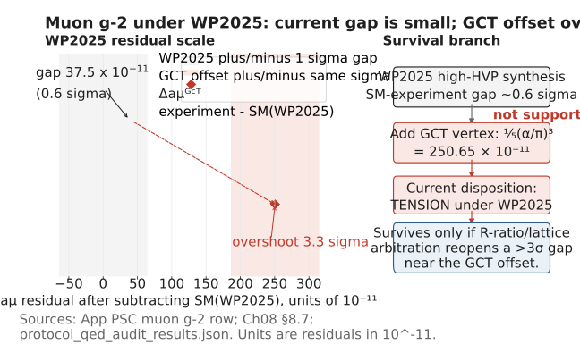

**Status:** **Tier 2 law-level mechanism + Tier 3 state-level residuals.** The lepton harmonic-ladder mechanism (resonant overtones of the 6D hardware at $N = 11, 17$) is Tier 2 structural; the absolute precision figures are state-level residuals against pole-mass targets: the electron sits at 1006 ppm against CODATA 2022 (conditional on Open Problem O.14 closure of the $n = -107$ K-theoretic gap-label link), the muon at ~21 ppm and tau at ~51 ppm (both against CODATA 2022 / PDG 2024 anchors; Tier 3 formula residuals, not theory-limited agreements — see the Note on Precision and §PSC.2.1). These figures are descriptive arithmetic (Tier 4 as evidence: not distinguishable from numerology for strong effects; App PSC §PSC.9.6).

---

### **PSC.2 Fundamental Coupling Constants**

These constants define candidate interaction impedances of the force sectors. Residuals here are closure gaps; a radiative-flow direction counts only as an inserted-template compatibility diagnostic until the physical bundle, interaction, sign, and magnitude are derived from the microscopic action. The native flow is a Tier 3 activation ansatz (App GRF), and for $\sin^2\theta_W$ and $\alpha_s$ the run does not close the gap.

| **Constant** | **GCT Geometric Formula** | **Bare Value** | **Observed ($M_Z$ / low-E)** | **Residual (Gap)** | **Type** | **Provenance** | **Tier** |
| :--- | :--- | :--- | :--- | :--- | :--- | :--- | :---: |
| **$\alpha^{-1}$** | $360 \phi^{-2}$ | **137.5078** | 137.0359 | **3443 ppm bare; precise closure conditional on O.19/O.5** — the geometric tree-level relation $\alpha^{-1} = 360\phi^{-2}$ is a Tier 3 numerical relation (Tier 3 600-cell multiplier; mechanism open — the RT solid-angle construction is withdrawn, V1 §13.2.1–§13.2.2); the +3443 ppm residual relative to CODATA $\alpha^{-1}(0)$ is a Tier 3 numerical gap and a load-bearing closure target. The current phason anti-screening calculation shows only template-direction compatibility after a Berry/Peierls loop template is inserted: periodic locking or a finite point-group quotient does not derive the physical bundle, curvature, loop sign, or magnitude, and the Galois map $\phi\mapsto-\phi^{-1}$ fixes no physical sign. Those remain open under O.19/O.5. A3 measured $\alpha(0)$ is used separately in corrected precision rows and is not evidence that the bare alpha derivation is closed. | **Tier 3 numerical relation (mechanism open) + Tier 3 600-cell multiplier + Tier 3 inserted-template residual diagnostic pending QLQCD-1L/O.19 closure** — the QED precision target for $\alpha^{-1}$ is sub-ppm; the GCT 3443 ppm bare gap is therefore not a sub-ppm-class "Postdiction" against QED; it is a tree-level identity whose residual closure is conditional on the QLQCD-1L bare-to-physical bridge, which is not yet action-derived | script: `protocol_alpha_derivation.py` | **3 relation + 3 multiplier/residual**; **Tier 4 as evidence** (φ-formula match; App PSC §PSC.9.6) |
| **Muon $g-2$** | $\frac{1}{5} \left( \frac{\alpha_{\rm A3}}{\pi} \right)^3$ | **$\Delta a_\mu \approx 250.65 \times 10^{-11}$** | under the consolidated high-HVP lattice-dominant WP2025 SM theory benchmark compared with Fermilab/BNL experiment, the experiment-theory gap is $\sim 0.6\sigma$ — no significant residual anomaly; the GCT correction sits $\sim 3.3\sigma$ *above* the consolidated closure; the CMD-3 R-ratio measurement context is part of the reduced-tension HVP arbitration, not a GCT confirmation | **Tension under WP2025; adverse evidence under the current world-average synthesis** | **Tier 3 fitted/equal-weight $1/5$ vertex coefficient + A3 precision input on top of a geometric mechanism class; not robust confirmation; reinstatable only if R-ratio + lattice-HVP reconciliation opens a $>3\sigma$ experiment–theory gap near the GCT offset (HVP arbitration condition, App PRG Table PRG.1 row P.5)**| `protocol_qed_audit.py` | **3 coefficient + A3; mechanism class not empirically confirmed** |
| **Electron $g-2$** | $\Delta a_e^{\rm lattice} = 0$ at this loop order (Tier 3/4 activation-threshold hypothesis, V3 Ch08 §8.7.4: $m_e \ll E_{\rm res} = m_e \phi^{11} \approx 101.69\text{ MeV}$, so electron at $N=0$ does not activate the cage-depinning loop that gives the muon's $1/5$ vertex correction at $N=11$; the threshold exponent $N=11$ remains Tier 3) | **$\Delta a_e^{\rm GCT} = 0$** | $a_e^{\rm exp}$ (Fan et al. 2023) minus the SM value: with Cs-α (Parker 2018) $\Delta a_e \approx -1.01 \times 10^{-12}$ (3.9σ); with Rb-α (Morel 2020) $\Delta a_e \approx +0.34 \times 10^{-12}$ (2.1σ). The Cs and Rb α determinations disagree with each other by 5.5σ. | **PENDING-α-RESOLUTION** (the null is in tension with both α inputs, by 3.9σ and 2.1σ; no branch passes) | **Tier 3/4 activation-threshold hypothesis (not derived; virtual loops have no rest-mass threshold) + Tier 3 threshold exponent $N=11$; α-input contingent** | `verify_independent/verify_g2_electron.py` | **3–4 threshold hypothesis + 3 threshold exponent** |
| **$\rho_{\rm raw}$ raw Galois-frame ratio (coordinate identity)** | $\phi^{-2}$; normalized share $\rho_{\rm raw}/(1+\rho_{\rm raw})$ | **0.38197** (normalized share **0.27639**) | — (no physical scale) | **0% (Tier 1 exact arithmetic)** | **Tier 1 coordinate-frame identity; not a physical boundary (canonical projector shares $1/2+1/2$)** | `protocol_electroweak.py::verify_gram_projection` | **1** |
| **$\sin^2\theta_W$ (bare)** | $\phi^{-3}$ | **0.23607** | 0.23122 (Z-pole; PDG 2026, $\overline{\rm MS}$) | **2.1%** (cross-scale numerical alignment, not RGE support) | **Tier 3 gauge-kinetic hypothesis (H-EW); the raw-frame volume identity of App USS §USS.9 is coordinate arithmetic; Z-pole Tier 3 observational input** *** | script: `protocol_electroweak.py`, `protocol_weinberg_uniqueness.py` | **3** (H-EW as a hypothesis); **Tier 4 as evidence** (φ-formula match; App PSC §PSC.9.6) |
| **$\sin^2\theta_W$ (Z-pole)** | H-EW boundary run to $M_Z$: physical-hypercharge one-loop comparator (full-SM $b_Y=41/6$, $b_2=-19/6$) and native kernel with the imported A2 benchmark | **0.136725** (comparator) / **0.16957** (native) | 0.23122 ± 0.00006 (PDG 2026, $\overline{\rm MS}$) | **−40.87% / −26.66%** (no current route closes; V3 Ch04 §4.3.3). The pre-registered gauge-running audit (App GRF §GRF.4.3) is a **FAILED check**: no declared-input configuration reproduces $\sin^2\theta_W(M_Z)$, $\alpha_s(M_Z)$ or $\alpha_{\rm em}(M_Z)$ (one borderline two-loop $\alpha_{\rm em}$ value, which imports the measured $\alpha_s$, is excluded by a post hoc judgement; App GRF §GRF.4.3). Top-down from A2, H-EW, $\alpha_3^{-1}=10\phi^2$ and $M_{\rm GUT}=3.2\times10^{16}$ GeV with SM $\beta$-functions gives $\sin^2\theta_W(M_Z)=0.058$–$0.067$ (best case 0.0673, **−52σ**; native kernel 0.16957, −62σ), and $\alpha_3^{-1}$ reaches zero at 2–6×10⁶ GeV, so $\alpha_s(M_Z)$ is undefined; A2 and H-EW cannot both hold for any SM extension (App GRF §GRF.4.3) | **Tier 3 negative consistency result** (conditioned on measured couplings or on A2; the target-normalized integrator is an implementation check only) | scripts: `protocol_electroweak.py`, `protocol_rge_native.py`; App GRF | **3** |
| **$\alpha_s^{-1}$ (bare)** | $10\phi^2$ | **26.18** | $\alpha_s^{-1}(M_Z)=8.475$ (PDG 2026 $\alpha_s(M_Z)=0.1180\pm0.0009$) | **+208.9% inverse-space residual**, defined as $[\alpha_s^{-1}(\mathrm{bare})-\alpha_s^{-1}(M_Z)]/\alpha_s^{-1}(M_Z)$; equivalently, in direct-coupling space, $\alpha_s(M_Z)$ is **67.63% above** $\alpha_s(\mathrm{bare})$ when normalized to $\alpha_s(M_Z)$. This compares an ultraviolet handle with an $M_Z$ value and so mixes scales; the native run from the handle gives $\alpha_s(M_Z)\approx0.052$, 55.9% low (V3 Ch04 §4.5.5). The RT three-fold-axis count and icosahedral inflation supply a documented strong-sector handle, not a physical $M_Z$ precision postdiction; the integer 10 and $\phi^2$ factor do not close the product rule or native running without O.42 / QLQCD-2 | **Tier 3 calibrated handle (10 integer + $\phi^2$ geometric factor) + Tier 3 running residual pending O.42 / QLQCD-2** | `verify_independent/verify_alpha_s_bare.py`; `protocol_rge_native.py` | **3 handle + 3 residual**; **Tier 4 as evidence** (φ-formula match; App PSC §PSC.9.6) |
| **$\theta_C$** | Bare $\phi^{-3}$ [Tier 3 identification] + transfer correction $(1 - 5\alpha)$ [Tier 3 pending O.5] | **13.1473°** | 13.0035° | **1.11%** (angle residual against the PDG mixing anchor $\lambda = 0.22501$, for which $\theta_C = \arcsin(0.22501) = 13.0035°$. The $s_{12}=\sin\theta_C$ residual is $1.09\%$ in §PSC.4; the angle and sine relative residuals differ by the parametrization factor $\theta_C/\tan\theta_C \approx 0.982$ at $13°$, so they describe the same comparison in different variables. Corrected value is Tier 3 bare identification + Tier 3 transfer; bare $\phi^{-3}$ residual $\approx 4.9\%$; the load-bearing falsification statistic is the $s_{12}$ comparison, a 3.6σ CKM tension in §PSC.4) | **Contingent Postdiction / Tension** | [Model/Geometric] | 3 bare identification + 3 transfer; **Tier 4 as evidence** (φ-formula match; App PSC §PSC.9.6) |
| **CKM Jarlskog \|J\|** | No current Tier 2 prediction; the value $|J|$ is held as Open Problem **O.7** (App ORQ §ORQ.5). A naive $\phi^{-22}$ candidate formula is documented in App ORQ but is not load-bearing for this scorecard. | — (no current Tier 2 prediction) | 3.12 × 10⁻⁵ (PDG 2024) | n/a | **OPEN RESEARCH (O.7)** | `verify_independent/verify_jarlskog.py` (reference harness) | **OPEN** |
| **Strong CP / $\bar{\theta}$** | Candidate only: an icosahedral chirality-preserving cycle-closure argument for $\bar{\theta} = 0$ (Tier 3 sketch; not derived) | **none** — $\bar{\theta}=0$ is not a GCT prediction | $\|d_n\| < 1.8\times 10^{-26}\ e\cdot\text{cm}$ (2020) → $\|\bar{\theta}\| \lesssim 10^{-10}$ | OPEN-CONDITIONAL: the Strong CP problem is open in GCT (V3 Ch18 §18.5); the present action derives no symmetry or dynamics that suppresses $\theta$, and respecting the bound is not a PASS | **Open problem (candidate mechanism Tier 3)** | `verify_independent/verify_strong_cp.py` | **3** |
| **$G$** | $a_6 = (2\hbar/m_e c)\phi^{-107}(1-5\alpha_{\rm GCT}),\ \alpha_{\rm GCT}=\phi^2/360;\ G = c^3 a_6^2/(4\hbar)$ | **$6.689475523 \times 10^{-11}$** | $6.67430 \times 10^{-11}$ (CODATA 2022) | **0.23% (2273.725 ppm; display 2274 ppm)** | **Postdiction** — model-authoritative GCT-bare-$\alpha$ branch with CODATA $m_e$ and exact SI $h,c$; the all-CODATA-$\alpha$ sensitivity branch is 2013.345 ppm. Derived from P.1c ($G \propto m_e^{-2}$; the 2013.345 ppm branch is the 1006 ppm electron residual doubled), so it is not independent and inherits P.1c's FAIL (App FSM P.16). Tier 3 numerical residual pending O.14 physical-link refinement. This is the Jacobson route only: the elasticity formula of the former Routes 2/3 is retired and does not enter (App DPS §DPS.7; O.22) | script: `protocol_absolute_scale.py` (canonical source); independently re-derived in `verify_independent/verify_newton_g.py` | **2 mechanism + 4 Planck-link + 3 residual/A1**; **Tier 4 as evidence** (φ-formula match; App PSC §PSC.9.6) |
| **Higgs VEV ($v$)** | $m_e \phi^{11} (1 + 5\alpha_{\rm A3} + \phi^{8}\alpha_{\rm A3}^{2})\, 1440\,\phi$ | **246.1755 GeV** (engine full precision per `protocol_higgs_vev_results.json::v_derived_GeV`) | **246.21965 GeV** (PDG-2024 Fermi-constant anchor) | **179 ppm** (full-precision residual 179.15 ppm). **OPEN-CONDITIONAL:** the Tier 2 product/mechanism arithmetic inherits the Tier 3 O.38 $N_{\rm cage}=144$ posit, CODATA-2022 A3 measured $\alpha(0)$, and a Tier 3 calibrated-handle residual. O.20 enumerates $1440$ factorisations but does not select the $144\times10$ physical branch. The spectral-action cutoff $\Lambda_{\rm Higgs}$ belongs to the independent Higgs-mass route. | **Conditional postdiction / anchor-normalized comparison** | script: `protocol_higgs_vev.py` (canonical); `verify_independent/verify_higgs_vev.py` | **OPEN-CONDITIONAL: Tier 2 product arithmetic conditional on Tier 3 O.38 $N_{\rm cage}=144$ + A3 + Tier 3 VEV-handle residual**; **Tier 4 as evidence** (φ-formula match; App PSC §PSC.9.6) |
| **Higgs mass ($m_H$, bare)** | $v \cdot \sqrt{2\lambda_{\rm bare}} = v/2$ with $\lambda_{\rm bare} = 1/8$ (Tier 3 bare packing ansatz, V3 Ch05 §5.2.3) | **123.09 GeV** (with $v_{\rm GCT}=246.1755$ GeV, the convention of the top-quark row; with the measured $v=246.21965$ GeV it would be 123.11 GeV) | 125.20 ± 0.11 GeV (PDG 2024) | **−1.69% (−2.11 GeV; 19σ against the PDG uncertainty)** — the bare GCT tree-level value lies below the PDG mass. Standard SM 1-loop radiative corrections to the Higgs pole mass (top-loop quadratic-divergence cancellation under renormalization, $\overline{\rm MS}$ to pole conversion at order $\alpha_t$, $\alpha_s$, $\alpha_W$ contributions; cf. Buttazzo et al. 2013 *JHEP* 12:089) generate $\mathcal{O}(\text{few \%})$ shifts whose sign depends on the renormalization scheme and is *not* a free observation from this row — the GCT 1-loop closure that would derive the specific sign and magnitude from the AKN lattice bundles with QLQCD-1L (App ORQ O.5, App TPR §TP-E). See Higgs-sector handle-accounting callout below. | **Postdiction (radiative-correction-contingent)** — **Tier 3 bare packing ansatz ($\lambda_{\rm bare} = 1/8$ on an added broken-vacuum completion; V3 Ch05 §5.2.3) + Tier 3 numerical residual (−1.69% bare gap; precise closure conditional on O.5)** | `verify_independent/verify_higgs_mass.py` | **3 bare ansatz / 3 specific value** |

> [!IMPORTANT]
> **Higgs sector handle accounting** [OPEN-CONDITIONAL]: the VEV evaluation $v = m_e \phi^{11}(1 + 5\alpha + \phi^{8}\alpha^{2}) \cdot 1440\phi$ depends on the muon-mass formula, the $N=11$ harmonic anchor, CODATA-2022 A3, and the exact product $1440=144\times10$. That product inherits the Tier 3 O.38 $N_{\rm cage}=144$ posit; O.20 is an enumeration result and does not select the branch. The 179 ppm figure against the sole declared observational anchor $v=246.21965$ GeV is therefore a conditional comparison, not a Tier 2 absolute-scale closure. The Tier 3 bare packing ansatz $\lambda_{\rm bare}=1/8$ (no geometric quantity currently fixes it) and the spectral-action cutoff $\Lambda_{\rm Higgs}$ belong to the separate Higgs-mass route.

**** **Weinberg boundary:** $\phi^{-2}$ is the exact raw Galois-frame ratio $\rho_{\rm raw}$ (coordinate-dependent; normalized share $0.27639$), the canonical projectors give shares $1/2+1/2$, and $\phi^{-3}$ is the Tier 3 gauge-kinetic hypothesis H-EW (V3 Ch04 §4.3). None of these values is a derived physical Weinberg angle.*

**Status:** **Tier 3 numerical relation for the fine-structure route (mechanism open; the RT solid-angle construction is withdrawn, V1 §13.2.1–§13.2.2); Tier 3 handles (H-EW, $10\phi^2$) and Tier 3 state-level residuals.** The icosahedral projection fixes the complementary subspaces but does not by itself assign electroweak coupling strengths. It supplies candidate gauge-coupling handles from the unit cell axes (raw-frame projection ratios are Tier 1 coordinate arithmetic, not physical sector weights; the bare Weinberg angle is the Tier 3 hypothesis H-EW and $10\phi^2$ is a Tier 3 calibrated handle); the specific numerical residuals against current empirical anchors are Tier 3 state-level closure targets. Notably: $\alpha^{-1}$ sits at 3443 ppm bare residual (closure conditional on QLQCD-1L per O.5); $\alpha_s^{-1}$ has the largest gauge-coupling gap, with the registered bare handle $10\phi^2=26.18$ versus the PDG-2026 $M_Z$ value $8.475$, a **+208.9% inverse-space residual under the observed-value denominator convention** (the separately labelled direct-space comparison is 67.63%; both compare a GUT-scale handle with an $M_Z$ value, while the native run gives 55.9% low; pending O.42 / QLQCD-2); the Higgs bare mass lies **−1.69%** (with $v_{\rm GCT}$) below the observed mass (closure conditional on O.5 1-loop); muon g-2 carries a "Tension under WP2025; falsification conditional on long-term HVP-synthesis arbitration" disposition under the WP2025 lattice HVP synthesis; PMNS $\theta_{23}=45°$ lies inside the NuFIT 6.0 3σ ranges with and without Super-Kamiokande atmospheric data, with the octant unresolved (see §PSC.4). The fine-structure relation keeps its stated Tier 3 row tier; the headline status records that several state-level numerical residuals depend on Open Problem O.5 closure, and no residual in this table counts as evidence for an anti-screening sign. Where a φ-formula in this table matches its target, the match is descriptive arithmetic (Tier 4 as evidence: not distinguishable from numerology for strong effects; App PSC §PSC.9.6), and the pre-registered gauge-running check from the H-EW boundary is FAILED (App GRF §GRF.4.3).

### **PSC.2.1 Loop-Order Discipline — Radiative-Correction Provenance**

The GCT formulas in §PSC.1–PSC.2 (lepton masses, $\alpha^{-1}_{\text{tree}}$, Cabibbo angle, etc.; tiers as stated per row) are labeled "tree-level" or "tree + 1-loop" according to the loop order actually present in the displayed expression. The ppm-level residuals quoted for the muon and tau are scored against measured CODATA / PDG masses ($m_\mu$ to 22 ppb, $m_\tau$ to 51 ppm). A measured mass is not a theory quantity: the earlier statement that these targets "already include" SM corrections of ~10–40 ppm, so that a GCT theory floor of that size absorbs the residuals, is withdrawn. No GCT higher-loop calculation exists, so no theory error is assigned. Lepton precision rows are Tier 2 mechanism + Tier 3 formula residual.

| Row | Bare GCT residual | GCT + displayed correction residual | Measured target and residual status |
| :--- | :--- | :--- | :--- |
| Muon $m_\mu$ | $\sim -3.75\%$ for $m_e\phi^{11}$ | $\sim 0.24\%$ after $(1+5\alpha)$; $\sim 21$ ppm after the Tier 3-selected $\phi^8\alpha^2$ correction ansatz | Scored against the CODATA 2022 mass (22 ppb); the existence of a correction channel and the specific $\phi^8\alpha^2$ exponent/coefficient are kept separate, the latter being a Tier 3 selection rather than a derived one-loop heat-kernel term; the 21 ppm residual is ≈$10^3\sigma$ in measurement terms and is a Tier 3 formula residual pending QLQCD-1L (App ORQ O.5); the unpropagated next-order term $\phi^8\alpha^3\approx18$ ppm is the same size, so the row does not test the second-order term |
| Tau $m_\tau$ | $\sim +2.69\%$ for $m_e\phi^{17}$ | $\sim 51$ ppm against PDG 2024 after the single $(1-3.6\alpha)$ correction | Scored against the PDG 2024 mass (1776.93 ± 0.09 MeV; the residual is ≈1.0σ in measurement terms); the $-3.6$ coefficient carries Tier 2 mechanism + Tier 2 integer $D=18$ + $N=5$ $A_5$ irrep count (Tier 3 as a channel number) + Tier 3 combination rule $c=-D/N$ pending O.26b |
| Electron anchor | $m_e$ is the dimensional anchor | The $n=-107$ Planck-link residual is $\sim 1006$ ppm | Physical-link closure depends on App ORQ O.14 / O.5; it is not a lepton-pair prediction residual |

**Implication for Tier 2 status:** the ppm figures state how far the GCT geometric form plus displayed correction lies from the measured mass. They carry no theory-error model, so they are residuals, not agreements within a theory error. QLQCD-1L closure (App ORQ O.5) is the path that would supply a GCT-internal loop derivation and an error estimate.

### **PSC.2.2 Hypercharge Assignment and Anomaly Cancellation**

The L/R-asymmetric Standard Model hypercharges follow from the icosahedral identification of right-handed singlets with $E_\perp$-sterile states (V3 Ch04): for right-handed sterile singlets ($I_3 = 0$) the Gell-Mann–Nishijima relation $Q = T_3 + Y/2$ reduces to $Y_R = 2Q$. The full one-generation hypercharge assignment in the $Q = T_3 + Y/2$ convention is therefore:

| Multiplet | $T_3$ | $Q$ | $Y$ |
| :--- | :---: | :---: | :---: |
| $Q_L = (u_L, d_L)$ (LH quark doublet, color triplet) | $\pm 1/2$ | $+2/3, -1/3$ | $+1/3$ |
| $u_R$ (RH up, color triplet) | $0$ | $+2/3$ | $+4/3$ |
| $d_R$ (RH down, color triplet) | $0$ | $-1/3$ | $-2/3$ |
| $L_L = (\nu_L, e_L)$ (LH lepton doublet) | $\pm 1/2$ | $0, -1$ | $-1$ |
| $e_R$ (RH electron) | $0$ | $-1$ | $-2$ |

The four Standard Model gauge-anomaly cancellation conditions on this one-generation assignment evaluate to zero algebraically:

$$
\begin{aligned}
[SU(3)]^2 \cdot U(1)_Y :\quad & 2\,Y_Q - Y_u - Y_d = 2\cdot\tfrac{1}{3} - \tfrac{4}{3} - (-\tfrac{2}{3}) = 0 \\
[SU(2)]^2 \cdot U(1)_Y :\quad & 3\,Y_Q + Y_L = 3\cdot\tfrac{1}{3} + (-1) = 0 \\
\text{grav}^2 \cdot U(1)_Y :\quad & 6\,Y_Q + 2\,Y_L - 3\,Y_u - 3\,Y_d - Y_e = 2 - 2 - 4 + 2 + 2 = 0 \\
[U(1)_Y]^3 :\quad & 6\,Y_Q^3 + 2\,Y_L^3 - 3\,Y_u^3 - 3\,Y_d^3 - Y_e^3 = 0 \quad \text{(machine-precision residual)}
\end{aligned}
$$

The colour multiplicity 3 enters quark contributions; the doublet multiplicity 2 enters the gravitational and $U(1)^3$ traces via LH-doublet components. Coefficient signs (+ for LH, − for RH via chirality flip) reflect the anomaly-trace convention. Engine verification computes all four traces and the right-handed-singlet identity in a single L_∞ residual: `GCT_Physics_Engine/verify_independent/verify_hypercharges.py` reports machine-precision PASS (max residual $\sim 10^{-15}$ from $[U(1)]^3$ float roundoff).

**Tier discipline (two distinct claims must be separated).** The vanishing of the four anomaly traces given the standard one-generation L/R-asymmetric hypercharge assignment is a textbook SM identity (Bilal 2008 arXiv:0802.0634 §7.3; standard QFT references); calling that arithmetic Tier 2 GCT-specific would be inflation. **Two distinct claims live in this subsection:**

1. **The four-trace cancellation** given the standard hypercharge assignment is **Tier 1 textbook algebraic identity** — it does not depend on GCT-specific content. We list it here for completeness, to demonstrate that the verifier `verify_independent/verify_hypercharges.py` reproduces the textbook result to machine precision (max residual $\sim 10^{-15}$), not to claim GCT-specific credit for it.

2. **The L/R-asymmetric hypercharge assignment itself** — that right-handed singlets are $E_\perp$-sterile and that $Y_R = 2Q$ follows from the icosahedral $E_\parallel/E_\perp$ split (V3 Ch04) — is a **Tier 2 GCT-specific structural claim**. The load-bearing GCT content of this section is the L/R-asymmetric hypercharge assignment under the $E_\parallel/E_\perp$ split premise; the subsequent anomaly arithmetic is included for completeness against the standard SM consistency check.

---

### **PSC.3 Hadron Sector**

The Proton mass is modelled as the global energy minimum of the icosahedral projection, obtained from the winding sum of the Baryonic Triad (Tier 2 mechanism + Tier 3 sheet/exponent handle pending AKN-action closure).

> **Proton mass — three values guide:**
> 1. **Formula prediction (the GCT value): $m_p = m_e \cdot \phi^{15+\phi^{-1}} \approx 938.417$ MeV.** This is the tree-level output of the baryonic-triad mechanism evaluated against the CODATA $m_e$. The residual against the CODATA $m_p$ is $\approx 155$ ppm. Disposition: **Tier 2 mechanism + Tier 3 sheet/exponent handle pending AKN-action closure**, not hadron-mass closure from the current postulate set.
> 2. **CODATA observation: $m_p = 938.272$ MeV.** The empirical anchor against which the prediction is scored.
> 3. **Ratio formula: $m_p/m_e = \phi^{15+\phi^{-1}} \approx 1836.437$** vs CODATA observed $1836.153$. Same $\sim0.015\%$ residual, expressed as a dimensionless ratio.
>
> The $\sim0.015\%$ residual is the current tree-level precision of the $\phi$-power formula under the layered Tier 2 mechanism + Tier 3 sheet/exponent disposition; closure to higher precision and promotion of the sheet-doubling handle are QLQCD-1L / AKN-action targets (App QLA). Ppm-level display is not used as evidential precision for this offset-fitted handle. As evidence that φ or icosahedral structure is special, this match is **Tier 4** (constant control test v3, NEGATIVE-FRAGILE; App PSC §PSC.9.6); the number is kept as descriptive arithmetic.

Quark masses are renormalized QCD parameters, not invariant rest masses. The comparison convention is therefore explicit in the table: $u,d,s$ use $\overline{\mathrm{MS}}$ at 2 GeV; $c,b$ use $\overline{\mathrm{MS}}$ at $\mu=m_q$; $t$ is compared with the PDG 2024 direct-measurement mass (not a pole mass), with the mass-scheme question retained as a Tier 3 residual. Besides their row bands, the quark rows are scored by one common rule: the prediction is compared with the PDG 2024 value and its quoted uncertainty, and a miss of more than 5σ is a FAIL. Only the top (5.18σ) and bottom (6.9σ) rows fail it.

| **Particle** | **GCT Geometric Formula** | **Derived Value** | **Empirical Convention** | **Scale** | **Observed (CODATA/PDG)** | **Precision (Residual)** | **Type** | **Provenance** | **Tier** |
| :--- | :--- | :--- | :--- | :--- | :--- | :--- | :--- | :--- | :---: |
| **Proton ($m_p$)** | $m_e \phi^{15 + \phi^{-1}}$ | **938.417 MeV** | Bound-state rest mass | CODATA 2022 | 938.272 MeV | **~0.015%** (+155 ppm, inside the 500 ppm postdiction band) | **Postdiction** | $m_e$ (CODATA) $\to m_p$; Tier 3 sheet/exponent handle pending AKN-action closure; ppm display suppressed for this offset-fitted handle | 2 mechanism + 3 handle; **Tier 4 as evidence** (φ-formula match; App PSC §PSC.9.6) |
| **Top Quark ($m_t$)** | $(v_{\rm GCT}/2)\sqrt{2}$ (Fracture) * | **174.072 GeV** | Direct-measurement mass | PDG 2024 direct measurements (not a pole mass) | 172.57 ± 0.29 GeV | **+0.871%** (state-level/mass-scheme residual; 5.18σ, a FAIL of the written P.24 ±5σ rule, by the same standard as the electron row; against PDG's pole mass from cross sections, 172.4 ± 0.7 GeV, it is ≈2.4σ, and the mass-scheme question is open — the registered comparator is not swapped after the result) | **Postdiction / FAIL of the written rule** | scripts: `protocol_higgs_vev.py`, `protocol_quark_mismatch.py` | Tier 2 mechanism + Tier 3 state-level/mass-scheme residual |
| **Bottom Quark ($m_b$)** | $m_c \phi^2 (5/4)$ | **4134.69 MeV** | $\overline{\mathrm{MS}}$ running mass | $\mu=m_b$ | 4183 ± 7 MeV (PDG 2024) | **−1.15%; 6.9σ low** (more if PDG's ±7 MeV is read as the 90% CL interval it is labelled as). By the rule applied to the top quark this is a **FAIL**. The earlier window "4130–4230 MeV" was centred on the measurement, not on the prediction, so it could not test the prediction; it is withdrawn as a test. The residual stays a Tier 3 state-level residual pending O.5, and the mass-scheme question is open | **Postdiction / FAIL** | script: `protocol_quark_mismatch.py` | 3 absolute state-value; **Tier 4 as evidence** (φ-formula match; App PSC §PSC.9.6) |
| **Charm Quark ($m_c$)** | $m_u \phi^{13+\phi^{-3}}$ (Mixed-Harmonic Area Law heuristic at $N=17$; K-theoretic gap-label derivation pending O.5) | **1263.45 MeV** | $\overline{\mathrm{MS}}$ running mass | $\mu=m_c$ | 1273.0 ± 4.6 MeV (PDG 2024) | **−0.75% (2.1σ low)** | **Postdiction** | script: `protocol_quark_mismatch.py` | 3; **Tier 4 as evidence** (φ-formula match; App PSC §PSC.9.6) |
| **Strange Quark ($m_s$)** | $m_u \phi^8 (1-12\alpha)$ | **92.79 MeV** | $\overline{\mathrm{MS}}$ running mass | 2 GeV | 93.5 MeV (PDG 2024) | **0.76%** | **Postdiction** | script: `protocol_quark_mismatch.py` ($12\alpha$ drag coefficient is Tier 3 under the Ledger) | 3; **Tier 4 as evidence** (φ-formula match; App PSC §PSC.9.6) |
| **Down Quark ($m_d$)** | $m_u \cdot \phi^{\phi}$ as the FK-determinant infinite-volume-limit closed form; rigorous convergence proof conditional on O.5 | **4.716 MeV** | $\overline{\mathrm{MS}}$ running mass | 2 GeV | 4.70 ± 0.07 MeV (PDG) | **0.33%** — POSTDICTION-CONSISTENT conditional, inside the 11% shell-resonance gate. Tier 2 FK-determinant mechanism + Tier 3 $\phi^{\phi}$ identification of the shell median (infinite-volume limit open, O.5); closed-cage deep-tail mean $\det_{FK}/\phi^{\phi}=0.9976$ (sample std $0.0253$), with sequence-mean signed error vs PDG $+0.09\%$. Single-cage values oscillate inside the 11% band with empirical decaying envelope, so the match is a central tendency rather than a single clean value. | **Postdiction** | script: `protocol_quark_mismatch.py` + `protocol_md_fk_ih_closed_cages.py` | 2 mechanism + 3 conditional; **Tier 4 as evidence** (φ-formula match; App PSC §PSC.9.6) |
| **Up Quark ($m_u$)** | $m_e \phi^3$ | **2.16 MeV** | $\overline{\mathrm{MS}}$ running mass | 2 GeV | 2.16 MeV | **0.21%** | **Postdiction** | script: `protocol_quark_mismatch.py` | Tier 2 geometric motif + Tier 3 QCD scheme/running bridge; **Tier 4 as evidence** (φ-formula match; App PSC §PSC.9.6) |

*\* Calculated using the absolute GCT Higgs-VEV pipeline value $v_{\rm GCT}=246.1755$ GeV from `protocol_higgs_vev.py`; the measured electroweak VEV is not used as an input to this row.*
*The 5/4 coefficient is a Tier 2 representation-theory coefficient, but the absolute bottom-quark prediction imports the Tier 3 $m_c$ input and is therefore Tier 3 as a state-level residual conditional on O.5; the row fails the ±5σ rule (App FSM P.23).*
*The exponents $13+\phi^{-3}$ ($m_c$), $\phi^{\phi}$ ($m_d$), $6+\phi^{-1}$ and $11+\phi^{-1}$ (CKM $s_{23}$, $s_{13}$) match observed $\log_\phi$ values through irrational offsets (integer $+\,\phi^{-k}$, or $\phi^{\phi}$) found by postdictive search; no trial factor is applied for that family of offsets, so these rows are postdiction-search results and are not counted as evidence.*

**Status:** **Tier 2 law-level mechanism (Fuglede-Kadison-determinant chain rooted natively in the Planck scale) + Tier 3 state-level residuals.** The hadron mass chain follows the FK-determinant law-level structure. The down-quark row uses the primary $\phi^{\phi}$ infinite-volume-limit closed form and is POSTDICTION-CONSISTENT at $+0.33\%$ inside the registered shell-resonance band, conditional on O.5 for rigorous convergence and algebraic-field identification. Two quark rows fail the ±5σ rule: top (5.18σ) and bottom (6.9σ). The φ-formula quark matches ($m_u$, $m_d$, $m_s$, $m_c$, $m_b$) are descriptive arithmetic (Tier 4 as evidence: not distinguishable from numerology for strong effects; App PSC §PSC.9.6); the top row contains no φ and is not relabelled.

---

### **PSC.4 Mixing Geometry Matrices**

**[Tier 3 candidate identification]:** CKM and PMNS matrices are CANDIDATELY identified with the topological tunneling and axis sliding operations; closure pending O.5/O.7.

| **Observable** | **GCT Geometric Formula** | **GCT Prediction** | **Observed (PDG)** | **Precision (Residual)** | **Type** | **Tier** |
| :--- | :--- | :--- | :--- | :--- | :--- | :---: |
| **Cabibbo Angle ($s_{12}$)** | Bare $\phi^{-3}$ [Tier 3 identification] + transfer correction $(1 - 5\alpha)$ [Tier 3 pending O.5] | **0.2275** | $0.2250$ | **1.09%** (bare $\phi^{-3}$ residual $\approx 4.9\%$; corrected $s_{12}=\phi^{-3}\cdot(1-5\alpha)$ is a **3.6σ tension** under the registered comparison) | **Contingent Postdiction / Tension** | 3 bare identification + 3 transfer; **Tier 4 as evidence** (φ-formula match; App PSC §PSC.9.6) |
| **CKM $s_{23}$** | $\phi^{-(6 + \phi^{-1})}$ | **0.0414** | $0.04183^{+0.00079}_{-0.00069}$ | **−1.05%** (0.6σ; −0.98% vs the rounded engine comparator 0.0418 used in App FSM/GPE) | **Ansatz** | 3; **Tier 4 as evidence** (φ-formula match; App PSC §PSC.9.6) |
| **CKM $s_{13}$** | $\phi^{-(11 + \phi^{-1})}$ | **0.003732** | $0.003732$ | **0.0076%** (Tier 3 offset-fit ansatz; ppm display suppressed) | **Ansatz** | 3; **Tier 4 as evidence** (φ-formula match; App PSC §PSC.9.6) |
| **PMNS $\theta_{12}$** | $\arctan(1/\phi) + (\theta_{13}/5)$ | **33.40°** | $33.68^{+0.73}_{-0.70}$° (NuFIT 6.0) | **−0.85%** (0.4σ) | **Postdiction** | 3; **Tier 4 as evidence** (φ-formula match; App PSC §PSC.9.6) |
| **PMNS $\theta_{23}$** | $45°$ | **45.00°** | NuFIT 6.0, normal ordering: $43.3^{+1.0}_{-0.8}$° with SK atmospheric data (3σ range 41.3°–49.9°); $48.5^{+0.7}_{-0.9}$° without (3σ range 41.0°–50.5°) | **inside both 3σ ranges**: $\Delta\chi^2(45°)\approx2.0$ with SK and $\approx4.2$ without (≈1.4σ and ≈2.0σ); octant unresolved † | **Prediction (open)** | **3** |
| **PMNS $\theta_{13}$** | $\arcsin(\phi^{-4})$ | **8.39°** | $8.56 \pm 0.11$° (NuFIT 6.0 with SK; $8.52 \pm 0.11$° without) | **−2.0% (1.5σ)** / −1.5% (1.2σ) | **Postdiction** (θ₁₃ was measured in 2012) | 3; **Tier 4 as evidence** (φ-formula match; App PSC §PSC.9.6) |
| **CP Phase ($\delta_{CP}$)** | $2\pi \cdot \phi^{-1}$ | **222.49°** | NuFIT 6.0, normal ordering: $212^{+26}_{-41}$° with SK; $177^{+19}_{-20}$° without (non-Gaussian) | **+0.4σ with SK; +2.4σ without** — the tension depends on the data set | **OPEN_CONDITIONAL** | 3; **Tier 4 as evidence** (φ-formula match; App PSC §PSC.9.6) |
| **CKM 3×3 Unitarity Diagnostic ‡** | $\sum_k V_{ik} V_{jk}^* = \delta_{ij}$ | **Diagnostic exact by construction; max residual $1.11\times10^{-16}$** | Unitary (PDG 2024 fit) | **Tier 1 algebraic bookkeeping for a matrix built in the standard unitary parameterization; physical CKM content sits in the mixing-angle comparison rows, with residuals pending O.7/O.5 rather than a unitarity defect** | **Diagnostic** | 1 algebraic |
| **PMNS 3×3 Unitarity Diagnostic ‡** | $\sum_k U_{\alpha k} U_{\beta k}^* = \delta_{\alpha\beta}$ | **Diagnostic exact by construction; max residual $\sim 2.4\times10^{-17}$** | Unitary by construction in the standard 3×3 PMNS parameterization (PDG 2024; NuFit-6.0, Esteban-Gonzalez-Garcia-Maltoni-Martinez-Soler-Pinheiro-Schwetz 2024, arXiv:2410.05380) | **No independent unitarity test; the θ₂₃ comparison belongs to the angle row above** | **Diagnostic** | 1 algebraic / 3 angle tension |

*† **PMNS $\theta_{23}$ disposition status — octant unresolved.** The bare GCT prediction is $\theta_{23} = 45°$, the maximal-mixing boundary between the two octants. NuFIT 6.0 (Esteban, Gonzalez-Garcia, Maltoni, Martinez-Soler, Pinheiro & Schwetz 2024, arXiv:2410.05380; JHEP 12 (2024) 216), normal ordering, places $45°$ inside the 3σ range both with Super-Kamiokande atmospheric data (best fit $43.3°$, 3σ range $41.3°$–$49.9°$) and without it (best fit $48.5°$, 3σ range $41.0°$–$50.5°$). From the published one-dimensional $\Delta\chi^2$ projections, $\Delta\chi^2(\theta_{23}=45°)\approx2.0$ with SK and $\approx4.2$ without, i.e. about 1.4σ and 2.0σ. The earlier 4.09σ figure, a one-octant Gaussian $(49.5°-45°)/1.1°$ applied to a two-octant likelihood, is withdrawn: $45°$ is not in $>3\sigma$ tension, and the octant is unresolved. The MSW matter effect for NOvA (L = 810 km) shifts $\theta_{23}$ by only $\sim 0.00004°$ and plays no role. DUNE / Hyper-K octant data remain the decisive test: a $>5\sigma$ exclusion of $45°$ without a closing GCT-side derivation of the deviation would falsify the bare prediction. The prediction is held at Tier 3; the residual is bundled with the QLQCD-1L research debt (App ORQ §ORQ.5 Open Problem O.5).*

*‡ **3×3 Unitarity check:** The individual mixing-angle predictions above are *not independent* — they are constrained by the full $3 \times 3$ unitarity of the CKM and PMNS matrices ($V^\dagger V = 1$, nine real constraints from three row-norms, three column-norms, and three off-diagonal sum rules). The CKM and PMNS diagnostic rows check the constructed matrices after applying the standard unitary parameterization: unitarity is exact by construction to machine precision. The real CKM support/constraint sits in the mixing-angle comparison rows, where the $\sim 1\%$ mismatches against PDG global-fit central values remain pending O.7; they are not a unitarity defect. The PMNS angle comparisons sit in the angle rows above; a determinant or row-norm check of a standard 3×3 parameterization cannot independently validate or falsify that angle. Verifier: `verify_independent/verify_mixing_unitarity.py` and `verify_independent/verify_pmns.py`.*

**Status:** **Tier 3 bare identification + Tier 3 transfer-correction residual; PDG $s_{12}$ miss for the corrected Cabibbo formula $s_{12} = \phi^{-3}\cdot(1-5\alpha)$ is 3.6σ (residual 0.00245 / PDG uncertainty 0.00068); for the bare formula $s_{12} = \phi^{-3}$ the miss is 16.2σ (residual 0.011 / 0.00068). CKM precision closure pending.** PMNS $\theta_{23}=45°$ lies inside the NuFIT 6.0 3σ ranges with and without SK atmospheric data ($\Delta\chi^2\approx2.0$ and $\approx4.2$); the octant is unresolved pending DUNE / Hyper-K (§PSC.4 footnote †). CKM 3×3 unitarity is exact by construction under the standard unitary parameterization; the precision issue is the mixing-angle comparison rows, not a unitarity defect.

---

### **PSC.5 Neutrino Sector**

The Neutrino sector provides the "Risky Predictions" required to distinguish GCT from standard particle physics.

> [!WARNING]
> **Neutrino Mass Tension:** The Planck 2018 + DESI BAO 2024 combined constraint
> yields $\Sigma m_\nu$ < 0.072 eV (95% CL), and DESI DR2 tightens the ΛCDM-context bound
> to $\Sigma m_\nu$ < 0.064 eV. These bounds put the GCT prediction of 0.085 eV in active
> tension, not in a falsified state. The registered lower exclusion boundary is
> $\Sigma m_\nu$ < 0.075 eV at definitive precision (above the normal-hierarchy oscillation
> floor near 0.059 eV) or $\Sigma m_\nu$ > 0.15 eV. The DR2 95% bound (0.064 eV) already lies
> below that 0.075 eV gate; it is reported as a tension rather than a gate crossing only because
> it is a ΛCDM-model-dependent upper bound, not a definitive measurement. The 0.072/0.064 eV ΛCDM bounds are
> compared under a likelihood that reports the independent P.4 neutrino and P.6
> dark-energy templates together because the posterior is cosmology-dependent;
> the conditional $w(z)$ template is expected to leave the bound near 0.064 eV.
> This is an active falsification risk in the GCT framework.

| **Observable** | **GCT Geometric Formula** | **GCT Prediction** | **Observed / Bound** | **Status** | **Type** | **Tier** |
| :--- | :--- | :--- | :--- | :--- | :--- | :---: |
| **$m_1$ Floor** | $m_e \phi^{-36}$ | **0.0153 eV** | < 0.45 eV (KATRIN 2025, 90% CL) | **Conditional value currently allowed; cosmological sum in tension below** | **Tier 3 conditional hypothesis** (inherits the Tier 3 P3b/O.15 stiffness map $\phi^{-18}$, squared, plus the electron-mass anchor; only the integer $D=18$ is Tier 2) | 3 |
| **$\sum m_\nu$** | $\sum \sqrt{m_1^2 + \Delta m_{ij}^2}$ | **0.0853 eV** ** | < 0.064 eV (Planck + DESI DR2 $\Lambda$CDM); < 0.072 eV (Planck + DESI 2024 $\Lambda$CDM); historic < 0.12 eV (Planck-only) — see App PRG/FM cosmology rows | **Active adverse tension (ΛCDM-context; conditional likelihood pending)** | **Independent P.4 neutrino template; P.6 cannot activate a causal channel** | 3 |
| **Ordering** | *Growth Axiom* | **Normal Only** | Not Yet Proven | **Risky** | **Prediction (Tier 3 conjecture, V3 Ch09)** | 3 |

*** **CRITICAL NOTE:** The 0.0853 eV neutrino floor is in $\Lambda$CDM-context tension with current model-dependent cosmological bounds. Reassessment requires a GCT-native likelihood that jointly fits the registered dark-energy fingerprints; invoking $w<-1$ alone is insufficient to claim compatibility.*

> [!IMPORTANT]
> **Neutrino Floor and Dark-Energy Scope**
>
> The $\Sigma m_\nu = 0.0853$ eV prediction is in tension with DESI DR2's $\Sigma m_\nu < 0.064$ eV $\Lambda$CDM bound. Any relief requires a GCT-NATIVE CMB+BAO+LSS likelihood that is sign-opposite to the DESI-preferred CPL quadrant (DESI: $w_0>-1$, $w_a<0$; GCT: $w(z)\leq-1$ throughout). Generic dynamical-DE rescue is not available without an explicit GCT-native likelihood; this is registered as Open Problem O.13 closure-path C1. The neutrino bound and the multi-channel EoS are NOT co-immune.
>

---

### **PSC.6 Astrophysics & Cosmology**

This sector establishes macroscopic falsification targets tracking vacuum geometry properties and biological thresholds.

| **Observable** | **GCT Geometric Formula** | **GCT Prediction** | **Observed / Bound** | **Status** | **Type** | **Tier** |
| :--- | :--- | :--- | :--- | :--- | :--- | :---: |
| **PTA Icosahedral Structure ($l=6$)** | unique rotational-icosahedral scalar harmonic $A_6(R\hat n)$ | **first nonconstant scalar at $l=6$; orientation $R\in SO(3)/I$** | no physical PTA response or normalization has been derived | **Physical transfer open** | **Structural theorem / response program** | 1 theorem + 2 conditional symmetry + 3 transfer |
| **Dark Energy ($w(z)$)** | Tier 3 $\Delta\mathcal{I}$ correlation/model coordinate conditional on the shared-phason-field ansatz; no typed, normalized information-to-metric causal map | **$w(z)<-1$ throughout the modeled low-$z$ branch** (conditional single-channel biogenic-DE coordinate; $z\approx0.28$ is the V7' sensitivity marker, not a transition) | DES-Dovekie recalibrated DESI DR2 + CMB target (arXiv:2511.07517): $(w_0, w_a) = (-0.803 \pm 0.054,\ -0.72 \pm 0.21)$, joint dynamical-DE significance 3.2σ — sign-opposite to the conditional GCT phantom template | **Registered-menu closure-to-DESI claim falsified under its registered >3σ rule (DES-Dovekie 3.2σ; DESI DR2 3.1σ BAO+CMB, 2.8–4.2σ with SNe); branch-level verdict. The single-channel phantom template is a separate stipulated coordinate (phantom direction Tier 4, V2 Ch14 §14.3.1). Multi-channel shape-proxy partition CLOSURE-FAILS in `protocol_de_multichannel.py` with respect to the registered five-channel menu — best-fit diagonal diagnostic score ≈ 4.861, flat to within 0.0446 diagnostic-score units across the swept $\Omega_{\Lambda,0}$ range; the score ignores DESI covariance and is not a likelihood distance or physical multi-fluid background model; the convex-combination ceiling is partly tautological under the Tier-3 channel-menu choice $w_{\rm pert} = -0.9$, open at the framework level pending closure path C1 thawing-phason slow-roll or a no-go, see Ch14 §14.6.3)** | **Tier 3 conditional correlation/model coordinate; phantom direction Tier 4 (no ghost-free action; V2 Ch14 §14.3.1); physical shared-field coupling, normalization, and causal map open; registered menu falsified at branch level (see §PSC.8 row 8 + Ch14 §14.6.3 + App ORQ O.13)** | 3–4 |
| **Dark Energy ($\rho_{DE}$) bare biogenic-coordinate overshoot** [Tier 4 illustrative; §PSC.6.1 callout contains the extraction guard] | $\lambda_{bio} \cdot \dot{\mathcal{I}} / I_0$ evaluated as a conditional model coordinate before any unproved holographic-displacement suppression | see §PSC.6.1 illustrative-only callout | $\rho_\Lambda = 5.25 \times 10^{-10}$ J/m³, a Planck-parameter-derived reference $\Omega_\Lambda\rho_{\rm crit}c^2$ | **Tier 4 illustrative pre-suppression magnitude; not a state-level prediction or physical mechanism.** No typed, normalized information-to-metric map or derived suppression law is supplied. | **Pre-suppression illustrative — see §PSC.6.1** | 4 |
| $m_{phason}$ | $\rho_\Lambda = \tfrac{1}{2} m_{phason}^2 \langle\Phi_\perp\rangle^2$ (V2 Ch14 §14.1.3 condensate form; calibrated against $\rho_\Lambda$ for $\langle\Phi_\perp\rangle$ pinned by the App ULA condensate equation) | **$1.71 \times 10^{-5}$ eV** | $\rho_\Lambda = 5.25 \times 10^{-10}$ J/m³, from the Planck-parameter reference $\Omega_\Lambda\rho_{\rm crit}c^2$ | **Calibrated; conditional on $\langle\Phi_\perp\rangle$ closure (App ORQ O.1)** | **Consistency Check** | 3 |
| $E_{bio\_phason}$ | Historical biological/phason activation-scale scenario; no action-derived coupling or gap | **$k_B T(310\,\mathrm{K}) = 0.0267$ eV** | Registered as the body-temperature thermal-noise scale (Prediction/Postdiction Firewall). The historical radical-pair coupling candidate $E_{RP}\approx0.3$ eV cannot be compared with $k_BT$: without a type-correct, action-normalized spin–phason coupling the comparison is dimensionally invalid (Firewall §3 rule 6; V1 Ch17 §17.1.3). No eV-scale freezing energy is registered, and no qualified macro-coherence or Level-II threshold follows | **Underdetermined** | **Scenario provenance only** | 1 thermal-scale arithmetic + 3/open scenario identification |
| **Protocol D — Anaesthetic Isotope Shift** (P.13; mirrors App PRG Table PRG.1 P.13 + engine `protocol_isotope_experiment.py`) | Spin-Entropy Modulation via bound-water $^{17}$O hyperfine (Ch16 §16.3.2 + App NSP §NSP.4); central branch $0$ at $n_{rp}=0$ pending O.21, with conditional O.21/O.33 $f_{bound}$ sensitivity band $[1.1, 2.2] \times 10^{-3}$ at $n_{rp}=1$ ($N_{\rm bound}=n_{rp}\,n_{\rm contact}$; ≈$3.6\times10^3$ lumen waters per dimer) | Central branch gives no LORR shift. The conditional sensitivity branch supplies an ordinary material-proxy scenario $\Delta C_{50}/C_{50} \in [-0.22\%,-0.11\%]$ between $^{17}$O-substituted and $^{16}$O-control bound-water populations (lower anesthetic threshold under $^{17}$O substitution; engine convention `(C50_H2_17O - C50_H2_16O)/C50_H2_16O = -f_bound`); the disfavored $n_{rp}=2$ branch reaches signed $[-0.44\%,-0.22\%]$ and requires geometry re-evaluation; none of these values is a phason, Selection-Operator, or Level-II prediction | Drosophila $^{17}$O LORR assay window after systematics-gate redesign; no current power claim is registered because the §16.3.4 systematic budget rejects the operative gate | No operative falsification gate under the §16.3.4 systematic budget. $\sigma_{\rm syst,total}\approx0.0577$ (57.65× the 0.10% naive gate), and halving S2/S4 reduces $\sigma_{\rm syst}$ by only 1.20×; until a systematics-validated gate is specified, the quantitative gate is deferred. A future controlled result constrains this material scenario only; an inconclusive result preserves no framework-level mechanism. Neither outcome is a verdict on GCT as a whole: the measurement tests an ordinary material proxy, and no phason, Selection-Operator or Level-II inference follows from it (V1 Ch17 §17.1.3). With no operative gate, no null can reject the branch until a systematics-validated gate is registered. | **Material-proxy pilot** | **Tier 3 material hypothesis (Spin-Entropy Modulation via $^{17}$O hyperfine) tested only through an ordinary material proxy pending O.21/O.33 + Tier 4 quantitative gate operationally unfalsifiable under registered systematic budget; no GCT or phenomenal inference** |

**Operational thresholds for the dark-energy row (P.6).** Row P.6 has two separate decision rules. The **state-level CPL-fit gate** fires on a $3\sigma$ or stronger $w_0>-1,\ w_a<0$ preference from current DESI-class analyses; it has fired (DES-Dovekie 3.2σ; DESI DR2 3.1σ BAO+CMB), giving the branch-level failure verdict above. Euclid DR1 and later registry-approved likelihood updates are robustness checks on that verdict, not a precondition for it. The separate IMP-01 pipeline gate (C_IMP01_PIPELINE_GATE) requires DESI DR2 plus Euclid DR1 and has not fired. The earlier "no biogenic-channel fingerprint" clause is not observable at current precision (the registered amplitude is $|\Delta w(0.28)|\in[2,5]\times10^{-5}$) and is carried by the separate fingerprint gate below. The **biogenic-channel fingerprint gate** is the Roman/Stage-V low-redshift test of the Class-2 envelope $|\Delta w_{\rm bio}(z=0.28)|\in[2,5]\times10^{-5}$ with the asymptote-from-below sign; excluding that envelope at covariance-aware sub-$5\times10^{-5}$ precision falsifies the registered single-channel fingerprint. The current `protocol_de_multichannel.py` score is a diagnostic registered-menu closure failure, not a covariance-aware likelihood threshold.

> [!NOTE]
> **§PSC.6.1 Illustrative-only callout — bare biogenic-coordinate overshoot.** The conditional model expression $\rho_{DE}^{\rm bare} \sim \lambda_{bio} \cdot \dot{\mathcal{I}} / I_0$ produces a value approximately $10^{220}$ times the Planck-parameter-derived reference $\rho_\Lambda = \Omega_\Lambda\rho_{\rm crit}c^2 = 5.25 \times 10^{-10}$ J/m³ before any proposed holographic-displacement suppression. This figure is **Tier 4 illustrative only**: it exposes the failure of the unsuppressed coordinate and does not predict a state-level number, establish a physical coupling, or supply an independent observation. The absolute magnitude of $\rho_\Lambda$ is a state-level quantity per §PSC.0. Both a typed, normalized information-to-metric map and a derived suppression law remain absent; no load-bearing causal mechanism is claimed. See §PSC.7 row 3 for the model-coordinate-versus-magnitude scope split.

*\* The exact $l=6$ scalar theorem does not determine a pulsar-timing amplitude, a separation-only $P_6(\cos\theta)$ response, a finite angle mask, or a frequency law. A physical test requires a specified action, propagator, polarization/source/pulsar transfer, generalized overlap-reduction functions, and a normalization before an empirical threshold can be registered.*

---

### **PSC.7 Epistemic Summary**

* **Sector Closure Status:** The bare lepton-mass ratios (the $\phi^N$ harmonic ladder) are determined by the 5-postulate-plus-1-dimensional-anchor subsystem enumerated in Parameter Ledger §0.1; the bare $\alpha$ relation additionally uses the Tier 3 360 multiplier, and its mechanism is open (V1 §13.2); the corrected lepton rows additionally need A3 (measured $\alpha(0)$), the Tier 3 coefficient rules (the $+5\alpha$ normalisation, the $\phi^8\alpha^2$ selection, whose exponent choice inherits the Tier 3 H-EW boundary, and $c=-D/N$). The bare electroweak angle H-EW and the SU(3) factor are open Tier 3 inputs outside the subsystem, and the P3b stiffness map $K_\perp/K_\parallel=\phi^{-18}$ is likewise a registered Tier 3 hypothesis listed outside the count; only the integer $D_{H_3}=18$ is Tier 2. The current native-RGE endpoint audit uses A2, $\alpha_2^{-1}(M_{\rm GUT})\approx24$-$25$ (an imported MSSM/SUSY-GUT benchmark), as a Tier 3 calibrated gauge-flow boundary and A4-A6 as the Tier 3 calibrated $Z_1$, $Z_2$, $Z_3$ $\beta$-coefficient magnitude normalisations; corrected precision comparisons use A3, measured low-energy $\alpha(0)$. The present gauge + lepton + native-RGE + precision-comparison accounting is 5 postulates + 6 continuous anchors. The named precision/gauge comparison subset contains six calibrated Tier-3 discrete coefficient handles ($1440$, $12$, $360$, $2$, $10\phi^2$, $1/5$); this is not a manuscript-wide handle total, and O.38 $N=144$ plus other sector-specific handles are separately catalogued. The hadronic, biophysical, and cosmological sectors carry additional calibrated parameters per Parameter Ledger §0.2–0.4. See Parameter Ledger §0.5 for the aggregate accounting and §0.6 for the terminal-target ambition.
* **Systemic Reliability:** No aggregate precision score is claimed across the mixed Tier 2/Tier 3/Tier 4 rows. The scorecard is row-local: precision statements include or exclude calibrated handles, active tensions, and external anchors only where that row explicitly says so.
* **Iron Rule Note:** The Electron Mass Planck-link row ($m_e$) carries a **Tier 2 framework + Tier 3 integer anchor + Tier 4 physical-link conjecture** disposition (see §PSC.1 row 1 + README + V3 Ch07 §7.2.2). The $\phi^{-107}$ exponent is a canonical exact arithmetic identity of $H_3$ ($|n| = 107 = 1^2 + 5^2 + 9^2 = \sum m_i^2(H_3)$, unique to $H_3$ among finite irreducible Coxeter groups) identified with the electron-mass scaling under the Tier 4 K-theoretic gap-label-action physical-link conjecture from the $V$-side Coxeter invariant to the 6D trace-image projection $\tau_*(K_0(\mathcal{A}))$ pending Open Problem O.14; exact arithmetic on a Tier 4 chain does not promote the chain. The Standard Planck Mass convention ($M_P$) is a Tier 3 phenomenological choice forced by empirical closure — not uniquely derived from the 6D geometry (which prefers $\bar{M}_P$). The **~1006 ppm precision** (engine output against CODATA 2022) is conditional on this Tier 3 anchor (Tier 4 as evidence: not distinguishable from numerology for strong effects; App PSC §PSC.9.6).
* **Anomalies Under Disposition Per Row:**
 1. **Hierarchy Problem:** Candidate account via holographic screening ($10^{-40}$ force gap; Tier 2 mechanism; Tier 4 Planck normalization, O.14); not a resolution.
 2. **Hadron Mass Gap:** Dispositioned via the Baryonic Triad eigenvalue ($15 + \phi^{-1}$), with row-specific hadronic residuals and open QLQCD closure paths retained above.
 3. **Vacuum Energy:** The Cosmology-of-Zero statement is distinct from the **Tier 3 shared-field correlation/model ansatz** used for the biogenic coordinate. The absolute magnitude of $\rho_\Lambda$ is a state-level quantity under §PSC.0 and is not a derivation output. The §PSC.6 $\rho_{DE}$ row reports the unsuppressed coordinate's $10^{220}$ overshoot as a Tier 4 illustration relative to the Planck-parameter-derived reference $\rho_\Lambda = \Omega_\Lambda\rho_{\rm crit}c^2 = 5.25 \times 10^{-10}$ J/m³. Neither that comparison nor the proposed holographic restriction establishes a physical information-to-metric coupling, explains why $\rho_\Lambda$ is small or dynamic, or supplies a typed normalization; those bridges remain open. The multi-channel shape-proxy partition closure path to the DES-Dovekie recalibrated DESI CPL fit has been evaluated explicitly in `GCT_Physics_Engine/src/protocol_de_multichannel.py` and CLOSURE-FAILS for the registered five-channel menu across the swept cosmological range — the shape menu is a convex combination of channels all carrying $w_c \leq -0.9$, not a physically evolved multi-fluid background model, so $w_{\rm total}$ cannot reach the DES-Dovekie $w_0 = -0.803$ (Ch14 §14.6.3, App ORQ O.13 amplitude gap; C1/C2/C3 remain open); the registered-menu closure-to-DESI claim is therefore falsified under its registered >3σ rule (DES-Dovekie 3.2σ; DESI DR2 3.1σ BAO+CMB, 2.8–4.2σ with SNe); this is a branch-level verdict. The single-channel phantom template is a separate stipulated coordinate (phantom direction Tier 4, V2 Ch14 §14.3.1).
 4. **Dark Matter:** Dispositioned via the 3.55 keV Lattice Fracture signature and Topological Glass, subject to the XRISM and linewidth gates listed in App PRG.

**Summary:**
Selected gauge/lepton quantities reach sub-percent residuals under the disclosed Tier 2 mechanisms plus Tier 3 specific anchors of Parameter Ledger §0.1, with the electron exponent additionally inheriting the O.14 Tier 4 physical-link conjecture. These residuals are descriptive arithmetic. As evidence that φ or icosahedral structure is special, the matches are **Tier 4**: the preregistered constant control test (v3, NEGATIVE-FRAGILE; App PSC §PSC.9.6) found φ's pattern of matches on 21 constants not distinguishable from that of random constants (58 of 300 random bases did at least as well); the test "excludes, at power ≥ 0.8, an effect in which φ hits at least 6 of the 8 informative rows through a real effect; weaker effects are not excluded." The earlier global-significance figures stay withdrawn (§PSC.9); the tier labels and open-problem conditionalities that qualify each row are enumerated in §PSC.0–§PSC.2 and App ORQ.

---

### **PSC.8 Falsification Criteria**

Each item below names a registered branch that would be **falsified** if the stated observation is made. The verdict applies to that registered branch, not to GCT as a whole:

1. **Lepton Hierarchy Violation:**
 * **Pole-mass consistency gate:** the displayed corrected muon formula $m_\mu = m_e \phi^{11}(1+5\alpha+\phi^8\alpha^2)$ remains inside its registered 100 ppm band (App PRG P.1) under the §PSC.2.1 loop-order discipline.
 * **Falsification:** If precision measurements drive the corrected-formula residual outside the registered 100 ppm band (App PRG P.1). The band is a registered ppm tolerance, not a σ gate, and not a free prediction of $\phi^{11}\pm0.5\%$.
 * **Current Status:** Muon 21 ppm residual: a Tier 3 formula residual inside its registered 100 ppm band, not a σ-level agreement (it is ≈$10^3\sigma$ against the 22 ppb measurement); tau 50.85 ppm **TENSION** at the 50 ppm registry gate pending O.5/O.26b closure. *See §PSC.2.1 Loop-Order Discipline caveat:* the first-order $\phi^{11}(1+5\alpha)$ precision is ≈0.24% (bare $\phi^{11}$ alone ≈3.75%); the ppm figures are Tier 3 formula residuals against measured masses with no theory-error model (the earlier "SM corrections already incorporated, ~10–40 ppm theory floor" argument is withdrawn; no σ-level agreement is claimed). As evidence that φ is special they are Tier 4 (App PSC §PSC.9.6).

2. **Dark Matter Line Absence:**
 * **Prediction:** Emission line at 3.50-3.60 keV from galaxy clusters
 * **Falsification:** Protocol C terminal no-line non-detection operates on the Bulbul-level empirical-derived floor $\Gamma \lesssim 2.0\times10^{-28}\ \mathrm{s}^{-1}$ in a $\geq94$ Ms equivalent stacked exposure, obtained by scaling the XRISM 3.75 Ms reference stack limit $\Gamma\lesssim1.0\times10^{-27}\ \mathrm{s}^{-1}$ by $\sqrt{3.75/94}$. The 26 Ms / $\Gamma\lesssim3.8\times10^{-28}\ \mathrm{s}^{-1}$ stack remains the morphology-linewidth milestone, not the terminal no-line falsifier. The background-limited $F_{3\sigma}\approx1.1\times10^{-8}\ \mathrm{ph/cm^2/s}$ calculation at Resolve $A_{\rm eff}=200\ \mathrm{cm^2}$ and residual background $6.6\times10^{-4}\ \mathrm{cnt/s/keV}$ corresponds to $\Gamma\lesssim1.2\times10^{-30}\ \mathrm{s}^{-1}$, but that is a theoretical ceiling, not the operative gate, unless aperture overlap, continuum subtraction, K-XVIII line-model degeneracy, and stack-efficiency losses are controlled. The remaining branches are $W_{\rm int}>20$ eV FWHM after instrument/kinematic deconvolution and morphology $\Delta\chi^2\geq9$ vs smooth-$\rho$ templates in mass-weighted stress-gated above-$\sigma_{\rm crit}$ cluster regions. See Ch15 §15.1.4 + App PRG P.3 + `falsifiability_registry` P.3 + App FSM P.3 for the full preregistration parity.
 * **Current Status:** **SENSITIVITY-LIMITED.** The current 3.75 Ms stack is $\sim5\times$ too shallow relative to the registered sensitivity floor; the $W_{\rm int}$ test is not yet decisive. Confirmation regime is $W_{\rm int} \leq 5$ eV (within XRISM Resolve $\sim5$ eV FWHM instrument floor); $W_{\rm int}<1$ eV is a narrow-line result consistent with sterile-neutrino kinetics before cluster-virial, instrumental, and stacking convolution, while the Milky-Way halo blank-sky null (Dessert, Rodd & Safdi 2020, *Science* 367:1465) imposes an independent flux/background-modeling constraint. Linewidth alone is not decisive; morphology, flux floor, background model, and K-XVIII subtraction remain load-bearing.

3. **Neutrino Mass Floor Violation:**
 * **Conditional hypothesis (Tier 3):** $m_1 = m_e \phi^{-36} \approx 0.0153$ eV (absolute floor), inheriting the Tier 3 P3b/O.15 stiffness map and the electron-mass anchor; it is not a Tier 2 numerical prediction
 * **Falsification:** $\Sigma m_\nu < 0.075$ eV at definitive precision (below the prediction's exclusion boundary while staying above the normal-hierarchy oscillation floor) OR $\Sigma m_\nu > 0.15$ eV (above the inverted/high-mass branch)
 * **Current Status:** DESI 2024 $\Sigma m_\nu < 0.072$ eV and DESI DR2 $\Sigma m_\nu < 0.064$ eV place the 0.0853 eV floor in **TENSION**, not compatibility and not falsification; the GCT-native $w(z)$ likelihood path is expected to remain near $\Sigma m_\nu \approx 0.064$ eV because the registered dark-energy amplitude is too small to reproduce the generic CPL relaxation.

4. **Proton Mass Formula Breakdown:**
 * **Prediction:** Current operative formula $m_p = m_e \cdot \phi^{15+\phi^{-1}}$ gives a residual of $\sim0.015\%$ against PDG ($m_p = 938.272...$ MeV). This is a Tier 2 mechanism (icosahedral cage structure) + Tier 3 sheet-exponent handle, with closure pending AKN-action (O.5) and QCD-scale radiative corrections. The exponent additive $+\phi^{-1}$ is a candidate Berry-phase identification (PSC.9.1), not a closed derivation; ppm-level display is not used as evidential precision for this offset-fitted handle.
 * **Falsification:** If the residual leaves the registered 500 ppm postdiction band (registry P.2; current residual 155 ppm) and the deviation survives QLQCD-1L closure
 * **Current Status:** **Open precision closure** (~0.015% match attributed to uncalculated QCD-scale radiative corrections per §PSC.9.1; falsification gate fires on a deviation surviving QLQCD-1L closure). The match is descriptive arithmetic (Tier 4 as evidence: not distinguishable from numerology for strong effects; App PSC §PSC.9.6).

5. **Weinberg Angle at Unification:**
 * **Hypothesis (Tier 3, H-EW):** Bare $\sin^2\theta_W = \phi^{-3} \approx 0.236$ at the crystallization scale
 * **Falsification:** Not yet registerable as a sharp test: a normalized 6D gauge action must first fix the relative $SU(2)$/$U(1)$ kinetic coefficients and the matching scale (V3 Ch04 §4.5.4)
 * **Current Status:** Bare angle lies 2.1% from the Z-pole value 0.23122 ± 0.00006 (PDG 2026, $\overline{\rm MS}$; cross-scale alignment, Tier 4 as evidence, App PSC §PSC.9.6); the convention-correct one-loop comparator from this boundary is 40.87% low and the native kernel with the imported A2 benchmark 26.66% low → **open Tier 3 hypothesis, no current RGE support**. The pre-registered gauge-running audit (App GRF §GRF.4.3) is a **FAILED check**: no declared-input configuration reproduces $\sin^2\theta_W(M_Z)$, $\alpha_s(M_Z)$ or $\alpha_{\rm em}(M_Z)$ (one borderline two-loop $\alpha_{\rm em}$ value, which imports the measured $\alpha_s$, is excluded by a post hoc judgement; App GRF §GRF.4.3) (best case $\sin^2\theta_W(M_Z)=0.0673$, −52σ; $\alpha_s(M_Z)$ undefined; App GRF §GRF.4.3). H-EW remains a Tier 3 hypothesis at an unspecified scale.

6. **3.55 keV Photon from Atomic Transitions:**
 * **Prediction:** Protocol C detects anomalous 3.55 keV photon from isotope decay
 * **Falsification:** Deconvolved intrinsic linewidth $W_{\rm int} > 20$ eV after instrument, kinematic, K-XVIII, and stacking systematics are inside the frozen budget; confirmation is $W_{\rm int} \leq 5$ eV, with $W_{\rm int} < 1$ eV as the strong narrow-line discriminator.
 * **Current Status:** Awaiting decisive intrinsic-linewidth measurement

7. **Lorentz Violation Upper Limits:**
 * **Prediction:** The registered GCT photon dispersion is quadratic only ($n=2$): $\Delta t = (L/c)\,\xi_2\,(E/E_{Planck})^2$, with no linear ($n=1$) term (App FSM P.46; `protocol_lorentz_violation.py` reports the linear branch as excluded). Within the App TPF model only the inversion-odd linear part cancels (generically, by Friedel's law); the absence of every $n=1$ term rests on the Tier 3 CPT/helicity assumption (App TPF §TPF.5).
 * **Falsification:** P.46's gate: a detected energy-dependent GRB photon delay $\Delta t > 10^{-15}$ s at $E\approx100$ GeV (the quadratic benchmark is $\sim2\times10^{-17}$ s) falsifies the registered quadratic-only branch. Current Fermi-LAT timing resolves only $\sim0.1$ s, so at present only a large detected delay, such as one from a linear term, could trigger the gate; reaching the $10^{-15}$ s gate needs about $10^{14}$ times better timing, and resolving the $\sim2\times10^{-17}$ s quadratic benchmark itself about $5\times10^{15}$ times.
 * **Current Status:** Linear time-of-flight bounds (GRB 090510: $E_{QG,1} > 1.2$–$7.6\,E_{Planck}$, depending on the analysis) would already exclude a linear term at $E_{QG}\sim E_{Planck}$, which is why the registered branch is quadratic. The quadratic bounds ($E_{QG,2} > 1.3\times10^{11}$ GeV ≈ $10^{-8}E_{Planck}$, Vasileiou et al. 2013) are far from probing $\xi_2\sim1$ → **not constrained by current data**

8. **Phantom Dark Energy Crossing:**
 * **Prediction:** $w(z)$ remains below $-1$ throughout the modeled low-redshift branch; $z\approx0.28$ is the V7' sensitivity marker, not a transition redshift.
 * **Falsification:** A 3σ+ CPL preference for $w_0 > -1$ AND $w_a < 0$ (quintessence-today + more-phantom-into-past trajectory, opposite to GCT's phantom-asymptote-from-below) from current DESI-class analyses falsifies the registered five-channel state-level menu; Euclid DR1 is a robustness check, and the biogenic-channel fingerprint ($|\Delta w(0.28)|\in[2,5]\times10^{-5}$) is not observable at current precision and is tested separately (Roman/Stage-V). It does not by itself prove a no-go theorem against every possible GCT dark-energy channel; that stronger statement remains O.13. The separate IMP-01 pipeline gate (C_IMP01_PIPELINE_GATE) requires DESI DR2 plus Euclid DR1 and has not fired.
 * **Current Status:** **Registered-menu closure-to-DESI claim falsified under its registered >3σ rule (DES-Dovekie 3.2σ; DESI DR2 3.1σ BAO+CMB, 2.8–4.2σ with SNe); branch-level verdict. The single-channel phantom template is a separate stipulated coordinate (phantom direction Tier 4, V2 Ch14 §14.3.1).** *(Epistemic note: DES-Dovekie recalibrated DESI DR2 + CMB (arXiv:2511.07517) reports $(w_0, w_a) = (-0.803 \pm 0.054,\ -0.72 \pm 0.21)$, sign-opposite to the registered conditional phantom template, with joint dynamical-DE significance 3.2σ. The engine CPL summary $(w_0,w_a)\approx(-1.0038,+0.0136)$ is the non-operative broad logistic reference (a stipulated $w(0)$ normalization, not a GCT prediction; the registered amplitude is $|\Delta w(0.28)|\in[2,5]\times10^{-5}$); it and the convex-combination ceiling are reproducible model-internal arithmetic conditional on the stipulated kernel, channel menu, and weights. They do not preserve or establish a Tier 2 biogenic physical mechanism: the single-channel shape, allocation, and coefficient are Tier 3 model coordinates, while the typed information-to-metric coupling, normalized source map, and causal bridge remain open. Observations can support, disfavor, or exclude the registered template/menu, not confirm a biological causal mechanism.)*

**Summary Table:**

| **Prediction** | **Status** | **Falsification Timeline** |
| :--- | :--- | :--- |
| Lepton Hierarchy | Mixed: muon 21 ppm inside the registered 100 ppm band (a Tier 3 formula residual, ≈$10^3\sigma$ against the measurement); tau 50.85 ppm **AT-GATE TENSION** at the 50 ppm registry edge; no theory-error model pending O.5 | Ongoing precision tests |
| 3.55 keV X-ray Line | **Under Test (Data Inconclusive)** | XRISM deeper survey pending |
| Neutrino Mass Floor | **TENSION** (conditional survival pending GCT-native likelihood under O.13b) | Planck/DESI 2025+ |
| Proton Mass | Open precision closure (~0.015%; QCD-scale radiative corrections per §PSC.9.1; falsification gate fires on deviation surviving QLQCD-1L closure) | Future lattice QCD |
| Down-quark mass $m_d$ (App FSM P.20) | **✓ POSTDICTION-CONSISTENT conditional**: primary output $m_d = m_u \phi^{\phi} = 4.716$ MeV, +0.33% against PDG central and inside the 110,000 ppm shell-resonance band. The FK sequence centers on $\phi^{\phi}$ with closed-cage deep-tail mean $\det_{FK}/\phi^{\phi}=0.9976$ and empirical decaying envelope; rigorous convergence proof and algebraic-field identification remain O.5. | App ORQ Open Problem O.5 convergence proof / algebraic-field identification |
| Wavefunction-overlap suppression (App FSM P.36) | **Arithmetic check:** the three routes to $(\ell_P/\xi)^3 \approx 1.1\times10^{-80}$ agree to about 0.3%. The quantity is a Tier 3 wavefunction-overlap identification resting on the Tier 3 healing length $\xi$; the 107,190 ppm figure is only the gap between the computed value and its rounded display value $10^{-80}$, not a cross-route difference | App ORQ O.10 convention closure |
| Weinberg Angle | Bare $\phi^{-3}$ is a Tier 3 hypothesis; RGE audits 40.87% / 26.66% low (no closure); pre-registered gauge-running check **FAILED** (−52σ best case; App GRF §GRF.4.3) | Action-level gauge-kinetic derivation (V3 Ch04 §4.5.4) |
| Isotope Photon | Pending | Protocol C 2027+ |
| Lorentz Violation | Quadratic-only branch not constrained by current data (linear term excluded) | Ongoing LIV tests |
| Phantom Crossing | Registered-menu closure-to-DESI claim falsified under its >3σ rule (branch-level verdict; single-channel phantom template a separate stipulated coordinate, phantom direction Tier 4); multi-channel shape-proxy partition CLOSURE-FAILS w.r.t. the registered five-channel menu per `protocol_de_multichannel.py`; convex-combination ceiling partly tautological per Tier-3 channel-menu choice; see §PSC.8 row 8 for disposition) | Gate met (DES-Dovekie; DESI DR2); Euclid DR1 robustness check; Roman Year-5 for the separate fingerprint gate |

> **Note on conditional rows.** P.20 down-quark is POSTDICTION-CONSISTENT conditional on O.5: the primary $\phi^{\phi}$ output sits inside the registered shell-resonance gate, while rigorous convergence proof and algebraic-field identification remain open. P.36 is a separate Tier 3 arithmetic-consistency row (three routes agree to 0.3%). POSTDICTION-CONSISTENT means the value lies inside the registered band; as evidence that φ is special, the P.20 match is Tier 4 (App PSC §PSC.9.6). See App FSM for the full per-prediction status, row codes, and tolerance derivations.

---

### **PSC.9 The Look-Elsewhere Effect and Statistical Significance**

> [!IMPORTANT]
> **Statistical significance of the numerical matches**
>
> Earlier global-significance figures for the numerical matches are withdrawn: the cross-base comparison could not, by construction, credit any base other than φ, and the trial counts behind the quoted σ values were asserted rather than enumerated. The preregistered constant control test that compares φ against other constants under identical formula freedom has reported (§PSC.9.6): v1 and v2 failed their own validity checks and issued no verdict; v3 is **NEGATIVE-FRAGILE** (58 of 300 random bases did at least as well as φ on 21 constants). The test "excludes, at power ≥ 0.8, an effect in which φ hits at least 6 of the 8 informative rows through a real effect; weaker effects are not excluded." No global significance is claimed for the matches, and as evidence that φ or icosahedral structure is special every φ-formula match is **Tier 4**; the numbers are kept as descriptive arithmetic.
>
> The figures withdrawn are the lepton-pair values 2.6σ, 3.1σ, 4.4σ and 5.4σ, the engine's expanded-grid 6.52σ, and the cross-base bound $P_{null}$ (§PSC.9.2, §PSC.9.4). `protocol_global_significance.py` records both of its constructions with a withdrawn, non-informative status and emits no σ figure.

Critics may argue that the mass formulas (e.g., $m_\mu \sim \phi^{11}$) are numerological coincidences found by searching a large parameter space. The GCT search space is restricted, under a Tier 3 heuristic, by the **Symmetry Octaves** of the icosahedron ($N=6, 12, 18$).

* **Search rule [Tier 3 heuristic, not forced]:** resonances are sought at $N \times 6 \pm 1$ (the proposed "near-octave" stability points).
* **Result:** The Muon ($N=11 = 2\times6-1$) and Tau ($N=17 = 3\times6-1$) fall on these nodes.
* **Scope:** the rule was formulated with both masses already measured, so the coincidence of two masses with this cadence is not scored as a probability here; see the note above.

**PSC.9.1 The Proton Mass Formula**

The formula $m_p = m_e \cdot \phi^{15 + \phi^{-1}}$ yields a match to observation with relative error of **~0.015%** (Tier 4 as evidence: not distinguishable from numerology for strong effects; App PSC §PSC.9.6).

**Search Space Analysis:**
Consider the space of simple formulas of the form:
- $m_p = m_e \cdot \phi^N$ (pure power)
- $m_p = m_e \cdot \phi^{N + \phi^{-1}}$ (power + correction)
- $m_p = m_e \cdot \phi^{N} \cdot (1 + \alpha \phi^{-k})$ (multiplicative correction)

For integer $N \in [10, 20]$ and considering that:
1. The base exponent **15** is topologically motivated (3 quarks × 5-fold symmetry)
2. The correction term $+\phi^{-1}$ yields ~155 ppm (0.015%) precision

**Probability Estimate:**
- Probability of random integer $N$ yielding $<1\%$ precision: $\sim 1/100$
- Probability of additive correction improving to $<0.02\%$: $\sim 1/100$
- **Combined single-trial probability:** $p_{\rm single}\sim 1\times10^{-4}$; with the stated 100-trial factor, $p_{\rm global}\sim 1\times10^{-2}$

**Status of this estimate:** the two probabilities above are guessed, not enumerated, and the search space was chosen after the formula was known. Formally, $p_{\rm single}=10^{-4}$ would correspond to 3.72σ and $p_{\rm global}=10^{-2}$ to 2.33σ (one-sided), but no significance is claimed from this estimate (see the note at the head of §PSC.9).

**Critical Caveat on Radiative Corrections:**
While the base $\phi^{15}$ is motivated by the 15 gluonic bonds in the baryonic triad (a reading that rests on the Tier 3 colour/gluon identification, V3 Ch03), the additive correction term $+\phi^{-1}$ is a candidate Berry-phase identification rather than a closed derivation. The remaining $\sim0.015\%$ (+155 ppm) error is attributed, pending QLQCD-1L / AKN-action closure, to uncalculated QCD-scale radiative corrections.

**PSC.9.2 The Lepton Mass Hierarchy**

**§LEA Lepton Exponent Anchor (LEA)** — The corrected lepton-mass postdiction is built from the geometric base $m_\ell = m_e \cdot \phi^{N_\ell}$ plus tier-disclosed radiative corrections: muon $(1+5\alpha)$ + $\phi^8\alpha^2$ (Tier 3 phason-channel count, five $A_5$ irreps + Tier 3 $+5\alpha$ pole-mass normalization and loop discipline, see App PSC lepton row), tau $(1-3.6\alpha)$ with tau O.26b pending. The **bare** pure-$\phi^N$ residuals are $-3.75\%$ (muon) / $+2.69\%$ (tau); the **corrected** residuals are $\sim21$ ppm (muon) / $\sim51$ ppm (tau against PDG 2024). No joint significance is claimed for the pair (see the note at the head of §PSC.9); under the strict Firewall the corrected lepton pair is a Tier 2 mechanism + Tier 3 calibrated-radiative-correction postdiction, not a closed exponent prediction from the current postulate set.

**Withdrawn figures.** The earlier per-pair probability $p_{single}\approx4\times10^{-8}$ ("5.4σ raw") was computed against tolerance windows equal to the observed residuals (about 21 ppm for the muon and 51 ppm for the tau), i.e. windows fixed after the data were seen. The trial factors then applied to it (≈$1.2\times10^5$ "multi-base" pairs → 2.6σ; ~25,000 pairs over $N\in[4,50]$ → 3.1σ; 153 pairs over $N\in[8,25]$ → 4.4σ) were asserted rather than enumerated, and no base other than φ was evaluated. All of these figures are withdrawn (see the note at the head of §PSC.9).
**Placement:** The indices (11, 17) sit on the $6k\pm1$ nodes:
- $N=11$: Corresponds to the second symmetry octave ($2 \times 6 - 1$)
- $N=17$: Corresponds to the third symmetry octave ($3 \times 6 - 1$)
This $6N \pm 1$ pattern is consistent with the proposed icosahedral shell-filling template; the selection of the specific nodes is Tier 3 (App USS §USS.4), so the pattern is not by itself a definitive signature of icosahedral resonance.

**PSC.9.3 The Fine-Structure Constant**

The formula $\alpha^{-1} = 360 \times \phi^{-2}$ yields $137.5078$, with residual error $3443$ ppm (Tier 4 as evidence, as is the bilayer-corrected 41.5 ppm residual: not distinguishable from numerology for strong effects; App PSC §PSC.9.6).

**Parameters:**
- $360$: 600-cell antipodal edge count ($E = 720/2 = 360$) [Tier 2 topological count; its role as the exact fine-structure multiplier remains layered with the Tier 3 O.19/O.5 magnitude closure]
- $\phi^{-2}$: divisor, not derived (V1 §13.2)
- $N=144$: Tier 3 dodecahedral-cage posit pending O.38; $F_{12}=144=12^2$ is an exact arithmetic check
- **Status:** Tree-level baseline; phason anti-screening of the 0.34% residual is an inserted-template direction-compatibility target, not a derived one-loop correction.

**Compatibility diagnostic.**
For $N \in [100, 200]$, achieving $<50$ ppm precision gives the rough scan fraction $P \approx 1/2000$ under that discrete interval. This is a conditional diagnostic over a chosen integer handle range, not a headline significance for the fine-structure row, because the interval, 600-cell multiplier, bilayer factor, and residual target are framework-conditioned handles rather than a prior-free experiment.

**QLQCD 1-Loop Pathway (41.5 ppm):**
The 41.5 ppm residual is an inserted-template target for a proposed QLQCD one-loop phason vacuum-polarization calculation (Appendix QLA.5), not a derived correction. Bosonic statistics alone does not fix the sign of the physical contribution, the Galois map $\phi\mapsto-\phi^{-1}$ is an algebraic automorphism that fixes no physical sign, and the finite icosahedral quotient does not supply a Berry bundle or curvature. The present template is direction-compatible with anti-screening only after its coupling and phase structure are inserted (template-direction compatibility); the physical bundle, interaction vertex, sign, and magnitude—including any non-back-solved $C_{ico}$ (the back-solved value is $C_{ico}\approx1.12$)—remain open under O.19/O.5. The 3443 ppm and 41.5 ppm quantities are therefore residual diagnostics, not calibration inputs or sign-validated predictions. This 41.5 ppm gap is formally classified as a **Tier 3 open computational item (QLQCD-1L)**, awaiting exascale non-perturbative lattice integration.

**PSC.9.4 Cross-Base Monte Carlo and Expanded Lepton Grid [withdrawn as non-informative]**

`protocol_global_significance.py` contains two constructions. Both are withdrawn as evidence; the engine records them with status `WITHDRAWN_NON_INFORMATIVE` and emits no σ figure.

1. **Cross-base Monte Carlo.** 100,000 bases are drawn uniformly from $[1.05, 4.0]$, excluding a ±0.01 window around φ, and each is tested with the bare forms $b^N$ (muon, tau; 0.1%), $b^{N+1/b}$ (proton; 0.5%) and $360\,b^{-2}(1-1/288)$ ($\alpha^{-1}$; 0.3%). The $\alpha$ condition alone is satisfiable only for $b\in[1.6156,\,1.6204]$ (Tier 2 arithmetic: a 0.3% tolerance on $b^{-2}$ is 0.15% on $b$ around $b=1.6180$), and that interval lies entirely inside the excluded window $[1.6080,\,1.6280]$. No non-φ base can therefore pass, whatever the lepton or proton results, and the zero-hit result carries no information about φ. The earlier bound $P_{null}\le 5\times10^{-6}$ is withdrawn with it (as a 95% upper bound on zero hits in $10^5$ draws it would in any case be $3\times10^{-5}$). The test also credits φ with corrected formulae while other bases receive only bare forms; bare φ itself misses the muon and tau bands.
2. **Expanded lepton grid.** A grid over $N_\mu<N_\tau\le30$ and coefficients $C_1\in[-20,20]$ (step 0.2), $C_2\in[-50,50]$ (step 1) in $\phi^N(1+C_1\alpha+C_2\alpha^2)$, scored at 21 ppm. It evaluates φ only; its 21 ppm window equals the observed muon residual (post hoc); its grid is effectively a covering (the $C_2$ step $\alpha^2\approx5.3\times10^{-5}$ is comparable to the window width $4.2\times10^{-5}$, so almost any base with a power near a target scores hits); and the earlier run used a stale tau mass. The resulting "6.52σ" was never a valid significance and is withdrawn.

*Cross-reference: `protocol_global_significance.py`, output `protocol_global_significance_results.json` (status fields `cross_base_monte_carlo.status` and `lepton_lea.lepton_exponent_pair.status`).*

**PSC.9.5 Exhaustive Base-and-Formula Sweep [carried out as the preregistered control test, §PSC.9.6]**

The cross-base analysis of §PSC.9.4 cannot credit any base other than φ. A valid comparison of
φ against other constants requires an exhaustive, identically constrained sweep, which §PSC.9.4 does not
carry out. Closure requires four things to be fixed in advance:

1. **The observable set.** §PSC.9.4 uses four targets (muon, tau, proton, $\alpha$). An
   exhaustive figure requires the full registered observable list rather than a chosen subset.
2. **The formula family.** The admissible functional forms must be enumerated, with the
   admissibility rule stated, so the search space is countable rather than open.
3. **The base distribution.** Sampling over candidate bases must be replaced by exhaustive
   enumeration over a declared range, or by a stated measure on it.
4. **The tolerance rule.** One tolerance ladder must apply to every observable, fixed before
   evaluation rather than chosen per target.

These four requirements set the design of the preregistered constant control test referred to at the
head of §PSC.9. That test has been run: v1 and v2 were invalid and issued no verdict, and v3 is
NEGATIVE-FRAGILE. Its full account, and the Tier 4 evidential relabel that follows from it, are in
§PSC.9.6. No global look-elsewhere significance is claimed.

**PSC.9.6 Constant Control Test: Result and Tier 4 Evidential Relabel**

The preregistered constant control test scores φ against random constants ("bases") under identical
formula freedom on 21 measured constants. It was frozen three times; only v3 is valid.

| Version (frozen) | Validity check | Verdict |
| :--- | :--- | :--- |
| v1 (2026-10-19) | **INVALID**: the scrambled-target negative control favoured φ systematically (KS $p = 6\times10^{-9}$) because the description-length score trended with the size of the base; also underpowered (power 0.06 and 0.10) | None issued |
| v2 (2026-10-20) | **INVALID**: self-calibration fixed the v1 problem (scrambled control KS 0.23), but 300 random bases scored on the real targets did not give uniform $p$-values (KS $p = 0.0022$); the test failed its own validity check | None issued |
| v3 (2026-10-20) | Valid and powered | **NEGATIVE-FRAGILE** |

**v3 result.** $p_0 = 0.196$: 58 of 300 random bases do at least as well as φ on the 21 constants.
Power is 1.00 for a planted effect on 6 of the 8 informative rows. φ hits 18 of the 21 rows; it misses
$m_t$, $m_H$ and $\sin^2\theta_W$. The verdict is FRAGILE because, when GCT's own integers get cheap
codes (variant V2 of v3), φ ranks first of 101 ($p = 0.0099$); that variant measures how much φ's fit
depends on GCT's after-the-fact choice of integers and is not a positive signal. Scope: the test
"excludes, at power ≥ 0.8, an effect in which φ hits at least 6 of the 8 informative rows through a real effect; weaker effects are not excluded."
v3 is **non-confirmatory**: it re-analyses public data, and its statistic was chosen after v1 and v2.
Confirmatory evidence can only come from formulas registered before their targets are compared.
Disclosure: the test froze the PDG 2024 comparator 0.23129 for $\sin^2\theta_W$, while this manuscript
uses the PDG 2026 $\overline{\rm MS}$ value 0.23122 (§PSC.2); no claim is made here about the effect of
that difference. The frozen design data, bundle hashes and verdicts of v1–v3 are published in the
repository folder `verification/constant_control_test/`, and those of the separate observer-correction
test (Rule A refuted) in `verification/observer_test/`.

**Tier 4 evidential relabel (decision of 2026-10-20).** Every row or claim that presents a φ-based
constant or mass formula match as evidence that φ or icosahedral structure is special is **Tier 4 as
evidence**. The numbers are kept as descriptive arithmetic; the arithmetic itself is not demoted. The
affected rows are the 19 φ rows of the test plus one derivative: the $m_e$ Planck link
($\phi^{-107}(1-5\alpha)$), $m_\mu/m_e$, $m_\tau/m_e$, $m_p/m_e$, $m_u$, $m_d$, $m_s$, $m_c$, $m_b$, the
Higgs VEV $v = m_\mu\cdot1440\,\phi$, $\alpha^{-1} = 360\phi^{-2}$ (and the bilayer factor
$1-1/288$), the bare $\sin^2\theta_W=\phi^{-3}$ alignment (the "2.1%"), $\alpha_s^{-1}=10\phi^2$,
$s_{12}/\theta_C$, $s_{23}$, $s_{13}$, $\theta_{12}$, $\theta_{13}$, $\delta_{CP}$, and Newton's $G$
(the electron row inverted). In the tables of §PSC.1–§PSC.4 these rows carry the tag
**Tier 4 as evidence** (φ-formula match; App PSC §PSC.9.6) after their existing tier.

Not relabelled: (i) exact group theory, arithmetic and topology (the Coxeter sum
$1^2+5^2+9^2=107$, the degree sum $D=18$, $A_5$ irrep counts, McKay, the K-theory/gap-labelling
framework, knot and braid theorems, the FK determinant as mathematics, raw-frame identities);
(ii) formulas that contain no φ ($m_t$, $m_H = v/2$, $\theta_{23}=45°$, the muon $g-2$ coefficient
$1/5$); (iii) forward registered predictions outside the 21-row test (the neutrino floor $\phi^{-36}$,
$\Sigma m_\nu$, 3.55 keV, dark energy, Zeno); (iv) declared inputs as inputs: P1–P5, A1–A6 and H1–H4
keep their accounting status and tier as inputs, while their numerical success as evidence is Tier 4;
(v) hypothesis and mechanism labels (H-EW stays a Tier 3 hypothesis; the Tier 2 harmonic-ladder
mechanism stays a statement about the ansatz), provided no sentence cites the numerical match as
support.

The withdrawn significance figures (2.6σ, 3.1σ, 4.4σ, 5.4σ, 6.52σ and $P_{null}$; §PSC.9.2,
§PSC.9.4) stay withdrawn; the control test reinstates none of them.

**Remaining Epistemic Debt:**
We acknowledge that certain elements (e.g. higher-order radiative background models) are phenomenological fits pending microscopic derivation. The geometric skeleton for the lepton drag coefficients, electron exponent, proton Berry phase, and Strange Quark $12\alpha$ drag carries Tier 2 mechanism status where stated; the CKM exponents are Tier 3 ansätze. The Higgs VEV row retains only Tier 2 product/mechanism arithmetic conditional on the Tier 3 O.38 $N_{\rm cage}=144$ posit, A3, and its calibrated handles; it is OPEN-CONDITIONAL, not an absolute-scale closure. The Jackiw-Rebbi $2\pi\phi^{-1}$ CP Phase is Tier 3 in the PMNS-sector magnitude row pending the holonomy-to-observed-PMNS map. Specific coefficients and ppm/percent residuals remain Tier 3 or Open-Problem-conditional per their row-level dispositions; O.20 closes only the enumeration of 1440 factorisations.

### **PSC.10 Registry Disposition Mirror**

This block is the Appendix PSC source-of-truth mirror for narrative disposition text. Each line is emitted from `GCT_Physics_Engine/falsifiability_registry.json::entries[*].disposition_text` so Appendix PSC and Appendix FSM preserve identical registry dispositions.

<!-- APP_PSC_REGISTRY_DISPOSITIONS_START -->
- `P.1` / `muon_mass`: POSTDICTION-CONSISTENT alignment check inside the registered 100 ppm band. Tier 2 harmonic-ladder mechanism + Tier 3 integer/residual: the nominal -21.09 ppm residual is a Tier 3 formula residual (about `10^3` sigma against the 22 ppb CODATA 2022 measurement); the earlier 'SM corrections already incorporated, 10-40 ppm theory floor' argument is withdrawn. The tau row is AT-GATE TENSION at -50.85 ppm, with hard FAIL at 55 ppm. This settled PDG/CODATA row is a postdictive alignment check, not prospective detection evidence. As evidence that phi or icosahedral structure is special, this phi-formula match is Tier 4: the preregistered constant control test (v3, NEGATIVE-FRAGILE; App PSC §PSC.9.6) found phi's pattern of matches on 21 constants not distinguishable from that of random constants; it "excludes, at power ≥ 0.8, an effect in which φ hits at least 6 of the 8 informative rows through a real effect; weaker effects are not excluded." The number is kept as descriptive arithmetic.
- `P.1b` / `tau_mass`: Tier 2 mechanism + Tier 2 integer D=18 + N=5 A5 irrep count (Tier 3 as a channel number) + Tier 3 combination rule c = -D/N pending O.26b. Engine residual is about 50.9 ppm against the 50 ppm scorecard target, so the row emits AT-GATE TENSION pending O.5/O.26b/QLQCD-1L. The registered tri-state gate is 0-50 ppm PASS, >50-55 ppm AT-GATE TENSION, and `>=55` ppm hard FAIL under the current convention. The 55 ppm edge was introduced in v1.2.0; whether it predates knowledge of the ~50 ppm residual is not documented. If it does not, the P.1c/P.24 standard would make the 50 ppm boundary binding, and the row would miss it by 0.85 ppm. As evidence that phi or icosahedral structure is special, this phi-formula match is Tier 4: the preregistered constant control test (v3, NEGATIVE-FRAGILE; App PSC §PSC.9.6) found phi's pattern of matches on 21 constants not distinguishable from that of random constants; it "excludes, at power ≥ 0.8, an effect in which φ hits at least 6 of the 8 informative rows through a real effect; weaker effects are not excluded." The number is kept as descriptive arithmetic.
- `P.1c` / `electron_mass`: Tier 2 mechanism + Tier 3 dimensional/integer anchor + Tier 4 K-theoretic physical-link conjecture pending O.14. The `phi^{-107}` arithmetic identity is Tier 1 as an `H_3` Coxeter fact, but the electron-mass derivation chain inherits the O.14 physical-link conjecture. The Dixmier-trace type-check protocol is expected to report `type_check_pass=true`, `dixmier_trace_pass=false`, `status=open_problem_O.14` until the Connes-Moscovici residue computation closes. Under the pre-committed 1000 ppm rule the 1006 ppm residual misses by 6 ppm, so the row is reported as a FAIL of that rule; the 1500 ppm band is a later, non-retroactive band. As evidence that phi or icosahedral structure is special, this phi-formula match is Tier 4: the preregistered constant control test (v3, NEGATIVE-FRAGILE; App PSC §PSC.9.6) found phi's pattern of matches on 21 constants not distinguishable from that of random constants; it "excludes, at power ≥ 0.8, an effect in which φ hits at least 6 of the 8 informative rows through a real effect; weaker effects are not excluded." The number is kept as descriptive arithmetic.
- `P.1d` / `alpha_inverse_bilayer_corrected`: `alpha^-1` `!=` 137.030 within 100 ppm (would falsify the bilayer correction); current 41.5 ppm residual is the QLQCD-1L research debt (App QLA §QLA.5–§QLA.6 open programme). As evidence that phi or icosahedral structure is special, this phi-formula match is Tier 4: the preregistered constant control test (v3, NEGATIVE-FRAGILE; App PSC §PSC.9.6) found phi's pattern of matches on 21 constants not distinguishable from that of random constants; it "excludes, at power ≥ 0.8, an effect in which φ hits at least 6 of the 8 informative rows through a real effect; weaker effects are not excluded." The number is kept as descriptive arithmetic.
- `P.2` / `proton_mass`: Tier 2 mechanism + Tier 3 sheet/exponent handle pending AKN-action closure. 500 ppm postdiction band, not a live lattice-QCD falsifier: the formula output 1836.437 `m_e` vs CODATA 1836.153 `m_e` (+155 ppm) sits inside the band. The ~0.015% residual is the current tree-level mechanism precision, not hadron-sector closure from the current postulate set; ppm display is suppressed for this offset-fitted handle. As evidence that phi or icosahedral structure is special, this phi-formula match is Tier 4: the preregistered constant control test (v3, NEGATIVE-FRAGILE; App PSC §PSC.9.6) found phi's pattern of matches on 21 constants not distinguishable from that of random constants; it "excludes, at power ≥ 0.8, an effect in which φ hits at least 6 of the 8 informative rows through a real effect; weaker effects are not excluded." The number is kept as descriptive arithmetic.
- `P.3` / `dm_line_width_morphology`: P.3 Protocol C XRISM 3.55 keV conditional preregistration design. Operative forward observables are Gamma/exposure sensitivity, `W_int`, and stress-aperture morphology; `W_int` is the deconvolved intrinsic line-width residual after instrument and registered kinematic/turbulence deconvolution, and centroid agreement is not scored here. The registered Protocol C stress-gated line branch is falsified at decisive sensitivity if any registered branch condition holds: (a) no line at terminal Bulbul-level empirical-derived Gamma `<=` 2.0e-28 `s^-1` in `>=94` Ms equivalent exposure, (b) `W_int` > 20 eV FWHM (tests the lattice-bound emitter reading; emitter kinematics open, V3 Ch11 §11.2.3), or (c) morphology fails stress-gated `rho_above_sigma_crit^2` by Delta `chi^2` `>=` 9 against both smooth rho and smooth `rho^2` templates inside the numerically frozen `sigma_crit` = 0.53 keV `cm^-3` aperture. The 26 Ms / Gamma `<=` 3.8e-28 `s^-1` stack remains a morphology-linewidth milestone. Frozen target cells are Bullet bow-shock/Mach shell, Coma merger or radio-relic shells, A2142 cold-front/merger shell, A3667/A2256/A2319 shock or merger shells, plus only off-core Perseus/A2029/A1795 annuli whose pre-line pressure/shear proxy passes the same cut; relaxed cool cores are sub-threshold calibrators unless their pre-line maps exceed the cut. The ideal background-limited calculation gives `F_3sigma` ~= 1.1e-8 `ph/cm^2/s` and Gamma `<=` 1.2e-30 `s^-1`, but this is non-operative unless a real stack demonstrates those losses are controlled. The preregistration must include a per-cell ARF/RMF/background/effective-mass exposure table; nominal equivalent exposure alone is not decisive. Until that table is frozen, the terminal no-line branch is preregistered but not executable as a completed decisive falsifier; the package supports sensitivity-limited constraints plus morphology/linewidth milestones. Preregistered budget: S1 RMF/ARF residuals < 2%; S2 K-XVIII subtraction < 1e-5 `s^-1`; S3 gain drift < 0.3 eV; S4 split-stack scatter < 0.5 eV; S5 random-effects width < 1 eV; S6 cross-exposure calibration < 2%. Low-shear dSph branch remains as registered in `falsification_second_branch`.
- `P.3-centroid-context` / `dm_line_3p55keV`: Centroid agreement at 3.5486 keV is a Tier 3 postdiction-context row. It may be reported only as context for a line that has already passed the blinded `W_int` and morphology gates; it cannot by itself confirm or falsify P.3.
- `P.4` / `neutrino_sum`: The 0.0853 eV floor is in TENSION with the DESI DR2 + CMB LambdaCDM bound Sigma `m_nu` < 0.064 eV (95%), which already lies below the 0.075 eV gate; it is reported as a tension rather than a gate crossing because that bound is LambdaCDM-model-dependent, not a definitive measurement. App NSM reports P.4 beside the Tier 3 conditional P.6 coordinate because the posterior is cosmology-model dependent, not because a physical coupling has been derived. Each template is adjudicated independently; matching P.6 cannot confirm a biogenic causal mechanism.
- `P.4b` / `neutrino_m1_floor`: Open-conditional: no direct `m_1` observation exists, and respecting the KATRIN upper bound is not a measurement. The `m_1` = `m_e` `phi^-36` scale inherits the Tier 3 P3b stiffness map (O.15(b)) and the electron anchor; it is a conditional value, not a Tier 2 numerical prediction.
- `P.5` / `g2_muon`: Tier 3 revival path requires a reopened >3sigma experiment-theory gap near the GCT correction scale under R-ratio/lattice arbitration. A consolidated high-HVP lattice-dominant WP2025-class baseline collapses the anomaly and is adverse evidence, not a survival path. Current WP2025 baseline registers as adverse evidence because Delta `a_mu^GCT` ~= 2.51e-9 overshoots the consolidated gap by ~3.3sigma.
- `P.5b` / `g2_electron`: Electron g-2 is registered as a null at this loop order under a Tier 3/4 activation-threshold hypothesis (V3 §8.7.4): the null is in tension with QFT decoupling, which gives Δa\_e ~ (m\_e/m\_μ)²Δa\_μ ≈ 6×10⁻¹⁴ rather than zero, and carries no Tier 2 support; the numerical threshold `E_res` = $m_e\cdot\phi^{11}$ inherits the Tier 3 N=11 exponent. Falsified if any future measurement establishes $|\Delta a_e^{\rm anom}|$ > 10⁻¹² at >3σ ROBUSTLY across α-input choices (Cs-α2 + Rb-α2 + matter-wave gradiometry agreement). Current state (`a_e from Fan et al`. 2023): with Cs-α (Parker 2018) Δa\_e ≈ -1.01e-12 (3.9σ); with Rb-α (Morel 2020) Δa\_e ≈ +0.34e-12 (2.1σ). The null is in tension with both α inputs and no branch passes; the earlier 'Cs 0.96σ agreement / Rb 3.94σ tension' labels were swapped and are withdrawn. Status PENDING-α-RESOLUTION until the Cs/Rb α discord (5.5σ) resolves.
- `P.5c` / `no_verifier`: Long-horizon theoretical extrapolation / consistency check: GCT computes `Delta_a_tau` ~ 2.50655e-9 from the same 5-channel `A_5` averaging applied to the above-threshold tau using `alpha_CODATA` (the tau at 1776.93 MeV sits ~17.5x above the N=11 activation threshold). Current PDG bound `|Delta_a_tau|` <~ 1e-1 is ~8 OOM weaker than the value; FCC-ee tau-g-2 program target sensitivity ~1e-6 is ~3 OOM short. Operationally UNFALSIFIABLE at near-term and FCC-ee-target sensitivities, so this is not an operative falsifiable prediction until a plausible discriminator exists. Closure of the form-factor-universality sub-problem of O.26 would tighten the extrapolation; the channel-count universality across leptons is the load-bearing Tier 3 assumption.
- `P.6` / `no_verifier`: Registered-menu closure-to-DESI claim falsified under its registered >3σ rule (DES-Dovekie 3.2σ; DESI DR2 3.1σ BAO+CMB, 2.8–4.2σ with SNe); branch-level verdict. The single-channel phantom template is a separate stipulated coordinate (phantom direction Tier 4, V2 Ch14 §14.3.1). This tests the conditional template/menu only; Euclid/Roman cannot confirm a biogenic causal mechanism without a typed coupling, normalized source history, and information-to-metric causal map. The separate IMP-01 pipeline gate `(C_IMP01_PIPELINE_GATE)` requires DESI DR2 plus Euclid DR1 and has not fired.
- `P.6b` / `no_verifier`: Tier 3 frozen-phason-vacuum baseline (w = -1 follows if the frozen-strain energy density is constant in a; no covariant stress-energy or dilution law is derived; O.47) + Tier 3 operative biogenic-DE quartic mass scale `m_phason_operative` = 1.7e-5 eV conditional on O.1 closure. The Weinberg candidate `M_P` `phi^-147` ≈ 2.3 meV is separate O.37 reconcile-or-discard material; hbar H0 is the Hubble energy scale, not a direct phason mass constraint.
- `P.7` / `no_verifier`: The exact l=6 scalar invariant is established. A null PTA result does not falsify the exact angular theorem, because symmetry permits the l=6 coefficient to vanish. PTA, kSZ, and FRB channels require independent response maps and do not inherit one common amplitude.
- `P.7c` / `no_verifier`: RETIRED, not empirically falsified. Peak l=6 angular correlation deviation `DeltaGamma_max` = `phi^-18` = 1.73e-4, with the former 5% SKA-PTA gate. This historical gate is non-operative; scalar symmetry does not derive it.
- `P.7d` / `no_verifier`: RETIRED, not empirically falsified. Linear coefficient `C_hat_6` = 1.67e-4, with the former 5% SKA-PTA or 1e-4 combined-PTA null gate. This historical gate is non-operative; scalar symmetry does not derive it.
- `P.7e` / `no_verifier`: RETIRED, not empirically falsified. Squared ratio `C_6/C_0` = `(4pi/13)phi^-36` = 2.89542e-8, with the former factor-two or 1e-9 SKA-PTA null gate. This historical gate is non-operative; scalar symmetry does not derive it.
- `P.7f` / `no_verifier`: An m-resolved l=6 template search may be phenomenological; no GCT kSZ coefficient is presently derived.
- `P.7g` / `no_verifier`: An m-resolved l=6 template search may be phenomenological; no GCT FRB-DM coefficient or equality with PTA/RM amplitudes is presently derived.
- `P.8` / `no_verifier`: Protocol A-Prime uses the full half-open [32,200) MHz scan with adaptive spacing `Delta_nu<=1/(4*pi*T2_eff)`. The 5 kHz baseline is valid only through `T2_eff=15.915` us and gives 33,600 samples per cell. The six-cell experimental-design premise is L-chiral, R-chiral, and achiral/racemic crossed with RF scan and matched sham/no-drive; bare diamond is an auxiliary calibration outside the multiplier. M=201,600 baseline bin-cells. Raw and executable budgets are 5012.64 and 5013 shots per bin-cell, 1,010,548,224 and 1,010,620,800 total shots, and 280.70784 h and 280.728 h at 1 kHz. Budgets scale linearly if the cell factorial changes and are recomputed if the adaptive grid tightens. F1 remains the accepted Branch A + Branch B + chirality joint null. A clean F1 rejects the registered biophysical branch (protected-subspace / polarity / Zeno-substrate) as registered. The amplitude is not derived (O.23/O.24): F1 rejects the registered branch windows at the achieved sensitivity, not the coupling hypothesis as such. Neither outcome is a verdict on GCT as a whole: the measurement tests an ordinary material proxy, and no phason, Selection-Operator or Level-II inference follows from it (V1 Ch17 §17.1.3). The 150 MHz sign is unfixed and diagnostic-only outside F1 and Holm primary decisions.
- `P.8b` / `no_verifier`: Material-proxy row (derivation pending O.10). The 380 +/- 20 GHz window is an external historical scenario target; no action-derived GCT frequency or source amplitude exists. Detectability is not claimed either way: the earlier cavity-floor margin, the cavity xQ enhancement and the modulation-differential design (`N_shots >= 1e5 anaesthetic cycles` at >3sigma) are withdrawn pending O.10 re-derivation of the source/transfer model and noise budget; no decisive gate is licensed. A null rejects only the registered source scenario as registered; a positive signal would be an ordinary material response. Neither outcome is a verdict on GCT as a whole, and no Zeno-Drive, phason, Identity-Polaron, Selection-Operator or Level-II inference follows (V1 Ch17 §17.1.3).
- `P.8c` / `no_verifier`: Declared open programme — non-diagnostic as designed (Waldherr et al. 2011 NV Leggett–Garg violation; no ns QND single-pair readout); not a gate. The earlier prepared-state LGI decision rule (`K_3(nu_c) <= 1 at 3sigma`, n `>=` 1.7e7 triplets, scenario effect size `K_3` = 1 + `phi^-9/pi` = 1.0042) is withdrawn as a test. Neither outcome is a verdict on GCT as a whole, and no phason, Selection-Operator or Level-II inference follows (V1 Ch17 §17.1.3).
- `P.9` / `no_verifier`: Tier 3 conditional source-proxy/template test. A registered-band null excludes this template only; a match supports the template only. No physical biogenic-strain, normalized-coupling, or causal-source inference is licensed.
- `P.10` / `no_verifier`: Alias row only. See P.8 for the authoritative Protocol A-Prime thresholds, full-scan statistic, exact sample-size budget, Branch A/B/chirality joint-null, S0-S7 acceptance, measured per-cap `P_CISS` acceptance floors, post-transfer CISS retention, and six-cell experimental-design premise. The 150 MHz sign is unfixed and diagnostic-only outside F1 and Holm primary decisions. Readiness and verifier/package-freeze status are identical to P.8. A single-branch null remains sensitivity information and rejects no branch; a clean F1 rejects the registered biophysical branch as registered. The P.8 scope clause applies unchanged. Neither outcome is a verdict on GCT as a whole: the measurement tests an ordinary material proxy, and no phason, Selection-Operator or Level-II inference follows from it (V1 Ch17 §17.1.3).
- `P.11` / `no_verifier`: Derivation pending; amplitude underdetermined. Icosahedral symmetry permits the oriented l=6 scalar template, but no CMB polarization-rotation coefficient is derived, so no falsification threshold is licensed. The former 0.1-degree TB+EB gate, its 0.05-0.1 degree gray zone and the six-bin Bonferroni protocol are retired as amplitude-underdetermined, for the same reason as the P.7c-e PTA amplitudes and the P.46 RM subclaim. Closure requires a photon/phason action, primordial propagation and recombination transfer, an m-resolved TB/EB response and an orientation treatment.
- `P.12` / `no_verifier`: Derivation pending; amplitude underdetermined. Icosahedral symmetry permits the oriented l=6 scalar template, but no FRB rotation-measure coefficient is derived, so no falsification threshold is licensed. The former 0.05 `rad^2` six-fold amplitude gate and its 0.025-0.05 `rad^2` gray zone are retired as amplitude-underdetermined (cf. the P.7c-e PTA retirements and the P.46 RM subclaim). Closure requires a photon/medium action propagated through electron density, magnetic fields, redshift, Galactic/host foregrounds and selection functions, plus an m-resolved sky estimator.
- `P.12b` / `ckm_jarlskog`: No current Tier 2 GCT prediction for the CKM Jarlskog invariant J. The candidate `J_GCT` proportional to `phi^-n` awaits first-principles closure (Open Problem O.7, bundled with QLQCD-1L research debt O.5). The `delta_CP` = 360 deg * `phi^-1` value is independent of J and stands as a Tier 3 PMNS-sector phase ansatz pending O.7 (the Jackiw-Rebbi twist is the gauge-chirality result of Ch02 SS2.4.2, not the `delta_CP` value).
- `P.13` / `protocol_d_mc_systematics`: No operative falsification gate under the §16.3.4 systematic budget. Central branch `n_rp=0` gives `f_bound=0` and no predicted LORR signal pending O.21. Sensitivity branch `n_rp=1` gives `f_bound=[1.1,2.2]e-3` and signed endpoint shift [-0.22%,-0.11%]. The systematic-only SD is 0.0577, 57.65x the 0.10% naive gate; halving S2/S4 reduces `sigma_syst` by 1.20x and does not recover power. Until a systematics-validated gate is specified, the quantitative gate is deferred, and an inconclusive result preserves no framework-level mechanism. A future controlled result constrains only the ordinary isotope/anaesthetic material scenario. Neither outcome is a verdict on GCT as a whole: the measurement tests an ordinary material proxy, and no phason, Identity-Polaron, Selection-Operator or Level-II inference follows from it (V1 Ch17 §17.1.3).
- `P.13b` / `alpha_inverse`: Bare prediction `alpha^-1` = 360 `phi^-2` differs from the independent CODATA 2022 target `alpha^-1` = 137.035999177 by more than 5000 ppm. The current 3442.6 ppm comparison is inside this broad registered band but remains `OPEN_CONDITIONAL`, not a precision validation; reproducing 360 `phi^-2` is a separate internal implementation regression. As evidence that phi or icosahedral structure is special, this phi-formula match is Tier 4: the preregistered constant control test (v3, NEGATIVE-FRAGILE; App PSC §PSC.9.6) found phi's pattern of matches on 21 constants not distinguishable from that of random constants; it "excludes, at power ≥ 0.8, an effect in which φ hits at least 6 of the 8 informative rows through a real effect; weaker effects are not excluded." The number is kept as descriptive arithmetic.
- `P.13c` / `verify_p13c_nmr_polarity`: Held pending redesign. As written the gate rejected by construction (17O shortens water-1H `T_2` by scalar relaxation). The former sign-aware rule — reject the registered sign-positive branch on a powered, significant negative isotope x activity interaction in water-1H Delta `T_2` — applies only after the redesign; until then no outcome supports or rejects the branch. The gate is not decisive until the measurement nucleus (water-1H `T_2`), the Delta `T_2` definition and the systematic floor are fixed in the redesign. Design-sketch verifier bound to P.13c. Primary statistic: 99% bootstrap CI `(10^4 resamples)` of Delta `T_2`, defined once as the isotope x activity interaction on water-1H `T_2`: `[T_2(17O,active)` - `T_2(17O,inactive)]` - `[T_2(16O,active)` - `T_2(16O,inactive)]`. The earlier rule required `T_2(17O)` > `T_2(16O)` without naming the nucleus (V3 Ch16 §16.5). The redesign needs an interaction test with a systematic floor stated as a fraction of `T_2`. Neither outcome is a verdict on GCT as a whole: the measurement tests an ordinary material proxy, and no phason, Selection-Operator or Level-II inference follows from it (V1 Ch17 §17.1.3). Design sketch: n=24 independent biological preparations per isotope condition, three repeated NMR acquisitions per preparation, two-sided alpha=0.01, beta=0.20, pilot variance acceptance below the verifier-returned sigma ceiling, dominant 17O-1H scalar-relaxation (proton-exchange) systematic bounded to sigma < 2e-7 of `T_2` (the former '0.2 ppm' floor restated as a fraction of `T_2`) under the frozen relaxation model, S1-S8 systematics required, preregistration package/code/synthetic-data budget frozen before unblinding, and a first run would be planned for 12-18 months after protocol freeze and isotope-logistics validation. The n=24 / 99%-CI / `2e-7-of-T_2` numbers are a design sketch for the redesign, not a frozen preregistration; status `OPEN_CONDITIONAL` (sensitivity-limited pending redesign).
- `P.14` / `weinberg_bare`: Cross-scale numerical alignment only: `phi^-3` lies 2.1% from the Z-pole value 0.23122, inside a 5% cross-scale window that is not an operative gate. This is not RGE support: the one-coupling-conditioned one-loop comparator from the `phi^-3` boundary misses the Z pole by 40.87% and the native kernel with the imported A2 benchmark by 26.66% (V3 Ch04 §4.3.3). Deciding H-EW requires the relative SU(2)/U(1) gauge-kinetic coefficients from a normalized 6D action. The pre-registered gauge-running check from this boundary is FAILED (App GRF §GRF.4.3): with SM beta functions the declared inputs give `sin^2` `theta_W(M_Z)` at -52 sigma against the PDG 2026 MS-bar value 0.23122 +/- 0.00006, and `alpha_s(M_Z)` is undefined because `alpha_3^-1` reaches zero near 2-6 x `10^6` GeV (App GRF §GRF.4.3). As evidence that phi or icosahedral structure is special, this phi-formula match is Tier 4: the preregistered constant control test (v3, NEGATIVE-FRAGILE; App PSC §PSC.9.6) found phi's pattern of matches on 21 constants not distinguishable from that of random constants; it "excludes, at power ≥ 0.8, an effect in which φ hits at least 6 of the 8 informative rows through a real effect; weaker effects are not excluded." The number is kept as descriptive arithmetic.
- `P.15` / `weinberg_gut`: Machine-precision raw Galois-frame ratio `rho_raw` differs from `phi^-2`, or its normalized share differs from 0.27639320225. `rho_raw` is coordinate-dependent (it changes under row rescaling) and the canonical row-isometric projectors give shares 1/2+1/2; neither value is a physical Weinberg-angle prediction.
- `P.16` / `newton_g`: Tier 2 thermodynamic mechanism + Tier 4 Planck-link conjecture (inherits O.14) + Tier 3 dimensional anchor. Derived from P.1c, not independent: G is the electron Planck-link row inverted (G proportional to `m_e^-2`), so its all-CODATA-alpha residual 2013.345 ppm is the electron residual doubled; the model-authoritative 2273.725 ppm (display 2274 ppm) adds 260.38 ppm from `alpha_GCT`. It inherits P.1c's FAIL of the pre-committed 1000 ppm rule (2001 ppm on G) and is not counted as a pass while P.1c fails. Because it inverts the electron phi-formula row, its evidential reading is likewise Tier 4 (constant control test v3, NEGATIVE-FRAGILE; App PSC §PSC.9.6).
- `P.16b` / `polaron_healing_length`: xi = hbar c / `(alpha^2 m_e c^2)` = `a_0/alpha` is Tier 1 arithmetic (about 7.25 nm); its identification as the vacuum/polaron healing length is Tier 3; microtubule lumen identification `2*xi` vs lumen ID is the Tier 3 biological-scale match and is falsified if cryo-EM measurement falls outside 13-17 nm at 5sigma
- `P.17` / `higgs_vev`: Higgs VEV v = `m_mu` * 1440 * phi is an OPEN-CONDITIONAL scale evaluation. The 1440 = 144 x 10 product is exact arithmetic only after supplying the Tier 3 O.38 `N_cage=144` posit; O.20 enumerates factorisations but does not select this branch. The row also inherits CODATA-2022 A3 measured alpha and a Tier 3 calibrated-handle residual, so the ~179 ppm agreement against the sole declared v=246.21965 GeV anchor is not an independent geometric closure of v; O.5/O.14/O.15/O.19 remain upstream. As evidence that phi or icosahedral structure is special, this phi-formula match is Tier 4: the preregistered constant control test (v3, NEGATIVE-FRAGILE; App PSC §PSC.9.6) found phi's pattern of matches on 21 constants not distinguishable from that of random constants; it "excludes, at power ≥ 0.8, an effect in which φ hits at least 6 of the 8 informative rows through a real effect; weaker effects are not excluded." The number is kept as descriptive arithmetic.
- `P.17b` / `higgs_mass_bare`: `m_H^bare` = v · `sqrt(2 lambda_bare)` = v/2 from lambda = 1/8 (Tier 3 bare packing ansatz on an added broken-vacuum completion; the H3-invariant lattice action does not select this normalization). Bare prediction 123.09 GeV (`v_GCT = 246.1755 GeV; with` the measured v it would be 123.11 GeV) vs PDG 2024 125.20 +/- 0.11 GeV: -1.69% gap (prediction - observation = -2.11 GeV; ~16900 ppm; 19 sigma against the PDG uncertainty). The gap is not attributed to a computed correction: lambda = 1/8 lies near the SM MS-bar value `lambda(m_t)` ~ 0.126, and the scale at which 1/8 applies is not derived. The row stays `OPEN_CONDITIONAL` while the bare-to-physical gap stays within the registered 5% band; the band is a tolerance, not a prediction of the correction's sign or size. Falsified if observed `m_H` drops below the bare prediction at >3sigma, or if the full GCT 1-loop computation (TP-E) yields a correction with the wrong sign or magnitude to close the gap. Promotion of the physical-mass value beyond Tier 3 requires TP-E delivering a derived correction matching PDG within ~100 ppm.
- `P.18` / `cabibbo_angle`: Cabibbo uses the Tier 3 bare identification `sin(theta_C)^bare` = `phi^{-3}` (a reuse of the raw-frame value, not a derived invariant); the corrected `s_12` = `phi^{-3}(1-5 alpha)` value is Tier 3 bare + Tier 3 lepton-to-hadron transfer pending O.5 and is a live 3.6 sigma CKM tension under the registered PDG comparison. One observable carries one precision gate: the 0.5% gate shared with P.25 `(ckm_s12)` makes the 1.11% residual a TENSION; the 5% band is kept only as the falsification band, which a 1.11% miss does not cross. As evidence that phi or icosahedral structure is special, this phi-formula match is Tier 4: the preregistered constant control test (v3, NEGATIVE-FRAGILE; App PSC §PSC.9.6) found phi's pattern of matches on 21 constants not distinguishable from that of random constants; it "excludes, at power ≥ 0.8, an effect in which φ hits at least 6 of the 8 informative rows through a real effect; weaker effects are not excluded." The number is kept as descriptive arithmetic.
- `P.19` / `up_quark`: `m_u` outside PDG 2024 `m_u` = 2.16 +/- 0.07 MeV at mu=2 GeV for the registered `m_e` * geometric exponent; comparison inherits a Tier 3 QCD scheme/running bridge until QLQCD matching closes. As evidence that phi or icosahedral structure is special, this phi-formula match is Tier 4: the preregistered constant control test (v3, NEGATIVE-FRAGILE; App PSC §PSC.9.6) found phi's pattern of matches on 21 constants not distinguishable from that of random constants; it "excludes, at power ≥ 0.8, an effect in which φ hits at least 6 of the 8 informative rows through a real effect; weaker effects are not excluded." The number is kept as descriptive arithmetic.
- `P.20` / `down_quark`: POSTDICTION-CONSISTENT conditional: `m_d` = `m_u` * `phi^phi` = 4.716 MeV, +0.33% against the PDG central value, inside the registered 11% shell-resonance band. Mechanism: Tier 2 FK-determinant mechanism + Tier 3 `phi^phi` identification of the shell median (infinite-volume limit open, O.5). The FK sequence centers on `phi^phi`: closed-cage deep-tail mean `det_FK/phi^phi` = 0.9976 (sample std 0.0253), with sequence-mean signed error vs PDG +0.09%. Single-cage values oscillate within the 11% shell-resonance band with empirical decaying envelope; rigorous infinite-volume convergence is not proved and bundles with O.5. The `m_d` match is the central tendency of an oscillating sequence rather than a single clean value, a notch weaker than the up/strange rows. As evidence that phi or icosahedral structure is special, this phi-formula match is Tier 4: the preregistered constant control test (v3, NEGATIVE-FRAGILE; App PSC §PSC.9.6) found phi's pattern of matches on 21 constants not distinguishable from that of random constants; it "excludes, at power ≥ 0.8, an effect in which φ hits at least 6 of the 8 informative rows through a real effect; weaker effects are not excluded." The number is kept as descriptive arithmetic.
- `P.21` / `strange_quark`: The strange-quark area-law scaling is retained as the mechanism, but the specific 12α drag coefficient is a Tier 3 state-level handle per the Ledger; falsification remains `m_s` outside the PDG +/- 5sigma gate for this registered expression. As evidence that phi or icosahedral structure is special, this phi-formula match is Tier 4: the preregistered constant control test (v3, NEGATIVE-FRAGILE; App PSC §PSC.9.6) found phi's pattern of matches on 21 constants not distinguishable from that of random constants; it "excludes, at power ≥ 0.8, an effect in which φ hits at least 6 of the 8 informative rows through a real effect; weaker effects are not excluded." The number is kept as descriptive arithmetic.
- `P.22` / `charm_quark`: `m_c` outside +/- 3% of `m_u` `phi^(13+phi^-3)` heuristic (Tier 3 promotion path via QLQCD-1L K-theoretic gap label). Current residual -0.75% (2.1 sigma below PDG 2024 1273.0 +/- 4.6 MeV); the irrational exponent offset was found by postdictive search with no trial factor, so the row is not counted as evidence. As evidence that phi or icosahedral structure is special, this phi-formula match is Tier 4: the preregistered constant control test (v3, NEGATIVE-FRAGILE; App PSC §PSC.9.6) found phi's pattern of matches on 21 constants not distinguishable from that of random constants; it "excludes, at power ≥ 0.8, an effect in which φ hits at least 6 of the 8 informative rows through a real effect; weaker effects are not excluded." The number is kept as descriptive arithmetic.
- `P.23` / `bottom_quark`: Tier 2 5/4 coefficient + Tier 3 `m_c` input → Tier 3 absolute prediction. Prediction 4134.69 MeV vs PDG 2024 `m_b(m_b)` = 4183 +/- 7 MeV: 6.9 sigma low (more if PDG's +/-7 MeV is read as the 90% CL interval it is labelled as). By the rule applied to the top quark (P.24: outside PDG +/- 5sigma of the prediction) the row is reported as a FAIL. The earlier window 4130-4230 MeV was centred on the measurement, not on the prediction, so it could not test the prediction; it is withdrawn as a test. The residual stays a Tier 3 state-level residual pending O.5, and the mass-scheme question is open. As evidence that phi or icosahedral structure is special, this phi-formula match is Tier 4: the preregistered constant control test (v3, NEGATIVE-FRAGILE; App PSC §PSC.9.6) found phi's pattern of matches on 21 constants not distinguishable from that of random constants; it "excludes, at power ≥ 0.8, an effect in which φ hits at least 6 of the 8 informative rows through a real effect; weaker effects are not excluded." The number is kept as descriptive arithmetic.
- `P.24` / `top_quark`: Top-quark absolute mass is Tier 3 as a state-level residual conditional on O.5/QCD pole-mass closure. The written falsification rule, registered since v1.2.0, is `m_t` outside the PDG +/- 5sigma gate for the geometric prediction. The verifier applies it: (174.07 - 172.57)/0.29 = 5.18 sigma, so the row is reported as a FAIL of the written rule, by the same standard as the electron row (P.1c); it is not re-described as a tension. A pole/MS-bar uncertainty model would be a new pre-registered band, not applied retroactively. The registered comparator 172.57 +/- 0.29 GeV is PDG 2024's direct-measurement mass, not a pole mass. Against PDG's pole mass from cross-section measurements (172.4 +/- 0.7 GeV) the prediction sits at about 2.4 sigma; the mass-scheme question is open, and the comparator registered since v1.2.0 is not swapped after the result, so the FAIL of the written rule stands.
- `P.25` / `ckm_s12`: CKM `s_12` / Cabibbo uses a Tier 3 bare identification (the raw-frame value `phi^{-3}`) and a Tier 3 lepton-to-hadron transfer correction through (1-5 alpha) pending O.5. Neither the bare nor the corrected value is a Tier 2 prediction. As evidence that phi or icosahedral structure is special, this phi-formula match is Tier 4: the preregistered constant control test (v3, NEGATIVE-FRAGILE; App PSC §PSC.9.6) found phi's pattern of matches on 21 constants not distinguishable from that of random constants; it "excludes, at power ≥ 0.8, an effect in which φ hits at least 6 of the 8 informative rows through a real effect; weaker effects are not excluded." The number is kept as descriptive arithmetic.
- `P.26` / `ckm_s23`: CKM `s_23` outside Tier 3 ansatz envelope; closure path via TP-F (O.5). As evidence that phi or icosahedral structure is special, this phi-formula match is Tier 4: the preregistered constant control test (v3, NEGATIVE-FRAGILE; App PSC §PSC.9.6) found phi's pattern of matches on 21 constants not distinguishable from that of random constants; it "excludes, at power ≥ 0.8, an effect in which φ hits at least 6 of the 8 informative rows through a real effect; weaker effects are not excluded." The number is kept as descriptive arithmetic.
- `P.27` / `ckm_s13`: CKM `s_13` outside Tier 3 ansatz envelope; closure path via TP-F (O.5). As evidence that phi or icosahedral structure is special, this phi-formula match is Tier 4: the preregistered constant control test (v3, NEGATIVE-FRAGILE; App PSC §PSC.9.6) found phi's pattern of matches on 21 constants not distinguishable from that of random constants; it "excludes, at power ≥ 0.8, an effect in which φ hits at least 6 of the 8 informative rows through a real effect; weaker effects are not excluded." The number is kept as descriptive arithmetic.
- `P.28` / `pmns_theta12`: PMNS `theta_12` is a Tier 3 axis-sliding ansatz in the joint PMNS sector. NuFIT 6.0: 33.68 (+0.73/-0.70) deg; the prediction 33.395 deg is -0.85% (0.4 sigma). The row cannot be promoted independently while the `theta_23` octant is unresolved. As evidence that phi or icosahedral structure is special, this phi-formula match is Tier 4: the preregistered constant control test (v3, NEGATIVE-FRAGILE; App PSC §PSC.9.6) found phi's pattern of matches on 21 constants not distinguishable from that of random constants; it "excludes, at power ≥ 0.8, an effect in which φ hits at least 6 of the 8 informative rows through a real effect; weaker effects are not excluded." The number is kept as descriptive arithmetic.
- `P.29` / `pmns_theta13`: PMNS `theta_13` is a Tier 3 axis-sliding ansatz in the joint PMNS sector and a postdiction `(theta_13 was measured in 2012)`. NuFIT 6.0: 8.56 +/- 0.11 deg with SK atmospheric data (prediction 8.389 deg: -2.0%, 1.5 sigma) and 8.52 +/- 0.11 deg without (-1.5%, 1.2 sigma). The row cannot be promoted independently while the `theta_23` octant is unresolved. As evidence that phi or icosahedral structure is special, this phi-formula match is Tier 4: the preregistered constant control test (v3, NEGATIVE-FRAGILE; App PSC §PSC.9.6) found phi's pattern of matches on 21 constants not distinguishable from that of random constants; it "excludes, at power ≥ 0.8, an effect in which φ hits at least 6 of the 8 informative rows through a real effect; weaker effects are not excluded." The number is kept as descriptive arithmetic.
- `P.30` / `pmns_theta23`: The bare GCT value is 45 deg. NuFIT 6.0 (normal ordering) places 45 deg inside the 3 sigma range both with Super-Kamiokande atmospheric data (best fit 43.3 deg, 3 sigma 41.3-49.9 deg; Delta `chi^2(45 deg)` about 2.0) and without it (best fit 48.5 deg, 3 sigma 41.0-50.5 deg; Delta `chi^2(45 deg)` about 4.2). The earlier 4.09 sigma figure, a one-octant Gaussian on 49.5 +/- 1.1 deg, is withdrawn: 45 deg is not in >3 sigma tension, and the octant is unresolved. DUNE/Hyper-K octant data remain the decisive test.
- `P.31` / `pmns_delta_cp`: `delta_CP` outside the 360 deg `phi^-1` parametric phase by > 5sigma in DUNE / Hyper-K would falsify the registered Tier 3 phase ansatz; numerical PMNS-sector magnitude remains Tier 3 pending O.7 and the `theta_23` octant resolution; the eEDM estimate of V3 Ch09 §9.6.3 uses `J_CKM`, not this phase. NuFIT 6.0 (normal ordering): 212 (+26/-41) deg with SK atmospheric data (prediction 222.49 deg: +0.4 sigma) and 177 (+19/-20) deg without (+2.4 sigma); the errors are non-Gaussian. As evidence that phi or icosahedral structure is special, this phi-formula match is Tier 4: the preregistered constant control test (v3, NEGATIVE-FRAGILE; App PSC §PSC.9.6) found phi's pattern of matches on 21 constants not distinguishable from that of random constants; it "excludes, at power ≥ 0.8, an effect in which φ hits at least 6 of the 8 informative rows through a real effect; weaker effects are not excluded." The number is kept as descriptive arithmetic.
- `P.32` / `strong_cp_theta_bar`: theta-bar = 0 is not a GCT prediction: the Strong CP problem is open in GCT (V3 Ch18 §18.5), and the present action derives no symmetry or dynamics that suppresses theta. An icosahedral chirality-preserving cycle-closure argument for theta-bar = 0 is recorded only as a Tier 3 candidate sketch. Current bound `|d_n|` < 1.8e-26 e·cm → |theta-bar| <~ 1e-10; respecting it is not a PASS. If a future derivation registers theta-bar = 0, a next-generation nEDM detection attributed to theta-bar (|theta-bar| > 1e-10 at >3sigma; SNS, n2EDM) would falsify it.
- `P.33` / `cage_node_count_N144`: N=144 remains a Tier 3 structural posit pending O.38. Discrete Gauss-Bonnet closes exactly as 12(pi/3)=4pi for the icosahedron and 20(pi/5)=4pi for the dodecahedron, but does not determine the inner 12-fold resolution or the physical cage size.
- `P.34` / `phason_stiffness_ratio`: Only the integer D = 18 is Tier 2 (H3 invariant-degree sum). The map `K_perp/K_para` = `phi^-18` is the Tier 3 P3b hypothesis (O.15(b)), registered outside the count; the raw-frame Gram ratio `det(G_perp)/det(G_para)` = `phi^-6` is frame-dependent and the canonical, isotropic action gives 1, so the former Gram-cube route is not a derivation. No `K_perp/K_para` observation is registered: the cited i-AlPdMn papers report `K_2/K_1` anisotropy and phason relaxation kinetics, not this scalar ratio, and the former chemical-bonding floor is withdrawn (App DPS §DPS.4b; its DFT citation, DOI 10.1103/PhysRevB.88.144102, is a CaIrO3 study). A statistically resolved deviation from `phi^-18` for the same canonically normalized observable, after the tensor-to-scalar observable map of O.41 is derived, would falsify the P3b numerical hypothesis, not GCT as a whole.
- `P.35` / `verify_independent/verify_hypercharges.py::hypercharges_and_anomaly_cancellation`: `Y_R` `!=` 2Q for right-handed singlets (would falsify the Gell-Mann-Nishijima identity itself); exact algebraic identity given SM charges and `I_3=0` for singlets, Tier 2 attaches to the `E_parallel/E_perp` split premise
- `P.36` / `fbio_jacobian`: Tier 3 wavefunction-overlap identification (it rests on the Tier 3 healing length xi). The three routes to `(ell_P/xi)^3` agree to about 0.3%; the engine's about 107000 ppm figure is the gap between the computed 1.107e-80 and the rounded display value 1e-80, not a cross-route difference. The row is an arithmetic-consistency check inside the 200000 ppm convention band pending a single declared Bohr-Compton/xi convention, not a hard biological-overlap falsifier.
- `P.37` / `f_bound_conservative_geometry`: Operative central branch is `f_bound=0` under `n_rp=0` pending O.21 closure. Sensitivity branch is [1.1,2.2]e-3 under `n_rp=1` conditional on O.21. The `n_rp=2` branch [2.2,4.4]e-3 is disfavored but registered; the structural stress-test upper edge 6.6e-3 `(n_rp=2, n_contact=12)` is the geometric maximum and not used downstream. `N_bound` = `n_rp` x `n_contact` (no factor 12); lumen water per dimer about 3.6e3 (4.7e4 per 13-dimer ring).
- `P.38` / `nu_zeno_van_Hove`: Bare-vs-renormalized frequency channel: the engine PASS is protected by construction against the O.12/O.23 branch logic, but O.23 protected-subspace renormalization is required before the bare scale (TrpH•+ effective hyperfine ≈27 MHz, above FAD•− ≈20 MHz; the 30 MHz figure is the 3-term FAD rms placeholder) and the 112 MHz registered Tier 3 branch value (not an observation) can be treated as the same physical frequency channel. Protocol A-Prime still tests the branch through the registered `T_2` feature, with the 5-200 MHz tubulin-EPR `Delta_ST/h` band disclosed as the S0 systematic floor. This row is subordinate to the authoritative P.8 three-conjunct F1 rule; it is not a separate single-branch rejection rule. A clean F1 rejects the registered biophysical branch as registered. Neither outcome is a verdict on GCT as a whole: the measurement tests an ordinary material proxy, and no phason, Selection-Operator or Level-II inference follows from it (V1 Ch17 §17.1.3).
- `P.39` / `chi_holographic_susceptibility`: chi = pi `(c/H_0 ell_P)^2` deviates from 2.27e122 by > 5% once `H_0` is fixed via Planck 2018 (67.4 km/s/Mpc)
- `P.40` / `w_z_phantom_crossing_z028`: The pipeline validates arithmetic conditional on the stipulated Class-2 allocation and `P_evolve`. Source normalization, typed coupling, and causal identification remain open; DESI tension is not direct support.
- `P.41` / `alpha_s_inv_bare`: Tier 3 calibrated handle: `alpha_s^-1(bare)` = 10 `phi^2` = 26.18 combines a geometric integer and geometric factor, but the strong-sector boundary is pending O.42 / QLQCD-2 derivation. The `bare->PDG` gap is documented open problem, not current support. As evidence that phi or icosahedral structure is special, this phi-formula match is Tier 4: the preregistered constant control test (v3, NEGATIVE-FRAGILE; App PSC §PSC.9.6) found phi's pattern of matches on 21 constants not distinguishable from that of random constants; it "excludes, at power ≥ 0.8, an effect in which φ hits at least 6 of the 8 informative rows through a real effect; weaker effects are not excluded." The number is kept as descriptive arithmetic.
- `P.42` / `E_perp_E_para_amplitudes`: `|E_perp|^2` / `|E_para|^2` `!=` `phi^-2` in the declared raw frame. This is an arithmetic identity of the `H_4/H_3` cut-and-project frames; the canonical projector shares are 1/2 + 1/2, so the ratio is not a physical sector weight.
- `P.43` / `imp01_biogenic_DE_pipeline`: Pipeline consistency gate. The modeled w(z) stays below -1 with no direct w = -1 crossing `(continuous_phantom_no_direct_crossing = true)`. The CPL crossing redshift `z_cross` (about 0.39 at default) is only where the two-parameter CPL fit to that curve crosses -1; it is a parametrisation diagnostic, not a test of this branch, and the earlier `z_cross` in [0.3, 0.5] criterion is retired. The gate fails if the CPL summary is internally inconsistent `(cpl(a_cross) != -1 within 1e-3)` or if a direct w = -1 crossing appears in the modeled range.
- `P.43b` / `de_multichannel_partition`: Registered-menu closure-to-DESI claim falsified under its registered >3σ rule (DES-Dovekie 3.2σ; DESI DR2 3.1σ BAO+CMB, 2.8–4.2σ with SNe); branch-level verdict. The single-channel phantom template is a separate stipulated coordinate (phantom direction Tier 4, V2 Ch14 §14.3.1). Registered-menu no-go verdict: CLOSURE-FAILS for the five-channel shape-proxy menu (closure paths C1/C2/C3 of App ORQ O.13 open). The 4032-point sensitivity sweep over `(Omega_Lambda,0, f_ext, f_chiral, f_pert, z_chiral)` returns best-fit diagonal diagnostic score ~4.861 against the DES-Dovekie recalibrated DESI DR2 + CMB CPL target (arXiv:2511.07517), flat to within 0.0446 score units across the swept `Omega_Lambda,0` range; DESI covariance is not included, so this is diagnostic only and not a likelihood distance, physical multi-fluid background model, or closure threshold. DES-Dovekie reports `(w_0, w_a)` = (-0.803 +/- 0.054, -0.72 +/- 0.21) at joint significance 3.2sigma. Sweep envelope is pinned at `w_0` in [-1.009, -0.991], `w_a` in [-0.012, +0.045]. Analytically, every registered menu item satisfies `w_c` `<=` -0.9, so `w_total` `<=` -0.9. Stipulated channels are phantom-directed (Tier 4; no ghost-free action produces w<-1) or the w=-1 baseline; the nonphantom `w_pert=-0.9` item is a Tier 3 menu assumption, not a law-derived channel. Closure requires a law-derived dark-energy channel with quintessence-today behavior over z in [0, 1.5].
- `P.44` / `anti_zeno_upper_crossover`: Declared open programme (V3 §13.4.7); not a gate. The engine evaluates the bare Misra-Sudarshan crossover at approximately 3.6e11 Hz (355305.758 MHz) as a model diagnostic only; an applied drive frequency is not a measurement rate, so this scalar is not placed against any drive window and fixes no operational sign at 150 MHz, which remains an O.23/O.24 diagnostic outside F1 and Holm primary decisions. Against the 112 MHz reference, the prediction/reference ratio is 3172.372843 and the declared (pred-obs)/obs x `10^3` convention gives 3171372.84 (display arithmetic, not a comparison). The former 50 kHz drive-window comparison is withdrawn as a test. Neither outcome is a verdict on GCT as a whole, and no phason, Selection-Operator or Level-II inference follows (V1 Ch17 §17.1.3).
- `P.45` / `yield_strain_epsilon_y`: `epsilon_y` `!=` `phi^-5` within 1% (would falsify the AKN tiling-flip proposal)
- `P.46` / `ch20_liv_delay_and_rm_coefficient`: GRB `Delta_t` > 1e-15 s at E~100 GeV would falsify the quadratic-only LIV claim (the quadratic benchmark is ~2e-17 s). Current Fermi/LAT timing resolves ~1e-1 s, so at present only a large detected delay (for example one from a linear, n = 1 term) could trigger the gate; reaching the 1e-15 s gate would need about 1e14 times better timing (resolving the ~2e-17 s benchmark itself, about 5e15). Linear time-of-flight bounds (GRB 090510: `E_QG,1` > 1.2-7.6 `E_Planck`) already exclude a linear term at the Planck scale; quadratic bounds `(E_QG,2 > 1.3e11 GeV)` do not probe `xi_2` ~ 1. The inversion-odd linear summand of the TPF structure-factor sum for `xi_1` cancels generically (Friedel's law, G `->` -G; not the `I_h` center-inversion) [Tier 1 within the TPF model]; excluding every n = 1 term is a Tier 3 assumption on the CPT and helicity structure of the emergent electromagnetic action (V3 Ch20 §20.2), and the quadratic-only form is conditional on it. The former RM `phi^-18` amplitude/null subclaim is withdrawn; no RM empirical gate is registered before its channel-specific transfer and normalization are derived.
- `P.47` / `polaron_unity_trefoil`: Tier 3 conditional: `D_K` is the inverse limit of complement-compatible full-fibre supports, and `Pi_K` is an inverse-limit pro-group of generally infinite knot groups, not a profinite group. The former Proposition PUP.1(ii) (Hilbert-space non-factorizability) is withdrawn: an exact A5 regular/GNS counterexample refutes its bridge. For the trefoil the represented group `B_3` has the nontrivial amenable centre `<Delta^2>`, so O.35 as posed is false and `L(B_3)` is not a factor (O.36); both hold for the further central quotient `B_3/Z(B_3)` = `C_2*C_3`, and whether any physical sector is that quotient's regular representation is open (Tier 3, O.18). `F_sel` remains the canonical non-unitary branch selector. The ceiling is an algebraic unity candidate, with no subject count, owner or Level-II verdict. General-prime extension adds Anderson-Putnam, canonicity, and O.32.
- `C.IIT` / `no_verifier`: Tier 2 mechanism + Tier 3 sub-graph values: `max_k` Phi(k `<=` 5) = 1.124900 > 0 on canonical induced sub-graphs of the icosahedron under the noisy majority-vote TPM. These sub-graph values DO NOT extend to a global `Phi_max(k=12)` > 0 bound under the IIT Exclusion Postulate; the full k=12 numerical computation is the residual of Open Problem O.28. Numerical values are PyPhi-environment-pinned and should be compared only under the registered PyPhi configuration.
- `S.ckm_unitarity_3x3` / `verify_independent/verify_mixing_unitarity.py::ckm_unitarity_3x3`: Tier 1 algebraic identity; no falsification band applies — the standard parametrization is unitary for any real angles and phase, so the check fails only if the matrix assembly is modified. Element-level agreement with PDG is tracked separately.
- `S.hypercharges_and_anomaly_cancellation` / \linebreak `verify_independent/verify_hypercharges.py`::\linebreak `hypercharges_and_anomaly_cancellation`: Tier 1 algebraic identity; no falsification band applies — the claim is provable from definitions and fails only if the hypercharge assignments are modified.
- `S.pmns_unitarity_3x3` / `verify_independent/verify_mixing_unitarity.py::pmns_unitarity_3x3`: Tier 1 algebraic identity; no falsification band applies — the standard parametrization is unitary for any real angles and phase, so the check fails only if the matrix assembly is modified. Element-level agreement with PDG is tracked separately.
- `S.pta_l6_first_scalar_invariant` / \linebreak `verify_independent/verify_pta_l6_invariant.py`::\linebreak `pta_l6_first_scalar_invariant`: No nonconstant rotational-icosahedral scalar harmonic occurs at l=1..5; exactly one occurs at l=6.
- `S.pta_l6_orientation_requirement` / \linebreak `verify_independent/verify_pta_l6_invariant.py`::\linebreak `pta_l6_orientation_requirement`: The invariant requires an oriented `A_6(R n)`, with R in SO(3)/I. A separation-only zonal `P_6` is not the derived invariant.
- `S.pta_l6_transfer_open` / `verify_independent/verify_pta_l6_invariant.py::pta_l6_transfer_open`: No empirical gate: action, propagator, polarization/source/pulsar transfer, generalized ORFs and normalization remain required.
<!-- APP_PSC_REGISTRY_DISPOSITIONS_END -->
**END OF APPENDIX PSC**

---

### **Appendix IVH: Independent Verification Harness**

This appendix documents the parallel verification stack that re-evaluates the numerical claims in **Appendix PSC** from an independent codebase — narrowing the epistemic-circularity gap that would otherwise leave App PSC's precision figures vulnerable to the criticism *"the precision is computed by the same engine that generates the prediction."* It re-evaluates stated formulas; it does not test their geometric derivation or their tiers (§IVH.6), and four engine-dependent scripts are excluded from the independence claim (§IVH.1).

The harness lives at:

```
GCT_Physics_Engine/verify_independent/
|-- constants.py # CODATA 2022 + PDG 2024, hardcoded with citations
|-- report.py # shared reporting + discrepancy flagging
|-- verify_<claim>.py # one per registered claim or consistency check
|-- run_all.py # master scorecard aggregator
`-- results/<claim>.json # per-claim machine-readable output + scorecard.json
```

---

## IVH.1 Purpose and Method

**Purpose.** App PSC's precision figures are produced by `GCT_Physics_Engine/src/`. If a reader doubts the engine, they cannot independently audit App PSC without rebuilding the engine — a circular trust loop. The verification harness removes that numerical loop by re-evaluating each App PSC number from the manuscript-stated formula in a separate codebase that imports nothing from the engine (it does not remove the dependence on the formulas themselves). Four scripts are explicit exceptions and do not carry the independence claim — see the **Independence-scope exceptions** note below.

**Method.** For each row of App PSC §§PSC.1–PSC.6:

1. Read the GCT formula directly from the manuscript prose (App PSC, the relevant chapter, and the formula citation).
2. Re-implement it in `verify_<name>.py` using only the mathematical primitives ($\phi$, $\pi$, $\sqrt{2}$, $\sqrt{5}$) and CODATA 2022 / PDG 2024 empirical anchors hardcoded in `constants.py`.
3. Compute the prediction, compare to the observed value, and emit ppm precision.
4. Compare independent precision against the precision App PSC claims. Flag any discrepancy.
5. Emit a JSON result. `run_all.py` aggregates into a master scorecard.

**What is NOT imported.** The independent scripts never import from `gct_utils.C`, `gct_constants.yaml`, or any module in `GCT_Physics_Engine/src/`. The constants in `verify_independent/constants.py` are sourced directly from CODATA 2022 (May 2024 release) and PDG 2024, with the source noted next to each value.

**Independence and reference-class boundary.** The historical `verify_independent/` directory contains three declared result classes: external `EMPIRICAL_ANCHOR` comparisons, internal `MANUSCRIPT_STATED` arithmetic checks, and `PURE_MATHEMATICAL` identity checks. Only the first class is an empirical re-derivation, and class membership is emitted in every result JSON. Four top-level scripts are explicitly engine-dependent and do not carry the independence claim: `verify_g2_muon.py` imports `gct_utils.C`; `verify_stiffness_ratio.py` imports `gct_projections`; `verify_p13c_nmr_polarity.py` imports `nmr_polarity_power`; and `verify_protocol_d_mc_systematics.py` reads the engine-produced Protocol-D MC artifact. Their rows are **engine-consistency checks**, not independent corroboration. Checks under `verify_independent/self_consistency/` are excluded from the master scorecard. Thus the operative criterion is source and reference provenance, not merely the absence of an import from `src/`.

**Discrepancy-reporting rule.** Where independent re-derivation disagrees with App PSC or with the engine, the harness reports the disagreement. It does NOT modify App PSC or the engine to suppress the disagreement. Discrepancies are listed in §IVH.4.

---

## IVH.2 Independent-Codebase Architecture

### Hardcoded empirical anchors (`constants.py`)

| Quantity | Value | Units | Source |
| :--- | :--- | :--- | :--- |
| $m_e$ | $0.51099895069$ | MeV/$c^2$ | CODATA 2022 |
| $m_e$ | $9.1093837139 \times 10^{-31}$ | kg | CODATA 2022 |
| $m_p$ | $938.27208816$ | MeV/$c^2$ | CODATA 2022 |
| $m_\mu$ | $105.6583755$ | MeV/$c^2$ | PDG 2024 |
| $m_\tau$ | $1776.93$ | MeV/$c^2$ | PDG 2024 |
| $\alpha$ | $7.2973525643 \times 10^{-3}$ | — | CODATA 2022 |
| $\alpha^{-1}$ | $137.035999177$ | — | CODATA 2022 |
| $G$ | $6.67430 \times 10^{-11}$ | m$^3$kg$^{-1}$s$^{-2}$ | CODATA 2022 |
| $c$ | $299\,792\,458$ | m/s | SI exact |
| $\hbar$ | $1.054571817 \times 10^{-34}$ | J·s | CODATA 2022 |
| $v_{EW}$ | $246.21965$ | GeV | PDG 2024 |
| $m_u, m_d, m_s$ | $2.16, 4.70, 93.5$ | MeV/$c^2$ | PDG 2024 (MSbar at 2 GeV) |
| $m_c, m_b, m_t$ | $1.2730 \pm 0.0046,\ 4.183 \pm 0.007,\ 172.57 \pm 0.29$ | GeV/$c^2$ | PDG 2024 ($m_t$: direct-measurement mass, not a pole mass) |
| CKM $s_{12}, s_{23}, s_{13}$ | $0.2250, 0.0418, 0.003732$ | — | PDG 2024 (Wolfenstein/global fit) |
| PMNS $\theta_{12}$ | $33.68^{+0.73}_{-0.70}$° | — | NuFIT 6.0 (normal ordering) |
| PMNS $\theta_{23}$ | $43.3^{+1.0}_{-0.8}$° with SK (3σ 41.3°–49.9°); $48.5^{+0.7}_{-0.9}$° without (3σ 41.0°–50.5°); $\Delta\chi^2(45°) = 2.02 / 4.20$ | — | NuFIT 6.0 (normal ordering; $\Delta\chi^2$ from the published 1-D projections) |
| PMNS $\theta_{13}$ | $8.56 \pm 0.11$° with SK ($8.52 \pm 0.11$° without) | — | NuFIT 6.0 |
| PMNS $\delta_{CP}$ | $212^{+26}_{-41}$° with SK ($177^{+19}_{-20}$° without) | — | NuFIT 6.0 |
| $\Delta m^2_{21}$ | $7.49 \times 10^{-5}$ | eV$^2$ | NuFIT 6.0 |
| $\Delta m^2_{31}$ | $2.513 \times 10^{-3}$ | eV$^2$ | NuFIT 6.0 (with SK) |
| $\sum m_\nu$ DESI DR2 bound (registered comparator) | $0.064$ | eV | DESI DR2 BAO + CMB, ΛCDM (95%) |
| $\sum m_\nu$ earlier bounds (context only) | $0.12$ / $0.072$ | eV | Planck 2018 / Planck + DESI 2024 (95%) |
| $a_e$ | $1.159\,652\,180\,59(13) \times 10^{-3}$ | — | Fan et al. 2023 |
| $\alpha^{-1}$ (Cs / Rb) | $137.035\,999\,046(27)$ / $137.035\,999\,206(11)$ | — | Parker 2018 / Morel 2020 |
| 3.55 keV X-ray line | $3.55 \pm 0.03$ | keV | Bulbul et al. 2014 |

Mathematical primitives: $\phi = (1+\sqrt{5})/2$ computed exactly from `math.sqrt(5)`; $\pi$ from `math.pi`. No GCT-provided constant flows into the independent scripts (the four engine-dependent exceptions of §IVH.1 aside).

### Per-claim formula provenance

Each `verify_<name>.py` script states the formula it re-implements, cites the manuscript section (App PSC row, plus the originating chapter — e.g. Ch08 §8.4 for $m_\mu$), and declares the integer / structural inputs explicitly (e.g. `N_MU = 11`, `N_GEOM = -107`, `SATURATION = 1440`). These structural inputs are taken from the manuscript prose, not from `gct_constants.yaml`.

---

## IVH.3 Per-Claim Verification Status

Run output `run_all.py` (re-runnable; see §IVH.5). Independent ppm = $|\text{pred} - \text{obs}|/\text{obs}$ where the prediction is the harness's re-derivation and `obs` is CODATA 2022 / PDG 2024.

The executable scorecard records three independent fields: `reference_class`,
`band_outcome`, and `derivational_closure`. A row may lie inside its empirical
band while retaining an open derivational bridge; that combination is not a
contradiction and is not collapsed into a single monotone status ladder. The
registered-band ordering applies only within a shared empirical reference class
and shared numeric band.

| Claim | App PSC ppm | Independent ppm | Match | Status |
| :--- | :---: | :---: | :---: | :--- |
| **R.1 Leptons** | | | | |
| Electron mass ($m_e$) | 1006 | 1006.17 | ✓ | **FAIL** of the LOCKED 1000 ppm pre-commitment (missed by 6 ppm; registry P.1c). The later 1500 ppm band is not applied retroactively. |
| Muon mass ($m_\mu$) | 21 | 21.09 | ✓ | **PASS** |
| Tau mass ($m_\tau$) | 51 | 50.85 | ⚠ | **AT-GATE TENSION** |
| **R.2 Couplings** | | | | |
| $\alpha^{-1}$ | 3443 | 3442.64 | ⚠ | **OPEN_CONDITIONAL** (Tier 3 numerical relation; Tier 3 600-cell multiplier; mechanism open — the RT solid-angle construction is withdrawn, V1 §13.2.1–§13.2.2; precision closure pending O.19/O.5) |
| Muon g-2 ($\Delta a_\mu$) | 3.3σ | above WP2025 SM total | ⚠ | **TENSION UNDER WP2025** (Tier 3 fitted/equal-weight $1/5$ coefficient + A3 on top of a geometric mechanism class; no robust confirmation) |
| Raw Galois-frame ratio $\rho_{\rm raw}$ ($\phi^{-2}$) | Tier 1 exact (coordinate arithmetic) | $0.38197$ | ✓ | **TIER1_EXACT** — a coordinate identity, not a physical Weinberg boundary |
| $\sin^2\theta_W$ bare ($\phi^{-3}$; Tier 3 hypothesis H-EW) | 21000 (2.1%) | 20967 | ○ | **OPEN_RESEARCH** — the bare angle is the undecided Tier 3 hypothesis H-EW (P.14 registered as open research). The value lies inside the registered 5% band, but that is a cross-scale numerical alignment, not RGE support or a derivation; the one-loop comparator from this boundary is 40.87% low at $M_Z$ (V3 Ch04 §4.3.3), and the pre-registered gauge-running check from it is FAILED (App GRF §GRF.4.3). The 2.1% alignment is **Tier 4 as evidence** (φ-formula match; App PSC §PSC.9.6). |
| Cabibbo angle | 11058 (1.11%) | 11058 | ✓ | **TENSION** — the residual exceeds the 0.5% CKM precision gate shared with CKM $s_{12}$ (same observable, same formula); it lies inside the 5% (50,000 ppm) P.18 falsification band, so nothing is falsified. Observed angle taken as $\arcsin\lambda$ from the PDG mixing anchor. |
| Newton $G$ | 2273.725 (display 2274) | 2273.725 | ✓ | **FAIL** inherited from the electron row (registry P.16): $G \propto m_e^{-2}$, so the residual is the electron Planck-link residual doubled; the P.1c LOCKED 1000 ppm rule is 2001 ppm on $G$, and both branches (2273.725 ppm; all-CODATA-$\alpha$ 2013.345 ppm) miss it. Not independent evidence (see §IVH.4) |
| Higgs VEV | 179 | 179.15 | ✓ | **OPEN_CONDITIONAL** (residual well inside gate; conditional on the A3 measured-$\alpha$ input and a Tier 3 calibrated handle) |
| **R.3 Hadrons** | | | | |
| Proton ($m_p$) | 155 | 154.93 | ✓ | **OPEN_CONDITIONAL** (residual inside gate; sheet exponent $15+\phi^{-1}$ is a Tier 3 anchor pending AKN-action closure under O.5) |
| Up quark | 2100 (0.21%) | 2142 | ✓ | **PASS** |
| Down quark | 3308 (0.33%) | 3307.77 | ✓ | **PASS** — POSTDICTION-CONSISTENT empirical-band outcome; derivational closure remains conditional on O.5 for the FK-determinant infinite-volume limit (see §IVH.4). |
| Strange quark | 7632 (0.76%) | 7632 | ✓ | **PASS** (the verifier uses `constants.py`; the engine protocol reads `M_S_OBS` from YAML; see §IVH.4) |
| Charm quark | 7503 (0.75%) | 7503 | ✓ | **PASS** (2.1σ below PDG; inside the registered ±3% band) |
| Bottom quark | 11549 (1.15%) | 11549 | ✓ | **FAIL** of the PDG $\pm5\sigma$ rule applied to the top quark: 6.9σ low against $4183\pm7$ MeV. The earlier 4130–4230 MeV window was centred on the measurement and is withdrawn as a test (registry P.23). |
| Top quark | 8706 (0.87%) | 8706 | ✓ | **FAIL** of the written P.24 rule (PDG $\pm5\sigma$, registered since v1.2.0): 5.18σ against PDG 2024 ($172.57\pm0.29$ GeV). The same standard as the electron row applies; the residual is a Tier 3 state-level residual conditional on O.5, and a pole/MS-bar uncertainty model would be a new pre-registered band, not a retroactive rescue. Both paths use the GCT-derived $v=246.1755$ GeV, not the measured electroweak VEV. |
| **R.4 Mixing matrices** | | | | |
| CKM $s_{12}$ | 10900 (1.09%) | 10864.50 | ✓ | **TENSION** (residual exceeds the 0.5% gate) |
| CKM $s_{23}$ | 9800 (0.98%) | 9769 | ✓ | **TENSION** (residual exceeds the 0.5% gate) |
| CKM $s_{13}$ | 76 (0.01%) | 76 | ✓ | **PASS** |
| PMNS $\theta_{12}$ | (−0.85%) | 8452 | ✓ | **PASS** (0.4σ against NuFIT 6.0) |
| PMNS $\theta_{23}$ | inside both 3σ ranges | $\Delta\chi^2(45°)=2.02$ with SK / 4.20 without | ✓ | **OPEN_CONDITIONAL** (octant unresolved; the earlier one-octant 4.09σ Gaussian is withdrawn) |
| PMNS $\theta_{13}$ | (−2.0%) | 19943 | ✓ | **TENSION** (1.5σ against NuFIT 6.0 with SK; 1.2σ without) |
| PMNS $\delta_{CP}$ | (+0.4σ / +2.4σ) | 49492 | ✓ | **OPEN_CONDITIONAL** (phase not independently fixed; +0.4σ against NuFIT 6.0 with SK, +2.4σ without) |
| **R.5 Neutrino** | | | | |
| $m_1$ floor | < KATRIN 0.45 eV (90% CL, 2025) | $0.01531$ eV | ✓ | **OPEN_CONDITIONAL** — the conditional value respects the KATRIN upper bound, but no $m_1$ observation exists (registry P.4b) |
| $\sum m_\nu$ | < 0.064 (DESI DR2 + CMB, ΛCDM) | $0.08530$ eV | partial | **TENSION** vs DESI DR2; the bound lies below the 0.075 eV P.4 gate but is model-dependent (acknowledged in App PSC) |
| **R.6 DM** | | | | |
| 3.55 keV X-ray line (centroid) | 0.04% | 393 ppm | ✓ | **OPEN_CONDITIONAL** — context only: the line is unconfirmed by the blinded width and morphology gates, so centroid agreement is never counted as a PASS |

**Aggregate result.** The canonical scorecard contains 54 claim-result JSON rows emitted by the harness's allowlisted verifier invocation: 7 empirical-anchor PASS rows, 9 internal-arithmetic rows, 8 Tier-1-exact pure-mathematical rows (algebraic identities, including the CKM/PMNS unitarity bookkeeping rows, are not counted as empirical anchors), 26 tension/open/pending rows comprising 7 TENSION, 16 OPEN_CONDITIONAL, 2 OPEN_RESEARCH, and 1 PENDING-α-RESOLUTION, and 4 registered FAIL rows (the electron row, which misses its LOCKED 1000 ppm pre-commitment at 1006 ppm; the Newton-$G$ row, which inherits that failure; the bottom-quark row, which misses the PDG $\pm5\sigma$ rule at 6.9σ; and the top-quark row, which misses its written P.24 $\pm5\sigma$ rule at 5.18σ). The 7 empirical-anchor PASS rows are settled-data postdictions (muon, up, down, strange and charm masses, CKM $s_{13}$, PMNS $\theta_{12}$); several of them rest on exponents found by postdictive search with no trial factor, and none is counted as evidence on its own strength. PASS means only that the value lies inside its registered band (descriptive arithmetic); as evidence that φ or icosahedral structure is special, the φ-formula rows of this table are **Tier 4** (constant control test v3, NEGATIVE-FRAGILE; App PSC §PSC.9.6). Self-consistency IMP01 is excluded, and each unique result name occupies one row. The single discrepancy-bearing item, `cage_node_count_N144`, compares the adopted manuscript datum 144 to 144; it is not an empirical cage-size observation. Four registered FAIL rows (electron, P.1c; Newton $G$, P.16; bottom quark, P.23; top quark, P.24) and zero unexpected FAIL rows are present.

---

## IVH.4 Independent-Verification Cross-Checks

The independent harness reports source-level disagreements as verification outputs and leaves the manuscript/engine comparison explicit. Three cross-check classes are tracked here.

### Newton's $G$ Precision

The independent Newton-$G$ verifier evaluates two explicitly separated branches. The model-authoritative branch uses $\alpha_{\rm GCT}=\phi^2/360$ with CODATA-2022 $m_e$ and exact SI $h,c$; it gives $G=6.689475523\times10^{-11}$ and **2273.725 ppm (displayed as 2274 ppm, 0.23%)**. The all-CODATA-$\alpha$ sensitivity branch gives $G=6.687737668\times10^{-11}$ and 2013.345 ppm. Thus 2274 ppm is a mixed model/empirical-input postdiction, not an all-CODATA-input evaluation; the 260.380 ppm branch difference comes from the $\alpha$ substitution. The comparison concerns the Jacobson Route 1 expression only, which reduces to the Planck identity $G=\hbar c/M_P^2$ through the electron-mass anchor in $a_6$; it does not validate the phason-elasticity Routes 2/3, whose dimensionally completed form differs from $G$ by a calibration-dependent factor that is never 1 ($\phi^{18}/(32\pi)\approx57$ in the Parameter Ledger convention $c=\phi^{-9}c_P$; $\phi^{-18}/(32\pi)\approx1.72\times10^{-6}$ only if $c_P=c$; App DPS §DPS.7). App PSC §PSC.2, V2 Ch09 §9.1.4, App ULA §ULA.8, App DPS §DPS.7, V3 Ch22, and the Parameter Ledger use the model-authoritative figure. The $G$ row is not independent of the electron row: $G \propto m_e^{-2}$ through $a_6$, so 2013.345 ppm $=(1+1006.17\ \text{ppm})^2-1$ and 2273.725 ppm $=(1+1136.22\ \text{ppm})^2-1$. It therefore carries the P.1c LOCKED 1000 ppm rule (2001 ppm on $G$), inherits P.1c's FAIL, and is not counted as a pass.

### Down-Quark Fuglede-Kadison Determinant

The down-quark route uses the Fuglede-Kadison determinant infinite-volume-limit branch as the primary source: $m_d = m_u \phi^{\phi} = 4.716$ MeV, a $+0.33\%$ residual against the PDG comparison value and inside the registered 11% shell-resonance gate. App TPR §TP-B records the finite-size scaling support: the FK-type geometric-mean determinant $\exp((1/N)\sum \log |\lambda_i|)$, with $N$ the number of non-zero eigenvalues (an ad hoc normalisation, not Lück's von-Neumann-trace normalisation; App GPE §GPE.4), on larger natural icosahedral shells centers on $\phi^\phi$, with the $I_h$-closed deep-tail mean $\det_{FK}/\phi^\phi=0.9976$ (sample std $0.0253$) and sequence-mean signed error vs PDG $+0.09\%$. Single-cage values oscillate within the 11% band with empirical decaying envelope; rigorous convergence proof and algebraic-field identification remain O.5. The charm-quark `fk_det_charm` entry remains Tier 3 heuristic pending K-theoretic gap-label closure (App ORQ O.5 / TP-F). The closed-cage sequence is recorded through `protocol_md_fk_ih_closed_cages.py`.

### Strange-Quark Target Import Path

The strange-quark comparison target is sourced from YAML through `protocol_quark_mismatch.py`, which reads `float(C.M_S_OBS)` for the `s` target. This keeps the script and configuration on a single source of truth. App PSC §PSC.3 reports the engine convention and its corresponding precision against the configured comparison value.

### Tensions (acknowledged in App PSC; not discrepancies in the verification sense)

- **PMNS $\theta_{23}$**: no longer a tension. The bare 45° lies inside the NuFIT 6.0 3σ ranges with and without SK atmospheric data ($\Delta\chi^2(45°)\approx2.0$ and $4.2$); the earlier one-octant 4.09σ figure is withdrawn and the octant is unresolved pending DUNE / Hyper-K.
- **$\sum m_\nu$**: 0.0853 eV vs DESI DR2 + CMB < 0.064 eV (ΛCDM, 95%) → active tension. App PRG/Falsifiability Matrix P.4 uses the registered exclusion band $\sum m_\nu < 0.075$ eV or $\sum m_\nu > 0.15$ eV at definitive precision; the DR2 bound already lies below the 0.075 eV gate, and the row remains a tension rather than a gate crossing only because the bound is ΛCDM-model-dependent.

These are tensions between the theory and the data, not between sub-parts of GCT's own documentation, so the verification harness records them as TENSION rather than DISCREPANCY.

---

## IVH.5 How to Re-Run the Verification

```bash
cd GCT_Physics_Engine/verify_independent
py -3.13 run_all.py # full harness
py -3.13 verify_muon_mass.py # single claim
```

**Expected outputs:**
- `results/<claim>.json` — one per verification script (overwritten on each run)
- `results/scorecard.json` — aggregated master scorecard with summary buckets

**Pytest mode:** the verification scripts also work as pytest functions. The `main` entry points return result dicts; add `assert result["status"] in ("PASS", "TIER1_EXACT", "TENSION")` in a thin pytest wrapper if integrating into CI.

**Python version:** Python 3.13 (matches the repo's pinned version). No third-party dependencies — only the standard library (`math`, `json`, `pathlib`, `typing`).

**Maintenance rule.** When any App PSC numerical claim changes, the corresponding `verify_<name>.py` script must be updated to match. The harness is intended to be ADJACENT to App PSC, not derivative of it. If a discrepancy is identified by the harness, the resolution path is to fix App PSC prose, fix the engine, or document the difference here in §IVH.4 — never to silently align the harness to suppress the disagreement.

---

## IVH.6 What This Harness Verifies and Doesn't Verify

**Verifies:**
- The canonical scorecard aggregate in §IVH.3 records the 54 allowlisted claim-result rows and their 7 empirical-anchor PASS, 9 internal-arithmetic, 8 Tier-1-exact, 26 tension/open/pending dispositions and 4 registered FAIL rows (electron, LOCKED 1000 ppm rule missed at 1006 ppm; Newton $G$, inheriting that failure; bottom quark, PDG $\pm5\sigma$ rule missed at 6.9σ; top quark, written P.24 $\pm5\sigma$ rule missed at 5.18σ), with zero unexpected FAIL. Its single discrepancy-bearing item, `cage_node_count_N144`, tests the adopted manuscript datum 144 against 144 rather than an empirical cage-size observation.
- Newton-G, down-quark, and strange-quark documentation mismatches are resolved into explicit tier/status dispositions: Newton-G is a 2273.725 ppm mixed model/anchor postdiction (display 2274 ppm) on $\alpha_{\rm GCT}=\phi^2/360$, derived from the electron row and carrying its FAIL; the all-CODATA-$\alpha$ branch is a separately labelled 2013.345 ppm sensitivity check. The down-quark route is postdiction-consistent conditional on O.5 through the primary $\phi^\phi$ FK limit; the strange-quark target imports the YAML/engine comparison value consistently.

**Doesn't verify:**
- The harness does NOT test the geometric derivation of the formulas themselves. It tests the *numerical evaluation* of those formulas given CODATA / PDG anchors. The geometric provenance (why $\phi^{-107}$ for the electron, why $\phi^{15+\phi^{-1}}$ for the proton, etc.) remains the responsibility of the manuscript prose and `App GPE (Physics Engine)`.
- The harness does NOT test consistency of formulas across chapters (e.g. that the proton-mass formula in Ch10 matches the one in App PSC). Cross-document formula parity is maintained by the canonical-source rule of App TAT §TAT.2, not by this harness.
- The harness does NOT validate Tier classifications. Each claim's tier label is inherited from App PSC.

**END OF APPENDIX IVH**

---

### **Appendix CVC: Computational Verification of Core Derivations**

This appendix documents computational checks of the analytic claims in Geometric Consciousness Theory. Each entry pairs a closed-form claim presented in the main text with a numerical evaluation. A numerical evaluation can confirm arithmetic, expose a contradiction, or return a non-pass when a proposed derivation does not follow. Tier assignments remain per claim; running code does not promote a hypothesis or fitted map to Tier 2, and computational evaluation establishes consistency, not logical necessity.

## CVC.1 Coverage by Sector

The verification suite covers the analytic claims listed below, grouped by principal physical sector (the grouping is descriptive; entries are not a fixed-count inventory):

* **Geometric foundations.** The absolute scale anchor $a_6 = 2\ell_P$, the $\phi$-slope check (the slope follows from the adopted $H_3$/$H_4$ structure, App USS Lemma T-McK.4; its selection as an optimizer over all 3-planes remains open, V2 Ch02 §2.1.2), the $H_3$ invariant-degree integer $D_{H_3}=18$ [Tier 2] and the conditional P3b stiffness-map value $K_\perp/K_\parallel=\phi^{-18}$ [Tier 3 hypothesis pending O.15, listed outside the core count like H-EW; icosahedral symmetry alone leaves the phason/phonon coefficient ratio free], the cage-minimization condition for the $N=144$ defect, and the continuum limit of the Ammann–Kramer–Neri tiling.
* **Gauge structure.** The RT 10-axis generator-inventory audit, the $A_2$ / $\mathfrak{su}(3)$ candidate-identification witness, the chirality audit, the anomaly cancellation conditions, and the structural correspondence with the Connes–Chamseddine spectral action. Theorem-grade gauge uniqueness remains App ORQ O.39.
* **Electromagnetic and lepton sector.** The bare fine-structure constant $\alpha^{-1}_{bare} = 360\phi^{-2}$, the electron mass exponent $\phi^{-107}$, the lepton mass coefficients ($5\alpha$, $-3.6\alpha$, $\phi^8\alpha^2$), the lepton spectrum at one-loop, the absolute scale via $m_e = M_P\,\phi^{-107}(1-5\alpha)$, and the healing-length consistency check.
* **Hadronic sector.** The proton Berry phase ($\gamma=\pi$), the proton mass exponent $15+\phi^{-1}$, the light-quark rational-exponent formulas via the mixed-harmonic area law, the bottom-quark $5/4$ coefficient, and the baryonic charge audit.
* **Electroweak sector.** The Higgs vacuum expectation value via the absolute pipeline $v = m_\mu \times 1440 \times \phi$, the geometric renormalization-group running, the $W/Z$ mass relations, the electroweak boundary audit ($\sin^2\theta_W^{\rm bare} = \phi^{-3}$ as the Tier 3 hypothesis H-EW, the raw-frame ratio $\rho_{\rm raw}=\phi^{-2}$ and the canonical $1/2+1/2$ projector shares), and the right-handed hypercharge assignments $Y_R = 2Q$.
* **Cosmological sector.** The compatibility of the GCT vacuum with standard cosmological observables, the dark-energy Lagrangian structure $\mathcal{L}_{DE} \propto \dot{\mathcal{I}}$, the dark-matter lattice-fracture spectrum and its $3.55$ keV signature, the pulsar-timing array anisotropy at $\ell=6$, and the bound on Lorentz violation at the lattice scale.
* **Mixing and precision sector.** The neutrino mass scale at $m_e\,\phi^{-36}$, the Tier 3 Cabibbo-angle identification from icosahedral fiber geometry, the Fuglede–Kadison determinant route to the remaining mixing angles, the three-loop muon anomalous-magnetic-moment correction (in tension under WP2025), and the QED audit at the bare baseline.
* **Phenomenological and biophysical sector.** The Zeno-drive energy budget, the biological-Polaron Kaluza–Klein reduction, the decoherence-rate audit, the isotope-shift experimental forecast, the psychophysical correspondence audit, and the comparison with integrated information theory.
* **Closure and extension.** The internal consistency checks, the one-loop phason anti-screening pathway for the fine-structure residual, the predictions-ledger closure, the prediction–postdiction firewall preregistration, the Lee-extended consistency check, the spectral-action match, and the McKay–$E_8$ projection identity.

## CVC.2 Status of the Computational Suite

The entries enumerated above have all been numerically evaluated, but evaluation is not the same as verification. The suite includes passing identity checks, sensitivity studies, open calculations, and negative results. In particular, the electroweak boundary runs from the Tier 3 hypothesis H-EW do not reproduce the Z-pole value: the physical-hypercharge one-loop comparator is 40.87% low and the native kernel with the imported A2 benchmark is 26.66% low (Appendix PSC §PSC.2; V3 Ch04 §4.3.3), and the pre-registered gauge-running check from that boundary is FAILED ($\sin^2\theta_W$ at −52σ; $\alpha_s(M_Z)$ undefined; Appendix GRF §GRF.4.3). The Cabibbo identification and the P3b stiffness map remain Tier 3 hypotheses. The former symmetry-only, degree-sum RG and chemical-floor closures of the stiffness ratio are not supported (Appendix DPS §DPS.3–§DPS.4b), and the engine's O.15 chemical-correction protocol is quarantined: it no longer returns a pass. Appendix PSC (Precision Scorecard), Appendix FSM and the machine-readable registries record the status and dependency chain of each claim; no aggregate "all verified" verdict is inferred from script execution.

Major explicit open calculations include: (i) the full $N=144$ defect-cage Hessian spectrum needed to test the lepton hierarchy (Open Problem O.5, V1 Ch13); (ii) the one-loop phason anti-screening evaluation of the residual fine-structure shift (Appendix QLA §QLA.5–§QLA.6), with no APS operator/domain/index presently supplied; (iii) the Fuglede–Kadison determinant closure for the remaining quark mixing angles; and (iv) a normalization-invariant microscopic derivation or falsification of the P3b stiffness map under O.15.

## CVC.3 Tier Classification of the Verification

The suite has mixed epistemic status. Standard mathematical identities and exact finite computations can be Tier 1; structural consequences of the declared GCT axioms can be Tier 2; calibrated coefficients, physical-map hypotheses such as H-EW and P3b, and phenomenological branches remain Tier 3; explicitly interpretive extrapolations remain Tier 4. Computational consistency is evidence about a stated model, not proof that its premises describe nature. Where a check reports PASS or postdiction-consistent for a φ formula, that means only that the computed value lies inside its registered band (descriptive arithmetic); as evidence that φ or icosahedral structure is special, such matches are **Tier 4** (constant control test v3, NEGATIVE-FRAGILE; App PSC §PSC.9.6).

For per-claim tier assignments and dependencies, see Appendix TAT (Tier Audit Table).

---

### **Appendix TAT: Tier Audit Table**

This appendix provides the per-claim audit of every primary result, constant, and mechanism in Geometric Consciousness Theory, classified under the Epistemic Tier System set out in the Global Front Matter. The table below is the single source of truth for tier assignments; Appendix TCD (Decision Tree) and the tier examples in the Global Frontmatter cite this table rather than restating its content.

## TAT.1 Audit Table

| Claim | Tier | Derivation / Evidence | Notes |
| :--- | :--- | :--- | :--- |
| **Wheeler–DeWitt Constraint** ($\hat{H}\Psi=0$) | Tier 1 formalism / Tier 3 adoption | Conservation of Nullity, adopted as a structural postulate under Axiom 2 (Intelligibility) | — |
| **Lattice Action Postulate** ($\hat{\hbar}=1$) | Tier 1 | Postulated discrete unit of action | — |
| **Photon Masslessness** ($m_\gamma=0$) | Tier 1 (standard field theory, given unbroken local $\mathrm{U}(1)$) | Unbroken local $\mathrm{U}(1)$ gauge invariance and the Ward identity; compactness of the condensate phase alone does not force a flat potential | The former "Kinematic Agency / phase freedom" gloss is interpretive, not a derivation; the physical electromagnetic bundle and connection remain Tier 3/open |
| **Dimensionality** ($D=3$) | Tier 1 mathematics + Tier 3 premise | Closed curves are nontrivially knotted only in three dimensions (Tier 1); the requirement that persistent identity be carried by knotted 1-D defects is a Tier 3 premise | The former "Knot-Theoretic Bound" label overstated a conditional argument |
| **Icosahedral Projection** ($E_8\to H_4$, then rank-six $H_3$ module) | Tier 1/2 | Conditional Lemma III, App USS §USS.6.1–USS.6.3: exact group taxonomy plus the adopted maximal-polyhedral, aperiodic, five-fold/RT-window, and golden-arithmetic criteria | Every finite rotation subgroup has a canonical Spin$(3)$ preimage; no dihedral, tetrahedral, or octahedral branch is eliminated by spin-lift obstruction. $A_5$ is distinguished by perfectness/universal-extension status only conditionally, and alternatives are set aside architecturally. |
| **6D Parent Lattice** (adopted $P\cong\mathbb{Z}^6$) | Tier 1/2 structural postulate | Full icosahedral indexing closes rank 6; the Bravais classification gives $P\cong\mathbb Z^6$, $F\cong D_6$, and $I\cong D_6^*$ | The primitive-$P$ choice is not forced by the $D_6$ roots or Elser–Sloane map. The downstream T-McK.1b operator program cannot derive or elevate this upstream choice. |
| **$\phi$-Selection (Slope)** | Tier 1/2 | $H_4$ Cartan/root metric and Elser–Sloane invariant-space construction | Inherits the tier of the icosahedral projection |
| **$D=18$ Stiffness Integer** | Tier 2 | $H_3$ Shephard-Todd invariant-degree sum $\{2,6,10\}$ gives $D=18$ | Integer anchor only; the physical RG-running map is separate |
| **$K_\perp/K_\parallel=\phi^{-D}$ RG-running connection and $c$ from $K_\perp/K_\parallel$** | Tier 3 conditional | Phason stiffness ratio under the metric reduction; RG-running identification tracked at O.15(b) | The integer $D=18$ is Tier 2; the physical-link claim that the stiffness ratio runs specifically as $\phi^{-D}$ is the registered Tier 3 hypothesis P3b (Parameter Ledger §0.1), listed outside the postulate count like H-EW, and awaits the O.15(b) derivation. Icosahedral symmetry alone leaves the ratio free ($Q=aP_\parallel+bP_\perp$ with $b/a$ unconstrained) |
| **Newton's $G$** | Tier 2 thermodynamic mechanism + Tier 4 Planck-link conjecture (inherits O.14) + Tier 3 dimensional anchor + **Tier 4 as evidence** (φ-formula match; App PSC §PSC.9.6) | Route 1 only: Jacobson thermodynamic chain with the electron-anchored lattice scale, a consistency closure to the Planck identity $G=\hbar c/M_P^2$ rather than an independent derivation; model-authoritative $\alpha_{\rm GCT}$ branch 2273.725 ppm (display 2274 ppm). The phason-elasticity / acoustic-metric routes are retired (App DPS §DPS.7) | O.14. The $G$ row is the electron Planck-link row inverted ($G\propto m_e^{-2}$; the all-CODATA-$\alpha$ residual 2013 ppm ≈ 2 × the electron's 1006 ppm), so it is not independent evidence and is not counted as a pass while the electron row fails its pre-committed rule |
| **Gauge Group** ($\mathrm{SU}(3) \times \mathrm{SU}(2) \times \mathrm{U}(1)$) | Open Tier 3 candidate (physical SM identification also Tier 3) | Holonomy structure of the icosahedral fiber bundle; the SU(3) closure is not specific to the RT window (V3 Ch03 §3.2.1); full spectral-triple identification conditional on O.32 | — |
| **Gluon Count** ($N=8$) | Tier 1 matrix algebra; Tier 3 physical identification | Eight-dimensional closure of the ten three-fold RT axis seeds; generic ten-axis sets close the same way (V3 Ch03 §3.2.1) | — |
| **Spin-Statistics Program** | Tier 1 control + Tier 3/open GCT identification | App CCD §CCD.4 supplies the Tier 1 $\mathrm{SU}(2)\to\mathrm{SO}(3)$ double-cover control and the normalized WZW generator of $H^3(SU(2);\mathbb{Z})$; the earlier hemisphere integral ($W=\tfrac12$) is withdrawn there, since the integral over a chosen half of $S^3$ is not a topological invariant, and no functional is evaluated for a GCT defect. The identification of GCT's framed-ribbon defects with that construction, and their exchange statistics, are Tier 3/open; $\pi_1(\Sigma_\infty)=0$, so the Solenoid supplies no rotation obstruction | The separate conjecture $n_{\mathrm{def}}=\operatorname{ind}_{APS}D=-107$ remains open and requires a qualifying bulk/boundary operator pair, exact domains, kernel term, regularised eta, and comparison map. Finite scalar-adjacency sign sums are not APS evidence. |
| **Born Rule** ($P=\lvert\psi\rvert^2$) | Tier 3 conditional compatibility theorem (App BRC); engine non-executable | Gleason's Theorem on the GCT lattice Hilbert space (App BRC) | The engine records this as a manuscript-level theorem assertion: non-negativity, normalization, non-contextuality, and Gleason applicability are manuscript-level claims pending an executable verifier |
| **Lepton Mass Ratios** ($\phi^{11}, \phi^{17}$) | Tier 2 mechanism + Tier 3 exponent anchors (O.5/O.14/O.15) + **Tier 4 as evidence** (φ-formula match; App PSC §PSC.9.6) | Dodecahedral defect resonance via $F_{12}=144$ | — |
| **Electron Exponent** ($\phi^{-107}$) | Tier 2 K-theoretic framework support + Tier 3 specific integer anchor + Tier 4 physical-interpretation chain (per O.14) | 6D phase-space suppression and the 1D Identity Tether | — |
| **Electron Mass** ($m_e = M_P \phi^{-107}(1-5\alpha)$) | Tier 2 framework + Tier 3 integer anchor + Tier 4 K-theoretic physical-link conjecture + **Tier 4 as evidence** (φ-formula match; App PSC §PSC.9.6) | Absolute 6D scaling; K-theoretic gap-labeling framework (Bellissard + Connes-Moscovici + Pimsner-Voiculescu, V3 Ch07 §7.2.2) is Tier 2 rigorous. Integer $\|n\|=107 = \sum m_i^2(H_3)$ Tier 2 group-theoretic (engine `protocol_o14_coxeter_exponent_squares.py`). The structural-link chain from the $V$-side Coxeter invariant to the 6D trace-image projection $\tau_*(K_0(\mathcal{A}))$ is Tier 4 conjectural pending Open Problem O.14 | As a numerical comparison the formula is a Tier 3 anchor-normalised Planck-link check ($m_e$ is the A1 anchor); the 1006 ppm residual misses the pre-committed 1000 ppm rule by 6 ppm, a FAIL of that rule (App FSM P.1c) |
| **Muon Drag Coefficient** ($+5\alpha$) | Tier 2 mechanism + Tier 3 coefficient normalization | counting the five $A_5$ irreps (trivial included) as phason channels is a Tier 3 convention; converting the count into equal-weight pole-mass self-energy units of $\alpha$ is Tier 3 pending O.5 | Non-perturbative GCT self-energy / Hessian evaluation deferred (App ORQ O.5, App PSC) |
| **Tau Screening Coefficient** ($-3.6\alpha$) | Tier 2 mechanism + Tier 2 integer $D=18$ + $N=5$ $A_5$ irrep count (Tier 3 as a channel number) + Tier 3 combination rule $c = -D/N$ pending O.26b — headline coefficient is Tier 3 | $D = 18$ from the $H_3$ Shephard-Todd invariant-degree sum $\{2,6,10\}$ (Anchor A, load-bearing; unique within finite irreducible rank-three Coxeter systems but also attained by reducible $A_1\times I_2(14)$). The 2D-RT-face-in-6D tangent-bundle decomposition $6+6+6 = 18$ is a 6D-ambient consistency cross-check (Anchor B), not a second independent icosahedral anchor (every 6D-ambient theory with this triple-decomposition yields 18 regardless of icosahedral structure; see App ORQ O.26). $N = 5$ is the count of the five $A_5$ irreps (trivial included); reading them as phason channels is a Tier 3 convention (Tier 3 as a channel number). It is the same origin as the muon $+5\alpha$ channel count. The RT arithmetic $(4F-3V_3)/V_5=5$ gives the same integer but is a numerical coincidence check, not a second derivation. Combination rule $c = -D/N$ pairing the integers as a ratio is Tier 3 pending O.26b | Non-perturbative Hessian evaluation deferred |
| **Muon Second-Order Correction** ($+\phi^8\alpha^2$) | Exponent arithmetic exact; Tier 3 exponent selection (conditional on H-EW); 21.09 ppm Tier 3 formula residual | The exponent identity $11-3=8$ fixes the displayed $\phi^8\alpha^2$ arithmetic, but the selected $-3$ factor inherits the Tier 3 H-EW boundary | $m_\mu$ is measured to 22 ppb (CODATA 2022), so the 21.09 ppm residual is about $10^3\,\sigma_{\rm exp}$; it is a Tier 3 formula residual. The earlier "SM corrections already incorporated, 10–40 ppm theory floor" reading is withdrawn |
| **Proton Holonomy Correction** ($+\phi^{-1}$) | Tier 3 central-holonomy ansatz (selection of $n=1$ and of the physical bundle, loop and connection); the $2I$ parity identity is Tier 1 | Prescribed two-sheet holonomy limit (Berry phase $\pi$) used as a proton-mass handle; no smooth gapped eigenbundle or physical $\mathrm{SU}(2)$ weak connection is derived, and the coherent two-sheet contribution awaits an AKN-action derivation | O.5 / AKN-action closure |
| **Proton Mass Exponent** ($15+\phi^{-1}$) | Tier 2 mechanism + Tier 3 sheet/exponent handle + **Tier 4 as evidence** (φ-formula match; App PSC §PSC.9.6) | Baryonic-triad counting $3 \times 5 = 15$ (Tier 2) plus the Tier 3 holonomy correction; current ~0.015% tree-level residual is not full hadron-sector closure from the current postulate set, and ppm display is suppressed for this offset-fitted handle | O.5 / AKN-action closure |
| **Bottom-Quark Representation Ratio** ($5/4$) | Tier 2 exact ratio + Tier 3 deployment as the physical $m_b$ coefficient | $A_5$ representation-dimension identity $\dim(H)/\dim(G)=5/4$, using the canonical 5- and 4-dimensional icosahedral irreps | Physical coefficient deployment remains pending O.43 |
| **Up- and Strange-Quark Area-Law Masses** ($m_u, m_s$) | Tier 2 scaling mechanisms + Tier 3 absolute masses + **Tier 4 as evidence** (φ-formula match; App PSC §PSC.9.6) | Mixed-Harmonic Area Law ($\phi^2$); the strange-quark value additionally inherits the $12\alpha$ handle and QLQCD scheme/running bridge | V3 Ch10 §10.4; O.5 / O.43 |
| **Strange-Quark Drag Handle** ($12\alpha$) | Tier 2 face/coordination mechanism + Tier 3 deployment as the physical $m_s$ coefficient | Dodecahedral face-channel drag candidate associated with the 12-fold $\mathbb{Z}^6$ coordination count; this is not a representation-dimension ratio | Physical coefficient deployment remains pending O.43 |
| **Down-Quark Mass** ($m_d=m_u\phi^{\phi}$) | Tier 2 FK-determinant mechanism + Tier 3 $\phi^{\phi}$ identification of the shell median (infinite-volume limit open, O.5) + **Tier 4 as evidence** (φ-formula match; App PSC §PSC.9.6) | Normalized Fuglede–Kadison pseudo-determinant of the cage adjacency; rigorous continuum convergence remains open | Adopted primary $m_d=4.716$ MeV at $+0.33\%$; exact secondary $R=2$ finite-cage branch $m_d=4.848734$ MeV at $+3.1645\%$ (displayed as $+3.16\%$); both inside the registered 110000-ppm gate; O.5 convergence and algebraic-field identification remain open |
| **Charm-Quark Mass and Higher CKM Mixing** ($m_c$; $s_{23}, s_{13}$) | Tier 3 + **Tier 4 as evidence** (φ-formula match; App PSC §PSC.9.6) | Mixed-Harmonic Area Law heuristic for $m_c$ with a separate K-theoretic gap-label promotion path; higher CKM angles are face-tunneling ansätze. Neither route is the down-quark FK determinant | $-0.75\%$ ($m_c$), $-0.98\%$ ($s_{23}$), $+0.008\%$ ($s_{13}$); O.5 |
| **Bottom-Quark Mass** ($m_b=m_c\phi^2(5/4)$) | Tier 3 absolute prediction + **Tier 4 as evidence** (φ-formula match; App PSC §PSC.9.6) | Imports the Tier 3 charm-mass input and the Tier 3 physical deployment of the exact Tier 2 $5/4$ representation ratio | $-1.15\%$: 4134.69 MeV lies $6.9\sigma$ below PDG 2024 $m_b(m_b)=4183\pm7$ MeV, a failure by the P.24 standard (outside PDG $\pm5\sigma$); the former 4130–4230 MeV window was centred on the measurement and is withdrawn as a test; Tier 3 state-level residual pending O.5 / O.43, mass-scheme question open |
| **Top-Quark Mass** ($m_t=(v_{\rm GCT}/2)\sqrt{2}$) | Tier 2 face-diagonal fracture mechanism + Tier 3 top-mass ansatz/state-level mass-scheme residual (comparator: PDG direct-measurement mass) | $D_6$ face diagonal applied to the GCT Higgs-VEV pipeline; this is not a Mixed-Harmonic light-quark exponent formula | $+0.87\%$ against the PDG 2024 direct-measurement mass (174.07 GeV vs $172.57\pm0.29$ GeV, $5.18\sigma$; against the PDG 2024 pole mass from cross sections, $172.4\pm0.7$ GeV, the offset is $2.4\sigma$): a FAIL of P.24's written PDG $\pm5\sigma$ rule; the residual is a Tier 3 state-level/QCD-pole residual pending O.5, and QLQCD closure remains open |
| **Fine-Structure Constant** ($\alpha^{-1}_{bare} = 360\phi^{-2}$) | Tier 3 numerical relation (Tier 3 600-cell multiplier; mechanism open — the RT solid-angle construction is withdrawn, V1 §13.2.1–§13.2.2) + **Tier 4 as evidence** (φ-formula match; App PSC §PSC.9.6) | 600-cell 720-edge geometry and 360 antipodal-pair quotient; selection of 360 as the multiplier and the anti-screening magnitude remain O.19/O.5 closure targets | 3443 ppm bare residual; phason anti-screening pathway deferred (App QLA §QLA.5–§QLA.6) |
| **Higgs VEV** ($v \approx 246$ GeV) | OPEN-CONDITIONAL scale evaluation with CODATA-2022 A3 measured $\alpha$ and Tier 3 $N=144/1440$ handles + **Tier 4 as evidence** (φ-formula match; App PSC §PSC.9.6) | Registered branch $v=m_\mu\times1440\times\phi$ with $1440=N_{\rm cage}N_{C_3}=144\times10$; the $C_3$-axis count is exact, while $N=144$ is a Tier 3 cage posit pending O.38. O.20 closes only the factorisation catalogue and does not select this branch; $(120\times12)$, $(24\times60)$, and $(15\times96)$ are dimensional cross-checks | The 179 ppm comparison against $v=246.21965$ GeV is conditional on the inherited muon input and open O.38/O.5/O.14/O.15/O.19 closures; it is not an independent geometric closure of $v$ |
| **Weinberg Angle (bare)** ($\sin^2\theta_W = \phi^{-3}$) | Tier 3 gauge-kinetic hypothesis (H-EW); raw-frame volume identity Tier 1 coordinate arithmetic + **Tier 4 as evidence** (φ-formula match; App PSC §PSC.9.6) | The canonical projectors give $1/2+1/2$ and do not fix the angle; the raw-frame identity $V_{\perp,0}/V_{\parallel,0}=\phi^{-3}$ (App USS §USS.9) changes under row rescaling. The one-coupling-conditioned one-loop comparator from this boundary misses the Z pole by 40.87% (Ch04 §4.3.3) | — |
| **Raw Galois-Frame Ratio (GUT)** ($\rho_{\rm raw} = \phi^{-2}$; normalized share $=0.276393$) | Tier 1 (coordinate arithmetic) | Exact for the declared raw row frames; changes under row rescaling, while the canonical projectors give $1/2+1/2$ (Ch04 §4.1.2) | Not a physical Weinberg-angle boundary; the bare angle $\phi^{-3}$ is the separate Tier 3 hypothesis H-EW |
| **Weinberg Angle ($M_Z$)** ($\sin^2\theta_W(M_Z) = 0.23122$) | Tier 3 (Observational) | Z-pole measurement (PDG 2026 $\overline{\rm MS}$ $\hat s^2_Z(M_Z)=0.23122\pm0.00006$); comparison target | Not a prediction. The H-EW one-loop comparator is 40.87% low and the native kernel 26.66% low; only the target-normalized integrator matches, by construction (V3 Ch04 §4.3.3). The pre-registered gauge-running audit (App GRF §GRF.4.3) is a **FAILED check**: run top-down from {A2 = 24–25, H-EW, $\alpha_3^{-1}=10\phi^2$, $M_{\rm GUT}=3.2\times10^{16}$ GeV} with SM β-functions it gives $\sin^2\theta_W(M_Z)=0.058$–$0.067$ (best case $-52\sigma$), and $\alpha_s(M_Z)$ is undefined (non-perturbative); A2 and H-EW cannot both hold for any SM extension (App GRF §GRF.4.3). H-EW remains a Tier 3 hypothesis at an unspecified scale |
| **Right-Handed Hypercharges** ($Y_R = 2Q$) | Tier 1 algebraic identity + Tier 2 physical embedding | $T_3=0$ in $Q=T_3+Y/2$ for $E_\perp$-sterile states; Tier 2 because it assumes the $E_\parallel/E_\perp$ split (V3 Ch04 Theorem 4.2) | — |
| **CP Violation** ($\delta_{CP} = 360°\phi^{-1}$) | Tier 3 + **Tier 4 as evidence** (φ-formula match; App PSC §PSC.9.6) | PMNS-sector phase ansatz; $222.49^\circ$ lies about $2.4\sigma$ above the NuFIT 6.0 normal-ordering best fit without Super-Kamiokande atmospheric data ($177^{+19}_{-20}{}^\circ$) and about $0.4\sigma$ above the fit with it ($212^{+26}_{-41}{}^\circ$); Jarlskog geometry remains O.7 | O.7 |
| **Cabibbo Angle** | Tier 3 bare identification + Tier 3 transfer + **Tier 4 as evidence** (φ-formula match; App PSC §PSC.9.6) | Bare $\phi^{-3}$ reuses the raw-frame value (no derived invariant); $(1-5\alpha)$ lepton-to-hadron transfer pending O.5 | — |
| **PMNS Mixing Angles** ($\theta_{23}$ and remaining) | Tier 3 + **Tier 4 as evidence** (φ-formula match; App PSC §PSC.9.6) for $\theta_{12}$, $\theta_{13}$ only ($\theta_{23}=45^\circ$ contains no $\phi$) | Icosahedral 3-fold symmetry; structural ansatz pending FK closure | The bare value $\theta_{23}=45^\circ$ lies inside the NuFIT 6.0 normal-ordering $3\sigma$ range both with Super-Kamiokande atmospheric data (best fit $43.3^\circ$, $3\sigma$ $41.3^\circ$–$49.9^\circ$) and without it (best fit $48.5^\circ$, $3\sigma$ $41.0^\circ$–$50.5^\circ$). The earlier "4.09σ" figure (a one-octant Gaussian on $49.5^\circ\pm1.1^\circ$) is withdrawn: $45^\circ$ is not in $>3\sigma$ tension and the octant is unresolved. DUNE/Hyper-K octant data remain the decisive test; Ch09 §9.4.2 |
| **Phason Anti-Screening** | Tier 3/open template-direction compatibility | The residual direction is compatible with a separately supplied non-Abelian anti-screening template; it is not derived from the 6D lattice action, and Galois conjugation $\phi\mapsto-1/\phi$ is an algebraic automorphism that fixes no physical sign | Required direction (+) is an inserted Tier 3 candidate convention; magnitude approximately 0.34%; QLQCD-1L evaluation deferred (App ULA §ULA.7; App QLA §QLA.6) |
| **Polaron Unity Proposition** | Tier 3 conditional algebraic-unity candidate (trefoil case and general-prime extension); Proposition PUP.1(ii) withdrawn | Trefoil-case free indecomposability (Lemma PUP.3.2) is conditional on O.18 physical adoption of full-fibre supports and complement-compatible bonding maps + a faithful represented meridian model or controlled finite-representation family with convergence and trace descent. The former direct-product/operator-factor (Hilbert-space non-factorizability) step is withdrawn by the exact $A_5$ counterexample of App PUP §PUP.4.2 [Tier 1]; for the trefoil, O.35/O.36 fail as posed for the represented trefoil group $B_3$ (its centre $\langle\Delta^2\rangle$ makes the amenable radical nontrivial and $L(B_3)$ non-factorial) and hold for the further central quotient $B_3/Z(B_3)\cong C_2*C_3$ [Tier 1 — standard]; whether any physical sector is that quotient's regular representation is open [Tier 3]; the generally infinite complement groups form a pro-group, not a profinite group absent finite completions. O.36 concerns the invariant normalized density $R_{\rm inv}$, not uniqueness of non-unitary $\mathcal F_{sel}$. The general-prime extension adds O.18 Anderson-Putnam-to-knot-complement extension + canonicity of $K \to A_K$ + meridian convergence and trace descent, the O.35/O.36 questions for the represented group, and O.32 KO-dimension sign verification. Even full closure would yield at most an algebraic unity candidate, not Level II apperception, an owner, or a subject count. | O.18 + O.35/O.36 (fail as posed for $B_3$; hold for $B_3/Z(B_3)$) + O.32 |
| **Neutrino Mass Scale** ($m_e\,\phi^{-36}$) | Proposed second-order mechanism + Tier 3 numerical value + Tier 3 absolute anchor | Second-order phason coupling limit; $\phi^{-36}$ inherits the Tier 3 stiffness-map hypothesis P3b, and the absolute floor is a registered anchored candidate, not a closed numerical prediction | V3 Ch09 §9.3 |
| **3.55 keV Line** | Tier 3 absolute centroid conditional on O.38; Tier 3 fracture-mechanism form (rests on the Tier 3 Topological Glass model; conditional on the adopted architecture) | $m_e/144=3.5486$ keV is exact arithmetic once the Tier 3 $N_{\rm cage}=144$ posit is supplied; the centroid does not independently select the cage | O.38 |
| **PTA $\ell=6$ scalar structure** | Tier 1 theorem + Tier 2 conditional symmetry; physical transfer open | Rotational-icosahedral harmonic restriction and an explicitly oriented $m$-resolved response program | A detector response, normalization, and likelihood statistic are not derived; no numerical PTA amplitude is assigned. |
| **Phason Vacuum Cosmology** ($w=-1$) | Tier 3 | Frozen phason strain; $w=-1$ follows if the frozen-strain energy density is constant in $a$; no covariant stress-energy or dilution law is derived (V2 Ch14 §14.1.1) | O.47 (dark-matter / dark-energy split); O.13c (CMB/LSS not confronted) |
| **Muon $g-2$ HVP arbitration channel** ($\Delta a_\mu \approx 250.65 \times 10^{-11}$) | Tier 3 fitted/equal-weight $1/5$ coefficient + A3; tension under WP2025 | WP2025 leaves a $\sim0.6\sigma$ SM-experiment gap; the GCT correction overshoots the residual by $3.34\sigma$ | Not load-bearing empirical support under the current baseline; decisive status requires a future independently reopened R-ratio / lattice-HVP gap |
| **Biogenic Dark Energy — Lagrangian Structure** ($\mathcal{L}_{DE} \propto \dot{\mathcal{I}}$) | Tier 3 correlation model | Declared coefficient choice $\lambda_{bio}\equiv\alpha$ inside the ansatz (V2 Ch14 §14.3.1) | Causal energy budget and absolute amplitude remain open; reading the term as a physical biological source is a Tier 4 interpretation |
| **Biogenic Dark Energy — Susceptibility** ($\chi \approx 2.27\times10^{122}$) | Tier 3 numerical evaluation | Imported holographic ratio $A_H/(4\ell_P^2)$ evaluated with Planck 2018 $H_0$ | Functional form: row $\chi$ below; V2 Ch14 §14.1.5 |
| **Biogenic Dark Energy — Magnitude** | Tier 4 | First-principles magnitude overshoots observation by $10^{220}$ | V2 Ch14 §14.3.2; App PSC §PSC.6 |
| **Biogenic Equation of State** ($w(z) < -1$) | Tier 4 (phantom direction; no ghost-free action, V2 Ch14 §14.3.1) | stipulated phantom template (no ghost-free action) | Registered-menu closure-to-DESI claim falsified under its registered >3σ rule (DES-Dovekie 3.2σ; DESI DR2 3.1σ BAO+CMB, 2.8–4.2σ with SNe); branch-level verdict |
| **$\lambda_{bio}$ (Coupling)** | Tier 3 coefficient choice inside the ansatz; Tier 4 physical adoption | Declared matching choice $\lambda_{bio}\equiv\alpha$ (V2 Ch14 §14.3.1) | Reading it as a physical biological-source coupling is Tier 4 |
| **$\chi$ (Holographic Ratio)** | Tier 2 functional form + Tier 3 numerical evaluation | Holographic identity $\chi = A_H / (4\ell_P^2)$ | Value $\approx2.27\times10^{122}$ inherits the empirical $H_0$ (Parameter Ledger) |
| **Phason Mass Gap** ($m_{\rm phason}^{\rm operative}$) | Tier 3 | Operative biogenic-DE quartic mass scale $1.7\times10^{-5}$ eV; not the $M_P\phi^{-147}$ Weinberg-candidate ansatz and not $\hbar H_0$ | O.1 / O.37 |
| **Biological Phason Freezing** ($E_{bio}$) | Tier 3/open; no valid acceptance criterion registered | The former comparison of a candidate $E_{RP}\approx0.3$ eV coupling with $k_BT(310\,{\rm K})$ is dimensionally invalid (Firewall §3 rule 6; V1 Ch17 §17.1.3); no body-temperature freezing energy is registered | Any future criterion requires a type-correct, action-normalized spin–phason coupling |
| **Selection Semantics** | Tier 3 | Bayesian update via Consistent Histories | Philosophical framework |

## TAT.2 Notes on the Audit

- Every entry whose tier depends on a deferred computation (the $N=144$ Hessian, the App CCD APS boundary integral, the QLQCD-1L closure, or the Fuglede–Kadison determinant) carries the explicit dependency in the Notes column. The tier listed is the present standing; any future elevation requires the dependency to close.
- The Polaron Unity Proposition is classified as a Tier 3 conditional algebraic-unity candidate for the canonical trefoil-knot Identity Polaron case and for the general prime-knot extension under the modular reduction of Appendix PUP. Its former part (ii), Hilbert-space non-factorizability, is withdrawn (exact $A_5$ counterexample, App PUP §PUP.4.2), and for the trefoil O.35/O.36 fail as posed for the represented trefoil group $B_3$ (its centre $\langle\Delta^2\rangle$ makes the amenable radical nontrivial and $L(B_3)$ non-factorial) and hold for the further central quotient $B_3/Z(B_3)\cong C_2*C_3$ [Tier 1 — standard]; whether any physical sector is that quotient's regular representation is open [Tier 3]. The finite-level ambient space is $M_n \cong S^1 \times \mathbb{R}^3$, so the classical 3-manifold Wirtinger/product argument requires full-fibre supports $\mathscr D_n=X_n\times K_n$ and complement-compatible ambient bonding maps not yet physically derived by the Ch11 ansatz. The inverse limit is a complement pro-group rather than a profinite group absent separately constructed finite completions. Downstream uses inherit this conditional disposition; closure requires O.18 physical full-fibre-support/complement-map adoption + a faithful represented meridian model or controlled finite-representation family with convergence and trace descent + Anderson-Putnam-to-knot-complement extension, the O.35/O.36 questions for whichever group is physically represented (as posed for $B_3$ itself they fail), and O.32 KO-dimension sign verification. Even then the ceiling is an algebraic unity candidate; no Proposition-to-Theorem promotion of the withdrawn part (ii) is available. No uniqueness theorem for canonical non-unitary $\mathcal F_{sel}$ is claimed.
- The Conditional T-McKay Architecture Chain (App USS §USS.7) is classified as a Tier 1/2 structural postulate. Its Schur-cover, McKay-correspondence, Elser–Sloane two-shell $E_8\to H_4$ projection, rank-six requirement, icosahedral Bravais classification, and $H_4$ Cartan/root-metric components are closed mathematical results within their hypotheses; their physical composition and the primitive-$P$ choice are conditional. Program T-McK.1b is downstream because its RT boundary is defined only after the 6D cut-and-project architecture is adopted. No qualifying APS operator/domain or complete index is presently specified, and the finite scalar-adjacency/discrete-matrix diagnostics are not APS eta evaluations. Future operator-level closure could supply an internal consistency result but could not derive or elevate the upstream 6D premise to Tier 1.
- The Higgs VEV entry is OPEN-CONDITIONAL. Tier 2 product arithmetic applies only after supplying the Tier 3 O.38 $N_{\rm cage}=144$ posit; O.20 enumerates but does not select the $144\times10$ branch. The approximately 179 ppm comparison against the sole declared $v=246.21965$ GeV observational anchor is conditional on that branch and the disclosed anchors, not an absolute or geometric closure.
- Where a result is reported in two locations of the manuscript with different precision figures (e.g., the tau lepton precision), the canonical figure lives in App PSC (Precision Scorecard), and every front-matter and chapter abstract cites App PSC rather than restating the figure.

---

### **Appendix TPR: Tier Promotion Roadmap**

### TPR.1 Purpose

Tier 0 contains only the first-person datum that experience is occurring, neither postulated nor derived. No other claim may enter Tier 0, and it is not a destination for tier promotion. Axiom 1 remains its stipulated universal Level I generalisation at Tier 1; no Level II substrate verdict follows.

The Epistemic Tier System in the Global Front Matter runs from Tier 0 to Tier 4; Tier 0 holds only the first-person datum, so every quantitative GCT claim falls in Tier 1 (axiomatic / mathematically forced) through Tier 4 (speculative extrapolation). Some Tier 2 or Tier 3 claims have bounded tests, but no finite computation by itself promotes a GCT identification to Tier 1. This appendix inventories candidate work and distinguishes standard mathematical subidentities from GCT-specific identifications, operator/domain construction, experimental validation, and open-ended theoretical closure.

This appendix is deliberately scoped: it enumerates *promotion candidates* and does not execute the promotions. Closure follows the priority ordering in §TPR.6.

### TPR.2 Classification Scheme

Each candidate is tagged on three axes:

- **Promotion** — current tier → target tier (e.g. T3 → T2, T2 → T1)
- **Closure type** — what kind of work would close the gap:
 - *Code-bounded* — a finite computation within the existing engine framework
 - *Math-bounded* — a bounded analytic step citing published literature
 - *Experiment-bounded* — requires laboratory data the manuscript cannot supply
 - *Open-research* — a major open conjecture in theoretical physics; closure is a research programme, not a bounded computation
- **Tractability** — high / medium / low, reflecting how completely the required step is specified by existing results

### TPR.3 Tier 3 → Tier 2 Promotion Candidates (Mixed Tractability)

This section contains five mixed-tractability entries: TP-B and TP-C are high-tractability; TP-D is a completed diagnostic whose closure is low-tractability (it lives upstream at $m_e$); TP-E is medium-tractability; and TP-A is a related negative result whose remaining closure path is long-horizon. The common placement keeps the gauge-flow analyses adjacent; it does not assign one tractability class to all five entries.

#### TP-A: $Z_3 = 7/10$ closed-form derivation — **NEGATIVE**

**Status.** The conjecture cannot be closed by character-theoretic work alone. The factor 10 in the denominator is a substrate count (the number of three-fold rotation axes of the rhombic triacontahedron, Tier 1 via V3 §3.1.2; its use as the SU(3) sector weight is a Tier 3 assignment, App GRF §GRF.2.3), but the factor 7 in the numerator is *imported* from the SM target $b_3^{\rm SM}({\rm full}) = -(11/3)C_2(\mathfrak{su}_3) + (4/3)n_f T_R = -11 + 4 = -7$ ($|b_3^{\rm SM}| = 7$). The number 7 has **no GCT-native origin in icosahedral group theory** — it is not a divisor of $|I_h|=120$, not a Coxeter degree of $H_3 \in \{2,6,10\}$ or $H_4 \in \{2,12,20,30\}$, not an irrep dimension or face/vertex/edge count of the RT, and does not appear as a natural quotient in any of the $H_4$-order families surveyed.

The "$Z_3 = 7/10$" form is therefore a **calibration**, not a closed-form prediction: it follows from imposing $b_3^{\rm GCT}(T_{\rm GUT}) = b_3^{\rm SM}({\rm full}) = -7$ and dividing by the geometric weight sum $\sum_\rho d_\rho^2 \cdot (10/120) = 10$. Promoting it to a substrate-derived Tier 2 result requires computing the phason loop contribution to $\alpha_s$ running directly — i.e., the QLQCD-2 program of App QLA.7.

**Disposition.** TP-A is long-horizon and bundled with App ORQ §ORQ.5 Open Problem O.5 (QLQCD-1L) and App QLA §QLA.7 (QLQCD-2). It remains adjacent to the gauge-flow candidates here, but is not one of the high-tractability entries. App GRF §GRF.3.1 gives the calibration-not-derivation reading.

**Where the analysis lives**: App GRF §GRF.3.1 ("Scope reading of $Z_3 = 7/10$") + §GRF.5.1 + §GRF.6 summary table.

#### TP-B: Finite-size scaling of the FK determinant for $m_d$ — **Tier 2 mechanism with primary $\phi^{\phi}$ output**

**Status.** Three independent findings emerge:

1. **FK definition.** The load-bearing quantity is the pseudo-determinant $\det_{FK}(A) = \exp\!\bigl((1/N)\sum_i \log|\lambda_i|\bigr)$ over the non-zero eigenvalues stated in V3 Ch10, not a spectral-gap ratio shortcut. Normalising by the number of non-zero eigenvalues is an ad hoc choice: Lück's (2002) von-Neumann-trace normalisation of the Fuglede–Kadison determinant gives ≈1.751 on the $R=2$ cage.

2. **Determinant evaluation.** The geometric mean over the non-zero eigenvalues gives a closed-form value at the $R=2$ cage. The 100 non-zero eigenvalues factor cleanly into icosahedral characters with multiplicities $\{\sqrt 2{:}6,\,\phi{:}24,\,\phi\sqrt 2{:}44,\,\phi\sqrt 3{:}8,\,2\phi{:}10,\,\phi^2\sqrt 2{:}6,\,\phi\sqrt 6{:}2\}$, and the geometric mean evaluates exactly to
$$\det_{FK}(D_F^{R=2}) = \phi \cdot 2^{39/100} \cdot 3^{5/100} = 2.239987\ldots$$
giving a finite-cage branch value $m_d = 4.849$ MeV. The primary output adopts the FK-determinant infinite-volume-limit closed form
$$m_d = m_u \phi^{\phi} = 4.716~{\rm MeV},$$
which is postdiction-consistent at $+0.33\%$ inside the registered 11% shell-resonance gate (Tier 4 as evidence: not distinguishable from numerology for strong effects; App PSC §PSC.9.6). On the $R=4$ lattice, $\det_{FK}$ oscillates across natural icosahedral shells at $N \in \{1416, 1626, 1686, 1866, 2046, 2178, 2418, 2988\}$ in the range $[2.105, 2.391]$ (envelope **$+11\%/-3\%$**, 1$\sigma$ band $\pm 5\%$) with median $\approx 2.18$ — within 1% of the Mixed-Harmonic Area Law heuristic $\phi^{\phi}=2.1785$. The $I_h$-closed orbit-union cage sequence in `protocol_md_fk_ih_closed_cages.py` gives the principled aggregate: deep-tail ($N \ge 2000$, 17 cages) mean signed error vs PDG = **$+0.09\%$**, with mean $\det_{FK}/\phi^{\phi}=0.9976$ and sample std $0.0253$.

2b. **Bellissard claim — clarification.** The FK output does *not* automatically lie in the Bellissard K-theoretic module $\mathbb{Z}[\phi]$, but the two relevant quantities fail to lie in it for *different* reasons. The exact finite-cage ($R{=}2$) branch value $\phi \cdot 2^{39/100} \cdot 3^{5/100}$ is **algebraic over $\mathbb{Q}$ of degree $200$**: the rational powers $2^{39/100}$ and $3^{1/20}$ are roots of $x^{100}-2^{39}$ and $x^{20}-3$ (irreducible by Capelli / Eisenstein), and the tower law over $\mathbb{Q}(\phi)$ gives degree $2 \times 100 = 200$, so it lies outside the degree-$2$ field $\mathbb{Z}[\phi]$ by its algebraic degree, **not** by transcendence. The asymptotic infinite-volume candidate $\phi^{\phi}$ *is* transcendental (Gelfond–Schneider: algebraic base $\phi \neq 0,1$, algebraic-irrational exponent), hence outside $\mathbb{Z}[\phi]$ — indeed outside every algebraic-number module. Neither lies in $\mathbb{Z}[\phi]$, but the finite-cage value is high-degree algebraic while the asymptotic value is transcendental. This does not falsify the numerical closure (which holds within PDG uncertainty) — it corrects *which kind of number* the FK determinant produces. Lück's FK determinant is a multiplicative spectral invariant distinct from the additive $K_0$-class of Bellissard gap labels (those apply to spectral *projections*, not full-spectrum determinants). The algebraic-field structure of the asymptotic $\det_{FK}$ is an Open Problem bundled with App ORQ O.5 (engine: `GCT_Physics_Engine/src/protocol_w5_phiphi_field.py`).

3. **Cage geometry status.** The "$N=144$ cage" is an artefact of the $R=2$, $\mathrm{perp\_cutoff}=2.0$ lattice truncation, not a closed icosahedral shell. On the $R=4$ lattice, the corresponding $|x_\perp| \le 0.46$ shell contains 634 nodes (only 54 of the 144 $R=2$ nodes overlap). The promotion is robust under this refinement at the sequence-mean level: the FK definition tracks the $m_d$ target across both cage geometries, while single-cage values continue to oscillate.

**Disposition.** $m_d$ is a **Tier 2 mechanism with a primary $\phi^{\phi}$ output**: the primary engine source adopts $m_d = m_u \phi^{\phi}$ as the FK-determinant infinite-volume-limit closed form. The row is postdiction-consistent at $+0.33\%$ conditional on O.5. On the $R=4$ lattice the value oscillates with median $\approx \phi^{\phi}$ and 1$\sigma$ band $\pm 5\%$; the $I_h$-closed deep-tail mean supports the $\phi^{\phi}$ candidate at the sequence-mean level, not as a uniform single-cage $\pm 3\%$ closure. The shell-resonance oscillation is a Tier 3 engine diagnostic of finite cages, not a physical prediction. The rigorous convergence proof and **algebraic-field identification** of $\det_{FK}$ in the continuum limit (whether it equals $\phi^{\phi}$ exactly or only its median tracks it; how this relates, if at all, to the Bellissard $\mathbb{Z}[\phi]$ gap-label module) remain **Tier 3 / Open** — bundled with App ORQ O.5. As evidence that φ or icosahedral structure is special, this match is **Tier 4**: the preregistered constant control test (v3, NEGATIVE-FRAGILE; App PSC §PSC.9.6) found φ's pattern of matches on 21 constants not distinguishable from that of random constants (58 of 300 random bases did at least as well). The test "excludes, at power ≥ 0.8, an effect in which φ hits at least 6 of the 8 informative rows through a real effect; weaker effects are not excluded." The number is kept as descriptive arithmetic.

**Separate finding (not closure).** The charm-quark line `m_c = m_u * fk_det_charm**2`, with `fk_det_charm = fk_det * (target_charm_sqrt / fk_det)`, algebraically forces `fk_det_charm = target_charm_sqrt`. This is a heuristic $\phi^{13+\phi^{-3}}$ target rather than a K-theoretic gap-label derivation. Per Ch10's $N=17$ second-harmonic framing, $m_c$ requires a separate gap-label analysis (App ORQ Open Problem O.5; bundled with §TP-F). **$m_c$ stays Tier 3**.

**Falsification.** If a re-derivation of the FK determinant under the Connes–Bellissard noncommutative-integration formalism returns a value outside $[\phi^{\phi/2},\, \phi^{3\phi/2}] \approx [1.48,\, 3.22]$ in the continuum limit of the icosahedral cage, the structural identification $m_d = m_u \cdot \det_{FK}$ is falsified. The finite-cage oscillation (envelope $+11\%/-3\%$, 1$\sigma$ band $\pm5\%$ across $N \gtrsim 1400$) is a property of the engine's cage sequence; it has no established counterpart in lattice-QCD finite-volume effects.

- **Disposition**: down-quark mass Tier 2 mechanism with primary output $m_d = m_u \phi^{\phi}$; postdiction-consistent at $+0.33\%$ conditional on O.5 (**Tier 4 as evidence**; App PSC §PSC.9.6), with shell-resonance oscillation disclosure retained.
- **Open dependency**: charm-quark mass (Tier 3, awaiting K-theoretic gap label for $N=17$ mode — bundled with §TP-F + App ORQ O.5).
- **Where it lives**: `GCT_Physics_Engine/src/gct_spectrum.py` (FK determinant definition), `protocol_quark_mismatch.py` (primary consumer), `protocol_quark_mismatch_scaling.py` (finite-size scaling), `protocol_md_fk_ih_closed_cages.py` ($I_h$-closed orbit-union cage sequence), `data/fk_scaling.json` (scaling table), `data/protocol_md_fk_ih_closed_cages_results.json` (closed-cage sequence table), V3 Ch10 §10.4 (FK definition and $m_c$ status).

#### TP-C: $\alpha_s$ bare prefactor 10 trace — **PER-FACTOR TRACE CLOSED; PRODUCT REMAINS TIER 3 HANDLE**

**Factor status.** The factorisation $\alpha_s^{-1}({\rm bare}) = 10\phi^2$ has per-factor anchors through the manuscript at the per-factor level. The factors have geometric anchors, but the product is not promoted to a Tier 2 physical prediction: the area-law multiplication and the strong-sector matching to a bare SU(3) boundary remain a Tier 3 calibrated handle pending O.42 / QLQCD-2 closure.

| Factor | Origin | Tier | Anchor |
| :--- | :--- | :--- | :--- |
| **10** | Count of three-fold rotation axes of the rhombic triacontahedron (RT) acceptance window. Conditional on the RT/AKN substrate, this is the Tier 1 axis inventory used in the color construction: the traceless seeds span five dimensions and close to an eight-dimensional algebra with an $A_2$ fingerprint. Generic ten-axis sets close the same way, so the construction supports only an open Tier 3 $\mathfrak{su}(3)$ candidate; compact-Lie uniqueness remains O.39. | **Tier 1 inventory; Tier 3 open identification** | V3 §3.1.2 + §3.2.1 |
| **$\phi^2$** | Square of the $H_4$ Cartan/root-metric slope $\phi=2\cos(\pi/5)$, fixed by the pentagonal Cartan entry $-\phi$ and the Lie-algebraic structure of $E_8$ (Humphreys §3.7). The Coxeter-element eigenvalues are unit-modulus roots of unity, not quantities with modulus $\phi$. | **Tier 1** | App USS §USS.7.3 Lemma T-McK.4 |
| **product $10\phi^2$** | Area-law combination: bare inverse coupling = (count of axes) × (area-scaling eigenvalue). | **Tier 3 calibrated handle** + **Tier 4 as evidence** (φ-formula match; App PSC §PSC.9.6) | V3 §4.5.2 + O.42 / QLQCD-2 closure target |

This per-factor decomposition is a substantive tightening of the prior shorthand: $\alpha_s^{-1}({\rm bare}) = 10\phi^2$ is not a single monolithic prediction. The factors are geometrically motivated (10 = three-fold rotation axis count of the RT acceptance window; $\phi^2$ = squared $H_4$ Cartan/root-metric slope factor), while the product-level strong-coupling claim remains Tier 3 until the area-law product and native strong running are derived without the calibrated handle.

- **What closed**: the per-factor trace for $\alpha_s^{-1}({\rm bare})$. The remaining 55.9% endpoint gap of the native run to PDG $\alpha_s(M_Z)$ is QLQCD-2 territory (App QLA.7), and the product-level status is the registered Tier 3 calibrated handle. In the pre-registered gauge-running audit (App GRF §GRF.4.3), run top-down with SM β-functions together with A2 and H-EW, $\alpha_3^{-1}=10\phi^2$ reaches zero at $2$–$6\times10^6$ GeV, so $\alpha_s(M_Z)$ is undefined (non-perturbative); the audit is a **FAILED check** (App GRF §GRF.4.3).
- **Where it lives**: V3 Ch04 §4.5.5 (expanded with the explicit factor-by-factor derivation chain) + App USS §USS.7.3 (Lemma T-McK.4) + V3 §3.1.2 (axis inventory) + §3.2.1.
- **Falsification**: see V3 Ch04 §4.5.5 — note that failure of QLQCD-2 corrections to close the 55.9% endpoint gap would NOT falsify the geometric factor anchors; it would falsify the Tier 3 calibrated strong-sector handle / area-law combination rule of §4.5.2.

#### TP-D: Newton's $G$ residual structure — **DIAGNOSTIC COMPLETE / UPSTREAM-CASCADED**

**Cascade structure.** The model-authoritative branch uses $\alpha_{\rm GCT}=\phi^2/360$ with CODATA $m_e$ and exact SI $h,c$, giving $G=6.689475523\times10^{-11}$ and a 2273.725 ppm residual (display 2274 ppm). The separate all-CODATA-$\alpha$ sensitivity branch gives 2013.345 ppm, consistent with mapping the 1006.166 ppm electron residual through $G\propto m_e^{-2}$ (2012.332 ppm at leading order plus the quadratic term). The $G$ row is therefore the electron Planck-link row inverted: it is not independent evidence and is not counted as a pass while the electron row fails its pre-committed 1000 ppm rule; like the electron row it is Tier 4 as evidence (App PSC §PSC.9.6). The 260.380 ppm difference between branches is caused by $\alpha_{\rm CODATA}\to\alpha_{\rm GCT}$ in $(1-5\alpha)^2$; there are no finite-precision uncertainty terms from $\hbar$ or $c$ because $h$ and $c$ are exact in the post-2019 SI.

**Muon-analogue 2nd-order pathway is structurally insufficient.** Adding the muon-analogue 2nd-order $\alpha^2$ correction to the electron mass formula yields a negligible contribution: per V3 §8.2.3, the muon's coefficient $\phi^8 = \phi^{-3} \times \phi^{11}_{\text{bare-muon-exp}}$. Substituting the electron's bare exponent ($-107$) into the same combination rule gives $\phi^{-3} \times \phi^{-107} = \phi^{-110} \approx 1.0 \times 10^{-23}$, contributing $\phi^{-110} \cdot \alpha^2 \approx 5.5 \times 10^{-28}$ to $m_e$ — **totally negligible** relative to the 1006 ppm residual. The 2nd-order phason self-energy by the muon-analogue mechanism therefore does NOT close the electron / $G$ residuals.

**Closure paths.** None is high-tractability. The 1006 ppm electron residual most plausibly closes through:

1. **Conditional APS programme on $\partial\mathcal{M}_{\text{RT}}$** — first specify a qualifying boundary operator and domain, then evaluate the corresponding APS invariant/index. The existing weighted-adjacency sign count is only a finite diagnostic and does not close $\alpha$'s residual.
2. **Higher-order non-perturbative corrections** to the discrete RT lattice mass formula beyond tree-level $(1-5\alpha)$ — would require a dedicated 1-loop computation of the electron mass on the cage (analogous to the muon's §8.2.3 but for the ground-state defect rather than the 11th harmonic).
3. **Refinement of the Tier 3 $M_P$ convention** — V3 §7.2.2 flags the $\sqrt{\hbar c / G_N}$ vs $\sqrt{\hbar c / 8\pi G_N}$ choice as a Tier 3 phenomenological selection. A first-principles derivation here would change the absolute scale.

**Status.** The $G$ residual is upstream-cascaded from the electron mass residual; a tighter $G$ requires upstream work on $m_e$, not direct work on the gravitational derivation chain. The diagnostic chain is complete.

- **Where it lives**: V2 Ch09 §9.1.5 (cascade structure callout) + App PSC §PSC.1 row 1 (electron) + this entry.
- **Closure path**: a separate O.14 operator/domain/index construction, followed by any justified connection to the mass normalization; no promotion follows from the present finite diagnostic.

#### TP-E: Higgs VEV 1.6% radiative-correction closure [Closure: math-bounded + code-bounded; Tractability: medium]

App PSC §PSC.2 reports an **OPEN-CONDITIONAL** Higgs VEV evaluation $v_{\rm pred}=246.1755$ GeV versus the sole declared PDG-2024 anchor $v=246.21965$ GeV. Its Tier 2 product arithmetic applies only after supplying the Tier 3 O.38 $N_{\rm cage}=144$ posit; O.20 enumerates but does not select the $144\times10$ branch. The approximately 179 ppm comparison is conditional, not an absolute or geometric closure (Tier 4 as evidence: not distinguishable from numerology for strong effects; App PSC §PSC.9.6). Separately, the bare Higgs mass $m_H^{\rm bare}=v_{\rm GCT}/2=123.09$ GeV (123.11 GeV with the measured $v$) lies 1.69% below the PDG 2024 value $125.20\pm0.11$ GeV; a 1-loop GCT spectral computation would test that distinct radiative-correction closure.

- **What closes**: $m_H^{\rm bare}$ Tier 3 → Tier 2 (or reveals a structural revision)
- **Where it lives**: V3 Ch04 Higgs sector + new section under `protocol_higgs_vev.py`

### TPR.4 Tier 3 → Tier 2 Promotion Candidates (Medium Tractability)

These candidates have a clear closure path but require either substantial mathematical machinery or are harder than the §TPR.3 items.

#### TP-F: CKM $s_{23}, s_{13}$ from K-theoretic gap labels [Closure: gap-label route ruled out as a standalone path; residual bundles with O.5]

V3 Ch10 carries the four irrational-exponent quark formulas ($m_d, m_c, s_{23}, s_{13}$) as Tier 3 ansätze; the down-quark and charm-quark routes are addressed by TP-B (finite-size FK scaling). For the CKM angles $s_{23} = \phi^{-(6 + \phi^{-1})}$ and $s_{13} = \phi^{-(11 + \phi^{-1})}$, the K-theoretic gap-label audit (engine: `GCT_Physics_Engine/src/protocol_tpf_ckm_gap_labels.py`) enumerates the Bellissard $\mathbb{Z}[\phi]$ trace-image labels $L(p,q) = (p\,\phi^{-1} + q)\bmod 1$ (App USS §USS.7.6) against the observed magnitudes and establishes that this route does not close them: (i) neither observed value lies on an integer-power label $\phi^{-n}$ — both fall strictly between consecutive powers ($n_{\rm obs} \approx 6.60$ for $s_{23}$, $11.62$ for $s_{13}$, each $\gtrsim 17\%$ from the nearer power); (ii) a general $\mathbb{Z}[\phi]$ label matches the observed magnitudes only at $|p| \approx 42$ ($s_{23}$) and $|p| \approx 466$ ($s_{13}$), far beyond the validated/accessible range ($|p| \le 7$ at the 1D Fibonacci scale $F_{15} = 610$), and — because $\{p\,\phi^{-1}\bmod 1\}$ is equidistributed — multiple labels co-fit at that scale with no selection rule, the same under-determination as the open $-107$ uniqueness (O.14a); and (iii) the literal ansätze carry irrational algebraic exponents, so by the Gelfond-Schneider theorem they are transcendental and lie outside $\mathbb{Z}[\phi]$ — indeed outside any algebraic-number K-theory trace module, a convention-independent exclusion. A richer 6D AKN $K_0$ trace image than the validated $\mathbb{Z}[\phi]$ core is not excluded in principle, but no such module is supplied, and none can host the transcendental ansätze. The standalone gap-label closure is therefore ruled out; the residual derivation of $s_{23}, s_{13}$ remains with the QLQCD dressed-Dirac extraction (App ORQ Open Problem O.5), where gap labels can at most serve as a downstream consistency check.

- **What closes**: removes the gap-label route as a standalone TP-F closure; sharpens the $s_{23}, s_{13}$ residual to the O.5 dressed-Dirac extraction
- **Where it lives**: V3 Ch10 §10.6 + App ORQ O.5; engine `protocol_tpf_ckm_gap_labels.py`
- **Scope**: standalone gap-label enumeration complete (negative result); full closure bounded by App ORQ O.5 status

#### TP-G: Weinberg raw-frame identity and physical boundary [Closure: raw-frame arithmetic closed; physical boundary open]

App PSC §PSC.2 lists $\sin^2\theta_W^{\rm bare}=\phi^{-3}=0.23607$, 2.1% from $\sin^2\theta_W^{\rm Z\text{-}pole}=0.23122$ (PDG 2026 $\overline{\rm MS}$), as a cross-scale numerical alignment (Tier 4 as evidence: not distinguishable from numerology for strong effects; App PSC §PSC.9.6). App USS §USS.9 gives the exact raw-frame identity $V_{\perp,0}/V_{\parallel,0}=\phi^{-3}$, which is coordinate arithmetic: it changes under row rescaling while the canonical projectors (shares $1/2+1/2$) do not. The physical bare angle is the Tier 3 gauge-kinetic hypothesis H-EW (V3 Ch04 §4.3.2), and the conditioned one-loop comparator from that boundary misses the Z pole by 40.87% (V3 Ch04 §4.3.3). The pre-registered gauge-running audit (App GRF §GRF.4.3) is a **FAILED check**: top-down from {A2 = 24–25, H-EW, $\alpha_3^{-1}=10\phi^2$, $M_{\rm GUT}=3.2\times10^{16}$ GeV} with SM β-functions (1-loop, 2-loop, top-decoupled) it gives $\sin^2\theta_W(M_Z)=0.058$–$0.067$, the best case ($0.0673$) at $-52\sigma$ against $0.23122\pm0.00006$, and $\alpha_s(M_Z)$ undefined; bottom-up, $\sin^2\theta_W$ equals $\phi^{-3}$ only at 243 GeV, and placing H-EW there would be endpoint fitting. Since any matter content containing the SM has $b_Y\ge41/6$, A2 and H-EW cannot both hold for any SM extension (App GRF §GRF.4.3). H-EW remains a Tier 3 hypothesis at an unspecified scale.

- **What closes**: the raw-frame integer-exponent identity only; no physical promotion of H-EW
- **Promotion path**: derive the relative $SU(2)$/$U(1)$ gauge-kinetic coefficients from a normalized 6D action (V3 Ch04 §4.5.4)
- **Where it lives**: V3 Ch04 §4.1–§4.3 + App USS §USS.9

#### TP-H: Inattentional blindness surrogate [Closure: experiment-bounded; Tractability: low]

V1 §16.6 uses attention-vector misalignment with the information gradient as an analogy for inattentional blindness. It is not identical to, or a mechanism for, the empirical phenomenon, so the reading is Tier 4 (it could reach Tier 3 only as an ordinary empirical model). The open question is whether the surrogate $I(X) = \int |F_{\rm sel} \cdot \hat{\bf i}|\, d^3r$ predicts psychophysical thresholds at all. App ORQ Open Problem O.3 lists this as an open research direction. The test requires psychophysics collaboration — not code-only.

- **What closes**: a test of whether the §16.6 surrogate predicts thresholds (Tier 4 → Tier 3 only as an ordinary empirical model)
- **Where it lives**: V1 §16.6 + App ORQ O.3 (already a public Open Problem)
- **Scope**: experiment-bounded; cannot be closed in-manuscript

### TPR.5 Analytic promotion candidates and conditional consistency programmes

This section separates genuine analytic-promotion candidates from downstream consistency programmes. Each entry states whether closure changes an epistemic tier; a successful conditional consistency calculation does not automatically promote the architecture or physical identification that supplies its domain.

#### TP-I: T-McKay downstream operator-consistency programme [Closure: open construction; Tractability: open; Promotion: none automatic]

App USS §USS.7 separates the closed representation-theoretic arrows of the conditional T-McKay architecture from Program T-McK.1b. TP-I is the downstream operator-consistency programme only. No qualifying smooth bulk/boundary operator pair, Hilbert-space domain, boundary conditions, kernel term, reduced invariant, relative-invariant construction, spectral-flow control, or graph-to-smooth comparison theorem is specified. The finite scalar-adjacency and discrete-Dirac sign sums are diagnostics on distinct finite spaces and do not reduce this construction problem.

- **What closes**: a specified smooth Fredholm problem; its boundary operator and domain; kernel and reduced invariant $\xi=\tfrac12(h+\eta)$; any required relative $\rho$-invariant; compatible bulk pairing; spectral-flow/local-variation control; and a proved comparison, if claimed, to the finite graph diagnostics
- **What does not close automatically**: selection of $n=-107$, the cage-selection rule, the 6D parent architecture, or the GCT spin-statistics identification; each requires an independent bridge
- **Where it lives**: App USS §USS.7.6.1–4, with the physical comparison target in V1 Ch15 §15.3.2
- **Scope/status**: open infinite-dimensional operator/domain and comparison construction; successful closure would establish a conditional consistency result on the adopted architecture, not Tier-1 promotion

#### TP-J: Spin-statistics operator/domain comparison programme [Closure: open construction; Tractability: open]

V1 Ch15 §15.3.2 separates the Tier 1 conditional mathematics (the standard $SU(2)$ double-cover rotation control; App CCD §CCD.4) from the GCT spin-statistics identification, which is Tier 3/open (the physical framed-defect premise of App CCD §CCD.4 is not derived). TP-J asks for an independently specified operator, domain, index problem, and comparison map; even a successful result would be a distinct conditional consistency statement rather than an automatic tier promotion.

- **What closes**: a separately stated APS operator/index claim; no automatic Tier 1 promotion of the GCT spin-statistics identification
- **Where it lives**: V1 Ch15 §15.3.2 (cross-reference) + App USS §USS.7.6.1–4 (the open construction programme)
- **Scope**: distinct operator/domain/comparison work; not bundled closure

#### TP-K: Polaron Unity (App PUP) algebraic-status programme [Closure: open construction (physical identification); Tractability: low without substrate data; Promotion: none automatic]

App PUP now records Polaron Unity at its **algebraic status**: Proposition PUP.1(ii) (Hilbert-space non-factorizability) is withdrawn because its tensor-factor-to-direct-product bridge is false; for the trefoil, $\Gamma_\mathcal K=B_3$ has a nontrivial amenable centre, so O.35 is false as posed and the regular $L(B_3)$ is not a factor (O.35/O.36 fail as posed for the represented trefoil group $B_3$ (its centre $\langle\Delta^2\rangle$ makes the amenable radical nontrivial and $L(B_3)$ non-factorial) and hold for the further central quotient $B_3/Z(B_3)\cong C_2*C_3$ [Tier 1 — standard]; whether any physical sector is that quotient's regular representation is open [Tier 3]). What survives is at most an algebraic unity candidate, with no subject count, owner or Level II verdict. The former non-factorizability closure route is retired, and no mathematical result in this entry can promote a unity, subject-count or Level-II claim to Tier 1/2. The remaining work is a physical identification stack, not one more abstract lemma. The superseded trefoil trace computation of §PUP.6.3a is a finite-matrix surrogate only; moreover the finite-level ambient space is $M_n \cong S^1 \times \mathbb{R}^3$, the classical knot-complement product split requires full-fibre supports $\mathscr D_n=X_n\times K_n$ and complement-compatible ambient bonding maps not yet physically derived by the Ch11 ansatz, and the trefoil trace step still requires a faithful represented meridian model or a controlled finite-representation family with convergence and trace descent. The inverse limit of the generally infinite complement groups is a pro-group, not a profinite group absent separately constructed finite completions. Proposition PUP.1(iii) gives a conditional invariant-density statement for $R_{\rm inv}$ only in a factorial sector, whose physical identification is open; it does not make the canonical non-unitary $\mathcal F_{sel}$ unique. The surviving items are the O.18 sub-problems (physical full-fibre support, inverse-limit promotion, the meridian trace/GNS bridge of Lemma PUP.3.4, identification of a physical factorial sector) plus, for the general case, the Anderson-Putnam-to-$S^3 \setminus K$ extension (gap A), canonicity of $K \mapsto \mathcal{A}_K$ (gap B) and support realization (gap C).

- **What closes**: at most the algebraic-unity-candidate statement of App PUP on a physically identified sector; no outcome promotes a Level II, owner or subject-count claim to Tier 1/2, and no Proposition-to-Theorem promotion is scheduled
- **Where it lives**: App PUP Lemma PUP.3.4 (§PUP.3) and §PUP.6 + bibliography §IX (Knot Theory & Operator Algebras)
- **Scope**: open physical-identification construction; low feasibility without substrate data, since the decisive steps are a derived physical sector, representation and coupling rather than a bounded operator-algebra computation

### TPR.6 Promotion Ordering

Bundled by closure type, ordered by tractability and impact:

**Status of the TP-A–TP-D subset of §TPR.3 (two high-tractability, one completed diagnostic and one long-horizon):**

1. **TP-D** Newton's $G$ residual structure — **DIAGNOSTIC COMPLETE.** The all-CODATA-$\alpha$ sensitivity branch carries the doubled 1006.166 ppm electron-anchor residual into 2013.345 ppm in $G$; the model-authoritative $\alpha_{\rm GCT}=\phi^2/360$ branch is 2273.725 ppm, with the additional 260.380 ppm arising from the $\alpha$ substitution. The muon-analogue 2nd-order $\alpha^2$ correction gives a $\phi^{-110}$-suppressed shift to $m_e$ — totally negligible. A dedicated electron 1-loop computation is a direct closure route; the separate O.14 APS programme presently lacks a qualifying operator/domain/index and supplies no residual correction. See §TPR.3 entry.
2. **TP-C** $\alpha_s$ bare prefactor 10 trace — **PER-FACTOR TRACE CLOSED; PRODUCT TIER 3.** The 10 axis count and $\phi^2$ factor are geometrically traced, but the area-law product remains the registered Tier 3 calibrated strong-sector handle pending O.42 / QLQCD-2. See §TPR.3 entry.
3. **TP-B** FK finite-size scaling for $m_d$ — **Tier 2 mechanism; primary $\phi^{\phi}$ output.** The primary engine source adopts $m_d = m_u \phi^{\phi}$ as the FK-determinant infinite-volume-limit closed form, postdiction-consistent at $+0.33\%$ conditional on O.5 (Tier 4 as evidence; App PSC §PSC.9.6). The enlarged $R=4$ lattice oscillates around $\phi^{\phi}$. The $I_h$-closed orbit-union cage sequence in `protocol_md_fk_ih_closed_cages.py` gives deep-tail ($N \ge 2000$, 17 cages) mean $\det_{FK}/\phi^{\phi}=0.9976$ (sample std $0.0253$) and mean signed error vs PDG $+0.09\%$; the closed-cage tail error range is $[-7.20\%, +10.12\%]$, all tail values sit inside the 11% shell-resonance band, and excursions persist at $N=1746$ ($+5.6\%$), $N=1866$ ($+10.1\%$), and $N=2688$ ($+5.4\%$). Rigorous convergence proof and algebraic-field identification of $\det_{FK}$ in the continuum limit remain Tier 3/Open, bundled with O.5. The charm-quark hard-coded heuristic is exposed as Tier 3 awaiting QLQCD-1L gap-label analysis. See §TPR.3 entry.
4. **TP-A** $Z_3 = 7/10$ closed-form derivation — **NEGATIVE — long-horizon (QLQCD-2 dependent).** See §TPR.3 entry for the analysis: the 7 in the numerator has no GCT-native origin in icosahedral group theory; the form is calibration, not closed-form derivation.

**Net summary:** within the four-row TP-A–TP-D subset, TP-B and TP-C are high-tractability and TP-D is a completed diagnostic: TP-B supplies the primary $\phi^{\phi}$ output for $m_d$ conditional on O.5, TP-C closes only the per-factor trace while retaining Tier 3 product status, and TP-D is upstream-cascaded to the electron mass residual (residual lives at $m_e$, not at $G$). TP-A is the subset's long-horizon, QLQCD-2-dependent entry. TP-E, the fifth entry in §TPR.3, is separately classified as medium-tractability. TP-B is particularly substantive as mechanism bookkeeping: $m_d$ matches the Mixed-Harmonic Area Law heuristic $\phi^{\phi}$ at $+0.33\%$ through the primary engine source (a match that is Tier 4 as evidence; App PSC §PSC.9.6), anchored on the pseudo-determinant $\exp((1/N)\sum\log|\lambda_i|)$ over non-zero eigenvalues (an ad hoc normalisation; Lück's von-Neumann-trace normalisation gives ≈1.751 on the $R=2$ cage) rather than a gap-ratio shortcut.

**Candidates requiring a larger mathematical investment:**

5. **TP-I + TP-J** Conditional APS programme — requires a chirality-breaking boundary operator, domain, and justified index problem (App USS §USS.7.6.3); any bearing on T-McKay or spin statistics must then be proved separately
6. **TP-G** Weinberg raw-frame identity — arithmetic closed but coordinate-dependent; the bare angle remains the Tier 3 gauge-kinetic hypothesis H-EW at an unspecified scale (the gauge-running audit is a FAILED check, App GRF §GRF.4.3) and the Z-pole value a Tier 3 comparison target
7. **TP-E** Higgs VEV radiative-correction 1-loop closure — closes on an explicit one-loop evaluation of the registered correction

**Long-horizon (not bounded-pass material; programmatic):**

8. **TP-A** $Z_3$ from first principles — bundled with App ORQ O.5 + App QLA.7 QLQCD-2 (the 7 in the numerator requires direct phason-loop computation; closed-form from icosahedral group theory alone is ruled out by the §TPR.3 audit)
9. **TP-F** CKM $s_{23}, s_{13}$ via K-theoretic gap labels — bundled with App ORQ O.5 (QLQCD-1L)
10. **TP-K** Polaron Unity algebraic-status programme — open physical-identification construction (physical sector, representation and coupling); the abstract programme reaches only the algebraic-unity-candidate ceiling, and the Level II status is open (Tier 3): no validated substrate criterion exists yet (it requires a typed, normalized, measured coupling, the Identity-Polaron construction and an independent phenomenal bridge; O.21/O.23/O.34, O.18)
11. **TP-H** Inattentional-blindness surrogate (Tier 4 analogy) — App ORQ O.3 (experiment-bounded)

### TPR.7 What This Roadmap Does NOT Include

To preserve the boundary between (i) candidates with clear math/code paths and (ii) genuine open research, the following are *excluded* from this roadmap and remain in the **Open Problems** inventory of App ORQ §ORQ.5:

- **O.1 / O.4** Phason mass gap & $H_0$ from lattice dynamics — these are equivalent open problems and constitute the framework's primary cosmological frontier. Closure is a research programme, not a bounded computation.
- **O.5** QLQCD-1L closure — a multi-month lattice-computation programme; TP-F above is a sub-component contribution.
- **O.6** dS/CFT boundary state for $\chi$ — a famous open conjecture in holographic gravity (Strominger 2001 / Maldacena 2003 territory); no tractable closure path.
- **O.2** Mechanical proof of neutrino eigenvalues (Protocol G) — 6D lattice simulation; bounded but compute-intensive and dependent on simulation framework readiness.

### TPR.8 Standard of Promotion

This appendix records what each promotion requires, not a schedule for supplying it. A tier label moves only when the stated work is complete, never on the strength of an intention to do it; a candidate that is not closed is carried at its current tier with the missing step named.

---

### **Appendix USS: Uniqueness and Search Space Analysis**

A foundational requirement for any theory of everything is the prevention of "Look-Elsewhere" bias—the ability to find patterns in any data given enough trials. This appendix defines the search space of **Geometric Consciousness Theory (GCT)** and separates the Tier 2 harmonic-ladder mechanism ($\phi^N$ scaling) from the Tier 3 symmetry-octave node rule and the Tier 3 specific integer anchors that remain tied to the QLQCD closure target.

## USS.1 Bounded Search Space

GCT is designed not to be a curve-fitting exercise; this section states the constraints that make that testable. The "Search Space" for physical constants is bounded by the symmetries of the adopted **6D hypercubic lattice $\mathbb Z^6$** and its icosahedral cut-and-project data. The 240-root $E_8$ system enters separately, through the conditional McKay / Elser–Sloane $E_8\to H_4$ chain (§USS.7); $\mathbb Z^6$ is not a projection or sublattice of $E_8$ (App CXL §CXL.1).

1. **Scalar Anchor:** All mass ratios are referenced to the Electron mass ($m_e$), the sole dimensional anchor (A1); the lattice constant $a_6 \equiv 1$ is the separate length unit.
2. **Allowed Operators:** Formulas are restricted to powers of the Golden Ratio ($\phi$), the Fine-Structure Constant ($\alpha$), and the candidate finite-cage count $N=144$. The latter is a Fibonacci/bookkeeping anchor (the Tier 3 posit O.38), not a unique topological saturation or physical-sector selector.
3. **Integer Selection:** Exponents must be integers or simple fractions (e.g., $N/2$) selected by the Tier 3 **symmetry-octave** heuristic (§USS.2).

---

## USS.2 The Symmetry Octave Rule

The fundamental resonator of GCT is the **Icosahedral Shell**. The symmetry-octave template assigns resonant modes to the nodes $N = 6k \pm 1$; this is a template rule adopted by the framework, not a derived geometric forcing, so it is a Tier 3 heuristic (App PSC §PSC.9).

### **USS.2.1 The Muon (N=11)**
The exponent **11** for the Muon ratio ($m_\mu/m_e \approx \phi^{11}$) sits at the first sub-octave node of the 2nd shell of the symmetry-octave template:
$$ N = (2 \times 6) - 1 = 11 $$
This node is the primary stability point for a 12-vertex structure with a single defect. The shell-filling template $N = 6k \pm 1$ is a Tier 3 heuristic, and the selection of this specific node is also Tier 3 — consistent with, but not uniquely forced by, the template — pending the QLQCD closure target (§USS.4; Ch08 §8.3.1; App ORQ O.5).

### **USS.2.2 The Tau (N=17)**
The exponent **17** for the Tau ratio ($m_\tau/m_e \approx \phi^{17}$) sits at the 3rd-shell node of the same Tier 3 template:
$$ N = (3 \times 6) - 1 = 17 $$
The template does not explain why the intermediate node $N = 13 = 6\cdot2+1$ carries no lepton; that absence is open (Tier 3). As with $N=11$, the specific selection is Tier 3 — consistent with the shell-filling template, not uniquely forced — pending the QLQCD closure target (§USS.4; Ch08 §8.3.1; App ORQ O.5).

---

## USS.3 The Baryonic Triad (N=15)

The base exponent **15** for the Proton mass ($m_p \sim \phi^{15}$) is motivated by the **(3×5) Closure**:
- **3 Quarks:** Representing the internal degrees of freedom.
- **5-Fold Symmetry:** The fundamental rotational symmetry of the icosahedron.
The product $3 \times 5 = 15$ gives the number of winding states that close the baryonic knot — a Tier-2 structural counting mechanism, not an arbitrary fit; reading the factor 3 as colour and the windings as gluonic inherits the open Tier 3 $SU(3)$ candidate (V3 Ch03; App ORQ O.39). As with the lepton exponents (§USS.2), the specific base value is Tier 3 pending the QLQCD closure target (§USS.4), and the full exponent $15 + \phi^{-1}$ carries the Tier-3 Berry-phase correction handle (App PSC).

---

## USS.4 Remaining Ansatz Terms and Integer Anchors [Mixed Tier]

The harmonic-ladder mechanism ($\phi^N$ scaling) is Tier 2; the restriction of leptons, baryons and correction terms to symmetry-octave nodes and icosahedral projection data rather than arbitrary real-valued fits is the Tier 3 template heuristic of §USS.2. The specific base exponents $(11,15,17)$ are Tier 3 fixed pending the QLQCD closure target (Ch08 §8.3.1; App ORQ O.5/O.14/O.15); extracting the solitonic eigenvalues ab initio remains the closure target. Certain precision correction terms also remain at the **Ansatz Level**:

| **Term** | **Role** | **Status** |
| :--- | :--- | :--- |
| **$+5\alpha$** | Muon phason drag | the $A_5$ irrep count (five, trivial included) is algebraic, and its reading as a channel multiplicity is a Tier 3 convention; equal-weight conversion to the pole-mass coefficient is Tier 3 pending first-principles GCT self-energy / HPC eigenvalue closure |
| **$+\phi^{-1}$** | Proton projection shift | The $2I$ parity identity $U_n = (-1)^n I_2$ is Tier 1 (`protocol_proton_berry_phase.py`); the selection of $n=1$ and the connection are a Tier 3 central-holonomy ansatz (§USS.8); deployment in the proton exponent is the Tier 3 sheet/exponent handle. |
| **$3443$ ppm** | α residual | **Tier 3 residual target.** Its required direction is labelled "phason anti-screening" only as a Tier 3 candidate convention: the Galois map $\phi \mapsto -1/\phi$ is an algebraic automorphism and fixes no physical sign. Defines the 1-loop research debt (O.19). |
| **$+\phi^8\alpha^2$** | Second-order phi-alpha correction | **Tier 2 exponent arithmetic + Tier 3 pole-mass residual closure.** The product is exact as exponent arithmetic in the registered $\phi^8\alpha^2$ readout; reading its $\phi^{-3}$ factor as an electroweak mixing projection rests on the Tier 3 hypothesis H-EW (V3 Ch04 §4.3.2), while its use in the absolute muon/Higgs pole-mass comparison remains conditional on O.15/O.5/O.19/O.26 closure. |

By identifying these terms explicitly, GCT maintains **epistemic discipline**. The Tier 2 structural claim is the harmonic-ladder mechanism; the node template, the current specific integer values and the precision residuals are the closure frontier.

---

## USS.5 Statistical Significance (Look-Elsewhere Analysis)

This section states what the search space is and what can and cannot be concluded about the significance of the mass-spectrum matches.

### **USS.5.1 Search Space Size**
The symmetry-octave template restricts integer exponents to the nodes $N = 6k \pm 1$. In $N \in [1, 30]$ these are the 10 values $\{1,5,7,11,13,17,19,23,25,29\}$, giving $\binom{10}{2}=45$ unordered exponent pairs. The separate depinning window $N \in [8, 25]$ (a Tier 3 ansatz, Ch08 §8.1.1) contains 18 integers and $\binom{18}{2}=153$ pairs. The allowed operators are limited to $\{\phi^N, \alpha, N \}$.

### **USS.5.2 Probability of Chance Match**
*Superseded; retained for the record.* The original premise of this subsection is false as stated: neither lepton ratio lies within $20$ ppm of a bare $\phi^N$ power ($\phi^{11}$ is $3.75\%$ below $m_\mu/m_e$ and $\phi^{17}$ is $2.69\%$ above $m_\tau/m_e$). The ppm-level agreement appears only after the registered $\alpha$-dressings: $\phi^{11}(1+5\alpha+\phi^8\alpha^2)$ at $21$ ppm and $\phi^{17}(1-3.6\alpha)$ at $51$ ppm, whose coefficients carry their own trial factors (App TAT; §USS.5.4). The historical single-ratio chance estimates below were computed for a $20$ ppm window and are not used for any figure:
* **Muon ($N=11$):** $P \approx 5 \times 10^{-4}$
* **Tau ($N=17$):** $P \approx 2 \times 10^{-3}$

### **USS.5.3 Combined Significance**

Earlier global-significance figures for the numerical matches are withdrawn: the cross-base comparison could not, by construction, credit any base other than $\phi$, and the trial counts behind the quoted σ values were asserted rather than enumerated. They stay withdrawn.

The preregistered constant control test, which compares $\phi$ against other constants under identical formula freedom on 21 constants, has now reported (full account: App PSC §PSC.9.6). Its first two versions failed their own validity checks and issued no verdict: v1 (frozen 2026-10-19) because its scrambled-target negative control favoured $\phi$ systematically (KS $p = 6\times10^{-9}$; the description-length score trended with the size of the base) and it was underpowered (power 0.06 and 0.10); v2 (frozen 2026-10-20) because, although self-calibration repaired the v1 problem (scrambled control KS 0.23), 300 random bases scored on the real targets did not give uniform $p$-values (KS $p = 0.0022$). Version v3 (frozen 2026-10-20) is valid and powered, and its result is **NEGATIVE-FRAGILE**: $p_0 = 0.196$, i.e. 58 of 300 random bases do at least as well as $\phi$ on the 21 constants, with power 1.00 for a planted effect on 6 of the 8 informative rows. $\phi$ hits 18 of the 21 rows and misses $m_t$, $m_H$ and $\sin^2\theta_W$. The result is fragile: when GCT's own integers are given cheap codes (variant V2), $\phi$ ranks first of 101 ($p = 0.0099$); that variant measures how much $\phi$'s fit depends on GCT's after-the-fact choice of integers and is not a positive signal. The test "excludes, at power ≥ 0.8, an effect in which φ hits at least 6 of the 8 informative rows through a real effect; weaker effects are not excluded." v3 is **non-confirmatory**: it re-analyses public data, and its statistic was chosen after v1 and v2. Confirmatory evidence can only come from formulas registered before their targets are compared.

Consequently, as evidence that $\phi$ or icosahedral structure is special, the $\phi$-formula matches of this search space are **Tier 4**: their pattern is not distinguishable from that of random constants for strong effects. No global significance is claimed for the matches, no individual match is cited as evidence on its own strength, and the numbers are kept as descriptive arithmetic.

The withdrawal covers the earlier ≈2.6σ "multi-base sweep" figure, the ≈3.1σ figure for the window $N \in [4, 50]$ (~25,000 asserted pairs), the ≈4.4σ figure for the depinning window (153 pairs; the earlier description of those pairs as "$N\in[1,30]$ with $N=6k\pm1$" was also inconsistent, since that set gives 45 pairs, §USS.5.1), and the single-trial ≈5.4σ. No Postulate-G / Lucas-only auxiliary is retained either: Postulate G admits Galois-compatible integer powers $N \in \mathbb{Z}$ and supplies no narrower trial factor.

### **USS.5.4 Search-Space Disclosure**

Any future significance figure must count the formula freedom the manuscript actually uses across Volumes 2–3, not only the integer exponents. That freedom includes:

- $\phi$-powers and Galois-compatible integer exponents $N \in \mathbb{Z}$;
- mixed lepton-harmonic ladders and cross-terms;
- $\alpha$-corrections at zeroth, first, and second order;
- icosahedral-group-theoretic coefficients (Clebsch–Gordan products, dimensions of irreps, orbit lengths);
- bilayer / cage factors (e.g., $1 - 1/288$, $1 - 5\alpha$).

As an order-of-magnitude illustration only, counting the unfiltered reachable expressions across these classes gives roughly $10^5$ candidates. No significance is attached to that count; the preregistered constant control test (§USS.5.3; App PSC §PSC.9.6) replaced it with an explicit formula grammar applied identically to $\phi$ and to other constants, and found $\phi$ not distinguishable from random constants for strong effects.

**Status of the evidential case.** With the significance figures withdrawn and the constant control test negative (§USS.5.3), the lepton pair carries no quantified evidential weight. The other items are: (i) the postdiction-consistency and algebraic-coherence rows of App FSM for the Higgs VEV, proton mass, fine-structure bilayer readout and the Tier 3 CP-violating phase ansatz (V3 Ch07–Ch10, App PSC), which are internal-alignment checks rather than empirical detections and whose $\phi$-formula matches are Tier 4 as evidence (App PSC §PSC.9.6); the muon $g - 2$ channel is in tension under WP2025; (ii) the Protocol A-Prime and Protocol D paths (V3 Ch13, Ch16), which test ordinary material scenarios and cannot by themselves count as evidence for GCT; and (iii) the open substrate comparisons with IIT / Orch-OR / Illusionism (V1 Ch16–17), from which no substrate verdict follows. None of these is cited as evidence on its own strength.

## USS.6 Lemma III: Conditional Selection of the Icosahedral Vacuum [Tier 1/2 — Architectural Postulate + Conditional Mathematics]

The lemma assumes the maximal-polyhedral-point-symmetry axiom rather than bare isotropy alone. Octahedral $O_h$ and tetrahedral $T_d$ point groups also satisfy macroscopic finite-point isotropy, so isotropy by itself cannot choose the icosahedral substrate. The additional architectural premise selects the largest rotational order among the finite polyhedral rotation groups, namely $I\cong A_5$ of order 60. (The restriction to the polyhedral class is essential: the dihedral family has unbounded order.) This is why the Axiom Ledger classifies the substrate as an architectural postulate rather than a deductive consequence of isotropy alone.

> **Lemma III: Proof Status [Tier 1/2 — Architectural Postulate + Conditional Mathematics]**
>
> Lemma III is a conditional comparison inside the registered architectural class, not an exhaustive uniqueness proof over all quasicrystals:
>
> - **§USS.6.1 (Group Cohomology / Schur Multipliers):** Among the polyhedral rotation groups $A_4,S_4,A_5$, only $A_5$ is perfect. Its canonical Spin$(3)$ preimage $2I$ is also its universal central extension. This perfectness/universality property distinguishes the icosahedral branch only if universality is adopted as an architectural criterion; it is not a condition for the existence of spinors.
>
> - **§USS.6.2 (Spin lifts and dihedral conventions):** Every finite rotation subgroup $\Gamma\subset SO(3)$ has the canonical double cover $p^{-1}(\Gamma)\subset\mathrm{Spin}(3)\cong SU(2)$. For $D_n$ (order $2n$ in the convention used here), this preimage is the dicyclic group $\mathrm{Dic}_n$ of order $4n$. The decagonal, octagonal, and dodecagonal rotation groups therefore are not eliminated by a spin-lift obstruction.
>
> Sections USS.6.1–USS.6.3 therefore separate closed group facts from physical selection. The comparison with $A_4,S_4,A_5$ is restricted to the finite Platonic rotation groups. The registered dihedral quasicrystal branches do not reproduce the full adopted three-dimensional package: the $H_3$ rhombic-triacontahedral window, the $H_3$ invariant data, and the $2I\to E_8\to H_4\to H_3$ chain. Five-fold symmetry and $\mathbb Z[\phi]$ arithmetic are not separately unique to that package, because decagonal $C_5/D_5$ geometry also carries them. Lemma III remains **Tier 1/2 (Architectural Postulate + Conditional Mathematics)** because adopting the package and registered candidate class is itself a premise; the conditional mathematics never promotes the premise it assumes.

**Lemma III (conditional statement): Within the registered projection families and under the adopted
full three-dimensional $H_3$ RT-window/invariant package and maximal-Platonic-symmetry criterion,
the icosahedral branch is the surviving architecture.**

*Exceptional McKay subtable used by the adopted architecture:*

For the three finite Platonic rotation groups $A_4,S_4,A_5$, the Spin$(3)$ preimages
$2T,2O,2I$ occupy the exceptional $E_6,E_7,E_8$ portion of the McKay correspondence.
This is a subtable of the finite-$SU(2)$ classification, not a classification of every
quasicrystalline projection:

| $\tilde{G}$ | Order | Platonic rotation group $G$ | McKay finite algebra | Framework-specific disposition |
|--------|-------|------------|-------------------|---------------------|
| 2T | 24 | $A_4$ (tetrahedral) | $E_6$ | Crystallographic Platonic branch; no 3D $H_3$ RT window |
| 2O | 48 | $S_4$ (octahedral) | $E_7$ | Crystallographic Platonic branch; no 3D $H_3$ RT window |
| 2I | 120 | $A_5 \cong I \cong H_3^+$ (order 60) | $E_8$ | Adopted conditional route to the Elser–Sloane/$H_3$ construction |

**Note on the $E_6/E_7$ branch ceiling [Tier 3 model hypothesis]:** The McKay subtable above shows only that $2T$ and $2O$ correspond to $E_6$ and $E_7$ as finite-group/root-system data. It does not show that the physical GCT projection populates them as dark sectors, sterile neutrinos or dark gauge bosons; those readings remain Tier 3 model hypotheses requiring their own action and spectrum derivation. (In $E_6$ grand-unified models the fermions sit in the $\mathbf{27}$, not in the adjoint $\mathbf{78}$.) Nor does this subtable verify an $E_8$ uniqueness theorem or constitute an exhaustive search over possible vacuum architectures.

GCT requires simultaneously:
1. $A_5 \cong I \cong H_3^+$ rotational symmetry (icosahedral RT acceptance window — App QCT §QCT.2.2; the full reflection group is $H_3\cong I_h\cong A_5\times C_2$, order 120)
2. Binary spinorial double cover (fermion 4π cycle — Chapter 15)
3. E₈-compatible 6D parent lattice (a conditional organizing relation; $\mathbb Z^6$ is not a lattice subobject of $E_8$, App CXL §CXL.1)

Within this exceptional Platonic subtable, only $2I$ supplies the adopted three-item package. The silver ratio ($\delta_S = 1+\sqrt{2}$) belongs to the
octagonal Ammann–Beenker branch with point group $D_{8h}$; it has no five-fold axis and no
rhombic-triacontahedral acceptance window. This is distinct from the crystallographic
octahedral branch $S_4$ with Spin preimage $2O$. The tetrahedral
case (2T → E₆) produces a rank-6 algebra but with the wrong symmetry structure
(A₄ ≠ A₅ — no 5-fold axes, no RT window). □

The GCT protocol `gct_mckay_e8.py` checks the finite-group / McKay portion of the E₈ → H₄(600-cell) → 2I chain
numerically. This lemma provides the algebraic background for that numerical check; neither identifies the root system with the physical parent lattice.

### **USS.6.1 Perfectness and Universal Central Extensions [Tier 1 group facts; Tier 1/2 use]**

A universal central extension exists only for a perfect group. This is a stronger algebraic property than possessing a Spin$(3)$ preimage: every finite rotation subgroup of $SO(3)$ has such a preimage under the fixed covering map $SU(2)\to SO(3)$. Accordingly, perfectness may serve as an adopted architectural discriminator, but it cannot be used as a spin-existence test.

**Selected rotation groups in the registered comparison (not an exhaustive point-group table):**

| Rotation group $\Gamma$ | Order | $H_1(\Gamma;\mathbb Z)$ | Perfect? | Schur multiplier $H_2(\Gamma;\mathbb Z)$ | Canonical Spin$(3)$ preimage |
| :--- | :---: | :---: | :---: | :---: | :--- |
| **$A_5\cong I\cong H_3^+$** | **60** | **0** | **Yes** | **$\mathbb{Z}_2$** | **$2I\cong\mathrm{SL}_2(\mathbb F_5)$, order 120; universal** |
| $D_{10}$ (decagonal rotations) | 20 | $\mathbb{Z}_2\times\mathbb{Z}_2$ | No | $\mathbb{Z}_2$ | $\mathrm{Dic}_{10}$, order 40; not universal |
| $D_8$ (octagonal rotations) | 16 | $\mathbb{Z}_2\times\mathbb{Z}_2$ | No | $\mathbb{Z}_2$ | $\mathrm{Dic}_8$, order 32; not universal |
| $D_{12}$ (dodecagonal rotations) | 24 | $\mathbb{Z}_2\times\mathbb{Z}_2$ | No | $\mathbb{Z}_2$ | $\mathrm{Dic}_{12}$, order 48; not universal |

**Proof:**
Here $D_n$ denotes the orientation-preserving dihedral rotation group of order $2n$; $D_{nh}$ is the corresponding full point group containing orientation-reversing elements and is not itself a subgroup of $SO(3)$. For even $n$, $H_1(D_n;\mathbb Z)\cong\mathbb Z_2\times\mathbb Z_2$ and $H_2(D_n;\mathbb Z)\cong\mathbb Z_2$, giving the three displayed rows above.

Only $A_5$ is perfect. Its Schur multiplier $H_2(A_5;\mathbb Z)=\mathbb Z_2$ gives the universal central extension $2I$. The other rows are not perfect and therefore have no universal central extension, although their canonical Spin$(3)$ preimages still exist. The valid distinction is universal-extension status conditional on an extra architectural requirement, not obstruction or path dependence of spinors.

**Conclusion:** The icosahedral rotation group is the unique perfect entry among the finite Platonic rotation groups, and its Spin preimage is its universal central extension. This group fact does not by itself select the physical vacuum. $\square$

### **USS.6.2 Canonical Spin Preimages and the Missing Cobordism Datum [Tier 1]**

The McKay table addresses the binary polyhedral groups, but the same covering map supplies canonical preimages for cyclic and dihedral rotation groups. Thus decagonal, octagonal, and dodecagonal rotations cannot be discarded on the ground that they lack a spin lift.

> **Cohomology check:**
>
> The group $H^2(B\Gamma;\mathbb Z_2)$ is a set of possible cohomology classes, not a Stiefel–Whitney class by itself. In particular, $H^2(BA_5;\mathbb Z_2)\cong\mathbb Z_2$; it does not vanish. The full icosahedral point group is $I_h\cong H_3\cong A_5\times C_2$ and also does not have vanishing second mod-two cohomology.
>
> A genuine spin-obstruction calculation must instead specify a particular oriented vector bundle (or tangent bundle) over a particular manifold, its classifying map into $BSO$, and then evaluate the pulled-back class $w_2$ on that object. No such manifold/bundle/classifying-map datum is supplied by the abstract point-group list. Hence no Atiyah–Hirzebruch or cobordism elimination follows here.
>
> For each finite rotation subgroup $\Gamma\subset SO(3)$, the actual group-level lift is already fixed as $p^{-1}(\Gamma)\subset SU(2)$. The full point groups containing reflections require a Pin, rather than Spin, formulation if those orientation-reversing operations are to act on pinors; that separate problem is not an obstruction to the rotation-subgroup lift. $\square$

**Synthesis:** Spin lifting does not eliminate any finite rotation subgroup in the registered comparison. The icosahedral branch is preferred only after the full architectural package is adopted: $A_4$ and $S_4$ are crystallographic Platonic rotations; $D_{8h}$ and the registered dodecagonal branch do not supply the three-dimensional $H_3$ RT window; the decagonal $C_5/D_5$ branch shares five-fold symmetry and $\mathbb Z[\phi]$ arithmetic but not the full $H_3$ window/invariant/McKay package; and $A_5$ alone among the finite Platonic rotation groups is perfect, making $2I$ its universal central extension. The group facts are Tier 1, while using them to adopt the physical architecture is Tier 1/2 and conditional. The classification narrows the candidate space; it does not establish a uniquely forced projection. $\square$

### **USS.6.3 The Comparative Case for the Icosahedral Branch**

Lemma III compares the classified competitors *within* the adopted premises. It does not
force the premises themselves: the binary tetrahedral and binary octahedral groups $2T$ and
$2O$ remain valid spin preimages of $A_4$ and $S_4$, and nothing in §USS.6.1 or §USS.6.2 excludes
them. The choice of the icosahedral branch is therefore architectural, and this section states
the case for it on the comparative grounds that a choice of this kind must be defended on.

**Aperiodicity within the finite Platonic subtable.** $A_4$ and $S_4$ are crystallographic point groups.
A vacuum built on either admits a periodic lattice, and a periodic lattice supplies neither
the phason degrees of freedom on which the internal manifold $E_\perp$ depends nor the
cut-and-project construction adopted here. Among the finite Platonic rotation groups, $A_5$
is the noncrystallographic entry. Smaller cyclic and dihedral groups such as $C_5$ and $D_5$
also carry forbidden five-fold symmetry, so aperiodicity alone does not select $A_5$. On this
framework's architecture, $2T$ and $2O$ are spin-admissible but do not supply the adopted
three-dimensional $H_3$ acceptance-window package.

**The full $H_3$ golden package is specific to this registered branch.** The quadratic
irrationality $\phi$ enters the adopted model through the $H_3$ Coxeter geometry, and the
mass-sector scaling relations are statements in $\mathbb Z[\phi]$. Golden arithmetic by
itself is not unique to three-dimensional icosahedral order: pentagonal and decagonal
$C_5/D_5$ geometry also uses $\phi$. The registered discriminator is their conjunction with
the rhombic-triacontahedral $H_3$ acceptance window, the $H_3$ invariant degrees and Coxeter
exponents, and the conditional $2I\to E_8\to H_4\to H_3$ chain. The tetrahedral and octahedral
Platonic families do not supply that conjunction.

**Two integers follow from $H_3$ alone.** The Shephard–Todd invariant degrees of $H_3$ are
$2, 6, 10$, whose sum $D = 18$ is the Tier 2 integer used in the Tier 3 stiffness-map hypothesis P3b ($K_\perp/K_\parallel=\phi^{-18}$, pending O.15(b)). And the arithmetic identity

$$107 = 1^2 + 5^2 + 9^2 = \sum_i m_i^2(H_3)$$

over the Coxeter exponents $m_i = 1, 5, 9$ of $H_3$ holds for **no other finite irreducible
Coxeter group**. The electron-mass exponent is $n = -107$. The identity is exact group
arithmetic [Tier 1]; its appearance at the position the mass spectrum requires is a Tier 3
postdictive coincidence, not an empirical discriminator, because the exponent $-107$ was
read off the measured electron mass rather than predicted. Its promotion from arithmetic coincidence to physical mechanism is
Open Problem O.14 and is not claimed here.

**Scope of this case.** The argument is comparative: architectural adequacy, parsimony within
the framework's own commitments, and one exact arithmetic identity standing where the mass
spectrum requires it. It does not derive $A_5$, and it does not convert Lemma III into a global
uniqueness theorem; the adopted full $H_3$ package is a premise here, not a result. Among the
registered complete architectural packages, the icosahedral branch supplies the cut-and-project
construction this framework uses, and its $H_3$ invariant-degree and Coxeter-exponent signatures
distinguish it from the named alternatives. Individual ingredients such as spin lifting,
aperiodicity, five-fold symmetry, or golden arithmetic do not do so alone.

### USS.7 Conditional T-McKay Architecture Chain

> **Cross-reference note.** This section assembles the conditional T-McKay architecture chain referenced in the Global Abstract, the Axiom & Postulate Ledger §2, App TCD §TCD.2.5, App TAT §TAT.1, and downstream lattice-action chapters. The group-theoretic correspondences are genuine closed results, but the chain does not prove the 6D premise from an independent APS calculation. The proposed RT-boundary operator and cage diagnostics are constructed only after adopting the 6D cut-and-project architecture, so they are downstream consistency tests and cannot elevate the upstream architecture to Tier 1.

#### USS.7.1 Statement

> **Conditional T-McKay Architecture Proposition [Tier 2 conditional chain + Tier 3 downstream operator program].** *Given the declared icosahedral cut-and-project architecture, including the choice of the Elser–Sloane $E_8$ projection branch, the following mathematical correspondences organize the route from the rotation group to the adopted 6D parent:*
>
> **Scope framing.** The arrows below cite closed mathematical results within their hypotheses. T-McK.1b is not a missing forcing lemma: it is a proposed downstream consistency test whose RT boundary and finite cages already presuppose the adopted 6D construction. Exact $I$-orbit unions provide 21 two-shell $[12,60,12,60]$ cages, only one of which has scalar-adjacency sign sum $-8$; no first-principles rule selects that pair (§USS.7.6.6, O.14d). A future qualifying APS operator could test consistency of the adopted architecture but could not retroactively derive its own upstream domain.
>
> $$\Gamma = A_5 \;\xrightarrow{\;\mathrm{Step\ 1}\;}\; \tilde{\Gamma} = 2I \;\xrightarrow{\;\mathrm{Step\ 2:\ McKay}\;}\; E_8 \;\xrightarrow{\;\mathrm{Step\ 3:\ Elser\text{–}Sloane}\;}\; H_4 \;\xrightarrow{\;\mathrm{rank\text{-}6\ icosahedral\ module}\;}\; H_3.$$
>
> *The displayed correspondences are closed under their stated representation and projection choices. The display is an architecture map, not an unconditional uniqueness proof from $A_5$ alone. The downstream operator programme in §USS.7.6 is conditional on a future qualifying operator/domain construction.*

The discussion separates closed correspondence results (T-McK.1a, T-McK.2–4) from the conjectural physical adoption of their composition. T-McK.1b is retained only as a named downstream operator-construction program. The present disposition is **Tier 2 conditional architecture chain + Tier 3 downstream consistency program**.

---

#### USS.7.2 Preliminaries

##### USS.7.2.1 Notation and standing hypotheses

Throughout this section we adopt the following notation, all of which is standard in the literature:

| Symbol | Meaning |
| :--- | :--- |
| $\Gamma \subset SO(3)$ | Discrete polyhedral 3D point group selected by Lemma III §USS.6 |
| $\tilde{\Gamma}=p^{-1}(\Gamma) \subset SU(2)$ | Canonical Spin$(3)$ preimage of the rotation group $\Gamma$; for $\Gamma=A_5$ this is also the universal central extension |
| $A_5$ | Alternating group on 5 letters; $A_5 \cong I \cong H_3^+$ |
| $2I$ | Binary icosahedral group; order 120; $2I \cong \mathrm{SL}_2(\mathbb{F}_5)$ |
| $E_8$ | Exceptional simply-laced Lie algebra of rank 8; root system has 240 roots |
| $H_4$ | Non-crystallographic Coxeter group of rank 4; $|H_4| = 14{,}400$ |
| $\mathcal{M}_{RT}$ | Rhombic triacontahedron in $E_\perp \cong \mathbb{R}^3$ (acceptance window) |
| $\partial \mathcal{M}_{RT}$ | Boundary of the acceptance window; closed 2-manifold |
| $\eta(D)$ | Atiyah–Patodi–Singer $\eta$-invariant of the Dirac operator $D$ |
| $\mathrm{ind}_{APS}(D)$ | APS boundary-corrected Dirac index |
| $n_{\mathrm{def}}$ | Defect index — the integer associated to a stable knotted defect via the WZW holonomy / APS spectral flow |

The standing hypotheses inherited from prior sections are:

> **Hypothesis H1 (Platonic/icosahedral-package premise).** The vacuum adopts the maximal finite Platonic rotation group together with the full three-dimensional $H_3$ RT-window/invariant/McKay package stated in §USS.6. Every finite rotation subgroup is Spin-liftable, and aperiodicity, five-fold symmetry, or golden arithmetic alone also fails to select this package. *(Tier 1 group classification + Tier 1/2 architectural adoption.)*
>
> **Hypothesis H2 (Knot-theoretic premise).** Persistent topological knotting of one-dimensional defects is supported by the physical slice $E_\parallel \cong \mathbb{R}^3$. *(Theorem FTH.1, App FTH §FTH.1: the Euclidean classical-knot bound is Tier 1 knot topology; its use as the carrier of persistent GCT defects is a Tier 3 premise.)*

##### USS.7.2.2 The McKay correspondence (standard form)

The McKay correspondence (McKay 1980) is a bijection between conjugacy classes of finite subgroups of $\mathrm{SU}(2)$ and simply-laced affine Dynkin diagrams of type ADE. For the finite $SU(2)$ subgroup families:

| Binary group $\tilde{\Gamma}$ | Order | Base group $\Gamma \subset SO(3)$ | McKay graph | Lie algebra |
| :--- | :---: | :--- | :---: | :---: |
| Binary cyclic $2C_n$ | $2n$ | $C_n$ | $\widetilde{A}_{2n-1}$ | $A_{2n-1}$ |
| Dicyclic $\mathrm{Dic}_n$ (binary dihedral) | $4n$ | $D_n$ (order $2n$) | $\widetilde{D}_{n+2}$ | $D_{n+2}$ |
| Binary tetrahedral $2T$ | 24 | $A_4$ | $\widetilde{E}_6$ | $E_6$ |
| Binary octahedral $2O$ | 48 | $S_4$ | $\widetilde{E}_7$ | $E_7$ |
| Binary icosahedral $2I$ | 120 | $A_5$ | $\widetilde{E}_8$ | $E_8$ |

The correspondence assigns to each $\tilde{\Gamma}$ the affine Dynkin diagram whose vertices are the irreducible complex representations of $\tilde{\Gamma}$ and whose edges are determined by the decomposition of the defining 2-dimensional representation tensored with each irrep (the "McKay multiplication rule"). The Lie algebra associated to $\tilde{\Gamma}$ is the finite ADE algebra obtained by deleting the affine node. [Tier 1 — closed in McKay 1980; modern textbook treatment in Steinberg, *Representation Theory of Finite Groups* §10.]

##### USS.7.2.3 The Elser–Sloane projection (standard form)

Elser and Sloane (1987, *J. Phys. A* 20: 6161–6168) construct an orthogonal decomposition $\mathbb R^8=X\oplus\widetilde X$ into two invariant four-dimensional spaces and project $E_8$ onto $X$. In their icosian coordinates, the 240 minimal vectors of $E_8$ are the 120 unit icosians together with $\sigma$ times those unit icosians, where $\sigma=(1-\sqrt5)/2=-\phi^{-1}$. Their images therefore form **two concentric 600-cell shells**, each with 120 vertices, whose radii differ by the factor $\phi$; they are not a doubly covered single shell. The coordinate-level source of truth is the orthogonal matrix $\Phi$ and projector $\Pi=\Phi\,\mathrm{diag}(I_4,0)\Phi^T$ in Elser–Sloane §2. The non-TeX certificate `GCT_Physics_Engine/src/gct_mckay_e8.py` reconstructs $\Phi$, projects all 240 roots, checks $\|\Phi^T\Phi-I\|_\infty$, verifies the $120+120$ shell split and radius ratio $\phi$, and matches each normalized shell's pairwise-distance multiset to the unit-icosian 600-cell; its governed artifact is `data/mckay_e8_report.json`.

The eigenvalues of the Coxeter element of $H_4$ are $e^{2\pi i j / 30}$ for $j \in \{1, 11, 19, 29\}$ and therefore have unit modulus. The Golden Ratio enters instead through the $H_4$ Cartan entry $-\phi$, the associated pentagonal root metric, and the Elser–Sloane cut-and-project geometry via $\phi=2\cos(\pi/5)$; it is not the modulus of a Coxeter-element eigenvalue. The further $H_4\to H_3$ reduction supplies the icosahedral 3D geometry. [Tier 1 mathematical result under the published coordinate convention; Elser & Sloane 1987.]

##### USS.7.2.4 The Atiyah–Patodi–Singer framework (standard form)

For a compact Riemannian manifold $M$ with boundary $\partial M$ and a Dirac operator $D$ acting on a spinor bundle, the Atiyah–Patodi–Singer index theorem (Atiyah, Patodi & Singer 1975, Math. Proc. Camb. Phil. Soc. 77: 43) states
$$\mathrm{ind}_{APS}(D) \;=\; \int_M \widehat{A}(M) \,\wedge\, \mathrm{ch}(\mathcal{E}) \;-\; \tfrac{1}{2}\bigl(h(D|_{\partial M}) + \eta(D|_{\partial M})\bigr),$$
where $h$ is the dimension of the kernel of the boundary Dirac operator and $\eta$ is the Atiyah–Patodi–Singer $\eta$-invariant — the regularized spectral asymmetry of $D|_{\partial M}$. The boundary correction is the reduced invariant
$$\xi(D|_{\partial M}) \;=\; \tfrac12\bigl(h(D|_{\partial M})+\eta(D|_{\partial M})\bigr).$$
Along a smooth family of self-adjoint Dirac-type operators, eigenvalues crossing zero produce integer spectral-flow jumps. Passing to $\xi \bmod \mathbb{Z}$ removes those integer jumps, but does not by itself make the class constant: its smooth variation is governed by a local transgression term. Thus neither raw $\eta$ nor $\xi \bmod \mathbb{Z}$ supplies deformation invariance without an additional vanishing argument. The relevant finite-group rationality theorem is narrower: APS II, Theorem 2.9 proves rationality for the **relative** signature $\rho$-invariant attached to a flat unitary representation factoring through a finite covering group; the spin-Dirac analogue is naturally reduced modulo $\mathbb Z$. A raw $\eta$-value on a finite-symmetry orbit is not thereby rational. [Tier 1 — APS I, Theorem 3.10 for the boundary formula; APS II, §§2–3 for spectral-flow jumps and finite-group relative invariants.]

---

#### USS.7.3 Forcing Lemmata

##### Lemma T-McK.1a (Spinor cover: $A_5 \Rightarrow 2I$) [Tier 1]

*Let $\Gamma = A_5 \subset SO(3)$ be the icosahedral rotation group. Then the unique universal central extension of $\Gamma$ by $\mathbb{Z}_2$ is the Binary Icosahedral Group $2I$, and $2I$ is the unique perfect double cover of $A_5$ inside $SU(2)$.*

*Proof.* The argument is closed by group cohomology. The Schur multiplier of $A_5$ is $H_2(A_5, \mathbb{Z}) = \mathbb{Z}_2$ (Aschbacher, *Finite Group Theory*, 2nd ed., §33.15), and $A_5$ is perfect: $H_1(A_5, \mathbb{Z}) = A_5/[A_5, A_5] = 0$ (since $A_5$ is the smallest non-abelian simple group). A perfect group has a universal central extension, whose kernel is its Schur multiplier. For $A_5$, this extension is $\mathrm{SL}_2(\mathbb{F}_5) \cong 2I$, of order 120 (Conway et al., *ATLAS of Finite Groups*, p. 2; Steinberg, *Lectures on Chevalley Groups* §7). It is also the canonical inverse image of the embedded icosahedral rotation group $A_5\subset SO(3)$ under $SU(2)\to SO(3)$. $\square$

> **Remark.** This step is the algebraic content of the §USS.6.1 argument, restated as one closed correspondence within the conditional T-McKay architecture chain. The non-perfectness of $A_4$ (the tetrahedral case has $A_4/[A_4,A_4] = \mathbb{Z}_3 \neq 0$) and of $S_4$ (octahedral: $S_4/[S_4,S_4] = \mathbb{Z}_2 \neq 0$) makes their canonical double covers non-universal; it does not prevent the Spin$(3)$ preimages $2T$ and $2O$ from existing. The icosahedral case is the unique perfect entry in the finite Platonic rotation-group table.

##### Program T-McK.1b (Spinor-stability consistency test) [Tier 3 — qualifying APS operator/domain not constructed; see §USS.7.6]

*Let $\mathcal{K} \subset E_\parallel$ be a stable knotted defect of the kind assumed in premise H2 (App FTH §FTH.1), and let $\rho_{2I}: 2I \to SU(2)$ denote the spinor representation of the binary icosahedral group. The parallel transport of a $2I$-spinor field along the meridian of the defect tubular neighborhood induces a non-trivial holonomy in $SU(2)$. The open program asks whether a future qualifying bulk/boundary operator pair, with a specified domain and boundary conditions, represents the associated global-trivialization obstruction through an Atiyah–Patodi–Singer index problem on $\partial \mathcal{M}_{RT}$. Conditional on constructing that Fredholm problem, the proposed defect-index comparison is*
$$n_{\mathrm{def}} \;\stackrel{?}{=}\; \operatorname{ind}_{\mathrm{APS}}D
= \operatorname{Bulk}(D)-\tfrac12\bigl(h+\eta(D|_{\partial \mathcal{M}_{RT}})\bigr)
\;\stackrel{?}{=}\; -107$$
*is a conjectured downstream consistency relation, not a datum that derives the 6D architecture.*

*Status.* App CCD §CCD.4 supplies only the standard $SU(2)$ rotation sign (a Tier 1 control); identifying GCT defects with that construction is a Tier 3 framed-defect premise, and no tethered-defect holonomy result is derived. Mapping an APS integer index to the specific value $n_{\mathrm{def}}=-107$ is conjectural and is not reduced to the current finite-cage computations. It requires a qualifying bulk/boundary operator pair, domain, boundary conditions, kernel term, spectral-flow analysis, and comparison to the physical defect label. Because the RT boundary is defined within the adopted 6D construction, even a successful calculation would be a consistency result rather than a derivation of that architecture.

> **Remark T-McK.1b.A [Why the gap remains operator-theoretic].** The rhombic-triacontahedron boundary is a closed 2-manifold with the topology of a 2-sphere, $\chi = 2$ (30 rhombic faces, 60 edges and 32 vertices; simplicial refinement preserves this Euler characteristic). That topology alone does not specify an APS boundary operator or its domain, and the spectrum of a chosen finite discretization is not the regularised spectrum of a smooth qualifying operator without a proved comparison theorem. Chiral spectral pairing would give raw $\eta = 0$ for an ordinary spin Dirac operator under the hypotheses stated in §USS.7.6.2, so a nonzero value would require an independently defined chirality-breaking operator. If the finite-group rationality route is used, one must additionally construct a flat unitary bundle from a virtual dimension-zero representation and a reference operator so that the desired quantity is an APS relative $\rho$-invariant; no such qualifying difference is presently defined for the RT boundary. Connes–Moscovici 1995 supplies local residue machinery for a bulk index pairing, not rationality of raw $\eta$. Specifying the operator, the possible relative pair, and the smooth/discrete bridge is the open step recorded at §USS.7.6.3.

##### Lemma T-McK.2 (McKay-correspondence forcing: $2I \Rightarrow E_8$) [Tier 1]

*Under the McKay correspondence, the binary icosahedral group $2I \subset SU(2)$ is mapped to the simply-laced affine Dynkin diagram $\widetilde{E}_8$. Deleting the affine node yields the finite Dynkin diagram $E_8$, which is the unique simply-laced Lie algebra of rank 8 with a 240-vertex root system in $\mathbb{R}^8$.*

*Proof.* The McKay correspondence is a closed result (McKay 1980; modern proof in Slodowy, *Simple Singularities and Simple Algebraic Groups*, Springer LNM 815). The specific assignment $2I \to \widetilde{E}_8$ is verified by computing the McKay graph of $2I$: the 9 irreducible complex representations of $2I$ (of dimensions $1, 2, 2', 3, 3', 4, 4', 5, 6$) form the vertices, and the edges are computed from the decomposition of $V_2 \otimes V_i$ where $V_2$ is the defining 2-dimensional representation. The resulting graph is the affine Dynkin diagram $\widetilde{E}_8$ (Conway & Sloane, *Sphere Packings, Lattices, and Groups*, §4.10). Deletion of the affine node yields the $E_8$ Dynkin diagram, and the $E_8$ root system contains exactly 240 roots of squared length 2 — the largest exceptional simply-laced root system (Bourbaki, *Lie Groups and Lie Algebras*, Ch. VI §4). Among the exceptional McKay entries $2T, 2O, 2I$, $E_8$ is the unique one of rank $> 7$ (the binary dihedral family gives $D_{n+2}$ of unbounded rank). This proves the McKay assignment; it does not identify that root system with the physical parent lattice, and the rank-8 stage enters the architecture only through the adopted Elser–Sloane route. $\square$

##### Lemma T-McK.3 (rank-six icosahedral module; Bravais type not forced) [Tier 1 rank statement + Tier 1/2 lattice adoption]

*The Elser–Sloane construction supplies the $E_8\to H_4$ projection described above. Independently, a full three-dimensional icosahedral reciprocal module requires rank 6. That rank statement does not select a unique six-dimensional Bravais lattice.*

*Proof and scope.* Six independent reciprocal basis directions are required for full icosahedral indexing (Bak 1985; Kalugin, Kitayev & Levitov 1985). In six-dimensional lattice notation, however, the root vectors $\{\pm e_i\pm e_j:i\ne j\}$ generate
$$D_6=\{x\in\mathbb Z^6:\textstyle\sum_i x_i\equiv0\pmod2\},$$
an index-two sublattice of $\mathbb Z^6$, not $\mathbb Z^6$ itself. Moreover $\mathbb Z^6$ is not a lattice subobject of even $E_8$: it has norm-one vectors whereas every $E_8$ vector has even squared norm. The icosahedral Bravais classification distinguishes primitive $P\cong\mathbb Z^6$, face-centred $F\cong D_6$, and body-centred $I\cong D_6^*$ choices (Rokhsar, Mermin & Wright 1987). Thus the closed conclusion here is **rank 6**. GCT's use of the primitive $P$ lattice $\mathbb Z^6$ is an explicit Tier 1/2 architectural choice; it is not forced by the $D_6$ roots or by the Elser–Sloane projection. $\square$

> **Remark T-McK.3.A.** The dimension count agrees with Bak's six-dimensional Miller-index space. It does not identify $P$, $F$, or $I$ Bravais centring. Downstream formulae that use twelve nearest neighbours, a hypercubic unit cell, or the RT projection of that cell are conditional on the adopted primitive-$P$ choice.

##### Lemma T-McK.4 (φ-slope forcing: the $H_4$ Cartan/root-metric slope) [Tier 1]

*The projection slope of the Elser–Sloane map is exactly $\phi = 2\cos(\pi/5)=(1+\sqrt{5})/2$; this slope is forced by the $H_4$ Cartan entry $-\phi$, the golden-ratio root metric, and the cut-and-project geometry, with no continuous adjustable parameter.*

*Proof.* The Coxeter element $c \in H_4$ has order $h = 30$ (the Coxeter number of $H_4$). Its eigenvalues on $\mathbb{R}^4 \otimes \mathbb{C}$ are $e^{2\pi i m_j / h}$ where $m_j \in \{1, 11, 19, 29\}$ are the exponents of $H_4$ (the fundamental-invariant degrees $\{2, 12, 20, 30\}$ minus one; Humphreys, *Reflection Groups and Coxeter Groups*, §3.16). These Coxeter-element eigenvalues lie on the unit circle and do not have magnitude $\phi$. The golden ratio enters instead through the pentagonal Cartan entry and the associated root metric:
$$\bigl|2 \cos(\pi/5)\bigr| = \phi,$$
and this golden metric fixes the irrational cut-and-project slope of the Elser–Sloane map. The Elser–Sloane projector is the orthogonal projection onto the $H_4$-adapted plane determined by the pentagonal simple-root geometry; the slope is the golden-ratio metric of that plane, not the modulus of a Coxeter-element eigenvalue. No continuous real parameter enters the construction: the slope is fixed by the $H_4$ Cartan/root system, which is fixed by the Lie-algebraic structure of $E_8$. $\square$

---

#### USS.7.4 Composition and limits of the conditional chain

Assembling the closed correspondences under the declared architecture premises:

1. **Lemma III (§USS.6.1–§USS.6.3)** selects $\Gamma=A_5$ within the declared comparison by maximal order in the finite Platonic class plus the full three-dimensional $H_3$ RT-window/invariant/McKay package and—if adopted—perfectness/universal-extension status. Spin lifting, aperiodicity, five-fold symmetry, and golden arithmetic do not distinguish the candidates individually. This is conditional on the class and is not an unconditional derivation from the ontological axioms.
2. **Lemma T-McK.1a** identifies $\tilde{\Gamma} = 2I$ as both the canonical Spin$(3)$ preimage and the universal central extension of $A_5$. *Tier 1 — group theory.*
3. **Program T-McK.1b** asks whether the standard $SU(2)$ rotation sign of App CCD §CCD.4 (a Tier 1 control, with the framed-defect identification Tier 3) can be connected to an APS defect index. That operator/domain construction is Tier 3 and open; the finite diagnostics of §USS.7.6 are not APS evidence.
4. **Lemma T-McK.2** forces $E_8$ as the unique simply-laced Lie algebra in the McKay correspondence assigned to $2I$. *Tier 1 — closed in McKay 1980.*
5. **Lemma T-McK.3** closes the rank-six requirement for full icosahedral indexing and distinguishes the three Bravais choices $P\cong\mathbb Z^6$, $F\cong D_6$, and $I\cong D_6^*$. GCT adopts $P\cong\mathbb Z^6$ conditionally; no theorem here selects it uniquely.
6. **Lemma T-McK.4** forces the projection slope to be $\phi$. *Tier 1 — closed in Humphreys §3.7 and the $H_4$ Cartan/root metric.*

Composing the chain:
$$A_5 \;\xrightarrow{\;\text{T-McK.1a}\;}\; 2I \;\xrightarrow{\;\text{T-McK.2 (McKay)}\;}\; E_8 \;\xrightarrow{\;\text{Elser–Sloane}\;}\; H_4 \;\xrightarrow{\;\text{rank-6 module; adopt }P\cong\mathbb Z^6\;}\; H_3,$$
with the slope $\phi$ fixed by T-McK.4 at the $H_4$ intermediate stage. This composition records a conditional architecture map: it does not prove that the physical vacuum must adopt the Elser–Sloane branch or the primitive-$P$ Bravais choice, and it does not derive the 6-dimensional premise from Program T-McK.1b. The latter already uses an RT boundary defined by the adopted cut-and-project construction, so even its future closure would be downstream consistency evidence only.

*The finite-group / McKay portion is computationally checked by `gct_mckay_e8.py` (Protocol R-025); the physical adoption steps are not. See `data/mckay_e8_report.json`.*

---

#### USS.7.5 Tier disposition table

| Step / Lemma | Tier | Closure status |
| :--- | :--- | :--- |
| Lemma III (Polyhedral premise H1) | Tier 1 group facts + Tier 1/2 architectural adoption | §USS.6.1–§USS.6.3 close the group taxonomy and registered comparison. No abstract $H^2(B\Gamma;\mathbb Z_2)$ or spin-lift obstruction eliminates the alternatives. |
| Theorem FTH.1 (Euclidean classical-knot bound; premise H2) | Tier 1 knot topology + Tier 3 carrier premise | The knot theorem is closed in App FTH §FTH.1; its application to persistent GCT defects is a Tier 3 premise. |
| Lemma T-McK.1a (Spinor cover: $A_5 \to 2I$) | Tier 1 | Closed by Schur cover and Aschbacher §33.15. |
| Program T-McK.1b (spinor-stability consistency test) | Tier 3 open operator program | Requires a specified qualifying bulk/boundary operator pair, Hilbert-space domain, boundary conditions, kernel term, reduced invariant $\xi$, spectral-flow control, and a justified comparison with graph diagnostics. Its RT/6D domain is downstream of the architecture and cannot prove that premise. |
| Lemma T-McK.2 (McKay: $2I \to E_8$) | Tier 1 | Closed by McKay 1980 + Slodowy LNM 815. |
| Lemma T-McK.3 (rank-six module and Bravais classification) | Tier 1 rank/classification + Tier 1/2 primitive-$P$ adoption | Full icosahedral indexing has rank 6. The Bravais alternatives are $P\cong\mathbb Z^6$, $F\cong D_6$, and $I\cong D_6^*$; the manuscript adopts $P$ rather than deriving it uniquely. |
| Lemma T-McK.4 ($\phi$-slope from $H_4$ Coxeter) | Tier 1 | Closed by Humphreys §3.7. |
| **Conditional T-McKay architecture chain — overall** | **Tier 2 conditional architecture + Tier 3 downstream consistency program** | **The representation-theoretic arrows are closed within their hypotheses. Their physical composition and projection choice are conditional, and the finite-cage computations do not implement a qualifying APS operator. No downstream calculation can derive the 6D architecture it assumes.** |

The architecture chain and Program T-McK.1b have different logical roles. Closed group-theoretic arrows support the conditional architecture; the operator program tests a consequence on a domain built from that architecture. Closing the operator program would strengthen internal consistency but would not promote the upstream 6D adoption to logical necessity.

---

#### USS.7.6 Downstream operator-construction program (T-McK.1b)

The proposed program asks whether the standard $SU(2)$ rotation sign of App CCD §CCD.4 can be related to an APS index for a separately specified RT bulk/boundary operator pair. This is not a bounded finite spectral calculation and not the single missing premise of an architecture theorem. The required constructions are:

| Sub-step | Required | Status |
| :--- | :--- | :--- |
| USS.7.6.1 | Construct a smooth bulk manifold and elliptic operator whose boundary is the declared RT surface, with compatible spin structure and boundary conditions. | **Open.** General existence theorems do not select the physical operator/domain required here, and the present finite cage is not such a construction. |
| USS.7.6.2 | Specify the self-adjoint boundary operator, Hilbert-space domain, kernel, and regularised spectrum. | **Open.** A finite $G$-CW decomposition or conjugacy-class table does not by itself determine a Dirac spectrum or raw $\eta$-invariant. |
| USS.7.6.3 | Evaluate $\xi=\tfrac12(h+\eta)$ and the compatible bulk term for that same operator pair; construct a relative $\rho$-invariant if finite-group rationality is invoked. | **Open.** No operator-level identification maps an APS integer index to $n_{\rm def}=-107$. The engine instead reports distinct finite-matrix diagnostics: scalar-adjacency sign sum $-14$, arithmetic scalar/8 value $-1.75$, and full discrete-Dirac sign sum $0$ on the canonical 152-node $I_h$ cage. None is an APS $\eta$ evaluation. Connes–Moscovici residue machinery may enter a separately constructed bulk pairing but does not supply raw-$\eta$ rationality. |
| USS.7.6.4 | Control the change of the boundary correction under perturbations of the cut-and-project window. | **Open.** Raw $\eta$ is not deformation-invariant: zero crossings contribute spectral flow. The reduced class $\xi=\tfrac12(h+\eta)\bmod\mathbb Z$ removes the integer jumps but may still vary by a local transgression term. Stability therefore requires an explicit family of boundary operators, its spectral-flow count, and a proof that the relevant local variation vanishes or cancels in a qualified relative invariant. |

> **Object/domain separation** (with V3 Ch07 §7.2.3). Four quantities remain unbridged. (i) For a specified elliptic bulk/boundary operator pair, the APS theorem supplies an **integer analytic index**, $\operatorname{ind}_{APS}D=\operatorname{Bulk}-\xi$ with $\xi=\tfrac12(h+\eta)$. No such GCT operator/domain is currently specified. (ii) The **continuous coupling ansatz** $\delta\alpha^{-1}_{\rm res}\stackrel?=\eta_{\alpha}/2$ targets approximately $+0.012$; $\eta_{\alpha}$ has no derived operator and is not APS notation. (iii) On $\mathbb C^N$, the scalar weighted-adjacency sign sums are $-14$ for the canonical 152-node $I_h$ cage and $-8$ for the selected 144-node $I$ cage; division by the eight spinor components gives arithmetic diagnostics $-1.75$ and $-1$. (iv) On $\mathbb C^{152}\otimes\mathbb C^8$, the full finite discrete-Dirac sign sum is $0$. No theorem maps any pair of these objects.

The disposition remains **Tier 2 conditional architecture + Tier 3 downstream operator program**. Closing USS.7.6.1–4 would establish an internal operator-level consistency relation on the adopted architecture; it would not constitute an unconditional derivation of the 6D parent lattice.

##### USS.7.6.5 References for the open step

The path to closing USS.7.6.3 uses the following independently established results:

1. **Atiyah, M. F., Patodi, V. K., & Singer, I. M.** (1975). "Spectral asymmetry and Riemannian geometry. I." *Math. Proc. Camb. Phil. Soc.* 77: 43–69. — Defines the $\eta$-invariant and proves the boundary formula $\operatorname{ind}D=\operatorname{Bulk}-\tfrac12(h+\eta)$ in Theorem 3.10.
2. **Atiyah, M. F., Patodi, V. K., & Singer, I. M.** (1975). "Spectral asymmetry and Riemannian geometry. II." *Math. Proc. Camb. Phil. Soc.* 78: 405–432. — Describes spectral-flow jumps of $\eta$ and $\xi$, the reduced $\mathbb R/\mathbb Z$ Dirac invariant, and rationality of the relative signature $\rho$-invariant for representations factoring through finite coverings (Theorem 2.9).
3. **Connes, A.** (1994). *Noncommutative Geometry*. Academic Press, Ch. III §6 and Ch. VI §3. — Supplies operator-algebra and character-theoretic tools relevant to the proposed boundary construction.
4. **Connes, A., & Moscovici, H.** (1995). "The Local Index Formula in Noncommutative Geometry." *Geom. Funct. Anal.* 5: 174–243. — Supplies residue formulas for local index pairings of regular finitely summable spectral triples; it does not establish rationality of raw $\eta$ on finite-symmetry orbits.
5. **Farber, M. S., & Levine, J. P.** (1996). "Jumps of the eta-invariant." *Mathematische Zeitschrift* 223(2): 197–246. https://doi.org/10.1007/PL00004559 — Relates integer jumps of $\eta$ along analytic representation families to spectral flow.
6. **Lawson, H. B., & Michelsohn, M.-L.** (1989). *Spin Geometry*. Princeton Mathematical Series 38, §II.5. — Standard reference for Dirac operators on icosahedral Spin manifolds.

These sources delimit, but do not themselves close, USS.7.6.3. Closure requires specifying the smooth boundary operator and kernel, evaluating $\xi=\tfrac12(h+\eta)$ with spectral-flow and local-variation control, computing the compatible bulk term, and proving any claimed comparison to a finite graph. Its 32 vertices split under the rotation group $I$ into a 20-point orbit of 3-valent vertices and a 12-point orbit of 5-valent vertices; its 60 edges form a single 60-element orbit, but those finite orbit counts do not turn raw $\eta$ into a finite-dimensional character calculation. If rationality is invoked, the additional object must be a qualifying APS relative $\rho$-invariant built from a finite-cover flat-bundle difference.

##### USS.7.6.6 Finite-cage diagnostics [Tier 3; not APS evidence]

`GCT_Physics_Engine/src/protocol_aps_index_proof.py` constructs two finite matrices on the canonical 152-node $I_h$-closed cage: a scalar weighted adjacency matrix $A$ on $\mathbb C^{152}$ and a Clifford-valued Hermitian matrix $D$ on $\mathbb C^{152}\otimes\mathbb C^8$. It computes their sign sums separately. The script does not specify a qualifying APS boundary operator/domain, kernel term, regularised eta function, or compatible bulk operator.

| Quantity | Engine value ($I_h$-closed 152-cage) |
| :--- | :--- |
| Scalar weighted-adjacency sign sum on $\mathbb C^{152}$ | $-14$ |
| Arithmetic scalar sign sum / spinor dimension | $-1.75$ |
| Full finite discrete-Dirac sign sum on $\mathbb C^{152}\otimes\mathbb C^8$ | $0$ |
| Qualifying APS boundary operator/domain specified | No |
| APS $\eta$, $\xi$, or index evaluated | No |

The division $-14/8=-1.75$ is arithmetic normalization of a scalar-matrix sign count; it is not the sign sum of $D$ and not an APS boundary correction. The full constructed discrete Dirac matrix has sign sum zero. Neither result confirms or refutes $n=-107$, and no bulk-integrality test follows from them. APS integrality applies to the **complete index of one specified Fredholm problem**, not to an independently rearranged bulk term combined with an unrelated graph statistic.

**What USS.7.6.3 still requires:** a qualifying bulk/boundary operator pair, exact domains and boundary conditions, $h$, regularised $\eta$, spectral-flow control, the compatible bulk pairing, and any graph-to-smooth comparison. Connes–Moscovici residue machinery pertains to a separately constructed local index pairing; finite-group rationality additionally requires a qualifying relative $\rho$-invariant.

**Scope of the engine evidence.** Five qualifications must be kept on the record:

1. *No APS bulk term is computed.* The present finite diagnostics contain no bulk term. A rigorous bulk pairing and the boundary correction $-\xi=-\tfrac12(h+\eta)$ must belong to the same specified Fredholm problem (O.14c).

2. *The scalar adjacency and full discrete Dirac are distinct operators on distinct finite spaces.* The scalar sign sum is computed from the $N\times N$ weighted adjacency matrix (golden-weighted bonds at $|x_\perp|=1$ versus $1/\phi$). On the canonical 152-node cage it is $-14$; the full $1216\times1216$ discrete Dirac sign sum is $0$. Division of the former by 8 is only an arithmetic diagnostic.

3. **Path-(a) and path-(b) diagnostics:** two executable searches test structural cage selection and gap-label compatibility without promoting either result beyond its stated conditional tier.

   *Path (a):* `GCT_Physics_Engine/src/protocol_orbit_union_search.py` enumerates all 42 ways to partition 144 using the 14 full $I$-orbits selected from 15 radial shell components in the top-600 perp-distance sample; the fifteenth component is cutoff-truncated and excluded. **Exactly 1 of 42 cages gives $s_{\rm adj}=-8$.** The winning composition is sizes $[12,60,12,60]$ (specific subset #17). The 42 cages take $s_{\rm adj}$ values in $\{-22,-18,-16,-14,-12,-10,-8,-6,-4,-2,-1,0,+2,+4,+6,+8,+10,+24\}$. Thus $-8$ is achievable under exact $I$ symmetry, while the first-principles selection of the winning cage remains O.14d.

   *Two-Shell Vertex+Generic Decomposition (TS-VG) — structural reduction for path (a) [Tier 3-conditional: exact counting given the Tier 3 cage posit O.38].* Among the 42 I-orbit-unions summing to 144, the composition type $(12, 12, 60, 60)$ is the *only* composition type matching the **two-shell vertex+generic structure** required by the two-shell cage posit (O.38; V3 §7.1.3):
   
   * **Vertex orbits:** $I$ acts on the 12 icosahedron vertices with stabiliser $\mathbb{Z}_5$ (5-fold axis at each vertex), giving orbits of size $|I|/|\mathbb{Z}_5| = 60/5 = 12$. The top-600 radial sample has shell inventory $[12, 30, 30, 60, 20, 60, 60, 30, 60, 20, 12, 60, 60, 60, 26]$ ordered by minimum perpendicular norm. Shells 0–13 are full $I$-orbits; shell 14 is a 26-node cutoff-truncated component and is not an $I$-orbit. Exactly two full 12-orbits occur, at shell indices 0 and 10. These are the canonical "vertex shells" of the inner-and-outer dodecahedral cage faces.
   * **Generic orbits:** $I$ acting on generic positions with trivial stabiliser gives orbits of size $|I| = 60$. Seven such full 60-orbits occur at shell indices 3, 5, 6, 8, 11, 12, and 13. Each fills the inter-vertex space at its respective radial shell and is a candidate "phason-mode envelope" shell carrying bound-state amplitude away from the vertex singularities.
   * **Two-shell sum:** the dodecahedral cage requires two concentric shells (V3 §7.1.3 Sub-Proof B perfect-square commitment; Cohn 1964 number-theoretic uniqueness of $144 = 12^2$ as the unique non-trivial Fibonacci perfect square). Each shell contributes a vertex-orbit (12 nodes) plus a generic-orbit (60 nodes), for $12 + 60 = 72$ nodes per shell and $2 \times 72 = 144$ total. The composition $[V_{\text{inner}}, G_{\text{inner}}, V_{\text{outer}}, G_{\text{outer}}]$ = $[12, 60, 12, 60]$ is the only composition type matching this decomposition; 21 of the 42 enumerated orbit-unions have it (the other 21 have type $(12,12,30,30,60)$).
   
   *Reduction status.* Under the TS-VG commitment, the 42-fold uncertainty collapses to at most $\binom{m}{2}$ candidate orbit-unions, where $m$ is the number of distinct 60-orbits in the search radius (in the canonical $R=3, \text{perp\_cutoff}=3.0$ enumeration of `o14d_closure_search.py`, $m = 7$, giving $\binom{7}{2} = 21$ candidate pairings). Conditional on the declared finite bond rule, exactly one pairing yields $s_{\rm adj} = -8$: the 60-orbit pair at radial indices $(8, 13)$ with perp-norms $(0.489, 0.565)$ — both in the *outer* radial portion of the search window, *not* the inner+outer shell-matching geometry one might first guess.
   
   *Empirical test of candidate selection rules.* The standalone closure search (`GCT_Physics_Engine/src/o14d_closure_search.py`) tested three a-priori-natural radial selection rules against the winning pair $(8, 13)$:
   * **(i) Minimum-radial-extent** (the two smallest-perp 60-orbits): selects pair $(3, 5)$ → **fails to match the winner**.
   * **(ii) Inner-outer shell-radius matching** (each 60-orbit paired with the closest 12-orbit shell): selects pair $(11, 12)$ → **fails to match the winner**.
   * **(iii) Chiral-parity / Galois-conjugate radii** (60-orbit perp-norm ratio matching $\phi$ or $\phi^{-1}$): selects pair $(12, 13)$ → **fails to match the winner**.
   
   **All three natural radial rules fail.** The TS-VG decomposition is real: 1 of 21 pairings yields $s_{\rm adj} = -8$, while the full orbit-union enumeration gives 1 of 42. The further reduction from $\leq 21$ candidates to the unique winner is *not* captured by simple radial geometric rules.
   
   *Weighted-adjacency spectral multiplicity diagnostic (route $\alpha$).* The equivariant spectral analysis (`GCT_Physics_Engine/src/o14d_irrep_decomp.py`) verifies the commutator $[P_g,A]=0$ for every one of the 60 rotations $g\in I$ on all 21 adjacencies. Twenty pairings, including the winner $(8,13)$, display the resolved profile $(n_A,n_T,n_G,n_H)=(4,16,8,12)$, with $4\cdot1+16\cdot3+8\cdot4+12\cdot5=144$. Pair $(3,5)$ displays $(4,16,6,12)$ plus one multiplicity-8 eigenspace. The character of that eigenspace is $2G$, so it is an accidental collision of two four-dimensional $G$ sectors at one eigenvalue, not an equivariance failure. Route $\alpha$ therefore does not select the winner: its resolved profile is shared by 20 pairings.
   
   *What this reveals about the closure path.* The $s_{\rm adj}$ values across the 21 pairings span
   $$\{-22,-16,-14,-12,-10,-8,-6,0,2,4,6,24\}.$$
   Exactly six values occur once: $\{-22,-16,-12,-8,4,24\}$. The winner is not selected by that fact alone. Among the 20 resolved profiles, the differing $s_{\rm adj}$ values arise from signed spectral placement; pair $(3,5)$ has the same exact symmetry but an accidental $2G$ eigenvalue collision.
   
   *Permutation-character refinement (route $\alpha'$).* The permutation-character analysis (`GCT_Physics_Engine/src/o14d_advanced_invariants.py`) computes the abstract permutation character of the $I$ action on each 144-node cage, with $T_1$ and $T_2$ distinguished via the five conjugacy classes $\{E,C_5,C_5^2,C_3,C_2\}$. **All 21 pairings have the same permutation-representation decomposition $(n_A,n_{T_1},n_{T_2},n_G,n_H)=(4,8,8,8,12)$.** Route $\alpha$ is compatible with this result: pair $(3,5)$ contains the same eight $G$ copies but two share an eigenvalue. Route $\alpha'$ therefore does not discriminate among candidates.
   
   *Empirical test of discrete topological invariants (route $\beta$).* Nine candidate topological / spectral invariants were tested: bond count $n_{\text{edges}}$, triangle count $n_{\Delta}$, 4-cycle count $n_{\square}$, spectral moments $\text{Tr}(A^k)$ for $k=2,\ldots,6$, and adjacency determinant $\det A$. The bond count takes 16 distinct values across the 21 pairings; each of the other eight invariants takes 21. The winner's value is nevertheless unique for every invariant: $(8,13)$ has $n_{\text{edges}}=2760$, $n_{\Delta}=9800$, and $n_{\square}=320835$. This winner-specific uniqueness supplies no selection rule because no extremization or independently derived target picks those values. A structural selection rule for the finite sign-count value $s_{\rm adj}=-8$ remains O.14d.
   
*Tier disposition of path (a).* The TS-VG argument leaves one candidate among at most 21 under the two-shell vertex+generic structural commitment. This is a **Tier 3-conditional partial reduction**: the counting is exact, but it rests on the $N=144$ two-shell cage, which is the Tier 3 posit O.38. (P1 is the cut-and-project postulate and does not supply the cage.) The further reduction from $\leq 21$ to the unique winner requires either (a) a deeper structural identification of the spectral/topological feature distinguishing pair $(8, 13)$ from the other 20 pairings (e.g., an I-irrep multiplicity pattern in the adjacency spectrum that only $(8, 13)$ exhibits, or a Pontryagin-class topological invariant of the bond graph that picks it out), or (b) accepting the unique-winner selection as a sixth structural postulate P6 added to P1-P5 (with corresponding update to Parameter Ledger §0.1). The finite search shows that the three a-priori-natural radial rules do *not* close the gap; the closure path therefore points toward spectral/topological analysis of the winning bond graph, not toward a simple geometric uniqueness argument.

   *Path (b):* `GCT_Physics_Engine/src/protocol_bellissard_gap_labels.py` tested the Bellissard gap-labeling theorem on the 1D Fibonacci Hamiltonian $H \psi_n = \psi_{n+1} + \psi_{n-1} + \lambda V_n \psi_n$ with Fibonacci potential $V$. At lattice size $F_{15} = 610$, $\lambda = 1$, **all 9 spectral gaps were cleanly labeled by integer pairs $(p, q)$ with $p \cdot \alpha + q \equiv$ IDOS $\bmod 1$ to error $< 10^{-3}$ (where $\alpha = 1/\phi$)**. Two of the 9 gaps had labels with $q = 0$ (pure multiples of $\phi^{-1}$, so the IDOS values are irrational): IDOS $= 0.381967$ with $(p, q) = (-1, 0)$, and IDOS $= 0.763934$ with $(-2, 0)$. Maximum $|p|$ accessible at this lattice size: $7$. The computed labels agree with the gap-labelling theorem, as they must. The integer $-107$ could enter only as a coefficient $p$, far beyond the accessible $|p|\le7$; and since every gap of the Fibonacci Hamiltonian at $\lambda>0$ is open, consistency of a $p=-107$ label with the framework cannot fail and is not evidence for the assignment.

   *Net effect on A.1 / T-McK.1b.* The Bellissard gap-labelling theorem is illustrated numerically on the 1D toy model (path (b)). What remains open is sharper: (i) derive a structural cage-selection rule under the declared finite adjacency construction; (ii) construct a qualifying APS bulk/boundary operator pair and compute $\xi$ with spectral-flow control; (iii) carry out the compatible bulk pairing; and (iv) prove any comparison to the distinct scalar-adjacency or discrete-Dirac diagnostics. The current finite-matrix sign sums do not evaluate the APS formula.

4. *The canonical $I_h$-closed cage used by the engine has exact icosahedral symmetry.* The cage helper `GCT_Physics_Engine/src/cage_builder.py` constructs the boundary cage as the union of full $I_h$ orbits up to the chosen `perp_cutoff`; the canonical size at `perp_cutoff` $=2.0$ is 152 nodes (5 orbits: 12+30+20+30+60), with 92 nodes (4 inner orbits) available as a smaller-cage alternative. `protocol_cage_repair.py` verifies all 60 rotations preserve the 152-cage, and `protocol_cage_spectral_decomp.py` decomposes the scalar space as $\mathbb C^{152}=A^{\oplus5}\oplus T_1^{\oplus7}\oplus T_2^{\oplus7}\oplus G^{\oplus10}\oplus H^{\oplus13}$. The per-irrep scalar-adjacency sign sums total $-14$. These are $I$ labels on the scalar adjacency representation, not an APS boundary spectrum; a gerade/ungerade refinement would require a separately stated full-$I_h$ parity decomposition.

5. *The finite-orbit ansatz is a diagnostic only.* `GCT_Physics_Engine/src/protocol_eta_continuum.py` evaluates a finite trigonometric sum over nine $2I$ conjugacy classes for trial integers $n\in\{-3,\dots,+3\}$. Values under three arithmetic normalisations land in $\{\pm0.125,\pm0.25\}$. The script specifies no elliptic self-adjoint operator, domain, boundary conditions, kernel, spectrum, or regularised eta function; it therefore evaluates neither raw $\eta$, APS $\xi$, relative $\rho$, nor a Connes–Moscovici pairing. Numerical comparison with a cage scalar/8 value has no invariant-level significance.

The scalar $I$-irrep decomposition is a valid finite-graph result, and the full discrete-Dirac sign sum is separately zero. Neither is APS evidence. Roadmap candidate A.1 therefore stays **Partial — discrete scalar-representation diagnostics closed; qualifying APS operator/domain, complete-index evaluation, spectral-flow control, and relative-invariant construction outstanding (O.14b/c)**.

##### USS.7.6.7 Specific-integer disposition for $n = -107$

The gap-labelling framework (Bellissard/Connes-style tiling K-theory) supplies Tier 2 framework support for gap labels in $\mathbb{Z}[\phi]$, with a rigorously closed 1D Fibonacci AF-core toy model. The 6D AKN lift, the integer-valued sublattice relevant to defects, and the Connes–Moscovici local index formula (CMLIF) residue interpretation at $s=3$ remain Tier 4 physical-link conjectures until the required AKN spectral-triple and trace-image construction is supplied. The disposition of the **specific integer** $n = -107$ — the gap label selecting the ground-state electron defect — is separated cleanly from that framework support:

> **Tier 2 framework + Tier 4 AKN physical-link conjecture.** The 1D Fibonacci AF-core gap-label framework is closed as a toy model; the 6D AKN CMLIF residue / integer-sublattice transfer is an open structural-link conjecture.
>
> **Tier 3 postulate (Open Problem O.14).** The ground-state electron defect is the projection labeled by the specific integer $-107 \in \mathbb{Z} \subset \mathbb{Z}[\phi]$. This assignment does not by itself construct a ground-state defect or particle identity.

The Tier 3 postulate is currently tied to an empirical anchor; the separate APS operator program remains open:

1. **Empirical anchor.** The mass formula $m_e = M_P \phi^{-107}(1-5\alpha)$ matches CODATA to $\sim 0.1\%$ (1006 ppm), evaluated by `verify_independent/verify_electron_mass.py`; this misses the pre-committed 1000 ppm rule by 6 ppm (App FSM P.1c). No other integer in $[-200, +200]$ gives sub-percent agreement, but that is trivially implied by the base spacing (successive powers of $\phi$ differ by 61.8%), and the exponent was read off $m_e$, so it is not independent support (Tier 4 as evidence: not distinguishable from numerology for strong effects; App PSC §PSC.9.6).
2. **Finite-matrix diagnostics.** On the canonical 152-node $I_h$ cage, the scalar weighted-adjacency sign sum is $-14$, its arithmetic scalar/8 value is $-1.75$, and the full discrete-Dirac sign sum is $0$. These values neither confirm nor refute $n=-107$ and do not evaluate an APS index. See §USS.7.6.6.

**What is *not* claimed.** A first-principles uniqueness proof selecting $-107$ from among the $\mathbb{Z}[\phi]$-valued integer gap labels of the 6D AKN crossed-product is not provided. The phrase "$\chi(\mathbb{Z}^6/H_3) = -107$" sometimes used as informal shorthand for the constraint is *not* identified with any single standard equivariant Euler-characteristic-like invariant: a systematic survey (`GCT_Physics_Engine/src/protocol_euler_char_audit.py` plus `protocol_euler_char_audit_extended.py`) covering 78 candidate invariants — orbifold Euler characteristics, signed Lefschetz averages, fixed-point counts, signature sums on the three icosahedral 6-dim representations $T_1\oplus T_1$, $T_1\oplus T_2$, $T_{1g}\oplus T_{1u}$; rational singular cohomology Betti numbers $b_0, \dots, b_6$ of $T^6/G$ via the Hodge-type decomposition into $I_h$-invariants of $\Lambda^k V$; the alternating sum $\chi_Q = \sum (-1)^k b_k$; weighted Betti sums $\sum k \cdot b_k$ and $\sum k^2 \cdot b_k$; the equivariant Atiyah–Singer $G$-signature; hypercube vertex orbit counts — finds no candidate yielding $\pm 107$. The closest observation is $\sum k^2 \cdot b_k = 92$ for $I \times (T_1 \oplus T_1)$, with no principled selection rule preferring that weighted sum. The "$\chi(\mathbb{Z}^6/H_3) = -107$" shorthand should therefore be read as a label for the (currently open) uniqueness postulate, not as a reference to any specific standard invariant.

**Open items on the path to a derived physical identification of the specific integer.** Four computational/convention items remain. Their closure could strengthen the conditional physical link but would not promote the adopted upstream architecture to Tier 1. They are recorded here as named Open Problems rather than as required closures for the present specification:

- **O.14a — K-theoretic uniqueness.** Show that the adopted $N = 144$ cage datum (§7.1.3; Tier 3 pending O.38) picks $\phi^{-107}$ uniquely from among the $\mathbb{Z}[\phi]$-valued trace-image gap labels of $K_0(\mathcal{A})$, possibly via a specific equivariant cohomological invariant that the 78-candidate survey did not test. Polyhedral Gauss--Bonnet checks the icosahedral/dodecahedral boundary totals but does not select the cage size.
- **O.14b — APS operator and relative-invariant construction.** Construct a qualifying RT bulk/boundary operator pair, exact domains and boundary conditions, kernel term, lifted $2I$ twisting data, regularised spectrum, and spectral-flow control. If finite-group rationality is used, construct the qualifying flat-bundle relative $\rho$-difference. The finite-orbit ansatz does not supply these data.
- **O.14c — Complete APS-index evaluation.** Evaluate $\operatorname{ind}_{APS}D=\operatorname{Bulk}-\xi$ for that one specified Fredholm problem under a declared orientation/sign convention, then justify any map to $n=-107$. Integrality belongs to the complete index; the current scalar-adjacency and discrete-Dirac diagnostics do not constrain the bulk term. The empirical mass anchor is independent of this closure.
- **O.14d — Two-Shell Cage Uniqueness Refinement (status: Tier 3-conditional partial reduction; six selection rules tested and falsified or tautological).** §USS.7.6.6 path (a) above presents the Two-Shell Vertex+Generic (TS-VG) Decomposition argument as a Tier 3-conditional reduction (exact counting given the Tier 3 cage posit O.38) collapsing the 42-fold I-orbit-union uncertainty to $\leq 21$ candidates under the two-shell perfect-square commitment of §7.1.3 Sub-Proof B + Cohn 1964. The standalone closure search suite (`GCT_Physics_Engine/src/o14d_closure_search.py`, `o14d_irrep_decomp.py`, `o14d_advanced_invariants.py`) has identified the unique winning 60-orbit pair as indices $(8, 13)$ at perp-norms $(0.489, 0.565)$, and tested six selection rules:
  * **(i) Minimum-radial-extent** — selects $(3, 5)$, **fails**.
  * **(ii) Inner-outer shell-radius matching** — selects $(11, 12)$, **fails**.
  * **(iii) Chiral-parity / Galois-conjugate radii** — selects $(12, 13)$, **fails**.
  * **(iv-$\alpha$) Weighted-adjacency spectral multiplicities** $(n_A,n_T,n_G,n_H)$ — all 21 adjacencies commute exactly with all 60 rotations. Twenty pairings, including the winner, share the resolved $(4,16,8,12)$ profile; $(3,5)$ has $(4,16,6,12)$ plus an accidental multiplicity-8 $2G$ collision. **Fails**: the winner matches 19 other candidates.
  * **(v-$\alpha'$) Split permutation-character analysis** with $T_1$ vs $T_2$ distinguished — all 21 node-permutation representations have the identical profile $(n_A,n_{T_1},n_{T_2},n_G,n_H)=(4,8,8,8,12)$. **Fails**: this character profile is invariant across all candidates and is a different object from route $\alpha$'s adjacency-spectrum diagnostic.
  * **(vi-$\beta$) Discrete topological invariants** ($n_{\text{edges}}$, $n_\Delta$, $n_\square$, $\text{Tr}(A^k)$, $\det A$) — $n_{\text{edges}}$ has 16 distinct values; each of the other eight invariants has 21. The winner's value is unique under all nine, but **no extremization or target-matching rule selects $(8,13)$ specifically**. **Fails as a non-tautological closure rule.**
  
  **All six tested rules fail or are tautological.** The closure of the 21 → 1 step is genuinely deeper than (a) radial geometry, (b) representation-theoretic multiplicity counting (lumped or split), or (c) standard discrete topological invariants. Conditional on the declared finite adjacency construction, the eigenvalue *placement* (which multiplets sit at positive vs negative spectral eigenvalues) differs across the 21 pairings and uniquely produces the $s_{\rm adj} = -8$ signature for $(8, 13)$; what is needed is a first-principles derivation of that signature from icosahedral group theory + the cage construction rules. Remaining candidate routes for the closure: (a) route $\delta$ — compute the equivariant Chern-Simons class of the $I$-equivariant bond bundle and identify the discrete integer value distinguishing $(8, 13)$ from first principles; (b) route $\gamma$ — accept the unique-winner selection as a sixth structural postulate $P_6$ with corresponding update to Parameter Ledger §0.1, completing the "structural postulates" rather than the "first-principles derivations" column of the parameter accounting. Status: **Tier 3-conditional partial reduction** (42 → 21 exact given the O.38 two-shell posit + Cohn 1964; the 21 → 1 reduction is open and is not captured by the tested spectral/topological invariants).

Closure of O.14a would strengthen the conditional K-theoretic selection of the specific integer. Closure of O.14b/c would add an operator-level consistency result on the adopted architecture, not an independent derivation of that architecture. The integer $107$ remains an empirical mass-fit anchor plus a canonical $H_3$ arithmetic identification; the physical map between those objects remains open.

**Object-separation requirement.** The APS integer index, the proposed continuous $\alpha$-coupling residual, and the finite-graph sign asymmetry are distinct objects. No factor-of-two normalization currently relates them. Closure of O.14b/c requires explicit operators and comparison maps before any common normalization can be asserted.

---

## USS.8 Theorem USS.8: Parity of the Axial SU(2) Holonomy [Tier 1 algebraic parity; Tier 3 physical selection premise]

**Statement:** For every integer weight $n$, the diagonal axial connection
$A_\theta = \frac{n}{2}\sigma_z$ has $2\pi$ holonomy
$$U_n=\exp(in\pi\sigma_z)=(-1)^n I_2.$$
Even $n$ gives the trivial holonomy $I_2$ and odd $n$ gives the order-2
central element $-I_2$. The holonomy therefore distinguishes only parity;
$2I$-equivariance does not algebraically select $n=1$ among the odd integers.

**Proof:**

*Step 1 — Stabilizer of the 5-fold axis.*
Let $\hat{a}_5$ be the directed 5-fold rotation axis of the icosahedron.
The stabilizer of $\hat{a}_5$ under the adjoint $SO(3)$ action of the
icosahedral group $I$ is:
$$\mathrm{Stab}_I(\hat{a}_5) = \mathbb{Z}_5$$
generated by a $72°$ rotation. Its SU(2) pre-image in the double cover
$2I$ is:
$$\mathrm{Stab}_{2I}(\hat{a}_5) = \mathbb{Z}_{10}$$
generated by $U_{\mathrm{gen}} = \exp(i\pi\sigma_z/5)$.
The cyclic-subgroup orders of $2I$ are exactly $\{1, 2, 3, 4, 5, 6, 10\}$.

*Step 2 — Exact holonomy parity.*
For a diagonal axial connection $A_\theta = \frac{n}{2}\sigma_z$ with
$n\in\mathbb Z$:
$$\mathcal{P}\exp\!\left(i\int_0^{2\pi} A_\theta\, d\theta\right)
 = \cos(n\pi)I_2+i\sin(n\pi)\sigma_z=(-1)^nI_2.$$
Thus $U_n=I_2$ for even $n$ and $U_n=-I_2=U_{\mathrm{gen}}^5$ for odd $n$.
Both values lie in $\mathrm{Stab}_{2I}(\hat a_5)$, so the subgroup condition
supplies no finer distinction. $\square$

*Step 3 — Adopted physical selection premise [Tier 3 central-holonomy ansatz].*
The baryonic branch adopts a nontrivial-winding condition and chooses the
least positive integer weight satisfying it. Nontrivial holonomy excludes even
$n$; least-positive minimality then selects $n=1$ and hence
$$\boxed{A_\theta = \tfrac{1}{2}\sigma_z}.$$
This is an explicit physical premise, not an algebraic uniqueness
consequence of $2I$: the choice $A_\theta=\tfrac12\sigma_z$ is retained as a
simple Tier 3 central-holonomy ansatz whose loop holonomy is $-I_2$. A physical
bundle, loop, connection and adoption rule are still required to select it.

**Tier split:** The parity identity $U_n=(-1)^nI_2$ is Tier 1 algebra. The selection
of $n=1$ and the connection $A_\theta=\tfrac12\sigma_z$ are Tier 3 (central-holonomy
ansatz under the adopted least-positive/nontrivial-winding premise); an adopted
premise is not derived from the geometry. The $3\times5$ winding count of §USS.3
remains a Tier 2 structural counting mechanism. Deployment of the resulting $\phi^{-1}$ correction in the
absolute proton-mass exponent remains the Tier 3 sheet/exponent handle recorded
in App TAT and the Parameter Ledger.

**Conditional corollary (Proton Mass Exponent):** Under the Tier 3 central-holonomy
ansatz, the selected holonomy $-I_2$ implies Berry phase
$\gamma = \pi$ (half-winding $N_\mathrm{weak} = 1/2$). Icosahedral projection
ratio $R = 2\phi^{-1}$ then gives:
$$\phi\text{-correction} = N_\mathrm{weak} \cdot R = \phi^{-1}$$
giving the proton-exponent readout $\Phi_\mathrm{total} = 15 + \phi^{-1}$ (the base 15 and this deployment remain the Tier 3 sheet/exponent handle).

*Numerical verification: `protocol_proton_berry_phase.py` sweeps negative and
positive integer weights, confirms $U_n=(-1)^nI_2$, and verifies
$\|U_1 + I_2\|_F < 10^{-9}$ for $N_\mathrm{steps} = 10{,}000$.*
*Detailed derivation: Vol. 3 Ch18 §18.2.3.A.*

---

## USS.9 Theorem USS.9: Raw-Frame Integer-Exponent Identity $V_{\perp,0}/V_{\parallel,0}=\phi^{-3}$ [Tier 1 coordinate arithmetic; not a physical invariant]

> **Theorem USS.9 (Raw-Frame Volume Identity).** *For the declared unnormalized Galois-conjugate row frames $A_0, B_0$ of the AKN cut-and-project scheme, the ratio of the three-volumes spanned by the internal and physical frames is*
> $$\frac{V_{\perp,0}}{V_{\parallel,0}}=\phi^{-3},$$
> *as a consequence of three inputs:*
>
> - **T1.a (Dimension fixing):** $\dim(E_\perp) = 3$. The icosahedral cut-and-project decomposes $\mathbb{R}^6 = E_\parallel \oplus E_\perp$ with both subspaces 3-dimensional; this is the structural prerequisite for the AKN tiling and is fixed by Lemma III (App USS §USS.6) and V1 Ch02 §2.4.
>
> - **T1.b (Raw per-axis scale ratio):** $A_0A_0^{T} = 2(2+\phi)I_3$ and $B_0B_0^{T} = 2(3-\phi)I_3$, so the raw squared-scale ratio is $(3-\phi)/(2+\phi) = \phi^{-2}$ and the raw linear-scale ratio is $\phi^{-1}$ (V3 Ch04 §4.1.2). Equivalently, in the jointly normalized frame used by the engine, $|E^\parallel_i|^2 = (1+\phi^2)/5$ and $|E^\perp_i|^2 = (1+\phi^{-2})/5$.
>
> - **T1.c (Volume scaling):** for a Euclidean $d$-dimensional frame with isotropic scale factor $\lambda$, the volume scales as $V = \lambda^d V_0$.
>
> **Proof.** By T1.b each raw internal axis is scaled by $\phi^{-1}$ relative to the raw physical axis, isotropically across the six basis vectors. By T1.a and T1.c, $V_{\perp,0}/V_{\parallel,0}=(\phi^{-1})^{3}=\phi^{-3}$. $\square$
>
> **Scope and tier.** The identity is exact (Tier 1) for the declared raw frames, but it is a coordinate statement. Under $B_0 \mapsto sB_0$ the internal row space, its proper projector $B_0^{T}(B_0B_0^{T})^{-1}B_0$ and (with the window rescaled accordingly) the cut-and-project model set are unchanged, while the raw volume ratio is multiplied by $s^3$. The canonical row-isometric projectors give each basis vector the squared norm $1/2$ in both sectors (V3 Ch04 §4.1.1). Theorem USS.9 therefore does not define a physical length or volume ratio and does not fix a gauge coupling. The identification $\sin^2\theta_W^{\rm bare}=\phi^{-3}$ is the separate Tier 3 gauge-kinetic hypothesis H-EW (V3 Ch04 §4.3.2), and the Z-pole value $\sin^2\theta_W(M_Z)=0.23122$ (PDG 2026 $\overline{\rm MS}$) is a Tier 3 observational comparison target that the current RGE audits do not reproduce: the pre-registered gauge-running audit (App GRF §GRF.4.3) is a **FAILED check**, landing at best $-52\sigma$ from it (App GRF §GRF.4.3; V3 Ch04 §4.3.3, §4.5).
>
> **Numerical verification.** `GCT_Physics_Engine/src/protocol_weinberg_uniqueness.py` computes the raw-frame squared norms to machine precision, verifies the linear-scale ratio $\phi^{-1}$ and cubes it to recover $\phi^{-3} = 0.2360679775$; `protocol_electroweak.py::verify_gram_projection` records the canonical $1/2+1/2$ projector shares and the coordinate dependence of the raw ratio.

**END OF APPENDIX USS**

---

### **Appendix PRG: The Prediction Registry**

## PRG.1 The Falsification Contract

To ensure scientific integrity and prevent the retroactive fitting of data, Geometric Consciousness Theory (GCT) formally registers the following physical predictions. This contract defines the exact parameters and thresholds at which each registered branch is rejected; each verdict applies to that registered branch, not to GCT as a whole.

### Table PRG.1: Candidate Falsification Metrics

Table PRG.1 lists selected high-priority metrics. App FSM is the complete permanent P-series register, generated from the machine registry; this table is a curated ordered subset. Prediction identifiers are never reused or renumbered, and a terminal entry remains present with its closure version. Rows typed *Material-proxy test* test an ordinary material scenario with externally supplied values; under the App FSM rules a positive result in such a row cannot count as evidence for GCT, and a null rejects only the registered branch.

| Prediction ID | Type | Description | Predicted Value | Falsification Threshold | Timeframe | Tier | Distinguishability Protocol | Lifecycle Status | Closed In |
| :--- | :--- | :--- | :--- | :--- | :--- | :--- | :--- | :--- | :--- |
| **P.1** | Postdiction | Muon Mass | $105.656$ MeV | Outside 100 ppm of the geometric fit; the 21.09 ppm residual is a Tier 3 formula residual. $m_\mu$ is measured to 22 ppb (CODATA 2022), so the residual is about $10^3\,\sigma_{\rm exp}$; the earlier attribution of it to a 10–40 ppm higher-loop theory floor is withdrawn | Immediate | Tier 2 mechanism + Tier 3 integer/residual + **Tier 4 as evidence** (φ-formula match; App PSC §PSC.9.6) | Harmonic-ladder mechanism vs fitted parameter | ACTIVE | — |
| **P.2** | Postdiction | Proton Mass | $938.417$ MeV | Formula output outside the 500 ppm postdiction band of the measured $m_p$ (a postdiction band, not a live falsifier: $m_p$ is measured to $\sim10^{-10}$); current $\sim0.015\%$ residual is Tier 2 mechanism + Tier 3 sheet/exponent handle pending AKN-action closure, with ppm display suppressed for this offset-fitted handle | Long-term | Tier 2 mechanism + Tier 3 handle + **Tier 4 as evidence** (φ-formula match; App PSC §PSC.9.6) | Topological winding vs QCD dynamics | ACTIVE | — |
| **P.3** | Conditional protocol design | Protocol C XRISM 3.55 keV conditional preregistration; centroid is separate postdiction-status context, not the operative falsifier | $E_c=3.548\pm0.005$ keV context; forward test is Gamma/exposure sensitivity + $W_{\rm int}$ + morphology, where $W_{\rm int}$ is the deconvolved intrinsic line-width residual after instrument and registered kinematic/turbulence deconvolution | **Protocol C XRISM 3.55 keV (conditional preregistration design):** Decision rule: the registered Protocol C stress-gated line branch is falsified at decisive sensitivity if any registered branch condition holds: (a) NO 3.55 keV line detected at the terminal Bulbul-level empirical-derived floor $\Gamma\lesssim2.0\times10^{-28}\ {\rm s^{-1}}$ in $\geq94$ Ms equivalent stacked exposure, derived from the XRISM 3.75 Ms ten-cluster limit $\Gamma\lesssim1.0\times10^{-27}\ {\rm s^{-1}}$ scaled by $\sqrt{3.75/94}$, OR (b) detected line has $W_{\rm int}>20$ eV FWHM after instrument and registered kinematic/turbulence deconvolution (tests the lattice-bound emitter reading; emitter kinematics open, V3 Ch11 §11.2.3), OR (c) detected line morphology does NOT follow the stress-gated $\rho_{\mathrm{above}\,\sigma_{\mathrm{crit}}}^2$ template by $\Delta\chi^2\geq9$ versus both smooth $\rho$ and smooth $\rho^2$ templates. The 26 Ms / $\Gamma\lesssim3.8\times10^{-28}\ {\rm s^{-1}}$ stack remains a morphology-linewidth milestone, not a terminal no-line falsifier of a Bulbul-normalized signal. The background-limited theoretical floor $F_{3\sigma}\approx1.1\times10^{-8}\ {\rm ph\,cm^{-2}\,s^{-1}}$ ($\Gamma\lesssim1.2\times10^{-30}\ {\rm s^{-1}}$) is a non-operative ceiling unless real-stack penalties are controlled; the preregistration must include a per-cell ARF/RMF/background/effective-mass exposure table proving terminal-floor sensitivity after real response, masking, continuum, and stacking losses before the no-line branch is executable as a decisive falsifier. **Aperture:** mass-weighted stress-gated regions with pre-line $P_{\rm proxy}\ge\sigma_{\rm crit}=0.53\ {\rm keV\,cm^{-3}}$, where $\sigma_{\rm crit}=\sqrt{(0.07)(4.0)}\ {\rm keV\,cm^{-3}}$ from the Perseus-core / Bullet-shock pressure bracket. Frozen target cells: Bullet bow-shock/Mach shell, Coma merger or radio-relic shells, A2142 cold-front/merger shell, A3667/A2256/A2319 shock or merger shells, and only off-core Perseus/A2029/A1795 annuli whose pre-line maps pass the same cut; relaxed cool cores are sub-threshold calibrators unless their pre-line maps exceed the cut. Low-shear dSph branch separately falsifies stress-gating on a $>3\sigma$ 3.548±0.005 keV line in a registered dSph with $\sigma_v<15$ km/s at the same terminal decay-rate-normalized sensitivity, $W_{\rm int}\le5$ eV, and S1-S6 controls passed. Morphology power at 26 Ms: $B\approx343$ and $3\sqrt{B}\approx55.6$ counts power $\Delta\chi^2\ge9$ for one registered morphology degree of freedom when the pre-line stress template is separated from both smooth templates. | Sensitivity-limited until per-cell table frozen | Tier 3 morphology template + open linewidth (Ch11 §11.2.3); centroid context is Tier 3 postdiction | K-XVIII discriminant; shear-map morphology; dSph low-shear null branch | ACTIVE | — |
| **P.4** | Conditional prediction branch | Neutrino Floor | $\Sigma m_\nu=0.0853\pm0.0003$ eV after $m_1=m_e\phi^{-36}$ and the measured oscillation splittings are supplied | Canonical registered band (Fork A): $\Sigma m_\nu<0.075$ eV at definitive precision or $\Sigma m_\nu>0.15$ eV. The numerical scale inherits the Tier 3 stiffness-map hypothesis P3b (O.15(b)) and the electron/oscillation anchors; registry arithmetic does not derive P3b. P.4 is an independent neutrino-template/model-comparison test; no P.4 outcome activates or confirms a causal biogenic dark-energy channel. A definitive value in $[0.05,0.10)$ eV is a registered tension/exclusion-zone outcome handled by App NSM. The lower gate is set above the normal-hierarchy oscillation floor near $0.059$ eV; a conditional $w(z)$ likelihood comparison is expected to return $\approx0.064$ eV rather than $0.0853$ eV because the registered dark-energy template is too small to import the generic CPL relaxation. DESI 2024 $\Lambda$CDM $\Sigma m_\nu<0.072$ eV and DESI DR2 $\Lambda$CDM $\Sigma m_\nu<0.064$ eV are **TENSION**, not final falsification, pending that model comparison | DESI DR2 + Euclid DR1 | Tier 3 conditional (P3b/O.15(b) + anchors); in tension | Independent neutrino template vs model-dependent cosmological bound; cannot activate P.6 | ACTIVE | — |
| **P.5** | Tension | Muon g-2 (HVP arbitration channel) | $\Delta a_\mu\approx250.65\times10^{-11}$ | Tier 3 revival path requires a reopened $>3\sigma$ experiment-theory gap near the GCT correction scale under R-ratio/lattice arbitration. A consolidated high-HVP lattice-dominant WP2025-class baseline and the CMD-3 R-ratio measurement context reduce the anomaly and are adverse evidence, not a survival path; current WP2025 baseline registers as adverse evidence because the GCT correction overshoots the consolidated gap by $\sim3.3\sigma$. | Long-term HVP-synthesis arbitration | Tier 3 fitted/equal-weight $1/5$ coefficient + A3 on top of a geometric mechanism class; tension under WP2025 | HVP-synthesis arbitration | ACTIVE | — |
| **P.5b** | Consistency Check | Electron g-2 activation-threshold null (Tier 3/4 hypothesis) | $\Delta a_e^{\rm lattice}=0$ | **PENDING-α-RESOLUTION:** detection requires resolution of α-input ambiguity between Cs-α and Rb-α determinations; future $\lvert\Delta a_e^{\rm anom}\rvert>10^{-12}$ at $>3\sigma$ robustly across α-input choices falsifies the null | Immediate (α-input contingent) | Tier 3/4 activation-threshold hypothesis (V3 Ch08 §8.7.4; virtual loops have no rest-mass threshold, so the suppression is not derived) + Tier 3 threshold exponent N=11; α-input contingent | Cs-α/Rb-α/matter-wave-gradiometry arbitration | ACTIVE | — |
| **P.5c** | Long-horizon theoretical extrapolation / consistency check | Tau anomalous magnetic moment | $\Delta a_\tau\approx2.50655\times10^{-9}$ | Operationally unfalsifiable at current and FCC-ee-target sensitivities; form-factor universality remains O.26-dependent, so this row is not an operative falsifiable prediction until a plausible discriminator exists | Long-horizon | Tier 2 mechanism + Tier 3 universality assumption | FCC-ee tau-g-2 program | ACTIVE | — |
| **P.6** | Diagnostic / conditional prediction | Dark-energy phantom direction — registered-menu closure-to-DESI claim falsified under its registered >3σ rule (DES-Dovekie 3.2σ; DESI DR2 3.1σ BAO+CMB, 2.8–4.2σ with SNe); branch-level verdict. The single-channel phantom template is a separate stipulated coordinate (phantom direction Tier 4, V2 Ch14 §14.3.1); Euclid/Roman reserved for robustness | $w(z)\le -1$ for the biogenic channel (registered amplitude $\lvert\Delta w(0.28)\rvert\in[2,5]\times10^{-5}$); registered multi-channel shape-proxy menu CLOSURE-FAILS at best diagnostic score ≈4.861 against the DES-Dovekie recalibrated target | A 3σ+ CPL preference for $w_0>-1$ and $w_a<0$ from current DESI-class analyses (met: DES-Dovekie 3.2σ; DESI DR2 3.1σ BAO+CMB); Euclid/Roman are robustness checks, not a precondition. The biogenic-channel fingerprint ($\lvert\Delta w(0.28)\rvert\in[2,5]\times10^{-5}$) is not observable at current precision and is a separate Roman/Stage-V gate. This falsifies the registered five-channel state-level shape-proxy menu, not a physical likelihood-weighted multi-fluid prediction and not a no-go theorem over all possible GCT dark-energy channels; a physical prediction requires continuity-evolved $\rho_c(z)$ and the DESI covariance treatment. The separate IMP-01 pipeline gate (C_IMP01_PIPELINE_GATE) requires DESI DR2 plus Euclid DR1 and has not fired. | Gate met (DESI DR2, DES-Dovekie); Euclid/Roman robustness | Phantom direction Tier 4 (no ghost-free action; V2 Ch14 §14.3.1); Tier 3 registered-menu caveat | Ch14 §14.6.3 shape-proxy partition; O.13 C1/C2/C3 closure paths | ACTIVE | — |
| **P.6b** | Consistency Check | Frozen dark-energy baseline | $w=-1$ baseline | Phason mass extraction differs from $1.7\times10^{-5}$ eV geometrically; specific value conditional on O.1 closure | 2030+ | Tier 3 baseline ($w=-1$ follows if the frozen-strain energy density is constant in $a$; no covariant stress-energy or dilution law is derived; O.47) + Tier 3 specific value | Frozen phason mass-gap extraction | ACTIVE | — |
| **P.7** | Open response program | PTA $\ell=6$ structure | First nonconstant rotational-icosahedral scalar harmonic; orientation $R\in SO(3)/I$ required | No physical timing-response amplitude or null threshold is registered | Action, propagator, pulsar transfer, normalization, and likelihood closure | Tier 1 theorem + Tier 2 conditional symmetry; Tier 3 physical transfer open | Full $m$-resolved, oriented response derivation | ACTIVE | — |
| **P.8** | Material-proxy test (not evidence for GCT) | Zeno branch-frequency and chirality test | Full half-open $[32,200)$ MHz scan; Branch A $112\pm10$ MHz and Branch B $42\pm10$ MHz are hypothesis regions (external scenario values, not action-derived GCT frequencies) | **F1 = three-conjunct joint null:** no peak in Branch A, no peak in Branch B, and no chirality contrast after S0-S7 acceptance. A clean F1 rejects the registered biophysical branch (protected-subspace / polarity / Zeno-substrate) as registered. Neither outcome is a verdict on GCT as a whole: the measurement tests an ordinary material proxy, and no phason, Selection-Operator or Level-II inference follows from it (V1 Ch17 §17.1.3). Adaptive resolution uses $\delta\nu=1/(2\pi T_{2,\rm eff})$ and $\Delta\nu\le1/(4\pi T_{2,\rm eff})$; the 5 kHz baseline is valid only through $T_{2,\rm eff}=15.915\,\mu$s. On the half-open 5 kHz grid there are exactly $33{,}600$ samples per cell. The six-cell experimental-design premise is $\{L\text{-chiral},R\text{-chiral},\text{achiral/racemic}\}\times\{\text{RF scan},\text{matched sham/no-drive}\}$; bare diamond is auxiliary and outside the multiplier. Thus $M=201{,}600$. The exact raw and executable budgets are $5012.64$ and $5013$ shots per bin-cell, $1{,}010{,}548{,}224$ and $1{,}010{,}620{,}800$ total shots, and $280.70784$ h and $280.728$ h at 1 kHz. Budgets scale linearly if the cell factorial changes and are recomputed when the grid tightens. The 150 MHz sign is unfixed and diagnostic-only outside F1 and Holm primary decisions. A single-branch null does not reject the registered branch. Clean F1 also requires $r_{\rm transfer}P_{\rm CISS}^{net}\ge0.1$ at $\ge5\sigma$ after cap-to-NV transfer; $0.025\le r_{\rm transfer}P_{\rm CISS}^{net}<0.1$ is sensitivity-limited and requires re-powering, while below $0.025$ is not falsifying. The scan or drive frequency is not a Zeno measurement rate: the drive-window Zeno reading is a declared open programme (V3 Ch13 §13.4.7), and no window-side (Zeno / inverse-Zeno) inference follows from it. | 2-5 years; executable after preregistration verifier/package freeze | Empirical CISS spin selectivity + Tier 3 phason coupling (not derived: the Eq. 17.3 form is not an $A_5$ scalar, V1 Ch17 §17.1.3) + Tier 3 specific branch values (Branch A 112 MHz, Branch B 42 MHz; external scenarios) | Chiral NV-centre + h-BN A-Prime scan | ACTIVE | — |
| **P.8b** | Material-proxy test (not evidence for GCT) | Coherent THz shadow pulse | $\nu_{\rm leak}\approx380\pm20$ GHz (external target window; no action-derived GCT frequency or source amplitude) | No falsification threshold is registered. The earlier cavity $\times Q$ enhancement of the thermal floor is withdrawn (a passive cavity cannot exceed the blackbody limit), and the earlier modulation-differential rule ($>3\sigma$ over $N_{\rm shots}\gtrsim10^5$ cycles) is withdrawn with it; detectability is not claimed either way (V3 Ch13). Any future test constrains only the registered source scenario. Neither outcome is a verdict on GCT as a whole, and no Zeno-Drive, phason, Identity-Polaron, Selection-Operator or Level-II inference follows (V1 Ch17 §17.1.3). | Not scheduled pending a redesigned detection budget | Tier 3 | Active vs anaesthetized neural tissue | ACTIVE | — |
| **P.8c** | Material-proxy test (not evidence for GCT) | Protocol A-Tertius LGI (declared open programme; not a gate) | None registered. Declared open programme — non-diagnostic as designed: a Leggett–Garg violation in NV centres is already known (Waldherr et al. 2011, PRL 107:090401), and no ns-resolution QND single-radical-pair readout exists | Not a gate. The earlier $K_3(\nu_c)$ decision rule, effect size and sample plan are withdrawn (V3 Ch13 §13.3.6). Neither outcome of any future LGI measurement is a verdict on GCT as a whole, and no phason, Selection-Operator or Level-II inference follows (V1 Ch17 §17.1.3). | Open programme | Tier 3/4 declared open programme (V3 Ch13 §13.3.6) | LGI radical-pair parity readout | ACTIVE | — |
| **P.9** | Conditional template test | Stipulated Shapley-oriented source proxy | $\delta w/w\sim[2\times10^{-5},1.5\times10^{-4}]$ aligned within $\pm30^\circ$ of Shapley under the registered proxy assumptions | Post-Roman spatial-$w(z)$ mapping finds no aligned template amplitude in the registered band at $>3\sigma$; this excludes the stipulated proxy template only. A match supports the template but does not establish physical biogenic strain, a normalized source coupling, or a causal channel. | Post-Roman | Tier 3 stipulated source-proxy/template test | Template orientation; no physical biogenic-strain inference | ACTIVE | — |
| **P.10** | Alias / implementation row | NV-centre chiral surrogate test (Protocol A-Prime implementation of P.8) | Same authoritative full-scan, three-conjunct Branch A/Branch B/chirality F1 rule as P.8; 150 MHz sign is unfixed and diagnostic-only | **Alias row only:** see P.8 for the half-open adaptive grid, exact six-cell budget, S0-S7 acceptance, measured per-cap CISS and post-transfer retention floors, 50 caps × 20 NV ensemble, and single-branch-null discipline. The 150 MHz diagnostic is outside F1 and Holm primary decisions; readiness and verifier/package-freeze status are identical to P.8. No outcome derives $\alpha_5$, $g_{single}$, $\eta_{Zeno}$, a phason rate, or a Level-II verdict; the P.8 scope clause (material proxy; no verdict on GCT as a whole) applies unchanged. The scan or drive frequency is not a Zeno measurement rate: the drive-window Zeno reading is a declared open programme (V3 Ch13 §13.4.7), and no window-side (Zeno / inverse-Zeno) inference follows from it. | 2-5 years; same readiness as P.8 | Empirical CISS spin selectivity + Tier 3 phason coupling (not derived, V1 Ch17 §17.1.3) + Tier 3 amplitude/readout diagnostics | Alias to P.8 / substrate chirality dependence | ACTIVE | — |
| **P.11** | Structural candidate (derivation pending; amplitude underdetermined) | CMB $\phi$-birefringence | Oriented $\ell=6$ azimuthal template only. **Amplitude status:** icosahedral symmetry permits the oriented $\ell=6$ scalar template, but no CMB polarization-rotation coefficient is derived, so no amplitude is predicted | **No falsification threshold is licensed.** The former operational gate ($\beta_{\rm birefringence}>0.1^\circ$ at 3σ with TB+EB, Planck PR4 70% mask, six azimuthal bins and Bonferroni correction; gray zone $0.05^\circ$–$0.1^\circ$) is retired as amplitude-underdetermined, for the same reason as the P.7c–e PTA amplitudes and the P.46 RM subclaim. Closure requires a photon/phason action, primordial propagation and recombination transfer, an $m$-resolved TB/EB response and an orientation treatment | Physical transfer open | Tier 1 exact l=6 invariant theorem + Tier 3/open CMB birefringence transfer | Planck PR4 TB+EB cross-correlation | ACTIVE | — |
| **P.12** | Structural candidate (derivation pending; amplitude underdetermined) | FRB azimuthal birefringence | Oriented $\ell=6$ azimuthal template only. **Amplitude status:** icosahedral symmetry permits the oriented $\ell=6$ scalar template, but no FRB rotation-measure coefficient is derived, so no amplitude is predicted | **No falsification threshold is licensed.** The former operational gate (six-fold amplitude $>0.05\ {\rm rad}^2$ in CHIME/FRB 1000-burst + SKA-Mid 1-year samples; gray zone $0.025$–$0.05\ {\rm rad}^2$) is retired as amplitude-underdetermined (cf. the P.7c–e PTA retirements and the P.46 RM subclaim). Closure requires a photon/medium action propagated through electron density, magnetic fields, redshift, Galactic/host foregrounds and selection functions, plus an $m$-resolved sky estimator | Physical transfer open | Tier 1 exact l=6 invariant theorem + Tier 3/open FRB rotation-measure transfer | FRB RM dispersion vs sky angle | ACTIVE | — |
| **P.13** | Pilot/Systematics | Anaesthetic-threshold isotope shift | Central $0$ under $n_{rp}=0$ pending O.21; sensitivity branch $\Delta C_{50}/C_{50}\in[-0.22\%,-0.11\%]$ under $n_{rp}=1$ | Not an operative falsifier under §16.3.4 systematic budget; quantitative gate deferred until systematics-validated. A future controlled result constrains only the ordinary isotope/anaesthetic material scenario. Neither outcome is a verdict on GCT as a whole: the measurement tests an ordinary material proxy, and no phason, Identity-Polaron, Selection-Operator or Level-II inference follows from it (V1 Ch17 §17.1.3) | Protocol D LORR pilot window | Tier 3 material hypothesis (ordinary bound-water $^{17}$O hyperfine spin-entropy modulation) + Tier 4 no-gate systematics study | $^{17}$O LORR assay | ACTIVE | — |
| **P.13c** | Material-proxy test (not evidence for GCT) | NMR polarity check for Protocol D (sensitivity-limited pending redesign) | $\Delta T_2$ defined once as the isotope $\times$ activity interaction on water-$^1$H $T_2$: $[T_2^{\rm act}(^{17}{\rm O})-T_2^{\rm act}(^{16}{\rm O})]-[T_2^{\rm rest}(^{17}{\rm O})-T_2^{\rm rest}(^{16}{\rm O})]$; registered sign-positive branch, rule held pending redesign | **Held pending redesign.** As written the gate rejected by construction ($^{17}$O shortens water-$^1$H $T_2$ by scalar relaxation), and $\Delta T_2$ was defined two ways (V3 Ch16 §16.5). The former sign-aware rule — reject the registered sign-positive branch on a powered, significant negative isotope × activity interaction in water-$^1$H $\Delta T_2$ — applies only after the redesign; until then no outcome supports or rejects the branch. The redesign needs an interaction test with a systematic floor stated as a fraction of $T_2$. Neither outcome is a verdict on GCT as a whole: the measurement tests an ordinary material proxy, and no phason, Selection-Operator or Level-II inference follows from it (V1 Ch17 §17.1.3). | Protocol D NMR polarity window | Tier 3 material-response sign hypothesis (ordinary isotope/spin-coherence material mechanism; no phason or Level-II content) conditional on O.21/O.33 + Tier 3 active-state $\Delta T_2$ calibration anchor pending O.21/O.33 | Blinded isotope NMR with S1-S8 systematics | ACTIVE | — |
| **P.17** | Conditional postdiction | Higgs VEV scale | $v=m_e\phi^{11}(1+5\alpha+\phi^8\alpha^2)1440\phi$; approximately 179 ppm against the sole declared $v=246.21965$ GeV anchor | OPEN-CONDITIONAL: Tier 2 product arithmetic applies only after the Tier 3 O.38 $N_{\rm cage}=144$ posit is supplied; O.20 enumerates but does not select the $144\times10$ branch; O.5/O.14/O.15 and the second-order term remain upstream | Immediate | OPEN-CONDITIONAL; not an absolute/geometric closure + **Tier 4 as evidence** (φ-formula match; App PSC §PSC.9.6) | App PSC P.17 / Parameter Ledger VEV | ACTIVE | — |
| **P.36** | Consistency Check | Wavefunction-overlap suppression | $(\ell_P/\xi)^3\sim10^{-80}$ | 200,000 ppm cross-route convention band; row is a consistency check pending a single declared Bohr-Compton/$\xi$ convention, not a hard biological-overlap falsifier | current | Tier 3 wavefunction-overlap identification (rests on the Tier 3 healing length $\xi$) + Tier 3/Tier 4 inputs (O.14 electron chain) | App FSM P.36 / App PSC | ACTIVE | — |
| **P.37** | Consistency Check | $f_{\rm bound}$ conservative geometry | Central $0$ under $n_{rp}=0$ pending O.21; sensitivity branch $[1.1,2.2]\times10^{-3}$ under $n_{rp}=1$ local Trp21 branch | Outside O.21/O.33 conservative band after assembled-MT geometry + hydration-shell validation | Protocol A (in-vitro arm) | Tier 3 biological substrate value | ARITHMETIC-CONSISTENT; biology pending O.21+O.33 | ACTIVE | — |
| **P.47** | Consistency Check | Polaron Unity trefoil/operator bridge (algebraic status) | At most an algebraic unity candidate; full-fibre support and complement maps conditional | Failure of physical full-fibre adoption, complement-compatible bonding maps or inverse-limit pro-group promotion. Prop. PUP.1(ii) is withdrawn (A5 counterexample); O.35/O.36 fail as posed for the represented trefoil group $B_3$ (its centre $\langle\Delta^2\rangle$ makes the amenable radical nontrivial and $L(B_3)$ non-factorial) and hold for the further central quotient $B_3/Z(B_3)\cong C_2*C_3$ [Tier 1 — standard]; whether any physical sector is that quotient's regular representation is a Tier 3 O.18 target; general-prime extension adds O.32 | Current trefoil; long-horizon general-prime extension | Tier 3 conditional (algebraic unity candidate; no subject count, owner or Level-II verdict) | App PUP §PUP.6.3 / O.18 / O.35 / O.36 / O.32 | ACTIVE | — |

*Note on P.3: **Status: Sensitivity-limited (terminal no-line branch pending per-cell table).** XRISM has stacked 3.75 Ms across 10 clusters and did not resolve the 3.55 keV line. The upper limit on the decay rate ($\Gamma \lesssim 1.0 \times 10^{-27}\ \mathrm{s}^{-1}$) is 5× weaker than the Bulbul et al. XMM-Newton detection. Naive exposure scaling gives a 26 Ms morphology-linewidth milestone $\Gamma \lesssim 3.8 \times 10^{-28}\ \mathrm{s}^{-1}$ and a terminal Bulbul-level no-line floor $\Gamma \lesssim 2.0 \times 10^{-28}\ \mathrm{s}^{-1}$ at 94 Ms equivalent; the background-limited $\Gamma \lesssim 1.2 \times 10^{-30}\ \mathrm{s}^{-1}$ calculation is a theoretical ceiling, not the decisive gate. Until the per-cell ARF/RMF/background/effective-mass exposure table is frozen, the terminal no-line branch is preregistered but not executable as a decisive falsifier. The current package supports sensitivity-limited constraints plus morphology/linewidth milestones; deeper observations are needed.*

> [!WARNING]
> **K-XVIII Contamination Flag (3.514 keV) [Tier 2 Conditional]:**
> The formal centroid-context window is $E_c = 3.548 \pm 0.005$ keV; the broader "3.5 keV line complex" language is only an informal search-band shorthand.
> This lies perilously close to the Potassium K-XVIII atomic transition line at 3.514 keV.
> While pristine microcalorimeter spectral resolution (XRISM Resolve $\sim 5$ eV FWHM at 3.55 keV per Ishisaki et al. 2022, *Proc. SPIE* 12181:121811S (DOI 10.1117/12.2630654); Athena X-IFU $\sim 2.5$ eV) can in principle resolve
> the separation (ΔE ≈ 34 eV from the registered 3.548 keV centroid), thermal broadening in hot clusters (T > 5 keV) can blend
> these lines.
> **Ruling:** Any future detection of a line complex near 3.5 keV must explicitly fit and
> subtract the K-XVIII flux model before the residual can be claimed as the GCT 3.55 keV
> topological signal.

*Note on P.5: The physical parameter depends on the HVP synthesis. The row becomes a live survival test only if R-ratio/lattice arbitration reopens a material experiment-theory gap. It fails as load-bearing evidence if consolidated HVP synthesis definitively matches the WP2025-class high-HVP baseline and no dispersive/lattice arbitration gap remains.*
*Note on P.6: The operative principled V7' Class-2 envelope is $|\Delta w_{\rm bio}(z{=}0.28)| \in [2,5]\times10^{-5}$, with clean Roman/DESI distinguishability only at the joint low-$z$ precision floor. The broad empirical logistic ansatz threshold $|w(z)+1| > 10^{-3}$ is retained only as a disfavored comparison branch, not the registered P.6 falsification amplitude. The underlying $w(z)$ asymptotes to $-1$ from below without crossing the $w=-1$ boundary (see Ch14 §14.6.3). A CPL $(w_0,w_a)$ fit to such a curve can show an apparent crossing; that crossing belongs to the parametrisation, not to the underlying $w(z)$, so a CPL crossing redshift is not a test of this branch. The $w = -1$ baseline (P.6b) is a Tier 3 reading: it follows if the frozen-strain energy density is constant in $a$, but no covariant stress-energy or dilution law is derived (O.47); the specific $m_{\rm phason}$ value is Tier 3 conditional on O.1 closure.*
*Note on P.7: the $\ell=6$ scalar result does not furnish a PTA amplitude, separation-only statistic or numerical null threshold. The historical peak, linear-Legendre and squared-power claims keep their original P.7c/P.7d/P.7e identifiers, are RETIRED/non-operative in v1.3.0 and have not been empirically falsified. Distinct S.pta_l6_first_scalar_invariant, S.pta_l6_orientation_requirement and S.pta_l6_transfer_open rows record the structural theorem and open physical response. Any future empirical test requires a derived oriented transfer, normalization, uncertainty and likelihood program.*

*Scope note on P.9 (stipulated Shapley-oriented source-proxy template): The registered $\delta w/w \sim [2\times10^{-5},1.5\times10^{-4}]$ band is model-internal product arithmetic using the conditional V7' coordinate envelope of Ch14 §14.6.3, $|\Delta w(z{=}0.28)| \in [2,5]\times10^{-5}$, and a stipulated source-proxy overdensity factor in $[1,3]$. Neither factor is a measured physical biogenic strain or a normalized causal source map. A future registered-band null would exclude this template only; a directional match would support the Shapley-oriented template but would not establish a physical biogenic channel. P.9 is therefore a Tier-3 template/model-comparison target, not a derivation or near-term causal test.*

> **Muon g-2 HVP Condition:** The GCT icosahedral vertex correction ($\Delta a_\mu \approx 250.65 \times 10^{-11}$, using $\alpha_{\rm CODATA}$ as A3 and the Tier 3 equal-weight $1/5$ coefficient) is not robust confirmation under the current world-average synthesis. A consolidated high-HVP lattice-dominant WP2025-class baseline and the CMD-3 R-ratio measurement context reduce the anomaly and are adverse evidence, not a survival path. The channel re-enters decisive-test status only if R-ratio/lattice arbitration reopens a $>3\sigma$ experiment-theory gap compatible with the GCT offset. Current WP2025 baseline registers as adverse evidence because the GCT correction overshoots the consolidated gap by $\sim3.3\sigma$.

## PRG.2 Formal Pre-registration Registry

### PRG.2.1 PTA l=6 Performance Package

> **Prediction ID:** P.I.PTA
> **Datasets:** NANOGrav 15yr + PPTA DR3 + EPTA DR2 
> **Structural scope:** the first rotational-icosahedral scalar harmonic is at $\ell=6$, with absolute orientation $R\in SO(3)/I$ retained in any physical response.
> **Decision criterion:** not registered.  It requires an action-to-propagator-to-pulsar transfer, normalization, uncertainty model, and likelihood specification.
> **Blinding:** not applicable until that physical-response package is complete.
> **Falsification boundary:** no numerical null is presently licensed by the structural theorem alone.

## PRG.3 Epistemic Governance

### Hard Falsification (per-row gates)
**Hard Falsification — per-row gates:**

The registered core-architecture branch is rejected if ANY of the following per-row tolerances is exceeded by $\geq 1$ independent precision measurement. These tolerances were set after the corresponding measurements were known, so they act as postdiction-consistency tolerances: no future measurement can move $m_\mu/m_e$ (known to 22 ppb) or $\alpha$ across them, and only the tau gate can still change outcome. As evidence that φ or icosahedral structure is special, the φ-formula matches these gates check are **Tier 4**: the preregistered constant control test (v3, NEGATIVE-FRAGILE; App PSC §PSC.9.6) found φ's pattern of matches on 21 constants not distinguishable from that of random constants (58 of 300 random bases did at least as well). The test "excludes, at power ≥ 0.8, an effect in which φ hits at least 6 of the 8 informative rows through a real effect; weaker effects are not excluded." The numbers are kept as descriptive arithmetic.

- Muon mass $m_\mu$ outside 100 ppm of $m_e \cdot \phi^{11} \cdot (1 + 5\alpha + \phi^8\alpha^2)$ (registry P.1; `verify_muon_mass.py`).
- Bare fine-structure prediction $\alpha^{-1}=360\phi^{-2}$ outside 5000 ppm of the independent CODATA 2022 target $\alpha^{-1}=137.035999177$ (Mohr et al. 2025, DOI 10.1103/RevModPhys.97.025002; registry P.13b). The current 3442.6 ppm comparison is inside this broad band but remains **OPEN-CONDITIONAL**, not a precision validation; reproducing $360\phi^{-2}$ is a separate tight internal implementation regression. The formula is a Tier 3 numerical relation (Tier 3 600-cell multiplier; mechanism open — the RT solid-angle construction is withdrawn, V1 §13.2.1–§13.2.2), and the residual remains Tier 3 pending O.19/O.5; see App ULA §ULA.7.1.
- Bilayer-corrected $\alpha^{-1}$ outside 100 ppm of the corrected formula (registry P.1d).
- Tau mass $m_\tau$ outside 55 ppm of $m_e \cdot \phi^{17} \cdot (1 - 3.6\alpha)$ (registry P.1b; tri-state: 0-50 PASS, 50-55 AT-GATE TENSION, $\geq55$ FAIL). The 55 ppm edge was introduced in v1.2.0; whether it predates knowledge of the ~50 ppm residual is not documented.

There is no single aggregate "precision window" — each gate is row-specific. The proton row P.2 is not in this list: its 500 ppm band around $m_e \cdot \phi^{15 + \phi^{-1}}$ is a postdiction band, not a live falsifier, because $m_p$ is already measured to $\sim10^{-10}$ and the $+\phi^{-1}$ sheet handle is offset-fitted (registry P.2; `verify_proton_mass.py`).

The electron row P.1c is not in this core-architecture list, but its own pre-commitment is binding: the pre-committed 1000 ppm rule for $m_e = M_P\phi^{-107}(1-5\alpha)$ is missed at 1006 ppm, and App FSM reports the row as a FAIL of that rule. The later 1500 ppm band is not applied retroactively. The top-quark row P.24 is not in the list either, and the same standard applies to it: its written PDG $\pm5\sigma$ rule (registered since v1.2.0) is missed at 5.18σ, so App FSM reports it as a FAIL of that rule; the residual is a Tier 3 state-level residual pending O.5. The bottom-quark row P.23 is judged by the same standard: $m_b=4134.69$ MeV lies $6.9\sigma$ below PDG 2024 $m_b(m_b)=4183\pm7$ MeV, so it is reported as a failure. Its registered window 4130–4230 MeV was centred on the measurement rather than on the prediction, so it could not test the prediction and is withdrawn as a test; the residual is a Tier 3 state-level residual pending O.5, and the mass-scheme question is open.

### Soft Falsification (Tier 3)
**Soft Falsification:** a null Isotope-Shift result is operationally inconclusive (Protocol D LORR is no-gate per Ch16 §16.4); a null is interpretable as either (a) the registered biophysical model is wrong OR (b) the protocol systematic budget exceeded the predicted signal. Rejection of the registered biophysical branch (protected-subspace / polarity / Zeno-substrate) requires the Protocol A-Prime F1 joint null; the Protocol D NMR polarity check (§16.5) is sensitivity-limited pending redesign and currently neither supports nor rejects the branch. Neither protocol yields a verdict on GCT as a whole: each tests an ordinary material proxy, and no phason, Selection-Operator or Level-II inference follows from it (V1 Ch17 §17.1.3). Biogenic Dark Energy remains governed by the P.6/P.4 joint gates above.

## PRG.4 Consensus Requirement

The framework supplies a **structurally complete** mass spectrum: every observed fundamental mass is associated with a proposed topological/spectral object in the framework. Mass-sector OPEN ITEMS that prevent calling this a "closed" theory: (1) the down-quark Tier 2 FK-determinant mechanism adopts the conditional primary output $m_d=m_u\phi^{\phi}=4.716$ MeV ($+0.33\%$), while the exact $R=2$ finite-cage value $m_d=4.848734$ MeV ($+3.1645\%$, displayed as $+3.16\%$) is a secondary algebraic diagnostic; both lie inside the registered 110000-ppm gate, while rigorous infinite-volume convergence and the algebraic-field identification remain open under O.5; (2) charm mass + higher CKM angles $s_{13}$, $s_{23}$ remain Tier 3 calibrated ansätze (pending O.5); (3) P.4 neutrino-sum $\Sigma m_\nu$ in tension with Planck+DESI bounds (pending GCT-native CMB+BAO+LSS likelihood); (4) P.47 Polaron Unity is Tier 3 conditional and reaches at most an algebraic unity candidate (App PUP: Proposition PUP.1(ii) withdrawn; O.35/O.36 fail as posed for the represented trefoil group $B_3$ and hold only for $B_3/Z(B_3)\cong C_2*C_3$; any physical identification is Tier 3), with no subject count, owner or Level II verdict. Structural-completeness is not closed-theory, and the φ-formula mass matches it collects are Tier 4 as evidence (not distinguishable from numerology for strong effects; App PSC §PSC.9.6); see App ORQ for the operative open-problem inventory.

---

### **Appendix SNE: Selection, No-Signalling, and Energy**

## SNE.1 The Closed System Identity

Geometric Consciousness Theory (GCT) maintains that the universe is a closed system at the fundamental level of the Bulk. Under the Tier 3 Wheeler-DeWitt structural postulate (V1 Ch05), the universal wavefunction $|\Psi\rangle$ satisfies the constraint:
$$ \hat{H} |\Psi\rangle = 0 $$

For the following formal consistency check, $\mathcal{F}_{sel}$ is stipulated as an Agent-frame conditionalization map rather than a modification of the global Hamiltonian $\hat{H}$. This is a model definition, not a derivation or physical realization of a Selection Operator.

### Conditional No-Added-Energy Identity
If an observer conditions a description on branch $|\phi_k\rangle$ while the stipulated global state remains the unitary superposition
$$ |\Psi\rangle = \sum_i c_i |\phi_i\rangle $$
then the unchanged global Wheeler-DeWitt expectation remains
$$ \langle \Psi | \hat{H} | \Psi \rangle = 0 $$
This identity says only that descriptive conditioning does not alter the stipulated global state. It does not prove that a physical Agent collapses, redistributes, or steers amplitudes, nor that a non-unitary $\mathcal F_{sel}$ can be implemented without an explicit open-system energy ledger.

## SNE.2 The Metabolic Trade

This section records a **hypothetical energy ledger** for a future intent-to-metabolism bridge. No realized physical $\mathcal F_{sel}$, mental force, or material-to-vacuum transducer is presently derived; the bookkeeping is conditional on supplying such a bridge independently.

### The Cost of Thought
Within that conditional surrogate, define **Selection Work** ($W_{sel}$) as a placeholder for energy transferred through a specified material action channel toward a declared target configuration. The First-Law ledger would read:
$$ \Delta E_{bio} = W_{sel} + \Delta Q_{heat} $$
This identity enforces energy accounting only after the terms are physically defined. It does not establish a "Mental Force," an exact topological torque, or an ATP-powered Zeno interface (the microtubule-lumen interface remains Tier 3 candidate biochemistry, App ORQ O.34). ATP hydrolysis is a measured metabolic energy source and therefore a possible budget ceiling, not evidence for phason bias or vacuum winding.

**Conditional surrogate ledger:**
1. **Input candidate:** Measured chemical potential ($\Delta \mu_{ATP}$).
2. **Transduction placeholder:** A hypothetical Zeno/THz material channel whose coupling, efficiency, and directionality remain unmeasured and underived.
3. **Target variable:** A declared GCT configuration change; neither topological winding of the vacuum lattice nor its identification with $\mathcal{F}_{sel}$ has been physically realized.

If such a bridge were established, conservation would require it to redirect supplied metabolic free energy rather than create energy. This is a constraint on a future mechanism, not evidence that an Agent presently gates metabolic entropy.

## SNE.3 The No-Free-Lunch Constraint

The GCT framework is inherently conservative. Agency is not a "magic" source of causal power outside the laws of physics.

> [!NOTE]
> **No-free-lunch constraint for a future physical agency model.**
> Any implemented control or irreversible record update must satisfy ordinary energy and entropy accounting. This does not prove that consciousness performs work, that every formal conditional update has a metabolic cost, or that $\mathcal F_{sel}$ is physically realized.

For a supplied physical controller, reachable states are limited by its dynamics and available free energy. **Impedance mismatch** is only a proposed ledger metaphor; no Agent selection, prevented realization, or physical Rendering Engine follows from it.

## SNE.4 Conditional Subluminal Readout for a Declared Phason Source [Tier 1 selection rule; Tier 3 subluminality premise]

**Scope of the result.** The calculation below is a conditional field-propagation statement: if a declared source enters the phason equation and couples into the physical phonon sector through the allowed strain bilinear, the physical disturbance is carried by the phonon propagator at no more than the phonon speed; it is subluminal only on the additional premise $v_{\rm phonon}\leq c$ (Step 2), which GCT's own speed hierarchy does not supply. This is distinct from the standard quantum-information no-signalling theorem, which concerns completely-positive trace-preserving (CPTP) maps, local instruments and outcome averaging on a joint state. No established GCT result presently derives a nonlocal topological correlation, entangled state, common source, or cross-aperture channel from Solenoid topology. The theorem therefore constrains a source model **after** such physical data are supplied; it does not validate those data.

**Theorem SNE.1 (Phonon-speed-bounded physical readout of a declared address coupling).** Choose an address filtration and suppose a separately derived physical source/coupling associates two apertures with a common cylinder at depth $m$. Any observable disturbance transmitted from the phason source into $E_\parallel$ through the strain-level $K_3$ phason–phonon channel propagates no faster than the physical phonon characteristic speed $v_{\rm phonon}$; it propagates no faster than $c$ only under the additional premise $v_{\rm phonon}\leq c$ [Tier 3 premise; it fails under the P3b speed map, Step 2]. Shared cylinder membership alone does not establish a correlation, common state, or access channel.

**Proof.** The proof has three steps.

**Step 1 — Selection-rule structure of the phason–phonon coupling [Tier 1 character calculation given the representations; Tier 2 GCT field assignment].** The phonon displacement $u_\parallel$ transforms as the vector representation $T_1$ of the icosahedral group $I$ (order 60), and the phason displacement $u_\perp$ transforms as the Galois-conjugate representation $T_2$ (related to $T_1$ by the $\mathbb{Q}(\sqrt{5})$ automorphism $\phi \mapsto 1 - \phi$) — this is the standard quasicrystal-theory identification (Senechal 1995 *Quasicrystals and Geometry* §2.5; Janssen et al. 2018 *Aperiodic Crystals* §6.3). $T_1$ and $T_2$ are inequivalent 3-dimensional irreducible representations of $I$.

Two distinct bilinears must be examined to see which mode-couplings are allowed by $H_3$:

(i) *Displacement-level bilinear* $u_\parallel^i u_\perp^j$ (a candidate mass-like mixing term, transforming in $T_1 \otimes T_2$). With the conjugacy classes ordered $(e, 5A, 5B, 3A, 2A)$ (sizes $1, 12, 12, 20, 15$), the character of $T_1 \otimes T_2$ is the pointwise product $(9, -1, -1, 0, 1)$, and the multiplicity of the trivial irrep is

$$n_A(T_1 \otimes T_2) = \frac{1}{60}(9 - 12 - 12 + 0 + 15) = 0.$$

A direct $H_3$-invariant displacement–displacement coupling is therefore *forbidden*: no mass-like phonon–phason mixing exists at the algebraic level.

(ii) *Strain-level bilinear* $C^{mix}_{ijkl}\,\varepsilon_{ij}\,w_{kl}$. The physical phonon strain is symmetric in its two indices, $\varepsilon_{ij} = \tfrac{1}{2}(\partial_i u_\parallel^j + \partial_j u_\parallel^i)$, and therefore lives in $\mathrm{Sym}^2(T_1) = A \oplus H$ (the antisymmetric part $\Lambda^2(T_1) = T_1$ is the rotation of the displacement field, which couples through gauge-rotation invariance separately). The phason gradient $w_{kl} = \partial_k u_\perp^l$ lives in $T_1 \otimes T_2 = G \oplus H$. The strain-level mixing coupling therefore lives in
$$\mathrm{Sym}^2(T_1) \otimes (T_1 \otimes T_2) = (A \oplus H) \otimes (G \oplus H).$$
By the canonical multiplicity formula $n_A(R \otimes S) = \sum_X m_R(X)\,m_S(X)$, the multiplicity of the trivial irrep in this product equals the number of irreps appearing in both $\mathrm{Sym}^2(T_1)$ and $T_1 \otimes T_2$:
$$n_A\bigl(\mathrm{Sym}^2(T_1) \otimes (T_1 \otimes T_2)\bigr) = \sum_{X \in \{A, T_1, T_2, G, H\}} m_{\mathrm{Sym}^2(T_1)}(X)\,m_{T_1 \otimes T_2}(X).$$
Both decompositions contain $H$ exactly once; no other irrep is shared between $\mathrm{Sym}^2(T_1) = A \oplus H$ and $T_1 \otimes T_2 = G \oplus H$. Therefore $n_A = 1 \cdot 1 + 0 = 1$, and exactly one $H_3$-invariant strain–strain coupling exists, arising from the shared $H$ representation. This is the standard Socolar–Lubensky–Steinhardt / Lubensky–Ramaswamy–Toner $K_3 \varepsilon_{ij} w_{kl}$ term of icosahedral quasicrystal elasticity (Socolar et al. 1986; Lubensky et al. 1985); it is the same coupling that appears as the $C^{mix}_{ijkl}$ term of the hydrodynamic free energy in V2 Ch05 §5.2.2.

The first selection rule forbids displacement-level mixing in the declared representation assignment; a future $\mathcal F_{sel}$ source model would have to respect it, but no physical Selection Operator is derived. The second permits one ordinary strain-level quasicrystal-elasticity coupling. A separately supplied phason source could drive the phonon equation through that channel; GCT has not derived such a source or linked it to selection. Engine verification computing both multiplicities: `GCT_Physics_Engine/src/protocol_w4_h3_bilinear_coupling_ban.py`.

**Field-typing consistency note [Tier 1 representation theory].** The same selection rule underlies the field-typing analysis of V1 Ch17 §17.1.3. Vector phason strain lies in $T_1 \otimes T_2 = G \oplus H$, while the Levi-Civita cross product $\mathbf{k} \times \boldsymbol{\sigma}$ lies in $T_1$; they share no irrep, so the cross-product coupling of V1 Eq. (17.3) gives no icosahedral scalar for the vector phason. The full tensor $\mathbf{k} \otimes \boldsymbol{\sigma} = A \oplus T_1 \oplus H$ shares exactly one $H$ with the phason strain; under full $I_h$ parity the bare contraction is a pseudoscalar, and multiplication by a time-even molecular-handedness pseudoscalar $\chi \in A_u$ permits one candidate term. This establishes only that such a channel is allowed and unique up to its coefficient and normalization. It does not insert the term into the action, fix its coefficient, or turn the conditional source of Theorem SNE.1 into a physical Dual-Material or Selection source.

The linearised equations of motion in the presence of the $K_3$ coupling read schematically
$$\rho \ddot{u}_\parallel = K_\parallel \nabla^2 u_\parallel + K_3\, \nabla\!\cdot w, \qquad \rho_{eff} \ddot{u}_\perp = K_\perp \nabla^2 u_\perp + K_3\, \nabla\!\cdot \varepsilon,$$
i.e. a $w$-source in the phason equation feeds the phonon equation through the $K_3 \nabla\!\cdot w$ term. The phonon propagator then carries that disturbance into $E_\parallel$. Step 2 controls the propagation speed.

**Step 2 — The induced signal in $E_\parallel$ is bounded by the phonon speed; bounding it by $c$ is an extra premise [Tier 2 propagation bound within the declared linear model; Tier 3 subluminality premise].** The $K_3$-induced phonon disturbance propagates as a solution of the phonon wave operator $\rho \partial_t^2 - K_\parallel \nabla^2$, whose characteristic speed is the phonon sound speed $v_{\rm phonon}$; within the declared linear model the disturbance therefore travels no faster than $v_{\rm phonon}$, regardless of the algebraic structure of the source term. The further bound $v_{\rm phonon}\leq c$ is **not derived here**. It is an additional premise: that the long-wavelength effective theory of the phonon sector is Lorentz invariant with limiting speed $c$ (cf. Volovik, G. E. (2003), *The Universe in a Helium Droplet*, Oxford University Press). That premise is in tension with GCT's own speed hierarchy: the book identifies $c$ with the phason ("second sound") speed (V2 Ch06 Postulate 6.1; V2 Ch08; Parameter Ledger row $c$), and under the Tier 3 stiffness-map hypothesis P3b the reference phonon speed is $v_\parallel\approx c_P=\phi^{9}c>c$ (App TPS §TPS.1), with the phason sector the "soft" carrier relative to the "hard" phonon bonds (App ULA §ULA.3). **Under P3b the premise fails**, and Step 2 then bounds the readout only by $v_{\rm phonon}$, which is not a subluminality result. The subluminality of the readout is therefore conditional on the extra premise $v_{\rm phonon}\leq c$ [Tier 3], not a load-bearing physical fact of the GCT model.

**Step 3 — Address proximity is not physical proximity or a correlation law.** Two distinct Solenoid ends may share a cylinder in a chosen filtration while remaining different points. The Realization/Incidence map to physical locations $\mathbf{r}_{\parallel}^{(i)}$ and $\mathbf{r}_{\parallel}^{(j)}$ is additional Tier 3 data, as is any common-source or cross-aperture correlation kernel. The topology does not put the apertures at one Solenoid point and does not remove the need to specify how a measurable correlation is produced.

**Conclusion.** The field-theoretic calculation establishes a conditional propagation bound: if a declared phason source drives an $E_\parallel$ observable through the $K_3$ channel, the readout propagates no faster than the phonon speed, and subluminally only on the extra premise $v_{\rm phonon}\leq c$ (which fails under P3b). It does **not** derive simultaneous access, static co-location, Bell correlations, or a cross-aperture channel from shared cylinders. Those premises require an independent physical law and must also satisfy the standard CPTP no-signalling constraints. $\square$

**Scope corollary.** Bell-inequality violations cannot presently be recast as Solenoid-cylinder correlations by this theorem. Such a model would need an explicit entangled state, local instruments, outcome statistics reproducing the quantum correlations, and a proof of no signalling after outcome averaging. The present $K_3$ calculation constrains only the physical field-readout channel [Tier 1 selection rule; Tier 3 subluminality premise; Solenoid/Bell identification Tier 3/open].

**Consequence under P3b [Tier 3; open problem App ORQ O.48(b)].** If the Tier 3 stiffness-map hypothesis P3b holds, the phonon speed is $v_{\rm phonon}\approx c_P=\phi^{9}c>c$ (Step 2), so a declared phason source driving an $E_\parallel$ observable through the $K_3$ channel would be a superluminal channel inside the model. This tension with relativistic causality is not resolved here; it is registered as App ORQ O.48(b).

## SNE.5 Born-Marginal Constraint on Biased Selection [Tier 1 — standard QI consequence; its application to GCT selection is the open problem App ORQ O.48(a)]

The standard no-signalling identity used in V1 Ch09 §9.4.3 sums unnormalised projections, $\sum_k \mathrm{Tr}_A[(\hat P_k\otimes\hat I_B)\rho(\hat P_k\otimes\hat I_B)]=\rho_B$, so it holds when the outcomes at A occur with the Born weights $p_k=\mathrm{Tr}[(\hat P_k\otimes\hat I_B)\rho]$. If a will-, resonance- or impedance-biased Selection Operator reweighted A's outcomes to $q_k\neq p_k$, B's outcome-averaged state would be $\sum_k q_k\,\rho_{B|k}\neq\rho_B$ in general, and the bias would signal superluminally (Gisin 1990; Polchinski 1991). Any selection bias that GCT entertains (V1 Ch09 §9.5.3; V1 Ch10 §10.3.2) must therefore leave the outcome-averaged marginals at their Born values on every subsystem. Local unitary or CPTP steering before an outcome is registered meets this constraint, because it changes the state to which the Born rule applies rather than the rule itself. No mechanism that biases individual outcomes while meeting the constraint is stated in the manuscript; this gap is App ORQ O.48(a).

---

### **Appendix BEB: The Bio-Physical Energy Budget [Tier 3]**

## BEB.1 The Gap: Vacuum vs. Thermal

This appendix records a multi-scale **energy-comparison scenario** for candidate material degrees of freedom [Tier 3]. It does not establish agency, an Identity Polaron, a Selection Operator, or a decoherence solution in biology. Every biophysical quantity below is an external scenario input or an ordinary material proxy; no phason, Selection-Operator or Level-II inference follows from it (V1 Ch17 §17.1.3).

### The Nucleation Gap
The scenario compares an externally associated vacuum-quantum scale, which the candidate model [Tier 3] assigns to the **Identity Polaron**, with thermal energy:
$$ E_{vac} \approx 3.55 \text{ keV} $$

At physiological temperatures (310 K), the thermal noise floor is:
$$ k_B T \approx 0.026 \text{ eV} $$

The ratio between these two scales is:
$$ \frac{E_{vac}}{k_B T} \approx 1.36 \times 10^5 $$

**Scope:** The ratio is arithmetic between two supplied scales. It is not a Polaron binding energy, formation barrier, or lifetime calculation, and it does not show that an Agent forms a knot or that any biological identity is thermally protected [Tier 3 scenario].

**Tier Note on ξ:** $\xi = a_0/\alpha \approx 7.25$ nm [Tier 1 arithmetic; its
identification as the vacuum/polaron healing length is Tier 3]. Its biological
identification with microtubule geometry is also Tier 3. See the Parameter Ledger and the Ch13 Tier Boundary callout.

## BEB.2 The Shielding Requirement

The shielding scenario compares a candidate radical-pair coherence time with contextual bulk-water dipole estimates near $\tau_{raw} \approx 10^{-13}$ seconds. That bulk-water scale is not a measured bound for a qualified β-tubulin Trp radical pair, and no phase used for biological Zeno-gating has been identified.

The material scenario imports a **Singlet-Triplet ($S \leftrightarrow T_0$) gap** for Tubulin Tryptophan (Trp) aromatic radical pairs and $T_2 \sim 1-10 \ \mu\text{s}$ from radical-pair references; neither is a direct measurement of a qualified intact β-tubulin Trp pair or evidence for a stable quantum reservoir. The 10 ns interval used below ($\tau_{\rm meas}=1/\Gamma_{rec}$, $\Gamma_{rec}\sim10^8$ s$^{-1}$) is the radical-pair recombination channel treated as a measurement; the historical 100 MHz figure is a material-scan scenario only, not an operative Continuous Zeno Drive, a derived measurement rate, or a GCT frequency, and an applied drive frequency is not a measurement rate (V3 Ch13 §13.4.7). Sampling faster than the exponential $T_2$ scale is not sufficient for a Zeno regime: the bare Misra-Sudarshan crossover depends on $\tau_Z^2/T_2$, and the bare radical-pair Hamiltonian places the $10^8$ s$^{-1}$ recombination channel on the inverse-Zeno side. O.23 therefore explores a hypothetical ordinary protected-subspace material model that would lower the effective Hamiltonian variance; such a model is not established, is not required by Selection, and would not by itself be evidence of a phason interaction or of Level II.

### BEB.2b — Coherence-Extension Material Scenario [Tier 1 Misra–Sudarshan arithmetic; Tier 3 material scenario; O.23 open]

The Misra-Sudarshan quantum Zeno theorem (Misra & Sudarshan 1977 *J. Math. Phys.* 18:756; reviewed in Facchi & Pascazio 2008 *J. Phys. A* 41:493001 §2.1) gives, for projective measurements at interval $\tau_{\rm meas}$, a diagnostic effective-coherence-time extrapolation from the short-time survival law:

$$\tau_{eff} = \frac{\tau_Z^2}{\tau_{\rm meas}}, \qquad \tau_Z^{-2}\equiv\frac{\sigma_H^2}{\hbar^2},\qquad \sigma_H^2\equiv\langle H^2\rangle-\langle H\rangle^2.$$

The Zeno time is uniquely fixed by the survival-probability curvature: $P(t)=1-(\sigma_Ht/\hbar)^2+O(t^4)$, hence $\tau_Z=\hbar/\sigma_H$. Writing the variance as a cyclic frequency $\Delta\nu_H\equiv\sigma_H/h$ gives $\tau_Z=1/(2\pi\Delta\nu_H)$, not $1/\Delta\nu_H$. For a finite projective-measurement interval, $\Gamma_{\rm eff}=\tau_{\rm meas}/\tau_Z^2$ is the standard short-time consequence of the Misra-Sudarshan limit (see Facchi & Pascazio 2008 §2.1). Within the manuscript's quadratic-to-exponential matching diagnostic, the nominal boundary $\tau^*=\tau_Z^2/T_2$ is $2.81$ ps for $T_2=10\,\mu$s and $\tau_Z=5.305$ ns, so the 10 ns recombination interval is an out-of-regime diagnostic extrapolation. Facchi, Nakazato & Pascazio (2001, *Phys. Rev. Lett.* 86:2699, eq. 16) instead write $\tau^*\simeq\gamma_0\tau_Z^2$ for a golden-rule population-decay rate $\gamma_0$; identifying $\gamma_0=1/T_2$ is an additional Tier 3 channel-matching assumption.

where the **Zeno time** $\tau_Z$ is set by the variance of the interaction Hamiltonian in the initial state — *not* the exponential decoherence time $T_2$. Facchi & Pascazio (2008 §2.2.5, eq. 19) define a finite Zeno/inverse-Zeno crossover implicitly by $\gamma_{\rm eff}(\tau^*)=\gamma$ when an intersection exists; they do not identify it generally with $\tau_Z^2/T_2$ or guarantee the sign beyond it.

Applied to the bare Trp radical-pair singlet with the engine's placeholder variance $\sigma_H/h \approx 30$ MHz (the FAD-derived rms of §BEB.12, within ~10% of the TrpH$^{\bullet+}$ effective coupling), the Zeno time is $\tau_Z=1/[2\pi(30\,\text{MHz})]\approx5.305$ ns [Tier 3 hyperfine import]. At $\tau_{Zeno} = 10$ ns (the recombination interval $1/\Gamma_{rec}$, not a drive period) the bare Misra-Sudarshan formula gives

$$\tau_{eff}^{\text{bare MS}} = \frac{\tau_Z^2}{\tau_{\rm meas}} \approx 2.8\,\text{ns}.$$

This is an out-of-quadratic-regime diagnostic extrapolation of the bare Misra-Sudarshan formula, not an in-regime lifetime or an established extension. It is more than four orders below the $\sim 100\,\mu$s–$1$ ms registered material-scenario band and more than six orders below the 10 ms conservative comparison target; both are declared material-scenario stress targets, not Selection or Level-II requirements. The $\hbar/\sigma_H$ definition widens the disclosed gap by $(2\pi)^2\approx39.5$ relative to a calculation using $h/\sigma_H$. O.23 considers a hypothetical chiral phonon-polariton protected-subspace model (V1 §17.1.3c), in which an OAM mismatch between a chiral polariton mode and the symmetric thermal bath would supply a *protected-subspace* effective coupling $\Omega_{\text{DFS}} \ll \omega_{hf}$; the OAM-mismatch and collective-dressing assumptions do not derive a Decoherence-Free Subspace. Under the three-channel OAM + $\sqrt{N}$ collective-dressing best case, the scenario $\tau_{\rm eff}^{\text{collective}}$ reaches the $\sim100\,\mu$s floor and approaches but does not reach $1$ ms: the current engine best case is $\tau_{\rm eff}^{\text{collective}} \approx 8.69\times10^{-4}$ s ($0.87$ ms), with `collective_reaches_operative_target_1ms: false` (§BEB.7). This is conditional scenario output, not a measured β-tubulin lifetime or an operative mechanism. The $10$ ms conservative target remains unreached, and coverage of the $1$–$10$ ms neural-firing window is sensitivity-limited under O.23, not established. Any future closure would establish only an ordinary material-coherence response unless an independent phason interaction, Identity-Polaron realization, Selection-Operator bridge and phenomenal bridge were separately derived. (Linked to `protocol_decoherence_audit.py`.)

## BEB.3 No-Go Statement

The shielding factor $S$ is an **ordinary material-coherence proxy** and the registered scenario floor for the protected-subspace model (rejection of the biophysical branch requires the F1 null, below); it is not a test of GCT as a whole or of Level II.

> [!CAUTION]
> Define the shielding factor as $S \equiv \tau_{\rm eff}/\tau_{\rm raw}$, where $\tau_{\rm raw}$ is the in-vitro radical-pair baseline and $\tau_{\rm eff}$ is the coherence time under the candidate O.23 material model. Extending a $10\,\mu$s raw baseline to the $100\,\mu$s scenario floor requires $S\geq10$; extending it to the conservative $10$ ms comparison target requires $S\sim10^3$. There is no separate multiplier $T_2/\tau_{\rm Zeno}$ in the published gate. If preregistered protocols (THz spectroscopy or isotope substitution) fail, at accepted sensitivity, to demonstrate a protected subspace reaching at least the $100\,\mu$s floor, the protected-subspace scenario floor is not met and O.23 is constrained; rejection of the registered biophysical branch itself requires the three-conjunct F1 null of V3 Ch13 §13.3.5 (no Branch A peak, no Branch B peak, no chirality contrast). This does not falsify a derived Zeno Drive, because the phason interaction, the material map and the independent Level-II bridge are not derived (V1 Ch17 §17.1.3).
>
> Neither outcome is a verdict on GCT as a whole: the measurement tests an ordinary material proxy, and no phason, Selection-Operator or Level-II inference follows from it. The non-biophysical geometric physics program (the mass-spectrum mechanism, the registered SU(3) candidate construction, and the cosmological constants) is not tested by this observable.

## BEB.4 The Zeno-Drive Schematic Hamiltonian & Lindblad Bookkeeping

**DFS status guard.** The equations in this section state the schematic protected-subspace bookkeeping, not a demonstrated decoherence-free subspace for tubulin. A genuine DFS closure still requires an explicit symmetry generator, a measured or derived symmetry-breaking scale, and a full collapse-channel inventory for recombination, measurement, local dephasing, local emission, hydration-shell noise, and phonon/polariton leakage. The current engine verdict remains `DFS_SUPPRESSION_NOT_DEMONSTRATED`; the best collective O.23 path-(b) value is the 50-µm-regime estimate $\tau_{\rm eff}^{\rm collective}\approx0.87$ ms, not a universal millisecond proof.

**Coupling Constant Nomenclature [Tier 3 scenario inputs]:**
The **bare single-spin coupling** $g_{single}^{bare} \approx 931$ kHz is the generic Dicke-ansatz scenario value for the $\phi^{-9}$ geometric gradient acting on the spin-orbit (CISS) ingredient of the Tryptophan (Trp) aromatic system in β-tubulin. The proposed **Chiral Phonon-Polariton Enhancement** via resonant coupling to collective lattice modes of the tubulin dimer array is calibrated, not derived, at a factor of ~41, giving the scenario value $g_{single}^{eff} \approx 38.3$ MHz (Ch13 §13.1.2). Neither value is an evaluated matrix element of a type-correct phason coupling (V1 §17.1.3); both are hard-coded external scenario anchors, not derived rates. The bare value (931 kHz) is used below only as a historical scenario input to the Tavis-Cummings threshold arithmetic; it is not a derived spin-lattice interaction.

**Tavis-Cummings Cooperative Thresholds [Tier 3 — conditional two-rate bookkeeping]:**
If an independently measured or action-normalized rate is supplied in the same frequency convention as a decay rate, $N_{crit}=(\kappa/2g)^2$ is dimensionally valid Tavis-Cummings bookkeeping. With the scenario input $g_{single}^{bare} \approx 931$ kHz, two distinct rates can be inserted into the same threshold form. They answer different questions and must not be conflated; neither result is a biological gate or a GCT prediction:

1. **Decoherence-balance scenario:** using the radical-pair recombination rate $\Gamma_{\rm rec} \approx 10^8$ s$^{-1}$ as the measurement/decoherence rate, and converting the cyclic coupling to an angular rate so that both are in s$^{-1}$, gives
$$N_{crit}^{\rm rec} = \left(\frac{\Gamma_{\rm rec}}{2\cdot2\pi g_{single}^{bare}}\right)^2 = \left(\frac{10^8\ \text{s}^{-1}}{2 \times 2\pi\times 0.931\times10^6\ \text{s}^{-1}}\right)^2 \approx 73.$$
(The earlier value $2.9\times10^3$ divided a rate by a cyclic frequency, contrary to the units guard of V3 Ch13 §13.1.2b; the difference is $(2\pi)^2\approx39.5$.) This is conditional threshold arithmetic for whether a spin population could outrun recombination/decoherence under the scenario input. On the conditional O.21/O.33 $n_{rp}=1$ sensitivity branch it is exceeded by the engine-canonical candidate count $N_{bio}=1.625\times10^9$, giving $N_{bio}/N_{crit}^{\rm rec}\approx2.2\times10^7$. The disfavored all-four-β-Trp stress test is $6.5\times10^9$ and is not propagated. On the operative central O.21-pending branch, $n_{rp}=0$ and no beta-Trp substrate population is propagated.

2. **Cavity-cooperativity sanity check:** using the geometric cavity decay rate $\kappa_{\rm cav} = \phi^{-18}\omega_d/N_{\rm cage} \approx 120$–$135$ Hz from `protocol_eta_zeno.py` gives
$$N_{crit}^{\rm cav} = \left(\frac{\kappa_{\rm cav}}{2g_{single}^{bare}}\right)^2 \approx (4.1\text{–}5.2)\times10^{-9}.$$
This sub-unity value is conditional external-rate arithmetic, not a biological, DMC, Polaron, or Level-II gate.
To formalize the many-body macroscopic dynamics, we use a **schematic Lindblad Master Equation** in the superradiant limit. This is not a full warm radical-pair model; it retains only the collective-drive and bath channels needed to state the upper-bound logic. The schematic system is driven continuously by a microwave field of the kind used in dynamic nuclear polarization (DNP), retained only as a schematic collective-drive term ($\hat{H}_{DNP} = \frac{\hbar\Omega_R}{2} \sum_i (e^{i\omega t}\hat{\sigma}_+^i + e^{-i\omega t}\hat{\sigma}_-^i)$).
$$ \frac{d\rho}{dt} = -\frac{i}{\hbar}[\hat{H}_{total}, \rho] + \sum_i \gamma_i \mathcal{D}(\hat{\sigma}_-^i)\rho + \kappa_{\rm ph} \mathcal{D}(\hat{a})\rho $$
Here $\hat{a}$ is a schematic collective cavity-mode annihilation operator, distinct from the per-spin $\hat{\sigma}_-^i$ collapse operators. No normalized GCT phason mode or microscopic material matching has been supplied, so the equation is an ordinary open-system scenario rather than a derived phason model. Spin-selective recombination is a separate chemical sink channel in the enlarged radical-pair state space, not the same operator as the protected phason mode.
Using collective spin operators $\hat{S}_\pm$ in the Dicke limit, the effective decay rate of the collective mode would simplify dramatically *if* the collective state populated were a decoherence-protected one. The dark-state-conditional upper-bound bookkeeping is
$$ \Gamma_{collective}^{\rm dark\text{-}state\ upper\ bound} \equiv \frac{\gamma}{N_{bio}} + \frac{\kappa_{\rm rec} g_{single}^2}{\Delta^2 + \kappa_{\rm rec}^2/4} \approx \frac{\gamma}{N_{bio}} $$
predicts a per-spin suppression $\Gamma_{collective} \approx \gamma / N_{bio}$ that would give $\tau_{collective} = 1.625\times10^4$ s on the conditional $n_{rp}=1$ sensitivity branch at $N_{bio}=1.625\times10^9$, $\gamma \approx 10^5$ Hz; the operative central branch remains $n_{rp}=0$ pending O.21, and hydration-shell spins are bath/environment rather than cooperative oscillators. **However, this $\gamma/N$ form is not the canonical Dicke-collective-decay result and requires an explicit symmetry argument the present derivation does not supply.** The canonical Dicke result (Gross & Haroche 1982 *Phys. Rep.* 93:301) for the symmetric many-body collective state under small-volume Dicke coupling is $\Gamma_N \approx N \cdot \gamma_{\rm single}$ — superradiant *enhancement*, not suppression. The $1/N$ form above is the protected-subspace dark-state limit, which requires that the populated collective state be a *dark state* of the canonical bath operator — exactly the DFS-suppression claim that App ORQ Open Problem O.23 is currently open on, and that the engine's `protocol_o23_lindblad_explicit.py` returns `DFS_SUPPRESSION_NOT_DEMONSTRATED` on at the small-N tractable end (§BEB.7). Cross-consistency check: §BEB.7's best collective coherence (engine scenario output, 50-µm-regime and O.23-conditional) reaches $\sim 0.87$ ms in the long-acetylated-50µm-MT regime, $\sim 7$ orders of magnitude *below* the dark-state upper-bound estimate above — confirming that the $\gamma/N$ form is the dark-state-conditional bound, not the actual operative collective lifetime under physical noise channels. **Disposition (Tier 3 — non-canonical dark-state-conditional upper-bound estimate; see §BEB.7 for engine-confirmed bound).** The $\tau_{collective} = 1.625\times10^4$ s figure above is the upper-bound estimate one obtains *if* DFS protection and the O.21 $n_{rp}=1$ sensitivity branch are assumed; it is *not* the operative collective lifetime under realistic bath couplings, which sits about 7 OOM below per §BEB.7. The DNP-scheme thermodynamic viability is assessed, conditionally on O.23 closure, not from the dark-state upper bound but from the engine's bare Misra-Sudarshan $\tau_{eff}^{bare} \approx 2.8$ ns + Floquet-Lindblad correction + the O.23 path-(a)/(b) closure-conditional band $\sim 100$ µs–$1$ ms (§BEB.2b + §BEB.7); these are the load-bearing numerical claims, not the dark-state-conditional upper bound. All of them are ordinary calculated material scenarios, not evidence of a biological protected subspace, a GCT coupling, or Level II.

## BEB.5 Tubulin Tryptophan Aromatic Radical Pair Pumping Rate Balance [Tier 3 conditional engineering pending O.34]

The following ordinary pump–decay equation tests whether a stipulated Trp radical-pair population could be maintained. It does not establish a "Topological Shield," a Mind–Body bridge, a protected subspace, or a Selection process. The material population is parameterized by the **Tubulin Trp Aromatic Radical Pair Generation Rate**:

$$ \dot{P} = \Gamma_{pump}(P_{eq} - P) - \Gamma_{rec} P $$

where $\Gamma_{pump}$ represents the radical pair generation rate driven continuously by metabolic redox cycling in the microtubule lumen, and $\Gamma_{rec,meas} = 1/\tau_{rec,meas}$ represents the radical-pair recombination channel used as the measurement-rate dissipator. The separate chemical decay timescale is denoted $\tau_{rec,chem}$ below.

For the registered Trp material branch to close, the candidate engineering target is $\Gamma_{pump} \gg \Gamma_{rec,meas}$ together with an O.34 ATP-Trp redox-regeneration path whose local energy budget stays within the registered biological envelope. This is not demonstrated: the central energy-budget branch is still open, and the high-sensitivity branch that forces the pump hard enough to outrun the $\sim10^8$ s$^{-1}$ recombination comparison channel exceeds the nW-scale local-power ceiling. If oxygen or metabolic flux is removed, $\Gamma_{pump} \to 0$ and the radical-pair population decays on the chemical channel timescale ($\tau_{rec,chem} \sim 1$-$10 \ \mu\text{s}$). That result would reject only the registered protected-subspace material branch, and only under that branch's own registered decision rule; it would not establish or refute a Zeno Drive, an Identity Polaron, a Selection Operator, consciousness, or permanent identity. Neither outcome is a verdict on GCT as a whole: the measurement tests an ordinary material proxy, and no phason, Selection-Operator or Level-II inference follows from it (V1 Ch17 §17.1.3). Unlike exogenous proteins, the Trp residues are structural components of the microtubule lattice itself.

## BEB.6 Conditional Spin-Phason Sector Model [Tier 1 conditional algebra; Tier 3 physical realization open]

This section states the exact algebraic conditions under which a spin-only Zeno-type measurement channel would preserve a physically instantiated topological sector. It does **not** show that the Identity Polaron supplies such a sector, that the biological Hamiltonian is block diagonal in it, or that a macroscopic protection gap has been derived.

**BEB.6a Non-interchangeable integer candidates.** Three integer-valued quantities have different domains and must not be identified merely because each takes values in $\mathbb{Z}$:

1. **Compact phase-vortex winding** $W_{\rm vor}(\gamma)=\frac{1}{2\pi}\oint_\gamma d\theta_{\rm phason}\in\pi_1(S^1)\cong\mathbb{Z}$. It is defined only after an $S^1$-valued field $e^{i\theta_{\rm phason}}$, a domain on which its amplitude is non-zero, an oriented loop $\gamma$ and the excluded core or boundary data are supplied [Tier 1 topology conditional on the stated field and domain; GCT phason realization Tier 3/open].
2. **Three-dimensional texture degree** $w_{\rm tex}\in\pi_3(M)$, conditionally $\pi_3(S^3)\cong\mathbb{Z}$ if a normalized map $S^3_{\rm space}\to S^3_{\rm order}$ and a compactifying boundary condition are supplied.
3. **Framed-core self-linking** $h_F(K,v)=\operatorname{lk}(K,K_v)\in\mathbb{Z}$ for a physical normal field $v$ with push-off $K_v$; removing the frame collapses all $h_F$ values to the same unframed core.

No identity $W_{\rm vor}=w_{\rm tex}=h_F$ holds by default; any equality between them is a separate physical bridge to be derived.

**BEB.6b Dimensionally typed conditional Hamiltonian.** Retain the Tavis-Cummings spin/cavity sector of §BEB.4,
$$\hat H_{\rm spin}=\frac{\hbar\omega_a}{2}\sum_i\hat\sigma_z^i+\hbar\omega_c\hat a^\dagger\hat a+\hbar g\sum_i\left(\hat a^\dagger\hat\sigma_-^i+\hat a\hat\sigma_+^i\right).$$
Suppose, as an additional physical premise, that one of the integer candidates is instantiated as a dimensionless observable $\hat W=\sum_{n\in\mathbb Z}n\,\hat\Pi_n$ on a phason-sector Hilbert space with spectral projectors $\hat\Pi_n$. A minimal model is then
$$\hat H_{\rm total}=\hat H_{\rm spin}\otimes\mathbb I+\mathbb I\otimes\hat H_{\rm phason}+\hbar g_W\,\hat S_z\otimes f(\hat W)+\hat V_{\rm mix},$$
where $\hat S_z=\frac12\sum_i\hat\sigma_z^i$ and $f(\hat W)$ are dimensionless, $g_W$ is an angular frequency, and $\hat H_{\rm phason}$ (for example the phason elastic energy $K_\perp\int|\nabla\mathbf u_\perp|^2d^3x$ of Volume 2 Ch.2) and $\hat V_{\rm mix}$ have units of energy. The diagonal term commutes with $\hat W$ by construction: it can produce a sector-dependent spin phase but cannot write or change the sector. Any CISS/Rashba-phason transducer able to change the sector belongs in $\hat V_{\rm mix}$ until its matrix elements between sectors are derived. The local gradient coupling of V1 §17.1.3 does not by itself establish the diagonal form.

**Theorem BEB.6.1 (Conditional sector-preservation criterion) [Tier 1 algebra conditional on the declared model]:**
Let the open-system evolution be
$$\dot\rho=-\frac{i}{\hbar}[\hat H_{\rm total},\rho]+\sum_\alpha\mathcal D[\hat L_\alpha]\rho,\qquad \mathcal D[\hat L]\rho=\hat L\rho\hat L^\dagger-\tfrac12\{\hat L^\dagger\hat L,\rho\}.$$
If $[\hat H_{\rm total},\hat\Pi_n]=0$ and $[\hat L_\alpha,\hat\Pi_n]=0$ for every $n$ and every active collapse/measurement channel, then the sector probabilities $p_n=\operatorname{Tr}(\hat\Pi_n\rho)$ are constant, $\dot p_n=0$.

Spin-only measurement operators $\hat L_\alpha^{\rm spin}\otimes\mathbb I$ satisfy the second condition automatically. Full sector preservation additionally requires $[\hat H_{\rm phason},\hat W]=[\hat V_{\rm mix},\hat W]=[\hat L_\alpha^{\rm phason},\hat W]=0$ for the actual phason Hamiltonian, transducer, recombination channel and environmental collapse operators, or a quantitative bound on their off-diagonal matrix elements. These commutators are physical premises or dynamical calculations; they do not follow "by definition" from calling $\hat W$ topological. The theorem is therefore conditional: a strictly spin-only measurement preserves an already-instantiated sector when the complete dynamics is sector preserving. The present corpus has not derived these block-diagonality conditions for the Identity Polaron, the CISS coupling, radical-pair recombination or substrate turnover. Even when they hold, only the sector probabilities are conserved; relative phase coherence between sectors, a writable memory and an observable readout are not thereby supplied.

**BEB.6c Barrier and transition-rate requirement.** The quantum of the historical 100 MHz material-scan scenario is $h\nu\approx4.14\times10^{-7}$ eV. This is a useful diagnostic scale, but it does not establish decoupling without an independently derived sector-transition barrier
$$\Delta E_{n\to n\pm1}=\inf_{\Gamma:n\to n\pm1}\ \max_{s\in[0,1]}\left(F[\Gamma(s)]-F_n\right)$$
for the actual identity-sector free-energy functional, followed by thermal, driven and quantum transition-rate estimates $\Gamma_{n\to n\pm1}=\Gamma_{\rm thermal}+\Gamma_{\rm driven}+\Gamma_{\rm quantum}$. Changing $W_{\rm vor}$ normally requires a phase slip through a zero of the order-parameter amplitude, vortex passage across the loop or boundary escape; changing $h_F$ requires frame degeneration, core crossing, reconnection or boundary escape; changing $w_{\rm tex}$ requires a singularity, target-space escape or boundary leakage. A topological label alone does not provide finite-size energetic stability.

> **Retired scale-separation argument [arithmetic correction].** An earlier version of this section offered a "proof" of spin-phason decoupling that borrowed the $\sigma\approx1$ GeV/fm tension of the baryonic confinement branch (V3 Ch18 §18.2.1) as a phason-winding gap and multiplied it by $\xi=7.25$ nm. The product was misreported: $1\ {\rm GeV/fm}\times7.25\ {\rm nm}=7.25\times10^{6}$ GeV (not $7\times10^{3}$ GeV), and the quoted suppression was given inconsistently as 21 and 19 orders. More importantly, that tension is not an Identity-Polaron or phason-winding barrier, and the displayed coupling $\lambda_{sp}\hat J_z\otimes\hat W$ was diagonal in $\hat W$, so the commutation it "proved" held by construction. The argument is withdrawn. This appendix currently has **no derived numerical value** for $\Delta E_{n\to n\pm1}$, and no suppression factor of the form $g/\Delta E$ is assigned.

**BEB.6d Physical status and closure gates.** The topology and Theorem BEB.6.1 are Tier 1 under their declared hypotheses; their realization by the Identity Polaron, the phason field, the CISS channel, a Zeno-type drive or the tubulin network is Tier 3/open. Closure requires: (1) declaring which of $W_{\rm vor}$, $w_{\rm tex}$ or $h_F$ is the physical state; (2) supplying its configuration space, domain, boundary condition, orientation and reference; (3) deriving the operator and projectors $\hat\Pi_n$; (4) evaluating all Hamiltonian and Lindblad off-diagonal sector matrix elements; (5) deriving a transition barrier and lifetime under the biological bath and drive; (6) preparing and blindly reading at least two signed sectors; and (7) showing how the proposed CISS/Zeno operation writes or reads the sector without erasing it during recombination.

## BEB.7 Floquet-Lindblad Parameters for Protocol A-Prime

To quantify the environmental dampening factor $\eta_F$ introduced in Chapter 13 (§13.4.6), the following parameters represent the base GCT Tier 3 scenario inputs for the Tubulin Trp radical pair mechanism at physiological limit ($T = 310$ K):

* **Singlet-Triplet Gap ($\Delta_{ST}$):** engine placeholder $\Delta_{ST}/h \approx 30 \text{ MHz}$ (FAD-derived rms, within ~10% of the TrpH$^{\bullet+}$ effective coupling $\approx27$ MHz; §BEB.12); the $112 \pm 10$ MHz / $42 \pm 10$ MHz A-Prime windows are the registered Tier 3 F1 search windows (hypothesis regions inside the full scan, V3 Ch13 §13.3.5), not drive, measurement or operating rates
* **Pure Dephasing Rate ($\gamma_\phi$):** $\approx 10^6 \text{ s}^{-1}$ (derived from baseline $T_2^* \approx 1 \ \mu\text{s}$)
* **Temperature ($T$):** $310 \text{ K}$

Given these parameters, at driven two-level resonance ($\nu_d = \Delta_{ST}/h$), the canonical on-resonance Floquet-Lindblad efficiency factor is
$$ \eta_F = 1.0 $$
$\eta_F = 1.0$ is the multiplicative Floquet correction factor applied to whichever coherence-time mechanism supplies the underlying baseline at exact resonance; the absolute coherence target depends on Open Problem O.23 (chiral phonon-polariton DFS partial closure). The canonical on-resonance value is published in `protocol_eta_zeno.py` and `protocol_eta_zeno_results.json`. **Engine-confirmed diagnostic scale:** the bare Misra-Sudarshan formula at canonical biological parameters gives $\tau_{\rm eff}^{\rm bare} \approx 2.8$ ns ($\tau_Z^2 / \tau_{\rm meas}$ with $\tau_Z=\hbar/\sigma_H\approx5.305$ ns and $\tau_{\rm meas} \approx 10$ ns; engine: `protocol_decoherence_audit.py`). This is the only piece of the closure chain that is engine-confirmed at canonical biological parameters; the engine's numerical guard pins the bare answer at $\sim 2.8$ ns and the canonical structural verdict returned by the engine is BARE\_MS\_EXTENSION\_INSUFFICIENT. **O.23 closure-path-(a) numerical status (engine returns `DFS_SUPPRESSION_NOT_DEMONSTRATED`):** the explicit Lindblad demonstration (`protocol_o23_lindblad_explicit.py`) returns the verdict `DFS_SUPPRESSION_NOT_DEMONSTRATED` with `pass = false` on its pre-registered structural criteria (strict monotonic-increasing DFS ratio in N AND DFS ratio at largest N ≥ 2.0). The chiral OAM-$l=1$ collective bath does produce strictly larger T$_2$ than the symmetric OAM-$l=0$ collective control at every tested N — the *direction* of the DFS asymmetry is observed in the right sign — but the small-N DFS ratio sequence is **anti-monotonic in N**: 1.96 at N=2 → 1.73 at N=3 → 1.65 at N=4 → 1.61 at N=5, *decreasing* with N and capping below the 2.0 magnitude threshold rather than growing toward the analytic $\sqrt{N}$ asymptote. At the small-N tractable end, per-dimer $\sigma_z$ dephasing and per-dimer $\sigma_-$ emission channels (which are not OAM-symmetric) leak the |W⟩ coherence at a rate that exceeds the OAM-cancellation suppression. The asymptotic $\sqrt{N}$ extrapolation to the microtubule-bundle $N \sim 10^3$ regime therefore remains a framework-level analytic claim — *not* a numerically demonstrated result — and the small-N evidence is consistent with the DFS-direction sign but does *not* exhibit the asymptotic-growth regime that closure path (a) requires (App ORQ Open Problem O.23 retains this as residual open work; the engine reports it as a non-pass). **O.23 closure-path-(b) numerical status (regime-specific, not generic):** the three-channel + $\sqrt{N}$ collective-dressing estimate (`protocol_o23_dfs_collective_dressing.py`) reaches the operative-target band $\tau_{\rm eff}^{\rm collective} \in [0.2, 1]$ ms **only in the long-acetylated 50-µm-MT regime**; in the dynamic-MT and acetylated-5µm regimes the collective-dressing value is numerically identical to the bare 3-channel value (the $\sqrt{N}$ collective dressing only "wins" once $\varepsilon_{\rm th,collective} < \min(\varepsilon_L, \varepsilon_d)$, which holds in the 50 µm regime but not in the 1–10 µm range taken here as typical of neuronal MTs [scenario input; for axonal MT architecture see Foster, Ventura Santos & Carter 2022, *J. Cell Biol.* 221(2):e202103154, which is not cited here as the source of that length range]). The $\sim 0.2$–$1$ ms range is therefore **regime-conditional on the 50-µm-MT geometry**, not a generic acetylated-MT canonical answer.

**Sensitivity range.** The $\eta_F \approx 0.85$–$0.95$ band is retained only as an off-resonant or sub-Ohmic bath sensitivity test, not as the canonical on-resonance tubulin estimate. Under the 50-µm-regime O.23 path-(a)+(b) assumptions, applying that sensitivity band gives
$$ \tau_{eff} \in [0.17, 0.95] \text{ ms} $$
[O.23 path-(a)+(b)-conditional AND 50-μm-MT-regime-conditional; NOT engine-confirmed at the canonical 1–10 μm typical-neuronal-MT scale]
The operative disposition: the *direction* of the DFS suppression is engine-confirmed at small N; the *asymptotic-$\sqrt{N}$* extrapolation and the *typical-MT-scale* extrapolation are framework-level analytic claims pending O.23 closure. The registered material-scenario target band is $\sim 100\,\mu$s–$1$ ms (chosen to cover the neural-firing coincidence window); it is a declared stress target, not a Selection or Level-II requirement. The $10$ ms gate is retained only as the structurally conservative upper bound (O.23's engine-codified analysis admits no candidate mechanism reaching that level). The operative-band identification is O.23 path-(b) conditional and 50-µm-MT-regime conditional, not engine-confirmed at the typical 1–10 µm neuronal-MT scale.

## BEB.8 The Rashba-Phason Coupling: Candidate Transduction Research Sequence [Tier 3]

The former decomposition $\hat{H}_{total} = \hat{H}_{TC} + \hat{H}_{RP}$, with $\hat{H}_{TC}$ the Tavis-Cummings bookkeeping of §BEB.4 and $\hat{H}_{RP}$ the candidate CISS-phason term of V1 Ch17 §17.1.3, is schematic bookkeeping, not a formal derivation of a mind-matter interaction. As written, Eq. (17.3) is not an icosahedral scalar for the vector phason: the phason strain transforms as $4\oplus5$ under $A_5$, while the spin-momentum cross product is a $3$. A type-correct coupling exists only as a symmetry-allowed term with an undetermined coefficient (V1 Ch17 §17.1.3), so every step that needs it is conditional [Tier 3/open].

**The intended chain as a preregistered research sequence** (not an accomplished energy-conserving mechanism):
1. establish a recurring Trp radical-pair preparation channel (rate $\Gamma_{pump}$);
2. demonstrate the O.23 protected spin subspace;
3. measure a CISS spin asymmetry (net spin current $J_s \propto \langle\hat{\sigma}_l\rangle$);
4. derive and measure a non-zero, action-normalized coefficient for a type-correct spin-phason invariant (V1 §17.1.3);
5. demonstrate phason-sector writing and a physical phonon/strain readout (via the App DPS stiffness coupling);
6. supply the independent Selection, owner and phenomenal bridges.

Failure or success at steps 1–3 tests molecular spin physics but does not adjudicate steps 4–6. The current 38.3 MHz, $\eta_{\rm Zeno}$ and $N_{\rm coh}$ values are conditional external-rate scenarios, and the biological energy budget and heat-sink closure remain open until the O.23/O.34 substrate calculations are demonstrated. Level II is open (Tier 3): no validated substrate criterion exists yet (it requires a typed, normalized, measured coupling, the Identity-Polaron construction and an independent phenomenal bridge; O.21/O.23/O.34, O.18).

## BEB.9 In-Vitro vs. In-Vivo Tubulin Tryptophan Radical Pair T₂: Epistemic Status [Tier 3]

**Provenance of these figures.** Neither entry below is a direct spin-echo measurement on the system of interest. Ritz et al. (2000) is a theoretical radical-pair model, and Maeda et al. (2012) reports transient-absorption kinetics and magnetic-field-dependent reaction yields with fitted spin-decoherence rates rather than a pulsed-EPR or CIDEP $T_2$. The band is therefore a Tier 3 model-derived prior imported from related radical-pair systems, and the closure test remains a direct pulsed-EPR or ODMR measurement.

**Environmental Differences (in-vitro → in-vivo):**
1. **Protein pocket confinement:** Reduced local spin-bath density.
 Expected effect on T₂: *increase* (favourable for the registered material branch).
2. **Neural cytoplasmic viscosity:** Slower tumbling changes the motional
 modulation of anisotropic hyperfine and $g$-tensor interactions; in the
 fast-motion regime slower tumbling *increases* that relaxation. Direction: *unknown*.
3. **Ionic environment (Na⁺/K⁺/Ca²⁺):** These ions are diamagnetic and cause
 no Zeeman effect; they could act only indirectly, through electrostatics,
 local structure and electron-transfer energetics. Direction: *unknown*.
4. **Temperature 310 K:** Consistent across in-vitro and in-vivo;
 effect captured in existing measurements.

**Current Best Estimates [Tier 3 model-derived priors]:**
- In-vitro, solution: $T_2 \approx 1{-}10\,\mu\text{s}$ (Ritz 2000; Hore 2016)
- In-vitro, protein-bound: $T_2 \sim 10\,\mu\text{s}$ (fitted spin-decoherence rate from transient-absorption kinetics, Maeda 2012)
- **In-vivo bounds: No direct EPR spin-echo measurement in intact neurons
 published to date.** This is the **key empirical unknown** of
 the GCT biophysical program.

**Material Hypothesis for In-Vivo T₂:**
Hydrophobic pocket shielding suggests:
$$T_2^{in\text{-}vivo} \geq T_2^{in\text{-}vitro} = 10\,\mu\text{s} \quad \text{[Tier 3 hypothesis]}$$
Protocol A-Prime (V3 Ch13 §13.3.5) is an NV-centre surrogate test on abiotic
or in-vitro samples. It can bound surrogate and in-vitro $T_2$ but cannot
measure in-vivo $T_2$, so it does not test this hypothesis directly; an
in-vivo (intact-tissue or in-cell) measurement remains an open experimental
target.

**Falsification Condition:** The Misra-Sudarshan extension under continuous Zeno
measurement is $\tau_{eff} = \tau_Z^2 / \tau_{meas}$ with $\tau_Z=\hbar/\sigma_H$.
For a variance quoted as $\sigma_H/h=\Delta_{ST}=30$ MHz, $\tau_Z=1/(2\pi\Delta_{ST})$; the Hamiltonian-variance Zeno time is not $T_2$.
At the engine placeholder ($\sigma_H/h \approx 30$ MHz, §BEB.12; the hyperfine-list variance is ≈36 MHz; $\tau_{meas} = 10$ ns
set by the radical-pair recombination rate $\Gamma_{rec} \approx 10^8$ s$^{-1}$, $\tau_{meas} = 1/\Gamma_{rec}$),
the bare extension yields $\tau_{eff} = \tau_Z^2/\tau_{meas} = (5.305\,{\rm ns})^2 / 10\,{\rm ns} \approx 2.8$ ns
— more than four orders short of the registered $\sim 100\,\mu$s–$1$ ms material-scenario band and more than six orders short of the 10 ms conservative comparison target. Neither band is Selection-relevant or an action-derived gate. Reaching the residual material gap is therefore conditional on the
DFS-protected sub-system of Open Problem O.23 (chiral phonon-polariton). The
phenomenological $T_2$ enters as a *prerequisite* for the DFS-protected closure
rather than as the bare-extension input: if direct in-vivo EPR establishes
$T_2^{in\text{-}vivo} < 1\,\mu\text{s}$, the radical-pair channel falls below
the preregistered floor for this DFS-extension scenario. That would rule out
this DFS-extension scenario and constrain O.23; rejection of the registered
biophysical branch itself requires the three-conjunct F1 null of V3 Ch13 §13.3.5.
It would not falsify a derived Zeno Drive, since none is derived, or classify a
consciousness substrate. Neither outcome is a verdict on GCT as a whole, and no
phason, Selection-Operator or Level-II inference follows (V1 Ch17 §17.1.3).

**Epistemic Classification:** $T_2 = 10\,\mu\text{s}$ is a **Tier 3
(model-derived prior imported from related radical-pair systems)** until direct in-vivo EPR data
is available.

## BEB.10 Markovian Bath and the Anti-Zeno Regime [Tier 3]

**The Concern:** The Misra-Sudarshan formula $\tau_{eff} = \tau_Z^2/\tau_{meas}$
(with $\tau_Z = \hbar/\sigma_H = 1/[2\pi(\sigma_H/h)]$ the Hamiltonian-variance Zeno time) is derived
for an isolated quantum system under projective measurement. In a biological
cell, the Trp radical pair couples to a protein spin bath with spectral density
$J(\omega)$.
For a **super-Ohmic** bath ($J(\omega) \propto \omega^s$, $s > 1$), rapid
measurements at rate $\nu_{Zeno}$ can increase coupling to high-frequency
modes, *reducing* coherence — the Anti-Zeno Effect.

**Bath spectral density near the historical 100 MHz scan scenario:**

The Tubulin Trp radical pair couples to two bath sectors:
1. **Protein backbone (amide stretching, ~50 THz):** Far above 100 MHz;
 it contributes essentially no spectral weight there.
2. **Nuclear spin bath (¹H, ¹⁴N hyperfine, ~10 MHz–1 GHz):** Overlaps
 the scan range. A discrete hyperfine spectrum has no power-law exponent;
 the earlier Ohmic ($s\approx1$) and sub-Ohmic ($s\approx0.5$) labels were
 unsourced and are withdrawn. A measured $J(\omega)$ is required.

**Declared open programme [Tier 3] — anti-Zeno drive test.** (a) *Claimed:* that
Protocol A-Prime tests the O.23 protected-subspace layer directly, because
100 MHz driving that shortens $T_2$ (spin-echo $\tau_{eff}(Zeno) < T_2$)
would show the channel staying on the inverse-Zeno side, and that this single
condition rejects the registered branch. (b) *Defects:* an applied drive
frequency is not a measurement rate (V3 Ch13 §13.4.7), so a drive-induced
$T_2$ change has no Zeno/anti-Zeno reading; and 100 MHz lies outside
Branch A $[102,122]$ MHz. (c) *Closing would need:* a physical measurement
channel with a tunable rate, or a restatement as dynamical-decoupling noise
spectroscopy. (d) No rejection follows from this condition: rejection of the
registered biophysical branch requires the three-conjunct F1 null of
V3 Ch13 §13.3.5 (no Branch A peak, no Branch B peak, no chirality contrast).
Any residual CISS response remains an ordinary transport observable (§BEB.11).
Neither outcome is a verdict on GCT as a whole, and no phason,
Selection-Operator or Level-II inference follows (V1 Ch17 §17.1.3).

**Floquet-Lindblad Efficiency:**
In the canonical on-resonance tubulin regime, the Floquet-Lindblad correction (§13.4.6, §BEB.7)
gives $\eta_F = 1.0$. The off-resonant/sub-Ohmic sensitivity band is $\eta_F \approx 0.85{-}0.95$. The Floquet correction is a
multiplicative factor on whichever closure mechanism supplies the
protected-subspace baseline $\tau_{eff}^{\text{DFS}}$ (V1 Ch17 §17.1.3c, App ORQ
Open Problem O.23). **Compounded-conditional disclosure:** the chain
$\eta_F \times \tau_{eff}^{\text{DFS}} = \tau_{eff}^{\text{open}}$ is
only meaningful once $\tau_{eff}^{\text{DFS}}$ is independently
demonstrated; the engine-confirmed numerical baseline at canonical
biological parameters is the bare Misra-Sudarshan result $\tau_{eff}^{bare}
\approx 2.8$ ns (engine: `protocol_decoherence_audit.py`), and the
$\sim 100\,\mu\text{s}{-}1\,\text{ms}$ operative target is **O.23
path-(a)+(b)-conditional** — its closure-path-(a) numerical evidence
confirms the chiral-vs-symmetric DFS direction at small N but does not
demonstrate the asymptotic $\sqrt{N}$ enhancement, and its closure-path-(b)
collective-dressing result reaches the operative band only in the
abnormally-long 50-µm-MT regime (per §BEB.7). Stacking $\eta_F$ on top of
this twice-conditional baseline therefore yields an apparent quantitative
range that is **compounded-conditional, not engine-confirmed**: the
canonical on-resonance arithmetic keeps $\tau_{eff}^{open} = \tau_{eff}^{\rm collective}$
under the closure-path-(a)+(b) + 50-µm-MT-regime assumptions
(consistent with §BEB.7: the best collective coherence, an engine scenario output,
$\tau_{eff}^{\rm collective} \in [0.2, 1]$ ms in the long-acetylated
50-µm-MT regime). Applying the off-resonant/sub-Ohmic sensitivity band
$\eta_F \in [0.85, 0.95]$ gives $\tau_{eff}^{open} \in [0.17, 0.95]\,\text{ms}$,
but the engine-confirmed range at the canonical
1–10 µm typical-neuronal-MT scale is $\tau_{eff}^{\text{bare}} \approx
2.8$ ns × (O.23-conditional dimensionless DFS-enhancement factor pending
asymptotic $\sqrt{N}$ closure). The former anti-Zeno drive test above is a
declared open programme, not a test of the O.23 reduction.
Neither outcome is a verdict on GCT as a whole: the measurement tests an
ordinary material proxy, and no phason, Selection-Operator or Level-II
inference follows from it (V1 Ch17 §17.1.3).

## BEB.11 Ordinary CISS Material-Response Channel; GCT Coupling Open [Tier 3]

This section records ordinary spin-orbit/CISS transport observables in the α-helical tubulin backbone (both α- and β-tubulin monomers contribute α-helical secondary structure to the microtubule lattice; the Dual Material Constraint candidate controls operate at the heterodimer scale). These observables need not require long-lived radical-pair coherence. They do not define a phason-winding coupling: the CISS-to-phason map, its coefficient, normalization and rate are not derived here (V1 Ch17 §17.1.3) and remain a Tier 3/Tier 4 physical-link target, pending the typed, normalized, measured coupling (V1 Ch17 §17.1.3) and O.23. The symbol $g_{CISS}$ below denotes an ordinary current-generated Zeeman-frequency scenario, not a derived phason coupling.

### BEB.11.1 Spin-Orbit Coupling in Helical Peptide Bonds

The spin-orbit Hamiltonian for an electron in the electrostatic potential $V(\mathbf{r})$ of the peptide chain is:
$$\hat{H}_{SO} = \frac{\hbar}{4 m_e^2 c^2} \nabla V \times \hat{\mathbf{p}} \cdot \hat{\boldsymbol{\sigma}}$$

For the α-helix geometry, the net electrostatic gradient $\nabla V$ along the helical axis is non-zero due to the net dipole moment of each amide bond (~3.7 D per residue). This asymmetry creates a momentum-dependent effective magnetic field:
$$\mathbf{B}_{SO} = \frac{\hbar}{2 m_e c^2 e} (\nabla V \times \mathbf{k})$$

The CISS effect amplifies this spin-orbit field through the collective helical geometry. For a peptide helix with $n_{res}$ residues and pitch $p$, the spin-split conductance is (Naaman et al.):
$$\Delta G_{CISS} = G_\uparrow - G_\downarrow \approx P_{CISS} \times G_0$$

where the operative protein-band value is $P_{CISS} \in [0.05, 0.20]$ for α-helical protein/peptide systems, while $P_{CISS} \approx 0.6$ is retained only as a DNA-equivalent ordered-helix stress-test upper edge. This protein-band value is a literature-calibrated Tier 3 input; no engine protocol currently verifies it, and the CISS-to-phason map remains open pending the typed, normalized, measured coupling (V1 Ch17 §17.1.3) and O.23. The DNA-equivalent stress edge is barred from tubulin defaults unless direct tubulin current, redox handle, and phason-coupling calibration are measured on the same substrate. Source anchors by band: Naaman-Paltiel-Waldeck 2019 *Nat. Rev. Chem.* 3:250 is the review anchor; Göhler et al. 2011 *Science* 331:894 reports $\sim 55$–$61\%$ on ordered-helical dsDNA SAMs and sets only the DNA-equivalent stress edge; Mishra et al. 2013 *PNAS* 110:14872 reports bacteriorhodopsin near the mid-teen-percent scale; Kettner et al. 2018 *J. Phys. Chem. Lett.* 9:2025 gives helicene monolayer values in the single-digit to mid-teen-percent band; Aragonès et al. 2017 *Small* 13:1602519 supports the single-chiral-oligopeptide $\sim 5$–$20\%$ operative protein/peptide band. $G_0 = 2e^2/h$ is the conductance quantum.

### BEB.11.2 Ordinary Current/Field Estimate (scenario $g_{CISS}$; not a phason coupling)

Given a measured current and geometry, one may estimate an ordinary magnetic flux and Zeeman frequency; mapping that to a phason coupling would additionally require the missing interaction and normalization. For tubulin's helical geometry the effective magnetic flux is $\Phi_B \sim J_{CISS}\cdot L_{\rm dimer}\cdot \mu_0/(4\pi)$, and the field over the coupling area $A_{\rm dimer}$ is $B_{\rm eff} = \Phi_B/A_{\rm dimer}$. The Zeeman-like coupling is
$$g_{CISS} = \left(\frac{\mu_B B_{\rm eff}}{\hbar}\right)\eta_{\rm geom} = \left(\frac{\mu_B \Phi_B}{\hbar\,A_{\rm dimer}}\right)\eta_{\rm geom},$$

an angular frequency, with cyclic frequency $g_{CISS}/2\pi$. The area is required rather than incidental: $\mu_B\Phi_B/\hbar$ alone carries units of m$^2$/s.
where $\eta_{\rm geom}$ is the geometric overlap of the radical-pair spin operator with the induced B-field. With $L_{\rm dimer}=8$ nm, $A_{\rm dimer}=16$ nm², $J_{CISS}=P_{CISS}\times2e^2/h\times V_{\rm bias}$ (a per-dimer current; $V_{\rm bias}=50$ mV bench-transport calibration), the spin-polarized current vanishes at $P_{CISS}=0$ and reaches the full conductance channel only at perfect polarization. Evaluated at $\eta_{\rm geom}=1$, this expression gives cyclic frequencies of $1.4\times10^5$, $5.4\times10^5$ and $1.6\times10^6$ Hz for $P_{CISS}=0.05$, $0.20$ and $0.60$. Reaching the full $10^1$–$10^3$ Hz scale across this input band would require $\eta_{\rm geom}$ spanning approximately $6.1\times10^{-6}$–$7.4\times10^{-3}$, and no derived or measured value for $\eta_{\rm geom}$ is supplied here. The scale of $g_{CISS}$ is therefore not closed: this is a Tier 3 dimensional construction of an ordinary current/field response whose overlap factor, and with it the in-vivo magnitude, awaits a derived or measured $\eta_{\rm geom}$ (tracked with O.23 in the §BEB.11.4 table). It is not a phason coupling.

### BEB.11.3 No Derived Classical Phason Floor

As defined, $g_{CISS}$ depends only on $J_{CISS}$, $\mu_B$ and geometric constants, not on $T_2$, so $\lim_{T_2 \to 0} g_{CISS} = g_{CISS}^{(0)}$, which is non-zero provided $\eta_{\rm geom} > 0$ (expected on symmetry grounds, not established here). If a driven chiral device carries a non-zero current as $T_2\to0$, an ordinary current-generated magnetic response can therefore persist. That limit does not establish a non-zero phason coupling or phason-winding efficiency; no GCT floor follows without the missing interaction and normalization (V1 Ch17 §17.1.3; O.23).

The Tavis-Cummings cooperativity ratio $g_{coll}/\kappa$ evaluated in `GCT_Physics_Engine/src/protocol_eta_zeno.py` (with $g_{coll} = g_{single}\sqrt{N_{bio}}$ the collective Rabi coupling and $\kappa$ the cavity decay rate) is a conditional external-rate scenario: it reproduces supplied inputs and is not a physical coupling margin. The bare Misra-Sudarshan extension $\tau_Z^2/\tau_{\rm meas}$ of §BEB.2b is a separate diagnostic. Neither quantity is what a Protocol A-Prime outcome measures; the protocol measures ordinary chirality-correlated current, spin and $T_2$ response.

### BEB.11.4 Comparison: Classical vs. Quantum-Enhanced Coupling

| Coupling Channel | Formula | Coherence Dep. | Order of Magnitude |
| :--- | :--- | :--- | :--- |
| **Ordinary CISS current/field proxy** | $g_{CISS} = (\mu_B \Phi_B/\hbar A_{\rm dimer})\eta_{\rm geom}$ with $\Phi_B \sim J_{CISS}L_{\rm dimer}\mu_0/(4\pi)$ and $J_{CISS}=P_{CISS}(2e^2/h)V_{\rm bias}$ | None | $1.4\times10^5$–$1.6\times10^6$ Hz at $\eta_{\rm geom}=1$; the physical value scales linearly with undetermined $\eta_{\rm geom}$ and is conditional on a non-zero $\eta_{\rm geom}$, not established (part of O.23); not a phason coupling |
| **Tavis-Cummings scenario ratio** (historical name: $\eta_{Zeno}$ robustness ratio) | $g_{coll}/\kappa$ with cyclic $g_{coll}=g_{single}\sqrt{N_{bio}}$ and cyclic cavity linewidth $\kappa$ | Conditional open-system algebra | Historical scenario values only: NV-cap surrogate $26.845$; biological tubulin sensitivity upper-edge $1.14799561\times10^8$ from $g=383{,}346.543$ Hz, $\sqrt N=40{,}311.289$, $\kappa=134.610$ Hz ($n_{rp}=1$ conditional; central branch $0$) |

The NV-cap surrogate is a near-boundary engineered test case, while the biological tubulin value is the exact engine $1.14799561\times10^8$ sensitivity upper-edge ($n_{rp}=1$ conditional; per `protocol_eta_zeno_results.json`), not the O.21-pending central branch. Both ratios reproduce supplied scenario inputs (the coupling $g$ is an external scenario anchor, §BEB.4); they are not physical coupling margins and support no substrate verdict. The separate Rabi-splitting convention $2g_{coll}/\kappa$ is exactly twice these values and is not mixed into this column. The CISS row is an ordinary material observable that experiments can measure; it is not a guaranteed or derived phason coupling.

> **Decision scope:** Protocol A-Prime (§13.3.5.A) can measure ordinary chirality-correlated current, spin and $T_2$ response in isolated NV-centre systems under CISS-active chiral environments. A chirality-only null (no $T_2$ enhancement under chiral conditions at accepted sensitivity) constrains O.23/O.24 but does not by itself reject the registered material branch: rejection requires the three-conjunct F1 null of V3 Ch13 §13.3.5 (no Branch A peak, no Branch B peak, no chirality contrast). A positive result does not measure a phason coupling. Neither outcome is a verdict on GCT as a whole: the measurement tests an ordinary material proxy, and no phason, Selection-Operator or Level-II inference follows from it (V1 Ch17 §17.1.3).

## BEB.12 Hyperfine Characteristic Frequency and Operational Crossover [Tier 3]

The Trp radical-pair singlet-triplet dynamics define a *hyperfine characteristic frequency* $\nu_{hf}$ that sets the natural scale of the bare interaction Hamiltonian. We compute $\nu_{hf}$ here as the Tier 3 material input to the bare inverse-Zeno diagnostic of V3 Ch13 §13.4.3/§13.4.7 (the former drive-window anti-Zeno test is a declared open programme there). A shifted *operational* Zeno-to-anti-Zeno crossover is defined only inside the hypothetical protected-subspace model of V1 §17.1.3c, conditional on App ORQ Open Problem O.23; no physical Zeno clock, protected channel or GCT rate is thereby supplied.

**1. Hyperfine Characteristic Frequency**
For a spin system with $H_{int} = H_{hf} = \sum_k A_k\,\mathbf S\cdot\mathbf I_k$, the cyclic characteristic frequency is defined by the singlet-state Hamiltonian standard deviation,
$$ f_{hf} \equiv \sigma_H/h = \tfrac12\sqrt{\textstyle\sum_k A_k^2\, I_k(I_k+1)}, $$
which sets $\tau_Z=\hbar/\sigma_H=1/(2\pi f_{hf})$ in §13.4.3. A mean or rms over the coupling list (the $\bar A$ of item 2) is not this quantity.

**2. FAD/Trp Radical-Pair Literature Reference Band**
The N5/N10 hyperfine constants are FAD semiquinone literature values, used here only as an order-of-magnitude reference band for singlet-triplet mixing. Trp indole radicals have different atom labels and require the assembled-MT partner geometry of O.21 before a residue-specific table is claimed. Reference scale:
- $A_N(\text{N5}) \approx 42$ MHz (FAD semiquinone nitrogen-5 reference)
- $A_N(\text{N10}) \approx 28$ MHz (FAD semiquinone nitrogen-10 reference)
- $A_H(\text{H5}) \approx 12$ MHz (aromatic proton reference)
- Additional proton couplings ($\approx 6$–$8$ MHz each, 3–4 nuclei)

$$ \bar A = \sqrt{\frac{1}{N}\sum A_{couplings}^2} \approx 20.3 \text{ MHz}\ (N=7), \qquad \sigma_H/h = \tfrac12\sqrt{\textstyle\sum_k A_k^2\, I_k(I_k+1)} \approx 36 \text{ MHz}.$$

The first expression is a mean coupling, not the Hamiltonian variance: dividing by $N$ makes added nuclei lower it, which is backwards. The singlet-state variance of $H=\sum_k A_k\,\mathbf S\cdot\mathbf I_k$ is the second expression, $\approx36.3$–$36.7$ MHz for this list (two $I=1$ nitrogens, $I=\tfrac12$ protons; Tier 1 arithmetic on imported couplings, which are not checked here as isotropic values). For the Trp side, the DFT-based isotropic effective couplings of Wong, Benjamin & Hore (2023, *Phys. Chem. Chem. Phys.* 25:975–982) are $0.97$ mT ($\approx27$ MHz) for TrpH$^{\bullet+}$ and $0.70$ mT ($\approx20$ MHz) for FAD$^{\bullet-}$: the Trp radical couples *more* strongly than FAD, not less.

The bare Zeno time is therefore $\tau_Z^{\text{bare}}=1/(2\pi f_{hf})$. The engine uses a declared placeholder $\Delta_{ST}/h\approx30$ MHz, which is the plain rms of the three FAD couplings above ($\sqrt{(42^2+28^2+12^2)/3}\approx30.0$ MHz), not a Trp measurement; it lies within about 10% of the TrpH$^{\bullet+}$ effective coupling ($\approx27$ MHz, which would give $\tau_Z\approx5.85$ ns and $\nu^*\approx2.9\times10^{11}$ Hz). With the 20.3 MHz mean value instead, $\tau_Z^{\text{bare}}\approx7.84$ ns and $\nu^*_{\text{bare}}\approx1.6\times10^{11}$ Hz; with the 36 MHz variance, $\tau_Z\approx4.4$ ns. None of these changes the inverse-Zeno conclusion. Using the engine placeholder gives $\tau_Z^{\text{bare}}\approx1/[2\pi(30\,\text{MHz})]\approx5.305$ ns and the quadratic-model diagnostic $\nu^*_{\text{bare}}=T_2/\tau_Z^2\approx3.6\times10^{11}$ Hz — far above the recombination rate $\Gamma_{rec}\approx10^8$ s$^{-1}$. Facchi & Pascazio (2008 §2.2.5, eq. 19) define the physical crossover only implicitly by $\gamma_{\rm eff}(\tau^*)=\gamma$; the displayed $T_2/\tau_Z^2$ value additionally identifies the relevant golden-rule population-decay rate with $1/T_2$ [Tier 3 channel-matching assumption]. The recombination channel acting on the *bare* radical-pair Hamiltonian therefore sits in the inverse-Zeno regime within this diagnostic, as confirmed by the bare Misra-Sudarshan estimate of §13.4.3 ($\tau_{eff}^{\text{bare MS}}\approx2.8$ ns).

**3. Operational Crossover under Candidate Protected-Subspace Mechanism**
The biologically relevant crossover would be shifted into the kHz–MHz band only if the protected-subspace effective coupling $\Omega_{\text{DFS}} \ll \omega_{hf}$ is supplied by the candidate chiral phonon-polariton DFS mechanism of V1 §17.1.3c. This DFS comparison uses angular rates explicitly: $\tau_Z^{\rm DFS}=1/\Omega_{\rm DFS}$ and the quadratic-model operational crossover frequency is $\nu^*_{\text{DFS}}=T_2\Omega_{\rm DFS}^2$; it is therefore *conditional on closure of App ORQ Open Problem O.23*. The explicit Lindblad small-$N$ solve has not demonstrated DFS suppression, and the collective-dressing operative band is reached only in the long 50-$\mu$m-MT regime; under the operational target $\Omega_{\text{DFS}} \sim 10^5$ rad/s, $\nu^*_{\text{DFS}}$ would lie in the kHz band, but this remains a Tier 3/Open condition rather than an established protected-subspace Zeno regime.

**Former Prediction P.8 crossover comparison (declared open programme).** The comparison of $T_2$ in the A-Prime branch windows ($112 \pm 10$ MHz or $42 \pm 10$ MHz) against a 50 kHz drive read the drive frequency as a Zeno sampling rate, which it is not; it is a declared open programme in V3 Ch13 §13.4.7 and supports no decision. The $\nu^*_{\rm DFS}$ arithmetic above applies only to a physical measurement channel. Rejection of the registered biophysical branch (F1) still requires the three-conjunct joint null specified in Protocol A-Prime (no peak in Branch A, no peak in Branch B, and no chirality contrast; 150 MHz is diagnostic only). Neither outcome is a verdict on GCT as a whole: the measurement tests an ordinary material proxy, and no phason, Selection-Operator or Level-II inference follows from it (V1 Ch17 §17.1.3). A preregistered null rejects only the registered biophysical branch, and only under that branch's registered decision rule (the three-conjunct joint null above).

## BEB.13 Geomagnetic Bias as an Ordinary Material-Control Hypothesis [Tier 3]

One material-control hypothesis asks whether an external symmetry-breaking field could bias a candidate radical-pair preparation at $310$ K. The ambient **geomagnetic field** ($\sim 50\ \mu\text{T}$) supplies an ordinary electron-Zeeman splitting of order $1.4$ MHz, not the 100 MHz scan cadence.

By analogy with radical-pair models of avian magnetoreception, this field may be included as a weak spin-axis control and tested against shielded or rotated-field conditions. No result currently shows that it is required, that it seeds a protected subspace, or that it hands off to internal phason/DFS dynamics. The registered A-Prime branch frequencies remain externally registered material-scan settings; no phason-driven loop, Selection mechanism or GCT validation follows.

---

### **Appendix PUP: Polaron Unity: Algebraic Status**

> **Cross-reference note:** This appendix records the mathematical status of Proposition 11.12.A (Polaron Unity), the disposition of which is referenced in V1 Ch11 §11.12.3, V1 Ch16 §16.2.7, App TCD §TCD.4 (Tier classification), App TAT §TAT.1 (Tier audit), and the Global Abstract. Background topology of $\Sigma_\infty$ lives in V1 Ch07 §7.2 and App TAS; the framed-ribbon knot $\mathcal{K}$ is defined in §PUP.2.3 (the former tethered-ribbon framework is retired; App CCD §CCD.4 now records only the standard $SU(2)$ rotation control).

> [!IMPORTANT]
> **Corrected disposition (v1.3.0).**
>
> 1. Knot-exterior topology gives a genuine finite-level free-indecomposability result (Lemma PUP.3.2: every knot group is freely indecomposable, by Kneser–Stallings; primeness is not used), conditional on the full-fibre support hypothesis $H_{PUP.1}^{\mathrm{fib}}$. It controls free products only.
> 2. The former Proposition PUP.1(ii), Hilbert-space non-factorizability, is **withdrawn**. Its load-bearing step, "a $\Gamma$-equivariant tensor factorization of the Hilbert space induces a direct-product factorization of $\Gamma$", is false, including for the regular/GNS representation. §PUP.4.2 gives an exact counterexample with the group $A_5$. The former open step (gap D) is therefore retired as false, not left open.
> 3. For the trefoil, the represented group of Definition PUP.2.5 is the knot group $\Gamma_\mathcal K=B_3$. Its centre $\langle\Delta^2\rangle\cong\mathbb Z$ is a nontrivial amenable normal subgroup, so O.35 (trivial amenable radical) is false as posed and the regular group von Neumann algebra $L(B_3)$ is not a factor (O.36). Both hold for the further central quotient $B_3/Z(B_3)\cong C_2*C_3$ [Tier 1 — standard]; whether any physical sector is that quotient's regular representation is open [Tier 3].
> 4. **Claim ceiling.** What survives is at most an *algebraic unity candidate*: a conditional statement about a specified observable algebra. It supplies no subject count, no owner, and no Level II verdict. Level II is open (Tier 3; V1 Ch16 §16.2.7, V1 Ch17 §17.1.3): no validated substrate criterion exists yet (it requires a typed, normalized, measured coupling, the Identity-Polaron construction and an independent phenomenal bridge; O.21/O.23/O.34, O.18).

---

#### PUP.1 Statement

Let $\Sigma_\infty = \varprojlim (S^1, z \mapsto z^n)$ denote the universal Adelic Solenoid (App TAS §TAS.1). By Pontryagin duality (App TAS §TAS.2),
$$\Sigma_\infty \;\cong\; (\mathbb{R} \times \hat{\mathbb{Z}})/\mathbb{Z}.$$
For each $n \geq 1$, let $X_n \cong S^1$ denote the $n$-th term in the inverse system, and let $p_n: \Sigma_\infty \to X_n$ be the canonical projection. For each $n$, the configuration space of an Identity Polaron at finite resolution $n$ is the product
$$M_n \;:=\; X_n \times E_\parallel \;\cong\; S^1 \times \mathbb{R}^3,$$
where $E_\parallel \cong \mathbb{R}^3$ is the physical projection slice of the adopted icosahedral cut-and-project ansatz (Parameter Ledger P1; App FTH §FTH.3; cf. Theorem FTH.1 for the conditional knot-dimension bound). Let $q_{nm}:M_m\to M_n$ be the ambient bonding maps and $\widetilde\Sigma_\infty:=\varprojlim_n(M_n,q_{nm})$. Projected knot cores and deleted supports are typed separately below.

Dimensional clarification: $M_n$ is a four-dimensional product. This appendix adopts one geometry consistently:
$$H_{PUP.1}^{\mathrm{fib}}:\quad \mathscr D_n:=X_n\times K_n\subset M_n,$$
where $K_n\subset E_\parallel$ is the projected framed-ribbon core and $\mathscr D_n$ is its full identity-fibre support. Consequently
$$M_n\setminus\mathscr D_n=X_n\times(E_\parallel\setminus K_n).$$
This **full-fibre complement hypothesis** is not the incompatible fixed-slice deletion $M_n\setminus(\{x_n^0\}\times K_n)$. The latter retains every point $(x,k)$ with $x\ne x_n^0$ and does not have the displayed product form. The formal proposition below is conditional on $H_{PUP.1}^{\mathrm{fib}}$; establishing that the physical Polaron carries full-fibre support, or replacing it with a genuine four-dimensional fixed-slice complement calculation, remains an O.18 modelling target.

Assume also $q_{nm}^{-1}(\mathscr D_n)=\mathscr D_m$. Then $q_{nm}$ restricts to the complements. Set
$$\mathscr D_\mathcal K:=\varprojlim_n\mathscr D_n,\qquad
\widetilde\Sigma_\infty\setminus\mathscr D_\mathcal K\cong\varprojlim_n(M_n\setminus\mathscr D_n).$$

> **Proposition PUP.1 (Polaron Unity Proposition, revised; conditional on O.18 and $H_{PUP.1}^{\mathrm{fib}}$) [Tier 3 conditional; part (ii) withdrawn].**
> *Let $\mathscr D_\mathcal K\subset\widetilde\Sigma_\infty$ be the inverse limit of complement-compatible full-fibre supports $\mathscr D_n=X_n\times K_n$. Then:*
>
> *(i) **Complement fundamental pro-group.** The inverse-limit topological group*
> $$\Pi_\mathcal K:=\varprojlim_n\pi_1(M_n\setminus\mathscr D_n),$$
> *is freely indecomposable: it admits no non-trivial free-product decomposition $G_1 * G_2$ with $G_1, G_2 \neq 1$.*
>
> *(ii) **Withdrawn.** The former claim that the canonical representation space $\mathcal H_\mathcal K$ of the represented quotient $\Gamma_\mathcal K$ admits no $\Gamma_\mathcal K$-equivariant tensor product decomposition is withdrawn. The bridge it relied on is false (§PUP.4.2, Counterexample PUP.4.2.B). No Hilbert-space non-factorizability statement is made in this appendix.*
>
> *(iii) **Uniqueness of the invariant normalized density (conditional lemma).** If $\mathcal M=\rho(\Gamma_\mathcal K)''$ is a finite factor with normalized trace $\tau$, a positive, unit-trace, Zeno-invariant density $R_{\rm inv}\in\mathcal M$ commuting with $\rho(\Gamma_\mathcal K)$ is uniquely $\mathbf1$. This is a density/state statement, not a uniqueness theorem for the canonical non-unitary Selection Operator $\mathcal F_{sel}=\mathcal P_{actualize}\circ\mathcal U_{steer}$. For the trefoil its hypothesis fails in the regular representation of $\Gamma_\mathcal K=B_3$, because $L(B_3)$ is not a factor (O.36, §PUP.6); (iii) therefore applies only to a factorial sector that has not been physically identified.*

The argument proceeds via four lemmata and one finite-level remark (§PUP.3). Lemmata PUP.3.2, PUP.3.4, and PUP.3.5 have the scopes stated below; Remark PUP.3.3 records finite-level evidence without pretending to prove an inverse-limit theorem. Lemma PUP.3.1 is conditional on the explicitly adopted full-fibre hypothesis $H_{PUP.1}^{\mathrm{fib}}$. Lemma PUP.3.4 — the identification of the abstract Gelfand–Naimark–Segal (GNS) representation associated with $\mathcal{K}$ with the *physical* phason Hilbert space — remains an open structural gap. Section PUP.4.2 records why the former direct-product/operator-factor step is false rather than open. O.35 (unique trace) and O.36 (factoriality of the regular algebra) fail as posed for the represented trefoil group $\Gamma_\mathcal K=B_3$ and hold for the further central quotient $B_3/Z(B_3)\cong C_2*C_3$ (§PUP.6). Together with the Anderson-Putnam extension to $S^3 \setminus K$ (Open Problem O.18) and the canonicity assignment $K \mapsto \mathcal{A}_K$, these items define the conditional structure on which parts (i) and (iii) rest.

> **Claim ceiling.** Even with every listed closure, the content of this appendix is at most an algebraic unity candidate. No theorem here identifies an Identity Polaron, an owner, one subject, any other subject count, or Level II Apperception; those require independent physical and phenomenal bridges (V1 Ch16 §16.2.7).

---

#### PUP.2 Preliminaries

##### PUP.2.1 The Adelic Solenoid revisited

The space $\Sigma_\infty$ is the inverse limit of the system $\{X_n, f_{nm}\}_{n \mid m}$ where $X_n \cong S^1$ and $f_{nm}(z) = z^{m/n}$. As a topological group,
$$\Sigma_\infty \;\cong\; (\mathbb{R} \times \hat{\mathbb{Z}})/\mathbb{Z},$$
with $\hat{\mathbb{Z}} = \varprojlim \mathbb{Z}/n\mathbb{Z}$ the profinite completion of the integers. The space is compact, connected, but not locally path-connected; locally, $\Sigma_\infty \cong \mathbb{R} \times \mathcal{C}$ where $\mathcal{C}$ is a Cantor set (App TAS §TAS.1).

The three inverse-limit objects used here must be kept distinct. The profinite group
$$\hat{\mathbb Z}=\varprojlim_n\mathbb Z/n\mathbb Z$$
is the totally disconnected fibre (address group) in the quotient presentation above. The Čech/shape fundamental invariant of $\Sigma_\infty$ is instead the pro-group represented by
$$\bigl\{\pi_1(X_n)\cong\mathbb Z,\ (f_{nm})_*=\times(m/n)\bigr\}_{n\mid m}.$$
It is this inverse system, rather than a single group isomorphic to $\hat{\mathbb Z}$, that shape theory assigns to the solenoid. Finally, the ordinary group inverse limit of this integer system is trivial: compatibility would require an integer divisible by every positive degree. These statements concern the solenoid itself and do not classify the later knot-complement pro-group. [Tier 1 — Standard inverse-limit and shape theory.]

##### PUP.2.2 The augmented configuration space

A Polaron at finite resolution $n$ is a framed ribbon embedded in the augmented configuration space
$$M_n \;=\; X_n \times E_\parallel \;\cong\; S^1 \times \mathbb{R}^3.$$
The $S^1$ factor records the identity-fiber coordinate at depth $n$; the $\mathbb{R}^3$ factor is the physical slice. The augmented inverse-limit space
$$\widetilde{\Sigma}_\infty \;:=\; \varprojlim_n M_n \;=\; \Sigma_\infty \times E_\parallel$$
is the proposed home of the Polaron knot, replacing the heuristic phrase "$\mathcal{K} \subset \Sigma_\infty$" that appears in the Chapter 11 statement. The replacement is motivated, not forced: knotting of one-dimensional defects needs a three-dimensional ambient slice (cf. Theorem FTH.1), and the bare solenoid $\Sigma_\infty$ has local Lebesgue dimension one, so a knot cannot sit in $\Sigma_\infty$ itself. The physical slice $E_\parallel \cong \mathbb{R}^3$ supplies the three transverse dimensions, while the solenoid fiber records the identity address. That a physical Polaron is confined to such a slice, with the support required by $H_{PUP.1}^{\mathrm{fib}}$, is a Tier 3 modelling hypothesis under O.18; the Chapter 11 Polaron ansatz does not establish it. A single fixed-slice copy of the knot does not give the product complement (§PUP.1). Within the model, this is the sense in which the Polaron is a knot "in the solenoid": it is a knot in the augmented total space whose ambient projection onto the identity factor recovers the address path of Chapter 7 §7.4.

##### PUP.2.3 Definition of the Polaron knot $\mathcal{K}$

> **Definition PUP.2.3 (Polaron knot and full-fibre support).** A Polaron knot is an inverse system $\mathcal{K}=(K_n,\iota_{nm})$ where:
> 1. For each $n$, $K_n\subset E_\parallel$ is the core $\kappa_n(S^1\times\{\tfrac12\})$ of a smoothly embedded framed ribbon $\kappa_n:S^1\times[0,1]\hookrightarrow E_\parallel$ and is a tame prime knot in the standard three-dimensional sense (Burde–Zieschang, *Knots*, §3).
> 2. The bonding maps $\iota_{nm}:K_m\to K_n$ form a coherent system induced by the declared finite-resolution construction.
> 3. Under $H_{PUP.1}^{\mathrm{fib}}$, the corresponding deleted defect support in $M_n$ is $\mathscr D_n=X_n\times K_n$. This full-fibre support, rather than a single-slice copy $\{x_n^0\}\times K_n$, is the object whose complement is used below.
> 3a. Ambient bonding maps satisfy $q_{nm}^{-1}(\mathscr D_n)=\mathscr D_m$, hence restrict to maps of supports and complements.
> 4. The framing is non-trivial: the linking number of the two ribbon edges $\kappa_n(S^1 \times \{0\})$ and $\kappa_n(S^1 \times \{1\})$ (with $\kappa_n$ the ribbon embedding of item 1) equals $N$, the braid index of the underlying Polaron condensate.

The condition that the projected core be prime at each finite level is the rigorous translation of the Chapter 11 §11.12.2 phrase "the link reduces to an irreducible knot whose peripheral structure is trivial only for the full $N$-component system." Primeness is asserted for $K_n\subset E_\parallel$, while the complement calculation is asserted for its full-fibre support $\mathscr D_n\subset M_n$; the two object types are not conflated. Primeness of a knot is not the same as irreducibility of its exterior (§PUP.3, scope note after Lemma PUP.3.2); the free-indecomposability step uses only the latter, which holds for prime and composite knots alike.

##### PUP.2.4 The Wirtinger pro-system

For each $n$, $H_{PUP.1}^{\mathrm{fib}}$ gives the product complement exactly:
$$M_n\setminus\mathscr D_n=X_n\times(E_\parallel\setminus K_n).$$
Its knot-group factor admits a **Wirtinger presentation**
$$G(K_n)=\pi_1(E_\parallel\setminus K_n)=\langle x_1,\ldots,x_{k_n}\mid r_1^{(n)},\ldots,r_{k_n-1}^{(n)}\rangle,$$
where the $x_i$ are meridians of $K_n$ and the $r_j^{(n)}$ are the crossing relations (Burde–Zieschang §3.B). The bonding maps induce group homomorphisms
$$\varphi_{nm}:\pi_1(M_m\setminus\mathscr D_m)\to\pi_1(M_n\setminus\mathscr D_n).$$
Define the complement fundamental pro-group
$$\Pi_\mathcal K:=\varprojlim_n\pi_1(M_n\setminus\mathscr D_n).$$
The finite-level knot groups are generally infinite, so this inverse limit is not called profinite. A profinite group would require a separately constructed inverse system of finite quotients or completions. [Tier 3 conditional; inverse-limit free indecomposability remains open.]

##### PUP.2.5 The canonical phason representation $\mathcal{H}_\mathcal{K}$

In the model, each meridian generator $x_i$ is posited to act on phason modes of the lattice as a holonomy of a phason gauge connection around the knot core, and the action is posited to be unitary for the phason inner product. Both are Tier 3 modelling hypotheses: no phason gauge connection around a knot core has been derived, and no engine calculation establishes this holonomy representation. Let
$$\rho:\Gamma_\mathcal K\to\mathcal U(\mathcal H_\mathcal K)$$
denote this posited unitary representation, where $\mathcal{H}_\mathcal{K}$ is constructed as follows.

> **Definition PUP.2.5 (Canonical phason Hilbert space).** Let $\mathcal{A}_\mathcal{K} := C^*_r(\Gamma_\mathcal{K})$ denote the reduced group C\*-algebra of the represented discrete knot group after the central $\mathbb{Z}$ factor supplied by the full-fibre product complement has been quotiented out. For the trefoil this group is the knot group $\Gamma_\mathcal K=B_3$ itself, whose own centre $\langle\Delta^2\rangle\cong\mathbb Z$ is nontrivial. The Zeno boundary condition (§PUP.2.6) was intended to select a distinguished tracial state $\tau$ on $\mathcal{A}_\mathcal{K}$ through the unique-trace hypothesis registered as O.35; for $B_3$ that hypothesis fails (§PUP.2.6, §PUP.6), so $\tau$ below denotes the canonical regular trace, chosen rather than selected. The canonical phason Hilbert space $\mathcal{H}_\mathcal{K}$ is the GNS Hilbert space of $(\mathcal{A}_\mathcal{K}, \tau)$.

This construction is standard in operator-algebraic representation theory (Brown–Ozawa, *C\*-algebras and Finite-Dimensional Approximations*, §1.5).

##### PUP.2.6 The Zeno boundary condition

The hypothesised Zeno Drive of Chapter 17 §17.1.2 (Tier 3) is modelled as imposing a continuous projective measurement of the singlet state of the Trp radical pair network. The picture uses the historical 100 MHz material-scan scenario (the imported $\sim10^8$ s${}^{-1}$ spin-selective recombination timescale of the radical-pair scenario) as a placeholder only; it is not an operating Zeno cadence, and no Zeno measurement rate is derived (V1 Ch17 §17.1.3; V3 Ch13 §13.4.7). Mathematically, the model treats the boundary as a conditional expectation onto the represented trace-bearing algebra:
$$\mathbb{E}_{Zeno}: \mathcal{A}_\mathcal{K} \to \mathcal{Z}(\mathcal{A}_\mathcal{K}).$$
That the physical Zeno map equals such a trace-preserving conditional expectation is itself a Tier 3 hypothesis.

> **Definition PUP.2.6 (Zeno Boundary) [Tier 3 modelling hypothesis; its physical Zeno-Drive realization is Tier 3].** The Zeno boundary is proposed to select a distinguished faithful normalized trace on $\mathcal{A}_\mathcal{K}=C^*_r(\Gamma_\mathcal{K})$, the reduced group C\*-algebra of the represented discrete quotient introduced in Definition PUP.2.5 after quotienting the full-fibre product's central $\mathbb{Z}$ factor. That trace would be *the* unique one only if condition (a) below held; for the trefoil group $B_3$ condition (a) fails, so no unique trace exists and the selection is hypothetical. The pro-group $\Pi_\mathcal K$ supplies inverse-system control data; the BKKO theorem is invoked only for $\Gamma_\mathcal K$, and would require:
> (a) $\Gamma_\mathcal{K}$ has the unique-trace property, equivalently trivial amenable radical in the Breuillard-Kalantar-Kennedy-Ozawa theorem (2017, Theorem 1.3, arXiv:1410.2518). C\*-simplicity is a stronger separate condition and is not asserted here; and
> (b) the central $\mathbb{Z}$ factor introduced by the full-fibre product split in Lemma PUP.3.1 is explicitly quotiented out before the trace is taken.
>
> Residual finiteness is not required to define the displayed pro-system or to invoke the BKKO unique-trace criterion for the represented discrete quotient. It becomes relevant only for an optional route through separating finite quotients or a separately constructed profinite completion, and it is not sufficient for trace uniqueness. Trivial amenable radical in the sense of BKKO is the operative condition, registered as Open Problem **O.35**. For the trefoil the represented group is $B_3$, whose centre $\langle\Delta^2\rangle\cong\mathbb Z$ is a nontrivial amenable normal subgroup. Its amenable radical is therefore nontrivial, condition (a) fails, and $C^*_r(B_3)$ does not have a unique trace. O.35 as posed thereby fails for the represented group $B_3$ [Tier 1 — standard]. A further quotient by the knot group's own centre is a possible repair route: for $B_3/Z(B_3)\cong C_2*C_3$ the amenable radical is trivial, so O.35/O.36 hold there [Tier 1 — standard]. That route is not developed in this edition, and whether any physical sector is that quotient's regular representation is open [Tier 3].

> **Definition PUP.2.6b (Invariant normalized density).** Let $R_{\rm inv}\in L(\Gamma_\mathcal K)$ be the density, relative to $\tau$, of a normal state that is:
> (a) positive,
> (b) of unit trace under $\tau$,
> (c) invariant under the Zeno conditional expectation $\mathbb{E}_{Zeno}$, and
> (d) invariant for the represented knot-group action: $[R_{\rm inv},\rho(g)]=0$ for every $g\in\Gamma_\mathcal K$.

Proposition PUP.1(iii) says these conditions determine $R_{\rm inv}$ whenever the represented algebra is a finite factor; for the trefoil regular representation it is not (§PUP.6). The canonical Selection Operator is instead the non-unitary branch-selecting process $\mathcal F_{sel}=\mathcal P_{actualize}\circ\mathcal U_{steer}$ (Ch06 §6.4.1; Ch10 §10.4.1); it is not a normalized density and is not proved equal to the identity here.

---

#### PUP.3 Lemmata

##### Lemma PUP.3.1 (Wirtinger presentation at each finite level) [Tier 3 conditional on $H_{PUP.1}^{\mathrm{fib}}$]

*For each $n \geq 1$, if the defect support satisfies $H_{PUP.1}^{\mathrm{fib}}$, the group $\pi_1(M_n \setminus \mathscr D_n)$ is
$$\pi_1(M_n \setminus \mathscr D_n)\cong\mathbb Z\times G(K_n),$$
where $G(K_n)$ has the finite Wirtinger presentation
$$G(K_n)=\langle x_1, \ldots, x_{k_n} \mid w_i x_{\sigma(i)} w_i^{-1} = x_{\tau(i)},\; i = 1, \ldots, k_n - 1 \rangle.$$
The $x_i$ are meridians and the relations are determined by crossings of a planar projection of the projected knot core $K_n\subset E_\parallel$.*

*Proof.* By $H_{PUP.1}^{\mathrm{fib}}$, $\mathscr D_n=X_n\times K_n$ and hence
$$M_n\setminus\mathscr D_n=X_n\times(E_\parallel\setminus K_n).$$
With $\pi_1(X_n)\cong\mathbb Z$, the product theorem gives the displayed $\mathbb Z\times G(K_n)$ split. The $X_n$ generator commutes with every meridian, and the presentation of $G(K_n)$ is the classical Wirtinger presentation (Burde–Zieschang §3.B). No product claim is made for deletion of a single fixed-slice ribbon or for an arbitrary four-dimensional ribbon embedding. $\square$

A useful conditional corollary: after quotienting the central $\mathbb{Z}$ generator under $H_{PUP.1}^{\mathrm{fib}}$, the finite-level group is the classical knot group $G(K_n)$. We use this corollary only with that hypothesis in force.

##### Lemma PUP.3.2 (Kneser–Stallings: knot groups are freely indecomposable) [Tier 1]

*Let $K \subset S^3$ (equivalently $\mathbb{R}^3$) be a knot (prime or composite). Then the knot group $G(K) = \pi_1(\mathbb{R}^3 \setminus K)$ is **freely indecomposable**: there exist no non-trivial subgroups $H_1, H_2 < G(K)$ such that $G(K) = H_1 * H_2$.*

*Proof.* This is a classical theorem of 3-manifold topology, resting on Kneser's conjecture, proved by Stallings (1959; see also Stallings 1971) with the boundary case by Heil (1972): a free-product decomposition of the fundamental group of a compact 3-manifold is realized geometrically by an essential embedded 2-sphere or properly embedded disc. Stallings' proof uses the Papakyriakopoulos sphere/loop-theorem machinery (Loop Theorem: Papakyriakopoulos 1957, generalized by Stallings 1960), but the step used here is Kneser's conjecture, not the Loop Theorem itself. The argument: the exterior $X_K = S^3 \setminus N(K)$ (where $N(K)$ is an open tubular neighborhood) is irreducible (Hatcher, *Notes on Basic 3-Manifold Topology*, §1.2), which rules out an essential 2-sphere. For a non-trivial knot its torus boundary is incompressible, which rules out an essential disc; for the unknot $G(K)\cong\mathbb Z$, which is freely indecomposable directly. Hence $G(K)$ is freely indecomposable. $\square$

> **Scope of the hypothesis.** Irreducibility of the exterior is not equivalent to primeness of $K$: exteriors of composite knots are irreducible as well, and a connected sum is detected in the exterior by an essential decomposing annulus rather than by a 2-sphere. Kneser–Milnor decomposes 3-manifolds along spheres and does not supply that equivalence. Free indecomposability above follows from irreducibility of the exterior (with boundary incompressibility for a non-trivial knot, or $G(K)\cong\mathbb Z$ for the unknot), not from primeness; where primeness itself is needed it is taken through the annular criterion, not inferred from irreducibility.

This is the deepest classical ingredient. The proof rests on Kneser's conjecture (Stallings' theorem, whose proof uses the Papakyriakopoulos–Stallings loop/sphere-theorem machinery) together with irreducibility and boundary-incompressibility of knot exteriors, all foundational results in three-manifold topology.

##### Remark PUP.3.3 (Finite-resolution free-indecomposability control; no inverse-limit theorem) [Tier 1 finite-level fact; inverse-limit closure open under O.18]

For the registered inverse system $\{G_n,\varphi_{nm}\}$, Lemma PUP.3.2 proves free indecomposability separately for each finite-resolution knot group $G_n$. This sentence is only a record of those finite-level facts; it is not an implication about $\widehat G=\varprojlim_nG_n$. Whether $\widehat G$ is freely indecomposable requires an additional inverse-limit theorem for this actual pro-system and remains an O.18 closure target.

> **Remark PUP.3.3.A [Tier classification].** Finite-level Kneser–Stallings control is Tier 1. Inverse-limit promotion is Tier 3/O.18 and requires a theorem for the actual pro-system $\Pi_\mathcal K$. Profinite Bass–Serre results do not apply unless finite completions are separately constructed.

##### Lemma PUP.3.4 (Identification of canonical and physical phason representations) [Tier 3 conditional pending O.18 full-fibre-support closure + finite quotient trace + O.32; O.35/O.36 fail as posed for the trefoil, §PUP.6]

*Let $\mathcal{H}_\mathcal{K}^{phys}$ denote the proposed physical phason Hilbert space of a future realized Polaron branch, conditional on the full coupling and structural closure program. Let $\mathcal{H}_\mathcal{K}^{can}$ denote the canonical GNS Hilbert space of Definition PUP.2.5. Then there exists a $\Gamma_\mathcal K$-equivariant unitary isomorphism
$$U: \mathcal{H}_\mathcal{K}^{phys} \;\xrightarrow{\sim}\; \mathcal{H}_\mathcal{K}^{can}$$
intertwining the physical phason holonomy action with the canonical regular representation.*

*Status.* The Lemma is the structural bridge from operator-algebraic representation theory (where Lemmata PUP.3.1–PUP.3.3 and Lemma PUP.3.5 below operate) to the *physical* Hilbert space of the Polaron condensate (where Proposition 11.12.A is to be applied). It is the analogue, for the Polaron knot, of the proposed Connes–Chamseddine spectral-triple identification of the GCT vacuum (V3 Ch06 §6.5, Tier 3; its KO-dimension-6 verification is App ORQ O.32) — and it would reduce to that identification if the spectral-triple identification were granted.

*What is reduced.* Granting the spectral-triple identification of V3 Ch06 §6.5 (Tier 3 conditional on O.32/O.5), the physical phason Hilbert space at a fixed lattice configuration is modeled by the finite-subshift analogue of the AKN tiling algebra. The full AKN tiling algebra is governed by tiling-groupoid / substitution machinery rather than being canonically identical to a Cuntz–Krieger algebra of one finite adjacency matrix (cf. Putnam, *C\*-algebras from substitution tilings*). The Polaron knot defines a specific representation of $\Pi_\mathcal K$ inside this finite-subshift analogue — namely, the holonomy representation around the meridians of $\mathcal{K}$. The required equivariance $U$ is then the GNS realization of the holonomy state.

*What is open.* The remaining gap, marked Tier 3 conditional until the registered closure stack is supplied, is the following structural verification:

> **Open structural step (the L4 gap).** Work throughout on the declared reduced group algebra $\mathcal A_\mathcal K=C_r^*(\Gamma_\mathcal K)$ and its finitely generated meridian C\*-subalgebra $B_\mathcal K=C^*(\rho(x_1),\ldots,\rho(x_k))\subset\mathcal A_\mathcal K$. First verify that the physical holonomy/Zeno state restricted to $B_\mathcal K$ equals $\tau|_{B_\mathcal K}$. If an expectation-level comparison is also required, define both conditional expectations with the same domain and codomain and prove their equality separately. Equality of restricted states and equality of conditional expectations are not equivalent statements, and neither has yet been derived from the other.

Finite generation by the $k_n$ meridian unitaries does not make $B_\mathcal K$ finite-dimensional. The trefoil $M_2(\mathbb C)$ calculation is therefore a finite-matrix surrogate only. Closing the lemma requires a faithful represented model or a controlled family of finite representations, together with convergence and trace-descent results connecting that model to $B_\mathcal K\subset\mathcal A_\mathcal K$. Until those results are supplied, the Lemma inherits the Tier 3 conditional disposition from §PUP.6.3a/b. $\square$

##### Lemma PUP.3.5 (Factoriality / central-decomposition control) [Tier 1 standard fact under its hypothesis; the hypothesis fails for the trefoil regular representation]

*Suppose $\rho$ is a primary representation of $G$ on $\mathcal{H}$. Then $\rho(G)''$ is a factor, so the represented sector has trivial center and no non-trivial direct-integral/central decomposition. This controls central decomposition; it does not by itself exclude every $G$-equivariant tensor-product factorization.*

*Remark.* The factorial-representation hypothesis is essential: a non-primary representation can have absence of tensor decomposition without $\rho(G)''$ being a factor. For example, take $G=\mathbb{Z}/2$ acting on $\mathbb{C}^2$ by $\mathrm{diag}(1,-1)$. Then $\rho(G)''=\mathbb{C}\oplus\mathbb{C}$ is not a factor, but no tensor decomposition with both factors of dimension at least $2$ exists. For the represented knot group at hand, primary-representation status was registered as the closure target of **O.36**. For the trefoil, the regular representation of $\Gamma_\mathcal K=B_3$ is not primary: the infinite centre $\langle\Delta^2\rangle$ generates a diffuse centre of $L(B_3)$, so $L(B_3)$ is not a factor [Tier 1 — standard].

*Proof sketch.* For primary representations, factoriality is exactly the trivial-center condition for $\rho(G)''$ (Takesaki, *Theory of Operator Algebras I*, §V.1). A non-trivial central decomposition of a primary representation would contradict the primary hypothesis. Excluding tensor-product factorizations would require additional hypotheses on commuting subfactor pairs or on the represented tensor factors; no such exclusion follows from group-level indecomposability, because the former PUP.4.2 bridge is false (Counterexample PUP.4.2.B). The lemma is therefore a central-decomposition statement inside a represented primary sector, not a tensor-prime theorem for arbitrary unitary representations. $\square$

*Caveat on type.* This Lemma asserts factoriality, not a Murray–von Neumann type. A profinite completion of the complement pro-group has not been constructed. The represented countable discrete quotient $\Gamma_\mathcal K$ has a Type II$_1$ regular algebra only if it is i.c.c.; the trefoil group $B_3$ is not i.c.c., since its central elements have one-element conjugacy classes. At finite resolution the algebra is generally $\bigoplus_jM_{d_{n,j}}(\mathbb C)$ and is one factor only in a primary sector. Invariance places $R_{\rm inv}$ in the center; this statement does not constrain $\mathcal F_{sel}$.

---

#### PUP.4 Argument for Proposition PUP.1

We treat the three parts in sequence, citing the Lemmata. Part (ii) is withdrawn; §PUP.4.2 records why.

##### PUP.4.1 Proof of (i) — Free indecomposability of $\Pi_\mathcal K$

Let $\mathcal{K}$ be a Polaron knot in the sense of Definition PUP.2.3 and assume $H_{PUP.1}^{\mathrm{fib}}$. By Lemma PUP.3.1, for each finite resolution $n$, $\pi_1(M_n \setminus \mathscr D_n) \cong \mathbb{Z} \times G(K_n)$. The projected core $K_n\subset E_\parallel$ is a knot, so after quotienting the central $\mathbb Z$ factor, $G(K_n)$ is freely indecomposable by Lemma PUP.3.2 (primeness, assumed in Definition PUP.2.3, is not used in this step).

Remark PUP.3.3 records finite-level controls but no inverse-limit implication. Promotion to $\Pi_\mathcal K$ remains O.18. $\square$

##### PUP.4.2 Status of (ii) — withdrawn: the tensor-factor bridge is false

The former argument for (ii) granted Lemma PUP.3.4, so that the physical phason Hilbert space $\mathcal{H}_\mathcal{K}^{phys}$ would be canonically isomorphic to the GNS Hilbert space $\mathcal{H}_\mathcal{K}^{can}$ of the represented discrete quotient $\Gamma_\mathcal K$, and then sought to exclude every $\Gamma_\mathcal K$-equivariant tensor decomposition of that space.

Two steps were needed. First, Lemma PUP.3.2 establishes **free** indecomposability of the finite-level knot groups; it does not establish **direct-product** indecomposability. A freely indecomposable group can still split as a direct product (abelian groups supply elementary examples). Second, and decisively, the former closure target assumed that an equivariant tensor decomposition of the representation space would induce a direct-product decomposition of the group. That implication is false.

An equivariant tensor presentation means
$$U\rho(g)U^*=\rho_A(g)\otimes\rho_B(g)\qquad(g\in\Gamma),$$
with the same group acting diagonally on both factors. It does not require the group itself to decompose.

> **Counterexample PUP.4.2.B (equivariant tensor factorization without group factorization) [Tier 1].** Order the conjugacy classes of the alternating group $A_5$ (order 60) as $1A, 2A, 3A, 5A, 5B$, and write $\bar\phi=(1-\sqrt5)/2$. Among its irreducible characters are
> $$\chi_3=(3,-1,0,\phi,\bar\phi),\quad \chi_{3'}=(3,-1,0,\bar\phi,\phi),\quad \chi_4=(4,0,1,-1,-1),\quad \chi_5=(5,1,-1,0,0).$$
> Let $W=V_3\oplus V_{3'}\oplus V_4\oplus 2V_5$, so that $\chi_W=(20,0,-1,0,0)$ (using $\phi+\bar\phi=1$). Then
> $$\chi_{V_3\otimes W}=\chi_3\,\chi_W=(60,0,0,0,0)=\chi_{\rm reg}.$$
> Since a finite-group representation is determined by its character, $\ell^2(A_5)\cong V_3\otimes W$ as $A_5$-representations, with both factors non-trivial. This holds in particular for the canonical regular/GNS Hilbert space of $(C^*_r(A_5),\tau_{\rm reg})$. Yet $A_5$ is a nonabelian simple group and has no non-trivial direct-product decomposition. Hence
> $$\text{equivariant Hilbert-space tensor factorization}\;\not\Rightarrow\;\text{direct-product group factorization}.$$

The former "PUP.4.2 direct-product/operator-factor gap" (gap D of §PUP.6.3b) is therefore retired as false, not left open. Part (ii) of Proposition PUP.1 is withdrawn. Because regular representations of indecomposable groups can carry such equivariant tensor coordinates, their absence is not the right invariant for a unity claim.

> **Remark PUP.4.2.A (What a correct target would look like).** Free indecomposability remains useful because it blocks one class of fragmentation of the Polaron complement. A meaningful unity statement would instead have to concern an *observable algebra*: first produce commuting, state-compatible observable subalgebras corresponding to an independently defined physical bipartition, then show that the represented von Neumann algebra admits no decomposition into two diffuse factors along it. Such an algebraic primeness statement, even if proved, would bound only the algebra. It would not forbid arbitrary Hilbert-space tensor coordinates, and it would not supply an owner, a subject count or Level II. No construction of this kind is developed in this edition.

##### PUP.4.3 Proof of (iii) — Uniqueness of $R_{\rm inv}$ (conditional lemma)

We work in the finite von Neumann algebra $\mathcal M=\rho(\Gamma_\mathcal K)''$ acting on $\mathcal H_\mathcal K^{can}$, where $\Gamma_\mathcal K$ is the countable discrete group arising from the inverse-system control data, and we *assume* that $\mathcal M$ is a factor. O.35 and O.36 were meant to supply the distinguished trace and that factoriality. For the trefoil, neither holds in the regular representation $L(B_3)$ (§PUP.2.6, Lemma PUP.3.5), so the argument below applies only to a factorial sector whose physical identification is open [Tier 3].

**Uniqueness step.** Condition (d) in Definition PUP.2.6b gives
$$R_{\rm inv}\in\rho(\Gamma_\mathcal K)' .$$
Because $R_{\rm inv}\in\mathcal M$, it follows that $R_{\rm inv}\in Z(\mathcal M)$. If $\mathcal M$ is a factor, $R_{\rm inv}=c\mathbf1$; positivity and normalized unit trace give $c=1$. Thus $R_{\rm inv}=\mathbf1$ uniquely. This density/state proof is not a proof that $\mathcal F_{sel}=\mathbf1$.

If $\Gamma_\mathcal K$ is additionally i.c.c., its regular group von Neumann algebra is Type II$_1$ (Murray–von Neumann 1943; Takesaki §V.7.1). That type classification is separate from the uniqueness proof. At finite resolution the represented algebra is generally a direct sum of matrix blocks and is a factor only after restricting to a primary sector.

The conclusion is only that the invariant normalized density is unique. The canonical Selection Operator remains the non-unitary branch selector $\mathcal F_{sel}=\mathcal P_{actualize}\circ\mathcal U_{steer}$. $\square$

> **Remark PUP.4.3.A (Finite-resolution sanity check).** At finite resolution,
> $$L_n:=\rho_n(G(K_n))''\cong\bigoplus_jM_{d_{n,j}}(\mathbb C).$$
> It is one matrix factor only in a primary sector. Without that restriction, an equivariant density lies in the blockwise center and normalization alone need not fix all block weights, so winner-specific uniqueness is not automatic. In a primary sector, the same commutation-plus-factoriality argument gives $R_{{\rm inv},n}=\mathbf1$. It does not constrain the canonical non-unitary $\mathcal F_{sel}$. A classical knot group may remain infinite even though its represented algebra is finite dimensional; no finite-group or i.c.c. claim is inferred from the truncation.

---

#### PUP.5 Interpretation and remarks

##### PUP.5.1 Proposed phenomenal interpretation

> **Corollary PUP.5.1 (Proposed phenomenal interpretation) [Tier 3; no subject count, owner or Level II].** With part (ii) of Proposition PUP.1 withdrawn, no non-factorizability result is available to support phenomenal unity. What remains is a conditional algebraic statement — (i), and (iii) for a factorial sector — which a separately stated phenomenal bridge might interpret as an algebraic unity candidate. The uniqueness of $R_{\rm inv}$ in (iii) is a density statement only; it does not prove uniqueness of the non-unitary Selection Operator.

Any such interpretation inherits the full closure stack: physical justification of $H_{PUP.1}^{\mathrm{fib}}$, inverse-limit promotion, a faithful represented meridian model or controlled finite-representation family with convergence and trace descent, the Anderson-Putnam extension, identification of a physical factorial sector (O.35/O.36 fail as posed for the trefoil regular representation), O.32, and the Tier 3 phenomenal-identification bridge. Even if all of these closed, the result would be at most an algebraic unity candidate: it would not by itself identify an Identity Polaron, an owner, one subject or Level II.

##### PUP.5.2 Candidate controls do not define the Aggregate–Polaron boundary

> **Remark PUP.5.2 (Finite-level knot type is discrete) [Tier 1 finite-level fact; no physical phase-boundary claim].** *Knot type is a topological invariant with values in a discrete set, so at each finite resolution a change in the prime-decomposition type of the projected core $K_n$ is a discrete change.*

This remark does not formalize a physical Aggregate–Polaron phase boundary, and it does not make that boundary sharp. Whether any physical transition tracks knot type depends on the inverse-limit, physical-realization and coupling questions above, all of which are open; the candidate material controls (nuclear spin, chirality) do not define a binary boundary (V1 Ch16 §16.2.6).

##### PUP.5.3 Split links (illustration only)

> **Remark PUP.5.3 (Split-link illustration) [Tier 3 illustration; not a substrate verdict].** *If a configuration projected at every finite resolution to a split link $\mathcal{L}_n = \mathcal{K}_n^{(1)} \sqcup \mathcal{K}_n^{(2)} \sqcup \cdots$, the fundamental group of its complement would be a non-trivial free product of the component knot groups (van Kampen's theorem applied to the disjoint complements), and part (i) would not apply to it.* Failure of primeness does not by itself give split-link topology — a connected sum of two trefoils is non-prime yet is a single-component knot — and no derivation shows that a thermally decohered Class 0 configuration (V1 Ch11 §11.4.1) projects to a split link [Tier 3 premise].

This remark is not a formulation of "a rock has no unity". A free-product group says nothing, by itself, about Hilbert-space factorization (§PUP.4.2), and nothing here shows that any Class 0 system lacks unity, phenomenal character or Level II. The Level II status of every substrate is open (Tier 3; V1 Ch16 §16.2.7). The remark makes no existence or uniqueness claim about the canonical non-unitary $\mathcal F_{sel}$.

---

#### PUP.6 Remaining gap (Lemma PUP.3.4) — modular reduction list

The argument above closes Lemma PUP.3.2 at each finite level; Remark PUP.3.3 explicitly leaves inverse-limit promotion open. Lemma PUP.3.5 applies only to a primary representation, which the trefoil regular representation is not. Lemma PUP.3.1 is exact under the declared full-fibre support hypothesis $H_{PUP.1}^{\mathrm{fib}}$; physical justification of that support model remains an O.18 target. The remaining open gap is **Lemma PUP.3.4**: identifying the physical phason Hilbert space with a canonical GNS Hilbert space.

**O.35/O.36 status [Tier 1 — standard; physical identification Tier 3].** O.35/O.36 fail as posed for the represented trefoil group $B_3$ (its centre $\langle\Delta^2\rangle$ makes the amenable radical nontrivial and $L(B_3)$ non-factorial) and hold for the further central quotient $B_3/Z(B_3)\cong C_2*C_3$ [Tier 1 — standard]; whether any physical sector is that quotient's regular representation is open [Tier 3]. Concretely, O.35 (trivial amenable radical, hence unique trace) is false as posed for $\Gamma_\mathcal K=B_3$ of Definition PUP.2.5, and O.36 fails for its regular/GNS representation.

The Lemma PUP.3.4 gap is not reducible to a single finite-dimensional verification. The finite-matrix calculation is diagnostic; convergence, faithful representation, and trace descent to the declared meridian subalgebra remain open:

| Step | Required | Status |
|---|---|---|
| PUP.6.0 | Full-fibre support $H_{PUP.1}^{\mathrm{fib}}$: $\mathscr D_n=X_n\times K_n$. | The complement identity $M_n\setminus\mathscr D_n=X_n\times(E_\parallel\setminus K_n)$ is exact. Physical justification of this support model, or a separate four-dimensional fixed-slice calculation, remains open under O.18. |
| PUP.6.1 | Existence of the holonomy representation of $\Pi_\mathcal K$ on phason modes around meridians of $\mathcal{K}_n$ at each level $n$. | Tier 3/open. It would follow from a phason gauge connection around the knot core, which has not been derived; no engine calculation establishes the representation. |
| PUP.6.2 | The holonomy representation is unitary with respect to the phason inner product induced by the lattice action. | Tier 3/open. Unitarity is posited together with PUP.6.1, not derived. |
| PUP.6.3 | A Zeno-induced trace agrees with the canonical regular trace on the represented discrete quotient after quotienting the full-fibre product's central $\mathbb Z$ factor. | For the trefoil the regular trace on $C^*_r(B_3)$ is not the unique trace (O.35 fails as posed), so a trace identification would need an additional physical selection rule. The trefoil computation is a finite-matrix surrogate only. |
| PUP.6.4 | The GNS Hilbert space of the regular trace is equivariantly isomorphic to the physical phason Hilbert space of the condensate. | Tier 3/open; under the spectral-triple identification tracked in App ORQ O.32 and V3 Ch06 §6.5 it reduces to PUP.6.3 and inherits its status. |

Part (i) of the proposition is Tier 3 conditional on physical justification of $H_{PUP.1}^{\mathrm{fib}}$ and inverse-limit promotion. Part (iii) is a conditional lemma that applies only to a factorial sector, whose physical identification is open. Part (ii) is withdrawn. The general-prime extension additionally requires Anderson-Putnam-to-knot-complement extension, canonicity of $K\mapsto A_K$, and O.32.

> [!IMPORTANT]
> **Formal disposition.** Lemma PUP.3.1 is exact under declared full-fibre support $H_{PUP.1}^{\mathrm{fib}}$; physical adoption of that support remains open. Remark PUP.3.3 leaves inverse-limit promotion open. The former §PUP.4.2 direct-product/operator-factor step is false (Counterexample PUP.4.2.B), so Proposition PUP.1(ii) is withdrawn. O.35 and O.36 fail as posed for the represented trefoil group $B_3$ and hold for the further central quotient $B_3/Z(B_3)\cong C_2*C_3$; whether any physical sector is that quotient's regular representation is open. The general-prime case additionally carries gaps (A) Anderson-Putnam extension, (B) canonicity and (C) support realization; former gap (D) is retired as false.
>
> - **Proposition 11.12.A (Polaron Unity):** reduced to an algebraic unity candidate. Part (i) is Tier 3 conditional on physical justification of $H_{PUP.1}^{\mathrm{fib}}$ and inverse-limit promotion; part (iii) holds only in a factorial sector whose physical identification is Tier 3; no Hilbert-space non-factorizability claim survives.
> - **Proposition 11.12.A — general prime case:** additionally conditional on (A) + (B) + (C).
> - **Corollary PUP.5.1 (proposed phenomenal interpretation):** Tier 3; no subject count, owner or Level II follows.
>
> **Effective load-bearing claim.** At most an algebraic unity candidate. Identifying any part of it with a physical Identity Polaron or with phenomenal unity requires the separately open coupling and phenomenal bridges; no substrate prediction rests on this appendix.

> [!NOTE]
> **Scope of the structural closure.** The finite-level van Kampen/Wirtinger step is exact under $H_{PUP.1}^{\mathrm{fib}}$; physical adoption of that support remains open. The remaining open items are inverse-limit promotion, the meridian trace/GNS bridge, identification of a physical factorial sector, and the additional general-prime inputs.

##### PUP.6.3a Superseded surrogate: the Fibonacci substitution model (not a derivation)

Earlier versions proposed to reduce the trefoil trace step PUP.6.3 to the uniqueness of the canonical trace on the AF core of a Cuntz–Krieger algebra $\mathcal{O}_A$, with $A$ taken to be the Fibonacci substitution matrix
$$
A =
\begin{pmatrix}
1 & 1\\
1 & 0
\end{pmatrix},
$$
whose Perron–Frobenius eigenvalue is $\phi = (1+\sqrt{5})/2$. **This route is retired as a derivation.** No construction in the manuscript links the trefoil knot group to this matrix: the identification "trefoil $=$ Fibonacci substitution" was a modelling choice, not a result. The trace it produces also lives on a different object. $\mathcal{O}_A$ is simple and purely infinite (Cuntz–Krieger 1980, Thm 2.14 and Cor 2.15), so it has no tracial state; the unique trace sits on its AF core $\mathcal{F}_A = \mathcal{O}_A^{\mathbb{T}}$, with $K_0(\mathcal{F}_A) \cong \mathbb{Z}[\phi]$ (Putnam 2000 §5). A trace on $\mathcal{F}_A$ is not a trace on $C^*_r(\Gamma_\mathcal K)$, and for the trefoil the latter has no unique trace at all (O.35 fails as posed, §PUP.6). These Tier 1 facts about $\mathcal{O}_A$ are recorded only to document the superseded surrogate; they supply no trace identification for the Polaron.

Let $B_\mathcal K\subset\mathcal A_\mathcal K=C_r^*(\Gamma_\mathcal K)$ denote the meridian sub-C\*-algebra generated by the represented Wirtinger unitaries $\rho(m_1),\rho(m_2),\rho(m_3)$ of the trefoil and the unit $\mathbf{1}$. The trace step needed here is a represented-algebra statement on this declared domain: construct either (i) a faithful trace-bearing representation of $B_\mathcal K$, or (ii) a controlled finite-representation family whose normalized traces converge to $\tau|_{B_\mathcal K}$ and for which the physical state descends compatibly. A single finite-dimensional representation cannot be faithful to an infinite source algebra; the standard $SL(2,\mathbb{Z})$ matrices used for the trefoil group relation therefore supply only a finite-matrix surrogate, not the required convergence or trace-descent proof. The AF-core state from the substitution model is a separate object, and no comparison map to $B_\mathcal K$ has been constructed.

**Conditional claim.** If such a finite-level unitary representation/trace model is supplied, with $\mathbb{E}_{\text{Zeno}}$ the Zeno conditional expectation of Definition PUP.2.6, $\pi_n:B_\mathcal K\to M_n(\mathbb C)$ the finite-level unitary representation of the meridian relation set supplied by that model, and $\tau_n=\mathrm{Tr}/n$ the normalised matrix trace on the represented finite algebra, then $\tau_n\circ\pi_n\circ\mathbb{E}_{\text{Zeno}}=\tau_n\circ\pi_n$ on the represented relation set provided the expectation is trace-preserving on the represented diagonal subalgebra. This is an elementary finite-dimensional trace statement once the finite-level model exists; the existence of that model is the load-bearing open construction. Promotion beyond the surrogate cannot rest on unique-trace control for $\Gamma_\mathcal K=B_3$, which fails (O.35, §PUP.6); it would need a physical rule selecting the trace.

Numerical verification in `GCT_Physics_Engine/src/protocol_o18_trefoil_meridian_trace.py` checks a 2-dimensional finite-matrix surrogate at $<10^{-12}$ precision. It does not close the unitary trace model, physical full-fibre-support adoption, inverse-limit promotion, or any trace identification.

##### PUP.6.3b Conditional extension to general prime Polaron knots [Tier 3 conditional on Anderson-Putnam-to-knot-complement extension]

The trefoil surrogate of §PUP.6.3a supplies no trace identification (the Fibonacci-matrix link is not derived, and the AF-core trace lives on a different algebra). A trefoil-specific trace closure would require a finite-level unitary representation/trace model for the meridian relation set; the finite $M_2(\mathbb{C})$ surrogate is not enough. Extension to general prime Polaron knots would require constructing an Anderson-Putnam-style substitution C\*-algebra from the knot complement $S^3 \setminus K$, not from a tiling of $\mathbb{R}^n$. Anderson-Putnam (1998) construct substitution C\*-algebras from **substitution tilings of $\mathbb{R}^n$**; the extension of their machinery to substitution structures on a 3-manifold-with-boundary (specifically, a knot complement in $S^3$) has no published precedent we can cite. Three open gaps, and one retired step, separate the trefoil surrogate from a general-prime statement:

(A) **Construction gap.** An Anderson-Putnam-style C\*-algebra on the knot complement $S^3 \setminus K$ — analogous to the Anderson-Putnam C\*-algebra on $\mathbb{R}^n$ tile spaces but for compact 3-manifolds with toroidal boundary — has not been constructed in published literature. Whether such a construction exists, and whether it would carry any trace structure relevant to $C^*_r(\Gamma_\mathcal K)$, is an open extension of Anderson-Putnam 1998 from $\mathbb{R}^n$ to $S^3 \setminus K$ tile spaces.

(B) **Canonicity gap.** Even assuming (A) is supplied, the assignment $K \mapsto A_K$ across choice of substitution presentation is the residual canonicity sub-question registered as Open Problem O.18.

(C) **Support-realization gap.** Under $H_{PUP.1}^{\mathrm{fib}}$, Lemma PUP.3.1 uses the exact product complement $M_n\setminus\mathscr D_n=X_n\times(E_\parallel\setminus K_n)$. Physical justification of full-fibre support remains open; deletion in one fixed slice would instead require a genuine four-dimensional complement calculation. This is registered under O.18.

(D) **Retired: direct-product/operator-factor step.** This step asked for a theorem that any non-trivial equivariant tensor factor of the represented phason Hilbert space would induce a direct-product factor of the represented group. That implication is false (Counterexample PUP.4.2.B), so (D) is not an open gap; it is withdrawn together with Proposition PUP.1(ii).

The former structural chain *"prime knot $\to$ primitive AKN $\to$ Perron-Frobenius dimension-group state on the AF core $\to$ controlled meridian trace identity $\to$ direct-product/operator-factor theorem"* is therefore broken at two links: the AF-core state is not a trace on $C^*_r(\Gamma_\mathcal K)$, and the last step is false. Engine note: `GCT_Physics_Engine/src/protocol_y6_3b_polaron_unity_general_prime.py` confirms only the primitive-matrix input of that former chain, on representative primitive non-negative integer matrices of sizes 2–4. It does **not** implement a per-knot matrix construction (gap A), the canonicity argument (gap B), a meridian convergence/trace-descent construction, or any unity theorem; it verifies a matrix-theoretic fact *given* a primitive matrix.

**Tier disposition.** Trefoil-case Polaron Unity is reduced to an algebraic unity candidate: part (i) is Tier 3 conditional on the physical full-fibre-support/complement-map closure and inverse-limit promotion (sub-closures of Open Problem O.18); part (iii) applies only to a factorial sector whose physical identification is Tier 3; part (ii) is withdrawn. The general-prime extension additionally requires Anderson-Putnam-to-knot-complement extension, canonicity of $K \to A_K$, a controlled meridian representation with convergence and trace descent, and KO-dim-6 sign verification (O.32). Corollary PUP.5.1 inherits this disposition and supplies no subject count, owner or Level II.

**Effective scope of the Polaron Unity Proposition in this manuscript.** The finite-level product complement is exact under declared full-fibre support; physical adoption of that support remains open. The trefoil trace remains a surrogate, inverse-limit promotion remains open, and no Hilbert-space non-factorizability claim survives. The general-prime claim additionally depends on (A) + (B) + (C).

##### PUP.6.5 Background references for the superseded substitution surrogate

The substitution surrogate of §PUP.6.3a drew on the following published results. They are independently established, but none of them supplies a trace on $C^*_r(\Gamma_\mathcal K)$ or links a knot group to a substitution matrix:

1. Cuntz, J. & Krieger, W., "A class of C\*-algebras and topological Markov chains," *Invent. Math.* 56 (1980), 251–268 — supplies the finite-subshift/topological-Markov-chain analogue for C\*-algebraic trace bookkeeping. The AKN icosahedral tiling algebra is treated through tiling groupoid/substitution machinery rather than as a canonical Cuntz-Krieger algebra.
2. Putnam, I. F., "C\*-algebras from substitution tilings," in *Integers, Polynomials and Quivers*, Adv. Stud. Pure Math. 26, 2000 — provides the GNS construction of the canonical trace on substitution-tiling C\*-algebras.
3. Anderson, J. E. & Putnam, I. F., "Topological invariants for substitution tilings and their associated C\*-algebras," *Ergod. Th. Dynam. Sys.* 18 (1998), 509–537 — provides substitution-tiling C\*-algebra and K-theory tools, not the GCT meridian trace or physical full-fibre-support construction tracked under O.18.
4. Ribes, L. & Zalesskii, P., *Profinite Groups*, 2nd ed., Springer 2010 — background for a possible future finite-completion route; it is not applied to $\Pi_\mathcal K$ as currently defined.

The complement step is exact under $H_{PUP.1}^{\mathrm{fib}}$, whose physical adoption remains O.18; the general-prime extension additionally requires gaps (A)–(C) of §PUP.6.3b.

---

#### PUP.7 Summary of Tier dispositions

| Lemma / Theorem | Tier | Justification |
|---|---|---|
| Lemma PUP.3.1 (Wirtinger at each level) | Tier 3 conditional on $H_{PUP.1}^{\mathrm{fib}}$ | Exact product complement under declared full-fibre support; physical adoption remains O.18. |
| Lemma PUP.3.2 (Kneser–Stallings) | Tier 1 | Classical 3-manifold theorem (Kneser's conjecture: Kneser 1929, Stallings 1959/1971, Heil 1972; irreducibility of knot exteriors). |
| Remark PUP.3.3 (finite-resolution control; no inverse-limit theorem) | Tier 1 finite-level / Tier 3 inverse-limit target | Finite knot groups are controlled by Lemma PUP.3.2; inverse-limit promotion remains open. |
| Lemma PUP.3.4 (canonical = physical phason representation) | **Tier 3 conditional** on $H_{PUP.1}^{\mathrm{fib}}$, physical adoption, finite-level trace/GNS bridge, and §PUP.6.3b inputs | The finite matrix is a surrogate, not a trace-descent proof. |
| Sub-step §PUP.6.3 (trace identity) | **Tier 3/open** | The engine check is a surrogate consistency check; the Fibonacci substitution route is superseded (§PUP.6.3a), and $C^*_r(B_3)$ has no unique trace. |
| Counterexample PUP.4.2.B ($A_5$: $\chi_3\chi_W=\chi_{\rm reg}$) | **Tier 1** | Equivariant Hilbert-space tensor factorization does not imply direct-product group factorization. |
| Former open step PUP.4.2 / gap (D) (direct-product/operator-factor bridge) | **Retired as false** | Refuted by Counterexample PUP.4.2.B. |
| O.35 / O.36 for the represented trefoil group $\Gamma_\mathcal K=B_3$ | **Fail as posed for $B_3$; hold for $B_3/Z(B_3)\cong C_2*C_3$ [Tier 1 — standard]; physical identification Tier 3** | The nontrivial amenable centre $\langle\Delta^2\rangle$ makes the amenable radical nontrivial (no unique trace) and $L(B_3)$ non-factorial; whether any physical sector is the regular representation of $B_3/Z(B_3)$ is open. |
| Lemma PUP.3.5 (factoriality / central decomposition under primary representation) | Tier 1 standard fact under its hypothesis | Takesaki §V.1. The hypothesis fails for the trefoil regular representation; the lemma excludes no tensor factorization. |
| **Proposition PUP.1(i) — trefoil** | **Tier 3 conditional on $H_{PUP.1}^{\mathrm{fib}}$ + physical adoption + inverse-limit promotion** | Finite-level free indecomposability is Tier 1; promotion is open. |
| **Proposition PUP.1(ii)** | **Withdrawn** | Its bridge is false (§PUP.4.2). |
| **Proposition PUP.1(iii)** | Tier 1 conditional lemma; physical use Tier 3 | Holds in any finite factor; for the trefoil it needs a factorial sector whose physical identification is open. No uniqueness theorem for $\mathcal F_{sel}$ is claimed. |
| **Proposition PUP.1 — general prime** | **Tier 3 conditional on (A)–(C), $H_{PUP.1}^{\mathrm{fib}}$ and physical adoption** | Inherits every trefoil limitation plus the Anderson-Putnam/canonicity inputs. |
| **Corollary PUP.5.1 (proposed phenomenal interpretation)** | **Tier 3** | At most an algebraic unity candidate; requires independent physical-coupling and phenomenal bridges. No subject count, owner, Level II or substrate verdict follows. |
| Remarks PUP.5.2 / PUP.5.3 | Tier 1 finite-level fact / Tier 3 illustration | No physical phase-boundary claim and no substrate verdict. |

Trefoil-case Polaron Unity is, at most, an algebraic unity candidate. Part (i) is Tier 3 conditional on the physical full-fibre-support/complement-map closure and inverse-limit promotion (sub-closures of Open Problem O.18); part (ii) is withdrawn; part (iii) applies only to a physically unidentified factorial sector, because O.35 and O.36 fail as posed for $B_3$. The general-prime extension additionally requires Anderson-Putnam-to-knot-complement extension, canonicity of $K \to A_K$, a controlled meridian representation with convergence and trace descent, and KO-dim-6 sign verification (O.32). None of this supplies a subject count, an owner or a Level II verdict.

---

### **Appendix QLA: Quasicrystalline Lattice QCD (QLQCD) Algorithm**

**QLA.1 Transition to Non-Perturbative Simulation**

The results presented in Volumes 1-3 rely on Geometric Harmonic Analysis (GHA)—an analytic approach approximating the low-energy limit of the $E_8 \to H_3$ projection. However, to extract exact, high-energy hadronic observables (such as dynamic parton distribution functions or deep-inelastic scattering cross-sections), the field must transition from analytic approximation to full non-perturbative simulation. 

This appendix formalizes the mathematical framework and algorithmic blueprints for **Quasicrystalline Lattice QCD (QLQCD)**, replacing the standard $SU(3)$ hypercubic LQCD with the native geometry of Geometric Consciousness Theory. It is designed for future exascale implementation.

---

**QLA.2 The Discrete Geometric Action**

In standard LQCD, spacetime is discretized as a hypercubic lattice, with fermion fields $\psi$ existing at the nodes and gauge fields $U_\mu \in SU(3)$ existing as parallel transporters (links) along the strictly orthogonal edges.

In QLQCD, the physical vacuum is an Ammann-Kramer-Neri (AKN) 3D tiling generated by the projection of $\mathbb{Z}^6$. The fundamental unit cells are **Rhombohedra**, not cubes (specifically, prolate and oblate rhombohedra formed by the 6 canonical basis vectors $\mathbf{e}_i$ of the icosahedral star).

**QLA.2.1 Gauge Links on Rhombohedral Edges**
Gauge links $U_i(x)$ are defined exclusively on the edges of the rhombohedra. Because the AKN tiling has 6 independent generator directions, the index $i \in \{1, \dots, 6\}$. 

The standard Wilson action is replaced by the **Icosahedral Plaquette Action**:
$$ S_{gauge} = \frac{\beta}{3} \sum_{\text{plaquettes } p} \mathrm{Re}\left[ \mathrm{Tr} (1 - U_p) \right] $$
where a plaquette $p$ is a rhombus face rather than a square of the 3D unit cells. The path-ordered product $U_p = U_1 U_2 U_3^\dagger U_4^\dagger$ traces the perimeter of the rhombus.

---

**QLA.3 The Matching Rule Constraint (Monte Carlo Updates)**

The most profound algorithmic departure from standard LQCD lies in the Monte Carlo (MC) update constraints. In hypercubic LQCD, local link variables are updated independently and configurations are sampled with weight $e^{-S}$.

In QLQCD, the vacuum is not a generic graph; it is a rigid projection from 6D defined by specific **Matching Rules**. The canonical AKN tiling permits a small finite set of distinct local neighbourhoods around any node, classified by how the cut-and-project window intersects the 12 nearest-neighbour displacements of $\mathbb{Z}^6$ projected into $E_\perp$. The count depends on what information is called a "vertex configuration"; three conventions are kept separate throughout the manuscript: the historical literature count **24** (App CXL §CXL.3), the bare nearest-neighbour count **9** and the radius-two decorated count **101** (both below). No vertex-star count of 32 is used. Direct enumeration on the $I_h$-closed cage geometry (see `GCT_Physics_Engine/src/protocol_akn_vertex_stars.py`) finds **9 distinct edge-incidence vertex-star types under $I_h$ equivalence**, with coordination histogram $\{4{:}1,\ 5{:}1,\ 6{:}2,\ 7{:}1,\ 8{:}1,\ 9{:}1,\ 10{:}1,\ 12{:}1\}$ [Tier 1 enumeration conditional on the Tier 2 AKN window]. A bare $Z=20$ star is impossible in this twelve-displacement alphabet; where a $Z=20$ object is used elsewhere, it must denote a larger-radius or decorated cluster. With matching-rule decorations enforcing aperiodicity, the decorated-star count is larger. Under the cut-and-project identity that a matching-rule decoration is the radius-2 local window patch (the next-shell data that fixes a vertex's admissible nearest-neighbour updates: $v+d_k$ present iff $\pi_\perp(v)+\pi_\perp(d_k)\in W$, and $v+d_k+d_j$ present iff $\pi_\perp(v)+\pi_\perp(d_k)+\pi_\perp(d_j)\in W$), the radius-2 patch is a function of the perp-coordinate alone, so the decorated stars are the cells of the partition of $W$ by the radius-2 ball of window translates. Window sampling of $W$ (engine: `GCT_Physics_Engine/src/protocol_akn_decorated_stars.py`) gives the realised decorated-star set $\mathcal{V}_{\text{AKN}}$ with
$$|\mathcal{V}_{\text{AKN}}| = 101 \quad \text{(radius-2 patches, full } I_h \text{ equivalence),}$$
the radius-1 restriction recovering the 9 edge-incidence stars. The count is stable across $90^3$, $130^3$, $170^3$ sampling grids ($\sim 0.42$–$2.9 \times 10^6$ window points); the exactness certificate is a formal cell-arrangement enumeration of the window partition, which a fixed grid does not by itself supply. Thus 101 is the result of the stated numerical decoration convention, not a proved universal AKN vertex count. The often-cited Penrose-style $\sim 30$–$40$ is a lower-dimensional ($2$D) heuristic rather than a $6$D-AKN radius-2 prediction, so the larger value follows from the declared 6D-AKN radius-2 decoration convention. $\mathcal{V}_{\text{AKN}}$ is the nearest-neighbour viability set used by the §QLA.3.1 Metropolis acceptance check; larger-radius decorations refine it further.

**QLA.3.1 The Algorithmic Bottleneck**
A Monte Carlo trajectory updating the gauge field $U_i$ or the phason displacement field $\delta \mathbf{w}$ must be rejected if it creates a vertex star outside of the allowed set $\mathcal{V}_{\text{AKN}}$.
* **Hypercubic MC:** Unconstrained local updates.
* **QLQCD MC:** Proposed constrained graph-rewriting. An update is intended to represent a localized **phason flip** (a De Bruijn dual surface passing through a node).

The algorithm requires a Metropolis-Hastings acceptance step where the proposal distribution $Q(x \to x')$ includes a binary viability check:
$$ \mathcal{P}_{accept} = \min \left( 1, e^{-\Delta S} \right) \times \prod_{v \in \text{update zone}} \Theta(v \in \mathcal{V}_{\text{AKN}}) $$
where $\Theta$ is an indicator function returning 1 if the updated vertex $v$ belongs to the set of legal AKN stars $\mathcal{V}_{\text{AKN}}$, and 0 otherwise. This is a proposed algorithmic matching-rule constraint; it is not yet a derivation of a physical $K_\perp$, proposal measure, flip path, rate or mobility [Tier 3 dynamics open].

---

**QLA.4 The Fermion Doubling Problem: Proposed Evasion [Tier 3 conjecture]**

A historic plague of Lattice QCD is the **Fermion Doubling Problem**. The Nielsen-Ninomiya theorem proves that any local, translationally invariant, hermitian discretization of fermions on a periodic lattice inevitably produces spurious "ghost" particles (2$^D$ fermions for every 1 intended fermion). Standard LQCD patches this by introducing "Wilson fermions," explicitly breaking chiral symmetry by adding an ad-hoc mass term that diverges in the continuum limit, forcing the ghosts infinitely massive.

**QLQCD is proposed to evade the Nielsen-Ninomiya theorem [Tier 3 conjecture].** Evading a theorem's hypotheses is not the same as proving its conclusion false: the argument below shows only that the theorem does not apply as stated, not that the quasicrystalline discretization is free of doublers.

**QLA.4.1 The Chiral Cut**
The underlying cause of fermion doubling is the discrete translation symmetry of the hypercubic lattice, which causes the momentum-space Dirac operator to have multiple zeros at the edges of the Brillouin zone ($p = \pi/a$). 

By definition, the AKN tiling is generated by an **irrational cut** ($\lambda = \phi$). It is quasiperiodic (a model set). **It possesses no discrete translational symmetry.** Therefore there is no ordinary Brillouin zone, and the lattice periodicity assumed by the Nielsen-Ninomiya theorem is absent at the lattice scale [Tier 1 observation about the theorem's hypotheses].

**QLA.4.2 Doubler-Absence Conjecture [Tier 3/open]**
The proposed GCT Dirac operator $D_{GCT}$ is defined on the aperiodic grid:
$$ \sum_{\mu=1}^6 \gamma^\mu \nabla_\mu^{(AKN)} \psi(x) = 0 $$
The heuristic expectation is that, because the discrete derivative $\nabla_\mu^{(AKN)}$ operates along the 6 aperiodic axes, the spectral weight of $D_{GCT}$ near zero is concentrated at the physical origin $p = 0$, and the 15 other parity-inverted momentum modes that plague hypercubic lattices ($\mathbf{p} \propto \pi$) have no counterpart in the quasicrystal. This is not established. The earlier wording, that "the icosahedral projection is inherently chiral", is also incorrect as stated: the full point group $I_h$ contains the inversion, and only its rotation subgroup $I$ is chiral. Showing the absence of doublers requires a spectral analysis of the quasiperiodic operator $D_{GCT}$ (its near-zero modes and their continuum limit), together with a check of locality and of the chiral (Ginsparg-Wilson-type) structure.

**Conditional conclusion:** if the conjecture holds, QLQCD would need no Wilson mass term and would preserve chiral symmetry for massless fermions on the quasicrystalline lattice. Until the spectral analysis is done, the doubling problem is an open item for QLQCD rather than a solved one.

---

### §QLA.5 — Boundary-Spectral Coupling Ansatz for $\alpha$ [Tier 3 — Open Program]

**Pathway, not closure.** The canonical fine-structure mechanism in GCT is the bare baseline $\alpha^{-1}_{bare} = 360\phi^{-2}$ (V1 Ch13 §13.2), with the specific 360 multiplier and anti-screening magnitude retained as O.19/O.5 closure targets, refined by the $1/288$ bilayer correction (V1 Ch13 §13.2.4; Tier 3, because $1/288 = 1/(2N)$ inherits the Tier 3 $N=144$ cage posit, O.38), which gives $\alpha^{-1}_{GCT} = 137.0303$ with a 41.5 ppm residual against CODATA. The 41.5 ppm residual is the present QLQCD-1L target.

The present section records a separate coupling ansatz. It introduces the symbol $\eta_{\alpha}$ for a presently undefined dimensionless boundary-spectral response that might satisfy $\delta\alpha^{-1}_{res}=\eta_{\alpha}/2$. This object is not the APS $\eta$-invariant, the reduced correction $\xi=\tfrac12(h+\eta)$, the integer APS index, or either finite-cage sign sum. No operator, Hilbert-space domain, boundary conditions, or response functional deriving $\eta_{\alpha}$ has been constructed.

**QLA.6 Operator and Form-Degree Requirements [Tier 3 — Open Program]**

**QLA.6.1 Conjectural Coupling.** The only admissible current statement is
$$\delta\alpha^{-1}_{res} \;\stackrel{?}{=}\; \tfrac12\eta_{\alpha},$$
with $\eta_{\alpha}$ explicitly distinct from APS notation. Closure requires a dimensionless response functional derived from the QLQCD-1L dynamics or another declared operator-level coupling. An APS construction, if independently developed for a qualifying bulk/boundary operator pair, would instead evaluate $\operatorname{ind}_{APS}D=\operatorname{Bulk}-\tfrac12(h+\eta)$; no theorem identifies that integer index or its boundary correction with $\eta_{\alpha}$.

**QLA.6.2 Form-Degree Audit.** The Chern–Simons 3-form
$$\mathcal{CS}_3(\omega) = \operatorname{Tr}\!\left(\omega \wedge d\omega + \tfrac{2}{3}\omega \wedge \omega \wedge \omega\right)$$
has degree three. The RT boundary used in this appendix is a two-dimensional surface, so $\int_{\partial\mathcal M_{RT}}\mathcal{CS}_3$ is not a well-typed integral and is not part of the program. A future Chern–Simons construction would require a declared three-dimensional integration manifold (for example, a separate bounding or world-volume geometry) and a derived transgression map to the physical coupling. No such geometry or map is currently specified; the 41.5 ppm residual remains the QLQCD-1L target rather than a Chern–Simons evaluation.

### QLA.7 QLQCD-2: Strong Coupling Bare Handle

**Status:** BARE HANDLE AND NATIVE RUN COMPUTED. Full QLQCD closure pending.

**The Handle:** 
$\alpha_s^{-1}(\text{bare}) = 10\phi^2 \approx 26.18$, a Tier 3 calibrated handle from the 
area-law of the 10 three-fold RT axes (V3 Ch04 §4.5.5). The native resolution-depth kernel 
(`protocol_rge_native.py`) runs this handle from the GUT boundary to $M_Z$, giving 
$\alpha_s(M_Z) \approx 0.052$, 55.9% below the PDG 2024 value ($0.1180 \pm 0.0009$); comparing 
the bare value $0.0382$ directly with $\alpha_s(M_Z)$ would mix scales.

**Implementation Path:** 
The calibrated native track has been implemented. The remaining task is to compute the 
full non-perturbative QLQCD-2 corrections that derive both the handle and the running and 
close the 55.9% endpoint gap.

**Scope:** a natural extension of the geometric RGE program; no current result depends on it.

---

### **Appendix GRF: GCT-Native Renormalization Group Flow**

> **Status:** Candidate native flow for the Open Research Debt flagged in V3 Ch22 §22.8. The $\beta$-function *shape* for U(1)$_Y$ and SU(2)$_L$ follows from a Tier 3 icosahedral $I_h$ irrep-activation ansatz whose activation schedule and sign assignments are Tier 3 model inputs (no continuous shape parameter is fitted); absolute magnitudes use three calibrated normalisations $\{Z_1, Z_2, Z_3\}$, and the $\sin^2\theta_W(M_Z)$ run from the H-EW boundary uses the imported A2 benchmark $\alpha_2^{-1}(M_{\rm GUT})\approx24$-$25$ (the MSSM unified coupling; §GRF.4.3) and lands 26.7% low. A pre-registered audit with Standard-Model β-functions (§GRF.4.3) records the gauge-running check from the declared inputs as **FAILED**. SU(3)$_C$ running remains Tier 3, deferred to QLQCD-2 (App QLA.7). Numerical verification: `GCT_Physics_Engine/src/protocol_rge_native.py`.

---

## GRF.1 Background — Why SM RGEs Work, What GCT Needs to Replace

The Standard Model gauge couplings $\{g_1, g_2, g_3\}$ run with energy scale $\mu$ according to the Renormalization Group Equations (RGEs):

$$\frac{d\,\alpha_i^{-1}}{d t} \;=\; -\frac{b_i(\mu)}{2\pi}, \qquad t \equiv \ln(\mu/M_Z),$$

with one-loop coefficients (full SM content above the top threshold):
$$b_1 = +\tfrac{41}{6},\qquad b_2 = -\tfrac{19}{6},\qquad b_3 = -7.$$

In SM, these rationals arise from the **virtual-particle loop content** — fermion and gauge-boson loops at each mass threshold. The coefficients themselves are derived from the particle Lagrangian, gauge-group Casimir invariants $C_2(G_i)$, and the multiplicity $T_R$ of each representation. The one-loop equations above provide the transparent comparator used here; precision phenomenology additionally requires a declared renormalisation scheme, threshold matching and higher-loop terms. Direct coupling measurements (LEP/SLD, Tevatron, LHC) reach only the TeV scale; running toward $M_{\rm GUT}$ is an extrapolation of the SM equations, not a measured flow.

For Chapter 4 of Volume 3 (Electroweak Unification), Standard-Model running uses the measured value $\sin^2\theta_W(M_Z)=0.23122\pm0.00006$ (PDG 2026 $\overline{\rm MS}$ $\hat s^2_Z(M_Z)$, EW review Table 10.2; the effective leptonic angle 0.23154 is a different quantity) only as a comparison target or as part of the low-energy coupling normalization. The raw Galois-frame ratio $\rho_{\rm raw}=\phi^{-2}$ (normalized share $0.27639$) is a coordinate identity, and the bare boundary $\phi^{-3}$ is the Tier 3 hypothesis H-EW (V3 Ch04 §4.1–§4.3). Importing SM RGE coefficients to flow such a boundary down to $M_Z$ is flagged in V3 Ch22 §22.8 as **Open Research Debt**, because it imports machinery (virtual-particle loop counting) that does not belong to the GCT substrate ontology. GCT's substrate is the supersolid icosahedral quasicrystal; there are no virtual particles, only phason hydrodynamics and topological defects.

The open target motivating this appendix (which supplies only a Tier 3 activation ansatz toward it) is therefore: **derive the $b_i$-coefficients and the flow shape from the GCT substrate alone — phonon/phason stiffness, icosahedral group invariants, canonical cut-and-project projector shares — without importing virtual-particle loop content.**

The native phason-RGE flow (`GCT_Physics_Engine/src/protocol_rge_native.py`) is a calibrated Tier 3 ansatz. Its three normalisations $Z_i$ are chosen so that the saturated coefficients equal the Standard-Model one-loop coefficients, so it does not predict their magnitudes, and its activation schedule and sign assignments are Tier 3 model inputs. The imported A2 benchmark $\alpha_2^{-1}(M_{\rm GUT}) = 24.0$ is not an endpoint calibration for this kernel; from the H-EW boundary the kernel lands 26.7% below the Z-pole value (V3 Ch04 §4.5.1). The pre-registered gauge-running check from the H-EW boundary is FAILED (§GRF.4.3). Deriving the normalisation constants, the activation schedule and A2 from a normalized action remains the open target.

---

## GRF.2 The Hydrodynamic-Relaxation-Tensor Formulation

### GRF.2.1 The substrate ingredients (tiers as stated per item)

Three families of invariants drive the construction. Each is established elsewhere in the manuscript and is reproduced verbatim here for reference:

**(i) Phonon/phason stiffness ratio** (App DPS.4) [Tier 3 physical-link input pending O.15(b); Parameter Ledger §0.1 P3]:
$$\frac{K_\perp}{K_\parallel} \;=\; \phi^{-18} \;\approx\; 1.731 \times 10^{-4}.$$

**(ii) Cut-and-project projector weights** (V3 Ch04 §4.1) [Tier 1]:
$$\|\Pi_\parallel \mathbf{E}_i\|^2 = \|\Pi_\perp \mathbf{E}_i\|^2 = \tfrac{1}{2} \quad \text{(canonical row-isometric projectors)},$$ while the declared raw Galois frames give the coordinate-dependent ratio $\rho_{\rm raw} = \phi^{-2}$, which is not a physical sector weight.

**(iii) Icosahedral irrep content of $I_h$** (group theory). The full icosahedral point group $I_h$ has 10 inequivalent irreducible representations:

| Irrep | $d_\rho$ | Parity | Role / transformation content |
|-------|---------|--------|-------------|
| $A_g$ | 1 | $+$ | vacuum scalar |
| $T_{1g}$ | 3 | $+$ | axial vector (pseudovector; rotation generators) |
| $T_{2g}$ | 3 | $+$ | Galois-conjugate partner of $T_{1g}$ (not a vector) |
| $G_g$ | 4 | $+$ | mixed quadruplet |
| $H_g$ | 5 | $+$ | quadrupolar tensor |
| $A_u$ | 1 | $-$ | pseudoscalar |
| $T_{1u}$ | 3 | $-$ | polar vector ($E_\parallel$; phonon displacement) |
| $T_{2u}$ | 3 | $-$ | Galois-conjugate polar triplet ($E_\perp$; phason displacement) |
| $G_u$ | 4 | $-$ | mixed quadruplet |
| $H_u$ | 5 | $-$ | quadrupolar tensor |

Burnside identity: $\sum_\rho d_\rho^2 = 120 = |I_h|$, with the dimension sums split as $16+16$ between the gerade and ungerade towers and the $d^2$ contributions split as $60+60$ [Tier 1 group theory]. The earlier identification of $16+16=32$ with "32 vertex stars" of the AKN tiling is retired: the equality is only the parity-split sum of irrep dimensions. Vertex-star counts depend on the enumeration convention — 24 (historical count, App CXL §CXL.3), 9 (bare edge-incidence stars, App QLA §QLA.3) and 101 (radius-two decorated stars, App QLA §QLA.3) — and none of them is 32.

### GRF.2.2 The activation schedule (Tier 3 ansatz)

In a hydrodynamic picture, the contribution of phason mode $\rho$ to the running of a gauge coupling at scale $\mu$ is governed by whether the probe wavelength $\lambda = \hbar c/\mu$ can resolve mode $\rho$. The natural geometric scaling is:

$$t_\rho \;=\; T_\text{GUT}\cdot \frac{d_\rho}{d_\text{max}}, \qquad d_\text{max} = 5,$$

where $t_\rho$ is the resolution depth (in units of $\ln \mu/M_Z$) at which irrep $\rho$ activates. Ansatz reading: irreps of larger representation dimension are taken to require a deeper probe to be resolved. Representation dimension does not by itself derive a physical threshold, and no substrate action currently yields this map; the choice $d_\text{max} = 5$ (the largest irrep dimension) places the upper edge of the activation tower at $M_\text{GUT}$ by construction.

The schedule is monotonic: $A_g$ ($d=1$) activates first (at $t = T_\text{GUT}/5 \approx 6.7$), $T$-irreps ($d=3$) activate at $t = 3T_\text{GUT}/5 \approx 20.1$, $G$-irreps ($d=4$) at $t = 4T_\text{GUT}/5 \approx 26.8$, $H$-irreps ($d=5$) at $t = T_\text{GUT} \approx 33.5$.

**Zero-measure $d=5$ defect.** Because the $H_g, H_u$ irreps activate exactly at $t = T_\text{GUT}$, they have an activation interval of measure zero inside $[0, T_\text{GUT}]$ and contribute nothing to the flow from $M_Z$ to $M_\text{GUT}$. They are nevertheless included in the sums used to calibrate the saturated $Z_i$ (§GRF.3.1), and a numerical integrator that samples the step at the endpoint can give them a step-size-dependent contribution. That leakage is a quadrature artefact, not substrate physics; a revised schedule must remove the defect.

At $t \le 0$ (the regime $\mu \le M_Z$), only the $d=1$ irreps are taken to contribute. This special IR convention is also a model input (the ansatz's stand-in for "all SM fields are above threshold at $M_Z$").

### GRF.2.3 The gauge-sector coupling weights (Tier 1 projector shares; Tier 3 sector assignment)

Each gauge sector $G_i \in \{U(1)_Y, SU(2)_L, SU(3)_C\}$ couples to a specific subset of phason irreps weighted by a canonical projector share or by the icosahedral axis count:

- **$U(1)_Y$:** couples to all irreps (gerade or ungerade) through the perpendicular projection: $w_1(\rho) = \|\Pi_\perp \mathbf{E}_i\|^2 = 1/2$ for every $\rho$. Ansatz reading: the hypercharge field is taken to couple to every phason mode.
- **$SU(2)_L$:** couples only to the $T_1$ pair $T_{1g}$ (axial vector) and $T_{1u}$ (polar vector) — the two $I_h$ irreps that restrict to the $\ell=1$ (spin-1) irrep $T_1$ of the rotation subgroup $I$ — with the parallel projector share: $w_2(\rho) = \|\Pi_\parallel \mathbf{E}_i\|^2 = 1/2$ for $\rho \in \{T_{1g}, T_{1u}\}$, zero otherwise. Ansatz reading: the weak-isospin field is taken to couple to the vector sector only (cf. the strain-level phonon–phason coupling $C^{mix}_{ijkl}$ of App SNE §SNE.4(ii)).
- **$SU(3)_C$:** couples to all irreps via the 10 three-fold rotation axes of the rhombic triacontahedron: $w_3(\rho) = 10/120$. Ansatz reading: the exact count of 10 three-fold axes (V3 Ch04 §4.5.5), divided by the group order $|I_h| = 120$, is converted into a colour-sector weight; that conversion is an ansatz.

### GRF.2.4 Sign assignments (Tier 3 model inputs)

The sign of each $b_i$ — whether the coupling screens (Landau pole in the UV) or anti-screens (asymptotic freedom) — is assigned from the parity of the dominant irrep coupling to each sector; these assignments are Tier 3 model inputs, not derivations. Parity alone does not force screening for U(1) or anti-screening for SU(2)/SU(3), and no action-level calculation currently fixes these signs; the readings below are motivating narratives only:

- $\text{sign}(b_1) = +1$ (screening): U(1) couples to the gerade-dominant phason content; gerade modes redshift the coupling at high energy (positive $\beta$).
- $\text{sign}(b_2) = -1$ (anti-screening): SU(2) couples only to vector irreps $T_{1g}, T_{1u}$; the ungerade $T_{1u}$ component dominates the loop contribution and gives asymptotic freedom.
- $\text{sign}(b_3) = -1$ (anti-screening): SU(3) couples to the three-fold axis structure; the sign is assigned negative by analogy with non-Abelian gauge boson loops in the SM (a Tier 3 model choice).

---

## GRF.3 The β-Function Construction per Coupling (Tier 3 ansatz)

### GRF.3.1 The native β-function

$$b_i^\text{GCT}(t) \;=\; (\text{sign}_i)\cdot Z_i \cdot \sum_{\rho \,:\, t \ge t_\rho} d_\rho^2 \cdot w_i(\rho).$$

The summation is over all icosahedral irreps active at resolution depth $t$. Three remarks:

1. **The sum is finite.** Once $t \ge T_\text{GUT}$ all 10 irreps are active and $b_i^\text{GCT}$ saturates at a constant value. Within the ansatz this plays the role of "no further SM fields above $M_\text{GUT}$".
2. **The shape is fixed by the disclosed sector choices.** Given the icosahedral group, the projector shares, and the sector coupling assignments above, $b_i^\text{GCT}(t)/Z_i$ is a definite step function within that accounting. Those choices are Tier 3 inputs, so the mathematical definiteness of the curve does not make it a Tier 2 physical derivation.
3. **The $Z_i$ normalise the magnitude.** They play the same role for the gauge-sector β-coefficient magnitudes that $m_e$ plays for the lepton sector (one anchor per independent sector). We fix $Z_i$ by demanding $b_i^\text{GCT}(T_\text{GUT}) = b_i^\text{SM}(\text{full content})$:

$$Z_1 = \frac{41/6}{\sum_\rho d_\rho^2 \cdot w_1} = \frac{41/6}{120 \cdot (1/2)} = \frac{41}{360} \approx 0.1139,$$
$$Z_2 = \frac{19/6}{\sum_{\rho \in \{T_{1g},T_{1u}\}} d_\rho^2 \cdot w_2} = \frac{19/6}{18 \cdot (1/2)} = \frac{19}{54} \approx 0.3519,$$
$$Z_3 = \frac{7}{\sum_\rho d_\rho^2 \cdot (10/120)} = \frac{7}{120 \cdot (10/120)} = \frac{7}{10} = 0.7.$$

The canonical projector shares $w_1 = w_2 = 1/2$ are used because they are the row-rescaling-invariant projector shares (V3 Ch04 §4.1.1; their use as sector weights is the Tier 3 assignment of §GRF.2.3); the raw-frame values $(1+\phi^{\pm2})/5$ change under row rescaling. Only the products $Z_i w_i$ enter the flow, so the saturated coefficients below do not depend on this choice. For the same reason, a common change in a sector weight is absorbed by its $Z_i$, and the calibrated saturation values cannot validate the projector weights or the gauge embedding. The denominators above include the $d=5$ irreps, which have zero activation measure below $T_\text{GUT}$ (§GRF.2.2).

**Scope reading of $Z_3 = 7/10$ [Tier 3 calibration, NOT closed-form derivation; as shown in App TPR §TP-A].** The ratio $7/10$ is *not* a closed-form prediction from substrate alone — it is a calibration. The denominator (10) is a genuine substrate count (the number of three-fold rotation axes of the rhombic triacontahedron, Tier 1 via V3 Ch03 §3.1.2); its use as the SU(3) sector weight is the Tier 3 assignment of §GRF.2.3. The numerator (7), however, is *imported* from the SM target $|b_3^{\rm SM}({\rm full})| = 7$ — itself the result of the SM virtual-particle loop sum $-(11/3) C_2(\mathfrak{su}_3) + (4/3) n_f T_R = -11 + 4 = -7$. The factor 7 has no GCT-native origin in icosahedral group theory: it is not a divisor of $|I_h|=120$, not a Coxeter degree of $H_3 \in \{2,6,10\}$ or $H_4 \in \{2,12,20,30\}$, not an irrep dimension or vertex/face/edge count of the RT. The "7/10" form is therefore the *consequence* of the matching condition $b_3^{\rm GCT}(T_{\rm GUT}) = b_3^{\rm SM}({\rm full}) = -7$, not an independent prediction.

The reading of $Z_3 = 7/10$ as a QLQCD derivation target remains a research route (§GRF.5.3; a target-blind derivation would be testable, §GRF.6) — but the tier label on this calibration is **Tier 3 (anchor)**, not Tier 2. A genuine first-principles derivation of $Z_3$ requires the QLQCD-2 path of App QLA.7: computing the phason loop contribution to $\alpha_s$ running directly, without using SM coefficients as inputs. Until that work lands, $Z_3$ remains on the same Tier-3 footing as $Z_1$ and $Z_2$ in this appendix.

### GRF.3.2 Verification at saturation

At $t = T_\text{GUT}$ (full activation), the calculation produces:

| Sector | $b_i^\text{GCT}(T_\text{GUT})$ | $b_i^\text{SM}(\text{full})$ | Match |
|--------|-------------------------------|------------------------------|-------|
| U(1)$_Y$ | $+6.833$ | $+41/6 = +6.833$ | exact (by $Z_1$ construction) |
| SU(2)$_L$ | $-3.167$ | $-19/6 = -3.167$ | exact (by $Z_2$ construction) |
| SU(3)$_C$ | $-7.000$ | $-7.000$ | exact (by $Z_3$ construction) |

At $t = 0$ (only $d=1$ irreps active):

| Sector | $b_i^\text{GCT}(0)$ | $b_i^\text{SM}(M_Z)$ | Comment |
|--------|---------------------|----------------------|---------|
| U(1)$_Y$ | $+0.114$ | $\approx +5.9$ (top decoupled; $+41/6$ with full content) | GCT activation slower than SM mass thresholds |
| SU(2)$_L$ | $-0.000$ | $\sim -3.0$ | GCT: no vector irreps active below $M_Z$ |
| SU(3)$_C$ | $-0.117$ | $-23/3 \approx -7.67$ (5 flavours) | GCT: only the $d=1$ irreps contribute, so SU(3) running below $M_Z$ is almost absent ($\lvert b_3\rvert\approx0.12$) |

The IR-side discrepancy is a known limitation of the Tier 3 activation ansatz, not evidence for it: the icosahedral irrep activation schedule has *one* dimensional gradient (set by $d_\rho/d_\text{max}$) rather than the *multiple* mass thresholds of SM particle content. It marks the difference between the ansatz flow and a particle-counting flow.

---

## GRF.4 Numerical Comparison with PDG Running Data

Running the GCT-native flow against PDG benchmarks (see `protocol_rge_native.py` for the full numerical analysis):

| Quantity | GCT-native | SM 1-loop | PDG observed | $\|\Delta\|_\text{GCT-PDG}$ |
|----------|-----------|-----------|--------------|------------------------------|
| $\alpha^{-1}(M_Z)$ (from $M_e$) | $136.82$ | $126.69$ | $127.94$ | $6.9\%$ |
| $\sin^2\theta_W(M_Z)$ (from $M_\text{GUT}$, Tier 3 BC $= \phi^{-3}$) | $0.170$ | $0.059$ † | $0.231$ | $26.7\%$ |
| $\alpha_s(M_Z)$ (from $M_\text{GUT}$, BC $= (10\phi^2)^{-1}$) | $0.052$ | — | $0.118$ | $55.9\%$ |

† Both columns use the disclosed Parameter Ledger A2 UV endpoint anchor $\alpha_2^{-1}(M_\text{GUT}) \approx 24$-$25$ and the Tier 3 H-EW boundary. Both outputs land **low**: the GCT-native kernel by 26.7% and this A2-conditioned full-content SM one-loop run by 74.6% (0.0587 vs 0.23122; comparison only, not fitted to the measured endpoint). This A2-conditioned run is distinct from the canonical one-coupling-conditioned SM comparator of V3 Ch04 §4.3.3, which gives 0.1367 (40.87% low). Misses of this size are not loop-order effects; they show that this boundary/A2 combination does not reproduce the Z-pole value under either kernel. The pre-registered audit of §GRF.4.3 confirms this at two loops and with thresholds (best case 0.0673, −52σ) and records the check as **FAILED**.

**Precision assessment:**

- For $\alpha(\mu)$: the GCT ansatz output $\alpha^{-1}(M_Z) = 136.8168$ sits between the unrun CODATA A3 value 137.035999177 and the PDG value 127.94, but it recovers only $(137.0360 - 136.8168)/(137.0360 - 127.94) \approx 2.4\%$ of the running, leaving a signed residual of $+6.94\%$ against 127.94 [Tier 3 calibrated/postdictive flow]. This is far worse than the SM one-loop comparator ($126.69$, $-0.98\%$). The discrepancy is dominated by the IR end of the flow ($M_e \to M_Z$), where the GCT irrep activation schedule has only $d=1$ irreps active, while in the SM the three charged leptons and the five lighter quark flavours contribute.

- For $\sin^2\theta_W$: from the Tier 3 H-EW boundary $\phi^{-3}$ the native kernel lands $26.7\%$ low. The imported A2 value is not an endpoint calibration for this kernel: reproducing the measured $\alpha_2(M_Z)$ would require $\alpha_2^{-1}(M_\text{GUT}) \approx 36.3$, and no single A2 lets H-EW and this kernel match both low-energy couplings. Re-anchoring to the PDG endpoint would be the "fit the IR" move that V3 Ch22 §22.8 flags as Tier-3 import. A2 remains listed in Parameter Ledger §0.1 as a calibrated gauge-flow anchor, not hidden inside the protocol. A2 is the MSSM unified coupling, not a Standard-Model value, and together with H-EW it is inconsistent with any matter content containing the Standard Model (no-go of §GRF.4.3); whether to retire it is an open v1.4.0 decision.

- For $\alpha_s$: the GCT-native flow does **not** recover the PDG value; it lands $55.9\%$ low (V3 Ch04 §4.5.5), i.e. $\alpha_s(M_Z)\approx0.052$ is too weak. Over the 33.5 e-folds the native kernel lowers $\alpha_s^{-1}$ by only about 7, so reaching $\alpha_s(M_Z)=0.118$ would need $\alpha_s^{-1}(M_\text{GUT})\approx15$–16: the bare handle $10\phi^2 \approx 26.18$ is too *large* for this kernel. Under SM one-loop running ($b_3=-7$) the required value is $\approx46$; starting from 26.18, $\alpha_3^{-1}$ reaches zero at $2$–$6\times10^6$ GeV (1-loop to 2-loop, §GRF.4.3), far above $M_Z$, so $\alpha_s(M_Z)$ is undefined (non-perturbative) from the declared handle under SM running. The handle therefore fails in opposite directions under the two kernels; QLQCD-2 (App QLA.7) would have to derive both the handle and the running.

### GRF.4.1 What the GCT-native ansatz encodes

The following features of the ansatz are listed with their status:

1. **The sign hierarchy** $b_1 > 0 > b_2 > b_3$ follows from the Tier 3 sign assignments of §GRF.2.4; it is built into the ansatz rather than derived.
2. **The numerical ordering** $|b_3| > |b_1| > |b_2|$ at saturation is imposed by the $Z_i$ calibration to the Standard-Model coefficients.
3. **The Weinberg-angle UV boundary data** separate the Tier 1 raw-frame coordinate ratio $\rho_{\rm raw}=\phi^{-2}$ (not a physical invariant) from the Tier 3 gauge-kinetic hypothesis $\sin^2\theta_W^{\rm bare}=\phi^{-3}$ (H-EW; V3 Ch04 §4.3).
4. **The bare strong-coupling handle** $\alpha_s^{-1}(\text{bare}) = 10\phi^2$ is Tier 3: the 10 integer and $\phi^2$ factor are geometrically traced, but the product rule and native strong-sector closure remain O.42 / QLQCD-2 work (V3 Ch04 §4.5.5).
5. **The flow saturates above $M_\text{GUT}$** because the icosahedral irrep tower is finite — see §GRF.4.2.

### GRF.4.2 The UV fixed-point question — comparison with Asymptotic Safety

Asymptotic Safety (Weinberg 1976, Reuter 1998) proposes a non-Gaussian UV fixed point: couplings $g_i^* \ne 0$ at which the beta functions vanish, $\beta_i(g^*) = 0$, and which the dimensionless couplings approach as $\mu \to \infty$. The calibrated GCT-native ansatz behaves differently:

- For $t > T_\text{GUT}$: all 10 irreps are already active, so $b_i^\text{GCT}(t) = b_i^\text{GCT}(T_\text{GUT}) = \text{const} \ne 0$. Constant nonzero $b_i$ continue to run the inverse couplings linearly in $t$; this is **not** a fixed point, Gaussian or non-Gaussian.
- The saturation is a mathematical consequence of the finite $I_h$ irrep list ($\sum d_\rho^2 = 120$) plus the chosen activation rule. It does not by itself establish a combinatorial UV cutoff or a UV completion.
- A possible physical reading (Tier 3, conditional on the $M_\text{GUT}$ scale assignment and O.15): above $M_\text{GUT}$ the probe wavelength would approach the lattice scale and a continuum flow would cease to apply, with discrete lattice physics (App QLA) taking over. No discrete-substrate UV theory has been constructed to support this reading.

The ansatz therefore neither predicts nor excludes a Weinberg-Reuter fixed point; the stronger claim that the substrate itself is the UV completion requires an action-level derivation beyond this appendix.

### GRF.4.3 Pre-registered SM-kernel audit and no-go

A pre-registered gauge-running audit ran the declared ultraviolet data $\{A2=24$–$25,\ \sin^2\theta_W(M_{\rm GUT})=\phi^{-3}\ (\text{H-EW}),\ \alpha_3^{-1}(M_{\rm GUT})=10\phi^2,\ M_{\rm GUT}=M_{\rm red}\phi^{-9}=3.2\times10^{16}\,{\rm GeV}\}$ down to $M_Z$ with Standard-Model β-functions and with the native kernel of §GRF.3, and found that no declared-input configuration reproduces the low-energy gauge couplings. The numbers below are standard Standard-Model running (imported Tier 1 machinery) evaluated on the declared inputs. The comparators were fixed before any script existed: $\hat s^2_Z=0.23122\pm0.00006$ (PDG 2026 $\overline{\rm MS}$, EW review Table 10.2), $\alpha_s(M_Z)=0.1180\pm0.0009$ (PDG 2026 QCD review) and $\hat\alpha^{(5)}(M_Z)^{-1}=127.930\pm0.008$ (PDG 2024). Pulls use $\sqrt{\sigma_{\rm exp}^2+\sigma_{\rm th}^2}$, where, as pre-registered, $\sigma_{\rm th}$ is the declared theory uncertainty or the spread across the SM kernels, whichever is larger. A separately written blind re-implementation agreed on all 25 compared numbers.

**Top-down runs (declared inputs at $M_{\rm GUT}$ → $M_Z$).**

| Route | $\sin^2\theta_W(M_Z)$ | $\alpha_{em}^{-1}(M_Z)$ | $\alpha_s(M_Z)$ |
|---|---|---|---|
| SM 1-loop, A2 = 24 / 25 | 0.0587 / 0.0647 | 121.21 / 125.45 | undefined: $\alpha_3^{-1}\to0$ at $2.0\times10^6$ GeV |
| SM 1-loop, top decoupled, A2 = 24 / 25 | 0.0584 / 0.0644 | 121.06 / 125.30 | undefined (same) |
| SM 2-loop\*, A2 = 24 / 25 | 0.0615 / 0.0673 | 122.02 / 126.24 | undefined: $\alpha_3^{-1}\to0$ at $\approx6\times10^6$ GeV |
| native kernel (A4–A6), A2 = 24 | 0.16957 (−62σ) | 101.71 (−261σ) | 0.05204 (−30σ) |

\* The 2-loop top-down run is defined only with the measured $\alpha_s$ inside its 2-loop terms, because $\alpha_3$ blows up above $M_Z$. The $\alpha_{em}^{-1}$ column is the top-down value from the H-EW/A2 boundary; it is a different route from the $M_e\to M_Z$ entry of the §GRF.4 table.

The best case for $\sin^2\theta_W(M_Z)$ is 0.0673 (2-loop, A2 = 25), **−52σ** against 0.23122. With SM β-functions $\alpha_3^{-1}$ reaches zero at $2$–$6\times10^6$ GeV, so **$\alpha_s(M_Z)$ is undefined (non-perturbative)** from the declared handle; the native kernel gives 0.05204 (−30σ).

**Bottom-up run (2-loop, PDG values → $M_{\rm GUT}$).** $\alpha_Y^{-1}=61.57$, $\alpha_2^{-1}=46.18$, $\alpha_3^{-1}=46.25$ and $\sin^2\theta_W(M_{\rm GUT})=0.4286$, against the declared $\alpha_2^{-1}=24$–25, $\sin^2\theta_W=\phi^{-3}=0.2361$ and $\alpha_3^{-1}=26.18$. The running $\sin^2\theta_W$ equals $\phi^{-3}$ only at **243 GeV**; placing H-EW at 243 GeV would be endpoint fitting.

**The miss is not an artefact.** The audit checked the usual suspects one by one:
- *Code:* all four engine numbers (native 0.16957, SM same-A2 0.0587, the conditioned 0.136725 of V3 Ch04 §4.3.3, native $\alpha_s$ 0.05204) were reproduced; there is no code bug in the engine.
- *Normalisation (D2):* the engine is internally consistent in physical hypercharge ($b_Y=41/6$). Reading H-EW in SU(5) normalisation makes the miss worse ($\sin^2\theta_W(M_Z)=0.040$), and no declared GCT embedding supplies the factor 5/3.
- *Loop order (D3):* going from one to two loops shifts $\sin^2\theta_W(M_Z)$ by +0.0027, about 2% of the miss.
- *Thresholds (D4):* decoupling the top shifts it by at most 0.0004.
- *Comparator (D5):* the verdict is the same (−52σ) with the superseded PDG 2024 value 0.23129.

**No-go [Tier 1 arithmetic with the imported SM β-functions; exact at one loop, checked at two].** Any matter content that contains the Standard Model has $b_Y\ge41/6$, so $\alpha_Y^{-1}(M_{\rm GUT})\le61.6$. With A2 = 24–25 this forces $\sin^2\theta_W(M_{\rm GUT})\ge0.280$–$0.288$, above $\phi^{-3}=0.236$: **A2 and H-EW cannot both hold for any SM extension.** For the native kernel the declared sign $b_2\le0$ (§GRF.2.4) forces $\alpha_2^{-1}(M_Z)\le A2\le25$, against 29.58 measured, for every $Z_2$ and every activation schedule.

**A2 provenance.** A2, $\alpha_2^{-1}(M_{\rm GUT})\approx24$–25, is the **MSSM** unified coupling: Langacker & Polonsky, Phys. Rev. D 47, 4028 (1993), give $\alpha_G^{-1}\approx23$–24.5 at $M_G\approx2.5\times10^{16}$ GeV for the MSSM, and in the Standard Model the couplings do not unify. With SM running $\alpha_2^{-1}(3.2\times10^{16}\,{\rm GeV})=46.2$ at two loops ($\approx46.5$ at one loop). A2 is therefore not a Standard-Model-equivalent benchmark. The strong handle $10\phi^2=26.18$ also sits in the MSSM range (SM: $\alpha_3^{-1}(M_{\rm GUT})=46.2$).

**The $\alpha_{em}$ borderline is not counted.** An $\alpha_{em}^{-1}(M_Z)$ value of 126.24 (−1.8σ) appears only in the 2-loop run that imports the measured $\alpha_s$, at the edge of the A2 range (matching needs A2 = 25.4), and only as a compensating sum: $\alpha_{em}^{-1}=\alpha_Y^{-1}+\alpha_2^{-1}$ with $\alpha_2^{-1}=8.5$ (measured 29.6) and $\alpha_Y^{-1}=117.7$ (measured 98.4). With declared-input kernels only, the best case is 125.45, at −17σ. The value is flagged and **not counted**; this judgement was made after the result was seen and is recorded as such.

**What a repair would need (described, not adopted).** Dropping A2 while keeping H-EW at $M_{\rm GUT}$ and $10\phi^2$ would require, with hypercharge held at its SM running, $\alpha_2^{-1}(M_{\rm GUT})\le19.0$ and an average $b_3\approx-3.3$: roughly four hypercharge-neutral SU(2)-triplet and two colour-octet Weyl fermions near the weak scale, with no new hypercharged matter. This appendix, V3 Ch04 and the Parameter Ledger derive no such states, and choosing their number and mass to hit two numbers would be a fit.

**Status: FAILED check.** "**FAILED check**: no declared-input configuration reproduces $\sin^2\theta_W(M_Z)$, $\alpha_s(M_Z)$ or $\alpha_{em}(M_Z)$ (one borderline two-loop $\alpha_{\rm em}$ value, which imports the measured $\alpha_s$, is excluded by a post hoc judgement; App GRF §GRF.4.3)." H-EW remains a Tier 3 hypothesis at an unspecified scale; the audit tests the declared combination (H-EW at $M_{\rm GUT}$ with A2, $10\phi^2$ and the stated kernels), not every possible placement of the boundary. Whether to retire A2 and A4–A6 ($Z_1$–$Z_3$) is an open v1.4.0 decision: (i) keep all inputs and record the check as FAILED; (ii) retire A2 for its MSSM provenance and its contradiction with H-EW; (iii) also retire A4–A6, which restate the SM one-loop coefficients, and use the SM β-functions as imported Tier 1 machinery, at the cost of the native-RGE scope. v1.3.0 retires nothing and keeps the counts (11 declared core inputs; 24 numbered Ledger inputs).

---

## GRF.5 Open Issues

### GRF.5.1 QLQCD ab-initio derivation of $\{Z_1, Z_2, Z_3\}$ and A2

The three icosahedral normalisations are currently anchored to SM full-content values via construction, and the endpoint check imports A2, $\alpha_2^{-1}(M_{\rm GUT})\approx24$-$25$, the MSSM unified coupling (Langacker & Polonsky 1993; §GRF.4.3); SM running from $M_Z$ gives $\alpha_2^{-1}(3.2\times10^{16}\,{\rm GeV})=46.2$ at two loops ($\approx46.5$ at one loop) instead. With H-EW at $M_{\rm GUT}$, A2 is inconsistent with any SM extension (§GRF.4.3), so an ab-initio A2 that reproduced 24–25 would not rescue the running check; whether to retire A2 and A4–A6 is an open v1.4.0 decision. A full Tier-2 derivation would compute these quantities ab initio from:

- $Z_1$: spectral-action expansion (App GPE) restricted to the U(1) sector with the icosahedral Dirac operator.
- $Z_2$: phonon–phason coupling tensor $C_{ijkl}^\text{mix}$ (App SNE §SNE.4(ii)) evaluated on the vector sector.
- $Z_3$: QLQCD-2 non-perturbative confinement computation (App QLA.7). $Z_3 = 7/10$ is a calibration using the SM target $|b_3^{\rm SM}| = 7$ as the numerator; first-principles closure requires computing the GCT phason-loop contribution to $\alpha_s$ running directly — that is the QLQCD-2 task (App QLA.7).
- A2: the SU(2) boundary value from the icosahedral irrep activation schedule and a normalized gauge-kinetic action that decides the bare boundary, without tuning to $\sin^2\theta_W(M_Z)$.

Each of these is a discrete open research target with its own difficulty class. $Z_3$ is the highest priority because it also closes the bare $\alpha_s$ magnitude gap.

### GRF.5.2 The IR-side activation schedule

The icosahedral activation schedule has only $d=1$ irreps active for $t \le 0$ (the regime $\mu \le M_Z$), which produces a much shallower running than SM in the low-energy regime. A revised schedule must remove the $d=5$ zero-measure defect (§GRF.2.2), state how the special $t \le 0$ convention arises and specify physical threshold matching. Incorporating the **mass thresholds of the lepton sector** as additional activation depths is one possible extension, but it would be another model choice unless the mapping from particle thresholds to irreps is derived independently.

### GRF.5.3 SU(3) strong-coupling closure

The bare Tier 3 handle $\alpha_s^{-1}(\text{GUT}) = 10\phi^2 \approx 26.18$ does not recover the PDG endpoint: it is too large for the native kernel (which would need $\approx15$–16) and too small for SM one-loop running (which would need $\approx46$; §GRF.4). Two routes are open:

- **QLQCD-2 confinement corrections** (App QLA.7): non-perturbative phason-axis interactions on the AKN lattice may change the bare value and the running. For the native kernel the bare inverse coupling would have to move down; an upward shift would worsen the native miss. Highest priority because it would simultaneously close the bare-magnitude gap and the running.
- **Multi-axis topological gluing** of three-fold and five-fold axes (a speculative route not yet developed in any chapter): the discrete topology of the icosahedral lattice may contribute an additional $\beta$-shift not captured by the irrep-counting decomposition used in §GRF.3.

### GRF.5.4 Two-loop and Yukawa back-reaction

The GCT-native β-function as constructed here is a 1-loop ansatz. The Standard-Model comparator of V3 Ch04 §4.3.3 uses one-loop full-content coefficients and does not reproduce the Z pole from the H-EW boundary either; the pre-registered audit of §GRF.4.3 shows that the SM two-loop terms shift $\sin^2\theta_W(M_Z)$ by only +0.0027. The GCT 1-loop construction does not include 2-loop phason-phason interactions or Yukawa back-reaction; these may eventually define higher-order corrections (cf. the phonon–phason coupling $C^{mix}_{ijkl}$ of App SNE §SNE.4(ii) at second order), but they are not a precision refinement of an already successful one-loop result and cannot by themselves supply the missing gauge-kinetic normalization. The 26.7% and 40.87% electroweak residuals, the target-calibrated $Z_i$ and the activation defect must be resolved first.

---

## GRF.6 Summary

| Coupling | Shape (Tier) | Magnitude (Tier) | Open work |
|----------|-------------|------------------|-----------|
| $\alpha(\mu)$ | Tier 3 (irrep-activation ansatz) | Tier 3 (anchor $Z_1$) | Spectral $Z_1$ derivation |
| $\sin^2\theta_W(\mu)$ | Tier 3 (irrep-activation ansatz) | Tier 3 (anchors $Z_2$ + imported A2 benchmark $\alpha_2^{-1}(M_{\rm GUT})$); 26.7% low from the H-EW boundary; running check **FAILED** (§GRF.4.3) | Phason-phonon $Z_2$ derivation + A2 boundary derivation + gauge-kinetic decision on H-EW |
| $\alpha_s(\mu)$ bare | **Tier 3 calibrated handle** ($10\phi^2$, V3 Ch04 §4.5.5; see App TPR §TP-C / §TPR.3 — factor trace documented, product closure pending) | Tier 3 (10 integer + $\phi^2$ geometric factor; O.42 / QLQCD-2 pending) | O.42 / QLQCD-2 |
| $\alpha_s(\mu)$ running | Tier 3 ($Z_3$ anchor calibrated against $|b_3^{\rm SM}| = 7$ SM target; first-principles closure at QLQCD-2 per App QLA.7) | Tier 3 (incomplete) | QLQCD-2 (App QLA.7) |

The structural claim of V3 Ch22 §22.8's roadmap is **not closed**: the SM β-function *structure* (signs, sector hierarchy) is modeled by the Tier 3 irrep-activation ansatz with canonical projector shares, and the saturated values are imposed by the $Z_i$ calibration. The remaining work is to derive the three $Z_i$ normalisations, the A2 boundary and the activation schedule ab initio from a normalized action. Until then, the gauge-flow sector retains the three Tier-3 magnitude anchors $Z_1$, $Z_2$ and $Z_3$ plus the A2 endpoint anchor; these are carried as rows A4-A6 and A2 in Parameter Ledger §0.1 rather than counted as a closed prediction from the current postulate set. Whether to retire A2 and A4–A6 after the FAILED running check of §GRF.4.3 is an open v1.4.0 decision; v1.3.0 retires nothing (11 declared core inputs; 24 numbered Ledger inputs).

The full numerical analysis, including the finite-tower UV behaviour discussed in §GRF.4.2, lives in `GCT_Physics_Engine/src/protocol_rge_native.py` and writes its results to `GCT_Physics_Engine/data/protocol_rge_native_results.json`.

**Branch-level falsification status: FAILED check.** The present H-EW + A2 + calibrated-$Z_i$ activation branch fails as an autonomous electroweak flow model: it lands 26.7% below $\sin^2\theta_W(M_Z) = 0.23122$ (−62σ), and the pre-registered audit of §GRF.4.3 shows that Standard-Model β-functions do no better (best case −52σ; $\alpha_s(M_Z)$ undefined) and that A2 and H-EW at $M_{\rm GUT}$ cannot both hold for any SM extension. No declared-input configuration reproduces $\sin^2\theta_W(M_Z)$, $\alpha_s(M_Z)$ or $\alpha_{em}(M_Z)$. H-EW itself remains a Tier 3 hypothesis at an unspecified scale. The $Z_i$ values themselves are not independent falsifiable predictions, because they are definitions tied to the SM targets. A future action-derived calculation (for example a QLQCD-2 derivation of $Z_3$ that does not use $|b_3^{\rm SM}| = 7$) can be tested without those calibrations; disagreement would falsify that proposed native mechanism, while agreement would count as new evidence only if the target values were not used in its construction.

---

\newpage

# Global Backmatter

## **GLOBAL BACK MATTER**

---

### **Master Glossary**

This master glossary aggregates and synchronizes the definitions established throughout the three volumes of GCT. It provides a unified terminological framework for the ontology (Volume 1), the material science (Volume 2), and the particle physics (Volume 3) of the consciousness field $\Psi$ (the Field, in its Level I, non-subjective sense).

* **Acceptance Window ($W$):** A specific geometric volume in the internal manifold ($E_\perp$) that acts as a selection filter for the 6D lattice. A node in the parent lattice is actualized in the physical 3D world if and only if its internal projection falls within $W$. In GCT, the window is the Rhombic Triacontahedron (RT).
* **Acoustic Metric:** The effective Lorentzian geometry ($g_{\mu\nu}$) experienced by long-wavelength excitations of a medium (analogue gravity). Reading gravity as the refraction of phason waves by density and stiffness gradients within the supersolid condensate is a proposed (Tier 3) analogue-gravity reading: an acoustic metric supplies kinematics only, and the acoustic-metric $G$ formula is retired (App DPS §DPS.7). The surviving $G$ comparison is the Route 1 Jacobson consistency closure.
* **Adelic Solenoid ($\Sigma_\infty$):** GCT's candidate inverse-limit address space for identity. Constructed as the inverse limit of all finite circle covers, it is the compact group $(\mathbb R\times\widehat{\mathbb Z})/\mathbb Z$, with all-prime transversal $\widehat{\mathbb Z}\cong\prod_p\mathbb Z_p$ [Tier 1 mathematics]. A rooted "Identity Tree" appears only after a cofinal cylinder filtration is chosen. The topology alone does not supply a physical address code, an interaction, memory storage or protection, ownership, or Level II; its infinite depth is resolution, not a non-erasable memory record, and $\pi_1(\Sigma_\infty)=0$, so it carries no winding record.
* **Agent ($\mathcal{A}$):** GCT's proposed self-referential subject/physical-carrier role: a localized instance of the Selection Operator, modelled as a topological defect (knot) in the Field. Its Identity-Polaron, Selection-Operator and topological-torque realization remains a Tier 3/4 bridge; no examined substrate currently instantiates it or receives a derived Level-II verdict.
* **Ammann-Kramer-Neri (AKN) Tiling:** The specific 3-dimensional quasicrystalline structure generated by the icosahedral projection of the 6D hyper-lattice. It serves as the discrete "geometric substrate" of the physical universe.
* **Anesthetic Threshold Shift:** A conditional isotope/material-response hypothesis: the predicted change in anesthetic potency, or in spin/coherence observables, when nuclear spins are substituted (e.g., $^{17}$O for $^{16}$O). Protocol D could constrain the specified material branch once an operative, powered gate exists; it does not prove an Agent substrate, an Identity Polaron, an unconsciousness mechanism or Level II. Neither outcome is a verdict on GCT as a whole: the measurement tests an ordinary material proxy, and no phason, Selection-Operator or Level-II inference follows from it (V1 Ch17 §17.1.3). Under the current systematic budget the anaesthetic-threshold branch (P.13) has no operative gate, so a null rejects nothing; the NMR polarity check (P.13c) is sensitivity-limited pending redesign and currently neither supports nor rejects the branch.
* **Apperception (Level II Consciousness):** Unified, self-referential subjectivity, distinct from Level I Universal Presence. GCT proposes an Identity-Polaron realization at Tier 3, conditional on the full mathematical, coupling, and phenomenal-bridge program. DMC descriptors are candidate controls, and Level II is open (Tier 3) for every current substrate: no validated substrate criterion exists yet (it requires a typed, normalized, measured coupling, the Identity-Polaron construction and an independent phenomenal bridge; O.21/O.23/O.34, O.18). (See *Level I*, *Level II*, *Identity Polaron*.)
* **Area-Law Scaling:** The proposed (Tier 3) rule that the mass-energy of interstitial face-defects (the candidate quark assignment) scales with the square of the inflation eigenvalue ($\phi^2$).
* **Asymptotic Freedom:** The logarithmic weakening of the strong coupling at high energy, observed at GeV–TeV scales. GCT has no derived mechanism for it: the lattice-transparency picture (App TPF) applies only near the Planck scale, many decades above the observed running, and the native flow does not reproduce the running (App GRF). A GCT account is an open Tier 3 candidate pending QLQCD-2 / O.42.
* **Axiom of Intelligibility:** The second foundational axiom of GCT: The Field of Presence is not chaotic; it contains distinction and sequence, implying it possesses internal consistency and can be mathematically mapped.
* **Axiom of Presence:** The stipulated universal generalisation [Tier 1] that all Field configurations carry Level I intrinsic non-subjective presence. It is motivated by, not identical to, the sole Tier 0 datum that experience is occurring. The objective-idealist ontology remains a Tier 3 parsimony choice; Level II substrate verdicts remain open (Tier 3).
* **Baryonic Triad:** The proposed topological configuration of the Proton, three quarks (Tier 3 candidate face defects) interacting with a 5-fold lattice star. Its mass formula $m_e \phi^{15 + \phi^{-1}}$ is a Tier 2 mechanism plus a Tier 3 sheet/exponent handle. As evidence that φ is special, its numerical match is Tier 4 (not distinguishable from numerology for strong effects; App PSC §PSC.9.6).
* **Berry Connection ($\mathcal{A}_\mu$):** The geometric gauge potential arising from the adiabatic transport of an agent’s internal orientation through the lattice. It is the proposed geometric origin of the electromagnetic and weak gauge fields, identified with them at Tier 3.
* **Binary Icosahedral Group ($2I$):** The discrete subgroup of $SU(2)$ with 120 elements. Its embedding in $\operatorname{Spin}(3)$ is a Tier 1 spatial-rotation control that defines the allowed rotational states of a defect frame. GCT separately proposes binary-icosahedral internal-frame data as the internal symmetry seed for the weak sector (an open Tier 3 candidate identification, App TAT; V3 Ch02); identifying a continuum connection and chiral representation with $SU(2)_L$ is a Tier 3 physical realization, not the spatial-spin double cover itself.
* **Biogenic Dark Energy:** A Tier 3 phenomenological correlation (a channel-shape fit) between a declared biological information-fixation history and a small phantom-directed perturbation of the dark-energy channel (the phantom direction itself is Tier 4: no ghost-free action, V2 Ch14 §14.3.1). Reading biological information processing and dark energy as co-phenomena coupled to the phason field is a Tier 4 physical-source interpretation: the model does not establish that conscious or biological selection causes the expansion, that bits are stored as Solenoid winding, or that topology supplies a nonlocal homogenization channel. Self-organized criticality is a candidate amplification mechanism; the causal energy budget and absolute amplitude remain open (V2 Ch14 §14.3.1–§14.3.2; App PSC §PSC.6).
* **Biological Polaron Healing Length ($\xi_{\rm pol}$):** The characteristic biological polaron scale. The value $\xi_{\rm pol} = \hbar c/(\alpha^2 m_e c^2) = a_0/\alpha \approx 7.25$ nm [Tier 1 arithmetic; its identification as the vacuum/polaron healing length is Tier 3] is stated in V3 Ch.7 §7.3; the tested GCT phason-stiffness route does not reproduce it. The value is verified computationally by `protocol_healing_length.py` and `verify_independent/verify_healing_length.py`; both CODATA and GCT bare-$\alpha$ inputs agree to approximately 0.7%. Its microtubule-lumen identification remains Tier 3. It is distinct from the dark-sector coherence length $\xi_{\rm DS}=\phi^4a_\perp$ used in V3 Ch11.
* **Bit-Generation ($\dot{\mathcal{I}}$):** A Tier 3 phenomenological source variable: the rate, in bits per second, assigned to a declared information-fixation history. No realized Selection Operator or physical bits-per-second rate has been derived. In the biogenic dark-energy extension it is correlated with the dark-energy channel rather than established as its causal driver; the physical-source reading is Tier 4.
* **Burgers Vector ($\mathbf{b}$):** The mathematical measure of a topological mismatch in a lattice. In GCT, the orientation of $\mathbf{b}$ in the internal space ($E_\perp$) is proposed to determine the Color Charge of a quark (Tier 3 candidate; V3 Ch03).
* **Cabibbo Angle ($\theta_C$):** The mixing angle between the first two generations of quarks. In GCT its bare value $\sin\theta_C^{\rm bare}=\phi^{-3}$ is a Tier 3 identification reusing the raw-frame ratio (a coordinate identity, App USS §USS.9), with a Tier 3 phason-drag transfer correction ($1-5\alpha$); it is not a derived invariant (Parameter Ledger §0.1; V3 Ch10 §10.5.1). As evidence that φ is special, its numerical match is Tier 4 (not distinguishable from numerology for strong effects; App PSC §PSC.9.6).
* **Chirality:** In GCT, the proposed chirality witness in which the cut-and-project boundary acts as a topological domain wall analogous to the Jackiw-Rebbi mechanism; the 1D Fibonacci-chain computation gives a net +1 midgap mismatch [proposed mechanism, chirality audit open + Tier 3 numerical-control witness, V3 Ch02 §2.4.2].
* **CISS Effect:** Chiral Induced Spin Selectivity, an ordinary material effect in which a chiral substrate (for example a helical molecule or the microtubule lattice) produces spin-selective transport or polarization. In GCT it is a proposed Tier 3 channel toward the phason field; it does not by itself establish a GCT phason coupling, topological torque, or Level II (V1 Ch17 §17.1.3).
* **Class 0/1/2 Entities:** The GCT taxonomy of existence based on agency. Class 0: Inanimate patterns (atoms). Class 1: Simple agents (plants). Class 2: Recursive agents (humans/higher mammals). These are functional taxonomy labels; they assign no Level-II verdict to any concrete system (Level II remains open, Tier 3, for every substrate).
* **Codimension:** The difference between the spatial dimension ($D=3$) and the defect's dimension. In GCT it is proposed (Tier 3 heuristic) to separate the lepton and quark mass-scaling rules; the quark area law uses $\phi^2$.
* **Consensus Protocol:** A Tier 3 weighted multi-aperture compatibility surrogate using terms such as $\sum \kappa_{ij} \Phi_j$. It does not ensure that physical Agents render a shared physical reality, and shared reality is not thereby shown to be a simulation; the coefficients, interactions, owners and phenomenal bridge remain unclosed. *(Note: Uses $\kappa_{ij}$ to avoid confusion with the fine-structure constant $\alpha$.)*
* **Consensus Viscosity ($\lambda$):** In the consensus analogy, a proposed resistance of the vacuum to divergent renders, with high viscosity associated with Mode A (waking). This is a Tier 4 phenomenological label; no derived mechanism makes the rigidity of physical laws depend on it.
* **Cosmological Constant ($\Lambda$):** The observed late-time expansion parameter. GCT registers a Tier 3 shared-phason-field correlation ansatz in which a dark-energy response coordinate co-varies with a stipulated information coordinate; it does not show that information processing generates $\Lambda$. The typed coupling, normalized source map, and information-to-metric causal map remain open.
* **Cut-and-Project:** The mathematical method of generating a quasicrystal by taking a higher-dimensional lattice and projecting a specific "slice" into a lower-dimensional manifold.
* **D6 Root Lattice:** The 6-dimensional "checkerboard" lattice ($\mathbb{Z}^6$ with even coordinate sums), a sublattice of $\mathbb{Z}^6$. It is the face-centred ($F$) icosahedral Bravais alternative; GCT adopts the primitive lattice $P\cong\mathbb{Z}^6$ (App CXL §CXL.1).
* **Dark Matter Evaporation:** A Tier 3 hypothesis: in high-stress cluster regions the topological glass fractures and releases photons (3.55 keV), slowly converting dark mass into radiation. At the Bulbul-level decay rate ($\Gamma_{\rm Bulbul}\approx2\times10^{-28}\,{\rm s^{-1}}$) the fractional mass loss over a Hubble time is about $10^{-10}$, far below any measurable level.
* **DeWitt Supermetric:** The metric on the space of all possible 3-geometries, utilized in the Wheeler-DeWitt equation to define the kinematics of the Field.
* **Diophantine Gap:** The distance between an irrational number (like $\phi$) and the nearest rational fraction. Maximizing this gap ensures phason fluidity and prevents vacuum "locking."
* **Dirac Belt Trick:** A visualization of the nontrivial $2\pi$ loop in $SO(3)$ and its $SU(2)$ double cover: an object framed relative to its environment returns to its original framing after a $720^\circ$ rotation [Tier 1]. It does not by itself make $SU(2)$ the necessary symmetry of matter, derive weak isospin or a Solenoid tether, or fix exchange statistics; the GCT framed-defect reading is a Tier 3 premise.
* **Discrete Geometry:** The GCT requirement that the physical universe has a minimum resolution limit (the Planck scale) to avoid informational singularities.
* **Dodecahedral Cage ($N=144$):** The candidate 144-node Electron core, adopted as a Tier 3 structural posit pending O.38. The identity $144=F_{12}=12^2$ and exact polyhedral Gauss--Bonnet totals are consistency checks, not a cage-size derivation.
* **Dual Material Constraint (V1 §16.2.6):** A Tier-3 candidate-control proposal comparing non-zero nuclear spin and molecular chirality. Neither descriptor is established as necessary or sufficient for Level II; silicon and biological preparations are controls, and Level II remains open (Tier 3) for every substrate pending a typed measured coupling and phenomenal bridge.
* **Dynamic Nuclear Polarization (DNP):** The proposed (Tier 3) process by which metabolic energy (via radical pair generation) would be channeled into a macroscopic coherent polarization of the neural nuclear spin network, hypothesised to stabilize an Identity Polaron within the biological substrate; no Level-II verdict for biology follows.
* **E8 Root Lattice:** The even unimodular 8-dimensional lattice, with 240 roots. In GCT it enters through the McKay correspondence ($2I\leftrightarrow\widetilde E_8$) and the Elser–Sloane $E_8\to H_4$ projection, which conditionally organize the architecture (App USS §USS.7). The adopted vacuum lattice $\mathbb{Z}^6$ is not a slice or sublattice of $E_8$: it has norm-one vectors, while every $E_8$ vector has even squared norm ($D_6\subset\mathbb{Z}^6$; App CXL §CXL.1).
* **Electroweak Unification:** The proposed identification of the $SU(2) \times U(1)$ structure as the product of a weak frame and the internal scalar phase (an open Tier 3 candidate identification, App TAT; V3 Ch01–Ch02). The spatial cover $\operatorname{Spin}(3)\cong SU(2)$ of the physical spinor frame is a Tier 1 control and is not by itself the weak factor; the physical electroweak identification requires distinct internal connections, gauge-kinetic terms and chiral matter representations [Tier 3 realization]. The bare mixing angle is the separate Tier 3 hypothesis H-EW (V3 Ch04 §4.3.2).
* **Entropic Exhaust:** See *Biogenic Dark Energy*.
* **Entropic Gravity:** A horizon/screen thermodynamic construction relating entropy gradients, temperature and effective gravitational dynamics (Jacobson; Verlinde). Reading it as a pressure of the Field that aligns agents or a Selection Operator with high bit-density regions is a Tier 3 analogy, not part of the thermodynamic gravity chain.
* **Euclidean Stability Ansatz (formerly "Euclidean Necessity"):** The conditional ansatz formerly named Euclidean Necessity. Proposition FTH.2 (App FTH §FTH.2) is conditional: given a static parent-lattice energy modelled as a positive quadratic elastic functional, a positive-definite Euclidean material metric supplies a bounded ground state, and identifying that material metric with the complete parent-space signature is a GCT architectural assumption. It is not a proof that the 6D parent space must be Euclidean; "Necessity" is retained here only as the historical label.
* **Fibonacci Resonance:** A stable configuration in a $\phi$-based lattice where the number of constituents is a Fibonacci number, ensuring scale-invariance under inflation.
* **Field Frame vs. Agent Frame:** The two complementary perspectives on time. Field Frame: Timeless/Static. Agent Frame: Sequential/Dynamic.
* **Fine-Structure Constant ($\alpha$):** The informational impedance of the selection interface, modeled by $\alpha^{-1}_{\rm bare}=360\phi^{-2}$, a Tier 3 numerical relation (Tier 3 600-cell multiplier; mechanism open — the RT solid-angle construction is withdrawn, V1 §13.2.1–§13.2.2), with the screening residual carried as a Tier 3 closure target. As evidence that φ is special, its numerical match is Tier 4 (not distinguishable from numerology for strong effects; App PSC §PSC.9.6).
* **Fisher Information:** A measure of the structural gradients in the Field. Used to quantify the "Self-Definition of Zero."
* **Frozen Formalism:** The disappearance of time in the Wheeler-DeWitt equation, requiring time to be redefined as an emergent relational correlation.
* **Galois Automorphism:** The mapping $\phi \to -1/\phi$ that relates the physical manifold ($E_\parallel$) to the internal manifold ($E_\perp$).
* **Geometric Seesaw:** The Tier 2 conditional mechanism in which second-order phason coupling suppresses the neutrino mass relative to the electron. The numerical factor $\phi^{-36}$ inherits the Tier 3 stiffness-map hypothesis P3b ($K_\perp/K_\parallel=\phi^{-18}$, Parameter Ledger; pending O.15(b)).
* **Gleason Equilibrium:** The unique state of optimal information transfer efficiency where the Born Rule ($P = |\psi|^2$) follows as a thermodynamic compatibility result [Tier 3 conditional; see App BRC].
* **Gluon String:** A proposed 1D tube of phason strain modelling the confinement of quarks (Tier 3 candidate flux-tube picture).
* **Golden Ratio ($\phi$):** The value 1.618..., the fundamental inflation eigenvalue of the icosahedral projection.
* **Gravastar:** A non-singular gravitational vacuum star with a symmetric-phase core, proposed as the GCT alternative to black holes [Tier 3 model; the mass-dependent de Sitter core density is a Tier 4 open item, V2 Ch10 §10.2.1].
* **Hadron Mass Gap:** The energy difference between the bare quarks and the composite proton, modelled as the phason strain energy of the Baryonic Triad. Its non-perturbative closure is open.
* **Hamiltonian Constraint ($\hat{H}\Psi=0$):** The constraint GCT adopts as a Tier 3 structural postulate (see *Wheeler-DeWitt Equation*) and reads as the law of the topological ground state of the phenomenal field: the universe as a self-balancing null state with zero total energy.
* **Hierarchical Distance ($d_H$):** A compatible ultrametric (often presented as a p-adic metric) on a **chosen** cylinder filtration of the identity solenoid, measuring the deepest shared finite-resolution cylinder. The filtration and numerical scale are extra data; identifying $d_H$ with physical scope or using it to set an observer coupling $\kappa_{ij}$ is Tier 3, not a consequence of the universal topology.
* **Higgs Mechanism:** The standard electroweak symmetry-breaking mechanism. GCT proposes, as a candidate Tier 3 identification, that it corresponds to the "Scalar Breathing Mode" of the 6D unit cell; this identification and the bare quartic $\lambda = 1/8$ packing ansatz on an added broken-vacuum completion are Tier 3, not derived properties of the vacuum lattice.
* **Holographic Displacement:** A Tier 4 phenomenological response ansatz relating a stipulated information-history variable to an effective expansion term under the Holographic Bound. The bound does not require Agent-generated information to cause metric expansion; no Agent bit source, Selection-to-phason transducer, typed normalized information-to-metric map or physical coupling has been derived.
* **Holographic Screening:** The proposed GCT mechanism for the extreme weakness of gravity, diluting local stress over the total information capacity of the cosmic horizon. Its Planck-scale normalization inherits the Tier 4 Planck-link conjecture (O.14), so it is a candidate account, not a resolution of the hierarchy problem.
* **Icosahedral Architectural Selection:** App USS records $A_5$ as the Tier 1/2 architectural premise H1 (Tier 1 group classification + Tier 1/2 architectural adoption) and derives exact conditional Schur-cover and McKay consequences; it does not prove point-group uniqueness or eliminate other spinorial point groups. The Golden Ratio projection is the primary candidate for the entropy-packing optimum because of its irrationality and information-packing behavior; global slope maximality remains open.
* **Identity Coordinate ($\mathbb{I}_K$):** The proposed address of an Agent within the universal solenoid: a compatible all-prime residue tuple in $\widehat{\mathbb Z}\cong\prod_p\mathbb Z_p$, of which a single p-adic digit string is a selected projection. Its physical encoding in a substrate is Tier 3; ownership is a separate physical/phenomenal bridge.
* **Identity Polaron:** GCT's proposed macroscopic coherent topological defect and physical-unity process for a Level-II candidate (V1 §11.12). The proposed $N=144$ Topological Aperture in the biological neural network is a Tier 3 candidate realization; no Level-II verdict follows. Reading that aperture as the window through which a universal 6D subject perceives the 3D projection is a Tier 4 interpretation. Free indecomposability of the prime framed-ribbon knot structure (App PUP, Proposition PUP.1(i), conditional on O.18) controls free products only. The former Hilbert-space non-factorizability claim, Proposition PUP.1(ii), is withdrawn because the equivariant-tensor-to-direct-product bridge is false (App PUP §PUP.4.2). What survives of Proposition 11.12.A is at most an algebraic unity candidate: it supplies no subject count, no owner and no Level-II verdict (App PUP, "Polaron Unity: Algebraic Status").
* **Identity Tether:** GCT's name for a proposed physical framing/connection relating a topological defect (knot) in $E_\parallel$ to an ambient physical frame [Tier 3 framed-defect premise]; it is distinct from a fiber address in the Adelic Solenoid $\Sigma_\infty$. Because $\pi_1(\Sigma_\infty)=0$, the Solenoid supplies no rotation homotopy obstruction, so the tether is not a topological derivation of Fermion statistics (the former Theorem CCD.1 of App CCD §CCD.4 is retired); the standard $SU(2)\to SO(3)$ double cover is the Tier 1 control. Its use in App PUP is conditional modelling data, not a unity proof.
* **Incommensurability:** The property of an irrational projection that ensures the lattice never repeats, enabling a dense and varied history of experience.
* **Information Gradient Vector:** A Tier 3 physical order parameter for the net direction of information accumulation in the declared Selection/Consensus dynamics (V1 §15.5.1). The Solenoid does not canonically orient its real leaves or supply this vector. In the model it defines the "forward" direction of selection, distinguishing matter (aligned) from antimatter (anti-aligned) [Tier 3].
* **Inflation Operator ($\mathcal{T}$):** $\phi$-scaling maps the primitive lattice $P\cong\mathbb Z^6$ to the body-centred lattice $I$; the self-similarity of $P$ is $\phi^3$ (App QCT §QCT.3). Using $\phi$ as the generational step of the matter hierarchy is a Tier 3 assumption (App QCT §QCT.3; V3 Ch08 §8.1).
* **Information Saturation:** The proposed physical limit where a defect contains one nat ($1/\ln 2$ bits) of information per plaquette $a_6^2 = 4\ell_P^2$ (the horizon count $A/4\ell_P^2$ is in nats) [Tier 3]. In the horizon-entropy route it fixes the Planck-scale normalization of Newton's $G$ only through the Tier 4 Planck-link conjecture (O.14); it is not an independent derivation of $G$.
* **Intentionality (Geometric):** The property of a mental state to be 'about' a specific object. GCT proposes a Tier 3 surrogate that scores the alignment of the phason winding vector **w** with the lattice region encoding that object; no current result identifies this alignment with phenomenal aboutness or derives the object-encoding, phason, Selection and owner maps. In the model, intentional content is externally anchored (via E∥ projection) and intentional structure is internally determined (via E⊥ geometry). See V1 §16.6.
* **Interstitial Defect:** A mismatch located on the faces of the lattice rhombohedra (e.g., a Quark, under the Tier 3 candidate assignment of V3 Ch03 §3.4).
* **Inverse Limit:** A space of mutually compatible coordinates across a directed system. The universal Adelic Solenoid uses all finite circle covers (or a cofinal degree sequence); a pure degree-$p$ tower instead gives the $p$-adic solenoid, which is not the universal object.
* **Jacobian of Screening:** The volume-normalization factor $(\ell_P/\xi)^3$ proposed to bridge the energy scale gap between the Planck scale and the Hadron scale (Tier 3 screening normalization for the string-tension bridge, V3 Ch18 §18.2.1).
* **Koide Convergence:** The summation rule for lepton masses ($K\approx2/3$). Its reading as a unitarity constraint on the icosahedral projection is a Tier 3 candidate identification, not a Tier 2 derivation; the first-order corrections each lower $K$ and do not cancel ($K=0.66688$ at first order; V3 Ch08 §8.6).
* **Landau-Ginzburg Potential:** The energy functional used to model the vacuum phase transition from a symmetric void to a structured crystal.
* **Lattice Fracture:** The proposed mechanical failure of the vacuum glass under high stress, put forward as a candidate source of the reported (and observationally contested) 3.55 keV X-ray line [Tier 3; absolute centroid conditional on the O.38 $N=144$ posit].
* **Lattice Impedance:** The resistance to moving a topological knot through the supersolid condensate, perceived as Inertial Mass.
* **Level I (Universal Presence):** Intrinsic non-subjective presence in *every* Field configuration (rocks, photons, silicon chips). Requires no threshold. Its universality is Axiom 1's Tier 1 stipulation, not a consequence of the Tier 0 $P=1$ datum. Distinct from Level II.
* **Level II (Apperception):** Unified, self-referential subjectivity. GCT reserves this term for a physically realized Identity-Polaron/Selection-Operator bridge, but DMC legs are candidate controls and the coupling/phenomenal bridge remain open. No examined substrate currently receives a derived Level-II verdict: Level II is open (Tier 3), with no validated substrate criterion yet.
* **Lorentzian Emergence:** The qualitative appearance of a light-cone and $c$-limit from the finite refresh rate of phason rearrangements. The numerical relation $\hat c=\phi^{-9}$ is a Tier 3 descendant of the stiffness-map hypothesis P3b and remains conditional on O.15(b).
* **Majorana Self-Duality:** The proposed property [Tier 3] that the neutrino component in physical space is the Galois conjugate of the component in internal space (V3 Ch09); it is not derived and does not by itself establish a Majorana mass.
* **Master Audit:** The consolidated comparison of the registered GCT quantitative claims against reference data (App PSC), with an independent re-computation in App IVH.
* **Micro-Agency:** A proposed local phase-control degree of freedom ($U(1)$ rotation) for a topological-defect model. Identifying it with the physical substrate of free will requires a physical control map and a phenomenal owner and is not presently derived.
* **Minlos Theorem:** Bochner–Minlos states that a normalized, continuous, positive-definite characteristic functional on a nuclear test space defines a probability measure on its topological dual. It applies to the infinite-dimensional field-distribution sector and derives no support properties: it does not by itself show that the consciousness field $\Psi$ sustains lattice support, defects, discrete objects or matter.
* **Mixing Angle:** The geometric tilt between the lattice basis and the eigenmode basis (e.g., Weinberg or Cabibbo angles; their GCT bare values are Tier 3 identifications, H-EW and V3 Ch10 §10.5.1).
* **MOND (Elastic Emergence):** Elastic MOND is a Tier 3 ansatz pending hydrodynamic derivation.
* **Muon Resonance:** The 11th harmonic excitation of the electron cage in the Tier 2 harmonic-ladder mechanism (conditional on the Tier 3 $\phi$-step, V3 Ch08 §8.1.2); the selection of $N=11$ is a Tier 3 anchor.
* **Nash Equilibrium (Consensus surrogate):** A local optimum of a stipulated multi-aperture cost functional. This formal property does not identify the external world with a rendering network, impose an infinite metabolic cost on deviation from Class 0 laws, or derive a collective Selection pressure.
* **Neutrino Mass Floor ($m_1$):** The candidate absolute minimum energy for an itinerant defect. The second-order phason-shadow mechanism is conditional Tier 2, while the numerical value $m_e\phi^{-36}\approx0.0153$ eV inherits the independent Tier 3 stiffness-map hypothesis P3b and the electron-mass anchor.
* **Normal Ordering:** The proposed requirement that particle generations follow a sequence of inflationary growth. Under this Growth Axiom GCT predicts the normal neutrino hierarchy $m_1 < m_2 < m_3$ [Tier 2 mechanism + Tier 3 oscillation-sector prediction, V3 Ch09 §9.3.3]; confirmation of inverted ordering at $>3\sigma$ would falsify this prediction.
* **Nuclear Spin ($I$):** A discrete quantum degree of freedom proposed as a candidate physical register in the substrate interface. Non-zero nuclear spin (e.g., $^{31}$P, $^{17}$O, $^6$Li) is one predicate in the Tier 3 Dual Material Constraint research hypothesis, not an established Level-II requirement. Mapping register states to a Solenoid address, and the read/write, noise-protection and persistence physics, require separate bridges that are not derived.
* **Objective Idealism:** The GCT ontological position that the consciousness field $\Psi$ is fundamental, objective and non-subjective (Level I presence), while matter is a structured behavior (pattern) within that field.
* **Orthogonal Identity:** The component of an Agent’s identity path assigned to the internal manifold ($E_\perp$) in the model. Its association with some reports of "Intuition" or a "Higher Mind" is a Tier 4 phenomenological label; no Agent component, alternate perceiver, or access to an internal manifold has been physically derived.
* **P-adic Tree:** The rooted cylinder tree associated with a selected $p$-primary tower such as $\mathbb Z_p=\varprojlim\mathbb Z/p^k\mathbb Z$; it is not intrinsic to the universal all-prime transversal $\widehat{\mathbb Z}$. In any chosen tree the root is the whole level-zero cylinder, finite nodes are cylinders and points are infinite ends. Reading the leaves and root as individual privacy and collective unity is interpretive: this membership hierarchy does not establish collective ownership or Level II.
* **Pauli Exclusion Principle:** The antisymmetry constraint on identical-fermion states. Standard spin–statistics rests on locality, Lorentz covariance and positive energy. GCT does not derive Pauli exclusion from Solenoid identity tethers ($\pi_1(\Sigma_\infty)=0$; the former Theorem CCD.1 is retired); its physical-framed-defect interpretation, built on the Tier 1 $SU(2)\to SO(3)$ double-cover control, remains a Tier 3 premise.
* **Phantom Phase ($w < -1$):** The dark-energy equation-of-state deviation into the phantom regime ($w(z) < -1$). In the GCT biogenic-DE pipeline (V2 Ch14 §14.6.3) $w(z)$ asymptotes to $-1$ from below and does not literally cross the divide; the operative Class-2 envelope is $|\Delta w(z\approx0.28)| \in [2,5]\times10^{-5}$ and is a Roman Year-10 / Stage-V target. The colloquial term "phantom crossing" refers to observational distinguishability rather than a mathematical zero of $w + 1$. The envelope does not by itself establish a physical source, a Selection process, or a signature of biogenic complexity growth; that physical-source reading is Tier 4, and the phantom direction itself is Tier 4 (no ghost-free action, V2 Ch14 §14.3.1).
* **Phason:** The "soft" hydrodynamic mode of a quasicrystal corresponding to topological rearrangements. GCT proposes phason-sector roles in its electromagnetic, light-speed and consciousness bridges, but the material-to-$\Phi_\perp$ interaction, the Selection carrier and any phenomenal transducer are unclosed. The numerical stiffness and speed ratios ($\phi^{-18}$, $\phi^{-9}$) are the Tier 3 stiffness-map hypothesis P3b (pending O.15(b)); only the integer $D=18$ is Tier 2.
* **Phonon:** The "hard" vibrational mode of the lattice involving the compression of 6D bonds. Phonon stiffness ($K_\parallel$) is anchored to the Planck scale; reading it as the rigid background for gravitational propagation is a Tier 3 model statement, not a derivation of gravity (App DPS §DPS.7).
* **Planck Length ($\ell_P$):** $\ell_P=\sqrt{\hbar G/c^3}\approx 1.616 \times 10^{-35}$ m. GCT sets the 6D lattice constant to $a_6 = 2\ell_P$ (App DPS §DPS.7), so the Planck length is half the lattice spacing, not the lattice constant itself.
* **Polaron:** The holographic restriction of the full 6D quasicrystalline vacuum to a localized topological excitation mode. In strict accordance with Mereological Nihilism, it is not an assembled composite of smaller parts, but a localized behavioral shadow of the 6D bulk.
* **Polaron Radius ($\xi_{\rm pol}$):** The characteristic scale of a biological polaron defect cloud. For the electron, $\xi_{\rm pol} \approx 7.25$ nm, proposed (Tier 3) as the minimum stable scale for a coherent biological interface with the vacuum; this is not $\xi_{\rm DS}$.
* **Processing Lag:** A conditional informational interpretation of gravity [Tier 3]: a supplied realization model assigns fewer selection cycles ($dn$) per unit coordinate time ($d\tau_{coord}$), i.e. larger $\Lambda_\tau=d\tau_{coord}/dn$, in high bit-density regions, read as time dilation and gravitational curvature. The update law, physical Selection Operator and phenomenal-time map are not currently derived, so this is not a derivation of gravity.
* **Qualia:** Under GCT's Tier 3 Structural Russellian proposal, qualia are associated with the putative coherent registration of **Topological Friction**: work done by the Selection Operator against the phason-sector resistance (drag) of the vacuum lattice. The present theory does not derive a physical Selection Operator performing phason work, or the owner/phenomenal bridge that would turn such work into feeling.
* **Quantum Zeno Effect:** A standard quantum-dynamical effect (suppression of transitions under frequent measurement) proposed as one ingredient in the Tier 3 Zeno-Drive implementation. GCT has not derived a normalized phason rate or demonstrated that biological sampling implements a Selection Operator, a "Zeno Lock" of the lattice, or Level II (V1 Ch17 §17.1.3).
* **Quasicrystal:** A structure that is ordered but not periodic. The GCT vacuum is a 3D icosahedral quasicrystal projected from a 6D hyper-lattice, conditionally selected by maximal polyhedral point symmetry, aperiodicity, the five-fold rhombic-triacontahedral window, golden arithmetic, and information density. Macroscopic isotropy alone would also admit $O_h$ and $T_d$, and spin lifting alone does not distinguish finite rotation subgroups.
* **Realization Operator ($\hat{\mathcal{R}}$):** A proposed mathematical map that performs the 6D $\to$ 3D projection for an Agent frame. Identifying it with a physical Zeno operation, an Agent's Selection Operator, or the rendering of phenomenal experience of space, time and matter requires separate action, owner and phenomenal bridges and is not presently derived.
* **Relational Time ($\mathcal{N}_{sel}$):** A formal ordinal index of an Agent’s selection events in the model, distinct from the static **Coordinate Time ($\tau_{coord}$)** of the Field Frame. Identifying it with physical Selection events or with subjectively experienced time ("Then," "Next") requires transition, memory, owner and phenomenal bridges [Tier 3]. *(Uses $\mathcal{N}_{sel}$ to avoid collision with Winding Number $n \in \mathbb{Z}$.)*
* **Rhombic Triacontahedron (RT):** The 30-faced zonohedron that serves as the Acceptance Window in the internal manifold ($E_\perp$). Its ten three-fold axes give a Tier 1 eight-dimensional matrix closure with an $A_2$ fingerprint (not RT-specific: generic ten-axis sets close the same way), the basis of the registered open Tier 3 $SU(3)$ color-symmetry candidate; theorem-grade uniqueness over all compact Lie-group alternatives remains App ORQ O.39.
* **Selection Operator ($\mathcal{F}_{sel}$):** A proposed Agent-frame conditionalization/actualization role, described in the ontology as the active principle of the consciousness field that actualizes a specific linear history from the non-linear superposition of the void. No examined physical carrier, instrument, clock, intent map, owner or phenomenal event realizes it, and the Adelic Solenoid supplies none of these. The full one-cycle operator is **non-unitary** (canonical framing per V1 Glossary, §6.4.1, Notation Reference): the inner-cycle steering generator $\mathcal{U}_{\text{steer}} = \exp(i[\hat{H}_{\text{therm}}+\hat{H}_{\text{will}}]\Delta\tau)$ is unitary, but the actualization step $\mathcal{P}_{\text{actualize}}$ that closes each Zeno cycle is the non-unitary projection onto the selected eigenbranch ($\mathcal{F}_{sel} = \mathcal{P}_{\text{actualize}} \circ \mathcal{U}_{\text{steer}}$; V1 §10.4.1).
* **Soliton-Field Duality:** The principle that elementary "particles" are the collective coordinates of topological solitons (knots) within a continuous, non-linear field substrate.
* **Structural Russellian Monism:** The ontological framework of GCT. Asserts that the Field of Presence is the intrinsic nature of reality, and the 6D$\to$3D quasicrystal describes its extrinsic structural properties. *Dissolves* the Hard Problem (per Ch16 §16.2.2b) by taking Qualitative Presence as Axiom 1 rather than as a derived result; what GCT *derives* is the topological structure of Quality Space. The identification of qualia with intrinsic feeling/geometric friction is a Tier 3 Russellian commitment.
* **Supersolid:** A phase of matter that simultaneously exhibits crystalline order (solid) and global phase coherence (superfluid). GCT identifies the vacuum as a supersolid quasicrystal.
* **Symmetry Octave:** The Tier 3 symmetry-octave template assigns resonant modes at intervals of 6 along the harmonic ladder (motivated by the six five-fold axes; e.g., the 11th and 17th harmonics for the muon and tau). The $6k\pm1$ node rule is a Tier 3 template heuristic, not a derived forcing (App USS §USS.2).
* **Tau Resonance:** The third-generation lepton resonance ($\phi^{17}$) in the Tier 2 harmonic-ladder mechanism (conditional on the Tier 3 $\phi$-step, V3 Ch08 §8.1.2); the selection of $N=17$ is a Tier 3 anchor. *Note: Distinct from **Coordinate Time ($\tau_{coord}$)**.*
* **Topological Glass:** The proposed (Tier 3) material state of **Dark Matter**. It consists of frozen phason strain within the internal dimensions ($E_\perp$) of the vacuum lattice, possessing mass but no electric charge winding.
* **Topological ground state of the phenomenal field (OS):** The collective set of geometric and logical constraints (including the Wheeler-DeWitt equation, the 6D hyper-lattice, and the $\phi$-projection) that define the computable laws of physical reality.
* **Topological Torque:** A Tier 3/4 formal control variable for a proposed volitional steer of an Agent on the phason field. No mechanical intent-to-phason transducer, metabolic gate, physical Selection Operator or phenomenal owner has been derived.
* **Tripartite Ontology (V1 Ch06):** The GCT triadic role decomposition of being: **Field** (the substrate of presence, the consciousness field $\Psi$), **Solenoid** (the candidate inverse-limit address scaffold, $\Sigma_\infty$), and **Agent** (the formal conditionalization/actualization role, a proposed localized Selection Operator that actualizes a single branch). The three-way partition replaces the standard subject/object dichotomy. No examined physical unity domain, localized Selection Operator, owner, transition kernel or phenomenal event presently realizes the Agent role.
* **$\eta_{Zeno}$ (Zeno Coupling Efficiency):** A conditional external-rate scenario defined by $\eta_{Zeno}=g_{single}^{eff}\sqrt{N_{bio}}/\kappa$. The present producer does not derive $g_{single}^{eff}$ from material descriptors; DMC legs are candidate controls, and $\eta_{Zeno}$ supplies no Level-II verdict.
* **Ultrametric Inequality:** The non-Archimedean relation $d(x,z) \le \max[d(x,y), d(y,z)]$, satisfied by compatible metrics obtained from a chosen nested cylinder filtration of the identity tree. It makes finite-resolution clusters (Resonance Clusters) nested; it does not by itself enable resonance, lateral data transfer, memory access or nonlocal experience.
* **Vacuum Quantum ($E_{vac}$):** Conditional on the Tier 3 O.38 posit $N_{\rm cage}=144$, the exact division $m_e/144$ gives the Tier 3 absolute centroid $3.5486$ keV. The lattice-fracture mechanism form is Tier 3 (it rests on the Tier 3 Topological Glass model and is conditional on that adopted architecture); the line width is open (emitter kinematics, V3 Ch11 §11.2.3), and the value does not select the cage size.
* **Vorton:** A closed loop of phason strain pinned to the matching rules of the icosahedral lattice. The proposed quantized collapse (unwinding) of a vorton would release a single **Vacuum Quantum**, a Tier 3 candidate source of the reported 3.55 keV X-ray line (see *Lattice Fracture*).
* **Weak Interaction:** The force mediated by the internal $SU(2)_L$ gauge group. GCT's identification of its group structure with binary-icosahedral internal-frame data is an open Tier 3 candidate (App TAT; V3 Ch02). The spatial double cover $\operatorname{Spin}(3)\cong SU(2)$ required for spinor transport within the physical manifold $E_\parallel$ is a Tier 1 control and does not by itself derive weak isospin; the physical weak-sector realization requires a distinct internal bundle, chiral matter representation and gauge connection [Tier 3].
* **Weinberg Angle ($\theta_W$):** The mixing angle between the $SU(2)$ and $U(1)$ sectors. The GCT bare boundary $\sin^2\theta_W = \phi^{-3}$ is the Tier 3 hypothesis H-EW (V3 Ch04 §4.3): the canonical projectors do not fix it, and current RGE runs do not reproduce the Z-pole value (PDG 2026 $\overline{\rm MS}$ 0.23122): the pre-registered gauge-running audit is a FAILED check (best case $-52\sigma$; App GRF §GRF.4.3), so H-EW stands at an unspecified scale. The bare 2.1% alignment is Tier 4 as evidence (App PSC §PSC.9.6).
* **Wheeler-DeWitt Equation ($\hat{H}\Psi = 0$):** The fundamental constraint of canonical quantum gravity. GCT adopts it as a Tier 3 structural postulate expressing the universe as a static, self-balancing null state.
* **Winding Number ($n$):** The integer count of phase circulation around a topological axis, proposed (Tier 3; Proposal 1.2, V3 Ch01 §1.3.2) to determine the quantization of electric charge and, in the Tier 3 colour candidate, of color charge.
* **Zeno Drive:** A Tier 3 proposed Identity-Polaron stabilization mechanism: a nuclear-spin sampling interface (the microtubule-water-spin network) hypothesised to implement the Selection Operator within a sparse, DNP-protected biological network. The ~100 MHz construction is a historical material-scan scenario and the 38.3 MHz figure a conditional external-rate scenario; neither is an action-derived, normalized GCT rate or a demonstrated Selection-Operator/Level-II implementation (V1 Ch17 §17.1.3).

---

### **Combined Bibliography**

This bibliography represents the cross-disciplinary synthesis required to construct the GCT Operating System. It integrates the foundational philosophical inquiries of Volume 1, the material hydrodynamics of Volume 2, and the precision particle physics of Volume 3.

#### **I. Foundations, Epistemology & Information Theory**
* **Bayes, T.** (1764). "An Essay towards solving a Problem in the Doctrine of Chances." *Philosophical Transactions of the Royal Society of London*, 53, 370–418. [Read posthumously to the Royal Society in December 1763 and published in the 1764 volume.]
* **Bekenstein, J. D.** (1973). "Black Holes and Entropy." *Physical Review D*, 7(8), 2333–2346.
* **Busch, P.** (2003). "Quantum states and generalized observables: a simple proof of Gleason's theorem." *Physical Review Letters*, 91(12), 120403. DOI: 10.1103/PhysRevLett.91.120403. [App BRC §BRC.6.]
* **Descartes, R.** (1641). *Meditations on First Philosophy*. [Foundational for the $P=1$ absolute datum].
* **Gisin, N.** (1990). "Weinberg's non-linear quantum mechanics and supraluminal communications." *Physics Letters A*, 143(1–2), 1–2. DOI: 10.1016/0375-9601(90)90786-N. [No-signalling constraint on nonlinear dynamics; V1 Ch09 §9.4.3, App SNE §SNE.5, App BRC, App ORQ O.48.]
* **Gleason, A. M.** (1957). "Measures on the Closed Subspaces of a Hilbert Space." *Journal of Mathematics and Mechanics*, 6(6), 885–893. [Mathematical background for the conditional Born-rule argument (App BRC; Tier 3)].
* **Gödel, K.** (1931). "Über formal unentscheidbare Sätze der Principia Mathematica und verwandter Systeme I." *Monatshefte für Mathematik und Physik*, 38, 173–198. [Incompleteness theorems; cited in V1 Part VI.]
* **Hawking, S. W.** (1974). "Black Hole Explosions?" *Nature*, 248, 30–31. [Short announcement.]
* **Hawking, S. W.** (1975). "Particle creation by black holes." *Communications in Mathematical Physics*, 43(3), 199–220. [Full derivation; the source of the 1/4 coefficient in the Bekenstein–Hawking entropy formula $S_{BH} = A / (4 \ell_P^2)$ used throughout V1 Ch04, V1 Ch13, V2 Ch10, V2 Ch14, App TCD.]
* **Hawley, K.** (2001). *How Things Persist*. Oxford: Clarendon Press. [Cited in App TIB §TIB.6, personal-identity comparison.]
* **Hoffman, D. D.** (2019). *The Case Against Reality: Why Evolution Hid the Truth from Our Eyes*. W.W. Norton.
* **Hofstadter, D. R.** (1979). *Gödel, Escher, Bach: An Eternal Golden Braid*. New York: Basic Books. [Strange-loop self-reference; cited in V1 Part VI.]
* **Hofstadter, D. R.** (2007). *I Am a Strange Loop*. New York: Basic Books. [Cited in V1 Ch22.]
* **Husserl, E.** (1913). *Ideas: General Introduction to Pure Phenomenology*. [Foundational for the Axiom of Presence].
* **Ismael, J.** (2007). *The Situated Self*. Oxford University Press.
* **Kastrup, B.** (2019). *The Idea of the World: A Multi-disciplinary Argument for the Mental Nature of Reality*. Iff Books.
* **Lewis, D.** (1986). *On the Plurality of Worlds*. Oxford: Blackwell. [Discussion of persistence through time (perdurance vs endurance); cited in App TIB §TIB.6.]
* **Locke, J.** (1689). *An Essay Concerning Human Understanding*. London. [The chapter on personal identity, Book II ch. xxvii "Of Identity and Diversity", was added in the 2nd edition (1694).] [Cited in App TIB §TIB.6, personal-identity comparison.]
* **Olson, E. T.** (1997). *The Human Animal: Personal Identity Without Psychology*. New York: Oxford University Press. [Cited in App TIB §TIB.6, personal-identity comparison.]
* **Parfit, D.** (1984). *Reasons and Persons*. Oxford: Clarendon Press. [Cited in App TIB §TIB.6, personal-identity comparison.]
* **Polchinski, J.** (1991). "Weinberg's nonlinear quantum mechanics and the Einstein-Podolsky-Rosen paradox." *Physical Review Letters*, 66(4), 397–400. [V1 Ch09 §9.4.3, App SNE §SNE.5, App BRC, App ORQ O.48.]
* **Rovelli, C.** (1996). "Relational quantum mechanics." *International Journal of Theoretical Physics*, 35, 1637-1678.
* **Russell, B.** (1912). "On the Notion of Cause." *Proceedings of the Aristotelian Society*, 13, 1–26. [Namesake source for V1 Ch10 "Russellian Causation".]
* **Russell, B.** (1921). *The Analysis of Mind*. London: George Allen & Unwin. [Five-minute hypothesis, V1 Ch01 §1.2.1.]
* **Russell, B.** (1927). *The Analysis of Matter*. London: Kegan Paul, Trench, Trubner & Co. [Canonical primary source for Russellian Monism, Ch. XXXVII §4: physics describes the structural relations among physical states without specifying their intrinsic categorical nature. Foundational for V1 Ch06 §6.4 Tripartite Ontology and the Field/Solenoid/Agent framing.]
* **Schechtman, M.** (1996). *The Constitution of Selves*. Ithaca, NY: Cornell University Press. [Cited in App TIB §TIB.6, personal-identity comparison.]
* **Shoemaker, S.** (1970). "Persons and Their Pasts." *American Philosophical Quarterly*, 7(4), 269–285. [Cited in App TIB §TIB.6, personal-identity comparison.]
* **Sider, T.** (2001). *Four-Dimensionalism: An Ontology of Persistence and Time*. Oxford: Clarendon Press. [Cited in App TIB §TIB.6, personal-identity comparison.]
* **Snowdon, P. F.** (2014). *Persons, Animals, Ourselves*. Oxford: Oxford University Press. [Cited in App TIB §TIB.6, personal-identity comparison.]

#### **II. Standard Model & Precision Tests**
* **Sirlin, A.** (1980). "Radiative corrections in the SU(2)L x U(1) theory: A simple renormalization framework." *Physical Review D*, 22(4), 971-981.
* **Marciano, W. J., & Sirlin, A.** (1980). "Radiative corrections to neutrino-induced neutral-current phenomena in the SU(2)L x U(1) theory." *Physical Review D*, 22(11), 2695.
* **Veltman, M.** (1977). "Limit on mass differences in the Weinberg model." *Nuclear Physics B*, 123(1), 89-99.
* **ALEPH, DELPHI, L3, OPAL, SLD Collaborations.** (2006). "Precision electroweak measurements on the Z resonance." *Physics Reports*, 427(5-6), 257-454.
* **Hollik, W.** (1990). "Radiative corrections in the standard model of the electroweak interactions." *Fortschritte der Physik*, 38(3), 165-260.
* **Degrassi, G., et al.** (2012). "Higgs mass and vacuum stability in the Standard Model at NNLO." *Journal of High Energy Physics*, 2012(8), 98.
* **Mohr, P. J., Newell, D. B., & Taylor, B. N.** (2016). "CODATA recommended values of the fundamental physical constants: 2014." *Reviews of Modern Physics*, 88(3), 035009.
* **Navas, S., et al. (Particle Data Group).** (2024). "Review of Particle Physics." *Physical Review D*, 110, 030001.
* **Parker, R. H., Yu, C., Zhong, W., Estey, B., & Müller, H.** (2018). "Measurement of the fine-structure constant as a test of the Standard Model." *Science*, 360(6385), 191–195. [DOI: 10.1126/science.aap7706; Cs-α atom-interferometry determination cited in App FSM Protocol P.5b.]
* **Morel, L., Yao, Z., Cladé, P., & Guellati-Khélifa, S.** (2020). "Determination of the fine-structure constant with an accuracy of 81 parts per trillion." *Nature*, 588(7836), 61–65. [DOI: 10.1038/s41586-020-2964-7; Rb-α atom-interferometry determination cited in App FSM Protocol P.5b.]
* **Tu, L.-C., Luo, J., & Gillies, G. T.** (2005). "The mass of the photon." *Reports on Progress in Physics*, 68(1), 77–130. [Canonical review of photon-rest-mass experimental bounds (laboratory Coulomb-law tests give $m_\gamma \lesssim 10^{-14}$ eV; the $m_\gamma < 10^{-18}$ eV limit quoted by the PDG comes from solar-wind magnetic-field data); cited in V2 Ch06 §6.1.2b IR/UV scale-separation block against the phason-gap-modified Anderson-Higgs identification.]
* **Cairncross, W. B., Gresh, D. N., Grau, M., Cossel, K. C., Roussy, T. S., Ni, Y., Zhou, Y., Ye, J., & Cornell, E. A.** (2017). "Precision Measurement of the Electron's Electric Dipole Moment Using Trapped Molecular Ions." *Physical Review Letters*, 119(15), 153001. [DOI: 10.1103/PhysRevLett.119.153001; JILA molecular-ion eEDM measurement cited in V3 Ch09 §9.4 next-generation discrimination context.]
* **Andreev, V., et al. (ACME Collaboration).** (2018). "Improved limit on the electric dipole moment of the electron." *Nature*, 562, 355–360. [DOI: 10.1038/s41586-018-0599-8; ACME II limit $|d_e| < 1.1 \times 10^{-29}\, e \cdot \text{cm}$ cited in V3 Ch09 §9.6.3.]
* **Roussy, T. S., et al.** (2023). "An improved bound on the electron's electric dipole moment." *Science*, 381(6653), 46–50. [DOI: 10.1126/science.adg4084; JILA limit $|d_e| < 4.1 \times 10^{-30}\, e \cdot \text{cm}$ cited in V3 Ch09 §9.6.3.]

#### **III. Berry Phase & Topology**
* **Xiao, D., Chang, M. C., & Niu, Q.** (2010). "Berry phase effects on electronic properties." *Reviews of Modern Physics*, 82(3), 1959.
* **Thouless, D. J., et al.** (1982). "Quantized Hall conductance in a two-dimensional periodic potential." *Physical Review Letters*, 49(6), 405.
* **Simon, B.** (1983). "Holonomy, the quantum adiabatic theorem, and Berry's phase." *Physical Review Letters*, 51(24), 2167.
* **Resta, R.** (1994). "Macroscopic polarization in crystalline dielectrics: the geometric phase approach." *Reviews of Modern Physics*, 66(3), 899.
* **Niu, Q., & Thouless, D. J.** (1984). "Quantised adiabatic charge transport in the presence of substrate disorder and many-body interaction." *Journal of Physics A: Mathematical and General*, 17(12), 2453.
* **Berry, M. V.** (1984). "Quantal Phase Factors Accompanying Adiabatic Changes." *Proceedings of the Royal Society A*, 392, 45–57.

#### **IV. Quasicrystals & Hydrodynamics**
* **Levine, D., & Steinhardt, P. J.** (1984). "Quasicrystals: A new class of ordered structures." *Physical Review Letters*, 53(26), 2477.
* **Socolar, J. E. S., Lubensky, T. C., & Steinhardt, P. J.** (1986). "Phonons, phasons, and dislocations in quasicrystals." *Physical Review B*, 34(5), 3345.
* **Kalugin, P. A., Kitayev, A. Y., & Levitov, L. S.** (1985). "Al0.86Mn0.14: A six-dimensional crystal." *JETP Letters*, 41(3), 145-149.
* **Bak, P.** (1985). "Phenomenological theory of icosahedral incommensurate (quasiperiodic) order." *Physical Review Letters*, 54(14), 1517.
* **Boyle, L., & Mygdalas, A.** "Spacetime Quasicrystals." arXiv:2601.07769.
* **de Boissieu, M., et al.** (1995). "Diffuse scattering and phason elasticity in the AlPdMn icosahedral phase." *Physical Review Letters*, 75(1), 89–92.
* **Elser, V.** (1985). "Indexing problems in quasicrystal diffraction." *Physical Review B*, 32(8), 4892.
* **Elser, V., & Sloane, N. J. A.** (1987). "A highly symmetric four-dimensional quasicrystal." *Journal of Physics A: Mathematical and General*, 20(18), 6161–6168.
* **Francoual, S., et al.** (2006). "Dynamics of phason fluctuations in the i-AlPdMn quasicrystal." *Philosophical Magazine*, 86(6–8), 1029–1035.
* **McKay, J.** (1980). "Graphs, singularities, and finite groups." *Proceedings of Symposia in Pure Mathematics*, 37, 183–186.
* **Janssen, T.** (1988). "Aperiodic crystals: a contradictio in terminis?" *Physics Reports*, 168(2), 55-113.
* **Freedman, B., Lifshitz, R., Fleischer, J. W., & Segev, M.** (2007). "Phason dynamics in nonlinear photonic quasicrystals." *Nature Materials*, 6, 776–781.
* **Kramer, P., & Neri, R.** (1984). "On periodic and non-periodic space fillings of $E^m$ obtained by projection." *Acta Crystallographica Section A*, 40, 580–587. [Canonical projection-method source for the AKN tiling used in GCT].
* **Andreev, A. F., & Lifshitz, I. M.** (1969). "Quantum Theory of Defects in Crystals." *Soviet Physics JETP*, 29(6), 1107–1113. [Original supersolid proposal for quantum crystals (crystalline helium); GCT's supersolid-vacuum reading is an analogy built on it.]
* **Hurwitz, A.** (1891). "Über die genäherte Darstellung der Irrationalzahlen durch rationale Brüche." *Mathematische Annalen*, 39(2), 279–284. [Supports the Diophantine extremality motivating $\phi$ as the primary slope candidate; it does not prove point-group uniqueness or global physical optimality.]
* **Janot, C.** (1992). *Quasicrystals: A Primer*. Oxford University Press.
* **Lubensky, T. C., Ramaswamy, S., & Toner, J.** (1985). "Hydrodynamics of Icosahedral Quasicrystals." *Physical Review B*, 32(11), 7444–7452.
* **Pontryagin, L. S.** (1966). *Topological Groups*. Gordon and Breach. [Pontryagin-duality and compact-group background for the Adelic Solenoid construction.]
* **Senechal, M.** (1995). *Quasicrystals and Geometry*. Cambridge University Press.
* **Shechtman, D., et al.** (1984). "Metallic Phase with Long-Range Orientational Order and No Translational Symmetry." *Physical Review Letters*, 53(20), 1951.
* **Volovik, G. E.** (2003). *The Universe in a Helium Droplet*. Oxford University Press.
* **Zhang, S.-W.** (1995). "Small points and adelic metrics." *Journal of Algebraic Geometry*, 4, 281–300. [Bogomolov-Zhang theorem context].
* **Forrest, A., Hunton, J., & Kellendonk, J.** (2002). *Topological Invariants for Projection Method Patterns*. Memoirs of the American Mathematical Society 159(758). [K-theory of the AKN tiling C\*-algebra via the Anderson-Putnam complex; rank of $K_0(\mathcal{A})$ for icosahedral cut-and-project tilings.]
* **Gähler, F., Hunton, J., & Kellendonk, J.** (2013). "Integral cohomology of rational projection method patterns." *Algebraic & Geometric Topology* 13(3):1661–1708. [Dimension group and trace image $\tau_*(K_0(\mathcal{A}))$ for icosahedral tilings; establishes $\tau_*(K_0) \subset \mathbb{Z}[\phi]$ for AKN.]
* **Bellissard, J.** (1992). "Gap labelling theorems for Schrödinger operators." In *From Number Theory to Physics* (M. Waldschmidt et al., eds.), Springer, pp. 538–630. [Foundational paper on the gap-labeling theorem for aperiodic crystals.]
* **Bellissard, J., Herrmann, D. J. L., & Zarrouati, M.** (2000). "Hulls of aperiodic solids and gap labelling theorems." In *Directions in Mathematical Quasicrystals* (M. Baake & R. Moody, eds.), CRM Monograph Series 13, pp. 207–258. [Modern formulation of gap-labeling on the hull of the tiling C\*-algebra.]
* **Connes, A., & Moscovici, H.** (1995). "The local index formula in noncommutative geometry." *Geometric and Functional Analysis* 5(2):174–243. [Local index formula for the Dixmier-trace residue.]
* **Pimsner, M., & Voiculescu, D.** (1980). "Exact sequences for K-groups and Ext-groups of certain cross-product C\*-algebras." *Journal of Operator Theory* 4(1):93–118. [PV six-term exact sequence for $K_0$ of crossed-product C\*-algebras.]
* **Anderson, J. E., & Putnam, I. F.** (1998). "Topological invariants for substitution tilings and their associated C\*-algebras." *Ergodic Theory and Dynamical Systems* 18(3):509–537. [Anderson-Putnam complex and inverse-limit calculation of the rational cohomology of substitution-tiling hulls.]
* **Henley, C. L.** (1986). "Sphere packings and local environments in Penrose tilings." *Physical Review B* 34(2):797–816. [Standard reference for the 24 vertex configurations in the AKN tiling.]
* **Katz, A., & Duneau, M.** (1986). "Quasiperiodic patterns and icosahedral symmetry." *Journal de Physique* 47(2):181–196. [Independent enumeration of AKN vertex configurations.]
* **Conway, J. H., & Sloane, N. J. A.** (1999). *Sphere Packings, Lattices and Groups* (3rd ed.). Springer-Verlag. [Standard reference for Voronoi cells of root lattices, including the rectified $n$-orthoplex Voronoi cell of $D_n$.]

#### **V. Neuro-Quantum & Consciousness**
* **Baars, B. J.** (1988). *A Cognitive Theory of Consciousness*. Cambridge University Press. [Global Workspace Theory monograph; cited in V1 Ch17 §17.5.1 as the cognitive-access comparison class.]
* **Balaguer, M.** (2009). *Free Will as an Open Scientific Problem*. MIT Press. [Event-causal libertarianism with explicit treatment of the actualization-step indeterminacy GCT inherits at $\mathcal{P}_{\rm actualize}$; cited in V1 Ch16 §16.2.8e.]
* **Bechara, A., Damasio, H., Tranel, D., & Damasio, A. R.** (2005). "The Iowa Gambling Task and the somatic marker hypothesis: some questions and answers." *Trends in Cognitive Sciences*, 9(4), 159–162. [Somatic-marker and implicit-affect reference; cited in V1 Ch16 §16.2.8d with the Tier 3 Level IIA mapping caveat.]
* **Block, N.** (1995). "On a confusion about a function of consciousness." *Behavioral and Brain Sciences*, 18(2), 227–247. [Phenomenal-vs-access consciousness distinction; used in V1 Ch16 §16.1 and the Level I / Level II disposition.]
* **Block, N.** (2007). "Consciousness, accessibility, and the mesh between psychology and neuroscience." *Behavioral and Brain Sciences*, 30(5–6), 481–548. [Refined P/A treatment introducing the iconic-memory overflow case as the canonical P-without-A example; cited in V1 Ch16 §16.2.8d.]
* **Block, N., & Stalnaker, R.** (1999). "Conceptual analysis, dualism, and the explanatory gap." *Philosophical Review*, 108(1), 1–46. [Modal-conceivability rebuttal of dualist arguments; cited in V1 Ch16 §16.2.8a Chalmers Direct Incongruence response.]
* **Chalmers, D. J.** (1995). "Facing up to the problem of consciousness." *Journal of Consciousness Studies*, 2(3), 200–219. [Canonical statement of the Hard Problem; load-bearing for V1 Ch16 §16.2 and the axiomatization-as-dissolution move.]
* **Chalmers, D. J.** (1996). *The Conscious Mind: In Search of a Fundamental Theory*. Oxford University Press. [Zombie conceivability argument; engaged across V1 Ch16-17.]
* **Chalmers, D. J.** (2010). *The Character of Consciousness*. Oxford University Press. [Collected papers including the Direct Incongruence Argument (§4.2) and the structural-realism response cited in V1 Ch16 §16.2.8a.]
* **Chalmers, D. J.** (2017). "The combination problem for panpsychism." In *Panpsychism: Contemporary Perspectives*, ed. G. Brüntrup & L. Jaskolla, Oxford University Press, pp. 179–214. [Canonical statement of the Combination Problem; cited inline in V1 Ch16 §16.2.7c as the Tier 3 framing of the GCT mereological-nihilism response.]
* **Carruthers, P.** (2000). *Phenomenal Consciousness: A Naturalistic Theory*. Cambridge University Press. [Higher-order representational theory; cited in V1 Ch16 §16.1.4b.]
* **Dehaene, S.** (2014). *Consciousness and the Brain: Deciphering How the Brain Codes Our Thoughts*. Viking. [Canonical GNW monograph; cited alongside Mashour-Roelfsema-Changeux-Dehaene 2020 in V1 Ch17 §17.5.]
* **Mashour, G. A., Roelfsema, P., Changeux, J.-P., & Dehaene, S.** (2020). "Conscious Processing and the Global Neuronal Workspace Hypothesis." *Neuron*, 105(5), 776–798. DOI: 10.1016/j.neuron.2020.01.026. [Global neuronal workspace review; cited in consciousness-framework comparisons.]
* **Boxer, S. G.** (2009). "Stark Realities." *The Journal of Physical Chemistry B*, 113(10), 2972–2983. DOI: 10.1021/jp8067393. [Canonical review of vibrational Stark spectroscopy in enzyme active sites. Active-site fields measured this way are of order 10–150 MV/cm (see Fried, Bagchi & Boxer 2014); V1 Ch17 §17.1.3b notes that its $E_{ATP}$ scenario range is not supported by this review.]
* **Callis, P. R., & Liu, T.** (2006). "Short range photoinduced electron transfer in proteins: QM-MM simulations of tryptophan and flavin fluorescence quenching in proteins." *Chemical Physics*, 326(1), 230–239. DOI: 10.1016/j.chemphys.2006.01.039. [Trp-environment-dependent dipole moment range relevant to the $\mu_{Trp} \in [3, 7]$ D anchor; used in V1 Ch17 §17.1.3b κ-uncertainty propagation. Companion to Callis & Vivian 2003 (CPL 369:409) and the Callis 2004 *J. Phys. Chem. B* 108:4248 Trp-quantum-yield review.]
* **Bechara, A., Damasio, H., & Damasio, A. R.** (2000). "Emotion, decision making and the orbitofrontal cortex." *Cerebral Cortex*, 10(3), 295–307. DOI: 10.1093/cercor/10.3.295. [Damásio somatic-marker hypothesis applied to orbitofrontal-cortex decision-making; cited inline in V1 Ch16 §16.2.8d as the canonical empirical anchor for the "Level IIA implicit affect is felt but not reportable" example.]
* **Hirokawa, N., & Takemura, R.** (2005). "Molecular motors and mechanisms of directional transport in neurons." *Nature Reviews Neuroscience*, 6(3), 201–214. DOI: 10.1038/nrn1624. [Canonical neuronal-cytoskeleton review supplying the $\sim 10^4$–$10^5$ MTs/neuron count anchor used in V1 Ch17 §17.1.4 Trp-site redundancy arithmetic.]
* **Conde, C., & Cáceres, A.** (2009). "Microtubule assembly, organization and dynamics in axons and dendrites." *Nature Reviews Neuroscience*, 10(5), 319–332. DOI: 10.1038/nrn2631. [Cortical-neuron MT-density review; companion anchor to Hirokawa-Takemura 2005 for the $\sim 10^5$ MTs/neuron figure used in V1 Ch17 §17.1.4 Trp-site redundancy arithmetic.]
* **Vivian, J. T., & Callis, P. R.** (2001). "Mechanisms of tryptophan fluorescence shifts in proteins." *Biophysical Journal*, 80(5), 2093–2109. DOI: 10.1016/S0006-3495(01)76183-8. [Canonical review of the Trp indole-side-chain dipole moment in the protein electrostatic environment; provides the literature anchor for the $\mu_{Trp} \in [3, 7]$ D range used in V1 Ch17 §17.1.3b κ-uncertainty propagation.]
* **Fedorov, R., Schlichting, I., Hartmann, E., Domratcheva, T., Fuhrmann, M., & Hegemann, P.** (2003). "Crystal Structures and Molecular Mechanism of a Light-Induced Signaling Switch: The Phot-LOV1 Domain from Chlamydomonas reinhardtii." *Biophysical Journal*, 84(4), 2474–2482. DOI: 10.1016/S0006-3495(03)75052-8. [Phot-LOV1 photochemistry; the flavin Trp-flavin electron-transfer studies that anchor the $\Delta E_{CI} \in [3 \times 10^{-3}, 3 \times 10^{-2}]$ eV conical-intersection seam-gap range used in V1 Ch17 §17.1.3b κ-uncertainty propagation are part of the broader Domratcheva-group photo-LOV / Trp-flavin literature (this paper supplies the LOV1 anchor; the specific seam-gap range is the operative Tier 3 estimate across the photo-LOV / cryptochrome literature, not a single-paper claim).]
* **Olufs, Z. P. G., Loewen, C. A., Ganetzky, B., Wassarman, D. A., & Perouansky, M.** (2018). "Genetic loss-of-function studies of isoflurane and sevoflurane potency mediators reveal divergent action of two volatile anesthetics in Drosophila melanogaster." *Scientific Reports*, 8, 2348. [DOI: 10.1038/s41598-018-20720-7; canonical Serial Anesthesia Array methodology characterising isoflurane/sevoflurane potency variability across Drosophila strains; cited in V3 Ch16 §16.3.4 as the calibration anchor for the Protocol D Drosophila $^{17}$O LORR assay sample-size and statistical-power estimates + the MC systematic-budget basis.]
* **Dehaene, S., & Naccache, L.** (2001). "Towards a cognitive neuroscience of consciousness: Basic evidence and a workspace framework." *Cognition*, 79(1–2), 1–37. [Global workspace baseline; used in V1 Ch16 §16.1 access-consciousness mapping.]
* **Dennett, D. C.** (1991). *Consciousness Explained*. Little, Brown and Co. [Heterophenomenology and the multiple-drafts model; cited in V1 Ch16 §16.2.7c against panpsychism.]
* **Dennett, D. C.** (2016). "Illusionism as the obvious default theory of consciousness." *Journal of Consciousness Studies*, 23(11-12), 65–72. [Illusionism position; engaged in V1 Ch16 §16.2.7c alongside Frankish 2016.]
* **Frankish, K.** (2016). "Illusionism as a theory of consciousness." *Journal of Consciousness Studies*, 23(11-12), 11–39. [Canonical illusionism reference; engaged in V1 Ch16 §16.2.7c as the position GCT's axiomatization of Qualitative Presence rejects.]
* **Gazzaniga, M. S.** (1970). *The Bisected Brain*. Appleton-Century-Crofts. [Foundational split-brain monograph.]
* **Goff, P.** (2017). *Consciousness and Fundamental Reality*. Oxford University Press. [Russellian cosmopsychism with explicit treatment of the Combination Problem (Ch.7; Russellian monism is introduced and classified in Ch.6); cited in V1 Ch16 §16.2.7, §16.2.8a and §16.2.8b as the closest contemporary competitor to GCT's Structural Russellian Monism.]
* **Goff, P.** (2019). *Galileo's Error: Foundations for a New Science of Consciousness*. Pantheon Books. [Panpsychism contemporary defense; engaged in V1 Ch11 Russellian-monism discussion.]
* **Hill, C. S., & McLaughlin, B. P.** (1999). "There are fewer things in reality than are dreamt of in Chalmers's philosophy." *Philosophy and Phenomenological Research*, 59(2), 445–454. [Modal-conceivability rebuttal of zombie arguments; cited in V1 Ch16 §16.2.8a as part of the load-bearing response to the Direct Incongruence Argument.]
* **Kripke, S. A.** (1980). *Naming and Necessity*. Harvard University Press. [Source for the rigid-designator framework and the water/H₂O conceivability-vs-metaphysical-possibility analogy cited in V1 Ch16 §16.2.8a.]
* **Lau, H.** (2008). "A higher-order Bayesian decision theory of consciousness." *Progress in Brain Research*, 168, 35–48. [Higher-order Bayesian/metacognitive consciousness account; cited in V1 Ch16 §16.1.4b.]
* **Lau, H., & Rosenthal, D. M.** (2011). "Empirical support for higher-order theories of conscious awareness." *Trends in Cognitive Sciences*, 15(8), 365–373. DOI: 10.1016/j.tics.2011.05.009. [Higher-order-theory empirical review; cited in V1 Ch16 and Ch17 for the P/A and HOT comparison surface.]
* **Lamme, V. A. F.** (2006). "Towards a true neural stance on consciousness." *Trends in Cognitive Sciences*, 10(11), 494–501. [Recurrent-processing theory; phenomenology-without-access argument.]
* **Brown, R., Lau, H., & LeDoux, J. E.** (2019). "Understanding the higher-order approach to consciousness." *Trends in Cognitive Sciences*, 23(9), 754–768. [Contemporary HOT synthesis; cited in V1 Ch16 §16.1.4b.]
* **Maniscalco, B., & Lau, H.** (2012). "A signal detection theoretic approach for estimating metacognitive sensitivity from confidence ratings." *Consciousness and Cognition*, 21(1), 422–430. [Metacognitive-sensitivity measure supporting the HOT/metacognition comparison in V1 Ch16 §16.1.4b.]
* **Miller, G. A.** (1956). "The magical number seven, plus or minus two: Some limits on our capacity for processing information." *Psychological Review*, 63(2), 81–97. [Working-memory capacity bound; V1 Ch17 consciousness-bandwidth context.]
* **Oizumi, M., Albantakis, L., & Tononi, G.** (2014). "From the phenomenology to the mechanisms of consciousness: Integrated Information Theory 3.0." *PLOS Computational Biology*, 10(5), e1003588. [IIT 3.0 axiomatic framework: integrated information from cause-effect repertoires plus exclusion and maximal existence; allows functionally-equivalent feed-forward zombies, and is not generic computational functionalism.]
* **Pinto, Y., Neville, D. A., Otten, M., Corballis, P. M., Lamme, V. A. F., de Haan, E. H. F., Foschi, N., & Fabri, M.** (2017). "Split brain: divided perception but undivided consciousness." *Brain*, 140(5), 1231–1237. [Used in V1 Ch17 to argue against the standard split-brain-as-two-minds interpretation.]
* **Rosenthal, D. M.** (1997). "A theory of consciousness." In N. Block, O. Flanagan, & G. Güzeldere (eds.), *The Nature of Consciousness: Philosophical Debates*. MIT Press, pp. 729–753. [Foundational higher-order-thought formulation; cited in V1 Ch16 §16.1.4b.]
* **Rosenthal, D. M.** (2005). *Consciousness and Mind*. Oxford University Press. [HOT-foundational monograph; cited in V1 Ch16 §16.1.4b.]
* **Rosenthal, D. M.** (2012). "Higher-order awareness, misrepresentation and function." *Philosophical Transactions of the Royal Society B*, 367, 1424–1438. DOI: 10.1098/rstb.2011.0353. [HOT refinement; cited in V1 Ch16 §16.1.4b.]
* **Sperling, G.** (1960). "The information available in brief visual presentations." *Psychological Monographs: General and Applied*, 74(11), 1–29. [Iconic-memory paradigm; V1 Ch16 §16.1 canonical Level IIA example.]
* **Sperry, R. W.** (1968). "Hemisphere deconnection and unity in conscious awareness." *American Psychologist*, 23(10), 723–733. [Original split-brain interpretation; engaged alongside Pinto 2017 in V1 Ch17.]
* **Gazzaniga, M. S.** (2005). "Forty-five years of split-brain research and still going strong." *Nature Reviews Neuroscience*, 6(8), 653–659. [DOI: 10.1038/nrn1723; engaged alongside Pinto 2017 in V1 Ch17 split-brain disposition.]
* **Volz, L. J., & Gazzaniga, M. S.** (2017). "Interaction in isolation: 50 years of insights from split-brain research." *Brain*, 140(7), 2051–2060. [DOI: 10.1093/brain/awx139; partial-dissociation scenarios under dual-task paradigms; framed in V1 Ch17 as sub-network decoherence rather than Polaron split.]
* **Craddock, T. J. A., Kurian, P., Preto, J., Sahu, K., Hameroff, S. R., Klobukowski, M., & Tuszynski, J. A.** (2017). "Anesthetic Alterations of Collective Terahertz Oscillations in Tubulin Correlate with Clinical Potency: Implications for Anesthetic Action and Post-Operative Cognitive Dysfunction." *Scientific Reports*, 7, 9877. [DOI: 10.1038/s41598-017-09992-7; cited in V1 Ch17 for the anaesthetic-tubulin hydrophobic-pocket binding claim.]
* **Aillaud, C., Bosc, C., Peris, L., Bosson, A., Heemeryck, P., Van Dijk, J., Le Friec, J., Boulan, B., Vossier, F., Sanman, L. E., Syed, S., Amara, N., Couté, Y., Lafanechère, L., Denarier, E., Delphin, C., Pelletier, L., Humbert, S., Bogyo, M., Andrieux, A., Rogowski, K., & Moutin, M.-J.** (2017). "Vasohibins/SVBP are tubulin carboxypeptidases (TCPs) that regulate neuron differentiation." *Science*, 358(6369), 1448–1453. [DOI: 10.1126/science.aao4165; TTL/VASH detyrosination kinetics — used in V1 Ch17 §17.1.4b for acetylated-MT lifetime context.]
* **Aragonès, A. C., Medina, E., Ferrer-Huerta, M., Gimeno, N., Teixidó, M., Palma, J. L., Tao, N., Ugalde, J. M., Giralt, E., Díez-Pérez, I., & Mujica, V.** (2017). "Measuring the Spin-Polarization Power of a Single Chiral Molecule." *Small*, 13(2), 1602519. DOI: 10.1002/smll.201602519. [Single-molecule CISS in chiral oligopeptide; polarisation in the polypeptide ~5–20% band that the App BEB §BEB.11.1 $P_{\rm CISS}$ lower edge anchors.]
* **Stoddard, M. C., Eyster, H. N., Hogan, B. G., Morris, D. H., Soucy, E. R., & Inouye, D. W.** (2020). "Wild hummingbirds discriminate nonspectral colors." *Proceedings of the National Academy of Sciences*, 117(26), 15112–15122. DOI: 10.1073/pnas.1919377117. [Behavioural discrimination of UV+red non-spectral mixtures in *Selasphorus platycercus*; engaged substantively in V1 Ch16 §16.4 as the strongest empirical challenge to the strict 3-D $T_2$ ($E_\perp$) phenomenal-color-substrate ceiling.]
* **Strawson, G.** (2006). "Realistic Monism: Why Physicalism Entails Panpsychism." *Journal of Consciousness Studies*, 13(10–11), 3–31. [Russellian-monism source; engaged in V1 Ch11 + Ch16.]
* **Weiskrantz, L.** (1986). *Blindsight: A Case Study and Implications*. Oxford University Press. [Blindsight phenomenon — historically cited as Level IIA evidence; reinterpreted as Block 1995 A-without-P canonical case in V1 Ch16 §16.1.]
* **Yablo, S.** (1993). "Is conceivability a guide to possibility?" *Philosophy and Phenomenological Research*, 53(1), 1–42. [Canonical modal-conceivability critique; cited in V1 Ch16 §16.2.8a as the lead philosophical response to Chalmers's Direct Incongruence Argument.]
* **Aiello, C. D., Abendroth, J. M., Abbas, M., et al.** (2022). "A chirality-based quantum leap." *ACS Nano*, 16(4), 4989–5035. DOI: 10.1021/acsnano.1c01347. [Updated synthesis of the CISS-enabled chiral-spin-qubit research program; cited in App NSP §NSP.5.]
* **Albantakis, L., Barbosa, L., Findlay, G., Grasso, M., Haun, A. M., Marshall, W., Mayner, W. G. P., Zaeemzadeh, A., Boly, M., Juel, B. E., Sasai, S., Fujii, K., David, I., Hendren, J., Lang, J. P., & Tononi, G.** (2023). "Integrated information theory (IIT) 4.0: Formulating the properties of phenomenal existence in physical terms." *PLOS Computational Biology*, 19(10), e1011465. [Canonical IIT 4.0 reformulation around intrinsic-difference cause-effect-structures; cited in V1 Ch17 §17.5 for the IIT 4.0-era GCT-vs-IIT divergence framing.]

* **Mayner, W. G. P., Marshall, W., Albantakis, L., Findlay, G., Marchman, R., & Tononi, G.** (2018). "PyPhi: A toolbox for integrated information theory." *PLOS Computational Biology*, 14(7), e1006343. [Reference Python implementation of the IIT 3.0 cause-effect-structure calculus; the engine `GCT_Physics_Engine/src/protocol_iit_phi_pyphi.py` invokes PyPhi to compute the diagnostic sub-network $\Phi$ values on induced sub-graphs of the icosahedral connectivity cited in V1 Ch17 §17.5.1 and the App ORQ O.28 closure-path discussion.]
* **Casali, A. G., Gosseries, O., Rosanova, M., Boly, M., Sarasso, S., Casali, K. R., Casarotto, S., Bruno, M.-A., Laureys, S., Tononi, G., & Massimini, M.** (2013). "A theoretically based index of consciousness independent of sensory processing and behavior." *Science Translational Medicine*, 5(198), 198ra105. DOI: 10.1126/scitranslmed.3006294. [Canonical Perturbational Complexity Index (PCI) reference; cited in V1 Ch17 §17.5.2 as the empirical NCC discriminator targeted by the GCT bimodal-$T_2$/PCI dissociation prediction.]
* **Casarotto, S., Comanducci, A., Rosanova, M., Sarasso, S., Fecchio, M., Napolitani, M., Pigorini, A., Casali, A. G., Trimarchi, P. D., Boly, M., Gosseries, O., Bodart, O., Curto, F., Landi, C., Mariotti, M., Devalle, G., Laureys, S., Tononi, G., & Massimini, M.** (2016). "Stratification of unresponsive patients by an independently validated index of brain complexity." *Annals of Neurology*, 80(5), 718–729. DOI: 10.1002/ana.24779. [Independently validated PCI cohort that established the canonical $PCI^* = 0.31$ cutoff; cited in V1 Ch17 §17.5.2.]
* **Comolatti, R., Pigorini, A., Casarotto, S., Fecchio, M., Faria, G., Sarasso, S., Rosanova, M., Gosseries, O., Boly, M., Bodart, O., Ledoux, D., Brichant, J.-F., Nobili, L., Laureys, S., Tononi, G., Massimini, M., & Casali, A. G.** (2019). "A fast and general method to empirically estimate the complexity of brain responses to transcranial and intracranial stimulations." *Brain Stimulation*, 12(5), 1280–1289. DOI: 10.1016/j.brs.2019.05.013. [PCI refinement; cited alongside Casali+ 2013 in V1 Ch17 §17.5.2.]
* **Cronin, T. W., & Marshall, N. J.** (1989). "A retina with at least ten spectral types of photoreceptors in a mantis shrimp." *Nature*, 339(6220), 137–140. [Foundational mantis-shrimp multi-photoreceptor reference; cited in V1 Ch16 §16.4 species-variance discussion of the $T_2$ ($E_\perp$) color-irrep ceiling.]
* **Findlay, G., Marshall, W., Albantakis, L., David, I., Mayner, W. G. P., Koch, C., & Tononi, G.** (2025; first posted 2024). "Dissociating Artificial Intelligence from Artificial Consciousness." *arXiv preprint* arXiv:2412.04571v2. DOI: 10.48550/arXiv.2412.04571. [Submitted 5 Dec 2024; v2 dated 3 Mar 2025. IIT 4.0 substrate-realism applied to the AI-consciousness question; cited in V1 Ch17 §17.5 Table 17.5 to refine the IIT-vs-GCT divergence framing on substrate-implemented digital systems.]
* **Eger, E. I., II, Raines, D. E., Shafer, S. L., Hendrickx, J. F. A., & Sonner, J. M.** (2008). "Is a New Paradigm Needed to Explain How Inhaled Anesthetics Produce Immobility?" *Anesthesia & Analgesia*, 107(3), 832–848. DOI: 10.1213/ane.0b013e318182aedb. [Canonical anaesthesia-mechanism review covering heavy-noble-gas anaesthetic specificity and the MAC-KIE background bound on heavy-atom solvent substitution at MAC concentrations; cited in V3 Ch16 §16.3.1 for the $<0.4\%$ MAC-shift KIE background. The $^{131}$Xe/$^{132}$Xe pair differs in nuclear spin, so it is a spin test rather than a clean control: Li et al. (2018) report a tens-of-percent potency difference between spin-carrying and spin-zero xenon isotopes.]
* **Hill, P. A., Wei, Q., Eckenhoff, R. G., & Dmochowski, I. J.** (2007). "Thermodynamics of Xenon Binding to Cryptophane in Water and Human Plasma." *Journal of the American Chemical Society*, 129(30), 9262–9263. DOI: 10.1021/ja072965p. [Eckenhoff-group primary-source reference on xenon-host binding thermodynamics; cited in V3 Ch16 §16.3.1 for xenon-host binding thermodynamics, distinct from the heavy-atom MAC-KIE bound which derives from the broader solvent-KIE class anchors (Cleland 2003; Loveridge & Allemann 2010; Gomez-Aspe & Muralidharan 2019; Eger et al. 2008).]
* **Goldsmith, T. H.** (1990). "Optimization, constraint, and history in the evolution of eyes." *Quarterly Review of Biology*, 65(3), 281–322. [Canonical reference for the 4-cone tetrachromatic colour geometry against which the Stoddard 2020 non-spectral-color result is interpreted; cited in V1 Ch16 §16.4.]
* **Goldsmith, T. H.** (2006). "What birds see." *Scientific American*, 295(1), 68–75. [Accessible reference for avian tetrachromacy and the substrate-vs-sensor distinction; cited in V1 Ch16 §16.4.]
* **Hart, N. S.** (2001). "The visual ecology of avian photoreceptors." *Progress in Retinal and Eye Research*, 20(5), 675–703. [Canonical bird-tetrachromacy reference; cited in V1 Ch16 §16.4.]
* **Kelber, A., Vorobyev, M., & Osorio, D.** (2003). "Animal colour vision — behavioural tests and physiological concepts." *Biological Reviews*, 78(1), 81–118. DOI: 10.1017/S1464793102006018. [Canonical behavioural-vs-physiological framework for animal colour vision, including the substrate-vs-sensor distinction; cited in V1 Ch16 §16.4 as the framework against which Stoddard 2020 is interpreted.]
* **Kane, R.** (1996). *The Significance of Free Will*. Oxford University Press. [Canonical libertarian-agency response to the luck objection; cited in V1 Ch16 §16.2.8e as the source of the Self-Forming-Action framework, which GCT engages but does **not** adopt — for the $\mathcal{F}_{\rm sel}$-stochasticity disposition GCT takes the Balaguer-Mele event-causal libertarian route instead, treating Kane's plural-rational-effort SFA as a structurally distinct alternative.]
* **Kane, R.** (1999). "Responsibility, luck, and chance: Reflections on free will and indeterminism." *Journal of Philosophy*, 96(5), 217–240. [Specific Kane statement of the Self-Forming-Action response to the luck objection; cited alongside Kane 1996 in V1 Ch16 §16.2.8e.]
* **Kettner, M., Maslyuk, V. V., Nürenberg, D., Seibel, J., Gutierrez, R., Cuniberti, G., Ernst, K.-H., & Zacharias, H.** (2018). "Chirality-dependent electron spin filtering by molecular monolayers of helicenes." *Journal of Physical Chemistry Letters*, 9(8), 2025–2030. [Chirality-dependent spin filtering in helicene monolayers; cited in App NSP §NSP.5.]
* **List, C.** (2014). "Free will, determinism, and the possibility of doing otherwise." *Noûs*, 48(1), 156–178. [Modal-agent-causal libertarianism + critique of pure-randomness responses; cited in V1 Ch16 §16.2.8e residual-luck-objection discussion.]
* **Mele, A. R.** (2006). *Free Will and Luck*. Oxford University Press. [Definitive contemporary treatment of the luck objection; cited in V1 Ch16 §16.2.8e for the residual thin-point analysis of libertarian responses.]
* **Manka, S. W., & Moores, C. A.** (2018). "The role of tubulin–tubulin lattice contacts in the mechanism of microtubule dynamic instability." *Nature Structural & Molecular Biology*, 25(7), 607–615. DOI: 10.1038/s41594-018-0084-y. [Cryo-EM characterisation of porcine microtubule + doublecortin (deposited PDB codes 6EVW/6EVX/6EVY/6EVZ/6EW0); cited in V3 Ch07 §7.3.3 for the microtubule lumen inner-diameter cross-check.]
* **Mishra, D., Markus, T. Z., Naaman, R., Kettner, M., Göhler, B., Zacharias, H., Friedman, N., Sheves, M., & Carmeli, C.** (2013). "Spin-dependent electron transmission through bacteriorhodopsin embedded in purple membrane." *Proceedings of the National Academy of Sciences*, 110(37), 14872–14876. [CISS in bacteriorhodopsin; cited in App NSP §NSP.5.]
* **Naaman, R., & Waldeck, D. H.** (2012). "Chiral-induced spin selectivity effect." *Journal of Physical Chemistry Letters*, 3(16), 2178–2187. [Early canonical CISS framework reference; cited in App NSP §NSP.5 alongside Naaman-Paltiel-Waldeck 2019.]
* **Sarasso, S., Boly, M., Napolitani, M., Gosseries, O., Charland-Verville, V., Casarotto, S., Rosanova, M., Casali, A. G., Brichant, J.-F., Boveroux, P., Rex, S., Tononi, G., Laureys, S., & Massimini, M.** (2015). "Consciousness and complexity during unresponsiveness induced by propofol, xenon, and ketamine." *Current Biology*, 25(23), 3099–3105. DOI: 10.1016/j.cub.2015.10.014. [PCI applied to anaesthetic states; cited in V1 Ch17 §17.5.2.]
* **Thoen, H. H., How, M. J., Chiou, T.-H., & Marshall, J.** (2014). "A different form of color vision in mantis shrimp." *Science*, 343(6169), 411–413. DOI: 10.1126/science.1245824. [Critical experimental demonstration that mantis-shrimp 12-channel photoreceptors function as fast spectral classifiers rather than as basis vectors for a high-dimensional perceptual color manifold; cited in V1 Ch16 §16.4 as the key result reconciling 12-photoreceptor biology with the $T_2$ ($E_\perp$) 3D phenomenal-substrate ceiling.]
* **van Inwagen, P.** (1983). *An Essay on Free Will*. Oxford: Clarendon Press. [Canonical statement of the luck objection and the Consequence Argument; cited in V1 Ch16 §16.2.8e as the load-bearing source for the libertarian-agency literature engaged.]
* **Yeganeh, S., Ratner, M. A., Medina, E., & Mujica, V.** (2009). "Chiral electron transport: Scattering through helical potentials." *Journal of Chemical Physics*, 131(1), 014707. [Chiral self-assembled monolayer transport; cited in App NSP §NSP.5 for the chiral-silicon-surface counterfactual.]
* **Yuan, F., Hu, Y., Wu, J., Chen, B., Wang, Y., Wei, T., et al.** (2019). "Wafer-scale fabrication of twisted silicon nanowires by guided cylinder-buckling self-assembly." *Nature Materials*, 18(11), 1267–1274. [Engineered chiral silicon nanowires; cited in App NSP §NSP.5 for the chiral-silicon counterfactual to standard achiral diamond-cubic Si.]
* **Göhler, B., et al.** (2011). "Spin selectivity in electron transmission through self-assembled monolayers of double-stranded DNA." *Science*, 331(6019), 894-897.
* **Hameroff, S., & Penrose, R.** (2014). "Consciousness in the universe: A review of the 'Orch OR' theory." *Physics of Life Reviews*, 11(1), 39-78.
* **Hore, P. J., & Mouritsen, H.** (2016). "The radical-pair mechanism of magnetoreception." *Annual Review of Biophysics*, 45, 299-344.
* **Naaman, R., Paltiel, Y., & Waldeck, D. H.** (2019). "Chiral molecules and the electron spin." *Nature Reviews Chemistry*, 3(4), 250–260. [Canonical CISS review; basis for the $F_{\rm CISS}$ ≈ 2.0 enhancement factor used in V3 §13 and App BEB.]
* **Signorelli, C. M., Szczotka, J., & Prentner, R.** (2021). "Explanatory profiles of models of consciousness — towards a systematic classification." *Neuroscience of Consciousness*, 2021(2), niab021. [V1 Ch17 §17.5 Table 17.5 invertebrate-ganglia Φ estimate for the GCT-vs-IIT comparison.]
* **Leggett, A. J., & Garg, A.** (1985). "Quantum mechanics versus macroscopic realism: Is the flux there when nobody looks?" *Physical Review Letters*, 54(9), 857-860.
* **Maeda, K., et al.** (2012). "Magnetically sensitive light-induced reactions in cryptochrome are consistent with its proposed role as a magnetoreceptor." *Proceedings of the National Academy of Sciences*, 109(13), 4774-4779.
* **Misra, B., & Sudarshan, E. C. G.** (1977). "The Zeno's paradox in quantum theory." *Journal of Mathematical Physics*, 18(4), 756-763.
* **Facchi, P., & Pascazio, S.** (2008). "Quantum Zeno dynamics: Mathematical and physical aspects." *Journal of Physics A: Mathematical and Theoretical*, 41(49), 493001. DOI: 10.1088/1751-8113/41/49/493001. [Topical review used for the short-time quadratic-rate consequence, Zeno/inverse-Zeno crossover, and continuous-coupling Zeno-subspace scope in V3 Ch13 and App BEB.]
* **Bloembergen, N., Purcell, E. M., & Pound, R. V.** (1948). "Relaxation Effects in Nuclear Magnetic Resonance Absorption." *Physical Review*, 73(7), 679-712. DOI: 10.1103/PhysRev.73.679. [Primary BPP relaxation source cited in V3 Ch16.]
* **Ritz, T., Adem, S., & Schulten, K.** (2000). "A model for photoreceptor-based magnetoreception in birds." *Biophysical Journal*, 78(2), 707-718.
* **Fisher, M. P.** (2015). "Quantum cognition: The possibility of processing with nuclear spins in the brain." *Annals of Physics*, 362, 593-602.
* **Tegmark, M.** (2000). "Importance of quantum decoherence in brain processes." *Physical Review E*, 61(4), 4194. [Cited in V1 Ch17 §17.6.1 (Orch-OR decoherence-timescale objection).]
* **Tegmark, M.** (2008). "The Mathematical Universe." *Foundations of Physics*, 38(2), 101–150. [Mathematical Universe Hypothesis canonical reference; cited in V1 Ch06 §6.4.5 parsimony comparison.]
* **Hagan, S., Hameroff, S. R., & Tuszynski, J. A.** (2002). "Quantum computation in brain microtubules: Decoherence and biological feasibility." *Physical Review E*, 65(6), 061901.
* **Penrose, R.** (1989). *The Emperor's New Mind: Concerning Computers, Minds, and the Laws of Physics*. Oxford University Press.
* **Koch, C., & Hepp, K.** (2006). "Quantum mechanics in the brain." *Nature*, 440(7084), 611.
* **Sahu, S., et al.** (2013). "Atomic water channel controlling remarkable properties of a single brain microtubule: Correlating single protein to its supramolecular assembly." *Biosensors and Bioelectronics*, 47, 141-148.
* **Craddock, T. J., et al.** (2012). "The zinc link to Alzheimer's disease: Zinc dependent tubulin polymerization." *Journal of Alzheimer's Disease*, 28(3), 677-696.
* **Zhang, R., LaFrance, B., & Nogales, E.** (2018). "Separating the effects of nucleotide and EB binding on microtubule structure." *Proceedings of the National Academy of Sciences*, 115(27), E6191-E6200. DOI: 10.1073/pnas.1802637115. [Primary citation for cryo-EM PDB structure 6DPU (porcine $\alpha\beta$-tubulin, 13-protofilament reconstruction, $\beta$-chains B/D/F/G/H/I and $\alpha$-chains A/C/E/J/K/L); cited in V1 Ch17 §17.1.2, App NSP §NSP.4, and App ORQ Open Problem O.21 as the structural-biology dataset against which β-tubulin Trp local-inward candidates are screened pending assembled-lumen-axis verification.]

* **Barry, J. F., Schloss, J. M., Bauch, E., Turner, M. J., Hart, C. A., Pham, L. M., & Walsworth, R. L.** (2020). "Sensitivity optimization for NV-diamond magnetometry." *Reviews of Modern Physics*, 92(1), 015004. DOI: 10.1103/RevModPhys.92.015004. [V3 Ch13 NV readout.]
* **Cowan, N.** (2001). "The magical number 4 in short-term memory: A reconsideration of mental storage capacity." *Behavioral and Brain Sciences*, 24(1), 87–114. [Current working-memory capacity estimate; V1 Ch17.]
* **Facchi, P., & Pascazio, S.** (2002). "Quantum Zeno subspaces." *Physical Review Letters*, 89(8), 080401. DOI: 10.1103/PhysRevLett.89.080401. [V3 Ch13, App BEB.]
* **Foster, H. E., Ventura Santos, C., & Carter, A. P.** (2022). "A cryo-ET survey of microtubules and intracellular compartments in mammalian axons." *Journal of Cell Biology*, 221(2), e202103154. [V1 Ch17; App BEB.]
* **Fried, S. D., Bagchi, S., & Boxer, S. G.** (2014). "Extreme electric fields power catalysis in the active site of ketosteroid isomerase." *Science*, 346(6216), 1510–1514. [Active-site field ≈ −144 MV/cm; V1 Ch17 §17.1.3b.]
* **Li, N., Lu, D., Yang, L., Tao, H., Xu, Y., Wang, C., Fu, L., Liu, H., Chummum, Y., & Zhang, S.** (2018). "Nuclear Spin Attenuates the Anesthetic Potency of Xenon Isotopes in Mice: Implications for the Mechanisms of Anesthesia and Consciousness." *Anesthesiology*, 129(2), 271–277. DOI: 10.1097/ALN.0000000000002226. [Spin-carrying vs spin-zero xenon isotopes; V1 Ch17, V3 Ch16.]
* **McKemmish, L. K., Reimers, J. R., McKenzie, R. H., Mark, A. E., & Hush, N. S.** (2009). "Penrose-Hameroff orchestrated objective-reduction proposal for human consciousness is not biologically feasible." *Physical Review E*, 80(2), 021912. [V1 Ch17.]
* **Waldherr, G., Neumann, P., Huelga, S. F., Jelezko, F., & Wrachtrup, J.** (2011). "Violation of a temporal Bell inequality for single spins in a diamond defect center." *Physical Review Letters*, 107(9), 090401. DOI: 10.1103/PhysRevLett.107.090401. [NV-centre Leggett–Garg violation; V3 Ch13 §13.3.6.]
* **Webster, D. R., & Borisy, G. G.** (1989). "Microtubules are acetylated in domains that turn over slowly." *Journal of Cell Science*, 92(1), 57–65. [V1 Ch17.]
* **Wong, S. Y., Benjamin, P., & Hore, P. J.** (2023). "Magnetic field effects on radical pair reactions: estimation of $B_{1/2}$ for flavin-tryptophan radical pairs in cryptochromes." *Physical Chemistry Chemical Physics*, 25, 975–982. [Effective hyperfine couplings of FAD•− and TrpH•+; V3 Ch13, App BEB, App ORQ O.12.]

#### **VI. Dark Energy & Cosmology**
* **Dicke, R. H.** (1954). "Coherence in spontaneous radiation processes." *Physical Review*, 93(1), 99–110. [Superradiance; basis for the cooperative-emission language used in the consensus-protocol chapters.]
* **Gibbons, G. W., & Hawking, S. W.** (1977). "Cosmological event horizons, thermodynamics, and particle creation." *Physical Review D*, 15(10), 2738–2751. [De Sitter horizon entropy; used in V2 Ch14 §14 dark-energy chapters.]
* **Madau, P., & Dickinson, M.** (2014). "Cosmic star-formation history." *Annual Review of Astronomy and Astrophysics*, 52, 415–486. [Madau–Dickinson SFR used in the IMP-01 biogenic-DE pipeline (V2 Ch14 §14.5; `protocol_imp01_pipeline.py`).]
* **McGaugh, S. S., Lelli, F., & Schombert, J. M.** (2016). "Radial Acceleration Relation in Rotationally Supported Galaxies." *Physical Review Letters*, 117(20), 201101. DOI: 10.1103/PhysRevLett.117.201101; arXiv:1609.05917. [Primary 153-galaxy/2693-point SPARC RAR analysis; Gaussian residual width 0.11 dex, rms scatter 0.13 dex, with negligible intrinsic scatter after the observational-error budget; cited in V2 Ch11–Ch12 and App ORQ O.46.]
* **Lelli, F., McGaugh, S. S., Schombert, J. M., & Pawlowski, M. S.** (2017). "One Law to Rule Them All: The Radial Acceleration Relation of Galaxies." *The Astrophysical Journal*, 836(2), 152. DOI: 10.3847/1538-4357/836/2/152; arXiv:1610.08981. [Primary 240-galaxy RAR extension across late types, early types, and dwarf spheroidals; observed scatter $\leq0.13$ dex and intrinsic scatter consistent with zero or extremely small; cited in V2 Ch11–Ch12 and App ORQ O.46.]
* **Maldacena, J.** (2003). "Non-Gaussian features of primordial fluctuations in single field inflationary models." *Journal of High Energy Physics*, 2003(5), 013. [V2 Ch14 §14.1.5 dark-sector cross-reference.]
* **Strominger, A.** (2001). "The dS/CFT correspondence." *Journal of High Energy Physics*, 2001(10), 034. [De Sitter holography; V2 Ch14 §14.1.5b AdS-vs-dS scope discussion.]
* **Verlinde, E. P.** (2017). "Emergent gravity and the dark universe." *SciPost Physics*, 2(3), 016. [Emergent-gravity follow-on to Verlinde 2011; V2 Ch09 + Ch14 dark-sector context.]
* **Agazie, G., et al. (NANOGrav Collaboration).** (2023). "The NANOGrav 15 yr Data Set: Evidence for a Gravitational-wave Background." *The Astrophysical Journal Letters*, 951(1), L8.
* **DESI Collaboration.** (2024). "DESI 2024 VI: Cosmological Constraints from the Measurements of Baryon Acoustic Oscillations." *arXiv preprint arXiv:2404.03002*.
* **DESI Collaboration: M. Abdul Karim et al.** (2025). "DESI DR2 Results II: Measurements of Baryon Acoustic Oscillations and Cosmological Constraints." arXiv:2503.14738. [DESI DR2 CPL/neutrino-mass reference used in V2 Ch14, V3 Ch12, App PSC, and the falsifiability registry. DESI DR2 reports the CPL departure from $\Lambda$CDM at $3.1\sigma$ for BAO+CMB and $2.8$–$4.2\sigma$ when supernova samples are added.]
* **Popovic, B., et al. (Dark Energy Survey Collaboration).** (2025). "The Dark Energy Survey Supernova Program: A Reanalysis of Cosmology Results and Evidence for Evolving Dark Energy with an Updated Type Ia Supernova Calibration." arXiv:2511.07517. [DES-Dovekie recalibrated Type Ia supernova sample combined with CMB and DESI DR2; recalibrated CPL target $(w_0, w_a) = (-0.803 \pm 0.054,\ -0.72 \pm 0.21)$ with joint dynamical-dark-energy significance $3.2\sigma$; the registered external CPL comparison target used in V2 Ch14, V3 Ch12, App PSC, App FSM, and the falsifiability registry.]
* **Dessert, C., Rodd, N. L., & Safdi, B. R.** (2020). "The dark matter interpretation of the 3.5-keV line is inconsistent with blank-sky observations." *Science*, 367(6485), 1465-1467.
* **Aguerri, J. A. L., Girardi, M., Agulli, I., Negri, A., Dalla Vecchia, C., & Domínguez Palmero, L.** (2020). "Deep spectroscopy in nearby galaxy clusters – V. The Perseus cluster." *Monthly Notices of the Royal Astronomical Society*, 494(2), 1681–1692. DOI: 10.1093/mnras/staa800. [Perseus cluster spectroscopic membership + velocity dispersion measurement; supplies the Perseus $\sigma_{vir} \approx 1280$ km/s anchor used in V3 Ch11 §11.1.4 quantitative reconciliation.]
* **Bovy, J., Allende Prieto, C., Beers, T. C., et al.** (2012). "The Milky Way's circular-velocity curve between 4 and 14 kpc from APOGEE data." *The Astrophysical Journal*, 759(2), 131. [Milky Way circular velocity $v_c \sim 220$ km/s (a halo dispersion is roughly $v_c/\sqrt2$) anchor used in V3 Ch11 §11.1.4 quantitative reconciliation table.]
* **Walker, M. G., Mateo, M., Olszewski, E. W., Peñarrubia, J., Wyn Evans, N., & Gilmore, G.** (2009). "A universal mass profile for dwarf spheroidal galaxies." *The Astrophysical Journal*, 704(2), 1274–1287. [Draco dSph $\sigma_{vir} \sim 9$ km/s anchor used in V3 Ch11 §11.1.4 quantitative reconciliation table.]
* **Churazov, E., Forman, W., Jones, C., & Böhringer, H.** (2003). "XMM-Newton observations of the Perseus cluster — I. The temperature and surface brightness structure." *The Astrophysical Journal*, 590(1), 225–237. [Perseus core thermal-pressure anchor $P_{th} \sim 0.07$ keV/cm³ at $n_e \approx 0.01$ cm⁻³, $T \approx 7$ keV; used in V3 Ch11 §11.1.4 quantitative reconciliation.]
* **Markevitch, M., & Vikhlinin, A.** (2007). "Shocks and cold fronts in galaxy clusters." *Physics Reports*, 443(1), 1–53. [Bullet Cluster bow-shock pressure $\sim 3$–$5$ keV/cm³ anchor used in V3 Ch11 §11.1.4 quantitative reconciliation table; bounds the upper edge of the $\sigma_{crit}$ closure-path-(b) bracket.]
* **Riess, A. G., et al.** (1998). "Observational evidence from supernovae for an accelerating universe and a cosmological constant." *The Astronomical Journal*, 116(3), 1009.
* **Riess, A. G., Yuan, W., Macri, L. M., Scolnic, D., Brout, D., Casertano, S., Jones, D. O., Murakami, Y., Breuval, L., Brink, T. G., et al.** (2022). "A Comprehensive Measurement of the Local Value of the Hubble Constant with 1 km s⁻¹ Mpc⁻¹ Uncertainty from the Hubble Space Telescope and the SH0ES Team." *The Astrophysical Journal Letters*, 934, L7. DOI: 10.3847/2041-8213/ac5c5b. [Reports $H_0 = 73.04 \pm 1.04$ km s⁻¹ Mpc⁻¹; cited in V2 Hubble-tension comparisons.]
* **Perlmutter, S., et al.** (1999). "Measurements of Omega and Lambda from 42 high-redshift supernovae." *The Astrophysical Journal*, 517(2), 565.
* **Planck Collaboration.** (2020). "Planck 2018 results. VI. Cosmological parameters." *Astronomy & Astrophysics*, 641, A6.
* **Freedman, W. L., Madore, B. F., Jang, I. S., Hoyt, T. J., Lee, A. J., & Owens, K. A.** (2024). "Status Report on the Chicago-Carnegie Hubble Program (CCHP): Measurement of the Hubble Constant Using the Hubble and James Webb Space Telescopes." arXiv:2408.06153. [The v1 values cited in Ch14 are TRGB $69.85\pm1.75_{stat}\pm1.54_{sys}$ and JAGB $67.96\pm1.85_{stat}\pm1.90_{sys}$ km s$^{-1}$ Mpc$^{-1}$; later arXiv revisions use expanded samples and updated values.]
* **Scolnic, D., Riess, A. G., Wu, J., Li, S., Anand, G. S., Beaton, R., Casertano, S., Anderson, R., Dhawan, S., & Ke, X.** (2023). "CATS: The Hubble Constant from Standardized TRGB and Type Ia Supernova Measurements." arXiv:2304.06693. [Baseline $H_0=73.22\pm2.06$ km s$^{-1}$ Mpc$^{-1}$.]
* **Anand, G. S., Tully, R. B., Rizzi, L., Riess, A. G., & Yuan, W.** (2022). "Comparing Tip of the Red Giant Branch Distance Scales: An Independent Reduction of the Carnegie-Chicago Hubble Program and the Value of the Hubble Constant." *The Astrophysical Journal*, 932, 15. DOI: 10.3847/1538-4357/ac68df. [$H_0=71.5\pm1.8$ km s$^{-1}$ Mpc$^{-1}$.]
* **Plenio, M. B., & Knight, P. L.** (1998). "The quantum-jump approach to dissipative dynamics in quantum optics." *Reviews of Modern Physics*, 70(1), 101–144. DOI: 10.1103/RevModPhys.70.101. [Canonical cavity-QED quantum-jump treatment of dressed-state dissipation; anchors the polariton-manifold $T_2 \lesssim T_2(\text{bare})/2$ bound used in V3 Ch13 §13.3.5 + App ORQ Open Problem O.31.]
* **Weinberg, S.** (1989). "The cosmological constant problem." *Reviews of Modern Physics*, 61(1), 1.
* **Bousso, R.** (2002). "The holographic principle." *Reviews of Modern Physics*, 74(3), 825.
* **Maldacena, J.** (1999). "The large-N limit of superconformal field theories and supergravity." *International Journal of Theoretical Physics*, 38, 1113-1133.
* **Aschheim, R., Bubuianu, L., Fang, F., Irwin, K., Ruchin, V., & Vacaru, S.** (2018). "Starobinsky inflation and dark energy and dark matter effects from quasicrystal like spacetime structures." *Annals of Physics*, 394, 120–143. arXiv:1611.04858.
* **Susskind, L.** (1995). "The world as a hologram." *Journal of Mathematical Physics*, 36(11), 6377-6396.
* **'t Hooft, G.** (1993). "Dimensional reduction in quantum gravity." *arXiv preprint gr-qc/9310026*.
* **Witten, E.** (1995). "String theory dynamics in various dimensions." *Nuclear Physics B*, 443(1), 85-126.
* **Boyarsky, A., et al.** (2014). "An unidentified line in X-ray spectra of the Andromeda galaxy and Perseus cluster." *Physical Review Letters*, 113(25), 251301. [Co-discovery of the 3.55 keV signal].
* **Bulbul, E., et al.** (2014). "Detection of an Unidentified Emission Line in the Stacked X-ray Spectrum of Galaxy Clusters." *The Astrophysical Journal*, 789(1), 13.
* **Gell-Mann, M.** (1961). "The Eightfold Way: A Theory of Strong Interaction Symmetries." *California Institute of Technology Synchrotron Laboratory Report CTSL-20; TID-12608*.
* **Aharonian, F. A., et al. (Hitomi Collaboration).** (2017). "Hitomi Constraints on the 3.5 keV Line in the Perseus Galaxy Cluster." *The Astrophysical Journal Letters*, 837(1), L15. DOI: 10.3847/2041-8213/aa61fa.
* **XRISM Collaboration.** (2025). "XRISM constraints on unidentified X-ray emission lines, including the 3.5 keV line, in the stacked spectrum of ten galaxy clusters." arXiv:2510.24560. [3.75 Ms Resolve stacked spectrum of ten galaxy clusters; no unidentified line detected, with a decay-rate constraint $\Gamma \lesssim 1.0 \times 10^{-27}\ \mathrm{s}^{-1}$ (3$\sigma$ upper limit) on the 3.5 keV line, $3$–$4\times$ tighter than Hitomi; the load-bearing X-ray non-detection reference for V3 Ch11 and Ch15 §15.5.]
* **Koide, Y.** (1982). "Fermion-boson two-body model of quarks and leptons and Cabibbo angle." *Letters to Il Nuovo Cimento*, 34(7), 201–204.
* **Koide, Y.** (1983). "A Fermion-Boson Composite Model of Quarks and Leptons." *Physics Letters B*, 120(1–3), 161–165. [The Koide lepton mass relation $K \approx 2/3$; benchmark for V3 §8.6 lepton mass derivations.]
* **Malyshev, D., Neronov, A., & Eckert, D.** (2014). "Constraints on 3.55 keV line emission from stacked observations of dwarf spheroidal galaxies." *Physical Review D*, 90, 103506.
* **Mazur, P. O., & Mottola, E.** (2004). "Gravitational Vacuum Condensate Stars." *Proceedings of the National Academy of Sciences*, 101(26), 9545–9550. [The Gravastar model].
* **Riemer-Sørensen, S.** (2016). "Constraints on the presence of a 3.55 keV dark matter emission line from Chandra observations of the Milky Way." *Astronomy & Astrophysics*, 590, A71.
* **Mohr, P. J., Newell, D. B., Taylor, B. N., & Tiesinga, E.** (2025). "CODATA Recommended Values of the Fundamental Physical Constants: 2022." *Reviews of Modern Physics*, 97, 025002. DOI: 10.1103/RevModPhys.97.025002.
* **Verlinde, E.** (2011). "On the Origin of Gravity and the Laws of Newton." *Journal of High Energy Physics*, 2011(4), 29. [The foundational framework for GCT entropic force].

#### **VII. Quantum Gravity & The Problem of Time**
* **DeWitt, B. S.** (1967). "Quantum Theory of Gravity. I. The Canonical Theory." *Physical Review*, 160(5), 1113–1148.
* **Everett, H.** (1957). "'Relative State' Formulation of Quantum Mechanics." *Reviews of Modern Physics*, 29(3), 454–462.
* **Jacobson, T.** (1995). "Thermodynamics of Spacetime: The Einstein Equation of State." *Physical Review Letters*, 75, 1260–1263. DOI: 10.1103/PhysRevLett.75.1260. [Thermodynamic derivation of the Einstein equation as an equation of state; used in the V2 Ch09 consistency route to $G$.]
* **Page, D. N., & Wootters, W. K.** (1983). "Evolution without evolution: Dynamics described by stationary observables." *Physical Review D*, 27(12), 2885–2892.
* **Wheeler, J. A.** (1968). "Superspace and the Nature of Quantum Geometrodynamics." *Battelle Rencontres*, 242.
* **Abdo, A. A., et al. (Fermi LAT & GBM Collaborations).** (2009). "A limit on the variation of the speed of light arising from quantum gravity effects." *Nature*, 462(7271), 331–334. [Fermi/LAT observations of GRB 090510; benchmark linear-LIV bound used in V3 §20.]
* **Aker, M., et al. (KATRIN Collaboration).** (2025). "Direct neutrino-mass measurement based on 259 days of KATRIN data." *Science*, 388, 180–185. arXiv:2406.13516. [Direct bound $m_\nu < 0.45$ eV (90% CL); used for the $m_1$ floor row in App PSC/IVH and V3 Ch09.]

#### **VIII. Group Theory, Lie Algebras & Spin Geometry (conditional T-McKay architecture literature)**
* **Kramer, P., & Neri, R.** (1984). "On periodic and non-periodic space fillings of $E^m$ obtained by projection." *Acta Crystallographica Section A*, 40, 580–587. [See also §IV; supplies the AKN icosahedral tiling used in Lemma T-McK.3 of App USS §USS.7.]
* **Aschbacher, M.** (2000). *Finite Group Theory* (2nd ed.). Cambridge Studies in Advanced Mathematics 10. Cambridge University Press. [§33.15 supplies the Schur multiplier $H_2(A_5, \mathbb{Z}) = \mathbb{Z}_2$ used in Lemma T-McK.1a, App USS §USS.7.3.]
* **Atiyah, M. F., Patodi, V. K., & Singer, I. M.** (1975). "Spectral asymmetry and Riemannian geometry. I." *Mathematical Proceedings of the Cambridge Philosophical Society*, 77(1), 43–69. [Theorem 3.10 supplies the APS boundary formula $\operatorname{ind}D=\operatorname{Bulk}-\tfrac12(h+\eta)$.]
* **Atiyah, M. F., Patodi, V. K., & Singer, I. M.** (1975). "Spectral asymmetry and Riemannian geometry. II." *Mathematical Proceedings of the Cambridge Philosophical Society*, 78(3), 405–432. [Sections 2–3 treat relative $\rho$-invariants, spectral-flow jumps, and reduced invariants; Theorem 2.9 gives rationality for the relative signature invariant associated with a finite covering group.]
* **Bourbaki, N.** (1968). *Groupes et algèbres de Lie, Chapitres IV–VI*. Hermann. [Chapter VI §4 supplies the standard $E_8$ root-system facts, including its 240 roots, used in Lemma T-McK.2, App USS §USS.7.2.2.]
* **Connes, A.** (1994). *Noncommutative Geometry*. Academic Press. [General noncommutative-geometric and spectral tools relevant to the separate T-McK.1b operator program once a physical boundary problem is specified.]
* **Connes, A., & Moscovici, H.** (1995). "The Local Index Formula in Noncommutative Geometry." *Geometric and Functional Analysis*, 5(2), 174–243. [See also §IV; supplies residue formulas for local index pairings of regular finitely summable spectral triples, not rationality of raw $\eta$ on finite-symmetry orbits.]
* **Farber, M. S., & Levine, J. P.** (1996). "Jumps of the eta-invariant." *Mathematische Zeitschrift*, 223(2), 197–246. https://doi.org/10.1007/PL00004559 [Relates integer jumps of $\eta$ along analytic representation families to spectral flow.]
* **Conway, J. H., Curtis, R. T., Norton, S. P., Parker, R. A., & Wilson, R. A.** (1985). *ATLAS of Finite Groups*. Oxford University Press. [p. 2 supplies the structure $2I \cong \mathrm{SL}_2(\mathbb{F}_5)$ used in Lemma T-McK.1a.]
* **Conway, J. H., & Sloane, N. J. A.** (1999). *Sphere Packings, Lattices and Groups* (3rd ed.). Grundlehren der mathematischen Wissenschaften 290. Springer. [§4.10 supplies the McKay graph computation $\widetilde{E}_8$ for $2I$ used in Lemma T-McK.2, App USS §USS.7.3.]
* **Gordon, I.** (2003). "On the quotient ring by diagonal invariants." *Inventiones Mathematicae*, 153(3), 503–518. arXiv:math/0208126. [Theorem 1.4 supplies the $W$-stable diagonal-coinvariant quotient ring of dimension $(h+1)^n$, valid for all finite Coxeter groups including non-crystallographic $H_3$ — the naming standing of the muon hook $h+1 = 11$ cited in V3 Ch08 §8.1.4; the crystallographic $Q/(h+1)Q$ interpretation (part 4) is Weyl-only and does not transfer.]
* **Humphreys, J. E.** (1990). *Reflection Groups and Coxeter Groups*. Cambridge Studies in Advanced Mathematics 29. Cambridge University Press. [§3.7 supplies the $H_4$ Coxeter and Cartan/root-system structure used in Lemma T-McK.4 ($\phi$-slope), App USS §USS.7.3.]
* **Lawson, H. B., & Michelsohn, M.-L.** (1989). *Spin Geometry*. Princeton Mathematical Series 38. Princeton University Press. [Standard construction of spin structures and Dirac operators. It does not select a GCT boundary operator or make the icosahedral point group unique.]
* **McKay, J.** (1980). "Graphs, singularities, and finite groups." *Proceedings of Symposia in Pure Mathematics*, 37, 183–186. [See also §IV; primary reference for the McKay correspondence used in Lemma T-McK.2, App USS §USS.7.3.]
* **Elser, V., & Sloane, N. J. A.** (1987). "A highly symmetric four-dimensional quasicrystal." *Journal of Physics A: Mathematical and General*, 20, 6161–6168. [Primary source for the orthogonal $E_8\to H_4$ invariant-space construction. Its 240 $E_8$ minimal vectors are the unit icosians and $\sigma=-\phi^{-1}$ times the unit icosians, giving two concentric 600-cell shells with radius ratio $\phi$.]
* **Moody, R. V., & Patera, J.** (1993). "Quasicrystals and icosians." *Journal of Physics A: Mathematical and General*, 26(12), 2829–2853. [Icosahedral/icosian background for the conditional architecture; not cited as a proof that primitive $\mathbb Z^6$ is the unique six-dimensional parent.]
* **Rokhsar, D. S., Mermin, N. D., & Wright, D. C.** (1987). "Rudimentary quasicrystallography: The icosahedral and decagonal reciprocal lattices." *Physical Review B*, 35(11), 5487–5495. [Primary classification of the three six-dimensional icosahedral Bravais types: primitive $P\cong\mathbb Z^6$, face-centred $F\cong D_6$, and body-centred $I\cong D_6^*$.]
* **Robinson, D. J. S.** (1996). *A Course in the Theory of Groups* (2nd ed.). Graduate Texts in Mathematics 80. Springer. [Background on central extensions and finite-group structure; Lemma T-McK.1a uses the perfectness and Schur-multiplier characterization of the universal central extension.]
* **Slodowy, P.** (1980). *Simple Singularities and Simple Algebraic Groups*. Lecture Notes in Mathematics 815. Springer. [Modern textbook proof of the McKay correspondence used in Lemma T-McK.2.]
* **Steinberg, B.** (2012). *Representation Theory of Finite Groups: An Introductory Approach*. Universitext. Springer. [§10 supplies the modern textbook treatment of the McKay correspondence used in Lemma T-McK.2.]
* **Steinberg, R.** (1967). *Lectures on Chevalley Groups*. Yale University Notes. [Reprinted by AMS, University Lecture Series 66, 2016.] [§7 supplies the universal-central-extension characterization of $\mathrm{SL}_2(\mathbb{F}_5) \cong 2I$ used in Lemma T-McK.1a.]

#### **IX. Knot Theory & Operator Algebras (Polaron Unity supporting literature, App PUP)**
* **Anderson, J. E., & Putnam, I. F.** (1998). "Topological invariants for substitution tilings and their associated C\*-algebras." *Ergodic Theory and Dynamical Systems*, 18(3), 509–537. [Substitution-tiling C\*-algebra and K-theory tools; background for the superseded substitution surrogate in App PUP §PUP.6.5, not the GCT meridian trace.]
* **Brown, N. P., & Ozawa, N.** (2008). *C\*-algebras and Finite-Dimensional Approximations*. Graduate Studies in Mathematics 88. American Mathematical Society. [§1.5 supplies the GNS construction used in App PUP Definition PUP.2.5.]
* **Burde, G., & Zieschang, H.** (2003). *Knots* (2nd ed.). de Gruyter Studies in Mathematics 5. de Gruyter. [§3.B supplies the Wirtinger presentation used in App PUP Lemma PUP.3.1; the physical three-dimensional confinement and trefoil identifications remain separate hypotheses.]
* **Cuntz, J., & Krieger, W.** (1980). "A class of C\*-algebras and topological Markov chains." *Inventiones Mathematicae*, 56(3), 251–268. [Begins with a specified transition matrix/topological Markov chain. Cited in App PUP §PUP.6.5 as background for the superseded substitution surrogate and as a scope contrast; it is not a derivation of the Adelic Solenoid inverse limit or of the AKN tiling algebra.]
* **Hatcher, A.** *Notes on Basic 3-Manifold Topology*. Cornell University, available online. [Ch. 1 supplies the irreducible Haken 3-manifold characterization used in App PUP Lemma PUP.3.2.]
* **Kneser, H.** (1929). "Geschlossene Flächen in dreidimensionalen Mannigfaltigkeiten." *Jahresbericht der Deutschen Mathematiker-Vereinigung*, 38, 248–260. [Supplies the connected-sum decomposition of 3-manifolds used in App PUP Lemma PUP.3.2, only for finite-level free indecomposability.]
* **Milnor, J.** (1962). "A unique decomposition theorem for 3-manifolds." *American Journal of Mathematics*, 84(1), 1–7. [Supplies the Kneser–Milnor decomposition theorem used in App PUP Lemma PUP.3.2.]
* **Papakyriakopoulos, C. D.** (1957). "On Dehn's lemma and the asphericity of knots." *Annals of Mathematics*, 66(1), 1–26. [Proves Dehn's lemma and the Loop Theorem used in App PUP Lemma PUP.3.2; the Loop Theorem was generalised by Stallings (1960).]
* **Popa, S.** (2006). "Strong rigidity of II${}_1$ factors arising from malleable actions of $w$-rigid groups, I." *Inventiones Mathematicae*, 165(2), 369–408. [Prime-factor background for II${}_1$ factors; Remark PUP.4.2.A records what a correct algebraic target would require.]
* **Putnam, I. F.** (2000). "C\*-algebras from substitution tilings." In *Integers, Polynomials and Quivers*, Advanced Studies in Pure Mathematics 26, 81–120. [GNS construction of the canonical trace on substitution-tiling C\*-algebras; background for the superseded substitution surrogate in App PUP §PUP.6.5, not a trace on the knot-group algebra.]
* **Ribes, L., & Zalesskii, P.** (2010). *Profinite Groups* (2nd ed.). Springer. [Background for a possible future finite-completion route (App PUP §PUP.6.5); not applied to the complement pro-group as currently defined.]
* **Stallings, J. R.** (1960). "On the loop theorem." *Annals of Mathematics*, 72(1), 12–19. [Generalisation of Papakyriakopoulos's Loop Theorem.]
* **Stallings, J. R.** (1971). *Group Theory and Three-Dimensional Manifolds*. Yale Mathematical Monographs 4. Yale University Press. [Supplies the proof of Kneser's conjecture (a free-product splitting of the fundamental group of a compact 3-manifold is realised by a connected-sum decomposition), the group-theoretic free-product decomposition used in App PUP Lemma PUP.3.2; this is a separate result from the Loop Theorem.]
* **Takesaki, M.** (1979). *Theory of Operator Algebras I*. Springer. [Factor, center and type-classification background used in App PUP Lemma PUP.3.5 (§V.1) and §PUP.4.3 (§V.7.1).]
* **Voiculescu, D.** (1985). "Symmetries of some reduced free product C\*-algebras." In *Operator Algebras and their Connections with Topology and Ergodic Theory*, Lecture Notes in Mathematics 1132, 556–588. Springer. [Free-probability background for free-product factors; App PUP makes no free-product factor claim.]
* **Wirtinger, W.** (1905). "Über die Verzweigung bei Funktionen von zwei Veränderlichen." *Jahresbericht der Deutschen Mathematiker-Vereinigung*, 14, 517. [Supplies the classical Wirtinger presentation of knot groups used in App PUP Lemma PUP.3.1.]

#### **X. Primary Project References [Self-Citations]**
* **Acosta, P. G.** *Geometric Consciousness Theory: A 6D-to-3D Projective Framework.* The present monograph.

---

### **Master Index (Cross-Volume)**

*References use volume/chapter shorthand: V1 = Volume 1, V2 = Volume 2, V3 = Volume 3,*
*App = Global Appendices, GFM = Global Front Matter, GBM = Global Back Matter.*

#### **A**

* **Abdo, A. A., et al. Fermi LAT & GBM Collaborations:** GBM Master Bibliography, V3 Bibliography
* **About the Author:** GBM Acknowledgments
* **Acknowledgments:** GBM Acknowledgments
* **Acoustic Metric:** V2 Ch08
* **Acoustic Metric and Gravity:** V2 Notation Ref
* **Active Rendering Ontology:** V1 Ch09
* **Active States:** V1 Ch11
* **Adjacency Matrix:** V3 Ch06
* **Agazie, G., et al. NANOGrav Collaboration:** GBM Master Bibliography, V3 Bibliography
* **Agent:** GBM Master Glossary
* **Aharonian, F. A., et al. Hitomi Collaboration:** GBM Master Bibliography, V3 Bibliography
* **Aiello, C. D., Abendroth, J. M., Abbas, M., et al:** GBM Master Bibliography
* **Aker, M., et al. KATRIN Collaboration:** GBM Master Bibliography, V3 Bibliography
* **ALEPH, DELPHI, L3, OPAL, SLD Collaborations:** GBM Master Bibliography
* **Ammann-Kramer-Neri Tiling:** V1 Ch04
* **Anderson, J. E., & Putnam, I. F:** GBM Master Bibliography
* **Andreev, A. F., & Lifshitz, I. M:** GBM Master Bibliography
* **Andreev, V., et al. ACME Collaboration:** GBM Master Bibliography
* **Animalism:** App TIB
* **Anisotropic Flux:** V3 Ch20
* **Anisotropic GZK Recovery:** App TPF
* **Ansatz Level:** App USS
* **Anti-Defect:** V2 Ch03
* **Apperception:** V1 Ch16
* **Aschbacher, M:** GBM Master Bibliography
* **Atiyah, M. F., Patodi, V. K., & Singer, I. M:** App USS, GBM Master Bibliography, V1 Bibliography, V3 Bibliography
* **Axiom & Postulate Ledger:** V1 Ch03
* **Axiom of Intelligibility:** V2 Ch03
* **Axiom of Presence:** V2 Preface
* **Axioms acting through the Architecture:** V1 Ch02

#### **B**

* **Baars, B. J:** GBM Master Bibliography, V1 Bibliography
* **Baez, J. C:** V3 Bibliography
* **Bak, P:** GBM Master Bibliography
* **Balaguer, M:** GBM Master Bibliography, V1 Bibliography
* **Barceló, C., Liberati, S., & Visser, M:** V2 Bibliography
* **Bare Lattice Speed:** V2 Ch06
* **Bare Mass:** App CCD
* **Bare precision:** V3 Abstract
* **Baryonic Triad:** App TCD, V3 Ch18, V3 Ch22
* **Baryonic Triad Geometric Resonance:** GFM Global Abstract
* **Baryonic Triad Winding:** V3 Ch18
* **Base Manifold:** App MFD
* **Bayes, T:** GBM Master Bibliography
* **Bechara, A., Damasio, H., & Damasio, A. R:** GBM Master Bibliography
* **Bechara, A., Damasio, H., Tranel, D., & Damasio, A. R:** GBM Master Bibliography, V1 Bibliography
* **Bekenstein, J. D:** GBM Master Bibliography, V1 Bibliography, V2 Bibliography
* **Bellissard, J:** GBM Master Bibliography
* **Bellissard, J., Herrmann, D. J. L., & Zarrouati, M:** GBM Master Bibliography, V1 Bibliography, V3 Bibliography
* **Berry Connection:** App MFD
* **Berry, M. V:** GBM Master Bibliography, V1 Bibliography
* **Bibliography Select References for Volume 3:** V3 Bibliography
* **Bibliography Volume 2:** V2 Bibliography
* **Biogenic Dark Energy — Amplitude Prediction:** App TCD
* **Biogenic Dark Energy — Conditional Lagrangian Ansatz:** App TCD
* **Biogenic Dark Energy — Lagrangian Structure:** App TAT
* **Biogenic Dark Energy — Susceptibility:** App TAT
* **Biogenic Equation of State:** App TAT
* **Biological Arrow:** V2 Ch14, V3 Ch12
* **Biological Phason Freezing:** App TAT
* **Biophysics, Neuroscience and Cognition V1 Ch17:** V1 Bibliography
* **Block, N:** GBM Master Bibliography, V1 Bibliography
* **Block, N., & Stalnaker, R:** GBM Master Bibliography, V1 Bibliography
* **Bloembergen, N., Purcell, E. M., & Pound, R. V:** GBM Master Bibliography
* **Born Rule:** App TAT
* **Bottom-Quark Mass:** App TAT
* **Bottom-Quark Representation Ratio:** App TAT
* **Bourbaki, N:** GBM Master Bibliography
* **Bousso, R:** GBM Master Bibliography
* **Bovy, J., Allende Prieto, C., Beers, T. C., et al:** GBM Master Bibliography
* **Boxer, S. G:** GBM Master Bibliography
* **Boyarsky et al. 2018 vs Cappelluti et al. 2018 review:** V3 Ch07
* **Boyarsky, A., et al:** GBM Master Bibliography
* **Branch discipline under App ORQ Open Problems O.21 and O.33:** V1 Ch17
* **Brown, N. P., & Ozawa, N:** GBM Master Bibliography
* **Brown, R., Lau, H., & LeDoux, J. E:** GBM Master Bibliography, V1 Bibliography
* **Bulbul, E., et al:** GBM Master Bibliography, V2 Bibliography, V3 Bibliography
* **Burde, G., & Zieschang, H:** GBM Master Bibliography
* **Busch, P:** GBM Master Bibliography, V1 Bibliography

#### **C**

* **Callis, P. R., & Liu, T:** GBM Master Bibliography
* **Cardoso, V., Franzin, E., & Pani, P:** V2 Bibliography
* **Carruthers, P:** GBM Master Bibliography, V1 Bibliography
* **Cartan Subalgebra:** App MFD
* **Cartesian Inversion:** V1 Ch02
* **Cell:** V1 Ch04
* **Chakravartty, A:** V1 Bibliography
* **Chalmers, D. J:** GBM Master Bibliography, V1 Bibliography
* **Chamseddine, A. H., & Connes, A:** V3 Bibliography
* **Chapline, G:** V2 Bibliography
* **Charm-Quark Mass and Higher CKM Mixing:** App TAT
* **Churazov, E., Forman, W., Jones, C., & Böhringer, H:** GBM Master Bibliography
* **CISS empirical class:** V3 Ch13
* **Class 0 Patterns:** V1 Ch17
* **Class 2 Agents:** V1 Ch17
* **Closure path:** App TPR
* **Closure paths:** App ORQ
* **Codimension 3:** V3 Ch10, V3 Ch17
* **Cognitive development and learning trajectories:** V3 Ch22
* **Collective Coordinates:** App CCD, App MFD
* **Colophon:** GBM Colophon
* **Combination Problem:** V1 Ch11
* **Combined Bibliography:** GBM Master Bibliography
* **Complex I NDUFV1 subunit:** V3 Ch13
* **Components:** App ORQ
* **Conde, C., & Cáceres, A:** GBM Master Bibliography
* **Conditional No-Added-Energy Identity:** App SNE
* **Connes, A:** App USS, GBM Master Bibliography, V1 Bibliography, V3 Bibliography
* **Connes, A., & Moscovici, H:** App USS, GBM Master Bibliography, V1 Bibliography, V3 Bibliography
* **Consensus Dissolution:** V1 Ch17
* **Consensus Render:** V1 Ch16
* **Conway, J. H., & Sloane, N. J. A:** GBM Master Bibliography
* **Coordinate Conventions:** V1 Notation Ref
* **Corollary PUP.5.1:** App PUP
* **Cosmological Arrow:** V2 Ch14, V3 Ch12
* **Cosmology of Zero:** V1 Ch12, V1 Ch13
* **Coupling Coefficient:** V1 Ch11, V1 Ch17
* **Cowan, N:** GBM Master Bibliography, V1 Bibliography
* **CP Violation:** App TAT
* **Craddock, T. J., et al:** GBM Master Bibliography
* **Criterion of Intelligibility:** V1 Ch12
* **Cronin, T. W., & Marshall, N. J:** GBM Master Bibliography
* **Cross-Reference Conventions:** V2 Notation Ref, V3 Notation Ref
* **Cultural anthropology, ritual analysis, gender / sexuality:** V3 Ch22
* **Cuntz, J., & Krieger, W:** GBM Master Bibliography, V1 Bibliography, V3 Bibliography
* **Curiosity weight:** V1 Ch16
* **Curvature:** App MFD
* **Cut-and-Project:** App QCT

#### **D**

* **Dark Energy Coupling:** GFM Epistemic Tier System
* **Dark Matter:** V2 Bibliography
* **Dark Sector:** V2 Glossary
* **Dark Sector Parameters:** V2 Notation
* **Decision rule sign-aware; held pending redesign, see above:** V3 Ch16
* **Decision theory and the Subjective Lagrangian:** V3 Ch22
* **Degrassi, G., et al:** GBM Master Bibliography
* **Dehaene, S:** GBM Master Bibliography
* **Dehaene, S., & Naccache, L:** GBM Master Bibliography
* **Dennett, D. C:** GBM Master Bibliography, V1 Bibliography
* **Derivation of Forces, Particles, and Observables:** V3 Abstract
* **Derived Spectral Parameters:** V3 Notation
* **Descartes, R:** GBM Master Bibliography
* **DESI Collaboration:** GBM Master Bibliography, V2 Bibliography
* **DESI Collaboration: M. Abdul Karim et al:** GBM Master Bibliography, V2 Bibliography, V3 Bibliography
* **Dessert, C., Rodd, N. L., & Safdi, B. R:** GBM Master Bibliography, V3 Bibliography
* **Dessert, Rodd & Safdi 2020:** V3 Ch07
* **DeWitt, B. S:** GBM Master Bibliography, V1 Bibliography
* **DHODH:** V3 Ch13
* **Dicke, R. H:** GBM Master Bibliography
* **Diffeomorphism Invariance:** V1 Ch12
* **Dimensionality:** App TAT
* **Dipole interaction scenario:** V3 Ch13
* **Direct Incongruence Argument:** V1 Ch16
* **Discrete:** V1 Ch04
* **Discrete Geometry:** GFM Global Abstract
* **Disfavored geometric upper edge:** V3 Ch16
* **Disposition:** App TPR
* **Distinction:** V1 Ch02
* **Down-Quark Fuglede-Kadison Determinant:** App IVH
* **Down-quark Fuglede–Kadison mechanism:** App NSM
* **Down-Quark Mass:** App TAT
* **Dyadic relationships and attachment dynamics:** V3 Ch22
* **Dynamics:** V1 Ch11
* **Dynamics of the Timeless Field:** V1 Abstract

#### **E**

* **Effective Schrödinger Equation:** V1 Ch12
* **Elastic Moduli and Ratios:** V2 Notation
* **Elastic Properties:** V2 Glossary
* **Electron Exponent:** App TAT
* **Electron Mass:** App TAT
* **Elser, V:** GBM Master Bibliography
* **Elser, V., & Sloane, N. J. A:** GBM Master Bibliography, V3 Bibliography
* **Entropic Gravity:** V2 Bibliography
* **Epistemic Standards The Tier System:** V3 Notation
* **Everett, H:** GBM Master Bibliography, V1 Bibliography
* **Executive Summary of Gauge Derivations:** V3 Abstract
* **Experimental Anchor:** App ULA
* **Experimental Anchors:** V3 Notation Ref
* **Experimental Foundations:** V3 Bibliography
* **External States:** V1 Ch11

#### **F**

* **Facchi, P., & Pascazio, S:** GBM Master Bibliography
* **FAILED:** App GRF, App PSC, GFM Global Abstract, GFM Parameter Ledger, V3 Abstract, V3 Ch04
* **FAILED check:** App GRF, App PSC, App TAT, App TCD, App TPR, GFM Parameter Ledger, V3 Ch22
* **Falsification:** App TPR
* **Farber, M. S., & Levine, J. P:** App USS, GBM Master Bibliography, V3 Bibliography
* **Field:** GBM Master Glossary
* **Fine-Structure Constant:** App TAT
* **Finite declared structural commitments and anchors:** V1 Ch02
* **Fisher, M. P:** GBM Master Bibliography
* **Fluctuation Field:** App CCD
* **Forrest, A., Hunton, J., & Kellendonk, J:** GBM Master Bibliography
* **Foster, H. E., Ventura Santos, C., & Carter, A. P:** GBM Master Bibliography, V1 Bibliography
* **Foundational References:** V1 Bibliography
* **Fractal Fiber:** App TAS
* **Fractured Liquid State:** V2 Ch13
* **Francoual, S., et al:** GBM Master Bibliography, V3 Bibliography
* **Frankish, K:** GBM Master Bibliography, V1 Bibliography
* **Freedman, B., Lifshitz, R., Fleischer, J. W., & Segev, M:** GBM Master Bibliography
* **Friction weight:** V1 Ch16
* **Fried, S. D., Bagchi, S., & Boxer, S. G:** GBM Master Bibliography, V1 Bibliography
* **Friston Free-Energy Principle bridges:** V3 Ch22
* **Frozen Phason Strain:** V3 Ch11
* **Frozen Strain:** V2 Ch09
* **Fröhlich, H:** V1 Bibliography
* **Fundamental Spaces:** V1 Notation, V1 Notation Ref

#### **G**

* **Galois Conjugates:** V3 Ch19
* **Gauge Group:** App TAT
* **Gauge Potential:** V1 Ch14
* **Gazzaniga, M. S:** GBM Master Bibliography, V1 Bibliography
* **GCT Consensus Protocol:** App MFD
* **GCT Fundamental Constants:** V1 Notation Ref
* **GCT Master Action:** App ULA
* **Gell-Mann, M:** GBM Master Bibliography
* **Generalized Hooke’s Law:** V2 Ch04
* **Geometric Harmonic Ansatz:** V3 Ch14
* **Geometric Phase:** V1 Ch14, V3 Ch01
* **Geometric Shape-Factor Deficiency:** V1 Ch13
* **Gibbons, G. W., & Hawking, S. W:** GBM Master Bibliography
* **Gisin, N:** GBM Master Bibliography, V1 Bibliography
* **Gleason, A. M:** GBM Master Bibliography, V1 Bibliography
* **Global Abstract:** GFM Global Abstract
* **Global Singlet Condition:** V3 Ch03, V3 Ch10
* **Glossary of Terms The Cosmic Architecture:** V2 Glossary
* **Glossary of Terms The Matter Spectrum:** V3 Glossary
* **Glossary of Terms The Operating System:** V1 Glossary
* **Gluon Count:** App TAT
* **Goff, P:** GBM Master Bibliography, V1 Bibliography
* **Goldsmith, T. H:** GBM Master Bibliography
* **Gordon, I:** GBM Master Bibliography
* **Grand Unification GUT Scale:** App DPS
* **Gravastar:** V2 Ch10
* **Gravitational and Cosmological Parameters:** V2 Notation
* **Green, C. D:** V1 Bibliography
* **Gross, E. P:** V2 Bibliography
* **Growth Axiom:** V3 Ch09
* **Gähler, F., Hunton, J., & Kellendonk, J:** GBM Master Bibliography
* **Gödel, K:** GBM Master Bibliography, V1 Bibliography
* **Göhler, B., et al:** GBM Master Bibliography

#### **H**

* **Hagan, S., Hameroff, S. R., & Tuszynski, J. A:** GBM Master Bibliography
* **Hameroff, S., & Penrose, R:** GBM Master Bibliography
* **Hard Falsification per-row gates:** App PRG
* **Harris, J. J., Jolivet, R., & Attwell, D:** V1 Bibliography
* **Hart, N. S:** GBM Master Bibliography
* **Hawking, S. W:** GBM Master Bibliography, V1 Bibliography
* **Hawley, K:** GBM Master Bibliography
* **Headline disclosure:** V3 Ch04
* **Helmholtz Decomposition:** V3 Ch01
* **Henley, C. L:** GBM Master Bibliography
* **Hierarchy Problem:** V1 Ch13
* **Higgs VEV:** App TAT, App TCD
* **High energy:** V3 Ch04
* **Hill, C. S., & McLaughlin, B. P:** GBM Master Bibliography, V1 Bibliography
* **Hill, P. A., Wei, Q., Eckenhoff, R. G., & Dmochowski, I. J:** GBM Master Bibliography
* **Hirokawa, N., & Takemura, R:** GBM Master Bibliography
* **Historical bias scenario:** V3 Ch13
* **Hitomi non-confirmation:** V3 Ch07
* **Hoffman, D. D:** GBM Master Bibliography, V1 Bibliography
* **Hofstadter, D. R:** GBM Master Bibliography, V1 Bibliography
* **Hollik, W:** GBM Master Bibliography
* **Holographic Entanglement:** V2 Bibliography
* **Hopf algebra deformation:** V2 Ch08
* **Hore, P. J., & Mouritsen, H:** GBM Master Bibliography, V3 Bibliography
* **Humphreys, J. E:** GBM Master Bibliography
* **Hurwitz, A:** GBM Master Bibliography, V1 Bibliography
* **Husserl, E:** GBM Master Bibliography, V1 Bibliography
* **Hydrodynamics:** V2 Glossary

#### **I**

* **Icosahedral cut-and-project ansatz:** GFM Parameter Ledger
* **Icosahedral Plaquette Action:** App QLA
* **Icosahedral Projection:** App TAT, GFM Epistemic Tier System
* **Idealism:** GFM Global Abstract
* **Identity Polarons:** V1 Ch11
* **Identity Ribbon:** V3 Ch19
* **Illusionism:** V1 Ch16
* **Inertia weight:** V1 Ch16
* **Inflation Factor:** V1 Ch13
* **Inflation Hypothesis:** V2 Ch03
* **Inflation Symmetry:** App QCT
* **Information Generation Rate:** V3 Ch12
* **Informational Pixel Size in Phase Space:** V2 Ch07
* **Instrumentalism about Mind:** V1 Ch02
* **Instrumentalists about Matter:** V1 Ch02
* **Intelligibility:** V1 Ch02, V1 Ch12
* **Interface Theory of Perception:** V1 Ch16
* **Internal Manifold:** V3 Ch06
* **Internal Space:** V3 Ch04
* **Internal States:** V1 Ch11
* **Introduction to Part VI:** V1 Part VI Introduction
* **INVALID:** App PSC
* **Inverted Ordering:** V3 Ch09
* **Irrotational:** V2 Ch05
* **Ismael, J:** GBM Master Bibliography
* **Isotropic:** V1 Ch04

#### **J**

* **Jackiw, R., & Rebbi, C:** V3 Bibliography
* **Jacobson, T:** GBM Master Bibliography, V1 Bibliography, V2 Bibliography
* **James, W:** V1 Bibliography
* **Janot, C:** GBM Master Bibliography, V2 Bibliography
* **Janssen, T:** GBM Master Bibliography

#### **K**

* **Kalugin, P. A., Kitayev, A. Y., & Levitov, L. S:** GBM Master Bibliography
* **Kane, R:** GBM Master Bibliography, V1 Bibliography
* **Kastrup, B:** GBM Master Bibliography
* **Katz, A., & Duneau, M:** GBM Master Bibliography
* **Kelber, A., Vorobyev, M., & Osorio, D:** GBM Master Bibliography
* **Key Formulas:** V2 Glossary
* **Kim, E., & Chan, M. H. W:** V2 Bibliography
* **Kitcher, P:** V1 Bibliography
* **Kneser, H:** GBM Master Bibliography
* **Koch, C., & Hepp, K:** GBM Master Bibliography
* **Koide, Y:** GBM Master Bibliography, V1 Bibliography, V3 Bibliography
* **Kramer, P., & Neri, R:** GBM Master Bibliography, V3 Bibliography
* **Kripke, S. A:** GBM Master Bibliography, V1 Bibliography

#### **L**

* **Lamme, V. A. F:** GBM Master Bibliography, V1 Bibliography
* **Landauer, R:** V1 Bibliography, V2 Bibliography
* **Lattice Action Postulate:** App TAT, GFM Epistemic Tier System
* **Lattice and Manifolds:** V2 Notation Ref
* **Lattice Coordinates:** V2 Notation
* **Lattice Fracture ansatz:** V2 Ch13
* **Lattice Spacing:** V1 Ch13
* **Lattice Strain:** App MTI
* **Lattice Surface Tension:** V3 Ch17
* **Lattice Update Rate:** V3 Ch12
* **Lau, H:** GBM Master Bibliography, V1 Bibliography
* **Lau, H., & Rosenthal, D. M:** GBM Master Bibliography
* **Law-level:** App PSC
* **Lawson, H. B., & Michelsohn, M.-L:** App USS, GBM Master Bibliography
* **Leggett, A. J:** V2 Bibliography
* **Leggett, A. J., & Garg, A:** GBM Master Bibliography, V3 Bibliography
* **Lemma I:** V1 Ch12
* **Lemma II:** V1 Ch12
* **Lemma III:** App FTH, App TAT, App TCD, App USS, V1 Ch12
* **Lemma PUP.3.1:** App PUP, GBM Master Bibliography, V1 Ch11
* **Lemma PUP.3.2:** App PUP, App TAT, GBM Master Bibliography, V1 Ch11
* **Lemma PUP.3.4:** App PUP, App TPR
* **Lemma PUP.3.5:** App PUP, GBM Master Bibliography
* **Lemma T:** App CVC, App TCD, App TPR, App USS, GBM Master Bibliography, V2 Ch09, V2 Ch11, V3 Ch04
* **Lepton g-2 and Anomalies:** V3 Notation Ref
* **Lepton Mass Ratios:** App TAT
* **Level I Universal Presence:** V1 Ch06
* **Levine, D., & Steinhardt, P. J:** GBM Master Bibliography, V2 Bibliography
* **Lewis, D:** GBM Master Bibliography, V1 Bibliography
* **Likelihood:** V1 Ch02
* **Lipoyl-containing 2-oxoacid dehydrogenase complexes:** V3 Ch13
* **List, C:** GBM Master Bibliography
* **Local Isomorphism Theorem:** V2 Ch02
* **Locke, J:** GBM Master Bibliography
* **Logos:** V1 Ch02
* **Longitudinal component:** V3 Ch01
* **Lorentz Force Law:** V1 Ch14
* **Low energy:** V3 Ch04
* **Lubensky, T. C., Ramaswamy, S., & Toner, J:** GBM Master Bibliography, V2 Bibliography, V3 Bibliography

#### **M**

* **Madau, P., & Dickinson, M:** GBM Master Bibliography, V2 Bibliography
* **Maeda, K., et al:** GBM Master Bibliography, V3 Bibliography
* **Maldacena, J:** GBM Master Bibliography
* **Malyshev, D., Neronov, A., & Eckert, D:** GBM Master Bibliography, V3 Bibliography
* **Maniscalco, B., & Lau, H:** GBM Master Bibliography, V1 Bibliography
* **Manka, S. W., & Moores, C. A:** GBM Master Bibliography
* **Marciano, W. J., & Sirlin, A:** GBM Master Bibliography
* **Markevitch, M., & Vikhlinin, A:** GBM Master Bibliography
* **Mashour, G. A., Roelfsema, P., Changeux, J.-P., & Dehaene, S:** GBM Master Bibliography
* **Masking Algorithm:** V1 Ch02
* **Mass Spectrum:** V3 Notation Ref
* **Master Glossary:** GBM Master Glossary
* **Mathematics itself:** V3 Ch22
* **Mazur, P. O., & Mottola, E:** GBM Master Bibliography, V2 Bibliography
* **McGaugh, S. S., Lelli, F., & Schombert, J. M:** GBM Master Bibliography, V2 Bibliography
* **McKay, J:** GBM Master Bibliography, V3 Bibliography
* **McManus, I. C:** V1 Bibliography
* **Mele, A. R:** GBM Master Bibliography, V1 Bibliography
* **Memory taxonomy:** V3 Ch22
* **Metric:** V3 Ch05
* **Metric Potential:** App MTI
* **Metrics and Coordinates:** V1 Notation
* **Metrics and Distances:** V1 Notation Ref
* **Micro-Steering:** V1 Ch11
* **Milgrom, M:** V2 Bibliography
* **Miller, G. A:** GBM Master Bibliography
* **Milnor, J:** GBM Master Bibliography
* **Misra, B., & Sudarshan, E. C. G:** GBM Master Bibliography, V3 Bibliography
* **Modified Poisson Equation:** V2 Ch12
* **Mohr, P. J., Newell, D. B., & Taylor, B. N:** GBM Master Bibliography
* **Mohr, P. J., Newell, D. B., Taylor, B. N., & Tiesinga, E:** GBM Master Bibliography, V3 Bibliography
* **MOND:** V2 Bibliography
* **Moody, R. V., & Patera, J:** GBM Master Bibliography
* **Morel, L., Yao, Z., Cladé, P., & Guellati-Khélifa, S:** GBM Master Bibliography
* **Mumford, S., & Anjum, R. L:** V1 Bibliography
* **Muon Drag Coefficient:** App TAT
* **Muon Second-Order Correction:** App TAT

#### **N**

* **Naaman, R., & Waldeck, D. H:** GBM Master Bibliography
* **Naaman, R., Paltiel, Y., & Waldeck, D. H:** GBM Master Bibliography, V3 Bibliography
* **Narrative identity:** App TIB
* **Navarro, J. F., Frenk, C. S., & White, S. D. M:** V2 Bibliography
* **Navas, S., et al. Particle Data Group:** GBM Master Bibliography, V3 Bibliography
* **Negative symptoms:** V1 Ch17
* **NEGATIVE-FRAGILE:** App PSC, App USS
* **Neutrino Mass Scale:** App TAT, V3 Abstract
* **Niu, Q., & Thouless, D. J:** GBM Master Bibliography
* **Node-Centric Eigenvalues:** V3 Ch14
* **Non-Linear Phason Solitons:** V3 Ch08
* **Non-Physical Causation Substance Dualism:** V1 Ch10
* **Normal Ordering:** V3 Ch09
* **Notation Quick Reference:** V1 Notation Ref

#### **O**

* **Object:** V1 Ch05
* **Object/domain separation:** App USS
* **Objective:** V2 Ch09
* **Off-Diagonal Long-Range Order:** V3 Ch11
* **Oizumi, M., Albantakis, L., & Tononi, G:** GBM Master Bibliography, V1 Bibliography
* **Olson, E. T:** GBM Master Bibliography
* **Ontological Axioms:** V1 Ch02
* **Ontological Root:** V1 Ch02
* **Operative central branch:** V3 Ch16
* **Operators and Generators:** V1 Notation, V1 Notation Ref
* **Ordered:** V1 Ch04
* **Orthogonal Identity:** V1 Ch07
* **Orthogonality Condition:** App CCD
* **Other neuronal flavoproteins:** V3 Ch13

#### **P**

* **Padmanabhan, T:** V2 Bibliography
* **Page, D. N., & Wootters, W. K:** GBM Master Bibliography, V1 Bibliography
* **Papakyriakopoulos, C. D:** GBM Master Bibliography
* **Parallel Space:** V2 Ch02
* **Parfit, D:** GBM Master Bibliography
* **Parker, R. H., Yu, C., Zhong, W., Estey, B., & Müller, H:** GBM Master Bibliography
* **Patterns:** V1 Ch06
* **Pearl, J:** V1 Bibliography
* **PENDING-α-RESOLUTION:** App PSC
* **Penrose Tiling:** V1 Ch04
* **Penrose, R:** GBM Master Bibliography
* **Per-claim formula provenance:** App IVH
* **Performative Contradiction:** V1 Ch02
* **Perlmutter, S., et al:** GBM Master Bibliography, V2 Bibliography
* **Perpendicular Space:** V2 Ch02
* **Perturbational Complexity Index PCI:** V1 Ch17
* **Phantom Phase:** V2 Notation Ref
* **Phason and Phonon Fields:** V2 Notation Ref
* **Phason Flip:** App QCT
* **Phason Mass Gap:** App TAT
* **Phason Self-Interaction Term:** V3 Ch19
* **Phason Shock Waves:** V3 Ch20
* **Phason Stiffness:** V2 Ch02
* **Phason Strain:** V2 Ch08, V2 Ch09
* **Phason Strain Field:** V3 Ch17
* **Phason Vacuum Cosmology:** App TAT
* **Phasons:** App QCT
* **Phonon Stiffness:** V2 Ch02
* **Phonons:** App QCT
* **Photon Masslessness:** App TAT
* **Physical Frame:** V1 Ch09
* **Physical Manifold:** V3 Ch06
* **Pimsner, M., & Voiculescu, D:** GBM Master Bibliography
* **Pitaevskii, L. P:** V2 Bibliography
* **Planck Collaboration:** GBM Master Bibliography
* **Planck Scale:** App DPS, V2 Ch04
* **Plant, fungal, and microbial candidate controls:** V3 Ch22
* **Plenio, M. B., & Knight, P. L:** GBM Master Bibliography
* **PMNS Mixing Angles:** App TAT
* **Poincaré Homology Sphere:** App QCT
* **Polchinski, J:** GBM Master Bibliography, V1 Bibliography
* **Pontryagin, L. S:** GBM Master Bibliography, V1 Bibliography
* **Popa, S:** GBM Master Bibliography
* **Popovic, B., et al. Dark Energy Survey Collaboration:** GBM Master Bibliography
* **Positive symptoms:** V1 Ch17
* **Postdiction:** App PSC
* **Posterior Probability:** V1 Ch02
* **Postulate 2.1:** V2 Ch02
* **Postulate 6.1:** App FTH, App SNE, App TPS, App ULA, V2 Ch05, V2 Ch06, V2 Ch08, V2 Ch11, V2 Glossary, V2 Notation Ref, V2 Preface
* **Postulate D:** V1 Ch03
* **Postulate G:** App USS, GFM Axiom and Postulate Ledger, GFM Parameter Ledger
* **Postulate L:** App USS, GFM Axiom and Postulate Ledger, GFM Global Abstract, GFM Parameter Ledger, V1 Ch01, V1 Ch02, V1 Ch03, V1 Ch09, V1 Ch12
* **Postulate P1:** V3 Ch04
* **Principle of Parsimony:** App QCT
* **Prior Probability:** V1 Ch02
* **Process:** V1 Ch11
* **Processing Lag:** V2 Ch09
* **Projection Matrices:** V2 Notation
* **Promotion path:** App TPR
* **Protocol A:** App FSM, App GPE, App ORQ, App PRG, GFM Parameter Ledger, V1 Ch17, V3 Ch13, V3 Ch16, V3 Ch22
* **Protocol A-Prime:** App BEB, App FSM, App ORQ, App PRG, App PSC, App USS, GFM Global Abstract, GFM Parameter Ledger, V1 Ch01, V1 Ch10, V1 Ch11, V1 Ch16, V1 Ch17, V3 Ch13, V3 Ch16
* **Protocol A-Tertius:** App FSM, App PRG, V3 Ch13
* **Protocol B:** V3 Ch08, V3 Ch14, V3 Ch17, V3 Ch22
* **Protocol C:** App FSM, App ORQ, App PRG, App PSC, GFM Parameter Ledger, V2 Ch13, V3 Ch11, V3 Ch15, V3 Ch22
* **Protocol Convergence:** App ORQ
* **Protocol D:** App FSM, App GPE, App NSP, App ORQ, App PRG, App PSC, App USS, GBM Master Bibliography, GBM Master Glossary, GFM Global Abstract, GFM Parameter Ledger, V1 Ch01, V1 Ch11, V1 Ch16, V1 Ch17, V3 Abstract, V3 Ch13, V3 Ch16, V3 Ch22
* **Protocol D — Anaesthetic Isotope Shift:** App PSC
* **Protocol D-Prime:** App NSP, V3 Ch16
* **Protocol Decoupling:** V1 Ch17
* **Protocol E:** V3 Ch17
* **Protocol F:** App FSM, V3 Ch10, V3 Ch18, V3 Ch22
* **Protocol G:** App FSM, App NSM, App ORQ, App TPR, V3 Ch19
* **Protocol H:** App TPF, V3 Ch20, V3 Notation Ref
* **Protocol I:** App ORQ, V3 Ch21
* **Protocol P:** GBM Master Bibliography
* **Protocol R-025:** App USS
* **Protocol SA:** V3 Ch06
* **Proton Holonomy Correction:** App TAT
* **Proton Mass Exponent:** App TAT
* **Psillos, S:** V1 Bibliography
* **Psychological continuity:** App TIB
* **Putnam, I. F:** GBM Master Bibliography

#### **Q**

* **QLQCD-2 confinement corrections:** App GRF
* **Quality:** V1 Ch16
* **Quality Space topology:** V1 Abstract
* **Quantity:** V1 Ch16
* **Quasicrystal and Polaron Parameters:** V3 Notation Ref
* **Quasicrystal Physics:** V2 Bibliography

#### **R**

* **Raw Galois-Frame Ratio GUT:** App TAT
* **Reader:** V1 Ch06
* **Realism about Matter:** V1 Ch02
* **Realists about Consciousness:** V1 Ch02
* **Realization Operator:** V2 Ch02
* **Regress of Observers:** V1 Ch03
* **Resonance Cluster:** V1 Ch17
* **Responsive:** V2 Ch09
* **Resta, R:** GBM Master Bibliography
* **Retired arguments:** App ORQ
* **Retro-Topology:** V1 Ch15
* **Rhombic Triacontahedral cage:** V3 Ch07
* **Rhombic Triacontahedron:** V2 Ch01
* **Ribes, L., & Zalesskii, P:** GBM Master Bibliography
* **Riemer-Sørensen, S:** GBM Master Bibliography, V3 Bibliography
* **Riess, A. G., et al:** GBM Master Bibliography, V2 Bibliography
* **Rigged Hilbert Spaces:** App MTI
* **Right-Handed Hypercharges:** App TAT
* **Rigid:** V2 Ch03
* **Ritz, T., Adem, S., & Schulten, K:** GBM Master Bibliography, V3 Bibliography
* **Robinson, D. J. S:** GBM Master Bibliography
* **Rokhsar, D. S., Mermin, N. D., & Wright, D. C:** GBM Master Bibliography
* **Rosenthal, D. M:** GBM Master Bibliography, V1 Bibliography
* **Roussy, T. S., et al:** GBM Master Bibliography
* **Rovelli, C:** GBM Master Bibliography
* **Rubin, V. C., & Ford, W. K:** V2 Bibliography
* **Russell, B:** GBM Master Bibliography, V1 Bibliography
* **Ryu, S., & Takayanagi, T:** V1 Bibliography, V2 Bibliography

#### **S**

* **Sahu, S., et al:** GBM Master Bibliography
* **Sampling Theory:** V1 Ch02
* **Sapphire Waveguide:** V3 Ch13
* **Scalar Trace of the 6D Strain Tensor:** V3 Ch05
* **Schechtman, M:** GBM Master Bibliography
* **Seager, W:** V1 Bibliography
* **Searle, J. R:** V1 Bibliography
* **Second-Order Phi-Alpha Correction:** V3 Ch14
* **Selection Operator:** V1 Abstract, V1 Ch12, V1 Ch16
* **Selection Work:** App SNE
* **Self-Reference:** V1 Ch05
* **Senechal, M:** GBM Master Bibliography, V3 Bibliography
* **Sensitivity branch:** V3 Ch16
* **Sensory States:** V1 Ch11
* **Sequence:** V1 Ch02
* **Shannon, C. E:** V1 Bibliography, V2 Bibliography
* **Shechtman, D., Blech, I., Gratias, D., & Cahn, J. W:** V1 Bibliography, V2 Bibliography
* **Shechtman, D., et al:** GBM Master Bibliography
* **Shoemaker, S:** GBM Master Bibliography
* **Sider, T:** GBM Master Bibliography
* **Signorelli, C. M., Szczotka, J., & Prentner, R:** GBM Master Bibliography, V1 Bibliography
* **Simon, B:** GBM Master Bibliography
* **Sirlin, A:** GBM Master Bibliography
* **Slodowy, P:** GBM Master Bibliography
* **Snowdon, P. F:** GBM Master Bibliography
* **Socolar, J. E. S., Lubensky, T. C., & Steinhardt, P. J:** GBM Master Bibliography
* **Solenoid:** GBM Master Glossary
* **Solipsism:** V1 Ch06
* **Solomonoff induction:** V1 Ch02
* **Solomonoff, R. J:** V1 Bibliography
* **Specific quantum-gravity competitor programmes:** V3 Ch22
* **Sperling, G:** GBM Master Bibliography
* **Sperry, R. W:** GBM Master Bibliography, V1 Bibliography
* **Spin:** V3 Ch02
* **Spin-Selective Recombination rate:** V1 Ch17
* **Spinorial matter:** V1 Ch02
* **Stallings, J. R:** GBM Master Bibliography
* **Standard Model Constants and Sectors:** V3 Notation Ref
* **State-level:** App PSC
* **State-level claims:** App PSC
* **Steinberg, B:** GBM Master Bibliography
* **Steinberg, R:** GBM Master Bibliography
* **Steinhauer, J:** V2 Bibliography
* **Step 4 is the load-bearing missing piece:** App DPS
* **Stiffness Partitioning:** V2 Ch02
* **Stochastic Agency:** V1 Ch10
* **Strange-Quark Drag Handle:** App TAT
* **Strange-Quark Target Import Path:** App IVH
* **Strawson, G:** GBM Master Bibliography, V1 Bibliography
* **Stream:** App TAS
* **Stress-Induced Emission:** V2 Ch13
* **Strominger, A:** GBM Master Bibliography
* **Strong Force:** V2 Ch04
* **Structural Architecture:** V1 Ch02
* **Structural Postulates:** V1 Ch02
* **Structure:** V1 Ch11
* **Structure Group:** App MFD
* **Subject:** V1 Ch05
* **Subject-Object duality:** V1 Ch03
* **Supersolid Quasicrystal:** GFM Global Abstract
* **Susskind, L:** GBM Master Bibliography
* **Symmetry-level operator-matching extension:** App ORQ

#### **T**

* **Takesaki, M:** GBM Master Bibliography
* **Tau Screening Coefficient:** App TAT
* **Tavis-Cummings scenario ratio:** App BEB
* **Tegmark, M:** GBM Master Bibliography, V1 Bibliography
* **Temporal Language Conventions:** V1 Notation
* **The Cost of Thought:** App SNE
* **The Epistemic Tier System:** GFM Epistemic Tier System
* **The intended chain as a preregistered research sequence:** App BEB
* **The Materials Science of Vacuum:** V2 Abstract
* **The Nucleation Gap:** App BEB
* **The Tier Classification System:** V1 Notation, V2 Notation
* **Theorem 1.1:** App MFD, V2 Ch01, V3 Ch01, V3 Ch06
* **Theorem 1.3:** App PUP
* **Theorem 1.4:** GBM Master Bibliography
* **Theorem 10.1:** V2 Ch10
* **Theorem 14.1.4:** V2 Ch14
* **Theorem 2.9:** App USS, GBM Master Bibliography
* **Theorem 3.10:** App USS, GBM Master Bibliography
* **Theorem 4.2:** App TAT, V1 Ch02, V3 Ch04, V3 Ch06
* **Theorem 5.1:** V2 Ch05
* **Theorem 6.1:** V3 Ch06
* **Theorem 6.5.1:** V3 Ch06
* **Theorem 9.1:** App NSM, App ORQ, V3 Ch09
* **Theorem 9.2:** App NSM, App ORQ, V3 Ch09
* **Theorem 9.3:** App ORQ, V2 Ch11, V3 Ch09
* **Theorem B:** V2 Ch06
* **Theorem BEB.6.1:** App BEB, V1 Ch17
* **Theorem CCD.1:** App CCD, GBM Master Glossary, V1 Ch15
* **Theorem E:** GFM Prediction Postdiction Firewall
* **Theorem FTH.1:** App FTH, App PUP, App USS
* **Theorem FTH.3:** App FTH
* **Theorem MTI.1:** App MTI
* **Theorem MTI.3:** App MTI
* **Theorem QCT.1:** App QCT
* **Theorem SNE.1:** App SNE
* **Theorem TPF.1:** App TPF
* **Theorem TPF.2:** App TPF, V2 Ch08, V3 Ch20
* **Theorem USS.8:** App USS, V3 Ch18
* **Theorem USS.9:** App USS, V3 Ch22
* **Thermal Catastrophe:** V2 Ch07
* **Thermal Noise:** V3 Ch13
* **Thoen, H. H., How, M. J., Chiou, T.-H., & Marshall, J:** GBM Master Bibliography
* **Thouless, D. J., et al:** GBM Master Bibliography
* **Time-Integrated Complexity:** V2 Ch14
* **Top-Quark Mass:** App TAT
* **Topological Friction:** GBM Master Glossary
* **Topological Glass:** GFM Global Abstract
* **Topological Order Parameters:** V2 Notation Ref
* **Topology:** V3 Ch05
* **Transverse Modes:** V2 Ch05
* **Trp radical-pair Zeno Drive:** V1 Ch17
* **Trp21, Trp101, Trp344, Trp397:** App ORQ
* **Tu, L.-C., Luo, J., & Gillies, G. T:** GBM Master Bibliography
* **Tubulin Trp Aromatic Radical Pair Generation Rate:** App BEB
* **Tubulin Tryptophan Trp Aromatic Radical Network:** V1 Ch17, V3 Ch13

#### **U**

* **Undifferentiated Panpsychism:** V1 Ch06
* **Unit Cell of the Dual Lattice:** V3 Ch07
* **Universal Presence:** V1 Ch16
* **Unpinned Phason Defects:** V2 Ch13
* **Unruh, W. G:** V2 Bibliography
* **Untethered Lattice Waves:** V1 Ch14
* **Up- and Strange-Quark Area-Law Masses:** App TAT

#### **V**

* **Vacuum Hydrodynamics:** V2 Notation
* **Vacuum Quantum:** V3 Ch13
* **Vacuum Selection Principle:** V1 Ch12
* **Valence:** V1 Ch16
* **Vector Potential:** V2 Ch05
* **Veltman, M:** GBM Master Bibliography
* **Verlinde, E:** GBM Master Bibliography, V2 Bibliography
* **Verlinde, E. P:** GBM Master Bibliography, V2 Bibliography
* **Vertical Instantiation:** App TIB
* **Viscous Drag:** V3 Ch08
* **Vivian, J. T., & Callis, P. R:** GBM Master Bibliography
* **Voiculescu, D:** GBM Master Bibliography
* **Volitional Torque:** V1 Ch11
* **Volovik, G. E:** GBM Master Bibliography
* **Volume 1 Abstract:** V1 Abstract
* **Volume 1 Notation and Symbolic Conventions:** V1 Notation
* **Volume 2 Abstract:** V2 Abstract
* **Volume 2 Notation and Symbolic Conventions:** V2 Notation
* **Volume 3 Abstract:** V3 Abstract
* **Volume 3 Notation and Conventions:** V3 Notation
* **Volz, L. J., & Gazzaniga, M. S:** GBM Master Bibliography, V1 Bibliography
* **Vorton:** V3 Ch11

#### **W**

* **Weak Isospin:** V3 Ch02
* **Webster, D. R., & Borisy, G. G:** GBM Master Bibliography, V1 Bibliography
* **Weighted Mean:** V1 Ch11
* **Weinberg Angle bare:** App TAT
* **Weinberg, S:** GBM Master Bibliography
* **Weiskrantz, L:** GBM Master Bibliography
* **Wheeler, J. A:** GBM Master Bibliography, V1 Bibliography
* **Wheeler-DeWitt Equation:** GFM Global Abstract, V1 Abstract, V1 Ch12
* **Wheeler–DeWitt Constraint:** App TAT
* **Wigner, E. P:** V1 Bibliography
* **Wirtinger, W:** GBM Master Bibliography
* **Witten, E:** GBM Master Bibliography
* **Wong, S. Y., Benjamin, P., & Hore, P. J:** GBM Master Bibliography
* **Worrall, J:** V1 Bibliography

#### **X**

* **Xiao, D., Chang, M. C., & Niu, Q:** GBM Master Bibliography
* **XRISM Collaboration:** GBM Master Bibliography
* **XRISM early data:** V3 Ch07

#### **Y**

* **Yablo, S:** GBM Master Bibliography, V1 Bibliography
* **Yeganeh, S., Ratner, M. A., Medina, E., & Mujica, V:** GBM Master Bibliography
* **Yuan, F., Hu, Y., Wu, J., Chen, B., Wang, Y., Wei, T., et al:** GBM Master Bibliography

#### **Z**

* **Zhang, R., LaFrance, B., & Nogales, E:** GBM Master Bibliography, V1 Bibliography
* **Zhang, S.-W:** GBM Master Bibliography
* **Zwicky, F:** V2 Bibliography

---

### **Acknowledgments**

The author acknowledges the intellectual lineage that defined the coordinates for this synthesis: to **John Wheeler** and **Bryce DeWitt**, for removing the variable of time from the bedrock of the universe; to **Roger Penrose**, for establishing the link between non-computability and aperiodic geometry; to **Dan Shechtman**, for proving that order does not require periodicity; and to **David Chalmers**, for rigorously defining the "Hard Problem" that GCT dissolves by axiom.

We express gratitude to the **CODATA** task group and the **Lattice QCD** community, whose high-precision measurements provided the objective targets for the geometric audits of this work. This work is dedicated to the advancement of a topological description of consciousness and to the experimental program required to falsify or confirm the icosahedral vacuum hypothesis.

---

### **About the Author**

**Pablo González Acosta** is an independent researcher and the author of the Geometric Consciousness Theory.

---

### **Colophon**

**Geometric Consciousness Theory**

* **Author:** Pablo González Acosta
* **Typesetting:** Manuscript authored in Markdown (GCT source format); typeset at 11 pt with Georgia display headings, Segoe UI body text, Latin Modern Math, and the custom GCT publication style.
* **Verification:** The numerical evaluations, residuals and registered comparisons reported in the text, and the gauge-group candidate's matrix-algebra checks, were computed or re-checked with the GCT Physics Engine in Python where noted. The engine checks arithmetic, internal consistency and comparison against reference data; it does not establish the physical premises, tier assignments or analytic derivation steps, and not every derivation in the text has an engine counterpart.
* **Data Standards:** Empirical parameters referenced from CODATA (2022) and the Particle Data Group (2024).

**END OF DOCUMENT**

---
***"The universe is not a machine running in the dark; it is a thought discovering its own structure."***

---

\newpage

